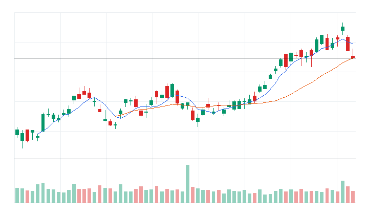
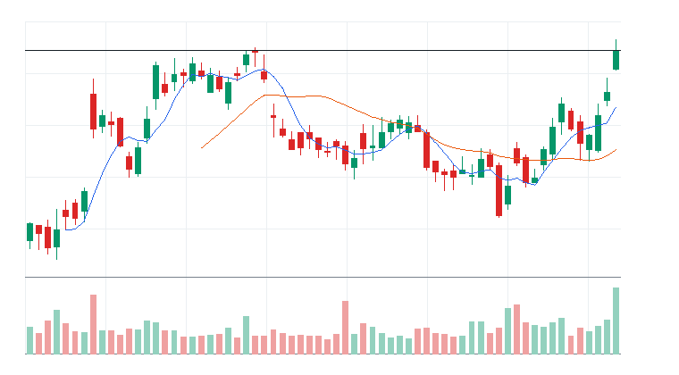
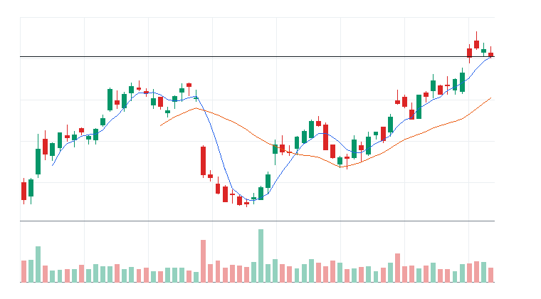
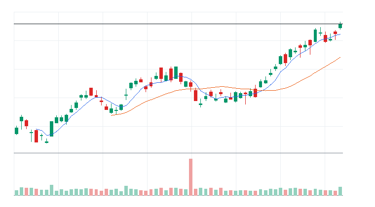
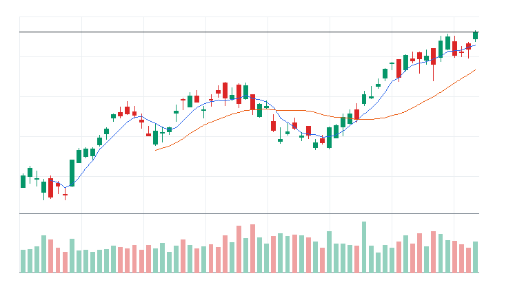
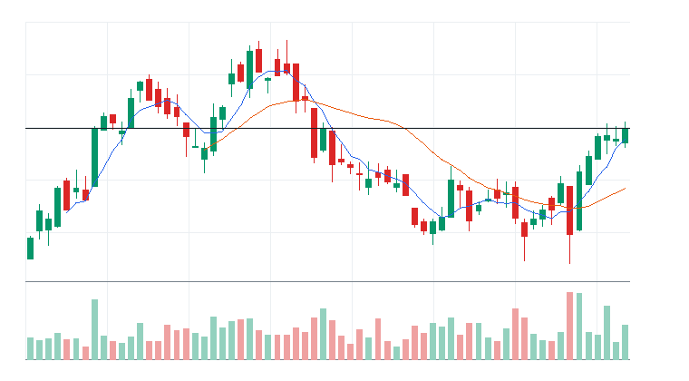
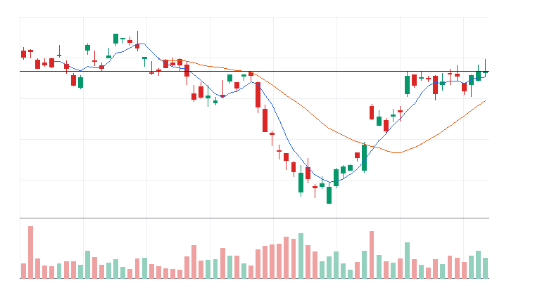
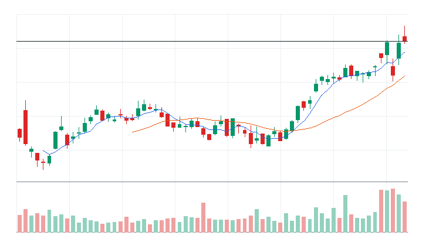

# 오늘의 데일리 트레이딩 요약

**REAL DATA TEST - 가격/거래량은 실제 데이터, 뉴스/ETF 구성종목 확산도/거래대금 유동성 일부 연결**

**목적:** 이 리포트는 최근 오른 자산을 나열하는 것이 아니라, 돈이 몰리는 근거와 다음 매수 주체가 확인할 트레이딩 후보를 찾기 위한 보고서다.

> 핵심 질문: 현재 가격에서 누가 사고 있고, 누가 앞으로 더 비싸게 사줄 수 있는가?

## 시장 국면 판단

- 최종 판정: 중립 (54점)
- 전일 대비: 기간 조정에서 중립으로 악화됐다(-16점).
- 판정 신뢰도: 높음 (100점) - 핵심 지수와 매크로 데이터가 대부분 직접 수집되어 판정 신뢰도가 높다.
- 행동 바이어스: 강한 테마만 선별, 신규 추격 제한
- 한 줄 결론: 기술 점수 57, 매크로 점수 48로 방향성이 엇갈린다. 후보별 게이트를 더 엄격히 본다.
- 기술적 지표: 상승 추세 유지 (57점, 가중치 65%)
- S&P 500: 65점 | 50일선 아래, 200일선 위, 20일 -1.85%, 60일 -2.00%, 52주 고점 대비 -3.37% -> 기술 점수 65
- Nasdaq 100: 49점 | 50일선 아래, 200일선 위, 20일 -7.87%, 60일 -3.00%, 52주 고점 대비 -9.49% -> 기술 점수 49
- 매크로 시황: 매크로 중립 (48점, 가중치 35%)
- 매크로 요약: 금리은 우호적이나 신용/유동성 부담이 남아 있다.
- 금리: 중립-우호 57점 / 금리 중립 / confidence HIGH
  - 주요 근거: US 10Y yield 20일 -6.59%, 5일 -1.18%; US 3M yield 20일 -0.50%, 단기금리 방향 확인; US long-duration bonds 20일 +5.63%, 장기채 가격 기준 할인율 부담 확인
  - 확인 사항: 금리 하락이 경기 둔화형 안전자산 선호일 수 있어 단순 우호로 보기 어렵다.
- 물가: 중립 45점 / 물가 중립 / confidence HIGH
  - 주요 근거: Oil ETF 20일 +14.56%, 유가 기반 물가 압력 확인; TIPS ETF 20일 +2.48%, 물가연동채 흐름은 보조 근거; Gold 20일 -6.41%, 금 강세는 방어 수요 여부 확인
  - 확인 사항: 추가 확인 이벤트 없음
- 정책: 중립 50점 / 정책 이벤트 확인 전 중립 / confidence LOW
  - 주요 근거: 정책 톤은 1차 버전에서 일정/이벤트 리스크 기반 중립값으로 반영한다.
  - 확인 사항: FOMC, CPI, PCE, 고용지표 발표 전후에는 매크로 confidence를 보수적으로 해석한다.
- 신용/유동성: 부담 36점 / 신용/유동성 부담 / confidence HIGH
  - 주요 근거: High yield credit 20일 +0.68%, 하이일드 위험선호 확인; HYG-LQD 20일 상대강도 -1.72%, 신용위험 선호/회피 확인; VIX 20일 +26.85%, 변동성 부담 확인
  - 확인 사항: VIX 상승은 유동성/리스크 프리미엄 부담으로 해석한다.
- 환율/글로벌: 중립 49점 / 환율/글로벌 중립 / confidence MEDIUM
  - 주요 근거: US dollar 20일 +0.38%, 달러 강세/약세 확인
  - 확인 사항: 추가 확인 이벤트 없음
- US 10Y yield: 61점 | 하락 시 주식 우호; 5일 -1.18%, 20일 -6.59% -> 매크로 점수 61
- US 3M yield: 52점 | 하락 시 주식 우호; 5일 -1.46%, 20일 -0.50% -> 매크로 점수 52
- US long-duration bonds: 59점 | 상승 시 주식 우호; 5일 +0.61%, 20일 +5.63% -> 매크로 점수 59
- TIPS ETF: 50점 | 상승 시 주식 우호; 5일 +0.42%, 20일 +2.48% -> 매크로 점수 50
- Oil ETF: 27점 | 하락 시 주식 우호; 5일 -0.41%, 20일 +14.56% -> 매크로 점수 27
- Gold: 50점 | 상승 시 주식 우호; 5일 -2.95%, 20일 -6.41% -> 매크로 점수 50
- US dollar: 49점 | 하락 시 주식 우호; 5일 +0.14%, 20일 +0.38% -> 매크로 점수 49
- High yield credit: 51점 | 상승 시 주식 우호; 5일 +0.49%, 20일 +0.68% -> 매크로 점수 51
- Investment grade credit: 50점 | 상승 시 주식 우호; 5일 +0.40%, 20일 +2.40% -> 매크로 점수 50
- VIX: 7점 | 하락 시 주식 우호; 5일 -0.15%, 20일 +26.85% -> 매크로 점수 7
- 데이터 커버리지: 기술 2/2, 매크로 10/10
- 데이터 신뢰도 근거:
  - 직접 지수 데이터: S&P 500, Nasdaq 100
  - 대체 지수 데이터 없음
  - 매크로 데이터: 10/10
  - 누락 데이터 없음
  - stale 데이터 없음

## 모바일 요약

[오늘의 데일리 트레이딩 요약]

생성 성공 / 데이터 모드: REAL_TEST

시장:
- 위험회피

시장 지배 서사:
1. Integrated Oil & Gas 자금 유입 - 지배 - Energy Select Sector SPDR Fund(XLE), VanEck Oil Services ETF(OIH), Exxon Mobil(XOM), Chevron(CVX) 중심으로 5일 +1.95%, 20일 +11.78% 흐름이 형성됨. 직접 촉매 일부 확인.
2. 매크로 방어/헤지 - 부상 - Energy Select Sector SPDR Fund(XLE), VanEck Oil Services ETF(OIH), Exxon Mobil(XOM), Chevron(CVX) 중심으로 5일 +0.91%, 20일 +7.72% 흐름이 형성됨. 직접 촉매 일부 확인.
3. 필수소비재 음료 방어 성장 - 약화 - Invesco QQQ Trust(QQQ), Coca-Cola Europacific Partners PLC(CCEP), Monster Beverage Corporation(MNST) 중심으로 5일 +0.89%, 20일 +4.80% 흐름이 형성됨. 뉴스 직접성 제한.

트렌드 강도:
1. Integrated Oil & Gas 자금 유입 - TSI 65 - 부상 - 진입품질 관찰
2. 매크로 방어/헤지 - TSI 57 - 부상 - 진입품질 관찰
3. 필수소비재 음료 방어 성장 - TSI 37 - 잠복 - 진입품질 낮음

오늘 결론:
- Energy 개별 종목 흐름이 ETF 대비 강한지 확인 필요
- 행동 후보는 linkedNarrative와 함께 확인한다.
- 추격보다 진입 조건 확인 후 접근한다.

오늘 실제 행동 후보:
1. Exxon Mobil(XOM)(STOCK) - Integrated Oil & Gas 자금 유입 - 52주 고점 부근이라 돌파가 확인되면 신고가 추종 매수가 붙을 수 있음
2. Vertex Pharmaceuticals Incorporated(VRTX)(STOCK) - 필수소비재 음료 방어 성장 - 52주 고점 부근이라 돌파가 확인되면 신고가 추종 매수가 붙을 수 있음
3. Amgen Inc.(AMGN)(STOCK) - 필수소비재 음료 방어 성장 - 52주 고점 부근이라 돌파가 확인되면 신고가 추종 매수가 붙을 수 있음

다크호스 후보:
1. Chevron(CVX) - darkHorseScore 84 - 베이스 돌파 확인

ETF 후보 TOP 5:
1. Energy Select Sector SPDR Fund(XLE) - Integrated Oil & Gas 자금 유입 - 관찰
2. VanEck Oil Services ETF(OIH) - Integrated Oil & Gas 자금 유입 - 관찰
3. iShares 20+ Year Treasury Bond ETF(TLT) - 매크로 방어/헤지 - 제외
4. iShares U.S. Aerospace & Defense ETF(ITA) - 방산/안보 프리미엄 - 제외
5. Utilities Select Sector SPDR Fund(XLU) - 전력망/원전/인프라 병목 - 제외

웹 리포트:
https://yoolcool.github.io/DailyTradingThesisAgent/

## 오늘 결론

- 오늘 결론: 매매 보류
- 신규 진입 후보: 0개
- 조건부 진입 후보: 5개
- 관찰 후보: 26개
- 주요 제한 요인: Entry Quality < 40, 뉴스 직접성 부족, ETF breadth 샘플 부족
- 주문 판단: 시장가 금지 / 지정가 또는 관찰
- 실전 판단: 진입 후보는 있으나, 전일 고점 돌파와 거래량 확인 후 선별적으로 접근한다.

### 후보 제한 요인 집계

- RVOL < 1.00x: 23개
- 거래대금 유동성 낮음: 12개
- Entry Quality 50~54 near miss: 0개
- Entry Quality 40~49 관찰: 4개
- Entry Quality < 40: 151개
- Exhaustion Risk >= 70: 0개
- ETF breadth 샘플 부족: 37개
- 뉴스 직접성 부족: 98개

## 데이터 신뢰도

- 전체 데이터 신뢰도 등급: LOW
- 분석 신뢰도: LOW
- 주문 실행 신뢰도: LOW
- ETF breadth 신뢰도: LOW
- 신뢰도 해석: 테마 확산 판단 제한, 거래대금 유동성 낮음 또는 확인 불가, 프리/애프터마켓 확인 불가
- 리포트 생성 시각: 2026-11-02 11:09 KST
- 가격 기준 거래일: 2026-10-30 US regular close
- 뉴스 수집 시각: 2026-11-02 11:09 KST
- 가장 최근 뉴스 발행 시각: 2026-11-02 09:22 KST
- 뉴스 신선도 상태: FRESH
- 뉴스 소스: Yahoo Finance RSS, MarketWatch RSS, CNBC Markets RSS, SEC EDGAR RSS, Federal Reserve RSS, Finnhub API
- 뉴스 소스 상태: Yahoo Finance RSS CONNECTED, MarketWatch RSS CONNECTED, CNBC Markets RSS PARTIAL, SEC EDGAR RSS PARTIAL, Federal Reserve RSS CONNECTED, Finnhub API DISABLED
- 뉴스 신뢰도: MEDIUM
- 추천 적용 거래일: 2026-11-01 US regular session
- 가격/거래량 데이터 상태: 일부 연결
- 뉴스 데이터 상태: 일부 연결
- ETF 구성종목 확산도 상태: 일부 연결
- ETF 구성종목 샘플 수: 1~4
- 거래대금 유동성 데이터 상태: 일부 연결
- 프리/애프터마켓 데이터 상태: UNAVAILABLE
- 데이터 provider: yfinance, Yahoo Finance RSS, MarketWatch RSS, CNBC Markets RSS, SEC EDGAR RSS, Federal Reserve RSS, Finnhub API, config fallback sample, price-volume dollar-volume fallback
- 실전 사용 경고: 이 리포트는 투자판단 보조용이며, REAL_TEST 모드에서는 일부 데이터가 누락되거나 지연될 수 있다. 실제 주문 전 현재가, 뉴스, 프리마켓/정규장 거래량을 별도 확인해야 한다.

## 0. 시장 상태

- 데이터 모드: REAL_TEST
- 가격/거래량: 일부 연결
- 뉴스: 일부 연결
- ETF 구성종목 확산도: 일부 연결
- 거래대금 유동성: 일부 연결
- 생성 시각: 2026년 11월 2일 월요일 AM 11:09
- 시장 상태: 위험회피
- 오늘 돈의 방향: Energy 개별 종목 흐름이 ETF 대비 강한지 확인 필요
- 강한 테마 TOP 3: 전통 에너지 ETF(68), 필수소비재(63), 전력/유틸리티 ETF(61)
- 데이터 한계:
  - API 또는 provider 상태에 따라 뉴스/ETF 확산도/거래대금 유동성 반영 범위가 달라질 수 있다.
  - 수집 실패 데이터는 점수 반영에서 제외하거나 confidence를 제한한다.
  - reasonConfidence HIGH는 직접 촉매, 가격/거래량, 확산도/유동성 근거가 함께 있을 때만 사용한다.

## 오늘 시장을 지배하는 서사

### 오늘 시장을 지배하는 서사 TOP 3

#### 1. Integrated Oil & Gas 자금 유입
- 상태: 지배
- narrativeScore: 89
- reasonConfidence: MEDIUM
- 근거 ETF: XLE, OIH
- 근거 개별 종목: XOM, CVX
- 돈이 몰리는 이유: Integrated Oil & Gas 자금 유입 관련 Energy Select Sector SPDR Fund(XLE), VanEck Oil Services ETF(OIH)와 Exxon Mobil(XOM), Chevron(CVX)의 5일(+1.95%)·20일(+11.78%) 흐름을 함께 본다. 평균 상대 거래량은 1.33배이고, ETF 확산도는 추가 확인이 필요하다. 직접 뉴스/이벤트가 일부 확인된다.
- 다음 매수 주체: Integrated Oil & Gas 자금 유입을 확인한 섹터 ETF 자금과 상대강도 추종 스윙 자금
- 가장 좋은 트레이딩 수단: ETF 우선: XLE, OIH / 개별 종목 우선: XOM, CVX
- 서사가 깨지는 조건: XLE 20일선 이탈 또는 관련 종목 절반 이상 5일선 이탈
- 오늘 행동: 기존 네러티브와 중복을 확인한 뒤 ETF/대표 종목 동조성이 살아날 때만 관찰 편입

상세 narrativeScore 근거 보기

- rawScore: 89
- ETF 평균 moneyFlowScore: 68
- 개별 종목 평균 moneyFlowScore: 83
- ETF 후보 비율: 100%
- 개별 종목 후보 비율: 100%
- 5일 평균 수익률: +2.00%
- 20일 평균 수익률: +12.00%
- 평균 상대 거래량: 1.00배
- ETF 평균 상대 거래량: 1.00배
- 개별주 평균 상대 거래량: 2.00배
- 52주 고점 근접 후보 비율: 75%
- 뉴스 직접성 점수: 11
- ETF 확산도 점수: 0
- 유동성 점수: 4
- 과열 리스크 차감: 0

#### 2. 매크로 방어/헤지
- 상태: 부상
- narrativeScore: 72
- reasonConfidence: MEDIUM
- 근거 ETF: XLE, OIH, TLT, GLD
- 근거 개별 종목: XOM, CVX
- 돈이 몰리는 이유: 매크로 방어/헤지 관련 Energy Select Sector SPDR Fund(XLE), VanEck Oil Services ETF(OIH), iShares 20+ Year Treasury Bond ETF(TLT)와 Exxon Mobil(XOM), Chevron(CVX)의 5일(+0.91%)·20일(+7.72%) 흐름을 함께 본다. 평균 상대 거래량은 1.39배이고, ETF 확산도는 추가 확인이 필요하다. 직접 뉴스/이벤트가 일부 확인된다.
- 다음 매수 주체: 금리/에너지/방어 헤지를 찾는 매크로 자금
- 가장 좋은 트레이딩 수단: ETF 우선: GLD, TLT, XLE / 개별 종목 우선: XOM, CVX
- 서사가 깨지는 조건: 방어 ETF 상대강도 둔화와 위험선호 성장주 재강세
- 오늘 행동: 위험회피가 확인될 때만 헤지성 접근

상세 narrativeScore 근거 보기

- rawScore: 72
- ETF 평균 moneyFlowScore: 48
- 개별 종목 평균 moneyFlowScore: 83
- ETF 후보 비율: 50%
- 개별 종목 후보 비율: 100%
- 5일 평균 수익률: +1.00%
- 20일 평균 수익률: +8.00%
- 평균 상대 거래량: 1.00배
- ETF 평균 상대 거래량: 1.00배
- 개별주 평균 상대 거래량: 2.00배
- 52주 고점 근접 후보 비율: 50%
- 뉴스 직접성 점수: 10
- ETF 확산도 점수: 0
- 유동성 점수: 5
- 과열 리스크 차감: 0

#### 3. 필수소비재 음료 방어 성장
- 상태: 약화
- narrativeScore: 36
- reasonConfidence: LOW
- 근거 ETF: QQQ
- 근거 개별 종목: CCEP, MNST
- 돈이 몰리는 이유: 필수소비재 음료 방어 성장 관련 Invesco QQQ Trust(QQQ)와 Coca-Cola Europacific Partners PLC(CCEP), Monster Beverage Corporation(MNST)의 5일(+0.89%)·20일(+4.80%) 흐름을 함께 본다. 평균 상대 거래량은 1.70배이고, ETF 확산도는 추가 확인이 필요하다. 뉴스 직접성은 아직 제한적이다.
- 다음 매수 주체: 필수소비재 음료 방어 성장을 확인한 섹터 ETF 자금과 상대강도 추종 스윙 자금
- 가장 좋은 트레이딩 수단: ETF 우선: QQQ / 개별 종목 우선: CCEP, MNST
- 서사가 깨지는 조건: QQQ 20일선 이탈 또는 관련 종목 절반 이상 5일선 이탈
- 오늘 행동: 기존 네러티브와 중복을 확인한 뒤 ETF/대표 종목 동조성이 살아날 때만 관찰 편입

상세 narrativeScore 근거 보기

- rawScore: 36
- ETF 평균 moneyFlowScore: 0
- 개별 종목 평균 moneyFlowScore: 64
- ETF 후보 비율: 0%
- 개별 종목 후보 비율: 50%
- 5일 평균 수익률: +1.00%
- 20일 평균 수익률: +5.00%
- 평균 상대 거래량: 2.00배
- ETF 평균 상대 거래량: 2.00배
- 개별주 평균 상대 거래량: 1.00배
- 52주 고점 근접 후보 비율: 33%
- 뉴스 직접성 점수: 5
- ETF 확산도 점수: -4
- 유동성 점수: 2
- 과열 리스크 차감: 0

### 전체 narrative 요약

| 서사명 | 상태 | narrativeScore | reasonConfidence | 대표 ETF | 대표 종목 | 오늘 행동 |
| --- | --- | ---: | --- | --- | --- | --- |
| Integrated Oil & Gas 자금 유입 | 지배 | 89 | MEDIUM | XLE, OIH | XOM, CVX | 기존 네러티브와 중복을 확인한 뒤 ETF/대표 종목 동조성이 살아날 때만 관찰 편입 |
| 매크로 방어/헤지 | 부상 | 72 | MEDIUM | XLE, OIH, TLT | XOM, CVX | 위험회피가 확인될 때만 헤지성 접근 |
| 필수소비재 음료 방어 성장 | 약화 | 36 | LOW | QQQ | CCEP, MNST | 기존 네러티브와 중복을 확인한 뒤 ETF/대표 종목 동조성이 살아날 때만 관찰 편입 |
| Discount Stores 자금 유입 | 약화 | 36 | LOW | QQQ | WMT, COST | 기존 네러티브와 중복을 확인한 뒤 ETF/대표 종목 동조성이 살아날 때만 관찰 편입 |
| 바이오/헬스케어 촉매 | 소멸 | 28 | LOW | QQQ | GILD, ALNY | 기존 네러티브와 중복을 확인한 뒤 ETF/대표 종목 동조성이 살아날 때만 관찰 편입 |
| Specialty Business Services 자금 유입 | 약화 | 24 | LOW | SPY, IWM, QQQ | TRI, CTAS | 기존 네러티브와 중복을 확인한 뒤 ETF/대표 종목 동조성이 살아날 때만 관찰 편입 |
| Aerospace & Defense 자금 유입 | 약화 | 20 | LOW | SPY, IWM, QQQ | LMT, RTX, NOC, KTOS | 기존 네러티브와 중복을 확인한 뒤 ETF/대표 종목 동조성이 살아날 때만 관찰 편입 |
| Staffing & Employment 자금 유입 | 약화 | 20 | LOW | SPY, IWM, QQQ | ADP, PAYX | 기존 네러티브와 중복을 확인한 뒤 ETF/대표 종목 동조성이 살아날 때만 관찰 편입 |
| 방산/안보 프리미엄 | 약화 | 17 | LOW | ITA, SHLD, XAR | LMT, RTX, AVAV, KTOS | 뉴스 촉매가 직접 확인될 때만 추세 추종 |
| Medical Devices 자금 유입 | 약화 | 11 | LOW | QQQ | DXCM, ISRG | 기존 네러티브와 중복을 확인한 뒤 ETF/대표 종목 동조성이 살아날 때만 관찰 편입 |
| 전력 유틸리티 수요 재평가 | 소멸 | 9 | LOW | SPY, IWM, QQQ | VRT, ETN, GEV | 기존 네러티브와 중복을 확인한 뒤 ETF/대표 종목 동조성이 살아날 때만 관찰 편입 |
| 전력망/원전/인프라 병목 | 소멸 | 7 | LOW | XLU, PAVE, GRID | VRT, PWR, ETN, CEG | ETF 확산도와 거래량이 같이 살아날 때만 진입 |
| 반도체 설계/공급망 재가속 | 소멸 | 4 | LOW | SMH, SOXX, SOXQ | NXPI, TSM, NVDA, AMD | 기존 네러티브와 중복을 확인한 뒤 ETF/대표 종목 동조성이 살아날 때만 관찰 편입 |
| 소프트웨어 실적/AI 수익화 | 소멸 | 4 | LOW | IGV, AIQ, QQQ | MSFT, SHOP | 기존 네러티브와 중복을 확인한 뒤 ETF/대표 종목 동조성이 살아날 때만 관찰 편입 |
| Data Storage 자금 유입 | 소멸 | 4 | LOW | SPY, IWM, QQQ | STX, WDC | 기존 네러티브와 중복을 확인한 뒤 ETF/대표 종목 동조성이 살아날 때만 관찰 편입 |
| 소비 회복/방어주 선별 | 약화 | 4 | LOW | QQQ | PDD, AMZN | 기존 네러티브와 중복을 확인한 뒤 ETF/대표 종목 동조성이 살아날 때만 관찰 편입 |
| 위험선호 성장주 재진입 | 소멸 | 3 | LOW | QQQ, IPO, ARKK | TSLA, ARM, COIN | 지수 위험선호가 유지될 때만 선별 진입 |
| AI 인프라 재가속 | 소멸 | 0 | LOW | SMH, SOXX, DRAM | VRT, NVDA, MU, ETN | 추격보다 5일선 지지 후 재상승 확인 |
| AI 소프트웨어/사이버보안 확산 | 약화 | 0 | LOW | IGV, AIQ, QQQ | MSFT, PLTR, DDOG, TEAM | 추격보다 눌림 후 재상승 확인 |
| Travel Services 자금 유입 | 소멸 | 0 | LOW | QQQ | BKNG, ABNB | 기존 네러티브와 중복을 확인한 뒤 ETF/대표 종목 동조성이 살아날 때만 관찰 편입 |
| 반도체 장비 사이클 재평가 | 소멸 | 0 | LOW | SMH, SOXX, SOXQ | ASML, LRCX | 기존 네러티브와 중복을 확인한 뒤 ETF/대표 종목 동조성이 살아날 때만 관찰 편입 |
| 사이버보안 지출 재가속 | 약화 | 0 | LOW | IHAK, HACK, CIBR | ZS, FTNT, PANW, CRWD | 기존 네러티브와 중복을 확인한 뒤 ETF/대표 종목 동조성이 살아날 때만 관찰 편입 |
| Internet Content 자금 유입 | 소멸 | 0 | LOW | QQQ | META, GOOGL, GOOG | 기존 네러티브와 중복을 확인한 뒤 ETF/대표 종목 동조성이 살아날 때만 관찰 편입 |
| Bitcoin Mining 자금 유입 | 소멸 | 0 | LOW | IBIT, BLOK | RIOT, MARA, CIFR | 기존 네러티브와 중복을 확인한 뒤 ETF/대표 종목 동조성이 살아날 때만 관찰 편입 |
| 비트코인/디지털 자산 위험선호 | 소멸 | 0 | LOW | IBIT, BLOK | MSTR, COIN, IREN | 비트코인 베타가 살아날 때만 단기 매매 |

## 트렌드 강도 판단

### 1. Integrated Oil & Gas 자금 유입
- Trend Strength Index: 65
- 트렌드 상태 라벨: 부상
- 테마 확산도: 보통
- ETF 동조성: 강함
- 거래량 강도: 보통
- 과열 위험: 보통 (25)
- 오늘 진입 품질: 관찰 (47)
- 한 줄 판단: Integrated Oil & Gas 자금 유입는 Trend Strength는 중간이지만 진입 품질이 살아나는 초기 진입 후보 성격이다.
- 오늘 접근법: Energy Select Sector SPDR Fund(XLE)/VanEck Oil Services ETF(OIH) 거래량 증가와 Exxon Mobil(XOM)/Chevron(CVX) 확산을 확인하며 작은 사이즈의 초기 진입 후보로만 본다.

트렌드 강도 상세 근거 보기

- 가격 모멘텀: 가격 모멘텀 14/25. 평균 5D +1.95%, 20D +11.78%.
- 거래량 강도: 거래량 강도 13/20. 평균 RVOL 1.33배.
- ETF 동조성: ETF 동조성 15/15. 관련 ETF Energy Select Sector SPDR Fund(XLE), VanEck Oil Services ETF(OIH) 흐름을 기준으로 판단.
- 테마 확산도: 테마 확산도 14/20. 상위 1~2개 쏠림 감점 3점 반영.
- 뉴스 촉매: 뉴스/촉매 신선도 5/10. HIGH 직접 촉매 2개.
- 과열 리스크: 과열 리스크 25/100. 단기 급등, 고점 근접, ETF-개별주 괴리, 쏠림을 함께 반영.
- 시장 환경: 시장 환경 4/10. QQQ/SPY/IWM 가격 흐름 기반 위험선호 점수.

### 2. 매크로 방어/헤지
- Trend Strength Index: 57
- 트렌드 상태 라벨: 부상
- 테마 확산도: 보통
- ETF 동조성: 강함
- 거래량 강도: 보통
- 과열 위험: 낮음 (12)
- 오늘 진입 품질: 관찰 (45)
- 한 줄 판단: 매크로 방어/헤지는 Trend Strength는 중간이지만 진입 품질이 살아나는 초기 진입 후보 성격이다.
- 오늘 접근법: Energy Select Sector SPDR Fund(XLE)/VanEck Oil Services ETF(OIH)/iShares 20+ Year Treasury Bond ETF(TLT) 거래량 증가와 Exxon Mobil(XOM)/Chevron(CVX) 확산을 확인하며 작은 사이즈의 초기 진입 후보로만 본다.

트렌드 강도 상세 근거 보기

- 가격 모멘텀: 가격 모멘텀 9/25. 평균 5D +0.91%, 20D +7.72%.
- 거래량 강도: 거래량 강도 13/20. 평균 RVOL 1.39배.
- ETF 동조성: ETF 동조성 12/15. 관련 ETF SPDR Gold Shares(GLD), iShares 20+ Year Treasury Bond ETF(TLT), Energy Select Sector SPDR Fund(XLE), VanEck Oil Services ETF(OIH) 흐름을 기준으로 판단.
- 테마 확산도: 테마 확산도 14/20. 상위 1~2개 쏠림 감점 0점 반영.
- 뉴스 촉매: 뉴스/촉매 신선도 5/10. HIGH 직접 촉매 2개.
- 과열 리스크: 과열 리스크 12/100. 단기 급등, 고점 근접, ETF-개별주 괴리, 쏠림을 함께 반영.
- 시장 환경: 시장 환경 4/10. QQQ/SPY/IWM 가격 흐름 기반 위험선호 점수.

### 3. 필수소비재 음료 방어 성장
- Trend Strength Index: 37
- 트렌드 상태 라벨: 잠복
- 테마 확산도: 약함
- ETF 동조성: 부족
- 거래량 강도: 강함
- 과열 위험: 보통 (31)
- 오늘 진입 품질: 낮음 (19)
- 한 줄 판단: 필수소비재 음료 방어 성장는 ETF 동조성이 약해 테마 자금 확인이 부족하다.
- 오늘 접근법: Invesco QQQ Trust(QQQ)와 Coca-Cola Europacific Partners PLC(CCEP)/Monster Beverage Corporation(MNST)의 거래량 확산이 확인되기 전까지 관찰한다.

트렌드 강도 상세 근거 보기

- 가격 모멘텀: 가격 모멘텀 7/25. 평균 5D +0.89%, 20D +4.80%.
- 거래량 강도: 거래량 강도 17/20. 평균 RVOL 1.70배.
- ETF 동조성: ETF 동조성 0/15. 관련 ETF Invesco QQQ Trust(QQQ) 흐름을 기준으로 판단.
- 테마 확산도: 테마 확산도 7/20. 상위 1~2개 쏠림 감점 6점 반영.
- 뉴스 촉매: 뉴스/촉매 신선도 2/10. HIGH 직접 촉매 0개.
- 과열 리스크: 과열 리스크 31/100. 단기 급등, 고점 근접, ETF-개별주 괴리, 쏠림을 함께 반영.
- 시장 환경: 시장 환경 4/10. QQQ/SPY/IWM 가격 흐름 기반 위험선호 점수.

## 최근 추천 결과 트래킹

개별주는 데이트레이딩 관점으로 추천 이후 첫 정규장의 장중 최고가와 종가를 추적한다. ETF는 테마/스윙 관점으로 추천 이후 1주일 동안의 최고가와 현재 종가를 추적한다.

### 개별주 Top 3 추천 성과 요약
- 최근 5개 리포트 표본: 15개 (초기 검증 단계)
- 장중 최고가 기준 성공률: +8.33%
- 종가 기준 성공률: +33.33%
- 평균 장중 최고 수익률: +1.81%
- 평균 종가 수익률: +0.18%

### ETF 추천 성과 요약
- 최근 5개 리포트 표본: 2개 (초기 검증 단계)
- 1주 최고가 기준 성공률: +50.00%
- 현재 종가 기준 성공률: 0.00%
- 평균 1주 최고 수익률: +3.49%
- 평균 현재 수익률: -2.04%

최근 추천 결과 상세 테이블 펼치기

| 추천일 | 유형 | 순위 | 티커 | 기준가 | 추적 기간 | 상태 | High 수익률 | Close 수익률 | 결과 | 코멘트 |
| --- | --- | ---: | --- | ---: | --- | --- | ---: | ---: | --- | --- |
| 2026-11-02 | STOCK | 3 | AMGN | $466.01 | 2026-11-02 | pending | 데이터 없음 | 데이터 없음 | 추적 대기 | 아직 추적 거래일 데이터가 완성되지 않음 |
| 2026-11-02 | STOCK | 2 | VRTX | $558.88 | 2026-11-02 | pending | 데이터 없음 | 데이터 없음 | 추적 대기 | 아직 추적 거래일 데이터가 완성되지 않음 |
| 2026-11-02 | STOCK | 1 | XOM | $187.25 | 2026-11-02 | pending | 데이터 없음 | 데이터 없음 | 추적 대기 | 아직 추적 거래일 데이터가 완성되지 않음 |
| 2026-10-30 | STOCK | 3 | FER | $56.92 | 2026-10-30 | complete | -0.09% | -2.86% | 실패 | 추천 이후 의미 있는 장중 기회가 부족하고 종가도 약함 (일봉 기준) |
| 2026-10-30 | STOCK | 2 | RTX | $199.4 | 2026-10-30 | complete | +2.41% | +0.20% | 제한적 유효 | 제한적인 장중 기회만 발생 (일봉 기준) |
| 2026-10-30 | STOCK | 1 | LMT | $643.59 | 2026-10-30 | complete | +2.08% | -1.03% | 제한적 유효 | 제한적인 장중 기회만 발생 (일봉 기준) |
| 2026-10-29 | STOCK | 3 | GEHC | $75.82 | 2026-10-29 | complete | +1.99% | +0.79% | 제한적 유효 | 제한적인 장중 기회만 발생 (일봉 기준) |
| 2026-10-29 | STOCK | 2 | LMT | $629.75 | 2026-10-29 | complete | +3.06% | +2.20% | 성공 | 장중 기회와 종가 유지가 모두 확인됨 (일봉 기준) |
| 2026-10-29 | STOCK | 1 | ROP | $440.66 | 2026-10-29 | complete | +2.17% | +2.04% | 제한적 유효 | 제한적인 장중 기회만 발생 (일봉 기준) |
| 2026-10-27 | STOCK | 3 | LMT | $635.2 | 2026-10-27 | complete | -0.26% | -1.92% | 실패 | 추천 이후 의미 있는 장중 기회가 부족하고 종가도 약함 (일봉 기준) |
| 2026-10-27 | STOCK | 2 | ROP | $441.65 | 2026-10-27 | complete | -0.52% | -1.62% | 실패 | 추천 이후 의미 있는 장중 기회가 부족하고 종가도 약함 (일봉 기준) |
| 2026-10-27 | STOCK | 1 | ZS | $260.45 | 2026-10-27 | complete | +2.85% | -0.12% | 제한적 유효 | 제한적인 장중 기회만 발생 (일봉 기준) |
| 2026-10-27 | ETF | 1 | IHAK | $76.25 | 2026-10-27~2026-11-03 | in_progress | +1.94% | -3.51% | 진행 중 | 아직 1주 추적 기간이 끝나지 않음 |
| 2026-10-26 | STOCK | 3 | CRWD | $257.57 | 2026-10-26 | complete | +2.65% | +1.65% | 제한적 유효 | 제한적인 장중 기회만 발생 (일봉 기준) |
| 2026-10-26 | STOCK | 2 | ROP | $438.14 | 2026-10-26 | complete | +2.88% | +0.80% | 제한적 유효 | 제한적인 장중 기회만 발생 (일봉 기준) |
| 2026-10-26 | STOCK | 1 | ZS | $255.15 | 2026-10-26 | complete | +2.47% | +2.08% | 제한적 유효 | 제한적인 장중 기회만 발생 (일봉 기준) |
| 2026-10-26 | ETF | 1 | IHAK | $74 | 2026-10-26~2026-11-02 | in_progress | +5.04% | -0.58% | 진행 중 | 아직 1주 추적 기간이 끝나지 않음 |
| 2026-10-23 | STOCK | 3 | ADP | $294.5 | 2026-10-23 | complete | +5.06% | +3.28% | 성공 | 장중 기회와 종가 유지가 모두 확인됨 (일봉 기준) |
| 2026-10-23 | STOCK | 2 | CTAS | $220.15 | 2026-10-23 | complete | +2.56% | +1.79% | 제한적 유효 | 제한적인 장중 기회만 발생 (일봉 기준) |
| 2026-10-23 | STOCK | 1 | MAR | $404 | 2026-10-23 | complete | -1.77% | -3.29% | 실패 | 추천 이후 의미 있는 장중 기회가 부족하고 종가도 약함 (일봉 기준) |
| 2026-10-22 | STOCK | 3 | TRI | $112.82 | 2026-10-22 | complete | +9.70% | +9.25% | 성공 | 장중 기회와 종가 유지가 모두 확인됨 (일봉 기준) |
| 2026-10-22 | STOCK | 2 | MAR | $397.31 | 2026-10-22 | complete | +1.50% | -0.13% | 제한적 유효 | 제한적인 장중 기회만 발생 (일봉 기준) |
| 2026-10-22 | STOCK | 1 | NOC | $534 | 2026-10-22 | complete | +4.22% | +3.44% | 성공 | 장중 기회와 종가 유지가 모두 확인됨 (일봉 기준) |
| 2026-10-13 | STOCK | 2 | SHOP | $179.22 | 2026-10-13 | complete | -0.01% | -1.51% | 실패 | 추천 이후 의미 있는 장중 기회가 부족하고 종가도 약함 (일봉 기준) |
| 2026-10-13 | STOCK | 1 | PLTR | $209 | 2026-10-13 | complete | +0.90% | -0.16% | 실패 | 추천 이후 의미 있는 장중 기회가 부족하고 종가도 약함 (일봉 기준) |
| 2026-10-12 | STOCK | 3 | ZS | $233.73 | 2026-10-12 | complete | +1.49% | -3.40% | 제한적 유효 | 제한적인 장중 기회만 발생 (일봉 기준) |
| 2026-10-12 | STOCK | 2 | DDOG | $293.26 | 2026-10-12 | complete | +2.53% | -2.04% | 제한적 유효 | 제한적인 장중 기회만 발생 (일봉 기준) |
| 2026-10-12 | STOCK | 1 | PLTR | $209.05 | 2026-10-12 | complete | +1.86% | -0.02% | 제한적 유효 | 제한적인 장중 기회만 발생 (일봉 기준) |
| 2026-10-09 | STOCK | 2 | ZS | $216.81 | 2026-10-09 | complete | +8.07% | +7.80% | 성공 | 장중 기회와 종가 유지가 모두 확인됨 (일봉 기준) |
| 2026-10-09 | STOCK | 1 | PLTR | $198.78 | 2026-10-09 | complete | +5.43% | +5.17% | 성공 | 장중 기회와 종가 유지가 모두 확인됨 (일봉 기준) |
| 2026-10-08 | STOCK | 1 | ADSK | $235.05 | 2026-10-08 | complete | +0.40% | -0.62% | 실패 | 추천 이후 의미 있는 장중 기회가 부족하고 종가도 약함 (일봉 기준) |
| 2026-10-07 | STOCK | 3 | FTNT | $191.27 | 2026-10-07 | complete | +0.50% | -1.04% | 실패 | 추천 이후 의미 있는 장중 기회가 부족하고 종가도 약함 (일봉 기준) |
| 2026-10-07 | STOCK | 2 | AMD | $649.42 | 2026-10-07 | complete | -0.14% | -0.55% | 실패 | 추천 이후 의미 있는 장중 기회가 부족하고 종가도 약함 (일봉 기준) |
| 2026-10-07 | STOCK | 1 | SNPS | $505.17 | 2026-10-07 | complete | +0.86% | -0.49% | 실패 | 추천 이후 의미 있는 장중 기회가 부족하고 종가도 약함 (일봉 기준) |
| 2026-10-07 | ETF | 1 | CIBR | $108.13 | 2026-10-07~2026-10-14 | complete | +2.36% | -6.57% | 단기 고점 후 반납 | 1주 내 상승 기회는 있었지만 현재가는 반납 |
| 2026-10-06 | STOCK | 2 | TSM | $485.8 | 2026-10-06 | complete | +0.04% | -0.72% | 실패 | 추천 이후 의미 있는 장중 기회가 부족하고 종가도 약함 (일봉 기준) |
| 2026-10-06 | STOCK | 1 | SNPS | $488.47 | 2026-10-06 | complete | +3.90% | +3.42% | 성공 | 장중 기회와 종가 유지가 모두 확인됨 (일봉 기준) |
| 2026-10-06 | ETF | 1 | CIBR | $106.01 | 2026-10-06~2026-10-13 | complete | +4.41% | -4.70% | 단기 고점 후 반납 | 1주 내 상승 기회는 있었지만 현재가는 반납 |
| 2026-10-05 | STOCK | 1 | SNPS | $489.9 | 2026-10-05 | complete | +3.77% | -0.29% | 단타 유효 | 장중 기회는 있었지만 종가 유지력은 약함 (일봉 기준) |
| 2026-10-05 | ETF | 1 | SMH | $630.6 | 2026-10-05~2026-10-12 | complete | +1.41% | -17.14% | 실패 | 추천 이후 ETF 흐름이 약화됨 |
| 2026-09-30 | STOCK | 1 | AMAT | $512.01 | 2026-09-30 | complete | +0.67% | -0.12% | 실패 | 추천 이후 의미 있는 장중 기회가 부족하고 종가도 약함 (일봉 기준) |
| 2026-09-28 | STOCK | 3 | DDOG | $268.13 | 2026-09-28 | complete | +1.74% | +0.21% | 제한적 유효 | 제한적인 장중 기회만 발생 (일봉 기준) |
| 2026-09-28 | STOCK | 2 | ARM | $310.32 | 2026-09-28 | complete | -1.02% | -8.70% | 실패 | 추천 이후 의미 있는 장중 기회가 부족하고 종가도 약함 (일봉 기준) |
| 2026-09-28 | STOCK | 1 | QCOM | $201.97 | 2026-09-28 | complete | -1.39% | -7.17% | 실패 | 추천 이후 의미 있는 장중 기회가 부족하고 종가도 약함 (일봉 기준) |
| 2026-09-25 | STOCK | 3 | ARM | $332.56 | 2026-09-25 | complete | -2.13% | -6.69% | 실패 | 추천 이후 의미 있는 장중 기회가 부족하고 종가도 약함 (일봉 기준) |
| 2026-09-25 | STOCK | 2 | CRWD | $262.49 | 2026-09-25 | complete | -1.00% | -3.95% | 실패 | 추천 이후 의미 있는 장중 기회가 부족하고 종가도 약함 (일봉 기준) |
| 2026-09-25 | STOCK | 1 | PLTR | $191.79 | 2026-09-25 | complete | +1.26% | -1.11% | 제한적 유효 | 제한적인 장중 기회만 발생 (일봉 기준) |
| 2026-09-23 | STOCK | 3 | MARA | $13.28 | 2026-09-23 | complete | +2.79% | +0.53% | 제한적 유효 | 제한적인 장중 기회만 발생 (일봉 기준) |
| 2026-09-23 | STOCK | 2 | CIFR | $18.9 | 2026-09-23 | complete | +3.49% | -2.91% | 단타 유효 | 장중 기회는 있었지만 종가 유지력은 약함 (일봉 기준) |
| 2026-09-23 | STOCK | 1 | RIOT | $24.18 | 2026-09-23 | complete | +4.51% | +2.11% | 성공 | 장중 기회와 종가 유지가 모두 확인됨 (일봉 기준) |
| 2026-09-23 | ETF | 3 | ARKK | $90.72 | 2026-09-23~2026-09-30 | complete | +1.63% | -10.99% | 실패 | 추천 이후 ETF 흐름이 약화됨 |
| 2026-09-23 | ETF | 2 | MAGS | $72.97 | 2026-09-23~2026-09-30 | complete | -0.29% | -6.15% | 실패 | 추천 이후 ETF 흐름이 약화됨 |
| 2026-09-23 | ETF | 1 | SMH | $596.03 | 2026-09-23~2026-09-30 | complete | +2.89% | -12.34% | 단기 고점 후 반납 | 1주 내 상승 기회는 있었지만 현재가는 반납 |
| 2026-09-22 | STOCK | 3 | CRWD | $237.65 | 2026-09-22 | complete | +5.53% | +5.22% | 성공 | 장중 기회와 종가 유지가 모두 확인됨 (일봉 기준) |
| 2026-09-22 | STOCK | 2 | RIOT | $23.75 | 2026-09-22 | complete | +6.91% | +4.97% | 성공 | 장중 기회와 종가 유지가 모두 확인됨 (일봉 기준) |
| 2026-09-22 | STOCK | 1 | AMD | $559.82 | 2026-09-22 | complete | +11.56% | +11.42% | 성공 | 장중 기회와 종가 유지가 모두 확인됨 (일봉 기준) |
| 2026-09-21 | STOCK | 3 | CRWD | $237.65 | 2026-09-21 | complete | +5.33% | +4.92% | 성공 | 장중 기회와 종가 유지가 모두 확인됨 (일봉 기준) |
| 2026-09-21 | STOCK | 2 | RIOT | $23.75 | 2026-09-21 | complete | +5.55% | +1.81% | 성공 | 장중 기회와 종가 유지가 모두 확인됨 (일봉 기준) |
| 2026-09-21 | STOCK | 1 | AMD | $559.82 | 2026-09-21 | complete | +10.16% | +9.95% | 성공 | 장중 기회와 종가 유지가 모두 확인됨 (일봉 기준) |
| 2026-09-17 | STOCK | 3 | QCOM | $187.8 | 2026-09-17 | complete | +2.19% | +0.48% | 제한적 유효 | 제한적인 장중 기회만 발생 (일봉 기준) |

## 오늘 실제 행동 후보

### 1. Exxon Mobil(XOM)
- 자산 유형: STOCK
- linkedNarrative: Integrated Oil & Gas 자금 유입
- narrativeStatus: 지배
- narrativeScore: 89
- Trend Strength Index: 65
- Exhaustion Risk: 25 (보통)
- Entry Quality Score: 48 (관찰)
- 트렌드 판단: 시장 위험선호가 약해 시장 환경 비우호 구간이다.
- moneyFlowScore: 89
- finalRawScore: 89
- reasonConfidence: HIGH
- reasonConfidenceExplanation: 직접 촉매: Yahoo Finance RSS / earnings / under_72h / positive - ExxonMobil (XOM) Stock Can Q3 Earnings Justify Its Run Higher? 가격/거래량, 관련 ETF 동반 강세, 유동성 근거가 함께 확인되어 HIGH로 분류했다.
- tieBreakerReason: 최종 원점수 89, 리스크 패널티 0, 5일 수익률 +2.21%, 상대 거래량 1.82배 순으로 정렬
- 후보별 시장 해석: 위험회피 / 제한적 - 전체 시장은 위험회피 / 고점 근처 추격 리스크 / Entry Quality 48 < 50이나 moneyFlow 89, confidence HIGH, RVOL 1.82x로 강한 자금흐름 예외 조건 충족
- 게이트 사유: Entry Quality 48 < 50이나 moneyFlow 89, confidence HIGH, RVOL 1.82x로 강한 자금흐름 예외 조건 충족
- 주문 실행: 시장가 가능
- 직접 촉매: Yahoo Finance RSS / earnings / under_72h / positive - ExxonMobil (XOM) Stock Can Q3 Earnings Justify Its Run Higher?
- 왜 돈이 몰리는가: 20일 +14.17%, 5일 +2.21%, 상대 거래량 1.82배로 가격과 거래량이 함께 개선. 뉴스: Yahoo Finance RSS earnings/under_72h / 유동성: LIQUID
- 누가 더 비싸게 사줄 수 있는지: 개별 주도주를 따라붙는 단기 모멘텀 자금과 관련 ETF 강세를 확인한 트레이더
- 진입 조건: 전일 고점 돌파와 5일선 유지 확인
- 무효화 조건: 20일선 이탈 또는 상대 거래량 0.8배 이하 둔화
- todayActionLabel: 자금흐름 예외 조건부
#### 최근 뉴스/동향 한국어 요약

- 요약: 종목 직접 뉴스 확인 상태이며 뉴스 흐름은 긍정 우위입니다. 후보 선정 후 재확인한 핵심 이슈는 "ExxonMobil (XOM) Stock Can Q3 Earnings Justify Its Run Higher?"입니다.
- 직접 촉매 판단: Exxon Mobil에 대해 직접 촉매로 분류된 뉴스가 확인됐습니다. 핵심은 "ExxonMobil (XOM) Stock Can Q3 Earnings Justify Its Run Higher?"이며, 실적 재료로 봅니다.
- 뉴스 1: ExxonMobil (XOM) Stock Can Q3 Earnings Justify Its Run Higher?
  - 내용: Exxon Mobil 관련 기사는 ExxonMobil (XOM) Stock Can Q3 Earnings Justify Its Run Higher? 이슈를 다루며, 주가 변동률 +2.20%를 핵심 내용으로 봅니다.
  - 투자 의미: Exxon Mobil의 당일 상대강도 확인에는 도움이 되지만, 실적/가이던스 같은 새 펀더멘털 변화로 보기는 어렵습니다.
  - 확인할 점: 거래량 동반 여부, 장중 고점 유지, 관련 ETF 동반 강세
- 뉴스 2: What ExxonMobil (XOM) Said on Its Q3 Earnings Call
  - 내용: Exxon Mobil 관련 실적 뉴스입니다. 기사 스니펫상 핵심 내용은 ExxonMobil (NYSE:XOM) reported third-quarter GAAP earnings of $15.4 billion and cash flow from operations of $25.7 billion, as higher prices and constrained supplies for refined...입니다.
  - 투자 의미: 실적/가이던스 재료는 다음 분기 기대치 변화로 이어질 수 있어 컨센서스 변화와 주가 반응 지속성을 함께 봅니다.
  - 확인할 점: 매출/마진/가이던스 수치, 컨센서스 대비 차이
- 뉴스 3: ExxonMobil Q3 Earnings: 3 Key Takeaways for Long-Term Investors
  - 내용: Exxon Mobil 관련 실적 뉴스입니다. 기사 스니펫상 핵심 내용은 Refining upgrades and $20 billion in annual buybacks through 2027 show how capital discipline fuels shareholder returns across cycles.입니다.
  - 투자 의미: 실적/가이던스 재료는 다음 분기 기대치 변화로 이어질 수 있어 컨센서스 변화와 주가 반응 지속성을 함께 봅니다.
  - 확인할 점: 매출/마진/가이던스 수치, 컨센서스 대비 차이
- 매매 해석: 매매 관점에서는 뉴스 자체보다 가격이 진입 조건을 지키는지, 거래량이 동반되는지, 그리고 뉴스가 이미 주가에 반영됐는지를 우선 확인해야 합니다.
- 차트: 

### 2. Vertex Pharmaceuticals Incorporated(VRTX)
- 자산 유형: STOCK
- linkedNarrative: 필수소비재 음료 방어 성장
- narrativeStatus: 약화
- narrativeScore: 36
- Trend Strength Index: 37
- Exhaustion Risk: 31 (보통)
- Entry Quality Score: 36 (낮음)
- 트렌드 판단: ETF 동조성이 약해 테마 자금 확인이 부족하다.
- moneyFlowScore: 95
- finalRawScore: 95
- reasonConfidence: MEDIUM
- reasonConfidenceExplanation: 보조 근거 일부 제한 때문에 HIGH가 아니라 MEDIUM으로 제한했다.
- tieBreakerReason: 최종 원점수 95, 리스크 패널티 0, 5일 수익률 +6.67%, 상대 거래량 2.17배 순으로 정렬
- 후보별 시장 해석: 위험회피 / 제한적 - 전체 시장은 위험회피 / 고점 근처 추격 리스크 / Entry Quality 36 < 50이나 moneyFlow 95, confidence MEDIUM, RVOL 2.17x로 강한 자금흐름 예외 조건 충족
- 게이트 사유: Entry Quality 36 < 50이나 moneyFlow 95, confidence MEDIUM, RVOL 2.17x로 강한 자금흐름 예외 조건 충족
- 주문 실행: 시장가 가능

- 왜 돈이 몰리는가: 20일 +10.73%, 5일 +6.67%, 상대 거래량 2.17배로 가격과 거래량이 함께 개선. 뉴스: Yahoo Finance RSS earnings/under_6h / 유동성: LIQUID
- 누가 더 비싸게 사줄 수 있는지: 개별 주도주를 따라붙는 단기 모멘텀 자금과 관련 ETF 강세를 확인한 트레이더
- 진입 조건: 전일 고점 돌파와 5일선 유지 확인
- 무효화 조건: 20일선 이탈 또는 상대 거래량 0.8배 이하 둔화
- todayActionLabel: 자금흐름 예외 조건부
#### 최근 뉴스/동향 한국어 요약

- 요약: 종목 직접 뉴스 확인 상태이며 뉴스 흐름은 긍정 우위입니다. 후보 선정 후 재확인한 핵심 이슈는 "Vertex Pharmaceuticals earnings: what to look for from VRTX"입니다.
- 직접 촉매 판단: Vertex Pharmaceuticals Incorporated에 대해 직접 촉매로 분류된 뉴스가 확인됐습니다. 핵심은 "Vertex Pharmaceuticals earnings: what to look for from VRTX"이며, 실적 재료로 봅니다.
- 뉴스 1: Vertex Pharmaceuticals earnings: what to look for from VRTX
  - 내용: Vertex Pharmaceuticals Incorporated 관련 실적 뉴스입니다. 기사 스니펫상 핵심 내용은 Biotech company Vertex Pharmaceuticals (NASDAQ:VRTX) will be announcing earnings results this Monday after market close.입니다.
  - 투자 의미: 실적/가이던스 재료는 다음 분기 기대치 변화로 이어질 수 있어 컨센서스 변화와 주가 반응 지속성을 함께 봅니다.
  - 확인할 점: 매출/마진/가이던스 수치, 컨센서스 대비 차이
- 뉴스 2: Vertex Gears Up to Report Q3 Earnings: Is a Beat in the Cards?
  - 내용: Vertex Pharmaceuticals Incorporated 관련 실적 뉴스입니다. 기사 스니펫상 핵심 내용은 VRTX is poised for a Q3 earnings beat as strong demand for Trikafta, Alyftrek's growth and rising Casgevy and Journavx sales drive expectations.입니다.
  - 투자 의미: 실적/가이던스 재료는 다음 분기 기대치 변화로 이어질 수 있어 컨센서스 변화와 주가 반응 지속성을 함께 봅니다.
  - 확인할 점: 매출/마진/가이던스 수치, 컨센서스 대비 차이
- 뉴스 3: Ahead of Vertex (VRTX) Q3 Earnings: Get Ready With Wall Street Estimates for Key Metrics
  - 내용: Vertex Pharmaceuticals Incorporated 관련 실적 뉴스입니다. 기사 스니펫상 핵심 내용은 Evaluate the expected performance of Vertex (VRTX) for the quarter ended September 2026, looking beyond the conventional Wall Street top-and-bottom-line estimates and examining ...입니다.
  - 투자 의미: 실적/가이던스 재료는 다음 분기 기대치 변화로 이어질 수 있어 컨센서스 변화와 주가 반응 지속성을 함께 봅니다.
  - 확인할 점: 매출/마진/가이던스 수치, 컨센서스 대비 차이
- 매매 해석: 매매 관점에서는 뉴스 자체보다 가격이 진입 조건을 지키는지, 거래량이 동반되는지, 그리고 뉴스가 이미 주가에 반영됐는지를 우선 확인해야 합니다.
- 차트: 

### 3. Amgen Inc.(AMGN)
- 자산 유형: STOCK
- linkedNarrative: 필수소비재 음료 방어 성장
- narrativeStatus: 약화
- narrativeScore: 36
- Trend Strength Index: 37
- Exhaustion Risk: 31 (보통)
- Entry Quality Score: 37 (낮음)
- 트렌드 판단: ETF 동조성이 약해 테마 자금 확인이 부족하다.
- moneyFlowScore: 92
- finalRawScore: 92
- reasonConfidence: MEDIUM
- reasonConfidenceExplanation: 보조 근거 일부 제한 때문에 HIGH가 아니라 MEDIUM으로 제한했다.
- tieBreakerReason: 최종 원점수 92, 리스크 패널티 0, 5일 수익률 +6.09%, 상대 거래량 1.26배 순으로 정렬
- 후보별 시장 해석: 위험회피 / 제한적 - 전체 시장은 위험회피 / Entry Quality 37 < 50이나 moneyFlow 92, confidence MEDIUM, RVOL 1.26x로 강한 자금흐름 예외 조건 충족
- 게이트 사유: Entry Quality 37 < 50이나 moneyFlow 92, confidence MEDIUM, RVOL 1.26x로 강한 자금흐름 예외 조건 충족
- 주문 실행: 시장가 가능

- 왜 돈이 몰리는가: 20일 +15.62%, 5일 +6.09%, 상대 거래량 1.26배로 가격과 거래량이 함께 개선. 뉴스: MarketWatch RSS earnings/under_6h / 유동성: LIQUID
- 누가 더 비싸게 사줄 수 있는지: 개별 주도주를 따라붙는 단기 모멘텀 자금과 관련 ETF 강세를 확인한 트레이더
- 진입 조건: 전일 고점 돌파와 5일선 유지 확인
- 무효화 조건: 20일선 이탈 또는 상대 거래량 0.8배 이하 둔화
- todayActionLabel: 자금흐름 예외 조건부
#### 최근 뉴스/동향 한국어 요약

- 요약: 종목 직접 뉴스 확인 상태이며 뉴스 흐름은 긍정 우위입니다. 후보 선정 후 재확인한 핵심 이슈는 "Amgen (AMGN) Q3 Earnings Preview: What You Should Know Beyond the Headline Estimates"입니다.
- 직접 촉매 판단: Amgen Inc.에 대해 직접 촉매로 분류된 뉴스가 확인됐습니다. 핵심은 "Amgen (AMGN) Q3 Earnings Preview: What You Should Know Beyond the Headline Estimates"이며, 실적 재료로 봅니다.
- 뉴스 1: Amgen (AMGN) Q3 Earnings Preview: What You Should Know Beyond the Headline Estimates
  - 내용: Amgen Inc. 관련 실적 뉴스입니다. 기사 스니펫상 핵심 내용은 Beyond analysts' top-and-bottom-line estimates for Amgen (AMGN), evaluate projections for some of its key metrics to gain a better insight into how the business might have perfo...입니다.
  - 투자 의미: 실적/가이던스 재료는 다음 분기 기대치 변화로 이어질 수 있어 컨센서스 변화와 주가 반응 지속성을 함께 봅니다.
  - 확인할 점: 매출/마진/가이던스 수치, 컨센서스 대비 차이
- 뉴스 2: AMGEN ANNOUNCES WEBCAST OF 2026 THIRD QUARTER FINANCIAL RESULTS
  - 내용: Amgen Inc. 관련 시장 일반 뉴스입니다. 기사 스니펫상 핵심 내용은 Amgen (NASDAQ:AMGN) today announced that it will report its third quarter 2026 financial results on Tuesday, November 3, 2026, after the close of the U.S.입니다.
  - 투자 의미: 단기 혼재 뉴스 흐름으로 볼 수 있지만, 단독 매수 근거보다는 가격·거래량 조건을 확인하는 보조 근거로 사용합니다.
  - 확인할 점: 원문 수치, 후속 보도, 가격이 진입 조건을 지키는지
- 뉴스 3: Amgen (AMGN) Increases Despite Market Slip: Here's What You Need to Know
  - 내용: Amgen Inc. 관련 기사는 Amgen (AMGN) Increases Despite Market Slip: Here's What You Need to Know 이슈를 다루며, 주가 변동률 +1.97%를 핵심 내용으로 봅니다.
  - 투자 의미: Amgen Inc.의 당일 상대강도 확인에는 도움이 되지만, 실적/가이던스 같은 새 펀더멘털 변화로 보기는 어렵습니다.
  - 확인할 점: 거래량 동반 여부, 장중 고점 유지, 관련 ETF 동반 강세
- 매매 해석: 매매 관점에서는 뉴스 자체보다 가격이 진입 조건을 지키는지, 거래량이 동반되는지, 그리고 뉴스가 이미 주가에 반영됐는지를 우선 확인해야 합니다.
- 차트: 

## 다크호스 후보

> 메인 행동 후보를 대체하지 않는 보조 관찰 섹션이다. 상위 서사 안에서 아직 과열되지 않았지만 초기 추세 전환, 베이스 돌파, 거래량 회복이 시작되는 개별주만 표시한다.

### 1. Chevron(CVX)
- 소속 서사: Integrated Oil & Gas 자금 유입
- darkHorseScore: 84 (강한 다크호스)
- 단계: 베이스 돌파 확인
- Confidence: MEDIUM
- 5D / 20D / RVOL: +0.99% / +13.95% / 1.47x
- MA 구조: 종가 $235.52 / MA5 $231.28 / MA20 $221.75
- 선정 이유: CVX는 Integrated Oil & Gas 자금 유입 서사에 속하고 종가가 MA20 위에 있으며 MA5/MA20 정렬이 개선되고 있다. 최근 15거래일 베이스는 상단 돌파 상태이고, RVOL 1.47x로 거래량 확인은 충분하다. Exhaustion Risk 25로 아직 메인 후보 대비 과열 상한 안에 있다.
- 확인 조건: 돌파 후 고점 위 안착 유지, MA5 위 종가 유지, 관련 ETF 동반 강세
- 무효화 조건: MA20 $221.75 종가 이탈, 최근 스윙 저점 $221.56 이탈, RVOL 0.80x 이하 둔화
- 왜 아직 메인이 아닌가: Entry Quality 44 < 50
#### 최근 뉴스/동향 한국어 요약

- 요약: 후보 선정 후 재확인 뉴스 데이터 없음

darkHorseScore 상세 근거 보기

- 서사 정렬: 20/20
- 초기 추세 구조: 24/30
- 베이스 돌파/정돈: 15/20
- 거래량 확인: 14/15
- 낮은 과열: 10/10
- 유동성 리스크 보정: 5/5
- 리스크 차감: -4
- rawScore: 84

- 차트: 

## 오늘 돈이 몰리는 테마

- 전통 에너지 ETF: XLE, OIH | 평균 moneyFlowScore 68 | 추세는 확인되지만 선별 진입이 필요한 중간 강도의 테마로 본다.
- 필수소비재: WMT, COST, PEP, MNST, MDLZ, KDP, CCEP, KHC | 평균 moneyFlowScore 63 | 추세는 확인되지만 선별 진입이 필요한 중간 강도의 테마로 본다.
- 전력/유틸리티 ETF: XLU | 평균 moneyFlowScore 61 | 추세는 확인되지만 선별 진입이 필요한 중간 강도의 테마로 본다.
- 바이오/헬스케어: AMGN, GILD, ISRG, VRTX, REGN, IDXX, ALNY, DXCM | 평균 moneyFlowScore 61 | 추세는 확인되지만 선별 진입이 필요한 중간 강도의 테마로 본다.
- 채권 ETF: TLT | 평균 moneyFlowScore 55 | 관심은 유지하되 우선순위는 낮추고 추가 거래량 확인을 기다린다.
- Basic Materials: LIN | 평균 moneyFlowScore 51 | 관심은 유지하되 우선순위는 낮추고 추가 거래량 확인을 기다린다.

## 1. ETF 트레이딩 보고서
### 1-1. ETF 결론
- ETF 우선 후보: 없음
- ETF 관찰 후보: Amplify Cybersecurity ETF(HACK), SPDR S&P Aerospace & Defense ETF(XAR), Global X Defense Tech ETF(SHLD), Invesco Aerospace & Defense ETF(PPA), Global X U.S. Infrastructure Development ETF(PAVE)
- ETF 매매 금지: Roundhill Memory ETF(DRAM), VanEck Semiconductor ETF(SMH), iShares Semiconductor ETF(SOXX), Invesco PHLX Semiconductor ETF(SOXQ), iShares Expanded Tech-Software Sector ETF(IGV)
- 오늘 ETF 최우선 1개: 없음
- ETF 섹션 해석: 이 섹션은 개별 종목 선택이 아니라 테마/섹터 단위 자금 흐름을 ETF로 매매할지 판단하기 위한 영역이다.

### 1-2. ETF 후보 TOP 5

선정 기준: ETF 후보는 가격/거래량 1차 점수에 뉴스, ETF 구성종목 확산도, 유동성, 리스크 패널티를 반영한 finalRawScore 기준으로 정렬한다. 표시 점수 100점 후보가 겹치면 tieBreakerReason으로 우선순위를 설명한다.

### [ETF] Energy Select Sector SPDR Fund(XLE)
- 자산 유형: ETF
- ETF 세부 카테고리: 전통 에너지 ETF
- ETF 역할: 테마 베타 매수
- 상태: 관찰
- linkedNarrative: Integrated Oil & Gas 자금 유입
- narrativeStatus: 지배
- narrativeScore: 89
- moneyFlowScore: 69
- finalRawScore: 69
- tieBreakerReason: 최종 원점수 69, 리스크 패널티 0, 5일 수익률 +1.00%, 상대 거래량 1.00배 순으로 정렬
- 과열 리스크: 낮음
- reasonConfidence: MEDIUM
- reasonConfidenceExplanation: ETF 확산도 제한 때문에 HIGH가 아니라 MEDIUM으로 제한했다.

- todayActionLabel: 관찰
- 주문 실행: 시장가 가능
- 기준일: 2026-10-30
- 종가: $70.02
- 1일 수익률: +1.91%
- 5일 수익률: +1.00%
- 20일 수익률: +11.46%
- 상대 거래량: 1.00배
- 52주 고점 대비 위치: -0.19%
- whyMoneyIsFlowing: 20일 +11.46%, 5일 +1.00%, 상대 거래량 1.00배로 가격과 거래량이 함께 개선. 뉴스: Yahoo Finance RSS mna/stale / 유동성: LIQUID
- likelyNextBuyer: 섹터 베타를 노리는 단기 모멘텀 자금과 리밸런싱 자금
- whyThisCouldTradeHigher: 52주 고점 부근이라 돌파가 확인되면 신고가 추종 매수가 붙을 수 있음
#### 최근 뉴스/동향 한국어 요약

- 요약: 후보 선정 후 재확인 뉴스 데이터 없음
- 진입 조건: 전일 고점 돌파와 5일선 유지 확인
- 무효화 조건: 20일선 이탈 또는 상대 거래량 0.8배 이하 둔화
- 차트: 

#### 상세 근거

Energy Select Sector SPDR Fund(XLE) 상세 근거 펼치기

- moneyFlowScore(최종) 산정 근거:
  - moneyFlowScore(1차): 52
  - 최종 원점수: 69
  - 최종 표시 점수: 69
  - cap 적용: cap 미적용
  - 계산식: +52 + +12 + 0 + +5 + 0 + 0 + 0 = 69
  - 점수 해석: 관심 후보. 눌림 또는 돌파 확인 후 진입 검토.
  - 가격/거래량 1차 점수: +52
    - 추세: +6
    - 단기 모멘텀: +3
    - 중기 모멘텀: +7
    - 거래량: +10
    - 신고가 근접: +12
    - 이동평균: +14
  - 하위 점수 cap:
    - 가격 모멘텀: 원점수 +6, 상한 적용 +6 / 최대 25
    - 단기 모멘텀: 원점수 +3, 상한 적용 +3 / 최대 20
    - 중기 모멘텀: 원점수 +7, 상한 적용 +7 / 최대 16
    - 거래량: 원점수 +10, 상한 적용 +10 / 최대 20
    - 신고가 근접: 원점수 +12, 상한 적용 +12 / 최대 12
    - 이동평균: 원점수 +14, 상한 적용 +14 / 최대 14
  - 추가 데이터 가감점:
    - 뉴스: +12
    - 유동성: +5
  - ETF 확산도: 0
  - 리스크 패널티: 0
  - 주요 근거: 1차 52, 최종 원점수 69, 표시 69. 20일 수익률 강함, 52주 고점 근처, 이동평균 위 추세 유지. 주의: 큰 감점 제한적.
  - 리스크 패널티 산정 근거:
    - 총 리스크 패널티: 0
    - 리스크 등급: LOW
    - 감점된 리스크: 없음
    - 관찰 리스크: 주요 관찰 리스크 없음
    - 한 줄 해석: 직접 감점된 주요 리스크는 없지만 관찰 리스크는 계속 확인해야 한다.
- 데이터 사용 현황:
  - 가격/거래량: 사용
  - 뉴스: 사용
  - ETF 확산도: 일부 연결
  - 거래대금 유동성: 사용
  - 관련 ETF 상대강도: 사용
- 뉴스 확인:
  - 최근 뉴스 상태: 일부 연결
  - 뉴스 소스: MarketWatch RSS, Yahoo Finance RSS, Federal Reserve RSS
  - 소스별 상태: Yahoo Finance RSS CONNECTED; MarketWatch RSS CONNECTED; CNBC Markets RSS FAILED; SEC EDGAR RSS PARTIAL; Federal Reserve RSS CONNECTED; Finnhub API DISABLED
  - 긍정/중립/부정: 10/6/0
  - 직접성/방향성/신선도: 4/1/4
  - 강한 촉매 수: 3
  - 중요 공시 수: 0
  - 직접 촉매: Yahoo Finance RSS / mna / stale / neutral - XLE’s Price Has Surged, but Its Dividend Barely Moved
  - 보조 뉴스: MarketWatch RSS sector_theme / earnings / under_6h
  - 뉴스 수집 시각: 2026-11-02 11:09 KST
  - 가장 최근 뉴스 발행 시각: 2026-11-02 09:22 KST
  - 뉴스 신선도 상태: FRESH
  - 뉴스 이후 가격 반응: 긍정
  - 가격 반응 점수 제한: 뉴스 이후 가격 반응과 점수 제한 특이사항 없음
  - 핵심 뉴스 요약: This is the biggest threat to the AI-powered bull market
  - 원점수/상한 점수: +27 / +12
  - 점수 반영: +12
  - 주의: CNBC Markets RSS: HTTP 403 from https://www.cnbc.com/id/100003114/device/rss/rss.html; SEC EDGAR RSS: no matching RSS items; Finnhub API: FINNHUB_API_KEY not configured
- ETF 구성종목 확산도:
  - 구성종목 데이터 상태: 일부 연결
  - 샘플 수: 1/1
  - 샘플 신뢰도: INSUFFICIENT
  - 상승 종목 비율: 100%
  - 20일선 위 비율: 100%
  - 50일선 위 비율: 100%
  - 상위 기여 종목: XOM
  - 확산도 판단: SAMPLE_TOO_SMALL
  - 원점수/샘플 상한/반영 점수: 0 / 0 / 0
  - 점수 반영: 0
- 거래대금 유동성:
  - 데이터 상태: 일부 연결
  - 거래대금 기준 유동성: LIQUID
  - 거래대금: $2,207,415,510
  - 평균 거래대금: $2,201,199,835
  - 주문 영향: 시장가 가능
  - 매매 영향: 거래대금이 충분해 시장가 가능 범위로 본다
- reasonConfidence 근거: 가격/거래량, 뉴스, 거래대금 유동성, 관련 ETF 상대강도은 확인됐지만 일부 보조 데이터가 미연결 또는 fallback이라 중간으로 제한한다.
- 후보 선정 후 뉴스/동향 재확인:
  - 재확인 상태: 데이터 없음
- 차트 요약: 최근 20거래일 기준 5일선이 20일선 위에 있음
- 기준일 2026-10-30 | 종가 $70.02 | 1일 +1.91% | 5일 +1.00% | 20일 +11.46% | 상대 거래량 1.00배 | 52주 고점 대비 -0.19% | 데이터 소스: yfinance

### [ETF] VanEck Oil Services ETF(OIH)
- 자산 유형: ETF
- ETF 세부 카테고리: 전통 에너지 ETF
- ETF 역할: 테마 베타 매수
- 상태: 관찰
- linkedNarrative: Integrated Oil & Gas 자금 유입
- narrativeStatus: 지배
- narrativeScore: 89
- moneyFlowScore: 66
- finalRawScore: 66
- tieBreakerReason: 최종 원점수 66, 리스크 패널티 0, 5일 수익률 +3.58%, 상대 거래량 1.02배 순으로 정렬
- 과열 리스크: 낮음
- reasonConfidence: MEDIUM
- reasonConfidenceExplanation: ETF 확산도 제한 때문에 HIGH가 아니라 MEDIUM으로 제한했다.

- todayActionLabel: 관찰
- 주문 실행: 지정가 권장
- 기준일: 2026-10-30
- 종가: $411.57
- 1일 수익률: +0.90%
- 5일 수익률: +3.58%
- 20일 수익률: +7.54%
- 상대 거래량: 1.02배
- 52주 고점 대비 위치: -10.39%
- whyMoneyIsFlowing: 20일 +7.54%, 5일 +3.58%, 상대 거래량 1.02배로 가격과 거래량이 함께 개선. 뉴스: Yahoo Finance RSS guidance/stale / 유동성: ACCEPTABLE
- likelyNextBuyer: 섹터 베타를 노리는 단기 모멘텀 자금과 리밸런싱 자금
- whyThisCouldTradeHigher: 단기 추세가 유지되고 거래량이 1.0배 이상이면 눌림 이후 재상승을 시도할 수 있음
#### 최근 뉴스/동향 한국어 요약

- 요약: 후보 선정 후 재확인 뉴스 데이터 없음
- 진입 조건: 20일선 위 눌림 후 재상승 확인
- 무효화 조건: 20일선 이탈 또는 상대 거래량 0.8배 이하 둔화
- 차트: 

#### 상세 근거

VanEck Oil Services ETF(OIH) 상세 근거 펼치기

- moneyFlowScore(최종) 산정 근거:
  - moneyFlowScore(1차): 52
  - 최종 원점수: 66
  - 최종 표시 점수: 66
  - cap 적용: cap 미적용
  - 계산식: +52 + +12 + 0 + +2 + 0 + 0 + 0 = 66
  - 점수 해석: 관심 후보. 눌림 또는 돌파 확인 후 진입 검토.
  - 가격/거래량 1차 점수: +52
    - 추세: +13
    - 단기 모멘텀: +4
    - 중기 모멘텀: +5
    - 거래량: +10
    - 신고가 근접: +6
    - 이동평균: +14
  - 하위 점수 cap:
    - 가격 모멘텀: 원점수 +13, 상한 적용 +13 / 최대 25
    - 단기 모멘텀: 원점수 +4, 상한 적용 +4 / 최대 20
    - 중기 모멘텀: 원점수 +5, 상한 적용 +5 / 최대 16
    - 거래량: 원점수 +10, 상한 적용 +10 / 최대 20
    - 신고가 근접: 원점수 +6, 상한 적용 +6 / 최대 12
    - 이동평균: 원점수 +14, 상한 적용 +14 / 최대 14
  - 추가 데이터 가감점:
    - 뉴스: +12
    - 유동성: +2
  - ETF 확산도: 0
  - 리스크 패널티: 0
  - 주요 근거: 1차 52, 최종 원점수 66, 표시 66. 이동평균 위 추세 유지, 뉴스 흐름이 가격/거래량 근거 보강, 거래대금 기준 유동성 양호. 주의: 큰 감점 제한적.
  - 리스크 패널티 산정 근거:
    - 총 리스크 패널티: 0
    - 리스크 등급: LOW
    - 감점된 리스크: 없음
    - 관찰 리스크: 주요 관찰 리스크 없음
    - 한 줄 해석: 직접 감점된 주요 리스크는 없지만 관찰 리스크는 계속 확인해야 한다.
- 데이터 사용 현황:
  - 가격/거래량: 사용
  - 뉴스: 사용
  - ETF 확산도: 일부 연결
  - 거래대금 유동성: 사용
  - 관련 ETF 상대강도: 사용
- 뉴스 확인:
  - 최근 뉴스 상태: 일부 연결
  - 뉴스 소스: MarketWatch RSS, Federal Reserve RSS, Yahoo Finance RSS
  - 소스별 상태: Yahoo Finance RSS CONNECTED; MarketWatch RSS CONNECTED; CNBC Markets RSS FAILED; SEC EDGAR RSS PARTIAL; Federal Reserve RSS CONNECTED; Finnhub API DISABLED
  - 긍정/중립/부정: 8/8/0
  - 직접성/방향성/신선도: 4/1/4
  - 강한 촉매 수: 2
  - 중요 공시 수: 0
  - 직접 촉매: Yahoo Finance RSS / guidance / stale / neutral - Oil ETFs to Benefit as Oil Prices Rally Due to Geopolitical Tensions
  - 보조 뉴스: MarketWatch RSS sector_theme / earnings / under_6h
  - 뉴스 수집 시각: 2026-11-02 11:09 KST
  - 가장 최근 뉴스 발행 시각: 2026-11-02 09:22 KST
  - 뉴스 신선도 상태: FRESH
  - 뉴스 이후 가격 반응: 긍정
  - 가격 반응 점수 제한: 뉴스 이후 가격 반응과 점수 제한 특이사항 없음
  - 핵심 뉴스 요약: This is the biggest threat to the AI-powered bull market
  - 원점수/상한 점수: +23 / +12
  - 점수 반영: +12
  - 주의: CNBC Markets RSS: HTTP 403 from https://www.cnbc.com/id/100003114/device/rss/rss.html; SEC EDGAR RSS: no matching RSS items; Finnhub API: FINNHUB_API_KEY not configured
- ETF 구성종목 확산도:
  - 구성종목 데이터 상태: 일부 연결
  - 샘플 수: 1/1
  - 샘플 신뢰도: INSUFFICIENT
  - 상승 종목 비율: 100%
  - 20일선 위 비율: 100%
  - 50일선 위 비율: 100%
  - 상위 기여 종목: XOM
  - 확산도 판단: SAMPLE_TOO_SMALL
  - 원점수/샘플 상한/반영 점수: 0 / 0 / 0
  - 점수 반영: 0
- 거래대금 유동성:
  - 데이터 상태: 일부 연결
  - 거래대금 기준 유동성: ACCEPTABLE
  - 거래대금: $123,018,273
  - 평균 거래대금: $120,972,770
  - 주문 영향: 지정가 권장
  - 매매 영향: 거래대금은 허용 가능하나 지정가를 우선한다
- reasonConfidence 근거: 가격/거래량, 뉴스, 거래대금 유동성, 관련 ETF 상대강도은 확인됐지만 일부 보조 데이터가 미연결 또는 fallback이라 중간으로 제한한다.
- 후보 선정 후 뉴스/동향 재확인:
  - 재확인 상태: 데이터 없음
- 차트 요약: 최근 20거래일 기준 5일선이 20일선 위에 있음
- 기준일 2026-10-30 | 종가 $411.57 | 1일 +0.90% | 5일 +3.58% | 20일 +7.54% | 상대 거래량 1.02배 | 52주 고점 대비 -10.39% | 데이터 소스: yfinance

### [ETF] iShares 20+ Year Treasury Bond ETF(TLT)
- 자산 유형: ETF
- ETF 세부 카테고리: 채권 ETF
- ETF 역할: 리스크 오프 확인
- 상태: 매매 금지
- linkedNarrative: 매크로 방어/헤지
- narrativeStatus: 부상
- narrativeScore: 72
- moneyFlowScore: 55
- finalRawScore: 55
- tieBreakerReason: 최종 원점수 55, 리스크 패널티 0, 5일 수익률 +0.61%, 상대 거래량 1.07배 순으로 정렬
- 과열 리스크: 낮음
- reasonConfidence: MEDIUM
- reasonConfidenceExplanation: ETF 확산도 제한 때문에 HIGH가 아니라 MEDIUM으로 제한했다.

- todayActionLabel: 제외
- 주문 실행: 시장가 가능
- 기준일: 2026-10-30
- 종가: $81.84
- 1일 수익률: +0.43%
- 5일 수익률: +0.61%
- 20일 수익률: +5.63%
- 상대 거래량: 1.07배
- 52주 고점 대비 위치: -9.93%
- whyMoneyIsFlowing: 20일 +5.63%, 5일 +0.61%, 상대 거래량 1.07배로 가격과 거래량이 함께 개선. 뉴스: MarketWatch RSS earnings/under_6h / 유동성: LIQUID
- likelyNextBuyer: 섹터 베타를 노리는 단기 모멘텀 자금과 리밸런싱 자금
- whyThisCouldTradeHigher: 단기 추세가 유지되고 거래량이 1.0배 이상이면 눌림 이후 재상승을 시도할 수 있음
#### 최근 뉴스/동향 한국어 요약

- 요약: 후보 선정 후 재확인 뉴스 데이터 없음
- 진입 조건: 20일선 위 눌림 후 재상승 확인
- 무효화 조건: 20일선 이탈 또는 상대 거래량 0.8배 이하 둔화
- 차트: 

#### 상세 근거

iShares 20+ Year Treasury Bond ETF(TLT) 상세 근거 펼치기

- moneyFlowScore(최종) 산정 근거:
  - moneyFlowScore(1차): 38
  - 최종 원점수: 55
  - 최종 표시 점수: 55
  - cap 적용: cap 미적용
  - 계산식: +38 + +12 + 0 + +5 + 0 + 0 + 0 = 55
  - 점수 해석: 관찰 후보. 흐름은 있으나 우선순위는 낮음.
  - 가격/거래량 1차 점수: +38
    - 추세: +3
    - 단기 모멘텀: +1
    - 중기 모멘텀: +4
    - 거래량: +10
    - 신고가 근접: +6
    - 이동평균: +14
  - 하위 점수 cap:
    - 가격 모멘텀: 원점수 +3, 상한 적용 +3 / 최대 25
    - 단기 모멘텀: 원점수 +1, 상한 적용 +1 / 최대 20
    - 중기 모멘텀: 원점수 +4, 상한 적용 +4 / 최대 16
    - 거래량: 원점수 +10, 상한 적용 +10 / 최대 20
    - 신고가 근접: 원점수 +6, 상한 적용 +6 / 최대 12
    - 이동평균: 원점수 +14, 상한 적용 +14 / 최대 14
  - 추가 데이터 가감점:
    - 뉴스: +12
    - 유동성: +5
  - ETF 확산도: 0
  - 리스크 패널티: 0
  - 주요 근거: 1차 38, 최종 원점수 55, 표시 55. 이동평균 위 추세 유지, 뉴스 흐름이 가격/거래량 근거 보강, 거래대금 기준 유동성 양호. 주의: ETF 구성종목 확산도 데이터 미연결.
  - 리스크 패널티 산정 근거:
    - 총 리스크 패널티: 0
    - 리스크 등급: LOW
    - 감점된 리스크: 없음
    - 관찰 리스크: ETF breadth data not connected
    - 한 줄 해석: 직접 감점된 주요 리스크는 없지만 관찰 리스크는 계속 확인해야 한다.
- 데이터 사용 현황:
  - 가격/거래량: 사용
  - 뉴스: 사용
  - ETF 확산도: 미연결
  - 거래대금 유동성: 사용
  - 관련 ETF 상대강도: 사용
- 뉴스 확인:
  - 최근 뉴스 상태: 일부 연결
  - 뉴스 소스: MarketWatch RSS, Yahoo Finance RSS, Federal Reserve RSS
  - 소스별 상태: Yahoo Finance RSS CONNECTED; MarketWatch RSS CONNECTED; CNBC Markets RSS FAILED; SEC EDGAR RSS PARTIAL; Federal Reserve RSS CONNECTED; Finnhub API DISABLED
  - 긍정/중립/부정: 7/9/0
  - 직접성/방향성/신선도: 2/1/4
  - 강한 촉매 수: 1
  - 중요 공시 수: 0
  - 직접 촉매: 없음
  - 보조 뉴스: MarketWatch RSS sector_theme / earnings / under_6h
  - 뉴스 수집 시각: 2026-11-02 11:09 KST
  - 가장 최근 뉴스 발행 시각: 2026-11-02 09:22 KST
  - 뉴스 신선도 상태: FRESH
  - 뉴스 이후 가격 반응: 긍정
  - 가격 반응 점수 제한: 뉴스 이후 가격 반응과 점수 제한 특이사항 없음
  - 핵심 뉴스 요약: This is the biggest threat to the AI-powered bull market
  - 원점수/상한 점수: +18 / +12
  - 점수 반영: +12
  - 주의: CNBC Markets RSS: HTTP 403 from https://www.cnbc.com/id/100003114/device/rss/rss.html; SEC EDGAR RSS: no matching RSS items; Finnhub API: FINNHUB_API_KEY not configured
- ETF 구성종목 확산도:
  - 구성종목 데이터 상태: 미연결
  - 샘플 수: 0/0
  - 샘플 신뢰도: UNKNOWN
  - 상승 종목 비율: 데이터 없음
  - 20일선 위 비율: 데이터 없음
  - 50일선 위 비율: 데이터 없음
  - 상위 기여 종목: 데이터 없음
  - 확산도 판단: UNKNOWN
  - 원점수/샘플 상한/반영 점수: 0 / N/A / 0
  - 점수 반영: 0
- 거래대금 유동성:
  - 데이터 상태: 일부 연결
  - 거래대금 기준 유동성: LIQUID
  - 거래대금: $3,359,589,288
  - 평균 거래대금: $3,131,954,602
  - 주문 영향: 시장가 가능
  - 매매 영향: 거래대금이 충분해 시장가 가능 범위로 본다
- reasonConfidence 근거: 가격/거래량, 뉴스, 거래대금 유동성, 관련 ETF 상대강도은 확인됐지만 일부 보조 데이터가 미연결 또는 fallback이라 중간으로 제한한다.
- 후보 선정 후 뉴스/동향 재확인:
  - 재확인 상태: 데이터 없음
- 차트 요약: 최근 20거래일 기준 5일선이 20일선 위에 있음
- 기준일 2026-10-30 | 종가 $81.84 | 1일 +0.43% | 5일 +0.61% | 20일 +5.63% | 상대 거래량 1.07배 | 52주 고점 대비 -9.93% | 데이터 소스: yfinance

### [ETF] iShares U.S. Aerospace & Defense ETF(ITA)
- 자산 유형: ETF
- ETF 세부 카테고리: 방산 ETF
- ETF 역할: 방어 섹터 확인
- 상태: 매매 금지
- linkedNarrative: 방산/안보 프리미엄
- narrativeStatus: 약화
- narrativeScore: 17
- moneyFlowScore: 39
- finalRawScore: 39
- tieBreakerReason: 최종 원점수 39, 리스크 패널티 0, 5일 수익률 +3.71%, 상대 거래량 1.43배 순으로 정렬
- 과열 리스크: 낮음
- reasonConfidence: MEDIUM
- reasonConfidenceExplanation: ETF 확산도 제한 때문에 HIGH가 아니라 MEDIUM으로 제한했다.

- todayActionLabel: 제외
- 주문 실행: 지정가 권장
- 기준일: 2026-10-30
- 종가: $209.74
- 1일 수익률: -2.13%
- 5일 수익률: +3.71%
- 20일 수익률: +0.94%
- 상대 거래량: 1.43배
- 52주 고점 대비 위치: -18.26%
- whyMoneyIsFlowing: 20일 +0.94%, 5일 +3.71%, 상대 거래량 1.43배로 가격과 거래량이 함께 개선. 뉴스: MarketWatch RSS earnings/under_6h / 유동성: ACCEPTABLE
- likelyNextBuyer: 섹터 베타를 노리는 단기 모멘텀 자금과 리밸런싱 자금
- whyThisCouldTradeHigher: 단기 추세가 유지되고 거래량이 1.0배 이상이면 눌림 이후 재상승을 시도할 수 있음
#### 최근 뉴스/동향 한국어 요약

- 요약: 후보 선정 후 재확인 뉴스 데이터 없음
- 진입 조건: 20일선 위 눌림 후 재상승 확인
- 무효화 조건: 20일선 이탈 또는 상대 거래량 0.8배 이하 둔화
- 차트: 

#### 상세 근거

iShares U.S. Aerospace & Defense ETF(ITA) 상세 근거 펼치기

- moneyFlowScore(최종) 산정 근거:
  - moneyFlowScore(1차): 35
  - 최종 원점수: 39
  - 최종 표시 점수: 39
  - cap 적용: cap 미적용
  - 계산식: +35 + +2 + 0 + +2 + 0 + 0 + 0 = 39
  - 점수 해석: 매매 금지 또는 우선순위 낮은 후보.
  - 가격/거래량 1차 점수: +35
    - 추세: +10
    - 단기 모멘텀: 0
    - 중기 모멘텀: +1
    - 거래량: +14
    - 신고가 근접: 0
    - 이동평균: +10
  - 하위 점수 cap:
    - 가격 모멘텀: 원점수 +10, 상한 적용 +10 / 최대 25
    - 단기 모멘텀: 원점수 0, 상한 적용 0 / 최대 20
    - 중기 모멘텀: 원점수 +1, 상한 적용 +1 / 최대 16
    - 거래량: 원점수 +14, 상한 적용 +14 / 최대 20
    - 신고가 근접: 원점수 0, 상한 적용 0 / 최대 12
    - 이동평균: 원점수 +10, 상한 적용 +10 / 최대 14
  - 추가 데이터 가감점:
    - 뉴스: +2
    - 유동성: +2
  - ETF 확산도: 0
  - 리스크 패널티: 0
  - 주요 근거: 1차 35, 최종 원점수 39, 표시 39. 상대 거래량 증가, 이동평균 위 추세 유지, 뉴스 흐름이 가격/거래량 근거 보강. 주의: ETF 구성종목 확산도 데이터 미연결.
  - 리스크 패널티 산정 근거:
    - 총 리스크 패널티: 0
    - 리스크 등급: LOW
    - 감점된 리스크: 없음
    - 관찰 리스크: ETF breadth data not connected
    - 한 줄 해석: 직접 감점된 주요 리스크는 없지만 관찰 리스크는 계속 확인해야 한다.
- 데이터 사용 현황:
  - 가격/거래량: 사용
  - 뉴스: 사용
  - ETF 확산도: 미연결
  - 거래대금 유동성: 사용
  - 관련 ETF 상대강도: 사용
- 뉴스 확인:
  - 최근 뉴스 상태: 일부 연결
  - 뉴스 소스: MarketWatch RSS, CNBC Markets RSS, Federal Reserve RSS, Yahoo Finance RSS
  - 소스별 상태: Yahoo Finance RSS CONNECTED; MarketWatch RSS CONNECTED; CNBC Markets RSS CONNECTED; SEC EDGAR RSS PARTIAL; Federal Reserve RSS CONNECTED; Finnhub API DISABLED
  - 긍정/중립/부정: 9/7/0
  - 직접성/방향성/신선도: 2/1/4
  - 강한 촉매 수: 3
  - 중요 공시 수: 0
  - 직접 촉매: 없음
  - 보조 뉴스: MarketWatch RSS sector_theme / earnings / under_6h
  - 뉴스 수집 시각: 2026-11-02 11:09 KST
  - 가장 최근 뉴스 발행 시각: 2026-11-02 09:22 KST
  - 뉴스 신선도 상태: FRESH
  - 뉴스 이후 가격 반응: 부정
  - 가격 반응 점수 제한: 뉴스 이후 가격 반응 부정 -> 긍정 점수 제한
  - 핵심 뉴스 요약: This is the biggest threat to the AI-powered bull market
  - 원점수/상한 점수: +24 / +12
  - 점수 반영: +12
  - 주의: SEC EDGAR RSS: no matching RSS items; Finnhub API: FINNHUB_API_KEY not configured
- ETF 구성종목 확산도:
  - 구성종목 데이터 상태: 미연결
  - 샘플 수: 0/0
  - 샘플 신뢰도: UNKNOWN
  - 상승 종목 비율: 데이터 없음
  - 20일선 위 비율: 데이터 없음
  - 50일선 위 비율: 데이터 없음
  - 상위 기여 종목: 데이터 없음
  - 확산도 판단: UNKNOWN
  - 원점수/샘플 상한/반영 점수: 0 / N/A / 0
  - 점수 반영: 0
- 거래대금 유동성:
  - 데이터 상태: 일부 연결
  - 거래대금 기준 유동성: ACCEPTABLE
  - 거래대금: $272,557,130
  - 평균 거래대금: $190,149,235
  - 주문 영향: 지정가 권장
  - 매매 영향: 거래대금은 허용 가능하나 지정가를 우선한다
- reasonConfidence 근거: 가격/거래량, 뉴스, 거래대금 유동성, 관련 ETF 상대강도은 확인됐지만 일부 보조 데이터가 미연결 또는 fallback이라 중간으로 제한한다.
- 후보 선정 후 뉴스/동향 재확인:
  - 재확인 상태: 데이터 없음
- 차트 요약: 최근 20거래일 기준 5일선이 20일선 위에 있음
- 기준일 2026-10-30 | 종가 $209.74 | 1일 -2.13% | 5일 +3.71% | 20일 +0.94% | 상대 거래량 1.43배 | 52주 고점 대비 -18.26% | 데이터 소스: yfinance

### [ETF] Utilities Select Sector SPDR Fund(XLU)
- 자산 유형: ETF
- ETF 세부 카테고리: 전력/유틸리티 ETF
- ETF 역할: 테마 베타 매수
- 상태: 매매 금지
- linkedNarrative: 전력망/원전/인프라 병목
- narrativeStatus: 소멸
- narrativeScore: 7
- moneyFlowScore: 61
- finalRawScore: 61
- tieBreakerReason: 최종 원점수 61, 리스크 패널티 0, 5일 수익률 +2.04%, 상대 거래량 1.07배 순으로 정렬
- 과열 리스크: 낮음
- reasonConfidence: MEDIUM
- reasonConfidenceExplanation: ETF 확산도 제한 때문에 HIGH가 아니라 MEDIUM으로 제한했다.

- todayActionLabel: 제외
- 주문 실행: 시장가 가능
- 기준일: 2026-10-30
- 종가: $43.43
- 1일 수익률: +0.67%
- 5일 수익률: +2.04%
- 20일 수익률: +9.04%
- 상대 거래량: 1.07배
- 52주 고점 대비 위치: -9.14%
- whyMoneyIsFlowing: 20일 +9.04%, 5일 +2.04%, 상대 거래량 1.07배로 가격과 거래량이 함께 개선. 뉴스: MarketWatch RSS earnings/under_6h / 유동성: LIQUID
- likelyNextBuyer: 섹터 베타를 노리는 단기 모멘텀 자금과 리밸런싱 자금
- whyThisCouldTradeHigher: 단기 추세가 유지되고 거래량이 1.0배 이상이면 눌림 이후 재상승을 시도할 수 있음
#### 최근 뉴스/동향 한국어 요약

- 요약: 후보 선정 후 재확인 뉴스 데이터 없음
- 진입 조건: 20일선 위 눌림 후 재상승 확인
- 무효화 조건: 20일선 이탈 또는 상대 거래량 0.8배 이하 둔화
- 차트: 

#### 상세 근거

Utilities Select Sector SPDR Fund(XLU) 상세 근거 펼치기

- moneyFlowScore(최종) 산정 근거:
  - moneyFlowScore(1차): 44
  - 최종 원점수: 61
  - 최종 표시 점수: 61
  - cap 적용: cap 미적용
  - 계산식: +44 + +12 + 0 + +5 + 0 + 0 + 0 = 61
  - 점수 해석: 관찰 후보. 흐름은 있으나 우선순위는 낮음.
  - 가격/거래량 1차 점수: +44
    - 추세: +6
    - 단기 모멘텀: +2
    - 중기 모멘텀: +6
    - 거래량: +10
    - 신고가 근접: +6
    - 이동평균: +14
  - 하위 점수 cap:
    - 가격 모멘텀: 원점수 +6, 상한 적용 +6 / 최대 25
    - 단기 모멘텀: 원점수 +2, 상한 적용 +2 / 최대 20
    - 중기 모멘텀: 원점수 +6, 상한 적용 +6 / 최대 16
    - 거래량: 원점수 +10, 상한 적용 +10 / 최대 20
    - 신고가 근접: 원점수 +6, 상한 적용 +6 / 최대 12
    - 이동평균: 원점수 +14, 상한 적용 +14 / 최대 14
  - 추가 데이터 가감점:
    - 뉴스: +12
    - 유동성: +5
  - ETF 확산도: 0
  - 리스크 패널티: 0
  - 주요 근거: 1차 44, 최종 원점수 61, 표시 61. 20일 수익률 강함, 이동평균 위 추세 유지, 뉴스 흐름이 가격/거래량 근거 보강. 주의: ETF 구성종목 확산도 데이터 미연결.
  - 리스크 패널티 산정 근거:
    - 총 리스크 패널티: 0
    - 리스크 등급: LOW
    - 감점된 리스크: 없음
    - 관찰 리스크: ETF breadth data not connected
    - 한 줄 해석: 직접 감점된 주요 리스크는 없지만 관찰 리스크는 계속 확인해야 한다.
- 데이터 사용 현황:
  - 가격/거래량: 사용
  - 뉴스: 사용
  - ETF 확산도: 미연결
  - 거래대금 유동성: 사용
  - 관련 ETF 상대강도: 사용
- 뉴스 확인:
  - 최근 뉴스 상태: 일부 연결
  - 뉴스 소스: MarketWatch RSS, CNBC Markets RSS, Yahoo Finance RSS, Federal Reserve RSS
  - 소스별 상태: Yahoo Finance RSS CONNECTED; MarketWatch RSS CONNECTED; CNBC Markets RSS CONNECTED; SEC EDGAR RSS PARTIAL; Federal Reserve RSS CONNECTED; Finnhub API DISABLED
  - 긍정/중립/부정: 9/7/0
  - 직접성/방향성/신선도: 2/1/4
  - 강한 촉매 수: 3
  - 중요 공시 수: 0
  - 직접 촉매: 없음
  - 보조 뉴스: MarketWatch RSS sector_theme / earnings / under_6h
  - 뉴스 수집 시각: 2026-11-02 11:09 KST
  - 가장 최근 뉴스 발행 시각: 2026-11-02 09:22 KST
  - 뉴스 신선도 상태: FRESH
  - 뉴스 이후 가격 반응: 긍정
  - 가격 반응 점수 제한: 뉴스 이후 가격 반응과 점수 제한 특이사항 없음
  - 핵심 뉴스 요약: This is the biggest threat to the AI-powered bull market
  - 원점수/상한 점수: +24 / +12
  - 점수 반영: +12
  - 주의: SEC EDGAR RSS: no matching RSS items; Finnhub API: FINNHUB_API_KEY not configured
- ETF 구성종목 확산도:
  - 구성종목 데이터 상태: 미연결
  - 샘플 수: 0/0
  - 샘플 신뢰도: UNKNOWN
  - 상승 종목 비율: 데이터 없음
  - 20일선 위 비율: 데이터 없음
  - 50일선 위 비율: 데이터 없음
  - 상위 기여 종목: 데이터 없음
  - 확산도 판단: UNKNOWN
  - 원점수/샘플 상한/반영 점수: 0 / N/A / 0
  - 점수 반영: 0
- 거래대금 유동성:
  - 데이터 상태: 일부 연결
  - 거래대금 기준 유동성: LIQUID
  - 거래대금: $1,316,884,460
  - 평균 거래대금: $1,225,824,996
  - 주문 영향: 시장가 가능
  - 매매 영향: 거래대금이 충분해 시장가 가능 범위로 본다
- reasonConfidence 근거: 가격/거래량, 뉴스, 거래대금 유동성, 관련 ETF 상대강도은 확인됐지만 일부 보조 데이터가 미연결 또는 fallback이라 중간으로 제한한다.
- 후보 선정 후 뉴스/동향 재확인:
  - 재확인 상태: 데이터 없음
- 차트 요약: 최근 20거래일 기준 5일선이 20일선 위에 있음
- 기준일 2026-10-30 | 종가 $43.43 | 1일 +0.67% | 5일 +2.04% | 20일 +9.04% | 상대 거래량 1.07배 | 52주 고점 대비 -9.14% | 데이터 소스: yfinance

### 1-3. ETF 과열/주의 후보

해당 없음

### 1-4. ETF 제외/매매 금지 후보

#### Roundhill Memory ETF(DRAM)
- moneyFlowScore(최종): 0
- moneyFlowScore 산정 근거 요약: 1차 0, 최종 원점수 -5, 표시 0. 상대 거래량 증가, 뉴스 흐름이 가격/거래량 근거 보강, 거래대금 기준 유동성 양호. 주의: 단기 과열/추격 위험 존재, ETF 구성종목 확산도 데이터 미연결.
- 제외 사유: 테마 자금 흐름 약함
- 해제 조건: 20일선 위 눌림 후 재상승 확인

#### VanEck Semiconductor ETF(SMH)
- moneyFlowScore(최종): 0
- moneyFlowScore 산정 근거 요약: 1차 0, 최종 원점수 -11, 표시 0. 상대 거래량 증가, 뉴스 흐름이 가격/거래량 근거 보강, 거래대금 기준 유동성 양호. 주의: 단기 과열/추격 위험 존재.
- 제외 사유: 테마 자금 흐름 약함
- 해제 조건: 20일선 위 눌림 후 재상승 확인

#### iShares Semiconductor ETF(SOXX)
- moneyFlowScore(최종): 0
- moneyFlowScore 산정 근거 요약: 1차 0, 최종 원점수 -11, 표시 0. 상대 거래량 증가, 뉴스 흐름이 가격/거래량 근거 보강, 거래대금 기준 유동성 양호. 주의: 단기 과열/추격 위험 존재.
- 제외 사유: 테마 자금 흐름 약함
- 해제 조건: 20일선 위 눌림 후 재상승 확인

#### Invesco PHLX Semiconductor ETF(SOXQ)
- moneyFlowScore(최종): 0
- moneyFlowScore 산정 근거 요약: 1차 0, 최종 원점수 -14, 표시 0. 상대 거래량 증가, 뉴스 흐름이 가격/거래량 근거 보강, 거래대금 기준 유동성 양호. 주의: 단기 과열/추격 위험 존재.
- 제외 사유: 테마 자금 흐름 약함
- 해제 조건: 20일선 위 눌림 후 재상승 확인

#### iShares Expanded Tech-Software Sector ETF(IGV)
- moneyFlowScore(최종): 0
- moneyFlowScore 산정 근거 요약: 1차 0, 최종 원점수 -3, 표시 0. 상대 거래량 증가, 뉴스 흐름이 가격/거래량 근거 보강, 거래대금 기준 유동성 양호. 주의: 단기 과열/추격 위험 존재.
- 제외 사유: 테마 자금 흐름 약함
- 해제 조건: 20일선 위 눌림 후 재상승 확인

## 2. 개별 종목 트레이딩 보고서
### 2-1. 오늘 Nasdaq-100 신규 발굴 요약
- 신규 발굴 풀: Nasdaq-100 구성종목 전체
- universe source: fallback from StockAnalysis Nasdaq-100 list checked 2026-06-02
- universe fetchStatus: FALLBACK
- 총 스캔 종목 수: 101
- 데이터 수집 성공: 118
- 데이터 수집 실패: -17
- 상세 데이터 수집 대상: 가격/거래량 1차 스캔 상위 20개
- 오늘 진입 후보: 6
- 오늘 눌림 대기: 1
- 오늘 관찰: 13
- 오늘 매매 금지: 100
- 개별 종목 진입 후보: Vertex Pharmaceuticals Incorporated(VRTX), Amgen Inc.(AMGN), Keurig Dr Pepper Inc.(KDP), Gilead Sciences Inc.(GILD)
- 개별 종목 눌림 대기: Exxon Mobil(XOM)
- 개별 종목 매매 금지: Exelon Corporation(EXC), Walmart Inc.(WMT), Mondelez International Inc.(MDLZ), GE HealthCare Technologies Inc.(GEHC)
- 오늘 개별 종목 최우선 1개: Exxon Mobil(XOM) - 관련 ETF와 비슷함 | 주식 5일 +2.21% vs ETF 평균 +2.29%, 주식 20일 +14.17% vs ETF 평균 +9.50%, 상대 거래량 1.82배 vs ETF 평균 1.01배
- 개별 종목 섹션 해석: 이 섹션은 ETF로 확인된 테마 자금 흐름 안에서 ETF보다 더 강한 돌파 가능성이 있는 개별 종목만 선별하는 영역이다.

### 2-2. 오늘 개별 종목 신규 후보 TOP 5

선정 기준:
1. Nasdaq-100 전체를 moneyFlowScore(1차)로 먼저 스캔
2. moneyFlowScore(1차) 상위 20개를 상세 분석
3. 뉴스/유동성/관련 ETF 대비 상대강도/리스크 패널티를 반영
4. moneyFlowScore(최종), 최종 원점수, 리스크 패널티, 5일 수익률, 상대 거래량 순으로 재정렬

### Chevron(CVX)
- 자산 유형: STOCK
- 상태: 관찰
- primaryTheme: Energy
- primarySector: Energy
- industry: Integrated Oil & Gas
- relatedEtfs: QQQ, SPY, IWM
- linkedNarrative: Integrated Oil & Gas 자금 유입
- narrativeStatus: 지배
- narrativeScore: 89
- moneyFlowScore: 77
- finalRawScore: 77
- tieBreakerReason: 최종 원점수 77, 리스크 패널티 0, 5일 수익률 +0.99%, 상대 거래량 1.47배 순으로 정렬
- 과열 리스크: 낮음
- reasonConfidence: HIGH
- reasonConfidenceExplanation: 직접 촉매: Yahoo Finance RSS / general_market / under_72h - Chevron Raises Exploration Spending By 50% 가격/거래량, 관련 ETF 동반 강세, 유동성 근거가 함께 확인되어 HIGH로 분류했다.
- 직접 촉매: Yahoo Finance RSS / general_market / under_72h - Chevron Raises Exploration Spending By 50%
- todayActionLabel: 관찰
- 주문 실행: 시장가 가능
- 기준일: 2026-10-30
- 종가: $235.52
- 1일 수익률: +1.75%
- 5일 수익률: +0.99%
- 20일 수익률: +13.95%
- 상대 거래량: 1.47배
- 52주 고점 대비 위치: -0.41%
- 관련 ETF 대비 상대강도: 관련 ETF보다 강함 | 주식 5일 +0.99% vs ETF 평균 -0.41%, 주식 20일 +13.95% vs ETF 평균 -3.49%, 상대 거래량 1.47배 vs ETF 평균 1.71배
- whyMoneyIsFlowing: 20일 +13.95%, 5일 +0.99%, 상대 거래량 1.47배로 가격과 거래량이 함께 개선. 뉴스: MarketWatch RSS earnings/under_6h / 유동성: LIQUID
- likelyNextBuyer: 개별 주도주를 따라붙는 단기 모멘텀 자금과 관련 ETF 강세를 확인한 트레이더
- whyThisCouldTradeHigher: 52주 고점 부근이라 돌파가 확인되면 신고가 추종 매수가 붙을 수 있음
- 왜 ETF가 아니라 이 종목인가: CVX가 관련 ETF 평균보다 5일/20일 흐름 또는 거래량에서 강해 개별 종목 우선 후보로 본다.
- ETF가 더 나은 경우: CVX가 관련 ETF 평균보다 약하거나 거래량이 둔화되면 개별 종목보다 관련 ETF를 우선한다.
#### 최근 뉴스/동향 한국어 요약

- 요약: 후보 선정 후 재확인 뉴스 데이터 없음
- 진입 조건: 전일 고점 돌파와 5일선 유지 확인
- 무효화 조건: 20일선 이탈 또는 상대 거래량 0.8배 이하 둔화
- 차트: 

#### 상세 근거

Chevron(CVX) 상세 근거 펼치기

- moneyFlowScore(최종) 산정 근거:
  - moneyFlowScore(1차): 59
  - 최종 원점수: 77
  - 최종 표시 점수: 77
  - cap 적용: cap 미적용
  - 계산식: +59 + +12 + 0 + +5 + +1 + 0 + 0 = 77
  - 점수 해석: 관심 후보. 눌림 또는 돌파 확인 후 진입 검토.
  - 가격/거래량 1차 점수: +59
    - 추세: +7
    - 단기 모멘텀: +3
    - 중기 모멘텀: +9
    - 거래량: +14
    - 신고가 근접: +12
    - 이동평균: +14
  - 하위 점수 cap:
    - 가격 모멘텀: 원점수 +7, 상한 적용 +7 / 최대 25
    - 단기 모멘텀: 원점수 +3, 상한 적용 +3 / 최대 20
    - 중기 모멘텀: 원점수 +9, 상한 적용 +9 / 최대 16
    - 거래량: 원점수 +14, 상한 적용 +14 / 최대 20
    - 신고가 근접: 원점수 +12, 상한 적용 +12 / 최대 12
    - 이동평균: 원점수 +14, 상한 적용 +14 / 최대 14
    - 관련 ETF 상대강도: 원점수 +1, 상한 적용 +1 / 최대 8
  - 추가 데이터 가감점:
    - 뉴스: +12
    - 유동성: +5
  - ETF 대비 상대강도: +1
  - 리스크 패널티: 0
  - 주요 근거: 1차 59, 최종 원점수 77, 표시 77. 20일 수익률 강함, 상대 거래량 증가, 52주 고점 근처. 주의: 큰 감점 제한적.
  - 리스크 패널티 산정 근거:
    - 총 리스크 패널티: 0
    - 리스크 등급: LOW
    - 감점된 리스크: 없음
    - 관찰 리스크: 주요 관찰 리스크 없음
    - 한 줄 해석: 직접 감점된 주요 리스크는 없지만 관찰 리스크는 계속 확인해야 한다.
- 데이터 사용 현황:
  - 가격/거래량: 사용
  - 뉴스: 사용
  - ETF 확산도: 관련 ETF에서 확인
  - 거래대금 유동성: 사용
  - 관련 ETF 상대강도: 사용
- 뉴스 확인:
  - 최근 뉴스 상태: 일부 연결
  - 뉴스 소스: MarketWatch RSS, CNBC Markets RSS, Yahoo Finance RSS
  - 소스별 상태: Yahoo Finance RSS CONNECTED; MarketWatch RSS CONNECTED; CNBC Markets RSS CONNECTED; SEC EDGAR RSS PARTIAL; Federal Reserve RSS CONNECTED; Finnhub API DISABLED
  - 긍정/중립/부정: 11/5/0
  - 직접성/방향성/신선도: 2/1/4
  - 강한 촉매 수: 4
  - 중요 공시 수: 0
  - 직접 촉매: 없음
  - 보조 뉴스: MarketWatch RSS sector_theme / earnings / under_6h
  - 뉴스 수집 시각: 2026-11-02 11:09 KST
  - 가장 최근 뉴스 발행 시각: 2026-11-02 09:22 KST
  - 뉴스 신선도 상태: FRESH
  - 뉴스 이후 가격 반응: 긍정
  - 가격 반응 점수 제한: 뉴스 이후 가격 반응과 점수 제한 특이사항 없음
  - 핵심 뉴스 요약: This is the biggest threat to the AI-powered bull market
  - 원점수/상한 점수: +26 / +12
  - 점수 반영: +12
  - 주의: SEC EDGAR RSS: no matching RSS items; Finnhub API: FINNHUB_API_KEY not configured
- ETF 구성종목 확산도: 관련 ETF에서 확인
- 거래대금 유동성:
  - 데이터 상태: 일부 연결
  - 거래대금 기준 유동성: LIQUID
  - 거래대금: $2,593,852,416
  - 평균 거래대금: $1,760,284,723
  - 주문 영향: 시장가 가능
  - 매매 영향: 거래대금이 충분해 시장가 가능 범위로 본다
- reasonConfidence 근거: 가격/거래량, 뉴스, 거래대금 유동성, 관련 ETF 상대강도 데이터가 확인되어 신뢰도를 높게 본다.
- 후보 선정 후 뉴스/동향 재확인:
  - 재확인 상태: 데이터 없음
- 차트 요약: 최근 20거래일 기준 5일선이 20일선 위에 있음
- 기준일 2026-10-30 | 종가 $235.52 | 1일 +1.75% | 5일 +0.99% | 20일 +13.95% | 상대 거래량 1.47배 | 52주 고점 대비 -0.41% | 데이터 소스: yfinance

### Exxon Mobil(XOM)
- 자산 유형: STOCK
- 상태: 진입 후보
- primaryTheme: Energy
- primarySector: Energy
- industry: Integrated Oil & Gas
- relatedEtfs: XLE, OIH
- linkedNarrative: Integrated Oil & Gas 자금 유입
- narrativeStatus: 지배
- narrativeScore: 89
- moneyFlowScore: 89
- finalRawScore: 89
- tieBreakerReason: 최종 원점수 89, 리스크 패널티 0, 5일 수익률 +2.21%, 상대 거래량 1.82배 순으로 정렬
- 과열 리스크: 낮음~중간
- reasonConfidence: HIGH
- reasonConfidenceExplanation: 직접 촉매: Yahoo Finance RSS / earnings / under_72h / positive - ExxonMobil (XOM) Stock Can Q3 Earnings Justify Its Run Higher? 가격/거래량, 관련 ETF 동반 강세, 유동성 근거가 함께 확인되어 HIGH로 분류했다.
- 직접 촉매: Yahoo Finance RSS / earnings / under_72h / positive - ExxonMobil (XOM) Stock Can Q3 Earnings Justify Its Run Higher?
- todayActionLabel: 자금흐름 예외 조건부
- 주문 실행: 시장가 가능
- 기준일: 2026-10-30
- 종가: $187.25
- 1일 수익률: +2.16%
- 5일 수익률: +2.21%
- 20일 수익률: +14.17%
- 상대 거래량: 1.82배
- 52주 고점 대비 위치: -0.66%
- 관련 ETF 대비 상대강도: 관련 ETF와 비슷함 | 주식 5일 +2.21% vs ETF 평균 +2.29%, 주식 20일 +14.17% vs ETF 평균 +9.50%, 상대 거래량 1.82배 vs ETF 평균 1.01배
- whyMoneyIsFlowing: 20일 +14.17%, 5일 +2.21%, 상대 거래량 1.82배로 가격과 거래량이 함께 개선. 뉴스: Yahoo Finance RSS earnings/under_72h / 유동성: LIQUID
- likelyNextBuyer: 개별 주도주를 따라붙는 단기 모멘텀 자금과 관련 ETF 강세를 확인한 트레이더
- whyThisCouldTradeHigher: 52주 고점 부근이라 돌파가 확인되면 신고가 추종 매수가 붙을 수 있음
- 왜 ETF가 아니라 이 종목인가: 관련 ETF와 비슷함 | 주식 5일 +2.21% vs ETF 평균 +2.29%, 주식 20일 +14.17% vs ETF 평균 +9.50%, 상대 거래량 1.82배 vs ETF 평균 1.01배. 개별 종목 우선으로 격상하려면 관련 ETF 대비 상대강도 유지가 더 필요하다.
- ETF가 더 나은 경우: XOM가 관련 ETF 평균보다 약하거나 거래량이 둔화되면 개별 종목보다 관련 ETF를 우선한다.
#### 최근 뉴스/동향 한국어 요약

- 요약: 종목 직접 뉴스 확인 상태이며 뉴스 흐름은 긍정 우위입니다. 후보 선정 후 재확인한 핵심 이슈는 "ExxonMobil (XOM) Stock Can Q3 Earnings Justify Its Run Higher?"입니다.
- 직접 촉매 판단: Exxon Mobil에 대해 직접 촉매로 분류된 뉴스가 확인됐습니다. 핵심은 "ExxonMobil (XOM) Stock Can Q3 Earnings Justify Its Run Higher?"이며, 실적 재료로 봅니다.
- 뉴스 1: ExxonMobil (XOM) Stock Can Q3 Earnings Justify Its Run Higher?
  - 내용: Exxon Mobil 관련 기사는 ExxonMobil (XOM) Stock Can Q3 Earnings Justify Its Run Higher? 이슈를 다루며, 주가 변동률 +2.20%를 핵심 내용으로 봅니다.
  - 투자 의미: Exxon Mobil의 당일 상대강도 확인에는 도움이 되지만, 실적/가이던스 같은 새 펀더멘털 변화로 보기는 어렵습니다.
  - 확인할 점: 거래량 동반 여부, 장중 고점 유지, 관련 ETF 동반 강세
- 뉴스 2: What ExxonMobil (XOM) Said on Its Q3 Earnings Call
  - 내용: Exxon Mobil 관련 실적 뉴스입니다. 기사 스니펫상 핵심 내용은 ExxonMobil (NYSE:XOM) reported third-quarter GAAP earnings of $15.4 billion and cash flow from operations of $25.7 billion, as higher prices and constrained supplies for refined...입니다.
  - 투자 의미: 실적/가이던스 재료는 다음 분기 기대치 변화로 이어질 수 있어 컨센서스 변화와 주가 반응 지속성을 함께 봅니다.
  - 확인할 점: 매출/마진/가이던스 수치, 컨센서스 대비 차이
- 뉴스 3: ExxonMobil Q3 Earnings: 3 Key Takeaways for Long-Term Investors
  - 내용: Exxon Mobil 관련 실적 뉴스입니다. 기사 스니펫상 핵심 내용은 Refining upgrades and $20 billion in annual buybacks through 2027 show how capital discipline fuels shareholder returns across cycles.입니다.
  - 투자 의미: 실적/가이던스 재료는 다음 분기 기대치 변화로 이어질 수 있어 컨센서스 변화와 주가 반응 지속성을 함께 봅니다.
  - 확인할 점: 매출/마진/가이던스 수치, 컨센서스 대비 차이
- 매매 해석: 매매 관점에서는 뉴스 자체보다 가격이 진입 조건을 지키는지, 거래량이 동반되는지, 그리고 뉴스가 이미 주가에 반영됐는지를 우선 확인해야 합니다.
- 진입 조건: 전일 고점 돌파와 5일선 유지 확인
- 무효화 조건: 20일선 이탈 또는 상대 거래량 0.8배 이하 둔화
- 차트: 

#### 상세 근거

Exxon Mobil(XOM) 상세 근거 펼치기

- moneyFlowScore(최종) 산정 근거:
  - moneyFlowScore(1차): 66
  - 최종 원점수: 89
  - 최종 표시 점수: 89
  - cap 적용: cap 미적용
  - 계산식: +66 + +12 + 0 + +5 + +6 + 0 + 0 = 89
  - 점수 해석: 강한 자금 유입 후보. 단, 과열 여부 확인 필수.
  - 가격/거래량 1차 점수: +66
    - 추세: +9
    - 단기 모멘텀: +4
    - 중기 모멘텀: +9
    - 거래량: +18
    - 신고가 근접: +12
    - 이동평균: +14
  - 하위 점수 cap:
    - 가격 모멘텀: 원점수 +9, 상한 적용 +9 / 최대 25
    - 단기 모멘텀: 원점수 +4, 상한 적용 +4 / 최대 20
    - 중기 모멘텀: 원점수 +9, 상한 적용 +9 / 최대 16
    - 거래량: 원점수 +18, 상한 적용 +18 / 최대 20
    - 신고가 근접: 원점수 +12, 상한 적용 +12 / 최대 12
    - 이동평균: 원점수 +14, 상한 적용 +14 / 최대 14
    - 관련 ETF 상대강도: 원점수 +6, 상한 적용 +6 / 최대 8
  - 추가 데이터 가감점:
    - 뉴스: +12
    - 유동성: +5
  - ETF 대비 상대강도: +6
  - 리스크 패널티: 0
  - 주요 근거: 1차 66, 최종 원점수 89, 표시 89. 20일 수익률 강함, 1일 단기 모멘텀 확인, 상대 거래량 증가. 주의: 큰 감점 제한적.
  - 리스크 패널티 산정 근거:
    - 총 리스크 패널티: 0
    - 리스크 등급: LOW
    - 감점된 리스크: 없음
    - 관찰 리스크: 주요 관찰 리스크 없음
    - 한 줄 해석: 직접 감점된 주요 리스크는 없지만 관찰 리스크는 계속 확인해야 한다.
- 데이터 사용 현황:
  - 가격/거래량: 사용
  - 뉴스: 사용
  - ETF 확산도: 관련 ETF에서 확인
  - 거래대금 유동성: 사용
  - 관련 ETF 상대강도: 사용
- 뉴스 확인:
  - 최근 뉴스 상태: 일부 연결
  - 뉴스 소스: MarketWatch RSS, Yahoo Finance RSS, Federal Reserve RSS
  - 소스별 상태: Yahoo Finance RSS CONNECTED; MarketWatch RSS CONNECTED; CNBC Markets RSS FAILED; SEC EDGAR RSS PARTIAL; Federal Reserve RSS CONNECTED; Finnhub API DISABLED
  - 긍정/중립/부정: 10/6/0
  - 직접성/방향성/신선도: 4/1/4
  - 강한 촉매 수: 6
  - 중요 공시 수: 0
  - 직접 촉매: Yahoo Finance RSS / earnings / under_72h / positive - ExxonMobil (XOM) Stock Can Q3 Earnings Justify Its Run Higher?
  - 보조 뉴스: MarketWatch RSS sector_theme / earnings / under_6h
  - 뉴스 수집 시각: 2026-11-02 11:09 KST
  - 가장 최근 뉴스 발행 시각: 2026-11-02 09:22 KST
  - 뉴스 신선도 상태: FRESH
  - 뉴스 이후 가격 반응: 긍정
  - 가격 반응 점수 제한: 뉴스 이후 가격 반응과 점수 제한 특이사항 없음
  - 핵심 뉴스 요약: This is the biggest threat to the AI-powered bull market
  - 원점수/상한 점수: +33 / +12
  - 점수 반영: +12
  - 주의: CNBC Markets RSS: HTTP 403 from https://www.cnbc.com/id/100003114/device/rss/rss.html; SEC EDGAR RSS: no matching RSS items; Finnhub API: FINNHUB_API_KEY not configured
- ETF 구성종목 확산도: 관련 ETF에서 확인
- 거래대금 유동성:
  - 데이터 상태: 일부 연결
  - 거래대금 기준 유동성: LIQUID
  - 거래대금: $4,086,862,325
  - 평균 거래대금: $2,251,421,909
  - 주문 영향: 시장가 가능
  - 매매 영향: 거래대금이 충분해 시장가 가능 범위로 본다
- reasonConfidence 근거: 가격/거래량, 뉴스, 거래대금 유동성, 관련 ETF 상대강도 데이터가 확인되어 신뢰도를 높게 본다.
- 후보 선정 후 뉴스/동향 재확인:
  - 재확인 상태: 일부 연결
  - 재확인 시각: 2026-11-02 11:09 KST
  - 최근 발행 시각: 2026-11-02 09:22 KST
  - 신선도: FRESH
  - 출처: MarketWatch RSS, Yahoo Finance RSS, Federal Reserve RSS
  - 소스별 상태: Yahoo Finance RSS CONNECTED; MarketWatch RSS CONNECTED; CNBC Markets RSS FAILED; SEC EDGAR RSS PARTIAL; Federal Reserve RSS CONNECTED; Finnhub API DISABLED
  - 한국어 요약: 종목 직접 뉴스 확인 상태이며 뉴스 흐름은 긍정 우위입니다. 후보 선정 후 재확인한 핵심 이슈는 "ExxonMobil (XOM) Stock Can Q3 Earnings Justify Its Run Higher?"입니다.
  - 직접 촉매: Yahoo Finance RSS / earnings / under_72h - ExxonMobil (XOM) Stock Can Q3 Earnings Justify Its Run Higher?
  - 한국어 뉴스 요약 1: ExxonMobil (XOM) Stock Can Q3 Earnings Justify Its Run Higher?
    - 내용: Exxon Mobil 관련 기사는 ExxonMobil (XOM) Stock Can Q3 Earnings Justify Its Run Higher? 이슈를 다루며, 주가 변동률 +2.20%를 핵심 내용으로 봅니다.
    - 투자 의미: Exxon Mobil의 당일 상대강도 확인에는 도움이 되지만, 실적/가이던스 같은 새 펀더멘털 변화로 보기는 어렵습니다.
    - 확인할 점: 거래량 동반 여부, 장중 고점 유지, 관련 ETF 동반 강세
  - 한국어 뉴스 요약 2: What ExxonMobil (XOM) Said on Its Q3 Earnings Call
    - 내용: Exxon Mobil 관련 실적 뉴스입니다. 기사 스니펫상 핵심 내용은 ExxonMobil (NYSE:XOM) reported third-quarter GAAP earnings of $15.4 billion and cash flow from operations of $25.7 billion, as higher prices and constrained supplies for refined...입니다.
    - 투자 의미: 실적/가이던스 재료는 다음 분기 기대치 변화로 이어질 수 있어 컨센서스 변화와 주가 반응 지속성을 함께 봅니다.
    - 확인할 점: 매출/마진/가이던스 수치, 컨센서스 대비 차이
  - 한국어 뉴스 요약 3: ExxonMobil Q3 Earnings: 3 Key Takeaways for Long-Term Investors
    - 내용: Exxon Mobil 관련 실적 뉴스입니다. 기사 스니펫상 핵심 내용은 Refining upgrades and $20 billion in annual buybacks through 2027 show how capital discipline fuels shareholder returns across cycles.입니다.
    - 투자 의미: 실적/가이던스 재료는 다음 분기 기대치 변화로 이어질 수 있어 컨센서스 변화와 주가 반응 지속성을 함께 봅니다.
    - 확인할 점: 매출/마진/가이던스 수치, 컨센서스 대비 차이
  - 원문 헤드라인 1: Yahoo Finance RSS / earnings / under_72h / positive - ExxonMobil (XOM) Stock Can Q3 Earnings Justify Its Run Higher?
  - 원문 헤드라인 2: Yahoo Finance RSS / earnings / under_72h / mixed - What ExxonMobil (XOM) Said on Its Q3 Earnings Call
  - 원문 헤드라인 3: Yahoo Finance RSS / earnings / under_24h / positive - ExxonMobil Q3 Earnings: 3 Key Takeaways for Long-Term Investors
  - 주의: CNBC Markets RSS: HTTP 403 from https://www.cnbc.com/id/100003114/device/rss/rss.html; SEC EDGAR RSS: no matching RSS items; Finnhub API: FINNHUB_API_KEY not configured
- 차트 요약: 최근 20거래일 기준 5일선이 20일선 위에 있음
- 기준일 2026-10-30 | 종가 $187.25 | 1일 +2.16% | 5일 +2.21% | 20일 +14.17% | 상대 거래량 1.82배 | 52주 고점 대비 -0.66% | 데이터 소스: yfinance

### Vertex Pharmaceuticals Incorporated(VRTX)
- 자산 유형: STOCK
- 상태: 진입 후보
- primaryTheme: 바이오/헬스케어
- primarySector: Healthcare
- industry: Biotechnology
- relatedEtfs: QQQ
- linkedNarrative: 필수소비재 음료 방어 성장
- narrativeStatus: 약화
- narrativeScore: 36
- moneyFlowScore: 95
- finalRawScore: 95
- tieBreakerReason: 최종 원점수 95, 리스크 패널티 0, 5일 수익률 +6.67%, 상대 거래량 2.17배 순으로 정렬
- 과열 리스크: 낮음~중간
- reasonConfidence: MEDIUM
- reasonConfidenceExplanation: 보조 근거 일부 제한 때문에 HIGH가 아니라 MEDIUM으로 제한했다.

- todayActionLabel: 자금흐름 예외 조건부
- 주문 실행: 시장가 가능
- 기준일: 2026-10-30
- 종가: $558.88
- 1일 수익률: +3.50%
- 5일 수익률: +6.67%
- 20일 수익률: +10.73%
- 상대 거래량: 2.17배
- 52주 고점 대비 위치: -0.87%
- 관련 ETF 대비 상대강도: 관련 ETF보다 강함 | 주식 5일 +6.67% vs ETF 평균 -1.97%, 주식 20일 +10.73% vs ETF 평균 -7.88%, 상대 거래량 2.17배 vs ETF 평균 2.17배
- whyMoneyIsFlowing: 20일 +10.73%, 5일 +6.67%, 상대 거래량 2.17배로 가격과 거래량이 함께 개선. 뉴스: Yahoo Finance RSS earnings/under_6h / 유동성: LIQUID
- likelyNextBuyer: 개별 주도주를 따라붙는 단기 모멘텀 자금과 관련 ETF 강세를 확인한 트레이더
- whyThisCouldTradeHigher: 52주 고점 부근이라 돌파가 확인되면 신고가 추종 매수가 붙을 수 있음
- 왜 ETF가 아니라 이 종목인가: VRTX가 관련 ETF 평균보다 5일/20일 흐름 또는 거래량에서 강해 개별 종목 우선 후보로 본다.
- ETF가 더 나은 경우: VRTX가 관련 ETF 평균보다 약하거나 거래량이 둔화되면 개별 종목보다 관련 ETF를 우선한다.
#### 최근 뉴스/동향 한국어 요약

- 요약: 종목 직접 뉴스 확인 상태이며 뉴스 흐름은 긍정 우위입니다. 후보 선정 후 재확인한 핵심 이슈는 "Vertex Pharmaceuticals earnings: what to look for from VRTX"입니다.
- 직접 촉매 판단: Vertex Pharmaceuticals Incorporated에 대해 직접 촉매로 분류된 뉴스가 확인됐습니다. 핵심은 "Vertex Pharmaceuticals earnings: what to look for from VRTX"이며, 실적 재료로 봅니다.
- 뉴스 1: Vertex Pharmaceuticals earnings: what to look for from VRTX
  - 내용: Vertex Pharmaceuticals Incorporated 관련 실적 뉴스입니다. 기사 스니펫상 핵심 내용은 Biotech company Vertex Pharmaceuticals (NASDAQ:VRTX) will be announcing earnings results this Monday after market close.입니다.
  - 투자 의미: 실적/가이던스 재료는 다음 분기 기대치 변화로 이어질 수 있어 컨센서스 변화와 주가 반응 지속성을 함께 봅니다.
  - 확인할 점: 매출/마진/가이던스 수치, 컨센서스 대비 차이
- 뉴스 2: Vertex Gears Up to Report Q3 Earnings: Is a Beat in the Cards?
  - 내용: Vertex Pharmaceuticals Incorporated 관련 실적 뉴스입니다. 기사 스니펫상 핵심 내용은 VRTX is poised for a Q3 earnings beat as strong demand for Trikafta, Alyftrek's growth and rising Casgevy and Journavx sales drive expectations.입니다.
  - 투자 의미: 실적/가이던스 재료는 다음 분기 기대치 변화로 이어질 수 있어 컨센서스 변화와 주가 반응 지속성을 함께 봅니다.
  - 확인할 점: 매출/마진/가이던스 수치, 컨센서스 대비 차이
- 뉴스 3: Ahead of Vertex (VRTX) Q3 Earnings: Get Ready With Wall Street Estimates for Key Metrics
  - 내용: Vertex Pharmaceuticals Incorporated 관련 실적 뉴스입니다. 기사 스니펫상 핵심 내용은 Evaluate the expected performance of Vertex (VRTX) for the quarter ended September 2026, looking beyond the conventional Wall Street top-and-bottom-line estimates and examining ...입니다.
  - 투자 의미: 실적/가이던스 재료는 다음 분기 기대치 변화로 이어질 수 있어 컨센서스 변화와 주가 반응 지속성을 함께 봅니다.
  - 확인할 점: 매출/마진/가이던스 수치, 컨센서스 대비 차이
- 매매 해석: 매매 관점에서는 뉴스 자체보다 가격이 진입 조건을 지키는지, 거래량이 동반되는지, 그리고 뉴스가 이미 주가에 반영됐는지를 우선 확인해야 합니다.
- 진입 조건: 전일 고점 돌파와 5일선 유지 확인
- 무효화 조건: 20일선 이탈 또는 상대 거래량 0.8배 이하 둔화
- 차트: 

#### 상세 근거

Vertex Pharmaceuticals Incorporated(VRTX) 상세 근거 펼치기

- moneyFlowScore(최종) 산정 근거:
  - moneyFlowScore(1차): 78
  - 최종 원점수: 95
  - 최종 표시 점수: 95
  - cap 적용: cap 미적용
  - 계산식: +78 + +12 + 0 + +5 + 0 + 0 + 0 = 95
  - 점수 해석: 강한 자금 유입 후보. 단, 과열 여부 확인 필수.
  - 가격/거래량 1차 점수: +78
    - 추세: +17
    - 단기 모멘텀: +10
    - 중기 모멘텀: +7
    - 거래량: +18
    - 신고가 근접: +12
    - 이동평균: +14
  - 하위 점수 cap:
    - 가격 모멘텀: 원점수 +17, 상한 적용 +17 / 최대 25
    - 단기 모멘텀: 원점수 +10, 상한 적용 +10 / 최대 20
    - 중기 모멘텀: 원점수 +7, 상한 적용 +7 / 최대 16
    - 거래량: 원점수 +18, 상한 적용 +18 / 최대 20
    - 신고가 근접: 원점수 +12, 상한 적용 +12 / 최대 12
    - 이동평균: 원점수 +14, 상한 적용 +14 / 최대 14
    - 관련 ETF 상대강도: 원점수 0, 상한 적용 0 / 최대 8
  - 추가 데이터 가감점:
    - 뉴스: +12
    - 유동성: +5
  - ETF 대비 상대강도: 0
  - 리스크 패널티: 0
  - 주요 근거: 1차 78, 최종 원점수 95, 표시 95. 20일 수익률 강함, 5일 수익률 강함, 1일 단기 모멘텀 확인. 주의: 큰 감점 제한적.
  - 리스크 패널티 산정 근거:
    - 총 리스크 패널티: 0
    - 리스크 등급: LOW
    - 감점된 리스크: 없음
    - 관찰 리스크: related ETF relative strength mapping needs confirmation
    - 한 줄 해석: 직접 감점된 주요 리스크는 없지만 관찰 리스크는 계속 확인해야 한다.
- 데이터 사용 현황:
  - 가격/거래량: 사용
  - 뉴스: 사용
  - ETF 확산도: 관련 ETF에서 확인
  - 거래대금 유동성: 사용
  - 관련 ETF 상대강도: 사용
- 뉴스 확인:
  - 최근 뉴스 상태: 일부 연결
  - 뉴스 소스: MarketWatch RSS, Yahoo Finance RSS, CNBC Markets RSS
  - 소스별 상태: Yahoo Finance RSS CONNECTED; MarketWatch RSS CONNECTED; CNBC Markets RSS CONNECTED; SEC EDGAR RSS PARTIAL; Federal Reserve RSS CONNECTED; Finnhub API DISABLED
  - 긍정/중립/부정: 9/7/0
  - 직접성/방향성/신선도: 4/1/4
  - 강한 촉매 수: 4
  - 중요 공시 수: 0
  - 직접 촉매: Yahoo Finance RSS / earnings / under_6h / neutral - Vertex Pharmaceuticals earnings: what to look for from VRTX
  - 보조 뉴스: MarketWatch RSS sector_theme / earnings / under_6h
  - 뉴스 수집 시각: 2026-11-02 11:09 KST
  - 가장 최근 뉴스 발행 시각: 2026-11-02 09:22 KST
  - 뉴스 신선도 상태: FRESH
  - 뉴스 이후 가격 반응: 긍정
  - 가격 반응 점수 제한: 뉴스 이후 가격 반응과 점수 제한 특이사항 없음
  - 핵심 뉴스 요약: This is the biggest threat to the AI-powered bull market
  - 원점수/상한 점수: +26 / +12
  - 점수 반영: +12
  - 주의: SEC EDGAR RSS: no matching RSS items; Finnhub API: FINNHUB_API_KEY not configured
- ETF 구성종목 확산도: 관련 ETF에서 확인
- 거래대금 유동성:
  - 데이터 상태: 일부 연결
  - 거래대금 기준 유동성: LIQUID
  - 거래대금: $1,693,406,400
  - 평균 거래대금: $779,151,374
  - 주문 영향: 시장가 가능
  - 매매 영향: 거래대금이 충분해 시장가 가능 범위로 본다
- reasonConfidence 근거: 가격/거래량, 뉴스, 거래대금 유동성, 관련 ETF 상대강도은 확인됐지만 일부 보조 데이터가 미연결 또는 fallback이라 중간으로 제한한다.
- 후보 선정 후 뉴스/동향 재확인:
  - 재확인 상태: 일부 연결
  - 재확인 시각: 2026-11-02 11:09 KST
  - 최근 발행 시각: 2026-11-02 09:22 KST
  - 신선도: FRESH
  - 출처: MarketWatch RSS, Yahoo Finance RSS, Federal Reserve RSS
  - 소스별 상태: Yahoo Finance RSS CONNECTED; MarketWatch RSS CONNECTED; CNBC Markets RSS FAILED; SEC EDGAR RSS PARTIAL; Federal Reserve RSS CONNECTED; Finnhub API DISABLED
  - 한국어 요약: 종목 직접 뉴스 확인 상태이며 뉴스 흐름은 긍정 우위입니다. 후보 선정 후 재확인한 핵심 이슈는 "Vertex Pharmaceuticals earnings: what to look for from VRTX"입니다.
  - 직접 촉매: Yahoo Finance RSS / earnings / under_6h - Vertex Pharmaceuticals earnings: what to look for from VRTX
  - 한국어 뉴스 요약 1: Vertex Pharmaceuticals earnings: what to look for from VRTX
    - 내용: Vertex Pharmaceuticals Incorporated 관련 실적 뉴스입니다. 기사 스니펫상 핵심 내용은 Biotech company Vertex Pharmaceuticals (NASDAQ:VRTX) will be announcing earnings results this Monday after market close.입니다.
    - 투자 의미: 실적/가이던스 재료는 다음 분기 기대치 변화로 이어질 수 있어 컨센서스 변화와 주가 반응 지속성을 함께 봅니다.
    - 확인할 점: 매출/마진/가이던스 수치, 컨센서스 대비 차이
  - 한국어 뉴스 요약 2: Vertex Gears Up to Report Q3 Earnings: Is a Beat in the Cards?
    - 내용: Vertex Pharmaceuticals Incorporated 관련 실적 뉴스입니다. 기사 스니펫상 핵심 내용은 VRTX is poised for a Q3 earnings beat as strong demand for Trikafta, Alyftrek's growth and rising Casgevy and Journavx sales drive expectations.입니다.
    - 투자 의미: 실적/가이던스 재료는 다음 분기 기대치 변화로 이어질 수 있어 컨센서스 변화와 주가 반응 지속성을 함께 봅니다.
    - 확인할 점: 매출/마진/가이던스 수치, 컨센서스 대비 차이
  - 한국어 뉴스 요약 3: Ahead of Vertex (VRTX) Q3 Earnings: Get Ready With Wall Street Estimates for Key Metrics
    - 내용: Vertex Pharmaceuticals Incorporated 관련 실적 뉴스입니다. 기사 스니펫상 핵심 내용은 Evaluate the expected performance of Vertex (VRTX) for the quarter ended September 2026, looking beyond the conventional Wall Street top-and-bottom-line estimates and examining ...입니다.
    - 투자 의미: 실적/가이던스 재료는 다음 분기 기대치 변화로 이어질 수 있어 컨센서스 변화와 주가 반응 지속성을 함께 봅니다.
    - 확인할 점: 매출/마진/가이던스 수치, 컨센서스 대비 차이
  - 원문 헤드라인 1: Yahoo Finance RSS / earnings / under_6h / neutral - Vertex Pharmaceuticals earnings: what to look for from VRTX
  - 원문 헤드라인 2: Yahoo Finance RSS / earnings / stale / positive - Vertex Gears Up to Report Q3 Earnings: Is a Beat in the Cards?
  - 원문 헤드라인 3: Yahoo Finance RSS / earnings / stale / neutral - Ahead of Vertex (VRTX) Q3 Earnings: Get Ready With Wall Street Estimates for Key Metrics
  - 주의: CNBC Markets RSS: HTTP 403 from https://www.cnbc.com/id/100003114/device/rss/rss.html; SEC EDGAR RSS: no matching RSS items; Finnhub API: FINNHUB_API_KEY not configured
- 차트 요약: 최근 20거래일 기준 5일선이 20일선 위에 있음
- 기준일 2026-10-30 | 종가 $558.88 | 1일 +3.50% | 5일 +6.67% | 20일 +10.73% | 상대 거래량 2.17배 | 52주 고점 대비 -0.87% | 데이터 소스: yfinance

### Amgen Inc.(AMGN)
- 자산 유형: STOCK
- 상태: 진입 후보
- primaryTheme: 바이오/헬스케어
- primarySector: Healthcare
- industry: Biotechnology
- relatedEtfs: QQQ
- linkedNarrative: 필수소비재 음료 방어 성장
- narrativeStatus: 약화
- narrativeScore: 36
- moneyFlowScore: 92
- finalRawScore: 92
- tieBreakerReason: 최종 원점수 92, 리스크 패널티 0, 5일 수익률 +6.09%, 상대 거래량 1.26배 순으로 정렬
- 과열 리스크: 낮음
- reasonConfidence: MEDIUM
- reasonConfidenceExplanation: 보조 근거 일부 제한 때문에 HIGH가 아니라 MEDIUM으로 제한했다.

- todayActionLabel: 자금흐름 예외 조건부
- 주문 실행: 시장가 가능
- 기준일: 2026-10-30
- 종가: $466.01
- 1일 수익률: +1.15%
- 5일 수익률: +6.09%
- 20일 수익률: +15.62%
- 상대 거래량: 1.26배
- 52주 고점 대비 위치: -2.03%
- 관련 ETF 대비 상대강도: 관련 ETF보다 강함 | 주식 5일 +6.09% vs ETF 평균 -1.97%, 주식 20일 +15.62% vs ETF 평균 -7.88%, 상대 거래량 1.26배 vs ETF 평균 2.17배
- whyMoneyIsFlowing: 20일 +15.62%, 5일 +6.09%, 상대 거래량 1.26배로 가격과 거래량이 함께 개선. 뉴스: MarketWatch RSS earnings/under_6h / 유동성: LIQUID
- likelyNextBuyer: 개별 주도주를 따라붙는 단기 모멘텀 자금과 관련 ETF 강세를 확인한 트레이더
- whyThisCouldTradeHigher: 52주 고점 부근이라 돌파가 확인되면 신고가 추종 매수가 붙을 수 있음
- 왜 ETF가 아니라 이 종목인가: AMGN가 관련 ETF 평균보다 5일/20일 흐름 또는 거래량에서 강해 개별 종목 우선 후보로 본다.
- ETF가 더 나은 경우: AMGN가 관련 ETF 평균보다 약하거나 거래량이 둔화되면 개별 종목보다 관련 ETF를 우선한다.
#### 최근 뉴스/동향 한국어 요약

- 요약: 종목 직접 뉴스 확인 상태이며 뉴스 흐름은 긍정 우위입니다. 후보 선정 후 재확인한 핵심 이슈는 "Amgen (AMGN) Q3 Earnings Preview: What You Should Know Beyond the Headline Estimates"입니다.
- 직접 촉매 판단: Amgen Inc.에 대해 직접 촉매로 분류된 뉴스가 확인됐습니다. 핵심은 "Amgen (AMGN) Q3 Earnings Preview: What You Should Know Beyond the Headline Estimates"이며, 실적 재료로 봅니다.
- 뉴스 1: Amgen (AMGN) Q3 Earnings Preview: What You Should Know Beyond the Headline Estimates
  - 내용: Amgen Inc. 관련 실적 뉴스입니다. 기사 스니펫상 핵심 내용은 Beyond analysts' top-and-bottom-line estimates for Amgen (AMGN), evaluate projections for some of its key metrics to gain a better insight into how the business might have perfo...입니다.
  - 투자 의미: 실적/가이던스 재료는 다음 분기 기대치 변화로 이어질 수 있어 컨센서스 변화와 주가 반응 지속성을 함께 봅니다.
  - 확인할 점: 매출/마진/가이던스 수치, 컨센서스 대비 차이
- 뉴스 2: AMGEN ANNOUNCES WEBCAST OF 2026 THIRD QUARTER FINANCIAL RESULTS
  - 내용: Amgen Inc. 관련 시장 일반 뉴스입니다. 기사 스니펫상 핵심 내용은 Amgen (NASDAQ:AMGN) today announced that it will report its third quarter 2026 financial results on Tuesday, November 3, 2026, after the close of the U.S.입니다.
  - 투자 의미: 단기 혼재 뉴스 흐름으로 볼 수 있지만, 단독 매수 근거보다는 가격·거래량 조건을 확인하는 보조 근거로 사용합니다.
  - 확인할 점: 원문 수치, 후속 보도, 가격이 진입 조건을 지키는지
- 뉴스 3: Amgen (AMGN) Increases Despite Market Slip: Here's What You Need to Know
  - 내용: Amgen Inc. 관련 기사는 Amgen (AMGN) Increases Despite Market Slip: Here's What You Need to Know 이슈를 다루며, 주가 변동률 +1.97%를 핵심 내용으로 봅니다.
  - 투자 의미: Amgen Inc.의 당일 상대강도 확인에는 도움이 되지만, 실적/가이던스 같은 새 펀더멘털 변화로 보기는 어렵습니다.
  - 확인할 점: 거래량 동반 여부, 장중 고점 유지, 관련 ETF 동반 강세
- 매매 해석: 매매 관점에서는 뉴스 자체보다 가격이 진입 조건을 지키는지, 거래량이 동반되는지, 그리고 뉴스가 이미 주가에 반영됐는지를 우선 확인해야 합니다.
- 진입 조건: 전일 고점 돌파와 5일선 유지 확인
- 무효화 조건: 20일선 이탈 또는 상대 거래량 0.8배 이하 둔화
- 차트: 

#### 상세 근거

Amgen Inc.(AMGN) 상세 근거 펼치기

- moneyFlowScore(최종) 산정 근거:
  - moneyFlowScore(1차): 75
  - 최종 원점수: 92
  - 최종 표시 점수: 92
  - cap 적용: cap 미적용
  - 계산식: +75 + +12 + 0 + +5 + 0 + 0 + 0 = 92
  - 점수 해석: 강한 자금 유입 후보. 단, 과열 여부 확인 필수.
  - 가격/거래량 1차 점수: +75
    - 추세: +19
    - 단기 모멘텀: +6
    - 중기 모멘텀: +10
    - 거래량: +14
    - 신고가 근접: +12
    - 이동평균: +14
  - 하위 점수 cap:
    - 가격 모멘텀: 원점수 +19, 상한 적용 +19 / 최대 25
    - 단기 모멘텀: 원점수 +6, 상한 적용 +6 / 최대 20
    - 중기 모멘텀: 원점수 +10, 상한 적용 +10 / 최대 16
    - 거래량: 원점수 +14, 상한 적용 +14 / 최대 20
    - 신고가 근접: 원점수 +12, 상한 적용 +12 / 최대 12
    - 이동평균: 원점수 +14, 상한 적용 +14 / 최대 14
    - 관련 ETF 상대강도: 원점수 0, 상한 적용 0 / 최대 8
  - 추가 데이터 가감점:
    - 뉴스: +12
    - 유동성: +5
  - ETF 대비 상대강도: 0
  - 리스크 패널티: 0
  - 주요 근거: 1차 75, 최종 원점수 92, 표시 92. 20일 수익률 강함, 5일 수익률 강함, 상대 거래량 증가. 주의: 큰 감점 제한적.
  - 리스크 패널티 산정 근거:
    - 총 리스크 패널티: 0
    - 리스크 등급: LOW
    - 감점된 리스크: 없음
    - 관찰 리스크: related ETF relative strength mapping needs confirmation
    - 한 줄 해석: 직접 감점된 주요 리스크는 없지만 관찰 리스크는 계속 확인해야 한다.
- 데이터 사용 현황:
  - 가격/거래량: 사용
  - 뉴스: 사용
  - ETF 확산도: 관련 ETF에서 확인
  - 거래대금 유동성: 사용
  - 관련 ETF 상대강도: 사용
- 뉴스 확인:
  - 최근 뉴스 상태: 일부 연결
  - 뉴스 소스: MarketWatch RSS, CNBC Markets RSS, Yahoo Finance RSS
  - 소스별 상태: Yahoo Finance RSS CONNECTED; MarketWatch RSS CONNECTED; CNBC Markets RSS CONNECTED; SEC EDGAR RSS PARTIAL; Federal Reserve RSS CONNECTED; Finnhub API DISABLED
  - 긍정/중립/부정: 9/7/0
  - 직접성/방향성/신선도: 2/1/4
  - 강한 촉매 수: 4
  - 중요 공시 수: 0
  - 직접 촉매: 없음
  - 보조 뉴스: MarketWatch RSS sector_theme / earnings / under_6h
  - 뉴스 수집 시각: 2026-11-02 11:09 KST
  - 가장 최근 뉴스 발행 시각: 2026-11-02 09:22 KST
  - 뉴스 신선도 상태: FRESH
  - 뉴스 이후 가격 반응: 긍정
  - 가격 반응 점수 제한: 뉴스 이후 가격 반응과 점수 제한 특이사항 없음
  - 핵심 뉴스 요약: This is the biggest threat to the AI-powered bull market
  - 원점수/상한 점수: +24 / +12
  - 점수 반영: +12
  - 주의: SEC EDGAR RSS: no matching RSS items; Finnhub API: FINNHUB_API_KEY not configured
- ETF 구성종목 확산도: 관련 ETF에서 확인
- 거래대금 유동성:
  - 데이터 상태: 일부 연결
  - 거래대금 기준 유동성: LIQUID
  - 거래대금: $1,533,359,304
  - 평균 거래대금: $1,217,940,436
  - 주문 영향: 시장가 가능
  - 매매 영향: 거래대금이 충분해 시장가 가능 범위로 본다
- reasonConfidence 근거: 가격/거래량, 뉴스, 거래대금 유동성, 관련 ETF 상대강도은 확인됐지만 일부 보조 데이터가 미연결 또는 fallback이라 중간으로 제한한다.
- 후보 선정 후 뉴스/동향 재확인:
  - 재확인 상태: 일부 연결
  - 재확인 시각: 2026-11-02 11:09 KST
  - 최근 발행 시각: 2026-11-02 09:22 KST
  - 신선도: FRESH
  - 출처: MarketWatch RSS, Yahoo Finance RSS, Federal Reserve RSS
  - 소스별 상태: Yahoo Finance RSS CONNECTED; MarketWatch RSS CONNECTED; CNBC Markets RSS FAILED; SEC EDGAR RSS PARTIAL; Federal Reserve RSS CONNECTED; Finnhub API DISABLED
  - 한국어 요약: 종목 직접 뉴스 확인 상태이며 뉴스 흐름은 긍정 우위입니다. 후보 선정 후 재확인한 핵심 이슈는 "Amgen (AMGN) Q3 Earnings Preview: What You Should Know Beyond the Headline Estimates"입니다.
  - 직접 촉매: Yahoo Finance RSS / earnings / stale - Amgen (AMGN) Q3 Earnings Preview: What You Should Know Beyond the Headline Estimates
  - 한국어 뉴스 요약 1: Amgen (AMGN) Q3 Earnings Preview: What You Should Know Beyond the Headline Estimates
    - 내용: Amgen Inc. 관련 실적 뉴스입니다. 기사 스니펫상 핵심 내용은 Beyond analysts' top-and-bottom-line estimates for Amgen (AMGN), evaluate projections for some of its key metrics to gain a better insight into how the business might have perfo...입니다.
    - 투자 의미: 실적/가이던스 재료는 다음 분기 기대치 변화로 이어질 수 있어 컨센서스 변화와 주가 반응 지속성을 함께 봅니다.
    - 확인할 점: 매출/마진/가이던스 수치, 컨센서스 대비 차이
  - 한국어 뉴스 요약 2: AMGEN ANNOUNCES WEBCAST OF 2026 THIRD QUARTER FINANCIAL RESULTS
    - 내용: Amgen Inc. 관련 시장 일반 뉴스입니다. 기사 스니펫상 핵심 내용은 Amgen (NASDAQ:AMGN) today announced that it will report its third quarter 2026 financial results on Tuesday, November 3, 2026, after the close of the U.S.입니다.
    - 투자 의미: 단기 혼재 뉴스 흐름으로 볼 수 있지만, 단독 매수 근거보다는 가격·거래량 조건을 확인하는 보조 근거로 사용합니다.
    - 확인할 점: 원문 수치, 후속 보도, 가격이 진입 조건을 지키는지
  - 한국어 뉴스 요약 3: Amgen (AMGN) Increases Despite Market Slip: Here's What You Need to Know
    - 내용: Amgen Inc. 관련 기사는 Amgen (AMGN) Increases Despite Market Slip: Here's What You Need to Know 이슈를 다루며, 주가 변동률 +1.97%를 핵심 내용으로 봅니다.
    - 투자 의미: Amgen Inc.의 당일 상대강도 확인에는 도움이 되지만, 실적/가이던스 같은 새 펀더멘털 변화로 보기는 어렵습니다.
    - 확인할 점: 거래량 동반 여부, 장중 고점 유지, 관련 ETF 동반 강세
  - 원문 헤드라인 1: Yahoo Finance RSS / earnings / stale / positive - Amgen (AMGN) Q3 Earnings Preview: What You Should Know Beyond the Headline Estimates
  - 원문 헤드라인 2: Yahoo Finance RSS / general_market / stale / mixed - AMGEN ANNOUNCES WEBCAST OF 2026 THIRD QUARTER FINANCIAL RESULTS
  - 원문 헤드라인 3: Yahoo Finance RSS / general_market / stale / neutral - Amgen (AMGN) Increases Despite Market Slip: Here's What You Need to Know
  - 주의: CNBC Markets RSS: HTTP 403 from https://www.cnbc.com/id/100003114/device/rss/rss.html; SEC EDGAR RSS: no matching RSS items; Finnhub API: FINNHUB_API_KEY not configured
- 차트 요약: 최근 20거래일 기준 5일선이 20일선 위에 있음
- 기준일 2026-10-30 | 종가 $466.01 | 1일 +1.15% | 5일 +6.09% | 20일 +15.62% | 상대 거래량 1.26배 | 52주 고점 대비 -2.03% | 데이터 소스: yfinance

### Keurig Dr Pepper Inc.(KDP)
- 자산 유형: STOCK
- 상태: 진입 후보
- primaryTheme: 필수소비재
- primarySector: Consumer Defensive
- industry: Beverages
- relatedEtfs: QQQ
- linkedNarrative: 필수소비재 음료 방어 성장
- narrativeStatus: 약화
- narrativeScore: 36
- moneyFlowScore: 89
- finalRawScore: 89
- tieBreakerReason: 최종 원점수 89, 리스크 패널티 0, 5일 수익률 +3.34%, 상대 거래량 2.32배 순으로 정렬
- 과열 리스크: 낮음
- reasonConfidence: MEDIUM
- reasonConfidenceExplanation: 보조 근거 일부 제한 때문에 HIGH가 아니라 MEDIUM으로 제한했다.

- todayActionLabel: 자금흐름 예외 조건부
- 주문 실행: 시장가 가능
- 기준일: 2026-10-30
- 종가: $35.84
- 1일 수익률: +1.53%
- 5일 수익률: +3.34%
- 20일 수익률: +18.01%
- 상대 거래량: 2.32배
- 52주 고점 대비 위치: -0.80%
- 관련 ETF 대비 상대강도: 관련 ETF보다 강함 | 주식 5일 +3.34% vs ETF 평균 -1.97%, 주식 20일 +18.01% vs ETF 평균 -7.88%, 상대 거래량 2.32배 vs ETF 평균 2.17배
- whyMoneyIsFlowing: 20일 +18.01%, 5일 +3.34%, 상대 거래량 2.32배로 가격과 거래량이 함께 개선. 뉴스: Yahoo Finance RSS product/under_72h / 유동성: LIQUID
- likelyNextBuyer: 개별 주도주를 따라붙는 단기 모멘텀 자금과 관련 ETF 강세를 확인한 트레이더
- whyThisCouldTradeHigher: 52주 고점 부근이라 돌파가 확인되면 신고가 추종 매수가 붙을 수 있음
- 왜 ETF가 아니라 이 종목인가: KDP가 관련 ETF 평균보다 5일/20일 흐름 또는 거래량에서 강해 개별 종목 우선 후보로 본다.
- ETF가 더 나은 경우: KDP가 관련 ETF 평균보다 약하거나 거래량이 둔화되면 개별 종목보다 관련 ETF를 우선한다.
#### 최근 뉴스/동향 한국어 요약

- 요약: 종목 직접 뉴스 확인 상태이며 뉴스 흐름은 긍정 우위입니다. 후보 선정 후 재확인한 핵심 이슈는 "Keurig Dr Pepper, Inc (KDP) Earnings Expected to Grow: Should You Buy?"입니다.
- 직접 촉매 판단: Keurig Dr Pepper Inc.에 대해 직접 촉매로 분류된 뉴스가 확인됐습니다. 핵심은 "Keurig Dr Pepper, Inc (KDP) Earnings Expected to Grow: Should You Buy?"이며, 실적 재료로 봅니다.
- 뉴스 1: Keurig Dr Pepper, Inc (KDP) Earnings Expected to Grow: Should You Buy?
  - 내용: Keurig Dr Pepper Inc. 관련 실적 뉴스입니다. 기사 스니펫상 핵심 내용은 Keurig Dr Pepper (KDP) doesn't possess the right combination of the two key ingredients for a likely earnings beat in its upcoming report.입니다.
  - 투자 의미: 실적/가이던스 재료는 다음 분기 기대치 변화로 이어질 수 있어 컨센서스 변화와 주가 반응 지속성을 함께 봅니다.
  - 확인할 점: 매출/마진/가이던스 수치, 컨센서스 대비 차이
- 뉴스 2: Keurig Dr Pepper (KDP) Stock Looks Above Fair Value On Earnings
  - 내용: Keurig Dr Pepper Inc. 관련 기사는 Keurig Dr Pepper (KDP) Stock Looks Above Fair Value On Earnings 이슈를 다루며, 주가 변동률 +31.80%를 핵심 내용으로 봅니다.
  - 투자 의미: Keurig Dr Pepper Inc.의 당일 상대강도 확인에는 도움이 되지만, 실적/가이던스 같은 새 펀더멘털 변화로 보기는 어렵습니다.
  - 확인할 점: 거래량 동반 여부, 장중 고점 유지, 관련 ETF 동반 강세
- 뉴스 3: Could Alta Launch Change The Bull Case For Keurig Dr Pepper (KDP)?
  - 내용: Keurig Dr Pepper Inc. 관련 제품/서비스 뉴스입니다. 기사 스니펫상 핵심 내용은 Keurig Dr Pepper recently launched the Keurig Alta System at a US$499.99 price point in the U.S., featuring plastic free and aluminum free AltaRounds pressed coffee, backward co...입니다.
  - 투자 의미: 단기 중립 뉴스 흐름으로 볼 수 있지만, 단독 매수 근거보다는 가격·거래량 조건을 확인하는 보조 근거로 사용합니다.
  - 확인할 점: 원문 수치, 후속 보도, 가격이 진입 조건을 지키는지
- 매매 해석: 매매 관점에서는 뉴스 자체보다 가격이 진입 조건을 지키는지, 거래량이 동반되는지, 그리고 뉴스가 이미 주가에 반영됐는지를 우선 확인해야 합니다.
- 진입 조건: 전일 고점 돌파와 5일선 유지 확인
- 무효화 조건: 20일선 이탈 또는 상대 거래량 0.8배 이하 둔화
- 차트: 

#### 상세 근거

Keurig Dr Pepper Inc.(KDP) 상세 근거 펼치기

- moneyFlowScore(최종) 산정 근거:
  - moneyFlowScore(1차): 72
  - 최종 원점수: 89
  - 최종 표시 점수: 89
  - cap 적용: cap 미적용
  - 계산식: +72 + +12 + 0 + +5 + 0 + 0 + 0 = 89
  - 점수 해석: 강한 자금 유입 후보. 단, 과열 여부 확인 필수.
  - 가격/거래량 1차 점수: +72
    - 추세: +11
    - 단기 모멘텀: +5
    - 중기 모멘텀: +12
    - 거래량: +18
    - 신고가 근접: +12
    - 이동평균: +14
  - 하위 점수 cap:
    - 가격 모멘텀: 원점수 +11, 상한 적용 +11 / 최대 25
    - 단기 모멘텀: 원점수 +5, 상한 적용 +5 / 최대 20
    - 중기 모멘텀: 원점수 +12, 상한 적용 +12 / 최대 16
    - 거래량: 원점수 +18, 상한 적용 +18 / 최대 20
    - 신고가 근접: 원점수 +12, 상한 적용 +12 / 최대 12
    - 이동평균: 원점수 +14, 상한 적용 +14 / 최대 14
    - 관련 ETF 상대강도: 원점수 0, 상한 적용 0 / 최대 8
  - 추가 데이터 가감점:
    - 뉴스: +12
    - 유동성: +5
  - ETF 대비 상대강도: 0
  - 리스크 패널티: 0
  - 주요 근거: 1차 72, 최종 원점수 89, 표시 89. 20일 수익률 강함, 상대 거래량 증가, 52주 고점 근처. 주의: 큰 감점 제한적.
  - 리스크 패널티 산정 근거:
    - 총 리스크 패널티: 0
    - 리스크 등급: LOW
    - 감점된 리스크: 없음
    - 관찰 리스크: related ETF relative strength mapping needs confirmation
    - 한 줄 해석: 직접 감점된 주요 리스크는 없지만 관찰 리스크는 계속 확인해야 한다.
- 데이터 사용 현황:
  - 가격/거래량: 사용
  - 뉴스: 사용
  - ETF 확산도: 관련 ETF에서 확인
  - 거래대금 유동성: 사용
  - 관련 ETF 상대강도: 사용
- 뉴스 확인:
  - 최근 뉴스 상태: 일부 연결
  - 뉴스 소스: MarketWatch RSS, CNBC Markets RSS, Yahoo Finance RSS
  - 소스별 상태: Yahoo Finance RSS CONNECTED; MarketWatch RSS CONNECTED; CNBC Markets RSS CONNECTED; SEC EDGAR RSS PARTIAL; Federal Reserve RSS CONNECTED; Finnhub API DISABLED
  - 긍정/중립/부정: 8/8/0
  - 직접성/방향성/신선도: 4/1/4
  - 강한 촉매 수: 3
  - 중요 공시 수: 0
  - 직접 촉매: Yahoo Finance RSS / product / under_72h / neutral - Could Alta Launch Change The Bull Case For Keurig Dr Pepper (KDP)?
  - 보조 뉴스: MarketWatch RSS sector_theme / earnings / under_6h
  - 뉴스 수집 시각: 2026-11-02 11:09 KST
  - 가장 최근 뉴스 발행 시각: 2026-11-02 09:22 KST
  - 뉴스 신선도 상태: FRESH
  - 뉴스 이후 가격 반응: 긍정
  - 가격 반응 점수 제한: 뉴스 이후 가격 반응과 점수 제한 특이사항 없음
  - 핵심 뉴스 요약: This is the biggest threat to the AI-powered bull market
  - 원점수/상한 점수: +23 / +12
  - 점수 반영: +12
  - 주의: SEC EDGAR RSS: no matching RSS items; Finnhub API: FINNHUB_API_KEY not configured
- ETF 구성종목 확산도: 관련 ETF에서 확인
- 거래대금 유동성:
  - 데이터 상태: 일부 연결
  - 거래대금 기준 유동성: LIQUID
  - 거래대금: $1,167,968,256
  - 평균 거래대금: $503,843,558
  - 주문 영향: 시장가 가능
  - 매매 영향: 거래대금이 충분해 시장가 가능 범위로 본다
- reasonConfidence 근거: 가격/거래량, 뉴스, 거래대금 유동성, 관련 ETF 상대강도은 확인됐지만 일부 보조 데이터가 미연결 또는 fallback이라 중간으로 제한한다.
- 후보 선정 후 뉴스/동향 재확인:
  - 재확인 상태: 일부 연결
  - 재확인 시각: 2026-11-02 11:09 KST
  - 최근 발행 시각: 2026-11-02 09:22 KST
  - 신선도: FRESH
  - 출처: MarketWatch RSS, Yahoo Finance RSS, Federal Reserve RSS
  - 소스별 상태: Yahoo Finance RSS CONNECTED; MarketWatch RSS CONNECTED; CNBC Markets RSS FAILED; SEC EDGAR RSS PARTIAL; Federal Reserve RSS CONNECTED; Finnhub API DISABLED
  - 한국어 요약: 종목 직접 뉴스 확인 상태이며 뉴스 흐름은 긍정 우위입니다. 후보 선정 후 재확인한 핵심 이슈는 "Keurig Dr Pepper, Inc (KDP) Earnings Expected to Grow: Should You Buy?"입니다.
  - 직접 촉매: Yahoo Finance RSS / earnings / stale - Keurig Dr Pepper, Inc (KDP) Earnings Expected to Grow: Should You Buy?
  - 한국어 뉴스 요약 1: Keurig Dr Pepper, Inc (KDP) Earnings Expected to Grow: Should You Buy?
    - 내용: Keurig Dr Pepper Inc. 관련 실적 뉴스입니다. 기사 스니펫상 핵심 내용은 Keurig Dr Pepper (KDP) doesn't possess the right combination of the two key ingredients for a likely earnings beat in its upcoming report.입니다.
    - 투자 의미: 실적/가이던스 재료는 다음 분기 기대치 변화로 이어질 수 있어 컨센서스 변화와 주가 반응 지속성을 함께 봅니다.
    - 확인할 점: 매출/마진/가이던스 수치, 컨센서스 대비 차이
  - 한국어 뉴스 요약 2: Keurig Dr Pepper (KDP) Stock Looks Above Fair Value On Earnings
    - 내용: Keurig Dr Pepper Inc. 관련 기사는 Keurig Dr Pepper (KDP) Stock Looks Above Fair Value On Earnings 이슈를 다루며, 주가 변동률 +31.80%를 핵심 내용으로 봅니다.
    - 투자 의미: Keurig Dr Pepper Inc.의 당일 상대강도 확인에는 도움이 되지만, 실적/가이던스 같은 새 펀더멘털 변화로 보기는 어렵습니다.
    - 확인할 점: 거래량 동반 여부, 장중 고점 유지, 관련 ETF 동반 강세
  - 한국어 뉴스 요약 3: Could Alta Launch Change The Bull Case For Keurig Dr Pepper (KDP)?
    - 내용: Keurig Dr Pepper Inc. 관련 제품/서비스 뉴스입니다. 기사 스니펫상 핵심 내용은 Keurig Dr Pepper recently launched the Keurig Alta System at a US$499.99 price point in the U.S., featuring plastic free and aluminum free AltaRounds pressed coffee, backward co...입니다.
    - 투자 의미: 단기 중립 뉴스 흐름으로 볼 수 있지만, 단독 매수 근거보다는 가격·거래량 조건을 확인하는 보조 근거로 사용합니다.
    - 확인할 점: 원문 수치, 후속 보도, 가격이 진입 조건을 지키는지
  - 원문 헤드라인 1: Yahoo Finance RSS / earnings / stale / positive - Keurig Dr Pepper, Inc (KDP) Earnings Expected to Grow: Should You Buy?
  - 원문 헤드라인 2: Yahoo Finance RSS / earnings / stale / positive - Keurig Dr Pepper (KDP) Stock Looks Above Fair Value On Earnings
  - 원문 헤드라인 3: Yahoo Finance RSS / product / under_72h / neutral - Could Alta Launch Change The Bull Case For Keurig Dr Pepper (KDP)?
  - 주의: CNBC Markets RSS: HTTP 403 from https://www.cnbc.com/id/100003114/device/rss/rss.html; SEC EDGAR RSS: no matching RSS items; Finnhub API: FINNHUB_API_KEY not configured
- 차트 요약: 최근 20거래일 기준 5일선이 20일선 위에 있음
- 기준일 2026-10-30 | 종가 $35.84 | 1일 +1.53% | 5일 +3.34% | 20일 +18.01% | 상대 거래량 2.32배 | 52주 고점 대비 -0.80% | 데이터 소스: yfinance

### 2-3. 전일 추천 종목 점검
이 섹션은 실제 계좌 보유 종목이 아니라 전일 리포트에서 제시된 개별 종목 후보의 사후 점검이다.
실제 보유 수량/평단이 입력되지 않았으므로 계좌 수익률이 아니라 추천 기준일 이후 가격 변화를 추적한다.

#### Roper Technologies Inc.(ROP)
- 전일 추천일: 2026-10-28
- 전일 actionLabel: 조건부 진입
- 전일 moneyFlowScore: 100
- 전일 종가 또는 추천 기준가: $440.66
- 오늘 종가: $466.6
- 추천 이후 수익률: +5.89%
- 진입 조건 충족 여부: 충족 또는 유지
- 무효화 조건 발생 여부: 미발생
- 관련 ETF 대비 상대강도 유지 여부: 유지
- 오늘 상태: 눌림 대기
- 오늘 판단 근거: ROP는 전일 추천 이후 +5.89% 변화. 관련 ETF보다 강함 | 주식 5일 +6.50% vs ETF 평균 -3.71%, 주식 20일 +31.69% vs ETF 평균 -6.97%, 상대 거래량 2.08배 vs ETF 평균 1.78배
- 다음 확인 조건: 20일선 이탈 또는 상대 거래량 0.8배 이하 둔화

#### Lockheed Martin(LMT)
- 전일 추천일: 2026-10-28
- 전일 actionLabel: 자금흐름 예외 조건부
- 전일 moneyFlowScore: 100
- 전일 종가 또는 추천 기준가: $629.75
- 오늘 종가: $636.95
- 추천 이후 수익률: +1.14%
- 진입 조건 충족 여부: 미충족
- 무효화 조건 발생 여부: 발생
- 관련 ETF 대비 상대강도 유지 여부: 유지
- 오늘 상태: 무효화
- 오늘 판단 근거: LMT는 전일 추천 이후 +1.14% 변화. 관련 ETF보다 강함 | 주식 5일 +5.42% vs ETF 평균 -0.41%, 주식 20일 +26.03% vs ETF 평균 -3.49%, 상대 거래량 1.22배 vs ETF 평균 1.71배
- 다음 확인 조건: 20일선 이탈 또는 상대 거래량 0.8배 이하 둔화

#### GE HealthCare Technologies Inc.(GEHC)
- 전일 추천일: 2026-10-28
- 전일 actionLabel: 자금흐름 예외 조건부
- 전일 moneyFlowScore: 92
- 전일 종가 또는 추천 기준가: $75.82
- 오늘 종가: $76.57
- 추천 이후 수익률: +0.99%
- 진입 조건 충족 여부: 미충족
- 무효화 조건 발생 여부: 발생
- 관련 ETF 대비 상대강도 유지 여부: 유지
- 오늘 상태: 무효화
- 오늘 판단 근거: GEHC는 전일 추천 이후 +0.99% 변화. 관련 ETF보다 강함 | 주식 5일 +7.17% vs ETF 평균 -1.97%, 주식 20일 +19.10% vs ETF 평균 -7.88%, 상대 거래량 1.02배 vs ETF 평균 2.17배
- 다음 확인 조건: 20일선 이탈 또는 상대 거래량 0.8배 이하 둔화

### 2-4. ETF 대비 개별 종목 판단 로직

- 관련 ETF의 5일/20일 수익률과 개별 종목의 5일/20일 수익률을 비교한다.
- 관련 ETF의 상대 거래량과 개별 종목의 상대 거래량을 비교한다.
- 개별 종목이 관련 ETF보다 강하면 개별 종목 우선 가능성으로 본다.
- 개별 종목이 관련 ETF와 비슷하거나 약하면 ETF 우선 / 개별 종목 관찰로 낮춘다.
- 관련 ETF가 더 강하면 개별 종목 대신 ETF를 우선한다.

### 2-5. 개별 종목 제외/주의 후보

#### Exxon Mobil(XOM)
- moneyFlowScore(최종): 89
- moneyFlowScore 산정 근거 요약: 1차 66, 최종 원점수 89, 표시 89. 20일 수익률 강함, 1일 단기 모멘텀 확인, 상대 거래량 증가. 주의: 큰 감점 제한적.
- 제외/주의 사유: 개별 종목 우선 근거 부족
- 해제 조건: 전일 고점 돌파와 5일선 유지 확인

#### Exelon Corporation(EXC)
- moneyFlowScore(최종): 82
- moneyFlowScore 산정 근거 요약: 1차 67, 최종 원점수 82, 표시 82. 20일 수익률 강함, 상대 거래량 증가, 이동평균 위 추세 유지. 주의: 큰 감점 제한적.
- 제외/주의 사유: 매매 조건 미충족
- 해제 조건: 20일선 위 눌림 후 재상승 확인

#### Walmart Inc.(WMT)
- moneyFlowScore(최종): 79
- moneyFlowScore 산정 근거 요약: 1차 62, 최종 원점수 79, 표시 79. 20일 수익률 강함, 상대 거래량 증가, 이동평균 위 추세 유지. 주의: 큰 감점 제한적.
- 제외/주의 사유: 매매 조건 미충족
- 해제 조건: 20일선 위 눌림 후 재상승 확인

#### Mondelez International Inc.(MDLZ)
- moneyFlowScore(최종): 79
- moneyFlowScore 산정 근거 요약: 1차 65, 최종 원점수 79, 표시 79. 20일 수익률 강함, 1일 단기 모멘텀 확인, 상대 거래량 증가. 주의: 큰 감점 제한적.
- 제외/주의 사유: 매매 조건 미충족
- 해제 조건: 전일 고점 돌파와 5일선 유지 확인

#### GE HealthCare Technologies Inc.(GEHC)
- moneyFlowScore(최종): 78
- moneyFlowScore 산정 근거 요약: 1차 64, 최종 원점수 78, 표시 78. 20일 수익률 강함, 5일 수익률 강함, 이동평균 위 추세 유지. 주의: 큰 감점 제한적.
- 제외/주의 사유: 매매 조건 미충족
- 해제 조건: 20일선 위 눌림 후 재상승 확인

### Nasdaq-100 전체 moneyFlowScore(1차) 표
이 표는 NASDAQ_100 전체 구성종목을 가격/거래량/추세 중심으로 빠르게 스캔한 moneyFlowScore(1차) 결과다. 뉴스, 유동성, 관련 ETF 대비 상대강도, 리스크 패널티를 반영한 최종 추천 점수는 Top5 카드의 moneyFlowScore(최종)에서 확인한다.

주의: Top5 카드의 moneyFlowScore(최종)는 1차 점수에 상세 데이터 가감점과 리스크 패널티를 더한 값이다. 따라서 아래 전체 표의 1차 순위와 Top5 최종 순위는 다를 수 있다.

- 총 스캔 종목 수: 101
- 점수 계산 성공: 118
- 점수 계산 실패: 2
- moneyFlowScore(1차) 80점 이상: 3
- moneyFlowScore(1차) 65~79점: 7
- moneyFlowScore(1차) 50~64점: 21
- moneyFlowScore(1차) 50점 미만: 89

상위 20개 요약:

| 순위 | 티커 | 이름 | moneyFlowScore(1차) | 최종 표시 점수 | 최종 원점수 | 점수 구간 | 오늘 판단 | 신뢰도 | 1일 | 5일 | 20일 | 상대 거래량 | 관련 ETF |
|---:|---|---|---:|---:|---:|---|---|---|---:|---:|---:|---:|---|
| 1 | REGN | Regeneron Pharmaceuticals Inc. | 100 | 100 | 112 | 강한 자금 유입 후보 | 자금흐름 예외 조건부 | MEDIUM | +13.33% | +15.26% | +26.21% | 3.85 | QQQ |
| 2 | GILD | Gilead Sciences Inc. | 90 | 100 | 107 | 강한 자금 유입 후보 | 자금흐름 예외 조건부 | MEDIUM | +3.06% | +9.38% | +17.92% | 1.82 | QQQ |
| 3 | ROP | Roper Technologies Inc. | 89 | 100 | 103 | 강한 자금 유입 후보 | 자금흐름 예외 조건부 | MEDIUM | +3.77% | +6.50% | +31.69% | 2.08 | IGV, AIQ, QQQ |
| 4 | VRTX | Vertex Pharmaceuticals Incorporated | 78 | 95 | 95 | 관심 후보 | 자금흐름 예외 조건부 | MEDIUM | +3.50% | +6.67% | +10.73% | 2.17 | QQQ |
| 5 | AMGN | Amgen Inc. | 75 | 92 | 92 | 관심 후보 | 자금흐름 예외 조건부 | MEDIUM | +1.15% | +6.09% | +15.62% | 1.26 | QQQ |
| 6 | KDP | Keurig Dr Pepper Inc. | 72 | 89 | 89 | 관심 후보 | 자금흐름 예외 조건부 | MEDIUM | +1.53% | +3.34% | +18.01% | 2.32 | QQQ |
| 7 | LMT | Lockheed Martin | 70 | 78 | 78 | 관심 후보 | 제외 | HIGH | -1.03% | +5.42% | +26.03% | 1.22 | QQQ, SPY, IWM |
| 8 | EXC | Exelon Corporation | 67 | 82 | 82 | 관심 후보 | 제외 | HIGH | +0.54% | +3.89% | +13.33% | 2.50 | QQQ, SPY, IWM |
| 9 | XOM | Exxon Mobil | 66 | 89 | 89 | 관심 후보 | 자금흐름 예외 조건부 | HIGH | +2.16% | +2.21% | +14.17% | 1.82 | XLE, OIH |
| 10 | MDLZ | Mondelez International Inc. | 65 | 79 | 79 | 관심 후보 | 제외 | MEDIUM | +3.85% | +1.79% | +11.60% | 1.95 | QQQ |
| 11 | GEHC | GE HealthCare Technologies Inc. | 64 | 78 | 78 | 관찰 후보 | 제외 | MEDIUM | +0.20% | +7.17% | +19.10% | 1.02 | QQQ |
| 12 | WMT | Walmart Inc. | 62 | 79 | 79 | 관찰 후보 | 제외 | MEDIUM | +1.86% | +3.02% | +18.46% | 1.49 | QQQ |
| 13 | NXPI | NXP Semiconductors N.V. | 61 | 68 | 68 | 관찰 후보 | 제외 | MEDIUM | -2.40% | +10.51% | +6.55% | 2.09 | SMH, SOXX, SOXQ, AIQ |
| 14 | CCEP | Coca-Cola Europacific Partners PLC | 60 | 74 | 74 | 관찰 후보 | 제외 | MEDIUM | +2.06% | +2.15% | +12.03% | 1.45 | QQQ |
| 15 | FER | Ferrovial N.V. | 59 | 64 | 64 | 관찰 후보 | 제외 | HIGH | -2.86% | +11.36% | +3.08% | 2.15 | QQQ, SPY, IWM |
| 16 | CVX | Chevron | 59 | 77 | 77 | 관찰 후보 | 관찰 | HIGH | +1.75% | +0.99% | +13.95% | 1.47 | QQQ, SPY, IWM |
| 17 | CSX | CSX Corporation | 58 | 63 | 63 | 관찰 후보 | 제외 | HIGH | -0.48% | +2.36% | +9.61% | 1.66 | QQQ, SPY, IWM |
| 18 | INSM | Insmed Incorporated | 57 | 65 | 65 | 관찰 후보 | 제외 | MEDIUM | +0.89% | +20.55% | +1.31% | 1.38 | QQQ |
| 19 | MAR | Marriott International Inc. | 56 | 61 | 61 | 관찰 후보 | 제외 | HIGH | -0.09% | +2.20% | +11.24% | 1.42 | QQQ, SPY, IWM |
| 20 | INTU | Intuit Inc. | 54 | 71 | 71 | 관찰 후보 | 제외 | MEDIUM | +2.99% | -0.67% | +21.35% | 1.24 | IGV, AIQ, QQQ |

NASDAQ_100 전체 moneyFlowScore(1차) 표 펼치기

| 순위 | 티커 | 이름 | moneyFlowScore(1차) | 최종 표시 점수 | 최종 원점수 | 점수 구간 | 오늘 판단 | 신뢰도 | 1일 | 5일 | 20일 | 상대 거래량 | 관련 ETF |
|---:|---|---|---:|---:|---:|---|---|---|---:|---:|---:|---:|---|
| 1 | REGN | Regeneron Pharmaceuticals Inc. | 100 | 100 | 112 | 강한 자금 유입 후보 | 자금흐름 예외 조건부 | MEDIUM | +13.33% | +15.26% | +26.21% | 3.85 | QQQ |
| 2 | GILD | Gilead Sciences Inc. | 90 | 100 | 107 | 강한 자금 유입 후보 | 자금흐름 예외 조건부 | MEDIUM | +3.06% | +9.38% | +17.92% | 1.82 | QQQ |
| 3 | ROP | Roper Technologies Inc. | 89 | 100 | 103 | 강한 자금 유입 후보 | 자금흐름 예외 조건부 | MEDIUM | +3.77% | +6.50% | +31.69% | 2.08 | IGV, AIQ, QQQ |
| 4 | VRTX | Vertex Pharmaceuticals Incorporated | 78 | 95 | 95 | 관심 후보 | 자금흐름 예외 조건부 | MEDIUM | +3.50% | +6.67% | +10.73% | 2.17 | QQQ |
| 5 | AMGN | Amgen Inc. | 75 | 92 | 92 | 관심 후보 | 자금흐름 예외 조건부 | MEDIUM | +1.15% | +6.09% | +15.62% | 1.26 | QQQ |
| 6 | KDP | Keurig Dr Pepper Inc. | 72 | 89 | 89 | 관심 후보 | 자금흐름 예외 조건부 | MEDIUM | +1.53% | +3.34% | +18.01% | 2.32 | QQQ |
| 7 | LMT | Lockheed Martin | 70 | 78 | 78 | 관심 후보 | 제외 | HIGH | -1.03% | +5.42% | +26.03% | 1.22 | QQQ, SPY, IWM |
| 8 | EXC | Exelon Corporation | 67 | 82 | 82 | 관심 후보 | 제외 | HIGH | +0.54% | +3.89% | +13.33% | 2.50 | QQQ, SPY, IWM |
| 9 | XOM | Exxon Mobil | 66 | 89 | 89 | 관심 후보 | 자금흐름 예외 조건부 | HIGH | +2.16% | +2.21% | +14.17% | 1.82 | XLE, OIH |
| 10 | MDLZ | Mondelez International Inc. | 65 | 79 | 79 | 관심 후보 | 제외 | MEDIUM | +3.85% | +1.79% | +11.60% | 1.95 | QQQ |
| 11 | GEHC | GE HealthCare Technologies Inc. | 64 | 78 | 78 | 관찰 후보 | 제외 | MEDIUM | +0.20% | +7.17% | +19.10% | 1.02 | QQQ |
| 12 | WMT | Walmart Inc. | 62 | 79 | 79 | 관찰 후보 | 제외 | MEDIUM | +1.86% | +3.02% | +18.46% | 1.49 | QQQ |
| 13 | NXPI | NXP Semiconductors N.V. | 61 | 68 | 68 | 관찰 후보 | 제외 | MEDIUM | -2.40% | +10.51% | +6.55% | 2.09 | SMH, SOXX, SOXQ, AIQ |
| 14 | CCEP | Coca-Cola Europacific Partners PLC | 60 | 74 | 74 | 관찰 후보 | 제외 | MEDIUM | +2.06% | +2.15% | +12.03% | 1.45 | QQQ |
| 15 | FER | Ferrovial N.V. | 59 | 64 | 64 | 관찰 후보 | 제외 | HIGH | -2.86% | +11.36% | +3.08% | 2.15 | QQQ, SPY, IWM |
| 16 | CVX | Chevron | 59 | 77 | 77 | 관찰 후보 | 관찰 | HIGH | +1.75% | +0.99% | +13.95% | 1.47 | QQQ, SPY, IWM |
| 17 | CSX | CSX Corporation | 58 | 63 | 63 | 관찰 후보 | 제외 | HIGH | -0.48% | +2.36% | +9.61% | 1.66 | QQQ, SPY, IWM |
| 18 | INSM | Insmed Incorporated | 57 | 65 | 65 | 관찰 후보 | 제외 | MEDIUM | +0.89% | +20.55% | +1.31% | 1.38 | QQQ |
| 19 | MAR | Marriott International Inc. | 56 | 61 | 61 | 관찰 후보 | 제외 | HIGH | -0.09% | +2.20% | +11.24% | 1.42 | QQQ, SPY, IWM |
| 20 | INTU | Intuit Inc. | 54 | 71 | 71 | 관찰 후보 | 제외 | MEDIUM | +2.99% | -0.67% | +21.35% | 1.24 | IGV, AIQ, QQQ |
| 21 | RTX | RTX | 53 | 54 | 54 | 관찰 후보 | 제외 | MEDIUM | +0.20% | +4.60% | +8.19% | 1.14 | QQQ, SPY, IWM |
| 22 | SBUX | Starbucks Corporation | 53 | 54 | 54 | 관찰 후보 | 제외 | MEDIUM | -1.74% | +2.85% | +9.46% | 1.41 | QQQ, SPY, IWM |
| 23 | MNST | Monster Beverage Corporation | 53 | 53 | 53 | 관찰 후보 | 제외 | MEDIUM | +2.14% | +2.49% | +10.25% | 1.48 | QQQ |
| 24 | XEL | Xcel Energy Inc. | 53 | 54 | 54 | 관찰 후보 | 제외 | MEDIUM | +0.99% | +2.27% | +11.79% | 1.37 | QQQ, SPY, IWM |
| 25 | COST | Costco Wholesale Corporation | 52 | 52 | 52 | 관찰 후보 | 제외 | MEDIUM | +1.63% | +0.89% | +9.95% | 1.61 | QQQ |
| 26 | CPRT | Copart Inc. | 51 | 52 | 52 | 관찰 후보 | 제외 | MEDIUM | +1.96% | +3.90% | +10.69% | 1.13 | QQQ, SPY, IWM |
| 27 | ADP | Automatic Data Processing Inc. | 51 | 52 | 52 | 관찰 후보 | 제외 | MEDIUM | +2.71% | -3.39% | +14.03% | 1.75 | QQQ, SPY, IWM |
| 28 | TRI | Thomson Reuters Corporation | 51 | 52 | 52 | 관찰 후보 | 제외 | MEDIUM | +1.63% | -3.99% | +21.13% | 1.50 | QQQ, SPY, IWM |
| 29 | LIN | Linde plc | 50 | 51 | 51 | 관찰 후보 | 제외 | MEDIUM | +2.20% | +1.06% | +7.25% | 1.50 | QQQ, SPY, IWM |
| 30 | VRSK | Verisk Analytics Inc. | 50 | 51 | 51 | 관찰 후보 | 제외 | MEDIUM | +2.93% | +0.21% | +19.78% | 1.13 | QQQ, SPY, IWM |
| 31 | ADSK | Autodesk Inc. | 50 | 50 | 50 | 관찰 후보 | 제외 | MEDIUM | +3.26% | -1.03% | +17.74% | 1.40 | IGV, AIQ, QQQ |
| 32 | TXN | Texas Instruments Incorporated | 49 | 49 | 49 | 우선순위 낮음/매매 금지 | 제외 | MEDIUM | -3.87% | +5.67% | +2.40% | 1.81 | SMH, SOXX, SOXQ, AIQ |
| 33 | CMCSA | Comcast Corporation | 48 | 49 | 49 | 우선순위 낮음/매매 금지 | 제외 | MEDIUM | +4.27% | +2.34% | +7.65% | 1.49 | QQQ, SPY, IWM |
| 34 | CTAS | Cintas Corporation | 48 | 49 | 49 | 우선순위 낮음/매매 금지 | 제외 | MEDIUM | +0.80% | -1.91% | +13.88% | 1.16 | QQQ, SPY, IWM |
| 35 | TSLA | Tesla Inc. | 47 | 47 | 47 | 우선순위 낮음/매매 금지 | 제외 | MEDIUM | -0.87% | +7.41% | +7.88% | 1.15 | QQQ |
| 36 | PEP | PepsiCo Inc. | 47 | 47 | 47 | 우선순위 낮음/매매 금지 | 제외 | MEDIUM | +2.65% | +1.16% | +9.10% | 1.86 | QQQ |
| 37 | AEP | American Electric Power Company Inc. | 45 | 46 | 46 | 우선순위 낮음/매매 금지 | 제외 | MEDIUM | +0.67% | +0.40% | +8.90% | 1.35 | QQQ, SPY, IWM |
| 38 | FANG | Diamondback Energy Inc. | 44 | 45 | 45 | 우선순위 낮음/매매 금지 | 거래량 확인 전 관찰 | LOW | +2.74% | +3.08% | +14.82% | 0.98 | QQQ, SPY, IWM |
| 39 | TMUS | T-Mobile US Inc. | 43 | 40 | 40 | 우선순위 낮음/매매 금지 | 제외 | MEDIUM | +6.21% | +6.76% | -4.40% | 1.60 | QQQ, SPY, IWM |
| 40 | ADI | Analog Devices Inc. | 42 | 42 | 42 | 우선순위 낮음/매매 금지 | 제외 | MEDIUM | -3.73% | +6.66% | -0.01% | 2.15 | SMH, SOXX, SOXQ, AIQ |
| 41 | AAPL | Apple Inc. | 41 | 42 | 42 | 우선순위 낮음/매매 금지 | 제외 | MEDIUM | -1.23% | -0.89% | +3.28% | 1.68 | QQQ, MAGS, SPY |
| 42 | FAST | Fastenal Company | 37 | 38 | 38 | 우선순위 낮음/매매 금지 | 제외 | MEDIUM | -1.22% | 0.00% | +2.29% | 1.34 | QQQ, SPY, IWM |
| 43 | PYPL | PayPal Holdings Inc. | 37 | 38 | 38 | 우선순위 낮음/매매 금지 | 제외 | MEDIUM | +0.11% | -0.02% | +7.97% | 1.34 | QQQ, SPY, IWM |
| 44 | KHC | The Kraft Heinz Company | 34 | 34 | 34 | 우선순위 낮음/매매 금지 | 제외 | LOW | +1.84% | -1.85% | +9.69% | 1.01 | QQQ |
| 45 | PAYX | Paychex Inc. | 33 | 34 | 34 | 우선순위 낮음/매매 금지 | 제외 | LOW | +2.51% | -5.02% | +13.32% | 1.24 | QQQ, SPY, IWM |
| 46 | DXCM | DexCom Inc. | 32 | 26 | 26 | 우선순위 낮음/매매 금지 | 제외 | LOW | +2.95% | +5.58% | -3.60% | 1.81 | QQQ |
| 47 | VRT | Vertiv | 29 | 24 | 24 | 우선순위 낮음/매매 금지 | 제외 | LOW | -5.46% | +19.65% | -7.80% | 1.07 | QQQ, SPY, IWM |
| 48 | ORLY | O'Reilly Automotive Inc. | 28 | 29 | 29 | 우선순위 낮음/매매 금지 | 제외 | LOW | +0.06% | -2.00% | +3.79% | 1.72 | QQQ, SPY, IWM |
| 49 | IDXX | IDEXX Laboratories Inc. | 27 | 27 | 27 | 우선순위 낮음/매매 금지 | 제외 | LOW | -4.30% | -1.64% | +6.33% | 2.09 | QQQ |
| 50 | MCHP | Microchip Technology Incorporated | 25 | 25 | 25 | 우선순위 낮음/매매 금지 | 제외 | LOW | -4.66% | +4.44% | -4.89% | 1.88 | SMH, SOXX, SOXQ, AIQ |
| 51 | CTSH | Cognizant Technology Solutions Corporation | 25 | 26 | 26 | 우선순위 낮음/매매 금지 | 제외 | LOW | +4.14% | -7.70% | +11.28% | 1.15 | QQQ, SPY, IWM |
| 52 | ISRG | Intuitive Surgical Inc. | 23 | 23 | 23 | 우선순위 낮음/매매 금지 | 제외 | LOW | -3.73% | -4.48% | +10.22% | 1.45 | QQQ |
| 53 | NOC | Northrop Grumman | 22 | 23 | 23 | 우선순위 낮음/매매 금지 | 거래량 확인 전 관찰 | LOW | -0.86% | +1.11% | +16.64% | 0.96 | QQQ, SPY, IWM |
| 54 | MSFT | Microsoft Corporation | 21 | 15 | 15 | 우선순위 낮음/매매 금지 | 제외 | LOW | -1.55% | -0.50% | +0.85% | 1.62 | QQQ, MAGS, IGV, AIQ |
| 55 | PWR | Quanta Services | 19 | 14 | 14 | 우선순위 낮음/매매 금지 | 제외 | LOW | -2.27% | +13.60% | -8.25% | 1.15 | QQQ, SPY, IWM |
| 56 | HON | Honeywell International Inc. | 18 | 19 | 19 | 우선순위 낮음/매매 금지 | 제외 | LOW | -1.72% | -1.28% | +2.03% | 1.17 | QQQ, SPY, IWM |
| 57 | WDAY | Workday Inc. | 18 | 18 | 18 | 우선순위 낮음/매매 금지 | 제외 | LOW | +1.21% | -5.80% | +6.27% | 1.10 | IGV, AIQ, QQQ |
| 58 | ADBE | Adobe Inc. | 17 | 17 | 17 | 우선순위 낮음/매매 금지 | 제외 | LOW | +0.85% | -5.15% | +5.28% | 1.36 | IGV, AIQ, QQQ |
| 59 | MPWR | Monolithic Power Systems Inc. | 16 | 10 | 10 | 우선순위 낮음/매매 금지 | 제외 | LOW | +1.07% | +6.27% | -15.84% | 2.54 | SMH, SOXX, SOXQ, AIQ |
| 60 | CSGP | CoStar Group Inc. | 16 | 7 | 7 | 우선순위 낮음/매매 금지 | 제외 | LOW | +7.21% | -11.06% | +10.19% | 1.47 | QQQ, SPY, IWM |
| 61 | SNPS | Synopsys Inc. | 13 | 7 | 7 | 우선순위 낮음/매매 금지 | 제외 | LOW | -4.61% | +8.71% | -4.55% | 1.12 | IGV, AIQ, QQQ |
| 62 | KLAC | KLA Corporation | 13 | 7 | 7 | 우선순위 낮음/매매 금지 | 제외 | LOW | -5.69% | +8.45% | -23.67% | 1.91 | SMH, SOXX, SOXQ, AIQ |
| 63 | CHTR | Charter Communications Inc. | 12 | 13 | 13 | 우선순위 낮음/매매 금지 | 거래량 확인 전 관찰 | LOW | +2.28% | +2.65% | +2.01% | 0.75 | QQQ, SPY, IWM |
| 64 | PDD | PDD Holdings Inc. | 11 | 5 | 5 | 우선순위 낮음/매매 금지 | 제외 | LOW | -0.85% | -0.54% | +4.28% | 1.06 | QQQ |
| 65 | DASH | DoorDash Inc. | 10 | 4 | 4 | 우선순위 낮음/매매 금지 | 제외 | LOW | -0.01% | -0.22% | -5.37% | 2.07 | QQQ |
| 66 | ZS | Zscaler Inc. | 9 | 11 | 11 | 우선순위 낮음/매매 금지 | 거래량 확인 전 관찰 | LOW | -4.03% | -6.79% | +20.97% | 0.80 | HACK, CIBR, IHAK, IGV |
| 67 | ROST | Ross Stores Inc. | 8 | 3 | 3 | 우선순위 낮음/매매 금지 | 제외 | LOW | -1.73% | -0.44% | -0.11% | 1.03 | QQQ, SPY, IWM |
| 68 | BKR | Baker Hughes Company | 6 | 1 | 1 | 우선순위 낮음/매매 금지 | 제외 | LOW | +1.32% | -1.13% | -1.38% | 1.28 | QQQ, SPY, IWM |
| 69 | GEV | GE Vernova | 5 | 0 | 0 | 우선순위 낮음/매매 금지 | 제외 | LOW | -3.38% | +5.26% | -13.23% | 1.53 | QQQ, SPY, IWM |
| 70 | AXON | Axon Enterprise Inc. | 2 | 3 | 3 | 우선순위 낮음/매매 금지 | 거래량 확인 전 관찰 | LOW | -2.35% | +1.76% | +3.49% | 0.95 | QQQ, SPY, IWM |
| 71 | LRCX | Lam Research Corporation | 1 | 0 | -5 | 우선순위 낮음/매매 금지 | 제외 | LOW | -6.01% | +3.92% | -31.19% | 1.75 | SMH, SOXX, SOXQ, AIQ |
| 72 | SHOP | Shopify Inc. | 1 | 0 | -5 | 우선순위 낮음/매매 금지 | 제외 | LOW | -5.63% | -6.63% | +4.03% | 1.32 | IGV, AIQ, QQQ |
| 73 | WDC | Western Digital Corporation | 0 | 0 | -29 | 우선순위 낮음/매매 금지 | 거래량 확인 전 관찰 | LOW | -7.41% | +6.53% | -11.84% | 0.96 | QQQ, SPY, IWM |
| 74 | KTOS | Kratos Defense & Security Solutions | 0 | 0 | -5 | 우선순위 낮음/매매 금지 | 거래량 확인 전 관찰 | LOW | -5.74% | +6.23% | -4.60% | 0.76 | QQQ, SPY, IWM |
| 75 | CDNS | Cadence Design Systems Inc. | 0 | 0 | -21 | 우선순위 낮음/매매 금지 | 거래량 확인 전 관찰 | LOW | -4.34% | +3.60% | -6.68% | 0.87 | IGV, AIQ, QQQ |
| 76 | CEG | Constellation Energy Corporation | 0 | 0 | -8 | 우선순위 낮음/매매 금지 | 거래량 확인 전 관찰 | LOW | -0.83% | +3.52% | +1.90% | 0.78 | QQQ, SPY, IWM |
| 77 | AMAT | Applied Materials Inc. | 0 | 0 | -10 | 우선순위 낮음/매매 금지 | 제외 | LOW | -7.49% | +3.41% | -27.77% | 1.43 | SMH, SOXX, SOXQ, AIQ |
| 78 | AVAV | AeroVironment | 0 | 0 | -30 | 우선순위 낮음/매매 금지 | 거래량 확인 전 관찰 | LOW | -6.50% | +2.32% | -10.45% | 0.73 | XAR, SHLD, ITA, PPA |
| 79 | RIOT | Riot Platforms | 0 | 0 | -12 | 우선순위 낮음/매매 금지 | 제외 | LOW | -6.77% | +2.23% | -35.07% | 1.41 | IBIT, BLOK |
| 80 | STX | Seagate Technology Holdings plc | 0 | 0 | -15 | 우선순위 낮음/매매 금지 | 제외 | LOW | -7.98% | +2.23% | -24.08% | 1.03 | QQQ, SPY, IWM |
| 81 | AVGO | Broadcom Inc. | 0 | 0 | -6 | 우선순위 낮음/매매 금지 | 제외 | LOW | -5.48% | +1.37% | -8.18% | 1.64 | SMH, SOXX, SOXQ, AIQ |
| 82 | ETN | Eaton | 0 | 0 | -13 | 우선순위 낮음/매매 금지 | 제외 | LOW | -6.03% | +1.05% | -15.17% | 1.44 | QQQ, SPY, IWM |
| 83 | MU | Micron Technology Inc. | 0 | 0 | -18 | 우선순위 낮음/매매 금지 | 제외 | LOW | -5.30% | +0.82% | -17.69% | 1.18 | DRAM, SMH, SOXX, SOXQ |
| 84 | ASML | ASML Holding N.V. | 0 | 0 | -16 | 우선순위 낮음/매매 금지 | 제외 | LOW | -6.55% | -0.38% | -16.14% | 1.39 | SMH, SOXX, SOXQ, AIQ |
| 85 | CSCO | Cisco Systems Inc. | 0 | 0 | -8 | 우선순위 낮음/매매 금지 | 제외 | LOW | -3.76% | -1.87% | -6.85% | 1.57 | QQQ, SPY, IWM |
| 86 | ARM | Arm Holdings plc | 0 | 0 | -16 | 우선순위 낮음/매매 금지 | 제외 | LOW | -9.97% | -2.07% | -33.02% | 2.18 | SMH, SOXX, SOXQ, AIQ |
| 87 | CCJ | Cameco | 0 | 0 | -13 | 우선순위 낮음/매매 금지 | 제외 | LOW | -7.88% | -2.15% | -9.71% | 2.69 | QQQ, SPY, IWM |
| 88 | AMD | Advanced Micro Devices Inc. | 0 | 0 | -16 | 우선순위 낮음/매매 금지 | 제외 | LOW | -10.88% | -2.32% | -20.37% | 1.93 | SMH, SOXX, SOXQ, AIQ |
| 89 | CRWD | CrowdStrike Holdings Inc. | 0 | 0 | -10 | 우선순위 낮음/매매 금지 | 제외 | LOW | -4.10% | -2.77% | -7.26% | 1.39 | HACK, CIBR, IHAK, IGV |
| 90 | TSM | Taiwan Semiconductor | 0 | 0 | -17 | 우선순위 낮음/매매 금지 | 제외 | LOW | -5.95% | -2.96% | -14.10% | 1.83 | SMH, SOXX, SOXQ |
| 91 | NVDA | NVIDIA Corporation | 0 | 0 | -16 | 우선순위 낮음/매매 금지 | 제외 | LOW | -4.22% | -3.00% | -12.53% | 1.66 | SMH, SOXX, SOXQ, AIQ, QQQ |
| 92 | AMZN | Amazon.com Inc. | 0 | 0 | -6 | 우선순위 낮음/매매 금지 | 제외 | LOW | -1.41% | -3.08% | -4.44% | 2.51 | QQQ |
| 93 | MARA | MARA Holdings | 0 | 0 | -23 | 우선순위 낮음/매매 금지 | 제외 | LOW | -5.58% | -3.56% | -39.72% | 1.20 | IBIT, BLOK |
| 94 | IREN | IREN | 0 | 0 | -45 | 우선순위 낮음/매매 금지 | 거래량 확인 전 관찰 | LOW | -8.76% | -3.83% | -42.65% | 0.94 | IBIT, BLOK |
| 95 | PANW | Palo Alto Networks Inc. | 0 | 0 | -18 | 우선순위 낮음/매매 금지 | 제외 | LOW | -3.86% | -3.86% | -9.27% | 1.39 | HACK, CIBR, IHAK, IGV |
| 96 | FCX | Freeport-McMoRan | 0 | 0 | -18 | 우선순위 낮음/매매 금지 | 제외 | LOW | -5.55% | -4.16% | -13.28% | 1.59 | QQQ, SPY, IWM |
| 97 | META | Meta Platforms Inc. | 0 | 0 | -23 | 우선순위 낮음/매매 금지 | 제외 | LOW | -1.53% | -4.30% | -15.53% | 1.09 | QQQ |
| 98 | ABNB | Airbnb Inc. | 0 | 0 | -6 | 우선순위 낮음/매매 금지 | 제외 | LOW | -1.24% | -4.43% | +1.21% | 1.24 | QQQ |
| 99 | PCAR | PACCAR Inc. | 0 | 0 | -14 | 우선순위 낮음/매매 금지 | 제외 | LOW | -0.37% | -4.72% | -7.08% | 1.27 | QQQ, SPY, IWM |
| 100 | BKNG | Booking Holdings Inc. | 0 | 0 | -16 | 우선순위 낮음/매매 금지 | 제외 | LOW | -1.53% | -4.94% | -6.85% | 1.24 | QQQ |
| 101 | ODFL | Old Dominion Freight Line Inc. | 0 | 0 | -12 | 우선순위 낮음/매매 금지 | 제외 | LOW | +0.12% | -5.55% | -4.39% | 1.32 | QQQ, SPY, IWM |
| 102 | NFLX | Netflix Inc. | 0 | 0 | -21 | 우선순위 낮음/매매 금지 | 제외 | LOW | +0.05% | -5.73% | -7.43% | 1.17 | QQQ |
| 103 | QCOM | QUALCOMM Incorporated | 0 | 0 | -21 | 우선순위 낮음/매매 금지 | 제외 | LOW | -11.12% | -6.32% | -10.86% | 2.28 | SMH, SOXX, SOXQ, AIQ |
| 104 | PLTR | Palantir Technologies Inc. | 0 | 0 | -21 | 우선순위 낮음/매매 금지 | 제외 | LOW | -6.27% | -6.42% | -2.46% | 1.17 | IGV, AIQ, CIBR, QQQ |
| 105 | TTWO | Take-Two Interactive Software Inc. | 0 | 0 | -14 | 우선순위 낮음/매매 금지 | 제외 | LOW | -1.67% | -6.64% | -6.20% | 1.51 | QQQ |
| 106 | CIFR | Cipher Mining | 0 | 0 | -30 | 우선순위 낮음/매매 금지 | 제외 | LOW | -10.00% | -8.19% | -53.60% | 1.13 | IBIT, BLOK |
| 107 | MELI | MercadoLibre Inc. | 0 | 0 | -40 | 우선순위 낮음/매매 금지 | 거래량 확인 전 관찰 | LOW | -2.14% | -10.25% | -4.25% | 0.91 | QQQ |
| 108 | MSTR | Strategy Inc. | 0 | 0 | -22 | 우선순위 낮음/매매 금지 | 제외 | LOW | -7.84% | -10.62% | -18.44% | 1.80 | IGV, AIQ, QQQ |
| 109 | APP | AppLovin Corporation | 0 | 0 | -22 | 우선순위 낮음/매매 금지 | 제외 | LOW | -10.36% | -12.20% | -14.81% | 2.37 | IGV, AIQ, QQQ |
| 110 | GOOG | Alphabet Inc. Class C | 0 | 0 | -20 | 우선순위 낮음/매매 금지 | 제외 | LOW | -1.45% | -12.31% | -18.25% | 2.09 | QQQ |
| 111 | GOOGL | Alphabet Inc. Class A | 0 | 0 | -20 | 우선순위 낮음/매매 금지 | 제외 | LOW | -1.40% | -12.61% | -18.53% | 1.99 | QQQ |
| 112 | COIN | Coinbase | 0 | 0 | -21 | 우선순위 낮음/매매 금지 | 제외 | LOW | -10.62% | -12.72% | -21.56% | 2.54 | QQQ, SPY, IWM |
| 113 | DDOG | Datadog Inc. | 0 | 0 | -22 | 우선순위 낮음/매매 금지 | 제외 | LOW | -11.50% | -12.75% | -15.13% | 2.02 | IGV, AIQ, QQQ |
| 114 | MRVL | Marvell Technology Inc. | 0 | 0 | -22 | 우선순위 낮음/매매 금지 | 제외 | LOW | -10.05% | -14.05% | -27.87% | 1.87 | SMH, SOXX, SOXQ, AIQ |
| 115 | TEAM | Atlassian Corporation | 0 | 0 | -8 | 우선순위 낮음/매매 금지 | 제외 | LOW | -6.07% | -15.77% | +2.04% | 1.69 | IGV, AIQ, QQQ |
| 116 | INTC | Intel Corporation | 0 | 0 | -22 | 우선순위 낮음/매매 금지 | 제외 | LOW | -28.58% | -24.38% | -44.89% | 3.91 | SMH, SOXX, SOXQ, AIQ |
| 117 | FTNT | Fortinet Inc. | 0 | 0 | -19 | 우선순위 낮음/매매 금지 | 제외 | LOW | -2.17% | -24.40% | -24.80% | 1.74 | HACK, CIBR, IHAK, IGV |
| 118 | ALNY | Alnylam Pharmaceuticals Inc. | 0 | 0 | -22 | 우선순위 낮음/매매 금지 | 제외 | LOW | -5.17% | -26.35% | -24.90% | 3.25 | QQQ |
| 119 | WBD | Warner Bros. Discovery Inc. | N/A | - | - | 계산 실패 | 돌파 확인 후 관찰 | LOW | - | - | - | - | QQQ |
| 120 | EA | Electronic Arts Inc. | N/A | - | - | 계산 실패 | 돌파 확인 후 관찰 | LOW | - | - | - | - | QQQ |

#### 데이터 수집 실패 종목
- Warner Bros. Discovery Inc.(WBD): ['Close']; ['Close']; stooq fallback failed: HTTP Error 404: Not Found
- Electronic Arts Inc.(EA): ['Close']; ['Close']; stooq fallback failed: HTTP Error 404: Not Found

## 감시 ETF 목록

| 티커 | 카테고리 | moneyFlowScore | 상태 | reasonConfidence | 주요 이유 |
| --- | --- | ---: | --- | --- | --- |
| Roundhill Memory ETF(DRAM) | 메모리/HBM ETF | 0 | 매매 금지 | LOW | 20일 -22.29%, 5일 +2.02%, 상대 거래량 1.36배로 가격과 거래량이 함께 개선. 뉴스: Yahoo Finance RSS earnings/under_72h / 유동성: LIQUID |
| VanEck Semiconductor ETF(SMH) | AI 반도체 ETF | 0 | 매매 금지 | LOW | 20일 -17.14%, 5일 -0.89%, 상대 거래량 1.88배로 가격과 거래량이 함께 개선. 뉴스: MarketWatch RSS earnings/under_6h / 유동성: LIQUID |
| iShares Semiconductor ETF(SOXX) | AI 반도체 ETF | 0 | 매매 금지 | LOW | 20일 -19.93%, 5일 -1.40%, 상대 거래량 1.97배로 가격과 거래량이 함께 개선. 뉴스: Yahoo Finance RSS general_market/under_72h / 유동성: LIQUID |
| Invesco PHLX Semiconductor ETF(SOXQ) | AI 반도체 ETF | 0 | 매매 금지 | LOW | 20일 -18.65%, 5일 -0.83%, 상대 거래량 2.25배로 가격과 거래량이 함께 개선. 뉴스: Yahoo Finance RSS general_market/stale / 유동성: ACCEPTABLE |
| iShares Expanded Tech-Software Sector ETF(IGV) | 클라우드/엔터프라이즈 소프트웨어 ETF | 0 | 매매 금지 | LOW | 20일 -3.82%, 5일 -5.70%, 상대 거래량 1.77배로 가격과 거래량이 함께 개선. 뉴스: Yahoo Finance RSS general_market/stale / 유동성: LIQUID |
| Global X Artificial Intelligence & Technology ETF(AIQ) | AI 소프트웨어 ETF | 0 | 매매 금지 | LOW | 20일 -9.20%, 5일 -3.45%, 상대 거래량 1.40배로 가격과 거래량이 함께 개선. 뉴스: MarketWatch RSS earnings/under_6h / 유동성: ACCEPTABLE |
| Global X Robotics & Artificial Intelligence ETF(BOTZ) | 로봇/자동화 ETF | 0 | 매매 금지 | LOW | 20일 -10.57%, 5일 -2.42%, 상대 거래량 1.26배로 가격과 거래량이 함께 개선. 뉴스: MarketWatch RSS earnings/under_6h |
| ROBO Global Robotics and Automation Index ETF(ROBO) | 로봇/자동화 ETF | 0 | 매매 금지 | LOW | 20일 -9.90%, 5일 -0.24%, 상대 거래량 1.54배로 가격과 거래량이 함께 개선. 뉴스: MarketWatch RSS earnings/under_6h |
| First Trust NASDAQ Cybersecurity ETF(CIBR) | 사이버보안 ETF | 0 | 매매 금지 | LOW | 20일 -3.51%, 5일 -4.80%, 상대 거래량 1.18배로 가격과 거래량이 함께 개선. 뉴스: MarketWatch RSS earnings/under_6h / 유동성: ACCEPTABLE |
| Amplify Cybersecurity ETF(HACK) | 사이버보안 ETF | 0 | 관찰 | LOW | 최근 수익률은 확인되지만 상대 거래량 0.98배라 신규 자금 유입 강도는 약함. 뉴스: CNBC Markets RSS general_market/under_6h |
| iShares Cybersecurity and Tech ETF(IHAK) | 사이버보안 ETF | 22 | 매매 금지 | LOW | 20일 +7.09%, 5일 -0.58%, 상대 거래량 1.09배로 가격과 거래량이 함께 개선. 뉴스: MarketWatch RSS earnings/under_6h |
| iShares U.S. Aerospace & Defense ETF(ITA) | 방산 ETF | 39 | 매매 금지 | MEDIUM | 20일 +0.94%, 5일 +3.71%, 상대 거래량 1.43배로 가격과 거래량이 함께 개선. 뉴스: MarketWatch RSS earnings/under_6h / 유동성: ACCEPTABLE |
| SPDR S&P Aerospace & Defense ETF(XAR) | 방산 ETF | 6 | 관찰 | LOW | 최근 수익률은 확인되지만 상대 거래량 0.96배라 신규 자금 유입 강도는 약함. 뉴스: Yahoo Finance RSS general_market/stale / 유동성: ACCEPTABLE |
| Global X Defense Tech ETF(SHLD) | 방산 ETF | 8 | 관찰 | LOW | 최근 수익률은 확인되지만 상대 거래량 0.88배라 신규 자금 유입 강도는 약함. 뉴스: MarketWatch RSS earnings/under_6h |
| Invesco Aerospace & Defense ETF(PPA) | 방산 ETF | 0 | 관찰 | LOW | 최근 수익률은 확인되지만 상대 거래량 0.81배라 신규 자금 유입 강도는 약함. 뉴스: MarketWatch RSS earnings/under_6h |
| Global X U.S. Infrastructure Development ETF(PAVE) | 인프라 ETF | 4 | 관찰 | LOW | 최근 수익률은 확인되지만 상대 거래량 0.92배라 신규 자금 유입 강도는 약함. 뉴스: MarketWatch RSS earnings/under_6h |
| First Trust NASDAQ Clean Edge Smart Grid Infrastructure ETF(GRID) | 전력망 인프라 ETF | 0 | 매매 금지 | LOW | 20일 -10.06%, 5일 +1.12%, 상대 거래량 1.17배로 가격과 거래량이 함께 개선. 뉴스: Yahoo Finance RSS general_market/stale / 유동성: ACCEPTABLE |
| iShares U.S. Infrastructure ETF(IFRA) | 인프라 ETF | 13 | 관찰 | LOW | 최근 수익률은 확인되지만 상대 거래량 0.50배라 신규 자금 유입 강도는 약함. 뉴스: Yahoo Finance RSS general_market/stale |
| Utilities Select Sector SPDR Fund(XLU) | 전력/유틸리티 ETF | 61 | 매매 금지 | MEDIUM | 20일 +9.04%, 5일 +2.04%, 상대 거래량 1.07배로 가격과 거래량이 함께 개선. 뉴스: MarketWatch RSS earnings/under_6h / 유동성: LIQUID |
| Global X Uranium ETF(URA) | 원전/우라늄 ETF | 0 | 매매 금지 | LOW | 20일 -15.23%, 5일 -1.11%, 상대 거래량 1.09배로 가격과 거래량이 함께 개선. 뉴스: MarketWatch RSS earnings/under_6h / 유동성: ACCEPTABLE |
| VanEck Uranium and Nuclear ETF(NLR) | 원전/우라늄 ETF | 0 | 매매 금지 | LOW | 20일 -10.70%, 5일 +1.52%, 상대 거래량 1.03배로 가격과 거래량이 함께 개선. 뉴스: Yahoo Finance RSS general_market/stale |
| Global X Lithium & Battery Tech ETF(LIT) | 배터리/리튬 ETF | 0 | 관찰 | LOW | 최근 수익률은 확인되지만 상대 거래량 0.97배라 신규 자금 유입 강도는 약함. 뉴스: MarketWatch RSS earnings/under_6h |
| Global X Copper Miners ETF(COPX) | 구리/금속 ETF | 0 | 매매 금지 | LOW | 20일 -16.24%, 5일 -1.55%, 상대 거래량 1.36배로 가격과 거래량이 함께 개선. 뉴스: MarketWatch RSS earnings/under_6h / 유동성: ACCEPTABLE |
| SPDR S&P Metals & Mining ETF(XME) | 금속/광산 ETF | 0 | 관찰 | LOW | 최근 수익률은 확인되지만 상대 거래량 0.96배라 신규 자금 유입 강도는 약함. 뉴스: MarketWatch RSS earnings/under_6h / 유동성: ACCEPTABLE |
| Energy Select Sector SPDR Fund(XLE) | 전통 에너지 ETF | 69 | 관찰 | MEDIUM | 20일 +11.46%, 5일 +1.00%, 상대 거래량 1.00배로 가격과 거래량이 함께 개선. 뉴스: Yahoo Finance RSS mna/stale / 유동성: LIQUID |
| VanEck Oil Services ETF(OIH) | 전통 에너지 ETF | 66 | 관찰 | MEDIUM | 20일 +7.54%, 5일 +3.58%, 상대 거래량 1.02배로 가격과 거래량이 함께 개선. 뉴스: Yahoo Finance RSS guidance/stale / 유동성: ACCEPTABLE |
| ARK Innovation ETF(ARKK) | 혁신 성장 ETF | 0 | 매매 금지 | LOW | 20일 -10.11%, 5일 -1.51%, 상대 거래량 1.61배로 가격과 거래량이 함께 개선. 뉴스: MarketWatch RSS earnings/under_6h / 유동성: ACCEPTABLE |
| Renaissance IPO ETF(IPO) | IPO/신규상장 ETF | 0 | 관찰 | LOW | 최근 수익률은 확인되지만 상대 거래량 0.80배라 신규 자금 유입 강도는 약함. 뉴스: MarketWatch RSS earnings/under_6h |
| KraneShares CSI China Internet ETF(KWEB) | 중국 인터넷 ETF | 0 | 관찰 | LOW | 최근 수익률은 확인되지만 상대 거래량 0.91배라 신규 자금 유입 강도는 약함. 뉴스: MarketWatch RSS earnings/under_6h / 유동성: ACCEPTABLE |
| Roundhill Magnificent Seven ETF(MAGS) | 메가캡 플랫폼 ETF | 3 | 매매 금지 | LOW | 20일 -5.66%, 5일 -2.27%, 상대 거래량 1.89배로 가격과 거래량이 함께 개선. 뉴스: MarketWatch RSS earnings/under_6h / 유동성: ACCEPTABLE |
| Invesco QQQ Trust(QQQ) | 시장 기준 ETF | 0 | 매매 금지 | LOW | 20일 -7.88%, 5일 -1.97%, 상대 거래량 2.17배로 가격과 거래량이 함께 개선. 뉴스: Yahoo Finance RSS general_market/under_24h / 유동성: LIQUID |
| SPDR S&P 500 ETF Trust(SPY) | 시장 기준 ETF | 16 | 매매 금지 | LOW | 20일 -1.81%, 5일 -0.56%, 상대 거래량 1.98배로 가격과 거래량이 함께 개선. 뉴스: Yahoo Finance RSS general_market/under_24h / 유동성: LIQUID |
| iShares Russell 2000 ETF(IWM) | 시장 기준 ETF | 10 | 관찰 | LOW | 최근 수익률은 확인되지만 상대 거래량 0.98배라 신규 자금 유입 강도는 약함. 뉴스: Yahoo Finance RSS general_market/stale / 유동성: LIQUID |
| iShares 20+ Year Treasury Bond ETF(TLT) | 채권 ETF | 55 | 매매 금지 | MEDIUM | 20일 +5.63%, 5일 +0.61%, 상대 거래량 1.07배로 가격과 거래량이 함께 개선. 뉴스: MarketWatch RSS earnings/under_6h / 유동성: LIQUID |
| SPDR Gold Shares(GLD) | 금 ETF | 0 | 매매 금지 | LOW | 20일 -6.41%, 5일 -2.95%, 상대 거래량 1.94배로 가격과 거래량이 함께 개선. 뉴스: Yahoo Finance RSS general_market/under_72h / 유동성: LIQUID |
| iShares Bitcoin Trust ETF(IBIT) | 비트코인 ETF | 0 | 매매 금지 | LOW | 20일 -9.16%, 5일 -5.66%, 상대 거래량 3.04배로 가격과 거래량이 함께 개선. 뉴스: Yahoo Finance RSS guidance/stale / 유동성: LIQUID |
| Amplify Transformational Data Sharing ETF(BLOK) | 비트코인 ETF | 0 | 매매 금지 | LOW | 20일 -17.10%, 5일 -4.47%, 상대 거래량 1.32배로 가격과 거래량이 함께 개선. 뉴스: MarketWatch RSS earnings/under_6h |

## 3. 최종 실행 판단

### 3-1. 오늘 실제로 할 일
1. ETF에서 할 일: ETF 후보는 관찰한다.
2. 개별 종목에서 할 일: Exxon Mobil(XOM) 등은 관련 ETF 대비 상대강도가 유지되는지 확인하고 눌림 또는 돌파 조건에서만 검토한다.
3. 하지 말아야 할 일: ETF와 개별 종목을 같은 테마 안에서 중복 매수하지 않는다.

### 3-2. 내일 확인할 조건
- ETF 확인 조건: ETF 후보 TOP 5가 20일선 위에서 유지되는지 확인
- 개별 종목 확인 조건: 관련 ETF 대비 5일/20일 상대강도와 상대 거래량 유지 확인
- 시장 상태 확인 조건: QQQ/SPY/IWM의 5일/20일 추세와 위험선호 유지 여부 확인
- 데이터 보강 필요 항목: 뉴스, ETF 구성종목 확산도, 프리마켓/정규장 거래량, 실제 보유 진입가

## 데이터 수집 상태

- 가격/거래량:
  - 상태: 일부 연결
  - 소스: yfinance
  - 비고: REAL_TEST 가격/거래량 및 차트 생성 사용

- 뉴스:
  - 상태: 일부 연결
  - 소스: Yahoo Finance RSS, MarketWatch RSS, CNBC Markets RSS, SEC EDGAR RSS, Federal Reserve RSS, Finnhub API
  - 소스별 상태: Yahoo Finance RSS CONNECTED; MarketWatch RSS CONNECTED; CNBC Markets RSS PARTIAL; SEC EDGAR RSS PARTIAL; Federal Reserve RSS CONNECTED; Finnhub API DISABLED
  - 수집 뉴스 수: 912
  - 실패/제한 사유: SEC EDGAR RSS: no matching RSS items; Finnhub API: FINNHUB_API_KEY not configured; CNBC Markets RSS: HTTP 403 from https://www.cnbc.com/id/100003114/device/rss/rss.html

- ETF 구성종목 확산도:
  - 상태: 일부 연결
  - 소스: config/etfHoldingsFallback.json 샘플
  - 수집 가능 ETF 수: 13
  - fallback 사용 여부: 사용

- Nasdaq-100 구성종목:
  - 상태: FALLBACK
  - 소스: fallback from StockAnalysis Nasdaq-100 list checked 2026-06-02
  - 총 구성종목 수: 101
  - 비고: remote source returned too few members: 0

- 전일 추천 snapshot:
  - 상태: 연결됨
  - 점검 대상: 3
  - 저장 위치: data/latest-report.json, data/previous-report.json, data/dailyReports/

- 거래대금 유동성:
  - 상태: 일부 연결
  - 소스: 가격/거래량 기반 거래대금 fallback
  - 거래대금 fallback 사용 여부: 사용

- 전체 비고:
- ETF 구성종목 확산도 fallback sample 13개 사용
- 거래대금 기반 유동성 fallback 57개 사용

## 참고: moneyFlowScore 산정 방식과 트렌드 강도

moneyFlowScore는 매수 추천 점수가 아니라 현재 ETF 또는 종목으로 돈이 몰리는 정도를 추적하는 트레이딩 후보 점수다.
Trend Strength Index는 테마 전체의 돈 몰림 강도이고, Entry Quality Score는 오늘 실제 진입 품질이다.
강한 트렌드와 매수 가능성은 분리해서 판단한다.

### 기본 산정 요소
- 20일 수익률: 최근 1개월 수준의 중기 추세를 반영한다.
- 5일 수익률: 최근 1주일 수준의 단기 자금 유입을 반영한다.
- 1일 수익률: 직전 거래일의 단기 추격 매수세를 반영한다.
- 상대 거래량: 가격 상승과 함께 거래량이 늘면 실제 자금 유입 가능성을 높게 본다.
- 52주 고점 대비 위치: 고점 근처 자산은 추세 추종 자금 유입 가능성이 있다.
- ETF 대비 상대강도: 개별 종목에만 적용하며, 관련 ETF보다 강할 때 개별 종목 우선 가능성이 올라간다.

### 계산 구조
- moneyFlowScore(1차) = 추세 + 단기 모멘텀 + 중기 모멘텀 + 거래량 + 신고가 근접 + 이동평균
- moneyFlowScore(최종 원점수) = moneyFlowScore(1차) + 뉴스 + ETF 확산도 + 유동성 + 관련 ETF 대비 상대강도 + 리스크 패널티
- moneyFlowScore(최종 표시 점수) = min(100, max(0, 최종 원점수))
- 하위 점수는 각 최대치를 넘지 않도록 cap 처리하고, 상세 근거에 원점수와 상한 적용 점수를 함께 표시한다.
- 리스크 패널티는 음수로 저장하고 계산식에 그대로 더한다.
- 행동 라벨은 Entry Quality, Exhaustion Risk, RVOL, 거래대금 유동성 게이트를 통과해야 진입 가능으로 표시한다.

주의: 점수가 높아도 진입 조건, 무효화 조건, 리스크 패널티 근거를 함께 확인해야 한다.
