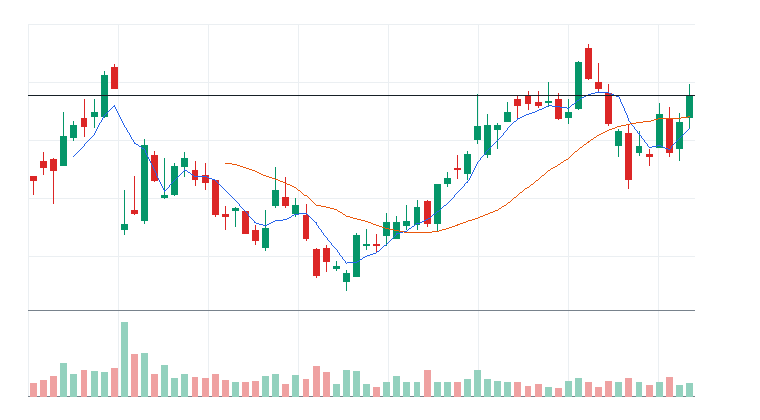

# 오늘의 데일리 트레이딩 요약

**REAL DATA TEST - 가격/거래량은 실제 데이터, 뉴스/ETF 구성종목 확산도/거래대금 유동성 일부 연결**

**목적:** 이 리포트는 최근 오른 자산을 나열하는 것이 아니라, 돈이 몰리는 근거와 다음 매수 주체가 확인할 트레이딩 후보를 찾기 위한 보고서다.

> 핵심 질문: 현재 가격에서 누가 사고 있고, 누가 앞으로 더 비싸게 사줄 수 있는가?

## 시장 국면 판단

- 최종 판정: 기간 조정 (60점)
- 전일 대비: 중립-상승에서 기간 조정으로 개선됐다(+1점).
- 판정 신뢰도: 높음 (100점) - 핵심 지수와 매크로 데이터가 대부분 직접 수집되어 판정 신뢰도가 높다.
- 행동 바이어스: 추격 보류, 돌파 확인
- 한 줄 결론: 장기 추세는 유지되지만 단기 추세가 둔화되어 기간 조정으로 본다. 기술 67점, 매크로 49점.
- 기술적 지표: 상승 추세 유지 (67점, 가중치 65%)
- S&P 500: 71점 | 50일선 아래, 200일선 위, 20일 -0.09%, 60일 +2.00%, 52주 고점 대비 -2.14% -> 기술 점수 71
- Nasdaq 100: 62점 | 50일선 아래, 200일선 위, 20일 -3.31%, 60일 +4.00%, 52주 고점 대비 -6.66% -> 기술 점수 62
- 매크로 시황: 매크로 중립 (49점, 가중치 35%)
- 매크로 요약: 금리은 우호적이나 신용/유동성 부담이 남아 있다.
- 금리: 중립-우호 57점 / 금리 중립 / confidence HIGH
  - 주요 근거: US 10Y yield 20일 -4.85%, 5일 -2.92%; US 3M yield 20일 -0.79%, 단기금리 방향 확인; US long-duration bonds 20일 +3.89%, 장기채 가격 기준 할인율 부담 확인
  - 확인 사항: 추가 확인 이벤트 없음
- 물가: 중립 45점 / 물가 중립 / confidence HIGH
  - 주요 근거: Oil ETF 20일 +10.81%, 유가 기반 물가 압력 확인; TIPS ETF 20일 +2.13%, 물가연동채 흐름은 보조 근거; Gold 20일 -2.67%, 금 강세는 방어 수요 여부 확인
  - 확인 사항: 추가 확인 이벤트 없음
- 정책: 중립 50점 / 정책 이벤트 확인 전 중립 / confidence LOW
  - 주요 근거: 정책 톤은 1차 버전에서 일정/이벤트 리스크 기반 중립값으로 반영한다.
  - 확인 사항: FOMC, CPI, PCE, 고용지표 발표 전후에는 매크로 confidence를 보수적으로 해석한다.
- 신용/유동성: 부담 41점 / 신용/유동성 부담 / confidence HIGH
  - 주요 근거: High yield credit 20일 -0.44%, 하이일드 위험선호 확인; HYG-LQD 20일 상대강도 -1.95%, 신용위험 선호/회피 확인; VIX 20일 +14.44%, 변동성 부담 확인
  - 확인 사항: VIX 상승은 유동성/리스크 프리미엄 부담으로 해석한다.
- 환율/글로벌: 중립 48점 / 환율/글로벌 중립 / confidence MEDIUM
  - 주요 근거: US dollar 20일 +1.08%, 달러 강세/약세 확인
  - 확인 사항: 추가 확인 이벤트 없음
- US 10Y yield: 60점 | 하락 시 주식 우호; 5일 -2.92%, 20일 -4.85% -> 매크로 점수 60
- US 3M yield: 52점 | 하락 시 주식 우호; 5일 -1.23%, 20일 -0.79% -> 매크로 점수 52
- US long-duration bonds: 58점 | 상승 시 주식 우호; 5일 +2.79%, 20일 +3.89% -> 매크로 점수 58
- TIPS ETF: 50점 | 상승 시 주식 우호; 5일 +1.00%, 20일 +2.13% -> 매크로 점수 50
- Oil ETF: 30점 | 하락 시 주식 우호; 5일 +3.37%, 20일 +10.81% -> 매크로 점수 30
- Gold: 50점 | 상승 시 주식 우호; 5일 -3.13%, 20일 -2.67% -> 매크로 점수 50
- US dollar: 48점 | 하락 시 주식 우호; 5일 +0.03%, 20일 +1.08% -> 매크로 점수 48
- High yield credit: 50점 | 상승 시 주식 우호; 5일 +0.48%, 20일 -0.44% -> 매크로 점수 50
- Investment grade credit: 50점 | 상승 시 주식 우호; 5일 +1.11%, 20일 +1.51% -> 매크로 점수 50
- VIX: 27점 | 하락 시 주식 우호; 5일 -0.27%, 20일 +14.44% -> 매크로 점수 27
- 데이터 커버리지: 기술 2/2, 매크로 10/10
- 데이터 신뢰도 근거:
  - 직접 지수 데이터: S&P 500, Nasdaq 100
  - 대체 지수 데이터 없음
  - 매크로 데이터: 10/10
  - 누락 데이터 없음
  - stale 데이터 없음

## 모바일 요약

[오늘의 데일리 트레이딩 요약]

생성 성공 / 데이터 모드: REAL_TEST

시장:
- 중립

시장 지배 서사:
1. 사이버보안 지출 재가속 - 부상 - iShares Cybersecurity and Tech ETF(IHAK), Amplify Cybersecurity ETF(HACK), Zscaler Inc.(ZS), CrowdStrike Holdings Inc.(CRWD) 중심으로 5일 +11.85%, 20일 +8.96% 흐름이 형성됨. 뉴스 직접성 제한.
2. Integrated Oil & Gas 자금 유입 - 약화 - Energy Select Sector SPDR Fund(XLE), VanEck Oil Services ETF(OIH), Exxon Mobil(XOM), Chevron(CVX) 중심으로 5일 +3.53%, 20일 +10.34% 흐름이 형성됨. 뉴스 직접성 제한.
3. Specialty Business Services 자금 유입 - 약화 - SPDR S&P 500 ETF Trust(SPY), iShares Russell 2000 ETF(IWM), Cintas Corporation(CTAS), Thomson Reuters Corporation(TRI) 중심으로 5일 +4.06%, 20일 +6.73% 흐름이 형성됨. 뉴스 직접성 제한.

트렌드 강도:
1. 사이버보안 지출 재가속 - TSI 68 - 부상 - 진입품질 관찰
2. Integrated Oil & Gas 자금 유입 - TSI 52 - 약화 - 진입품질 낮음
3. Specialty Business Services 자금 유입 - TSI 26 - 잠복 - 진입품질 낮음

오늘 결론:
- 사이버보안 개별 종목 흐름이 ETF 대비 강한지 확인 필요
- 행동 후보는 linkedNarrative와 함께 확인한다.
- 추격보다 진입 조건 확인 후 접근한다.

오늘 실제 행동 후보:
1. Zscaler Inc.(ZS)(STOCK) - 사이버보안 지출 재가속 - 단기 추세가 유지되고 거래량이 1.0배 이상이면 눌림 이후 재상승을 시도할 수 있음
2. Roper Technologies Inc.(ROP)(STOCK) - AI 소프트웨어/사이버보안 확산 - 단기 추세가 유지되고 거래량이 1.0배 이상이면 눌림 이후 재상승을 시도할 수 있음
3. Lockheed Martin(LMT)(STOCK) - 방산/안보 프리미엄 - 단기 추세가 유지되고 거래량이 1.0배 이상이면 눌림 이후 재상승을 시도할 수 있음

다크호스 후보:
1. 다크호스 후보 없음 - 조건 충족 후보 없음

ETF 후보 TOP 5:
1. iShares Cybersecurity and Tech ETF(IHAK) - 사이버보안 지출 재가속 - 자금흐름 예외 조건부
2. First Trust NASDAQ Cybersecurity ETF(CIBR) - 사이버보안 지출 재가속 - 관찰
3. Amplify Cybersecurity ETF(HACK) - 사이버보안 지출 재가속 - 제외
4. Energy Select Sector SPDR Fund(XLE) - Integrated Oil & Gas 자금 유입 - 제외
5. Global X Defense Tech ETF(SHLD) - 방산/안보 프리미엄 - 제외

웹 리포트:
https://yoolcool.github.io/DailyTradingThesisAgent/

## 오늘 결론

- 오늘 결론: 조건부 진입
- 신규 진입 후보: 0개
- 조건부 진입 후보: 4개
- 관찰 후보: 91개
- 주요 제한 요인: Entry Quality < 40, 뉴스 직접성 부족, RVOL 미달
- 주문 판단: 시장가 금지 / 지정가 또는 관찰
- 실전 판단: 진입 후보는 있으나, 전일 고점 돌파와 거래량 확인 후 선별적으로 접근한다.

### 후보 제한 요인 집계

- RVOL < 1.00x: 90개
- 거래대금 유동성 낮음: 14개
- Entry Quality 50~54 near miss: 2개
- Entry Quality 40~49 관찰: 2개
- Entry Quality < 40: 151개
- Exhaustion Risk >= 70: 0개
- ETF breadth 샘플 부족: 37개
- 뉴스 직접성 부족: 98개

## 데이터 신뢰도

- 전체 데이터 신뢰도 등급: LOW
- 분석 신뢰도: LOW
- 주문 실행 신뢰도: LOW
- ETF breadth 신뢰도: LOW
- 신뢰도 해석: 테마 확산 판단 제한, 거래대금 유동성 낮음 또는 확인 불가, 프리/애프터마켓 확인 불가
- 리포트 생성 시각: 2026-10-27 10:52 KST
- 가격 기준 거래일: 2026-10-26 US regular close
- 뉴스 수집 시각: 2026-10-27 10:52 KST
- 가장 최근 뉴스 발행 시각: 2026-10-27 10:45 KST
- 뉴스 신선도 상태: FRESH
- 뉴스 소스: Yahoo Finance RSS, MarketWatch RSS, CNBC Markets RSS, SEC EDGAR RSS, Federal Reserve RSS, Finnhub API
- 뉴스 소스 상태: Yahoo Finance RSS CONNECTED, MarketWatch RSS CONNECTED, CNBC Markets RSS PARTIAL, SEC EDGAR RSS PARTIAL, Federal Reserve RSS CONNECTED, Finnhub API DISABLED
- 뉴스 신뢰도: MEDIUM
- 추천 적용 거래일: 2026-10-26 US regular session
- 가격/거래량 데이터 상태: 일부 연결
- 뉴스 데이터 상태: 일부 연결
- ETF 구성종목 확산도 상태: 일부 연결
- ETF 구성종목 샘플 수: 1~4
- 거래대금 유동성 데이터 상태: 일부 연결
- 프리/애프터마켓 데이터 상태: UNAVAILABLE
- 데이터 provider: yfinance, Yahoo Finance RSS, MarketWatch RSS, CNBC Markets RSS, SEC EDGAR RSS, Federal Reserve RSS, Finnhub API, config fallback sample, price-volume dollar-volume fallback
- 실전 사용 경고: 이 리포트는 투자판단 보조용이며, REAL_TEST 모드에서는 일부 데이터가 누락되거나 지연될 수 있다. 실제 주문 전 현재가, 뉴스, 프리마켓/정규장 거래량을 별도 확인해야 한다.

## 0. 시장 상태

- 데이터 모드: REAL_TEST
- 가격/거래량: 일부 연결
- 뉴스: 일부 연결
- ETF 구성종목 확산도: 일부 연결
- 거래대금 유동성: 일부 연결
- 생성 시각: 2026년 10월 27일 화요일 AM 10:52
- 시장 상태: 중립
- 오늘 돈의 방향: 사이버보안 개별 종목 흐름이 ETF 대비 강한지 확인 필요
- 강한 테마 TOP 3: 사이버보안 ETF(86), 사이버보안(54), 전통 에너지 ETF(47)
- 데이터 한계:
  - API 또는 provider 상태에 따라 뉴스/ETF 확산도/거래대금 유동성 반영 범위가 달라질 수 있다.
  - 수집 실패 데이터는 점수 반영에서 제외하거나 confidence를 제한한다.
  - reasonConfidence HIGH는 직접 촉매, 가격/거래량, 확산도/유동성 근거가 함께 있을 때만 사용한다.

## 오늘 시장을 지배하는 서사

### 오늘 시장을 지배하는 서사 TOP 3

#### 1. 사이버보안 지출 재가속
- 상태: 부상
- narrativeScore: 66
- reasonConfidence: MEDIUM
- 근거 ETF: IHAK, HACK, CIBR
- 근거 개별 종목: ZS, CRWD, PANW, FTNT
- 돈이 몰리는 이유: 사이버보안 지출 재가속 관련 iShares Cybersecurity and Tech ETF(IHAK), Amplify Cybersecurity ETF(HACK), First Trust NASDAQ Cybersecurity ETF(CIBR)와 Zscaler Inc.(ZS), CrowdStrike Holdings Inc.(CRWD), Palo Alto Networks Inc.(PANW), Fortinet Inc.(FTNT)의 5일(+11.85%)·20일(+8.96%) 흐름을 함께 본다. 평균 상대 거래량은 1.15배이고, ETF 확산도는 추가 확인이 필요하다. 뉴스 직접성은 아직 제한적이다.
- 다음 매수 주체: 사이버보안 지출 재가속을 확인한 섹터 ETF 자금과 상대강도 추종 스윙 자금
- 가장 좋은 트레이딩 수단: ETF 우선: HACK, CIBR, IHAK / 개별 종목 우선: CRWD, PANW, FTNT
- 서사가 깨지는 조건: HACK 20일선 이탈 또는 관련 종목 절반 이상 5일선 이탈
- 오늘 행동: 기존 네러티브와 중복을 확인한 뒤 ETF/대표 종목 동조성이 살아날 때만 관찰 편입

상세 narrativeScore 근거 보기

- rawScore: 66
- ETF 평균 moneyFlowScore: 74
- 개별 종목 평균 moneyFlowScore: 54
- ETF 후보 비율: 75%
- 개별 종목 후보 비율: 25%
- 5일 평균 수익률: +12.00%
- 20일 평균 수익률: +9.00%
- 평균 상대 거래량: 1.00배
- ETF 평균 상대 거래량: 1.00배
- 개별주 평균 상대 거래량: 1.00배
- 52주 고점 근접 후보 비율: 38%
- 뉴스 직접성 점수: 8
- ETF 확산도 점수: 0
- 유동성 점수: 0
- 과열 리스크 차감: 0

#### 2. Integrated Oil & Gas 자금 유입
- 상태: 약화
- narrativeScore: 46
- reasonConfidence: LOW
- 근거 ETF: XLE, OIH
- 근거 개별 종목: XOM, CVX
- 돈이 몰리는 이유: Integrated Oil & Gas 자금 유입 관련 Energy Select Sector SPDR Fund(XLE), VanEck Oil Services ETF(OIH)와 Exxon Mobil(XOM), Chevron(CVX)의 5일(+3.53%)·20일(+10.34%) 흐름을 함께 본다. 평균 상대 거래량은 0.93배이고, ETF 확산도는 추가 확인이 필요하다. 뉴스 직접성은 아직 제한적이다.
- 다음 매수 주체: Integrated Oil & Gas 자금 유입을 확인한 섹터 ETF 자금과 상대강도 추종 스윙 자금
- 가장 좋은 트레이딩 수단: ETF 우선: XLE, OIH / 개별 종목 우선: XOM, CVX
- 서사가 깨지는 조건: XLE 20일선 이탈 또는 관련 종목 절반 이상 5일선 이탈
- 오늘 행동: 기존 네러티브와 중복을 확인한 뒤 ETF/대표 종목 동조성이 살아날 때만 관찰 편입

상세 narrativeScore 근거 보기

- rawScore: 46
- ETF 평균 moneyFlowScore: 47
- 개별 종목 평균 moneyFlowScore: 43
- ETF 후보 비율: 50%
- 개별 종목 후보 비율: 0%
- 5일 평균 수익률: +4.00%
- 20일 평균 수익률: +10.00%
- 평균 상대 거래량: 1.00배
- ETF 평균 상대 거래량: 1.00배
- 개별주 평균 상대 거래량: 1.00배
- 52주 고점 근접 후보 비율: 75%
- 뉴스 직접성 점수: 6
- ETF 확산도 점수: 0
- 유동성 점수: 0
- 과열 리스크 차감: 0

#### 3. Specialty Business Services 자금 유입
- 상태: 약화
- narrativeScore: 44
- reasonConfidence: LOW
- 근거 ETF: SPY, IWM, QQQ
- 근거 개별 종목: CTAS, TRI
- 돈이 몰리는 이유: Specialty Business Services 자금 유입 관련 SPDR S&P 500 ETF Trust(SPY), iShares Russell 2000 ETF(IWM), Invesco QQQ Trust(QQQ)와 Cintas Corporation(CTAS), Thomson Reuters Corporation(TRI)의 5일(+4.06%)·20일(+6.73%) 흐름을 함께 본다. 평균 상대 거래량은 0.87배이고, ETF 확산도는 추가 확인이 필요하다. 뉴스 직접성은 아직 제한적이다.
- 다음 매수 주체: Specialty Business Services 자금 유입을 확인한 섹터 ETF 자금과 상대강도 추종 스윙 자금
- 가장 좋은 트레이딩 수단: ETF 우선: QQQ, SPY, IWM / 개별 종목 우선: TRI, CTAS
- 서사가 깨지는 조건: QQQ 20일선 이탈 또는 관련 종목 절반 이상 5일선 이탈
- 오늘 행동: 기존 네러티브와 중복을 확인한 뒤 ETF/대표 종목 동조성이 살아날 때만 관찰 편입

상세 narrativeScore 근거 보기

- rawScore: 44
- ETF 평균 moneyFlowScore: 7
- 개별 종목 평균 moneyFlowScore: 69
- ETF 후보 비율: 0%
- 개별 종목 후보 비율: 50%
- 5일 평균 수익률: +4.00%
- 20일 평균 수익률: +7.00%
- 평균 상대 거래량: 1.00배
- ETF 평균 상대 거래량: 1.00배
- 개별주 평균 상대 거래량: 1.00배
- 52주 고점 근접 후보 비율: 40%
- 뉴스 직접성 점수: 10
- ETF 확산도 점수: -1
- 유동성 점수: 4
- 과열 리스크 차감: 0

### 전체 narrative 요약

| 서사명 | 상태 | narrativeScore | reasonConfidence | 대표 ETF | 대표 종목 | 오늘 행동 |
| --- | --- | ---: | --- | --- | --- | --- |
| 사이버보안 지출 재가속 | 부상 | 66 | MEDIUM | IHAK, HACK, CIBR | ZS, CRWD, PANW, FTNT | 기존 네러티브와 중복을 확인한 뒤 ETF/대표 종목 동조성이 살아날 때만 관찰 편입 |
| Integrated Oil & Gas 자금 유입 | 약화 | 46 | LOW | XLE, OIH | XOM, CVX | 기존 네러티브와 중복을 확인한 뒤 ETF/대표 종목 동조성이 살아날 때만 관찰 편입 |
| Specialty Business Services 자금 유입 | 약화 | 44 | LOW | SPY, IWM, QQQ | CTAS, TRI | 기존 네러티브와 중복을 확인한 뒤 ETF/대표 종목 동조성이 살아날 때만 관찰 편입 |
| AI 소프트웨어/사이버보안 확산 | 약화 | 37 | LOW | IGV, AIQ, QQQ | ZS, DDOG, TEAM, PLTR | 추격보다 눌림 후 재상승 확인 |
| 매크로 방어/헤지 | 약화 | 37 | LOW | XLE, TLT, GLD | XOM, CVX | 위험회피가 확인될 때만 헤지성 접근 |
| 방산/안보 프리미엄 | 약화 | 29 | LOW | SHLD, ITA, XAR | LMT, RTX, PLTR, AVAV | 뉴스 촉매가 직접 확인될 때만 추세 추종 |
| 바이오/헬스케어 촉매 | 소멸 | 20 | LOW | QQQ | GILD, ALNY | 기존 네러티브와 중복을 확인한 뒤 ETF/대표 종목 동조성이 살아날 때만 관찰 편입 |
| Medical Devices 자금 유입 | 약화 | 16 | LOW | QQQ | ISRG, DXCM | 기존 네러티브와 중복을 확인한 뒤 ETF/대표 종목 동조성이 살아날 때만 관찰 편입 |
| 소프트웨어 실적/AI 수익화 | 약화 | 12 | LOW | IGV, AIQ, QQQ | MSFT, SHOP, MSTR | 기존 네러티브와 중복을 확인한 뒤 ETF/대표 종목 동조성이 살아날 때만 관찰 편입 |
| 위험선호 성장주 재진입 | 소멸 | 12 | LOW | QQQ, IPO, ARKK | TSLA, ARM, COIN | 지수 위험선호가 유지될 때만 선별 진입 |
| Discount Stores 자금 유입 | 약화 | 12 | LOW | QQQ | COST, WMT | 기존 네러티브와 중복을 확인한 뒤 ETF/대표 종목 동조성이 살아날 때만 관찰 편입 |
| 필수소비재 음료 방어 성장 | 약화 | 11 | LOW | QQQ | CCEP, MNST | 기존 네러티브와 중복을 확인한 뒤 ETF/대표 종목 동조성이 살아날 때만 관찰 편입 |
| Aerospace & Defense 자금 유입 | 소멸 | 10 | LOW | SPY, IWM, QQQ | KTOS, AVAV | 기존 네러티브와 중복을 확인한 뒤 ETF/대표 종목 동조성이 살아날 때만 관찰 편입 |
| 반도체 설계/공급망 재가속 | 소멸 | 8 | LOW | SMH, SOXX, SOXQ | TXN, NXPI, TSM, NVDA | 기존 네러티브와 중복을 확인한 뒤 ETF/대표 종목 동조성이 살아날 때만 관찰 편입 |
| Data Storage 자금 유입 | 소멸 | 2 | LOW | SPY, IWM, QQQ | STX, WDC | 기존 네러티브와 중복을 확인한 뒤 ETF/대표 종목 동조성이 살아날 때만 관찰 편입 |
| 전력 유틸리티 수요 재평가 | 소멸 | 1 | LOW | SPY, IWM, QQQ | ETN, GEV, VRT | 기존 네러티브와 중복을 확인한 뒤 ETF/대표 종목 동조성이 살아날 때만 관찰 편입 |
| 전력망/원전/인프라 병목 | 소멸 | 0 | LOW | PAVE, GRID, URA | VRT, ETN, PWR, CEG | ETF 확산도와 거래량이 같이 살아날 때만 진입 |
| Travel Services 자금 유입 | 약화 | 0 | LOW | QQQ | ABNB, BKNG | 기존 네러티브와 중복을 확인한 뒤 ETF/대표 종목 동조성이 살아날 때만 관찰 편입 |
| AI 인프라 재가속 | 소멸 | 0 | LOW | SMH, SOXX, DRAM | NVDA, MU, VRT, ETN | 추격보다 5일선 지지 후 재상승 확인 |
| 반도체 장비 사이클 재평가 | 소멸 | 0 | LOW | SMH, SOXX, SOXQ | ASML, LRCX | 기존 네러티브와 중복을 확인한 뒤 ETF/대표 종목 동조성이 살아날 때만 관찰 편입 |
| 소비 회복/방어주 선별 | 약화 | 0 | LOW | QQQ | PDD, AMZN | 기존 네러티브와 중복을 확인한 뒤 ETF/대표 종목 동조성이 살아날 때만 관찰 편입 |
| Internet Content 자금 유입 | 소멸 | 0 | LOW | QQQ | META, GOOGL, GOOG | 기존 네러티브와 중복을 확인한 뒤 ETF/대표 종목 동조성이 살아날 때만 관찰 편입 |
| 비트코인/디지털 자산 위험선호 | 소멸 | 0 | LOW | IBIT, BLOK | MSTR, COIN, IREN | 비트코인 베타가 살아날 때만 단기 매매 |
| Bitcoin Mining 자금 유입 | 소멸 | 0 | LOW | IBIT, BLOK | RIOT, MARA, CIFR | 기존 네러티브와 중복을 확인한 뒤 ETF/대표 종목 동조성이 살아날 때만 관찰 편입 |

## 트렌드 강도 판단

### 1. 사이버보안 지출 재가속
- Trend Strength Index: 68
- 트렌드 상태 라벨: 부상
- 테마 확산도: 보통
- ETF 동조성: 강함
- 거래량 강도: 약함
- 과열 위험: 보통 (25)
- 오늘 진입 품질: 관찰 (41)
- 한 줄 판단: 사이버보안 지출 재가속는 Trend Strength는 중간이지만 진입 품질이 살아나는 초기 진입 후보 성격이다.
- 오늘 접근법: iShares Cybersecurity and Tech ETF(IHAK)/Amplify Cybersecurity ETF(HACK)/First Trust NASDAQ Cybersecurity ETF(CIBR) 거래량 증가와 Zscaler Inc.(ZS)/CrowdStrike Holdings Inc.(CRWD)/Palo Alto Networks Inc.(PANW) 확산을 확인하며 작은 사이즈의 초기 진입 후보로만 본다.

트렌드 강도 상세 근거 보기

- 가격 모멘텀: 가격 모멘텀 23/25. 평균 5D +11.85%, 20D +8.96%.
- 거래량 강도: 거래량 강도 8/20. 평균 RVOL 1.15배.
- ETF 동조성: ETF 동조성 16/15. 관련 ETF Amplify Cybersecurity ETF(HACK), First Trust NASDAQ Cybersecurity ETF(CIBR), iShares Cybersecurity and Tech ETF(IHAK), iShares Expanded Tech-Software Sector ETF(IGV) 흐름을 기준으로 판단.
- 테마 확산도: 테마 확산도 14/20. 상위 1~2개 쏠림 감점 0점 반영.
- 뉴스 촉매: 뉴스/촉매 신선도 3/10. HIGH 직접 촉매 0개.
- 과열 리스크: 과열 리스크 25/100. 단기 급등, 고점 근접, ETF-개별주 괴리, 쏠림을 함께 반영.
- 시장 환경: 시장 환경 4/10. QQQ/SPY/IWM 가격 흐름 기반 위험선호 점수.

### 2. Integrated Oil & Gas 자금 유입
- Trend Strength Index: 52
- 트렌드 상태 라벨: 약화
- 테마 확산도: 보통
- ETF 동조성: 강함
- 거래량 강도: 부족
- 과열 위험: 낮음 (23)
- 오늘 진입 품질: 낮음 (28)
- 한 줄 판단: Integrated Oil & Gas 자금 유입는 관찰 가능한 흐름은 있으나 가격, 거래량, 확산도 중 일부 확인이 더 필요하다.
- 오늘 접근법: 상승률이 남아 있어도 Energy Select Sector SPDR Fund(XLE)/VanEck Oil Services ETF(OIH)와 구성 종목 확산도가 회복될 때까지 신규 진입은 낮춘다.

트렌드 강도 상세 근거 보기

- 가격 모멘텀: 가격 모멘텀 17/25. 평균 5D +3.53%, 20D +10.34%.
- 거래량 강도: 거래량 강도 4/20. 평균 RVOL 0.93배.
- ETF 동조성: ETF 동조성 15/15. 관련 ETF Energy Select Sector SPDR Fund(XLE), VanEck Oil Services ETF(OIH) 흐름을 기준으로 판단.
- 테마 확산도: 테마 확산도 11/20. 상위 1~2개 쏠림 감점 3점 반영.
- 뉴스 촉매: 뉴스/촉매 신선도 1/10. HIGH 직접 촉매 0개.
- 과열 리스크: 과열 리스크 23/100. 단기 급등, 고점 근접, ETF-개별주 괴리, 쏠림을 함께 반영.
- 시장 환경: 시장 환경 4/10. QQQ/SPY/IWM 가격 흐름 기반 위험선호 점수.

### 3. Specialty Business Services 자금 유입
- Trend Strength Index: 26
- 트렌드 상태 라벨: 잠복
- 테마 확산도: 부족
- ETF 동조성: 부족
- 거래량 강도: 부족
- 과열 위험: 낮음 (22)
- 오늘 진입 품질: 낮음 (14)
- 한 줄 판단: Specialty Business Services 자금 유입는 테마 확산도가 낮아 아직 개별 종목 이벤트성 흐름에 가깝다.
- 오늘 접근법: SPDR S&P 500 ETF Trust(SPY)/iShares Russell 2000 ETF(IWM)/Invesco QQQ Trust(QQQ)와 Cintas Corporation(CTAS)/Thomson Reuters Corporation(TRI)의 거래량 확산이 확인되기 전까지 관찰한다.

트렌드 강도 상세 근거 보기

- 가격 모멘텀: 가격 모멘텀 14/25. 평균 5D +4.06%, 20D +6.73%.
- 거래량 강도: 거래량 강도 3/20. 평균 RVOL 0.87배.
- ETF 동조성: ETF 동조성 3/15. 관련 ETF Invesco QQQ Trust(QQQ), SPDR S&P 500 ETF Trust(SPY), iShares Russell 2000 ETF(IWM) 흐름을 기준으로 판단.
- 테마 확산도: 테마 확산도 1/20. 상위 1~2개 쏠림 감점 6점 반영.
- 뉴스 촉매: 뉴스/촉매 신선도 1/10. HIGH 직접 촉매 0개.
- 과열 리스크: 과열 리스크 22/100. 단기 급등, 고점 근접, ETF-개별주 괴리, 쏠림을 함께 반영.
- 시장 환경: 시장 환경 4/10. QQQ/SPY/IWM 가격 흐름 기반 위험선호 점수.

## 최근 추천 결과 트래킹

개별주는 데이트레이딩 관점으로 추천 이후 첫 정규장의 장중 최고가와 종가를 추적한다. ETF는 테마/스윙 관점으로 추천 이후 1주일 동안의 최고가와 현재 종가를 추적한다.

### 개별주 Top 3 추천 성과 요약
- 최근 5개 리포트 표본: 14개 (초기 검증 단계)
- 장중 최고가 기준 성공률: +27.27%
- 종가 기준 성공률: +54.55%
- 평균 장중 최고 수익률: +2.74%
- 평균 종가 수익률: +1.56%

### ETF 추천 성과 요약
- 최근 5개 리포트 표본: 2개 (초기 검증 단계)
- 1주 최고가 기준 성공률: 데이터 없음
- 현재 종가 기준 성공률: +50.00%
- 평균 1주 최고 수익률: 데이터 없음
- 평균 현재 수익률: +1.52%

최근 추천 결과 상세 테이블 펼치기

| 추천일 | 유형 | 순위 | 티커 | 기준가 | 추적 기간 | 상태 | High 수익률 | Close 수익률 | 결과 | 코멘트 |
| --- | --- | ---: | --- | ---: | --- | --- | ---: | ---: | --- | --- |
| 2026-10-27 | STOCK | 3 | LMT | $635.2 | 2026-10-27 | pending | 데이터 없음 | 데이터 없음 | 추적 대기 | 아직 추적 거래일 데이터가 완성되지 않음 |
| 2026-10-27 | STOCK | 2 | ROP | $441.65 | 2026-10-27 | pending | 데이터 없음 | 데이터 없음 | 추적 대기 | 아직 추적 거래일 데이터가 완성되지 않음 |
| 2026-10-27 | STOCK | 1 | ZS | $260.45 | 2026-10-27 | pending | 데이터 없음 | 데이터 없음 | 추적 대기 | 아직 추적 거래일 데이터가 완성되지 않음 |
| 2026-10-27 | ETF | 1 | IHAK | $76.25 | 2026-10-27~2026-11-03 | in_progress | 데이터 없음 | 0.00% | 진행 중 | 아직 1주 추적 기간이 끝나지 않음 (일봉 high 미확보 시 close 기준 보조) |
| 2026-10-26 | STOCK | 3 | CRWD | $257.57 | 2026-10-26 | complete | +2.65% | +1.65% | 제한적 유효 | 제한적인 장중 기회만 발생 (일봉 기준) |
| 2026-10-26 | STOCK | 2 | ROP | $438.14 | 2026-10-26 | complete | +2.88% | +0.80% | 제한적 유효 | 제한적인 장중 기회만 발생 (일봉 기준) |
| 2026-10-26 | STOCK | 1 | ZS | $255.15 | 2026-10-26 | complete | +2.47% | +2.08% | 제한적 유효 | 제한적인 장중 기회만 발생 (일봉 기준) |
| 2026-10-26 | ETF | 1 | IHAK | $74 | 2026-10-26~2026-11-02 | in_progress | 데이터 없음 | +3.04% | 진행 중 | 아직 1주 추적 기간이 끝나지 않음 (일봉 high 미확보 시 close 기준 보조) |
| 2026-10-23 | STOCK | 3 | ADP | $294.5 | 2026-10-23 | complete | +5.06% | +3.28% | 성공 | 장중 기회와 종가 유지가 모두 확인됨 (일봉 기준) |
| 2026-10-23 | STOCK | 2 | CTAS | $220.15 | 2026-10-23 | complete | +2.56% | +1.79% | 제한적 유효 | 제한적인 장중 기회만 발생 (일봉 기준) |
| 2026-10-23 | STOCK | 1 | MAR | $404 | 2026-10-23 | complete | -1.77% | -3.29% | 실패 | 추천 이후 의미 있는 장중 기회가 부족하고 종가도 약함 (일봉 기준) |
| 2026-10-22 | STOCK | 3 | TRI | $112.82 | 2026-10-22 | complete | +9.70% | +9.25% | 성공 | 장중 기회와 종가 유지가 모두 확인됨 (일봉 기준) |
| 2026-10-22 | STOCK | 2 | MAR | $397.31 | 2026-10-22 | complete | +1.50% | -0.13% | 제한적 유효 | 제한적인 장중 기회만 발생 (일봉 기준) |
| 2026-10-22 | STOCK | 1 | NOC | $534 | 2026-10-22 | complete | +4.22% | +3.44% | 성공 | 장중 기회와 종가 유지가 모두 확인됨 (일봉 기준) |
| 2026-10-13 | STOCK | 2 | SHOP | $179.22 | 2026-10-13 | complete | -0.01% | -1.51% | 실패 | 추천 이후 의미 있는 장중 기회가 부족하고 종가도 약함 (일봉 기준) |
| 2026-10-13 | STOCK | 1 | PLTR | $209 | 2026-10-13 | complete | +0.90% | -0.16% | 실패 | 추천 이후 의미 있는 장중 기회가 부족하고 종가도 약함 (일봉 기준) |
| 2026-10-12 | STOCK | 3 | ZS | $233.73 | 2026-10-12 | complete | +1.49% | -3.40% | 제한적 유효 | 제한적인 장중 기회만 발생 (일봉 기준) |
| 2026-10-12 | STOCK | 2 | DDOG | $293.26 | 2026-10-12 | complete | +2.53% | -2.04% | 제한적 유효 | 제한적인 장중 기회만 발생 (일봉 기준) |
| 2026-10-12 | STOCK | 1 | PLTR | $209.05 | 2026-10-12 | complete | +1.86% | -0.02% | 제한적 유효 | 제한적인 장중 기회만 발생 (일봉 기준) |
| 2026-10-09 | STOCK | 2 | ZS | $216.81 | 2026-10-09 | complete | +8.07% | +7.80% | 성공 | 장중 기회와 종가 유지가 모두 확인됨 (일봉 기준) |
| 2026-10-09 | STOCK | 1 | PLTR | $198.78 | 2026-10-09 | complete | +5.43% | +5.17% | 성공 | 장중 기회와 종가 유지가 모두 확인됨 (일봉 기준) |
| 2026-10-08 | STOCK | 1 | ADSK | $235.05 | 2026-10-08 | complete | +0.40% | -0.62% | 실패 | 추천 이후 의미 있는 장중 기회가 부족하고 종가도 약함 (일봉 기준) |
| 2026-10-07 | STOCK | 3 | FTNT | $191.27 | 2026-10-07 | complete | +0.50% | -1.04% | 실패 | 추천 이후 의미 있는 장중 기회가 부족하고 종가도 약함 (일봉 기준) |
| 2026-10-07 | STOCK | 2 | AMD | $649.42 | 2026-10-07 | complete | -0.14% | -0.55% | 실패 | 추천 이후 의미 있는 장중 기회가 부족하고 종가도 약함 (일봉 기준) |
| 2026-10-07 | STOCK | 1 | SNPS | $505.17 | 2026-10-07 | complete | +0.86% | -0.49% | 실패 | 추천 이후 의미 있는 장중 기회가 부족하고 종가도 약함 (일봉 기준) |
| 2026-10-07 | ETF | 1 | CIBR | $108.13 | 2026-10-07~2026-10-14 | complete | +2.36% | +0.28% | 단기 고점 후 반납 | 1주 내 상승 기회는 있었지만 현재가는 반납 |
| 2026-10-06 | STOCK | 2 | TSM | $485.8 | 2026-10-06 | complete | +0.04% | -0.72% | 실패 | 추천 이후 의미 있는 장중 기회가 부족하고 종가도 약함 (일봉 기준) |
| 2026-10-06 | STOCK | 1 | SNPS | $488.47 | 2026-10-06 | complete | +3.90% | +3.42% | 성공 | 장중 기회와 종가 유지가 모두 확인됨 (일봉 기준) |
| 2026-10-06 | ETF | 1 | CIBR | $106.01 | 2026-10-06~2026-10-13 | complete | +4.41% | +2.28% | 성공 | 추천 이후 테마 추세가 유지됨 |
| 2026-10-05 | STOCK | 1 | SNPS | $489.9 | 2026-10-05 | complete | +3.77% | -0.29% | 단타 유효 | 장중 기회는 있었지만 종가 유지력은 약함 (일봉 기준) |
| 2026-10-05 | ETF | 1 | SMH | $630.6 | 2026-10-05~2026-10-12 | complete | +1.41% | -14.11% | 실패 | 추천 이후 ETF 흐름이 약화됨 |
| 2026-09-30 | STOCK | 1 | AMAT | $512.01 | 2026-09-30 | complete | +0.67% | -0.12% | 실패 | 추천 이후 의미 있는 장중 기회가 부족하고 종가도 약함 (일봉 기준) |
| 2026-09-28 | STOCK | 3 | DDOG | $268.13 | 2026-09-28 | complete | +1.74% | +0.21% | 제한적 유효 | 제한적인 장중 기회만 발생 (일봉 기준) |
| 2026-09-28 | STOCK | 2 | ARM | $310.32 | 2026-09-28 | complete | -1.02% | -8.70% | 실패 | 추천 이후 의미 있는 장중 기회가 부족하고 종가도 약함 (일봉 기준) |
| 2026-09-28 | STOCK | 1 | QCOM | $201.97 | 2026-09-28 | complete | -1.39% | -7.17% | 실패 | 추천 이후 의미 있는 장중 기회가 부족하고 종가도 약함 (일봉 기준) |
| 2026-09-25 | STOCK | 3 | ARM | $332.56 | 2026-09-25 | complete | -2.13% | -6.69% | 실패 | 추천 이후 의미 있는 장중 기회가 부족하고 종가도 약함 (일봉 기준) |
| 2026-09-25 | STOCK | 2 | CRWD | $262.49 | 2026-09-25 | complete | -1.00% | -3.95% | 실패 | 추천 이후 의미 있는 장중 기회가 부족하고 종가도 약함 (일봉 기준) |
| 2026-09-25 | STOCK | 1 | PLTR | $191.79 | 2026-09-25 | complete | +1.26% | -1.11% | 제한적 유효 | 제한적인 장중 기회만 발생 (일봉 기준) |
| 2026-09-23 | STOCK | 3 | MARA | $13.28 | 2026-09-23 | complete | +2.79% | +0.53% | 제한적 유효 | 제한적인 장중 기회만 발생 (일봉 기준) |
| 2026-09-23 | STOCK | 2 | CIFR | $18.9 | 2026-09-23 | complete | +3.49% | -2.91% | 단타 유효 | 장중 기회는 있었지만 종가 유지력은 약함 (일봉 기준) |
| 2026-09-23 | STOCK | 1 | RIOT | $24.18 | 2026-09-23 | complete | +4.51% | +2.11% | 성공 | 장중 기회와 종가 유지가 모두 확인됨 (일봉 기준) |
| 2026-09-23 | ETF | 3 | ARKK | $90.72 | 2026-09-23~2026-09-30 | complete | +1.63% | -9.79% | 실패 | 추천 이후 ETF 흐름이 약화됨 |
| 2026-09-23 | ETF | 2 | MAGS | $72.97 | 2026-09-23~2026-09-30 | complete | -0.29% | -3.11% | 실패 | 추천 이후 ETF 흐름이 약화됨 |
| 2026-09-23 | ETF | 1 | SMH | $596.03 | 2026-09-23~2026-09-30 | complete | +2.89% | -9.13% | 단기 고점 후 반납 | 1주 내 상승 기회는 있었지만 현재가는 반납 |
| 2026-09-22 | STOCK | 3 | CRWD | $237.65 | 2026-09-22 | complete | +5.53% | +5.22% | 성공 | 장중 기회와 종가 유지가 모두 확인됨 (일봉 기준) |
| 2026-09-22 | STOCK | 2 | RIOT | $23.75 | 2026-09-22 | complete | +6.91% | +4.97% | 성공 | 장중 기회와 종가 유지가 모두 확인됨 (일봉 기준) |
| 2026-09-22 | STOCK | 1 | AMD | $559.82 | 2026-09-22 | complete | +11.56% | +11.42% | 성공 | 장중 기회와 종가 유지가 모두 확인됨 (일봉 기준) |
| 2026-09-21 | STOCK | 3 | CRWD | $237.65 | 2026-09-21 | complete | +5.33% | +4.92% | 성공 | 장중 기회와 종가 유지가 모두 확인됨 (일봉 기준) |
| 2026-09-21 | STOCK | 2 | RIOT | $23.75 | 2026-09-21 | complete | +5.55% | +1.81% | 성공 | 장중 기회와 종가 유지가 모두 확인됨 (일봉 기준) |
| 2026-09-21 | STOCK | 1 | AMD | $559.82 | 2026-09-21 | complete | +10.16% | +9.95% | 성공 | 장중 기회와 종가 유지가 모두 확인됨 (일봉 기준) |
| 2026-09-17 | STOCK | 3 | QCOM | $187.8 | 2026-09-17 | complete | +2.19% | +0.48% | 제한적 유효 | 제한적인 장중 기회만 발생 (일봉 기준) |
| 2026-09-17 | STOCK | 2 | FTNT | $172.37 | 2026-09-17 | complete | +2.16% | +0.12% | 제한적 유효 | 제한적인 장중 기회만 발생 (일봉 기준) |
| 2026-09-17 | STOCK | 1 | CRWD | $242.49 | 2026-09-17 | complete | +3.23% | +1.32% | 성공 | 장중 기회와 종가 유지가 모두 확인됨 (일봉 기준) |
| 2026-09-15 | STOCK | 1 | AMD | $516.13 | 2026-09-15 | complete | -0.48% | -2.31% | 실패 | 추천 이후 의미 있는 장중 기회가 부족하고 종가도 약함 (일봉 기준) |
| 2026-09-14 | STOCK | 1 | AMD | $516.13 | 2026-09-14 | complete | -3.44% | -4.40% | 실패 | 추천 이후 의미 있는 장중 기회가 부족하고 종가도 약함 (일봉 기준) |
| 2026-09-11 | STOCK | 2 | META | $653.69 | 2026-09-11 | complete | +1.61% | -0.87% | 제한적 유효 | 제한적인 장중 기회만 발생 (일봉 기준) |
| 2026-09-11 | STOCK | 1 | AMD | $521.1 | 2026-09-11 | complete | -0.01% | -0.95% | 실패 | 추천 이후 의미 있는 장중 기회가 부족하고 종가도 약함 (일봉 기준) |
| 2026-09-10 | STOCK | 3 | TSM | $439 | 2026-09-10 | complete | -1.47% | -2.50% | 실패 | 추천 이후 의미 있는 장중 기회가 부족하고 종가도 약함 (일봉 기준) |
| 2026-09-10 | STOCK | 2 | AMD | $505.74 | 2026-09-10 | complete | +2.09% | -0.42% | 제한적 유효 | 제한적인 장중 기회만 발생 (일봉 기준) |
| 2026-09-10 | STOCK | 1 | CEG | $299.05 | 2026-09-10 | complete | -1.41% | -4.37% | 실패 | 추천 이후 의미 있는 장중 기회가 부족하고 종가도 약함 (일봉 기준) |

## 오늘 실제 행동 후보

### 1. Zscaler Inc.(ZS)
- 자산 유형: STOCK
- linkedNarrative: 사이버보안 지출 재가속
- narrativeStatus: 부상
- narrativeScore: 66
- Trend Strength Index: 68
- Exhaustion Risk: 25 (보통)
- Entry Quality Score: 51 (관찰)
- 트렌드 판단: 시장 위험선호가 약해 시장 환경 비우호 구간이다.
- moneyFlowScore: 95
- finalRawScore: 95
- reasonConfidence: MEDIUM
- reasonConfidenceExplanation: 직접 촉매 부재 때문에 HIGH가 아니라 MEDIUM으로 제한했다.
- tieBreakerReason: 최종 원점수 95, 리스크 패널티 -6, 5일 수익률 +22.55%, 상대 거래량 1.06배 순으로 정렬
- 후보별 시장 해석: 중립 / 제한적 - 특이 충돌 없음
- 게이트 사유: 통과
- 주문 실행: 지정가 권장

- 왜 돈이 몰리는가: 20일 +30.62%, 5일 +22.55%, 상대 거래량 1.06배로 가격과 거래량이 함께 개선. 뉴스: CNBC Markets RSS earnings/under_6h / 유동성: ACCEPTABLE
- 누가 더 비싸게 사줄 수 있는지: 개별 주도주를 따라붙는 단기 모멘텀 자금과 관련 ETF 강세를 확인한 트레이더
- 진입 조건: 20일선 위 눌림 후 재상승 확인
- 무효화 조건: 20일선 이탈 또는 상대 거래량 0.8배 이하 둔화
- todayActionLabel: 조건부 진입
#### 최근 뉴스/동향 한국어 요약

- 요약: 종목 직접 뉴스 확인 상태이며 뉴스 흐름은 긍정 우위입니다. 후보 선정 후 재확인한 핵심 이슈는 "Why Did Zscaler (ZS) Move Today?"입니다.
- 직접 촉매 판단: Zscaler Inc.에 대해 직접 촉매로 분류된 뉴스가 확인됐습니다. 핵심은 "Why Did Zscaler (ZS) Move Today?"이며, 가이던스 재료로 봅니다.
- 뉴스 1: Why Did Zscaler (ZS) Move Today?
  - 내용: Zscaler Inc. 관련 기사는 Why Did Zscaler (ZS) Move Today? 이슈를 다루며, 주가 변동률 +13.10%, 동반 비교 수치 +67.10%를 핵심 내용으로 봅니다.
  - 투자 의미: Zscaler Inc.의 당일 상대강도 확인에는 도움이 되지만, 실적/가이던스 같은 새 펀더멘털 변화로 보기는 어렵습니다.
  - 확인할 점: 거래량 동반 여부, 장중 고점 유지, 관련 ETF 동반 강세
- 뉴스 2: Zscaler Stock Rose 23% in Five Trading Days as Cybersecurity Stocks Rallied on AI-Found PHP Flaws. Here’s Where It Could Go by 2031
  - 내용: Zscaler Inc. 관련 기사는 Zscaler Stock Rose 23% in Five Trading Days as Cybersecurity Stocks Rallied on AI-Found PHP Flaws. Here’s Where It Could Go by 2031 이슈를 다루며, 종가 $255, 주가 변동률 +23.00%, 동반 비교 수치 +59.00%를 핵심 내용으로 봅니다.
  - 투자 의미: Zscaler Inc.의 당일 상대강도 확인에는 도움이 되지만, 실적/가이던스 같은 새 펀더멘털 변화로 보기는 어렵습니다.
  - 확인할 점: 거래량 동반 여부, 장중 고점 유지, 관련 ETF 동반 강세
- 뉴스 3: How Nvidia AI Security Tie Up At Zscaler (ZS) Has Changed Its Investment Story
  - 내용: Zscaler Inc. 관련 기사는 How Nvidia AI Security Tie Up At Zscaler (ZS) Has Changed Its Investment Story 이슈를 다루며, 주가 변동률 +30.00%를 핵심 내용으로 봅니다.
  - 투자 의미: Zscaler Inc.의 당일 상대강도 확인에는 도움이 되지만, 실적/가이던스 같은 새 펀더멘털 변화로 보기는 어렵습니다.
  - 확인할 점: 거래량 동반 여부, 장중 고점 유지, 관련 ETF 동반 강세
- 매매 해석: 매매 관점에서는 뉴스 자체보다 가격이 진입 조건을 지키는지, 거래량이 동반되는지, 그리고 뉴스가 이미 주가에 반영됐는지를 우선 확인해야 합니다.
- 차트: 

### 2. Roper Technologies Inc.(ROP)
- 자산 유형: STOCK
- linkedNarrative: AI 소프트웨어/사이버보안 확산
- narrativeStatus: 약화
- narrativeScore: 37
- Trend Strength Index: 42
- Exhaustion Risk: 2 (낮음)
- Entry Quality Score: 50 (관찰)
- 트렌드 판단: 시장 위험선호가 약해 시장 환경 비우호 구간이다.
- moneyFlowScore: 100
- finalRawScore: 109
- reasonConfidence: HIGH
- reasonConfidenceExplanation: 직접 촉매: MarketWatch RSS / general_market / under_6h - With the Anthropic IPO, the devil is in the details 가격/거래량, 관련 ETF 동반 강세, 유동성 근거가 함께 확인되어 HIGH로 분류했다.
- tieBreakerReason: 최종 원점수 109, 리스크 패널티 0, 5일 수익률 +15.16%, 상대 거래량 1.73배 순으로 정렬
- 후보별 시장 해석: 중립 / 제한적 - 특이 충돌 없음
- 게이트 사유: 통과
- 주문 실행: 지정가 권장
- 직접 촉매: MarketWatch RSS / general_market / under_6h - With the Anthropic IPO, the devil is in the details
- 왜 돈이 몰리는가: 20일 +24.76%, 5일 +15.16%, 상대 거래량 1.73배로 가격과 거래량이 함께 개선. 뉴스: CNBC Markets RSS earnings/under_6h / 유동성: ACCEPTABLE
- 누가 더 비싸게 사줄 수 있는지: 개별 주도주를 따라붙는 단기 모멘텀 자금과 관련 ETF 강세를 확인한 트레이더
- 진입 조건: 20일선 위 눌림 후 재상승 확인
- 무효화 조건: 20일선 이탈 또는 상대 거래량 0.8배 이하 둔화
- todayActionLabel: 조건부 진입
#### 최근 뉴스/동향 한국어 요약

- 요약: 종목 직접 뉴스 확인 상태이며 뉴스 흐름은 긍정 우위입니다. 후보 선정 후 재확인한 핵심 이슈는 "Roper (ROP) Q3 2026 Earnings Call Transcript"입니다.
- 직접 촉매 판단: Roper Technologies Inc.에 대해 직접 촉매로 분류된 뉴스가 확인됐습니다. 핵심은 "Roper (ROP) Q3 2026 Earnings Call Transcript"이며, 실적 재료로 봅니다.
- 뉴스 1: Roper (ROP) Q3 2026 Earnings Call Transcript
  - 내용: Roper Technologies Inc. 관련 기사는 Roper (ROP) Q3 2026 Earnings Call Transcript 이슈를 다루며, 주가 변동률 +7.00%를 핵심 내용으로 봅니다.
  - 투자 의미: Roper Technologies Inc.의 당일 상대강도 확인에는 도움이 되지만, 실적/가이던스 같은 새 펀더멘털 변화로 보기는 어렵습니다.
  - 확인할 점: 거래량 동반 여부, 장중 고점 유지, 관련 ETF 동반 강세
- 뉴스 2: Roper Technologies Q3 Earnings Call Highlights
  - 내용: Roper Technologies Inc. 관련 기사는 Roper Technologies Q3 Earnings Call Highlights 이슈를 다루며, 주가 변동률 +7.00%, 동반 비교 수치 +15.00%를 핵심 내용으로 봅니다.
  - 투자 의미: Roper Technologies Inc.의 당일 상대강도 확인에는 도움이 되지만, 실적/가이던스 같은 새 펀더멘털 변화로 보기는 어렵습니다.
  - 확인할 점: 거래량 동반 여부, 장중 고점 유지, 관련 ETF 동반 강세
- 뉴스 3: Roper Technologies (ROP) Q3 Earnings: How Key Metrics Compare to Wall Street Estimates
  - 내용: Roper Technologies Inc. 관련 실적 뉴스입니다. 기사 스니펫상 핵심 내용은 Although the revenue and EPS for Roper Technologies (ROP) give a sense of how its business performed in the quarter ended September 2026, it might be worth considering how some ...입니다.
  - 투자 의미: 실적/가이던스 재료는 다음 분기 기대치 변화로 이어질 수 있어 컨센서스 변화와 주가 반응 지속성을 함께 봅니다.
  - 확인할 점: 매출/마진/가이던스 수치, 컨센서스 대비 차이
- 매매 해석: 매매 관점에서는 뉴스 자체보다 가격이 진입 조건을 지키는지, 거래량이 동반되는지, 그리고 뉴스가 이미 주가에 반영됐는지를 우선 확인해야 합니다.
- 차트: 

### 3. Lockheed Martin(LMT)
- 자산 유형: STOCK
- linkedNarrative: 방산/안보 프리미엄
- narrativeStatus: 약화
- narrativeScore: 29
- Trend Strength Index: 43
- Exhaustion Risk: 1 (낮음)
- Entry Quality Score: 43 (관찰)
- 트렌드 판단: 시장 위험선호가 약해 시장 환경 비우호 구간이다.
- moneyFlowScore: 100
- finalRawScore: 114
- reasonConfidence: MEDIUM
- reasonConfidenceExplanation: 직접 촉매 부재 때문에 HIGH가 아니라 MEDIUM으로 제한했다.
- tieBreakerReason: 최종 원점수 114, 리스크 패널티 0, 5일 수익률 +15.86%, 상대 거래량 1.95배 순으로 정렬
- 후보별 시장 해석: 중립 / 제한적 - Entry Quality 43 < 50이나 moneyFlow 100, confidence MEDIUM, RVOL 1.95x로 강한 자금흐름 예외 조건 충족
- 게이트 사유: Entry Quality 43 < 50이나 moneyFlow 100, confidence MEDIUM, RVOL 1.95x로 강한 자금흐름 예외 조건 충족
- 주문 실행: 시장가 가능

- 왜 돈이 몰리는가: 20일 +22.60%, 5일 +15.86%, 상대 거래량 1.95배로 가격과 거래량이 함께 개선. 뉴스: CNBC Markets RSS earnings/under_6h / 유동성: LIQUID
- 누가 더 비싸게 사줄 수 있는지: 개별 주도주를 따라붙는 단기 모멘텀 자금과 관련 ETF 강세를 확인한 트레이더
- 진입 조건: 20일선 위 눌림 후 재상승 확인
- 무효화 조건: 20일선 이탈 또는 상대 거래량 0.8배 이하 둔화
- todayActionLabel: 자금흐름 예외 조건부
#### 최근 뉴스/동향 한국어 요약

- 요약: 종목 직접 뉴스 확인 상태이며 뉴스 흐름은 긍정 우위입니다. 후보 선정 후 재확인한 핵심 이슈는 "Why Is Lockheed Martin (LMT) At The Center Of Two Fast Growing Defense Markets?"입니다.
- 직접 촉매 판단: Lockheed Martin에 대해 직접 촉매로 분류된 뉴스가 확인됐습니다. 핵심은 "Why Is Lockheed Martin (LMT) At The Center Of Two Fast Growing Defense Markets?"이며, 시장 일반 재료로 봅니다.
- 뉴스 1: Why Is Lockheed Martin (LMT) At The Center Of Two Fast Growing Defense Markets?
  - 내용: Lockheed Martin 관련 시장 일반 뉴스입니다. 기사 스니펫상 핵심 내용은 Lockheed Martin (NYSE:LMT) is highlighted in two new industry forecasts covering land-based C4ISR and defense electronics markets.입니다.
  - 투자 의미: 단기 긍정 뉴스 흐름으로 볼 수 있지만, 단독 매수 근거보다는 가격·거래량 조건을 확인하는 보조 근거로 사용합니다.
  - 확인할 점: 원문 수치, 후속 보도, 가격이 진입 조건을 지키는지
- 뉴스 2: Morgan Stanley upgrades Lockheed Martin, says F-35 deal removes key risk
  - 내용: Lockheed Martin 관련 기사는 투자의견 상향를 다룹니다. 기사 스니펫상 핵심은 Investing.com -- Morgan Stanley upgraded Lockheed Martin to Overweight from Equal-weight and raised its price target to $835 from $690 in a note to clients on Monday, saying a n...입니다.
  - 투자 의미: 애널리스트 상향은 단기 수급에 우호적일 수 있으나, 목표가 변화가 이미 주가에 반영됐는지 확인해야 합니다.
  - 확인할 점: M&A의 금액, 기간, 실적 반영 시점
- 뉴스 3: Global Military Drones Market Report 2026 | Capitalize on AI Autonomy and Swarming as Market Hits $121 Billion by 2030: Lockheed Martin, Northrop Grumman, Boeing, BAE Systems
  - 내용: Lockheed Martin 관련 매크로 뉴스입니다. 기사 스니펫상 핵심 내용은 ROI strategies: launch hybrid, multi-mission UAS to expand customer reach and sales; acquire high-growth UAS/C-UAS technology firms to strengthen defense offerings.Dublin, Oct.입니다.
  - 투자 의미: 단기 혼재 뉴스 흐름으로 볼 수 있지만, 단독 매수 근거보다는 가격·거래량 조건을 확인하는 보조 근거로 사용합니다.
  - 확인할 점: 원문 수치, 후속 보도, 가격이 진입 조건을 지키는지
- 매매 해석: 매매 관점에서는 뉴스 자체보다 가격이 진입 조건을 지키는지, 거래량이 동반되는지, 그리고 뉴스가 이미 주가에 반영됐는지를 우선 확인해야 합니다.
- 차트: 

## 다크호스 후보

다크호스 후보 없음. 상위 서사 정렬, MA20 위 안착, MA5/MA20 구조 개선, RVOL 0.90x 이상 조건을 동시에 충족한 개별주가 없다.

- darkHorseScore: 조건 충족 후보 없음
- 왜 아직 메인이 아닌가: 확인 조건을 통과한 보조 관찰 후보가 없다.

darkHorseScore 상세 근거 보기

- 서사 정렬: 조건 미충족
- 초기 추세 구조: 조건 미충족
- 베이스 돌파/정돈: 조건 미충족
- 거래량 확인: 조건 미충족
- rawScore: 데이터 없음

## 오늘 돈이 몰리는 테마

- 사이버보안 ETF: CIBR, HACK, IHAK | 평균 moneyFlowScore 86 | 단일 종목 이벤트보다 테마 단위 자금 흐름이 선명한 구간으로 본다.
- 사이버보안: PANW, CRWD, FTNT, ZS | 평균 moneyFlowScore 54 | 관심은 유지하되 우선순위는 낮추고 추가 거래량 확인을 기다린다.
- 전통 에너지 ETF: XLE, OIH | 평균 moneyFlowScore 47 | 관심은 유지하되 우선순위는 낮추고 추가 거래량 확인을 기다린다.
- 채권 ETF: TLT | 평균 moneyFlowScore 40 | 관심은 유지하되 우선순위는 낮추고 추가 거래량 확인을 기다린다.
- 클라우드/엔터프라이즈 소프트웨어 ETF: IGV | 평균 moneyFlowScore 39 | 관심은 유지하되 우선순위는 낮추고 추가 거래량 확인을 기다린다.
- Consumer Cyclical: SBUX, MAR, ROST, ORLY | 평균 moneyFlowScore 37 | 관심은 유지하되 우선순위는 낮추고 추가 거래량 확인을 기다린다.

## 1. ETF 트레이딩 보고서
### 1-1. ETF 결론
- ETF 우선 후보: 없음
- ETF 관찰 후보: Roundhill Memory ETF(DRAM), iShares Expanded Tech-Software Sector ETF(IGV), Global X Artificial Intelligence & Technology ETF(AIQ), First Trust NASDAQ Cybersecurity ETF(CIBR), SPDR S&P Aerospace & Defense ETF(XAR)
- ETF 매매 금지: Roundhill Memory ETF(DRAM), Global X Artificial Intelligence & Technology ETF(AIQ), Global X Robotics & Artificial Intelligence ETF(BOTZ), ROBO Global Robotics and Automation Index ETF(ROBO), SPDR S&P Aerospace & Defense ETF(XAR)
- 오늘 ETF 최우선 1개: iShares Cybersecurity and Tech ETF(IHAK) - 전일 고점 돌파와 5일선 유지 확인
- ETF 섹션 해석: 이 섹션은 개별 종목 선택이 아니라 테마/섹터 단위 자금 흐름을 ETF로 매매할지 판단하기 위한 영역이다.

### 1-2. ETF 후보 TOP 5

선정 기준: ETF 후보는 가격/거래량 1차 점수에 뉴스, ETF 구성종목 확산도, 유동성, 리스크 패널티를 반영한 finalRawScore 기준으로 정렬한다. 표시 점수 100점 후보가 겹치면 tieBreakerReason으로 우선순위를 설명한다.

### [ETF] iShares Cybersecurity and Tech ETF(IHAK)
- 자산 유형: ETF
- ETF 세부 카테고리: 사이버보안 ETF
- ETF 역할: 테마 베타 매수
- 상태: 진입 후보
- linkedNarrative: 사이버보안 지출 재가속
- narrativeStatus: 부상
- narrativeScore: 66
- moneyFlowScore: 93
- finalRawScore: 93
- tieBreakerReason: 최종 원점수 93, 리스크 패널티 -5, 5일 수익률 +13.03%, 상대 거래량 2.14배 순으로 정렬
- 과열 리스크: 낮음~중간
- reasonConfidence: MEDIUM
- reasonConfidenceExplanation: ETF 확산도 제한 때문에 HIGH가 아니라 MEDIUM으로 제한했다.

- todayActionLabel: 자금흐름 예외 조건부
- 주문 실행: 추격 금지
- 기준일: 2026-10-26
- 종가: $76.25
- 1일 수익률: +3.04%
- 5일 수익률: +13.03%
- 20일 수익률: +14.18%
- 상대 거래량: 2.14배
- 52주 고점 대비 위치: -0.46%
- whyMoneyIsFlowing: 20일 +14.18%, 5일 +13.03%, 상대 거래량 2.14배로 가격과 거래량이 함께 개선. 뉴스: MarketWatch RSS general_market/under_6h
- likelyNextBuyer: 섹터 베타를 노리는 단기 모멘텀 자금과 리밸런싱 자금
- whyThisCouldTradeHigher: 52주 고점 부근이라 돌파가 확인되면 신고가 추종 매수가 붙을 수 있음
#### 최근 뉴스/동향 한국어 요약

- 요약: 섹터/테마 뉴스 중심 상태이며 뉴스 흐름은 긍정 우위입니다. 후보 선정 후 재확인한 핵심 이슈는 "&#x2018;You need only watch episodes of Judge Judy&#x2019;: I&#x2019;m in my 70s. Why do people keep making the same avoidable financial mistakes?"입니다.
- 직접 촉매 판단: iShares Cybersecurity and Tech ETF에 대해 강한 직접 촉매는 확인되지 않았습니다.
- 뉴스 1: Nvidia, AMD and Broadcom could buy Meta shares as part of $35 billion stock offering
  - 내용: iShares Cybersecurity and Tech ETF 관련 M&A 뉴스입니다. 기사 스니펫상 핵심 내용은 Meta is looking to raise a total of $95 billion through stock-related deals that stretch into early next year.입니다.
  - 투자 의미: M&A 재료는 실적 가시성이나 밸류에이션 기대에 영향을 줄 수 있어 규모와 일정 확인이 중요합니다.
  - 확인할 점: M&A의 금액, 기간, 실적 반영 시점
- 뉴스 2: Dividend stocks are having an excellent October as tech sector struggles
  - 내용: iShares Cybersecurity and Tech ETF 관련 시장 일반 뉴스입니다. 기사 스니펫상 핵심 내용은 ETFs focused on dividend stocks are seeing a powerful rally in October, adding to huge gains in 2026.입니다.
  - 투자 의미: 단기 긍정 뉴스 흐름으로 볼 수 있지만, 단독 매수 근거보다는 가격·거래량 조건을 확인하는 보조 근거로 사용합니다.
  - 확인할 점: 원문 수치, 후속 보도, 가격이 진입 조건을 지키는지
- 뉴스 3: TikTok parent ByteDance&#x2019;s chatbot is now giving travel-booking sites a run for their money. And yours.
  - 내용: iShares Cybersecurity and Tech ETF 관련 시장 일반 뉴스입니다. 기사 스니펫상 핵심 내용은 Consumers in China are starting to wonder &#x2014; for good reason &#x2014; whether the emerging AI travel agents have a hidden agenda.입니다.
  - 투자 의미: 단기 긍정 뉴스 흐름으로 볼 수 있지만, 단독 매수 근거보다는 가격·거래량 조건을 확인하는 보조 근거로 사용합니다.
  - 확인할 점: 원문 수치, 후속 보도, 가격이 진입 조건을 지키는지
- 매매 해석: 매매 관점에서는 뉴스 자체보다 가격이 진입 조건을 지키는지, 거래량이 동반되는지, 그리고 뉴스가 이미 주가에 반영됐는지를 우선 확인해야 합니다.
- 진입 조건: 전일 고점 돌파와 5일선 유지 확인
- 무효화 조건: 20일선 이탈 또는 상대 거래량 0.8배 이하 둔화
- 차트: 

#### 상세 근거

iShares Cybersecurity and Tech ETF(IHAK) 상세 근거 펼치기

- moneyFlowScore(최종) 산정 근거:
  - moneyFlowScore(1차): 91
  - 최종 원점수: 93
  - 최종 표시 점수: 93
  - cap 적용: cap 미적용
  - 계산식: +91 + +12 + 0 - 5 + 0 - 5 + 0 = 93
  - 점수 해석: 강한 자금 유입 후보. 단, 과열 여부 확인 필수.
  - 가격/거래량 1차 점수: +91
    - 추세: +24
    - 단기 모멘텀: +14
    - 중기 모멘텀: +9
    - 거래량: +18
    - 신고가 근접: +12
    - 이동평균: +14
  - 하위 점수 cap:
    - 가격 모멘텀: 원점수 +24, 상한 적용 +24 / 최대 25
    - 단기 모멘텀: 원점수 +14, 상한 적용 +14 / 최대 20
    - 중기 모멘텀: 원점수 +9, 상한 적용 +9 / 최대 16
    - 거래량: 원점수 +18, 상한 적용 +18 / 최대 20
    - 신고가 근접: 원점수 +12, 상한 적용 +12 / 최대 12
    - 이동평균: 원점수 +14, 상한 적용 +14 / 최대 14
  - 추가 데이터 가감점:
    - 뉴스: +12
    - 유동성: -5
  - ETF 확산도: 0
  - 리스크 패널티: -5
  - 주요 근거: 1차 91, 최종 원점수 93, 표시 93. 20일 수익률 강함, 5일 수익률 강함, 1일 단기 모멘텀 확인. 주의: 단기 과열/추격 위험 존재, ETF 구성종목 확산도 데이터 미연결.
  - 리스크 패널티 산정 근거:
    - 총 리스크 패널티: -5
    - 리스크 등급: LOW
    - 감점된 리스크:
      - low liquidity: -5 | 근거: Liquidity signal: LOW. | 대응: Avoid market-order chasing.
    - 관찰 리스크: ETF breadth data not connected
    - 한 줄 해석: 1개 감점 리스크로 총 -5점 반영.
- 데이터 사용 현황:
  - 가격/거래량: 사용
  - 뉴스: 사용
  - ETF 확산도: 미연결
  - 거래대금 유동성: 사용
  - 관련 ETF 상대강도: 사용
- 뉴스 확인:
  - 최근 뉴스 상태: 일부 연결
  - 뉴스 소스: MarketWatch RSS, Yahoo Finance RSS, Federal Reserve RSS
  - 소스별 상태: Yahoo Finance RSS CONNECTED; MarketWatch RSS CONNECTED; CNBC Markets RSS FAILED; SEC EDGAR RSS PARTIAL; Federal Reserve RSS CONNECTED; Finnhub API DISABLED
  - 긍정/중립/부정: 12/4/0
  - 직접성/방향성/신선도: 2/1/4
  - 강한 촉매 수: 1
  - 중요 공시 수: 0
  - 직접 촉매: 없음
  - 보조 뉴스: MarketWatch RSS sector_theme / general_market / under_6h
  - 뉴스 수집 시각: 2026-10-27 10:52 KST
  - 가장 최근 뉴스 발행 시각: 2026-10-27 07:30 KST
  - 뉴스 신선도 상태: FRESH
  - 뉴스 이후 가격 반응: 긍정
  - 가격 반응 점수 제한: 뉴스 이후 가격 반응과 점수 제한 특이사항 없음
  - 핵심 뉴스 요약: &#x2018;You need only watch episodes of Judge Judy&#x2019;: I&#x2019;m in my 70s. Why do people keep making the same avoidable financial mistakes?
  - 원점수/상한 점수: +23 / +12
  - 점수 반영: +12
  - 주의: CNBC Markets RSS: HTTP 403 from https://www.cnbc.com/id/100003114/device/rss/rss.html; SEC EDGAR RSS: no matching RSS items; Finnhub API: FINNHUB_API_KEY not configured
- ETF 구성종목 확산도:
  - 구성종목 데이터 상태: 미연결
  - 샘플 수: 0/0
  - 샘플 신뢰도: UNKNOWN
  - 상승 종목 비율: 데이터 없음
  - 20일선 위 비율: 데이터 없음
  - 50일선 위 비율: 데이터 없음
  - 상위 기여 종목: 데이터 없음
  - 확산도 판단: UNKNOWN
  - 원점수/샘플 상한/반영 점수: 0 / N/A / 0
  - 점수 반영: 0
- 거래대금 유동성:
  - 데이터 상태: 일부 연결
  - 거래대금 기준 유동성: LOW
  - 거래대금: $36,699,125
  - 평균 거래대금: $17,174,550
  - 주문 영향: 추격 금지
  - 매매 영향: 유동성 부족으로 추격 금지 또는 우선순위 하향
- reasonConfidence 근거: 가격/거래량, 뉴스, 거래대금 유동성, 관련 ETF 상대강도은 확인됐지만 일부 보조 데이터가 미연결 또는 fallback이라 중간으로 제한한다.
- 후보 선정 후 뉴스/동향 재확인:
  - 재확인 상태: 일부 연결
  - 재확인 시각: 2026-10-27 10:52 KST
  - 최근 발행 시각: 2026-10-27 07:30 KST
  - 신선도: FRESH
  - 출처: MarketWatch RSS, Yahoo Finance RSS, Federal Reserve RSS
  - 소스별 상태: Yahoo Finance RSS CONNECTED; MarketWatch RSS CONNECTED; CNBC Markets RSS FAILED; SEC EDGAR RSS PARTIAL; Federal Reserve RSS CONNECTED; Finnhub API DISABLED
  - 한국어 요약: 섹터/테마 뉴스 중심 상태이며 뉴스 흐름은 긍정 우위입니다. 후보 선정 후 재확인한 핵심 이슈는 "&#x2018;You need only watch episodes of Judge Judy&#x2019;: I&#x2019;m in my 70s. Why do people keep making the same avoidable financial mistakes?"입니다.
  - 직접 촉매: 없음
  - 한국어 뉴스 요약 1: Nvidia, AMD and Broadcom could buy Meta shares as part of $35 billion stock offering
    - 내용: iShares Cybersecurity and Tech ETF 관련 M&A 뉴스입니다. 기사 스니펫상 핵심 내용은 Meta is looking to raise a total of $95 billion through stock-related deals that stretch into early next year.입니다.
    - 투자 의미: M&A 재료는 실적 가시성이나 밸류에이션 기대에 영향을 줄 수 있어 규모와 일정 확인이 중요합니다.
    - 확인할 점: M&A의 금액, 기간, 실적 반영 시점
  - 한국어 뉴스 요약 2: Dividend stocks are having an excellent October as tech sector struggles
    - 내용: iShares Cybersecurity and Tech ETF 관련 시장 일반 뉴스입니다. 기사 스니펫상 핵심 내용은 ETFs focused on dividend stocks are seeing a powerful rally in October, adding to huge gains in 2026.입니다.
    - 투자 의미: 단기 긍정 뉴스 흐름으로 볼 수 있지만, 단독 매수 근거보다는 가격·거래량 조건을 확인하는 보조 근거로 사용합니다.
    - 확인할 점: 원문 수치, 후속 보도, 가격이 진입 조건을 지키는지
  - 한국어 뉴스 요약 3: TikTok parent ByteDance&#x2019;s chatbot is now giving travel-booking sites a run for their money. And yours.
    - 내용: iShares Cybersecurity and Tech ETF 관련 시장 일반 뉴스입니다. 기사 스니펫상 핵심 내용은 Consumers in China are starting to wonder &#x2014; for good reason &#x2014; whether the emerging AI travel agents have a hidden agenda.입니다.
    - 투자 의미: 단기 긍정 뉴스 흐름으로 볼 수 있지만, 단독 매수 근거보다는 가격·거래량 조건을 확인하는 보조 근거로 사용합니다.
    - 확인할 점: 원문 수치, 후속 보도, 가격이 진입 조건을 지키는지
  - 원문 헤드라인 1: MarketWatch RSS / mna / under_6h / mixed - Nvidia, AMD and Broadcom could buy Meta shares as part of $35 billion stock offering
  - 원문 헤드라인 2: MarketWatch RSS / general_market / under_6h / positive - Dividend stocks are having an excellent October as tech sector struggles
  - 원문 헤드라인 3: MarketWatch RSS / general_market / under_6h / positive - TikTok parent ByteDance&#x2019;s chatbot is now giving travel-booking sites a run for their money. And yours.
  - 주의: CNBC Markets RSS: HTTP 403 from https://www.cnbc.com/id/100003114/device/rss/rss.html; SEC EDGAR RSS: no matching RSS items; Finnhub API: FINNHUB_API_KEY not configured
- 차트 요약: 최근 20거래일 기준 5일선이 20일선 위에 있음
- 기준일 2026-10-26 | 종가 $76.25 | 1일 +3.04% | 5일 +13.03% | 20일 +14.18% | 상대 거래량 2.14배 | 52주 고점 대비 -0.46% | 데이터 소스: yfinance

### [ETF] First Trust NASDAQ Cybersecurity ETF(CIBR)
- 자산 유형: ETF
- ETF 세부 카테고리: 사이버보안 ETF
- ETF 역할: 테마 베타 매수
- 상태: 관찰
- linkedNarrative: 사이버보안 지출 재가속
- narrativeStatus: 부상
- narrativeScore: 66
- moneyFlowScore: 81
- finalRawScore: 81
- tieBreakerReason: 최종 원점수 81, 리스크 패널티 0, 5일 수익률 +8.52%, 상대 거래량 1.00배 순으로 정렬
- 과열 리스크: 낮음~중간
- reasonConfidence: MEDIUM
- reasonConfidenceExplanation: ETF 확산도 제한 때문에 HIGH가 아니라 MEDIUM으로 제한했다.

- todayActionLabel: 관찰
- 주문 실행: 지정가 권장
- 기준일: 2026-10-26
- 종가: $108.43
- 1일 수익률: +2.18%
- 5일 수익률: +8.52%
- 20일 수익률: +6.65%
- 상대 거래량: 1.00배
- 52주 고점 대비 위치: -2.03%
- whyMoneyIsFlowing: 20일 +6.65%, 5일 +8.52%, 상대 거래량 1.00배로 가격과 거래량이 함께 개선. 뉴스: CNBC Markets RSS earnings/under_6h / 유동성: ACCEPTABLE
- likelyNextBuyer: 섹터 베타를 노리는 단기 모멘텀 자금과 리밸런싱 자금
- whyThisCouldTradeHigher: 52주 고점 부근이라 돌파가 확인되면 신고가 추종 매수가 붙을 수 있음
#### 최근 뉴스/동향 한국어 요약

- 요약: 후보 선정 후 재확인 뉴스 데이터 없음
- 진입 조건: 전일 고점 돌파와 5일선 유지 확인
- 무효화 조건: 20일선 이탈 또는 상대 거래량 0.8배 이하 둔화
- 차트: 

#### 상세 근거

First Trust NASDAQ Cybersecurity ETF(CIBR) 상세 근거 펼치기

- moneyFlowScore(최종) 산정 근거:
  - moneyFlowScore(1차): 67
  - 최종 원점수: 81
  - 최종 표시 점수: 81
  - cap 적용: cap 미적용
  - 계산식: +67 + +12 + 0 + +2 + 0 + 0 + 0 = 81
  - 점수 해석: 강한 자금 유입 후보. 단, 과열 여부 확인 필수.
  - 가격/거래량 1차 점수: +67
    - 추세: +18
    - 단기 모멘텀: +9
    - 중기 모멘텀: +4
    - 거래량: +10
    - 신고가 근접: +12
    - 이동평균: +14
  - 하위 점수 cap:
    - 가격 모멘텀: 원점수 +18, 상한 적용 +18 / 최대 25
    - 단기 모멘텀: 원점수 +9, 상한 적용 +9 / 최대 20
    - 중기 모멘텀: 원점수 +4, 상한 적용 +4 / 최대 16
    - 거래량: 원점수 +10, 상한 적용 +10 / 최대 20
    - 신고가 근접: 원점수 +12, 상한 적용 +12 / 최대 12
    - 이동평균: 원점수 +14, 상한 적용 +14 / 최대 14
  - 추가 데이터 가감점:
    - 뉴스: +12
    - 유동성: +2
  - ETF 확산도: 0
  - 리스크 패널티: 0
  - 주요 근거: 1차 67, 최종 원점수 81, 표시 81. 5일 수익률 강함, 1일 단기 모멘텀 확인, 52주 고점 근처. 주의: 큰 감점 제한적.
  - 리스크 패널티 산정 근거:
    - 총 리스크 패널티: 0
    - 리스크 등급: LOW
    - 감점된 리스크: 없음
    - 관찰 리스크: 주요 관찰 리스크 없음
    - 한 줄 해석: 직접 감점된 주요 리스크는 없지만 관찰 리스크는 계속 확인해야 한다.
- 데이터 사용 현황:
  - 가격/거래량: 사용
  - 뉴스: 사용
  - ETF 확산도: 일부 연결
  - 거래대금 유동성: 사용
  - 관련 ETF 상대강도: 사용
- 뉴스 확인:
  - 최근 뉴스 상태: 일부 연결
  - 뉴스 소스: CNBC Markets RSS, MarketWatch RSS
  - 소스별 상태: Yahoo Finance RSS CONNECTED; MarketWatch RSS CONNECTED; CNBC Markets RSS CONNECTED; SEC EDGAR RSS PARTIAL; Federal Reserve RSS CONNECTED; Finnhub API DISABLED
  - 긍정/중립/부정: 11/5/0
  - 직접성/방향성/신선도: 2/1/4
  - 강한 촉매 수: 2
  - 중요 공시 수: 0
  - 직접 촉매: 없음
  - 보조 뉴스: CNBC Markets RSS sector_theme / earnings / under_6h
  - 뉴스 수집 시각: 2026-10-27 10:52 KST
  - 가장 최근 뉴스 발행 시각: 2026-10-27 10:45 KST
  - 뉴스 신선도 상태: FRESH
  - 뉴스 이후 가격 반응: 긍정
  - 가격 반응 점수 제한: 뉴스 이후 가격 반응과 점수 제한 특이사항 없음
  - 핵심 뉴스 요약: China industrial profits post strongest growth in three months, rising 14.4%
  - 원점수/상한 점수: +22 / +12
  - 점수 반영: +12
  - 주의: SEC EDGAR RSS: no matching RSS items; Finnhub API: FINNHUB_API_KEY not configured
- ETF 구성종목 확산도:
  - 구성종목 데이터 상태: 일부 연결
  - 샘플 수: 2/2
  - 샘플 신뢰도: INSUFFICIENT
  - 상승 종목 비율: 50%
  - 20일선 위 비율: 100%
  - 50일선 위 비율: 100%
  - 상위 기여 종목: PLTR, MSFT
  - 확산도 판단: NARROW_LEADERSHIP
  - 원점수/샘플 상한/반영 점수: +2 / 0 / 0
  - 점수 반영: 0
- 거래대금 유동성:
  - 데이터 상태: 일부 연결
  - 거래대금 기준 유동성: ACCEPTABLE
  - 거래대금: $257,618,837
  - 평균 거래대금: $256,781,215
  - 주문 영향: 지정가 권장
  - 매매 영향: 거래대금은 허용 가능하나 지정가를 우선한다
- reasonConfidence 근거: 가격/거래량, 뉴스, 거래대금 유동성, 관련 ETF 상대강도은 확인됐지만 일부 보조 데이터가 미연결 또는 fallback이라 중간으로 제한한다.
- 후보 선정 후 뉴스/동향 재확인:
  - 재확인 상태: 데이터 없음
- 차트 요약: 단기 추세 중립
- 기준일 2026-10-26 | 종가 $108.43 | 1일 +2.18% | 5일 +8.52% | 20일 +6.65% | 상대 거래량 1.00배 | 52주 고점 대비 -2.03% | 데이터 소스: yfinance

### [ETF] Amplify Cybersecurity ETF(HACK)
- 자산 유형: ETF
- ETF 세부 카테고리: 사이버보안 ETF
- ETF 역할: 테마 베타 매수
- 상태: 매매 금지
- linkedNarrative: 사이버보안 지출 재가속
- narrativeStatus: 부상
- narrativeScore: 66
- moneyFlowScore: 83
- finalRawScore: 83
- tieBreakerReason: 최종 원점수 83, 리스크 패널티 -5, 5일 수익률 +11.35%, 상대 거래량 1.36배 순으로 정렬
- 과열 리스크: 낮음~중간
- reasonConfidence: MEDIUM
- reasonConfidenceExplanation: ETF 확산도 제한 때문에 HIGH가 아니라 MEDIUM으로 제한했다.

- todayActionLabel: 제외
- 주문 실행: 추격 금지
- 기준일: 2026-10-26
- 종가: $131.41
- 1일 수익률: +2.80%
- 5일 수익률: +11.35%
- 20일 수익률: +10.00%
- 상대 거래량: 1.36배
- 52주 고점 대비 위치: -0.55%
- whyMoneyIsFlowing: 20일 +10.00%, 5일 +11.35%, 상대 거래량 1.36배로 가격과 거래량이 함께 개선. 뉴스: CNBC Markets RSS earnings/under_6h
- likelyNextBuyer: 섹터 베타를 노리는 단기 모멘텀 자금과 리밸런싱 자금
- whyThisCouldTradeHigher: 52주 고점 부근이라 돌파가 확인되면 신고가 추종 매수가 붙을 수 있음
#### 최근 뉴스/동향 한국어 요약

- 요약: 후보 선정 후 재확인 뉴스 데이터 없음
- 진입 조건: 전일 고점 돌파와 5일선 유지 확인
- 무효화 조건: 20일선 이탈 또는 상대 거래량 0.8배 이하 둔화
- 차트: 

#### 상세 근거

Amplify Cybersecurity ETF(HACK) 상세 근거 펼치기

- moneyFlowScore(최종) 산정 근거:
  - moneyFlowScore(1차): 81
  - 최종 원점수: 83
  - 최종 표시 점수: 83
  - cap 적용: cap 미적용
  - 계산식: +81 + +12 + 0 - 5 + 0 - 5 + 0 = 83
  - 점수 해석: 강한 자금 유입 후보. 단, 과열 여부 확인 필수.
  - 가격/거래량 1차 점수: +81
    - 추세: +22
    - 단기 모멘텀: +12
    - 중기 모멘텀: +7
    - 거래량: +14
    - 신고가 근접: +12
    - 이동평균: +14
  - 하위 점수 cap:
    - 가격 모멘텀: 원점수 +22, 상한 적용 +22 / 최대 25
    - 단기 모멘텀: 원점수 +12, 상한 적용 +12 / 최대 20
    - 중기 모멘텀: 원점수 +7, 상한 적용 +7 / 최대 16
    - 거래량: 원점수 +14, 상한 적용 +14 / 최대 20
    - 신고가 근접: 원점수 +12, 상한 적용 +12 / 최대 12
    - 이동평균: 원점수 +14, 상한 적용 +14 / 최대 14
  - 추가 데이터 가감점:
    - 뉴스: +12
    - 유동성: -5
  - ETF 확산도: 0
  - 리스크 패널티: -5
  - 주요 근거: 1차 81, 최종 원점수 83, 표시 83. 20일 수익률 강함, 5일 수익률 강함, 1일 단기 모멘텀 확인. 주의: 단기 과열/추격 위험 존재.
  - 리스크 패널티 산정 근거:
    - 총 리스크 패널티: -5
    - 리스크 등급: LOW
    - 감점된 리스크:
      - low liquidity: -5 | 근거: Liquidity signal: LOW. | 대응: Avoid market-order chasing.
    - 관찰 리스크: 주요 관찰 리스크 없음
    - 한 줄 해석: 1개 감점 리스크로 총 -5점 반영.
- 데이터 사용 현황:
  - 가격/거래량: 사용
  - 뉴스: 사용
  - ETF 확산도: 일부 연결
  - 거래대금 유동성: 사용
  - 관련 ETF 상대강도: 사용
- 뉴스 확인:
  - 최근 뉴스 상태: 일부 연결
  - 뉴스 소스: CNBC Markets RSS, MarketWatch RSS
  - 소스별 상태: Yahoo Finance RSS CONNECTED; MarketWatch RSS CONNECTED; CNBC Markets RSS CONNECTED; SEC EDGAR RSS PARTIAL; Federal Reserve RSS CONNECTED; Finnhub API DISABLED
  - 긍정/중립/부정: 11/5/0
  - 직접성/방향성/신선도: 2/1/4
  - 강한 촉매 수: 2
  - 중요 공시 수: 0
  - 직접 촉매: 없음
  - 보조 뉴스: CNBC Markets RSS sector_theme / earnings / under_6h
  - 뉴스 수집 시각: 2026-10-27 10:52 KST
  - 가장 최근 뉴스 발행 시각: 2026-10-27 10:45 KST
  - 뉴스 신선도 상태: FRESH
  - 뉴스 이후 가격 반응: 긍정
  - 가격 반응 점수 제한: 뉴스 이후 가격 반응과 점수 제한 특이사항 없음
  - 핵심 뉴스 요약: China industrial profits post strongest growth in three months, rising 14.4%
  - 원점수/상한 점수: +22 / +12
  - 점수 반영: +12
  - 주의: SEC EDGAR RSS: no matching RSS items; Finnhub API: FINNHUB_API_KEY not configured
- ETF 구성종목 확산도:
  - 구성종목 데이터 상태: 일부 연결
  - 샘플 수: 2/2
  - 샘플 신뢰도: INSUFFICIENT
  - 상승 종목 비율: 50%
  - 20일선 위 비율: 100%
  - 50일선 위 비율: 100%
  - 상위 기여 종목: PLTR, MSFT
  - 확산도 판단: NARROW_LEADERSHIP
  - 원점수/샘플 상한/반영 점수: +2 / 0 / 0
  - 점수 반영: 0
- 거래대금 유동성:
  - 데이터 상태: 일부 연결
  - 거래대금 기준 유동성: LOW
  - 거래대금: $72,393,769
  - 평균 거래대금: $53,080,441
  - 주문 영향: 추격 금지
  - 매매 영향: 유동성 부족으로 추격 금지 또는 우선순위 하향
- reasonConfidence 근거: 가격/거래량, 뉴스, 거래대금 유동성, 관련 ETF 상대강도은 확인됐지만 일부 보조 데이터가 미연결 또는 fallback이라 중간으로 제한한다.
- 후보 선정 후 뉴스/동향 재확인:
  - 재확인 상태: 데이터 없음
- 차트 요약: 최근 20거래일 기준 5일선이 20일선 위에 있음
- 기준일 2026-10-26 | 종가 $131.41 | 1일 +2.80% | 5일 +11.35% | 20일 +10.00% | 상대 거래량 1.36배 | 52주 고점 대비 -0.55% | 데이터 소스: yfinance

### [ETF] Energy Select Sector SPDR Fund(XLE)
- 자산 유형: ETF
- ETF 세부 카테고리: 전통 에너지 ETF
- ETF 역할: 테마 베타 매수
- 상태: 매매 금지
- linkedNarrative: Integrated Oil & Gas 자금 유입
- narrativeStatus: 약화
- narrativeScore: 46
- moneyFlowScore: 72
- finalRawScore: 72
- tieBreakerReason: 최종 원점수 72, 리스크 패널티 0, 5일 수익률 +2.71%, 상대 거래량 1.01배 순으로 정렬
- 과열 리스크: 낮음
- reasonConfidence: MEDIUM
- reasonConfidenceExplanation: ETF 확산도 제한 때문에 HIGH가 아니라 MEDIUM으로 제한했다.

- todayActionLabel: 제외
- 주문 실행: 시장가 가능
- 기준일: 2026-10-26
- 종가: $69.64
- 1일 수익률: +0.45%
- 5일 수익률: +2.71%
- 20일 수익률: +12.14%
- 상대 거래량: 1.01배
- 52주 고점 대비 위치: -0.31%
- whyMoneyIsFlowing: 20일 +12.14%, 5일 +2.71%, 상대 거래량 1.01배로 가격과 거래량이 함께 개선. 뉴스: Yahoo Finance RSS general_market/under_24h / 유동성: LIQUID
- likelyNextBuyer: 섹터 베타를 노리는 단기 모멘텀 자금과 리밸런싱 자금
- whyThisCouldTradeHigher: 52주 고점 부근이라 돌파가 확인되면 신고가 추종 매수가 붙을 수 있음
#### 최근 뉴스/동향 한국어 요약

- 요약: 후보 선정 후 재확인 뉴스 데이터 없음
- 진입 조건: 전일 고점 돌파와 5일선 유지 확인
- 무효화 조건: 20일선 이탈 또는 상대 거래량 0.8배 이하 둔화
- 차트: 

#### 상세 근거

Energy Select Sector SPDR Fund(XLE) 상세 근거 펼치기

- moneyFlowScore(최종) 산정 근거:
  - moneyFlowScore(1차): 55
  - 최종 원점수: 72
  - 최종 표시 점수: 72
  - cap 적용: cap 미적용
  - 계산식: +55 + +12 + 0 + +5 + 0 + 0 + 0 = 72
  - 점수 해석: 관심 후보. 눌림 또는 돌파 확인 후 진입 검토.
  - 가격/거래량 1차 점수: +55
    - 추세: +8
    - 단기 모멘텀: +3
    - 중기 모멘텀: +8
    - 거래량: +10
    - 신고가 근접: +12
    - 이동평균: +14
  - 하위 점수 cap:
    - 가격 모멘텀: 원점수 +8, 상한 적용 +8 / 최대 25
    - 단기 모멘텀: 원점수 +3, 상한 적용 +3 / 최대 20
    - 중기 모멘텀: 원점수 +8, 상한 적용 +8 / 최대 16
    - 거래량: 원점수 +10, 상한 적용 +10 / 최대 20
    - 신고가 근접: 원점수 +12, 상한 적용 +12 / 최대 12
    - 이동평균: 원점수 +14, 상한 적용 +14 / 최대 14
  - 추가 데이터 가감점:
    - 뉴스: +12
    - 유동성: +5
  - ETF 확산도: 0
  - 리스크 패널티: 0
  - 주요 근거: 1차 55, 최종 원점수 72, 표시 72. 20일 수익률 강함, 52주 고점 근처, 이동평균 위 추세 유지. 주의: 큰 감점 제한적.
  - 리스크 패널티 산정 근거:
    - 총 리스크 패널티: 0
    - 리스크 등급: LOW
    - 감점된 리스크: 없음
    - 관찰 리스크: 주요 관찰 리스크 없음
    - 한 줄 해석: 직접 감점된 주요 리스크는 없지만 관찰 리스크는 계속 확인해야 한다.
- 데이터 사용 현황:
  - 가격/거래량: 사용
  - 뉴스: 사용
  - ETF 확산도: 일부 연결
  - 거래대금 유동성: 사용
  - 관련 ETF 상대강도: 사용
- 뉴스 확인:
  - 최근 뉴스 상태: 일부 연결
  - 뉴스 소스: MarketWatch RSS, Yahoo Finance RSS, Federal Reserve RSS
  - 소스별 상태: Yahoo Finance RSS CONNECTED; MarketWatch RSS CONNECTED; CNBC Markets RSS FAILED; SEC EDGAR RSS PARTIAL; Federal Reserve RSS CONNECTED; Finnhub API DISABLED
  - 긍정/중립/부정: 9/7/0
  - 직접성/방향성/신선도: 4/1/4
  - 강한 촉매 수: 1
  - 중요 공시 수: 0
  - 직접 촉매: Yahoo Finance RSS / general_market / under_24h / neutral - Should You Invest in the State Street Energy Select Sector SPDR ETF (XLE)?
  - 보조 뉴스: MarketWatch RSS sector_theme / general_market / under_6h
  - 뉴스 수집 시각: 2026-10-27 10:52 KST
  - 가장 최근 뉴스 발행 시각: 2026-10-27 07:30 KST
  - 뉴스 신선도 상태: FRESH
  - 뉴스 이후 가격 반응: 긍정
  - 가격 반응 점수 제한: 뉴스 이후 가격 반응과 점수 제한 특이사항 없음
  - 핵심 뉴스 요약: &#x2018;You need only watch episodes of Judge Judy&#x2019;: I&#x2019;m in my 70s. Why do people keep making the same avoidable financial mistakes?
  - 원점수/상한 점수: +22 / +12
  - 점수 반영: +12
  - 주의: CNBC Markets RSS: HTTP 403 from https://www.cnbc.com/id/100003114/device/rss/rss.html; SEC EDGAR RSS: no matching RSS items; Finnhub API: FINNHUB_API_KEY not configured
- ETF 구성종목 확산도:
  - 구성종목 데이터 상태: 일부 연결
  - 샘플 수: 1/1
  - 샘플 신뢰도: INSUFFICIENT
  - 상승 종목 비율: 100%
  - 20일선 위 비율: 100%
  - 50일선 위 비율: 100%
  - 상위 기여 종목: XOM
  - 확산도 판단: SAMPLE_TOO_SMALL
  - 원점수/샘플 상한/반영 점수: 0 / 0 / 0
  - 점수 반영: 0
- 거래대금 유동성:
  - 데이터 상태: 일부 연결
  - 거래대금 기준 유동성: LIQUID
  - 거래대금: $2,249,685,380
  - 평균 거래대금: $2,224,497,637
  - 주문 영향: 시장가 가능
  - 매매 영향: 거래대금이 충분해 시장가 가능 범위로 본다
- reasonConfidence 근거: 가격/거래량, 뉴스, 거래대금 유동성, 관련 ETF 상대강도은 확인됐지만 일부 보조 데이터가 미연결 또는 fallback이라 중간으로 제한한다.
- 후보 선정 후 뉴스/동향 재확인:
  - 재확인 상태: 데이터 없음
- 차트 요약: 최근 20거래일 기준 5일선이 20일선 위에 있음
- 기준일 2026-10-26 | 종가 $69.64 | 1일 +0.45% | 5일 +2.71% | 20일 +12.14% | 상대 거래량 1.01배 | 52주 고점 대비 -0.31% | 데이터 소스: yfinance

### [ETF] Global X Defense Tech ETF(SHLD)
- 자산 유형: ETF
- ETF 세부 카테고리: 방산 ETF
- ETF 역할: 방어 섹터 확인
- 상태: 매매 금지
- linkedNarrative: 방산/안보 프리미엄
- narrativeStatus: 약화
- narrativeScore: 29
- moneyFlowScore: 49
- finalRawScore: 49
- tieBreakerReason: 최종 원점수 49, 리스크 패널티 -5, 5일 수익률 +3.33%, 상대 거래량 1.43배 순으로 정렬
- 과열 리스크: 낮음
- reasonConfidence: MEDIUM
- reasonConfidenceExplanation: ETF 확산도 제한 때문에 HIGH가 아니라 MEDIUM으로 제한했다.

- todayActionLabel: 제외
- 주문 실행: 추격 금지
- 기준일: 2026-10-26
- 종가: $63.35
- 1일 수익률: +2.36%
- 5일 수익률: +3.33%
- 20일 수익률: +4.16%
- 상대 거래량: 1.43배
- 52주 고점 대비 위치: -19.29%
- whyMoneyIsFlowing: 20일 +4.16%, 5일 +3.33%, 상대 거래량 1.43배로 가격과 거래량이 함께 개선. 뉴스: MarketWatch RSS general_market/under_6h
- likelyNextBuyer: 섹터 베타를 노리는 단기 모멘텀 자금과 리밸런싱 자금
- whyThisCouldTradeHigher: 단기 추세가 유지되고 거래량이 1.0배 이상이면 눌림 이후 재상승을 시도할 수 있음
#### 최근 뉴스/동향 한국어 요약

- 요약: 후보 선정 후 재확인 뉴스 데이터 없음
- 진입 조건: 20일선 위 눌림 후 재상승 확인
- 무효화 조건: 20일선 이탈 또는 상대 거래량 0.8배 이하 둔화
- 차트: 

#### 상세 근거

Global X Defense Tech ETF(SHLD) 상세 근거 펼치기

- moneyFlowScore(최종) 산정 근거:
  - moneyFlowScore(1차): 47
  - 최종 원점수: 49
  - 최종 표시 점수: 49
  - cap 적용: cap 미적용
  - 계산식: +47 + +12 + 0 - 5 + 0 - 5 + 0 = 49
  - 점수 해석: 매매 금지 또는 우선순위 낮은 후보.
  - 가격/거래량 1차 점수: +47
    - 추세: +11
    - 단기 모멘텀: +5
    - 중기 모멘텀: +3
    - 거래량: +14
    - 신고가 근접: 0
    - 이동평균: +14
  - 하위 점수 cap:
    - 가격 모멘텀: 원점수 +11, 상한 적용 +11 / 최대 25
    - 단기 모멘텀: 원점수 +5, 상한 적용 +5 / 최대 20
    - 중기 모멘텀: 원점수 +3, 상한 적용 +3 / 최대 16
    - 거래량: 원점수 +14, 상한 적용 +14 / 최대 20
    - 신고가 근접: 원점수 0, 상한 적용 0 / 최대 12
    - 이동평균: 원점수 +14, 상한 적용 +14 / 최대 14
  - 추가 데이터 가감점:
    - 뉴스: +12
    - 유동성: -5
  - ETF 확산도: 0
  - 리스크 패널티: -5
  - 주요 근거: 1차 47, 최종 원점수 49, 표시 49. 1일 단기 모멘텀 확인, 상대 거래량 증가, 이동평균 위 추세 유지. 주의: 단기 과열/추격 위험 존재, ETF 구성종목 확산도 데이터 미연결.
  - 리스크 패널티 산정 근거:
    - 총 리스크 패널티: -5
    - 리스크 등급: LOW
    - 감점된 리스크:
      - low liquidity: -5 | 근거: Liquidity signal: LOW. | 대응: Avoid market-order chasing.
    - 관찰 리스크: ETF breadth data not connected
    - 한 줄 해석: 1개 감점 리스크로 총 -5점 반영.
- 데이터 사용 현황:
  - 가격/거래량: 사용
  - 뉴스: 사용
  - ETF 확산도: 미연결
  - 거래대금 유동성: 사용
  - 관련 ETF 상대강도: 사용
- 뉴스 확인:
  - 최근 뉴스 상태: 일부 연결
  - 뉴스 소스: MarketWatch RSS, Yahoo Finance RSS, Federal Reserve RSS
  - 소스별 상태: Yahoo Finance RSS CONNECTED; MarketWatch RSS CONNECTED; CNBC Markets RSS FAILED; SEC EDGAR RSS PARTIAL; Federal Reserve RSS CONNECTED; Finnhub API DISABLED
  - 긍정/중립/부정: 12/4/0
  - 직접성/방향성/신선도: 2/1/4
  - 강한 촉매 수: 2
  - 중요 공시 수: 0
  - 직접 촉매: 없음
  - 보조 뉴스: MarketWatch RSS sector_theme / general_market / under_6h
  - 뉴스 수집 시각: 2026-10-27 10:52 KST
  - 가장 최근 뉴스 발행 시각: 2026-10-27 07:30 KST
  - 뉴스 신선도 상태: FRESH
  - 뉴스 이후 가격 반응: 긍정
  - 가격 반응 점수 제한: 뉴스 이후 가격 반응과 점수 제한 특이사항 없음
  - 핵심 뉴스 요약: &#x2018;You need only watch episodes of Judge Judy&#x2019;: I&#x2019;m in my 70s. Why do people keep making the same avoidable financial mistakes?
  - 원점수/상한 점수: +25 / +12
  - 점수 반영: +12
  - 주의: CNBC Markets RSS: HTTP 403 from https://www.cnbc.com/id/100003114/device/rss/rss.html; SEC EDGAR RSS: no matching RSS items; Finnhub API: FINNHUB_API_KEY not configured
- ETF 구성종목 확산도:
  - 구성종목 데이터 상태: 미연결
  - 샘플 수: 0/0
  - 샘플 신뢰도: UNKNOWN
  - 상승 종목 비율: 데이터 없음
  - 20일선 위 비율: 데이터 없음
  - 50일선 위 비율: 데이터 없음
  - 상위 기여 종목: 데이터 없음
  - 확산도 판단: UNKNOWN
  - 원점수/샘플 상한/반영 점수: 0 / N/A / 0
  - 점수 반영: 0
- 거래대금 유동성:
  - 데이터 상태: 일부 연결
  - 거래대금 기준 유동성: LOW
  - 거래대금: $99,700,230
  - 평균 거래대금: $69,616,265
  - 주문 영향: 추격 금지
  - 매매 영향: 유동성 부족으로 추격 금지 또는 우선순위 하향
- reasonConfidence 근거: 가격/거래량, 뉴스, 거래대금 유동성, 관련 ETF 상대강도은 확인됐지만 일부 보조 데이터가 미연결 또는 fallback이라 중간으로 제한한다.
- 후보 선정 후 뉴스/동향 재확인:
  - 재확인 상태: 데이터 없음
- 차트 요약: 최근 20거래일 기준 5일선이 20일선 위에 있음
- 기준일 2026-10-26 | 종가 $63.35 | 1일 +2.36% | 5일 +3.33% | 20일 +4.16% | 상대 거래량 1.43배 | 52주 고점 대비 -19.29% | 데이터 소스: yfinance

### 1-3. ETF 과열/주의 후보

#### iShares Cybersecurity and Tech ETF(IHAK)
- moneyFlowScore(최종): 93
- moneyFlowScore 산정 근거 요약: 1차 91, 최종 원점수 93, 표시 93. 20일 수익률 강함, 5일 수익률 강함, 1일 단기 모멘텀 확인. 주의: 단기 과열/추격 위험 존재, ETF 구성종목 확산도 데이터 미연결.
- 과열 리스크: 낮음~중간
- 과열 근거: 사이버보안 ETF 기준 단기 급등과 고점 근접 조합 확인
- 대응: 돌파 확인 후 진입

#### Amplify Cybersecurity ETF(HACK)
- moneyFlowScore(최종): 83
- moneyFlowScore 산정 근거 요약: 1차 81, 최종 원점수 83, 표시 83. 20일 수익률 강함, 5일 수익률 강함, 1일 단기 모멘텀 확인. 주의: 단기 과열/추격 위험 존재.
- 과열 리스크: 낮음~중간
- 과열 근거: 사이버보안 ETF 기준 단기 급등과 고점 근접 조합 확인
- 대응: 돌파 확인 후 진입

#### First Trust NASDAQ Cybersecurity ETF(CIBR)
- moneyFlowScore(최종): 81
- moneyFlowScore 산정 근거 요약: 1차 67, 최종 원점수 81, 표시 81. 5일 수익률 강함, 1일 단기 모멘텀 확인, 52주 고점 근처. 주의: 큰 감점 제한적.
- 과열 리스크: 낮음~중간
- 과열 근거: 사이버보안 ETF 기준 단기 급등과 고점 근접 조합 확인
- 대응: 돌파 확인 후 진입

### 1-4. ETF 제외/매매 금지 후보

#### Roundhill Memory ETF(DRAM)
- moneyFlowScore(최종): 0
- moneyFlowScore 산정 근거 요약: 1차 0, 최종 원점수 -8, 표시 0. 1일 단기 모멘텀 확인, 뉴스 흐름이 가격/거래량 근거 보강, 거래대금 기준 유동성 양호. 주의: 단기 과열/추격 위험 존재, ETF 구성종목 확산도 데이터 미연결.
- 제외 사유: 테마 자금 흐름 약함
- 해제 조건: 상대 거래량 1.0배 회복 후 관찰

#### Global X Artificial Intelligence & Technology ETF(AIQ)
- moneyFlowScore(최종): 0
- moneyFlowScore 산정 근거 요약: 1차 0, 최종 원점수 -10, 표시 0. 뉴스 흐름이 가격/거래량 근거 보강, 거래대금 유동성 주의. 주의: 단기 과열/추격 위험 존재.
- 제외 사유: 테마 자금 흐름 약함
- 해제 조건: 상대 거래량 1.0배 회복 후 관찰

#### Global X Robotics & Artificial Intelligence ETF(BOTZ)
- moneyFlowScore(최종): 0
- moneyFlowScore 산정 근거 요약: 1차 1, 최종 원점수 -3, 표시 0. 상대 거래량 증가, 뉴스 흐름이 가격/거래량 근거 보강, 거래대금 유동성 주의. 주의: 단기 과열/추격 위험 존재, ETF 구성종목 확산도 데이터 미연결.
- 제외 사유: 테마 자금 흐름 약함
- 해제 조건: 20일선 위 눌림 후 재상승 확인

#### ROBO Global Robotics and Automation Index ETF(ROBO)
- moneyFlowScore(최종): 0
- moneyFlowScore 산정 근거 요약: 1차 0, 최종 원점수 -6, 표시 0. 뉴스 흐름이 가격/거래량 근거 보강, 거래대금 유동성 주의. 주의: 단기 과열/추격 위험 존재, ETF 구성종목 확산도 데이터 미연결.
- 제외 사유: 테마 자금 흐름 약함
- 해제 조건: 20일선 위 눌림 후 재상승 확인

#### SPDR S&P Aerospace & Defense ETF(XAR)
- moneyFlowScore(최종): 0
- moneyFlowScore 산정 근거 요약: 1차 0, 최종 원점수 -16, 표시 0. 1일 단기 모멘텀 확인, 뉴스 흐름이 가격/거래량 근거 보강, 거래대금 유동성 주의. 주의: 단기 과열/추격 위험 존재, ETF 구성종목 확산도 데이터 미연결.
- 제외 사유: 테마 자금 흐름 약함
- 해제 조건: 상대 거래량 1.0배 회복 후 관찰

## 2. 개별 종목 트레이딩 보고서
### 2-1. 오늘 Nasdaq-100 신규 발굴 요약
- 신규 발굴 풀: Nasdaq-100 구성종목 전체
- universe source: fallback from StockAnalysis Nasdaq-100 list checked 2026-06-02
- universe fetchStatus: FALLBACK
- 총 스캔 종목 수: 101
- 데이터 수집 성공: 118
- 데이터 수집 실패: -17
- 상세 데이터 수집 대상: 가격/거래량 1차 스캔 상위 20개
- 오늘 진입 후보: 3
- 오늘 눌림 대기: 0
- 오늘 관찰: 69
- 오늘 매매 금지: 48
- 개별 종목 진입 후보: Zscaler Inc.(ZS), Roper Technologies Inc.(ROP), Lockheed Martin(LMT)
- 개별 종목 눌림 대기: 없음
- 개별 종목 매매 금지: Cintas Corporation(CTAS), Texas Instruments Incorporated(TXN), Tesla Inc.(TSLA), Datadog Inc.(DDOG), Automatic Data Processing Inc.(ADP)
- 오늘 개별 종목 최우선 1개: Zscaler Inc.(ZS) - 관련 ETF보다 강함 | 주식 5일 +22.55% vs ETF 평균 +9.50%, 주식 20일 +30.62% vs ETF 평균 +9.12%, 상대 거래량 1.06배 vs ETF 평균 1.31배
- 개별 종목 섹션 해석: 이 섹션은 ETF로 확인된 테마 자금 흐름 안에서 ETF보다 더 강한 돌파 가능성이 있는 개별 종목만 선별하는 영역이다.

### 2-2. 오늘 개별 종목 신규 후보 TOP 5

선정 기준:
1. Nasdaq-100 전체를 moneyFlowScore(1차)로 먼저 스캔
2. moneyFlowScore(1차) 상위 20개를 상세 분석
3. 뉴스/유동성/관련 ETF 대비 상대강도/리스크 패널티를 반영
4. moneyFlowScore(최종), 최종 원점수, 리스크 패널티, 5일 수익률, 상대 거래량 순으로 재정렬

### Zscaler Inc.(ZS)
- 자산 유형: STOCK
- 상태: 진입 후보
- primaryTheme: 사이버보안
- primarySector: Technology
- industry: Cybersecurity
- relatedEtfs: HACK, CIBR, IHAK, IGV
- linkedNarrative: 사이버보안 지출 재가속
- narrativeStatus: 부상
- narrativeScore: 66
- moneyFlowScore: 95
- finalRawScore: 95
- tieBreakerReason: 최종 원점수 95, 리스크 패널티 -6, 5일 수익률 +22.55%, 상대 거래량 1.06배 순으로 정렬
- 과열 리스크: 낮음
- reasonConfidence: MEDIUM
- reasonConfidenceExplanation: 직접 촉매 부재 때문에 HIGH가 아니라 MEDIUM으로 제한했다.

- todayActionLabel: 조건부 진입
- 주문 실행: 지정가 권장
- 기준일: 2026-10-26
- 종가: $260.45
- 1일 수익률: +2.08%
- 5일 수익률: +22.55%
- 20일 수익률: +30.62%
- 상대 거래량: 1.06배
- 52주 고점 대비 위치: -22.71%
- 관련 ETF 대비 상대강도: 관련 ETF보다 강함 | 주식 5일 +22.55% vs ETF 평균 +9.50%, 주식 20일 +30.62% vs ETF 평균 +9.12%, 상대 거래량 1.06배 vs ETF 평균 1.31배
- whyMoneyIsFlowing: 20일 +30.62%, 5일 +22.55%, 상대 거래량 1.06배로 가격과 거래량이 함께 개선. 뉴스: CNBC Markets RSS earnings/under_6h / 유동성: ACCEPTABLE
- likelyNextBuyer: 개별 주도주를 따라붙는 단기 모멘텀 자금과 관련 ETF 강세를 확인한 트레이더
- whyThisCouldTradeHigher: 단기 추세가 유지되고 거래량이 1.0배 이상이면 눌림 이후 재상승을 시도할 수 있음
- 왜 ETF가 아니라 이 종목인가: ZS가 관련 ETF 평균보다 5일/20일 흐름 또는 거래량에서 강해 개별 종목 우선 후보로 본다.
- ETF가 더 나은 경우: ZS가 관련 ETF 평균보다 약하거나 거래량이 둔화되면 개별 종목보다 관련 ETF를 우선한다.
#### 최근 뉴스/동향 한국어 요약

- 요약: 종목 직접 뉴스 확인 상태이며 뉴스 흐름은 긍정 우위입니다. 후보 선정 후 재확인한 핵심 이슈는 "Why Did Zscaler (ZS) Move Today?"입니다.
- 직접 촉매 판단: Zscaler Inc.에 대해 직접 촉매로 분류된 뉴스가 확인됐습니다. 핵심은 "Why Did Zscaler (ZS) Move Today?"이며, 가이던스 재료로 봅니다.
- 뉴스 1: Why Did Zscaler (ZS) Move Today?
  - 내용: Zscaler Inc. 관련 기사는 Why Did Zscaler (ZS) Move Today? 이슈를 다루며, 주가 변동률 +13.10%, 동반 비교 수치 +67.10%를 핵심 내용으로 봅니다.
  - 투자 의미: Zscaler Inc.의 당일 상대강도 확인에는 도움이 되지만, 실적/가이던스 같은 새 펀더멘털 변화로 보기는 어렵습니다.
  - 확인할 점: 거래량 동반 여부, 장중 고점 유지, 관련 ETF 동반 강세
- 뉴스 2: Zscaler Stock Rose 23% in Five Trading Days as Cybersecurity Stocks Rallied on AI-Found PHP Flaws. Here’s Where It Could Go by 2031
  - 내용: Zscaler Inc. 관련 기사는 Zscaler Stock Rose 23% in Five Trading Days as Cybersecurity Stocks Rallied on AI-Found PHP Flaws. Here’s Where It Could Go by 2031 이슈를 다루며, 종가 $255, 주가 변동률 +23.00%, 동반 비교 수치 +59.00%를 핵심 내용으로 봅니다.
  - 투자 의미: Zscaler Inc.의 당일 상대강도 확인에는 도움이 되지만, 실적/가이던스 같은 새 펀더멘털 변화로 보기는 어렵습니다.
  - 확인할 점: 거래량 동반 여부, 장중 고점 유지, 관련 ETF 동반 강세
- 뉴스 3: How Nvidia AI Security Tie Up At Zscaler (ZS) Has Changed Its Investment Story
  - 내용: Zscaler Inc. 관련 기사는 How Nvidia AI Security Tie Up At Zscaler (ZS) Has Changed Its Investment Story 이슈를 다루며, 주가 변동률 +30.00%를 핵심 내용으로 봅니다.
  - 투자 의미: Zscaler Inc.의 당일 상대강도 확인에는 도움이 되지만, 실적/가이던스 같은 새 펀더멘털 변화로 보기는 어렵습니다.
  - 확인할 점: 거래량 동반 여부, 장중 고점 유지, 관련 ETF 동반 강세
- 매매 해석: 매매 관점에서는 뉴스 자체보다 가격이 진입 조건을 지키는지, 거래량이 동반되는지, 그리고 뉴스가 이미 주가에 반영됐는지를 우선 확인해야 합니다.
- 진입 조건: 20일선 위 눌림 후 재상승 확인
- 무효화 조건: 20일선 이탈 또는 상대 거래량 0.8배 이하 둔화
- 차트: 

#### 상세 근거

Zscaler Inc.(ZS) 상세 근거 펼치기

- moneyFlowScore(최종) 산정 근거:
  - moneyFlowScore(1차): 79
  - 최종 원점수: 95
  - 최종 표시 점수: 95
  - cap 적용: cap 미적용
  - 계산식: +79 + +12 + 0 + +2 + +8 - 6 + 0 = 95
  - 점수 해석: 강한 자금 유입 후보. 단, 과열 여부 확인 필수.
  - 가격/거래량 1차 점수: +79
    - 추세: +25
    - 단기 모멘텀: +14
    - 중기 모멘텀: +16
    - 거래량: +10
    - 신고가 근접: 0
    - 이동평균: +14
  - 하위 점수 cap:
    - 가격 모멘텀: 원점수 +30, 상한 적용 +25 / 최대 25 (cap 적용)
    - 단기 모멘텀: 원점수 +14, 상한 적용 +14 / 최대 20
    - 중기 모멘텀: 원점수 +20, 상한 적용 +16 / 최대 16 (cap 적용)
    - 거래량: 원점수 +10, 상한 적용 +10 / 최대 20
    - 신고가 근접: 원점수 0, 상한 적용 0 / 최대 12
    - 이동평균: 원점수 +14, 상한 적용 +14 / 최대 14
    - 관련 ETF 상대강도: 원점수 +8, 상한 적용 +8 / 최대 8
  - 추가 데이터 가감점:
    - 뉴스: +12
    - 유동성: +2
  - ETF 대비 상대강도: +8
  - 리스크 패널티: -6
  - 주요 근거: 1차 79, 최종 원점수 95, 표시 95. 20일 수익률 강함, 5일 수익률 강함, 1일 단기 모멘텀 확인. 주의: 단기 과열/추격 위험 존재.
  - 리스크 패널티 산정 근거:
    - 총 리스크 패널티: -6
    - 리스크 등급: LOW
    - 감점된 리스크:
      - short-term overheat: -6 | 근거: 5d return +22.55% is extended. | 대응: Prefer pullback or prior high reclaim over chasing.
    - 관찰 리스크: 주요 관찰 리스크 없음
    - 한 줄 해석: 1개 감점 리스크로 총 -6점 반영.
- 데이터 사용 현황:
  - 가격/거래량: 사용
  - 뉴스: 사용
  - ETF 확산도: 관련 ETF에서 확인
  - 거래대금 유동성: 사용
  - 관련 ETF 상대강도: 사용
- 뉴스 확인:
  - 최근 뉴스 상태: 일부 연결
  - 뉴스 소스: CNBC Markets RSS, MarketWatch RSS
  - 소스별 상태: Yahoo Finance RSS CONNECTED; MarketWatch RSS CONNECTED; CNBC Markets RSS CONNECTED; SEC EDGAR RSS PARTIAL; Federal Reserve RSS CONNECTED; Finnhub API DISABLED
  - 긍정/중립/부정: 11/5/0
  - 직접성/방향성/신선도: 2/1/4
  - 강한 촉매 수: 2
  - 중요 공시 수: 0
  - 직접 촉매: 없음
  - 보조 뉴스: CNBC Markets RSS sector_theme / earnings / under_6h
  - 뉴스 수집 시각: 2026-10-27 10:52 KST
  - 가장 최근 뉴스 발행 시각: 2026-10-27 10:45 KST
  - 뉴스 신선도 상태: FRESH
  - 뉴스 이후 가격 반응: 긍정
  - 가격 반응 점수 제한: 뉴스 이후 가격 반응과 점수 제한 특이사항 없음
  - 핵심 뉴스 요약: China industrial profits post strongest growth in three months, rising 14.4%
  - 원점수/상한 점수: +22 / +12
  - 점수 반영: +12
  - 주의: SEC EDGAR RSS: no matching RSS items; Finnhub API: FINNHUB_API_KEY not configured
- ETF 구성종목 확산도: 관련 ETF에서 확인
- 거래대금 유동성:
  - 데이터 상태: 일부 연결
  - 거래대금 기준 유동성: ACCEPTABLE
  - 거래대금: $749,314,650
  - 평균 거래대금: $705,193,118
  - 주문 영향: 지정가 권장
  - 매매 영향: 거래대금은 허용 가능하나 지정가를 우선한다
- reasonConfidence 근거: 가격/거래량, 뉴스, 거래대금 유동성, 관련 ETF 상대강도은 확인됐지만 일부 보조 데이터가 미연결 또는 fallback이라 중간으로 제한한다.
- 후보 선정 후 뉴스/동향 재확인:
  - 재확인 상태: 일부 연결
  - 재확인 시각: 2026-10-27 10:52 KST
  - 최근 발행 시각: 2026-10-27 07:30 KST
  - 신선도: FRESH
  - 출처: MarketWatch RSS, Yahoo Finance RSS, Federal Reserve RSS
  - 소스별 상태: Yahoo Finance RSS CONNECTED; MarketWatch RSS CONNECTED; CNBC Markets RSS FAILED; SEC EDGAR RSS PARTIAL; Federal Reserve RSS CONNECTED; Finnhub API DISABLED
  - 한국어 요약: 종목 직접 뉴스 확인 상태이며 뉴스 흐름은 긍정 우위입니다. 후보 선정 후 재확인한 핵심 이슈는 "Why Did Zscaler (ZS) Move Today?"입니다.
  - 직접 촉매: Yahoo Finance RSS / guidance / stale - Why Did Zscaler (ZS) Move Today?
  - 한국어 뉴스 요약 1: Why Did Zscaler (ZS) Move Today?
    - 내용: Zscaler Inc. 관련 기사는 Why Did Zscaler (ZS) Move Today? 이슈를 다루며, 주가 변동률 +13.10%, 동반 비교 수치 +67.10%를 핵심 내용으로 봅니다.
    - 투자 의미: Zscaler Inc.의 당일 상대강도 확인에는 도움이 되지만, 실적/가이던스 같은 새 펀더멘털 변화로 보기는 어렵습니다.
    - 확인할 점: 거래량 동반 여부, 장중 고점 유지, 관련 ETF 동반 강세
  - 한국어 뉴스 요약 2: Zscaler Stock Rose 23% in Five Trading Days as Cybersecurity Stocks Rallied on AI-Found PHP Flaws. Here’s Where It Could Go by 2031
    - 내용: Zscaler Inc. 관련 기사는 Zscaler Stock Rose 23% in Five Trading Days as Cybersecurity Stocks Rallied on AI-Found PHP Flaws. Here’s Where It Could Go by 2031 이슈를 다루며, 종가 $255, 주가 변동률 +23.00%, 동반 비교 수치 +59.00%를 핵심 내용으로 봅니다.
    - 투자 의미: Zscaler Inc.의 당일 상대강도 확인에는 도움이 되지만, 실적/가이던스 같은 새 펀더멘털 변화로 보기는 어렵습니다.
    - 확인할 점: 거래량 동반 여부, 장중 고점 유지, 관련 ETF 동반 강세
  - 한국어 뉴스 요약 3: How Nvidia AI Security Tie Up At Zscaler (ZS) Has Changed Its Investment Story
    - 내용: Zscaler Inc. 관련 기사는 How Nvidia AI Security Tie Up At Zscaler (ZS) Has Changed Its Investment Story 이슈를 다루며, 주가 변동률 +30.00%를 핵심 내용으로 봅니다.
    - 투자 의미: Zscaler Inc.의 당일 상대강도 확인에는 도움이 되지만, 실적/가이던스 같은 새 펀더멘털 변화로 보기는 어렵습니다.
    - 확인할 점: 거래량 동반 여부, 장중 고점 유지, 관련 ETF 동반 강세
  - 원문 헤드라인 1: Yahoo Finance RSS / guidance / stale / negative - Why Did Zscaler (ZS) Move Today?
  - 원문 헤드라인 2: Yahoo Finance RSS / general_market / under_24h / positive - Zscaler Stock Rose 23% in Five Trading Days as Cybersecurity Stocks Rallied on AI-Found PHP Flaws. Here’s Where It Could Go by 2031
  - 원문 헤드라인 3: Yahoo Finance RSS / analyst_upgrade / stale / positive - How Nvidia AI Security Tie Up At Zscaler (ZS) Has Changed Its Investment Story
  - 주의: CNBC Markets RSS: HTTP 403 from https://www.cnbc.com/id/100003114/device/rss/rss.html; SEC EDGAR RSS: no matching RSS items; Finnhub API: FINNHUB_API_KEY not configured
- 차트 요약: 최근 20거래일 기준 5일선이 20일선 위에 있음
- 기준일 2026-10-26 | 종가 $260.45 | 1일 +2.08% | 5일 +22.55% | 20일 +30.62% | 상대 거래량 1.06배 | 52주 고점 대비 -22.71% | 데이터 소스: yfinance

### Roper Technologies Inc.(ROP)
- 자산 유형: STOCK
- 상태: 진입 후보
- primaryTheme: 클라우드/엔터프라이즈 소프트웨어
- primarySector: Technology
- industry: Software Application
- relatedEtfs: IGV, AIQ, QQQ
- linkedNarrative: AI 소프트웨어/사이버보안 확산
- narrativeStatus: 약화
- narrativeScore: 37
- moneyFlowScore: 100
- finalRawScore: 109
- tieBreakerReason: 최종 원점수 109, 리스크 패널티 0, 5일 수익률 +15.16%, 상대 거래량 1.73배 순으로 정렬
- 과열 리스크: 낮음
- reasonConfidence: HIGH
- reasonConfidenceExplanation: 직접 촉매: MarketWatch RSS / general_market / under_6h - With the Anthropic IPO, the devil is in the details 가격/거래량, 관련 ETF 동반 강세, 유동성 근거가 함께 확인되어 HIGH로 분류했다.
- 직접 촉매: MarketWatch RSS / general_market / under_6h - With the Anthropic IPO, the devil is in the details
- todayActionLabel: 조건부 진입
- 주문 실행: 지정가 권장
- 기준일: 2026-10-26
- 종가: $441.65
- 1일 수익률: +0.80%
- 5일 수익률: +15.16%
- 20일 수익률: +24.76%
- 상대 거래량: 1.73배
- 52주 고점 대비 위치: -7.32%
- 관련 ETF 대비 상대강도: 관련 ETF보다 강함 | 주식 5일 +15.16% vs ETF 평균 +1.40%, 주식 20일 +24.76% vs ETF 평균 -0.13%, 상대 거래량 1.73배 vs ETF 평균 0.78배
- whyMoneyIsFlowing: 20일 +24.76%, 5일 +15.16%, 상대 거래량 1.73배로 가격과 거래량이 함께 개선. 뉴스: CNBC Markets RSS earnings/under_6h / 유동성: ACCEPTABLE
- likelyNextBuyer: 개별 주도주를 따라붙는 단기 모멘텀 자금과 관련 ETF 강세를 확인한 트레이더
- whyThisCouldTradeHigher: 단기 추세가 유지되고 거래량이 1.0배 이상이면 눌림 이후 재상승을 시도할 수 있음
- 왜 ETF가 아니라 이 종목인가: ROP가 관련 ETF 평균보다 5일/20일 흐름 또는 거래량에서 강해 개별 종목 우선 후보로 본다.
- ETF가 더 나은 경우: ROP가 관련 ETF 평균보다 약하거나 거래량이 둔화되면 개별 종목보다 관련 ETF를 우선한다.
#### 최근 뉴스/동향 한국어 요약

- 요약: 종목 직접 뉴스 확인 상태이며 뉴스 흐름은 긍정 우위입니다. 후보 선정 후 재확인한 핵심 이슈는 "Roper (ROP) Q3 2026 Earnings Call Transcript"입니다.
- 직접 촉매 판단: Roper Technologies Inc.에 대해 직접 촉매로 분류된 뉴스가 확인됐습니다. 핵심은 "Roper (ROP) Q3 2026 Earnings Call Transcript"이며, 실적 재료로 봅니다.
- 뉴스 1: Roper (ROP) Q3 2026 Earnings Call Transcript
  - 내용: Roper Technologies Inc. 관련 기사는 Roper (ROP) Q3 2026 Earnings Call Transcript 이슈를 다루며, 주가 변동률 +7.00%를 핵심 내용으로 봅니다.
  - 투자 의미: Roper Technologies Inc.의 당일 상대강도 확인에는 도움이 되지만, 실적/가이던스 같은 새 펀더멘털 변화로 보기는 어렵습니다.
  - 확인할 점: 거래량 동반 여부, 장중 고점 유지, 관련 ETF 동반 강세
- 뉴스 2: Roper Technologies Q3 Earnings Call Highlights
  - 내용: Roper Technologies Inc. 관련 기사는 Roper Technologies Q3 Earnings Call Highlights 이슈를 다루며, 주가 변동률 +7.00%, 동반 비교 수치 +15.00%를 핵심 내용으로 봅니다.
  - 투자 의미: Roper Technologies Inc.의 당일 상대강도 확인에는 도움이 되지만, 실적/가이던스 같은 새 펀더멘털 변화로 보기는 어렵습니다.
  - 확인할 점: 거래량 동반 여부, 장중 고점 유지, 관련 ETF 동반 강세
- 뉴스 3: Roper Technologies (ROP) Q3 Earnings: How Key Metrics Compare to Wall Street Estimates
  - 내용: Roper Technologies Inc. 관련 실적 뉴스입니다. 기사 스니펫상 핵심 내용은 Although the revenue and EPS for Roper Technologies (ROP) give a sense of how its business performed in the quarter ended September 2026, it might be worth considering how some ...입니다.
  - 투자 의미: 실적/가이던스 재료는 다음 분기 기대치 변화로 이어질 수 있어 컨센서스 변화와 주가 반응 지속성을 함께 봅니다.
  - 확인할 점: 매출/마진/가이던스 수치, 컨센서스 대비 차이
- 매매 해석: 매매 관점에서는 뉴스 자체보다 가격이 진입 조건을 지키는지, 거래량이 동반되는지, 그리고 뉴스가 이미 주가에 반영됐는지를 우선 확인해야 합니다.
- 진입 조건: 20일선 위 눌림 후 재상승 확인
- 무효화 조건: 20일선 이탈 또는 상대 거래량 0.8배 이하 둔화
- 차트: 

#### 상세 근거

Roper Technologies Inc.(ROP) 상세 근거 펼치기

- moneyFlowScore(최종) 산정 근거:
  - moneyFlowScore(1차): 92
  - 최종 원점수: 109
  - 최종 표시 점수: 100
  - cap 적용: raw score 109 capped to displayed score 100
  - 계산식: +92 + +12 + 0 + +2 + +3 + 0 + 0 = 109 -> 100
  - 점수 해석: 강한 자금 유입 후보. 단, 과열 여부 확인 필수.
  - 가격/거래량 1차 점수: +92
    - 추세: +25
    - 단기 모멘텀: +13
    - 중기 모멘텀: +16
    - 거래량: +18
    - 신고가 근접: +6
    - 이동평균: +14
  - 하위 점수 cap:
    - 가격 모멘텀: 원점수 +29, 상한 적용 +25 / 최대 25 (cap 적용)
    - 단기 모멘텀: 원점수 +13, 상한 적용 +13 / 최대 20
    - 중기 모멘텀: 원점수 +16, 상한 적용 +16 / 최대 16
    - 거래량: 원점수 +18, 상한 적용 +18 / 최대 20
    - 신고가 근접: 원점수 +6, 상한 적용 +6 / 최대 12
    - 이동평균: 원점수 +14, 상한 적용 +14 / 최대 14
    - 관련 ETF 상대강도: 원점수 +3, 상한 적용 +3 / 최대 8
  - 추가 데이터 가감점:
    - 뉴스: +12
    - 유동성: +2
  - ETF 대비 상대강도: +3
  - 리스크 패널티: 0
  - 주요 근거: 1차 92, 최종 원점수 109, 표시 100. 20일 수익률 강함, 5일 수익률 강함, 상대 거래량 증가. 주의: 큰 감점 제한적.
  - 리스크 패널티 산정 근거:
    - 총 리스크 패널티: 0
    - 리스크 등급: LOW
    - 감점된 리스크: 없음
    - 관찰 리스크: 주요 관찰 리스크 없음
    - 한 줄 해석: 직접 감점된 주요 리스크는 없지만 관찰 리스크는 계속 확인해야 한다.
- 데이터 사용 현황:
  - 가격/거래량: 사용
  - 뉴스: 사용
  - ETF 확산도: 관련 ETF에서 확인
  - 거래대금 유동성: 사용
  - 관련 ETF 상대강도: 사용
- 뉴스 확인:
  - 최근 뉴스 상태: 일부 연결
  - 뉴스 소스: CNBC Markets RSS, MarketWatch RSS
  - 소스별 상태: Yahoo Finance RSS CONNECTED; MarketWatch RSS CONNECTED; CNBC Markets RSS CONNECTED; SEC EDGAR RSS PARTIAL; Federal Reserve RSS CONNECTED; Finnhub API DISABLED
  - 긍정/중립/부정: 11/5/0
  - 직접성/방향성/신선도: 2/1/4
  - 강한 촉매 수: 2
  - 중요 공시 수: 0
  - 직접 촉매: 없음
  - 보조 뉴스: CNBC Markets RSS sector_theme / earnings / under_6h
  - 뉴스 수집 시각: 2026-10-27 10:52 KST
  - 가장 최근 뉴스 발행 시각: 2026-10-27 10:45 KST
  - 뉴스 신선도 상태: FRESH
  - 뉴스 이후 가격 반응: 긍정
  - 가격 반응 점수 제한: 뉴스 이후 가격 반응과 점수 제한 특이사항 없음
  - 핵심 뉴스 요약: China industrial profits post strongest growth in three months, rising 14.4%
  - 원점수/상한 점수: +22 / +12
  - 점수 반영: +12
  - 주의: SEC EDGAR RSS: no matching RSS items; Finnhub API: FINNHUB_API_KEY not configured
- ETF 구성종목 확산도: 관련 ETF에서 확인
- 거래대금 유동성:
  - 데이터 상태: 일부 연결
  - 거래대금 기준 유동성: ACCEPTABLE
  - 거래대금: $630,455,375
  - 평균 거래대금: $365,043,599
  - 주문 영향: 지정가 권장
  - 매매 영향: 거래대금은 허용 가능하나 지정가를 우선한다
- reasonConfidence 근거: 가격/거래량, 뉴스, 거래대금 유동성, 관련 ETF 상대강도 데이터가 확인되어 신뢰도를 높게 본다.
- 후보 선정 후 뉴스/동향 재확인:
  - 재확인 상태: 일부 연결
  - 재확인 시각: 2026-10-27 10:52 KST
  - 최근 발행 시각: 2026-10-27 07:30 KST
  - 신선도: FRESH
  - 출처: MarketWatch RSS, Yahoo Finance RSS, Federal Reserve RSS
  - 소스별 상태: Yahoo Finance RSS CONNECTED; MarketWatch RSS CONNECTED; CNBC Markets RSS FAILED; SEC EDGAR RSS PARTIAL; Federal Reserve RSS CONNECTED; Finnhub API DISABLED
  - 한국어 요약: 종목 직접 뉴스 확인 상태이며 뉴스 흐름은 긍정 우위입니다. 후보 선정 후 재확인한 핵심 이슈는 "Roper (ROP) Q3 2026 Earnings Call Transcript"입니다.
  - 직접 촉매: Yahoo Finance RSS / earnings / stale - Roper (ROP) Q3 2026 Earnings Call Transcript
  - 한국어 뉴스 요약 1: Roper (ROP) Q3 2026 Earnings Call Transcript
    - 내용: Roper Technologies Inc. 관련 기사는 Roper (ROP) Q3 2026 Earnings Call Transcript 이슈를 다루며, 주가 변동률 +7.00%를 핵심 내용으로 봅니다.
    - 투자 의미: Roper Technologies Inc.의 당일 상대강도 확인에는 도움이 되지만, 실적/가이던스 같은 새 펀더멘털 변화로 보기는 어렵습니다.
    - 확인할 점: 거래량 동반 여부, 장중 고점 유지, 관련 ETF 동반 강세
  - 한국어 뉴스 요약 2: Roper Technologies Q3 Earnings Call Highlights
    - 내용: Roper Technologies Inc. 관련 기사는 Roper Technologies Q3 Earnings Call Highlights 이슈를 다루며, 주가 변동률 +7.00%, 동반 비교 수치 +15.00%를 핵심 내용으로 봅니다.
    - 투자 의미: Roper Technologies Inc.의 당일 상대강도 확인에는 도움이 되지만, 실적/가이던스 같은 새 펀더멘털 변화로 보기는 어렵습니다.
    - 확인할 점: 거래량 동반 여부, 장중 고점 유지, 관련 ETF 동반 강세
  - 한국어 뉴스 요약 3: Roper Technologies (ROP) Q3 Earnings: How Key Metrics Compare to Wall Street Estimates
    - 내용: Roper Technologies Inc. 관련 실적 뉴스입니다. 기사 스니펫상 핵심 내용은 Although the revenue and EPS for Roper Technologies (ROP) give a sense of how its business performed in the quarter ended September 2026, it might be worth considering how some ...입니다.
    - 투자 의미: 실적/가이던스 재료는 다음 분기 기대치 변화로 이어질 수 있어 컨센서스 변화와 주가 반응 지속성을 함께 봅니다.
    - 확인할 점: 매출/마진/가이던스 수치, 컨센서스 대비 차이
  - 원문 헤드라인 1: Yahoo Finance RSS / earnings / stale / positive - Roper (ROP) Q3 2026 Earnings Call Transcript
  - 원문 헤드라인 2: Yahoo Finance RSS / earnings / stale / positive - Roper Technologies Q3 Earnings Call Highlights
  - 원문 헤드라인 3: Yahoo Finance RSS / earnings / stale / neutral - Roper Technologies (ROP) Q3 Earnings: How Key Metrics Compare to Wall Street Estimates
  - 주의: CNBC Markets RSS: HTTP 403 from https://www.cnbc.com/id/100003114/device/rss/rss.html; SEC EDGAR RSS: no matching RSS items; Finnhub API: FINNHUB_API_KEY not configured
- 차트 요약: 최근 20거래일 기준 5일선이 20일선 위에 있음
- 기준일 2026-10-26 | 종가 $441.65 | 1일 +0.80% | 5일 +15.16% | 20일 +24.76% | 상대 거래량 1.73배 | 52주 고점 대비 -7.32% | 데이터 소스: yfinance

### Lockheed Martin(LMT)
- 자산 유형: STOCK
- 상태: 진입 후보
- primaryTheme: Industrials
- primarySector: Industrials
- industry: Aerospace & Defense
- relatedEtfs: QQQ, SPY, IWM
- linkedNarrative: 방산/안보 프리미엄
- narrativeStatus: 약화
- narrativeScore: 29
- moneyFlowScore: 100
- finalRawScore: 114
- tieBreakerReason: 최종 원점수 114, 리스크 패널티 0, 5일 수익률 +15.86%, 상대 거래량 1.95배 순으로 정렬
- 과열 리스크: 낮음
- reasonConfidence: MEDIUM
- reasonConfidenceExplanation: 직접 촉매 부재 때문에 HIGH가 아니라 MEDIUM으로 제한했다.

- todayActionLabel: 자금흐름 예외 조건부
- 주문 실행: 시장가 가능
- 기준일: 2026-10-26
- 종가: $635.2
- 1일 수익률: +5.13%
- 5일 수익률: +15.86%
- 20일 수익률: +22.60%
- 상대 거래량: 1.95배
- 52주 고점 대비 위치: -8.21%
- 관련 ETF 대비 상대강도: 관련 ETF보다 강함 | 주식 5일 +15.86% vs ETF 평균 +0.37%, 주식 20일 +22.60% vs ETF 평균 -1.47%, 상대 거래량 1.95배 vs ETF 평균 0.77배
- whyMoneyIsFlowing: 20일 +22.60%, 5일 +15.86%, 상대 거래량 1.95배로 가격과 거래량이 함께 개선. 뉴스: CNBC Markets RSS earnings/under_6h / 유동성: LIQUID
- likelyNextBuyer: 개별 주도주를 따라붙는 단기 모멘텀 자금과 관련 ETF 강세를 확인한 트레이더
- whyThisCouldTradeHigher: 단기 추세가 유지되고 거래량이 1.0배 이상이면 눌림 이후 재상승을 시도할 수 있음
- 왜 ETF가 아니라 이 종목인가: LMT가 관련 ETF 평균보다 5일/20일 흐름 또는 거래량에서 강해 개별 종목 우선 후보로 본다.
- ETF가 더 나은 경우: LMT가 관련 ETF 평균보다 약하거나 거래량이 둔화되면 개별 종목보다 관련 ETF를 우선한다.
#### 최근 뉴스/동향 한국어 요약

- 요약: 종목 직접 뉴스 확인 상태이며 뉴스 흐름은 긍정 우위입니다. 후보 선정 후 재확인한 핵심 이슈는 "Why Is Lockheed Martin (LMT) At The Center Of Two Fast Growing Defense Markets?"입니다.
- 직접 촉매 판단: Lockheed Martin에 대해 직접 촉매로 분류된 뉴스가 확인됐습니다. 핵심은 "Why Is Lockheed Martin (LMT) At The Center Of Two Fast Growing Defense Markets?"이며, 시장 일반 재료로 봅니다.
- 뉴스 1: Why Is Lockheed Martin (LMT) At The Center Of Two Fast Growing Defense Markets?
  - 내용: Lockheed Martin 관련 시장 일반 뉴스입니다. 기사 스니펫상 핵심 내용은 Lockheed Martin (NYSE:LMT) is highlighted in two new industry forecasts covering land-based C4ISR and defense electronics markets.입니다.
  - 투자 의미: 단기 긍정 뉴스 흐름으로 볼 수 있지만, 단독 매수 근거보다는 가격·거래량 조건을 확인하는 보조 근거로 사용합니다.
  - 확인할 점: 원문 수치, 후속 보도, 가격이 진입 조건을 지키는지
- 뉴스 2: Morgan Stanley upgrades Lockheed Martin, says F-35 deal removes key risk
  - 내용: Lockheed Martin 관련 기사는 투자의견 상향를 다룹니다. 기사 스니펫상 핵심은 Investing.com -- Morgan Stanley upgraded Lockheed Martin to Overweight from Equal-weight and raised its price target to $835 from $690 in a note to clients on Monday, saying a n...입니다.
  - 투자 의미: 애널리스트 상향은 단기 수급에 우호적일 수 있으나, 목표가 변화가 이미 주가에 반영됐는지 확인해야 합니다.
  - 확인할 점: M&A의 금액, 기간, 실적 반영 시점
- 뉴스 3: Global Military Drones Market Report 2026 | Capitalize on AI Autonomy and Swarming as Market Hits $121 Billion by 2030: Lockheed Martin, Northrop Grumman, Boeing, BAE Systems
  - 내용: Lockheed Martin 관련 매크로 뉴스입니다. 기사 스니펫상 핵심 내용은 ROI strategies: launch hybrid, multi-mission UAS to expand customer reach and sales; acquire high-growth UAS/C-UAS technology firms to strengthen defense offerings.Dublin, Oct.입니다.
  - 투자 의미: 단기 혼재 뉴스 흐름으로 볼 수 있지만, 단독 매수 근거보다는 가격·거래량 조건을 확인하는 보조 근거로 사용합니다.
  - 확인할 점: 원문 수치, 후속 보도, 가격이 진입 조건을 지키는지
- 매매 해석: 매매 관점에서는 뉴스 자체보다 가격이 진입 조건을 지키는지, 거래량이 동반되는지, 그리고 뉴스가 이미 주가에 반영됐는지를 우선 확인해야 합니다.
- 진입 조건: 20일선 위 눌림 후 재상승 확인
- 무효화 조건: 20일선 이탈 또는 상대 거래량 0.8배 이하 둔화
- 차트: 

#### 상세 근거

Lockheed Martin(LMT) 상세 근거 펼치기

- moneyFlowScore(최종) 산정 근거:
  - moneyFlowScore(1차): 96
  - 최종 원점수: 114
  - 최종 표시 점수: 100
  - cap 적용: raw score 114 capped to displayed score 100
  - 계산식: +96 + +12 + 0 + +5 + +1 + 0 + 0 = 114 -> 100
  - 점수 해석: 강한 자금 유입 후보. 단, 과열 여부 확인 필수.
  - 가격/거래량 1차 점수: +96
    - 추세: +25
    - 단기 모멘텀: +18
    - 중기 모멘텀: +15
    - 거래량: +18
    - 신고가 근접: +6
    - 이동평균: +14
  - 하위 점수 cap:
    - 가격 모멘텀: 원점수 +28, 상한 적용 +25 / 최대 25 (cap 적용)
    - 단기 모멘텀: 원점수 +18, 상한 적용 +18 / 최대 20
    - 중기 모멘텀: 원점수 +15, 상한 적용 +15 / 최대 16
    - 거래량: 원점수 +18, 상한 적용 +18 / 최대 20
    - 신고가 근접: 원점수 +6, 상한 적용 +6 / 최대 12
    - 이동평균: 원점수 +14, 상한 적용 +14 / 최대 14
    - 관련 ETF 상대강도: 원점수 +1, 상한 적용 +1 / 최대 8
  - 추가 데이터 가감점:
    - 뉴스: +12
    - 유동성: +5
  - ETF 대비 상대강도: +1
  - 리스크 패널티: 0
  - 주요 근거: 1차 96, 최종 원점수 114, 표시 100. 20일 수익률 강함, 5일 수익률 강함, 1일 단기 모멘텀 확인. 주의: 큰 감점 제한적.
  - 리스크 패널티 산정 근거:
    - 총 리스크 패널티: 0
    - 리스크 등급: LOW
    - 감점된 리스크: 없음
    - 관찰 리스크: 주요 관찰 리스크 없음
    - 한 줄 해석: 직접 감점된 주요 리스크는 없지만 관찰 리스크는 계속 확인해야 한다.
- 데이터 사용 현황:
  - 가격/거래량: 사용
  - 뉴스: 사용
  - ETF 확산도: 관련 ETF에서 확인
  - 거래대금 유동성: 사용
  - 관련 ETF 상대강도: 사용
- 뉴스 확인:
  - 최근 뉴스 상태: 일부 연결
  - 뉴스 소스: CNBC Markets RSS, MarketWatch RSS
  - 소스별 상태: Yahoo Finance RSS CONNECTED; MarketWatch RSS CONNECTED; CNBC Markets RSS CONNECTED; SEC EDGAR RSS PARTIAL; Federal Reserve RSS CONNECTED; Finnhub API DISABLED
  - 긍정/중립/부정: 11/5/0
  - 직접성/방향성/신선도: 2/1/4
  - 강한 촉매 수: 2
  - 중요 공시 수: 0
  - 직접 촉매: 없음
  - 보조 뉴스: CNBC Markets RSS sector_theme / earnings / under_6h
  - 뉴스 수집 시각: 2026-10-27 10:52 KST
  - 가장 최근 뉴스 발행 시각: 2026-10-27 10:45 KST
  - 뉴스 신선도 상태: FRESH
  - 뉴스 이후 가격 반응: 긍정
  - 가격 반응 점수 제한: 뉴스 이후 가격 반응과 점수 제한 특이사항 없음
  - 핵심 뉴스 요약: China industrial profits post strongest growth in three months, rising 14.4%
  - 원점수/상한 점수: +22 / +12
  - 점수 반영: +12
  - 주의: SEC EDGAR RSS: no matching RSS items; Finnhub API: FINNHUB_API_KEY not configured
- ETF 구성종목 확산도: 관련 ETF에서 확인
- 거래대금 유동성:
  - 데이터 상태: 일부 연결
  - 거래대금 기준 유동성: LIQUID
  - 거래대금: $1,693,887,840
  - 평균 거래대금: $870,738,512
  - 주문 영향: 시장가 가능
  - 매매 영향: 거래대금이 충분해 시장가 가능 범위로 본다
- reasonConfidence 근거: 가격/거래량, 뉴스, 거래대금 유동성, 관련 ETF 상대강도은 확인됐지만 일부 보조 데이터가 미연결 또는 fallback이라 중간으로 제한한다.
- 후보 선정 후 뉴스/동향 재확인:
  - 재확인 상태: 일부 연결
  - 재확인 시각: 2026-10-27 10:52 KST
  - 최근 발행 시각: 2026-10-27 07:30 KST
  - 신선도: FRESH
  - 출처: MarketWatch RSS, Yahoo Finance RSS, Federal Reserve RSS
  - 소스별 상태: Yahoo Finance RSS CONNECTED; MarketWatch RSS CONNECTED; CNBC Markets RSS FAILED; SEC EDGAR RSS PARTIAL; Federal Reserve RSS CONNECTED; Finnhub API DISABLED
  - 한국어 요약: 종목 직접 뉴스 확인 상태이며 뉴스 흐름은 긍정 우위입니다. 후보 선정 후 재확인한 핵심 이슈는 "Why Is Lockheed Martin (LMT) At The Center Of Two Fast Growing Defense Markets?"입니다.
  - 직접 촉매: Yahoo Finance RSS / general_market / under_24h - Why Is Lockheed Martin (LMT) At The Center Of Two Fast Growing Defense Markets?
  - 한국어 뉴스 요약 1: Why Is Lockheed Martin (LMT) At The Center Of Two Fast Growing Defense Markets?
    - 내용: Lockheed Martin 관련 시장 일반 뉴스입니다. 기사 스니펫상 핵심 내용은 Lockheed Martin (NYSE:LMT) is highlighted in two new industry forecasts covering land-based C4ISR and defense electronics markets.입니다.
    - 투자 의미: 단기 긍정 뉴스 흐름으로 볼 수 있지만, 단독 매수 근거보다는 가격·거래량 조건을 확인하는 보조 근거로 사용합니다.
    - 확인할 점: 원문 수치, 후속 보도, 가격이 진입 조건을 지키는지
  - 한국어 뉴스 요약 2: Morgan Stanley upgrades Lockheed Martin, says F-35 deal removes key risk
    - 내용: Lockheed Martin 관련 기사는 투자의견 상향를 다룹니다. 기사 스니펫상 핵심은 Investing.com -- Morgan Stanley upgraded Lockheed Martin to Overweight from Equal-weight and raised its price target to $835 from $690 in a note to clients on Monday, saying a n...입니다.
    - 투자 의미: 애널리스트 상향은 단기 수급에 우호적일 수 있으나, 목표가 변화가 이미 주가에 반영됐는지 확인해야 합니다.
    - 확인할 점: M&A의 금액, 기간, 실적 반영 시점
  - 한국어 뉴스 요약 3: Global Military Drones Market Report 2026 | Capitalize on AI Autonomy and Swarming as Market Hits $121 Billion by 2030: Lockheed Martin, Northrop Grumman, Boeing, BAE Systems
    - 내용: Lockheed Martin 관련 매크로 뉴스입니다. 기사 스니펫상 핵심 내용은 ROI strategies: launch hybrid, multi-mission UAS to expand customer reach and sales; acquire high-growth UAS/C-UAS technology firms to strengthen defense offerings.Dublin, Oct.입니다.
    - 투자 의미: 단기 혼재 뉴스 흐름으로 볼 수 있지만, 단독 매수 근거보다는 가격·거래량 조건을 확인하는 보조 근거로 사용합니다.
    - 확인할 점: 원문 수치, 후속 보도, 가격이 진입 조건을 지키는지
  - 원문 헤드라인 1: Yahoo Finance RSS / general_market / under_24h / positive - Why Is Lockheed Martin (LMT) At The Center Of Two Fast Growing Defense Markets?
  - 원문 헤드라인 2: Yahoo Finance RSS / mna / under_24h / positive - Morgan Stanley upgrades Lockheed Martin, says F-35 deal removes key risk
  - 원문 헤드라인 3: Yahoo Finance RSS / macro / under_24h / mixed - Global Military Drones Market Report 2026 | Capitalize on AI Autonomy and Swarming as Market Hits $121 Billion by 2030: Lockheed Martin, Northrop Grumman, Boeing, BAE Systems
  - 주의: CNBC Markets RSS: HTTP 403 from https://www.cnbc.com/id/100003114/device/rss/rss.html; SEC EDGAR RSS: no matching RSS items; Finnhub API: FINNHUB_API_KEY not configured
- 차트 요약: 최근 20거래일 기준 5일선이 20일선 위에 있음
- 기준일 2026-10-26 | 종가 $635.2 | 1일 +5.13% | 5일 +15.86% | 20일 +22.60% | 상대 거래량 1.95배 | 52주 고점 대비 -8.21% | 데이터 소스: yfinance

### Datadog Inc.(DDOG)
- 자산 유형: STOCK
- 상태: 매매 금지
- primaryTheme: 클라우드/엔터프라이즈 소프트웨어
- primarySector: Technology
- industry: Software Application
- relatedEtfs: IGV, AIQ, QQQ
- linkedNarrative: AI 소프트웨어/사이버보안 확산
- narrativeStatus: 약화
- narrativeScore: 37
- moneyFlowScore: 77
- finalRawScore: 77
- tieBreakerReason: 최종 원점수 77, 리스크 패널티 0, 5일 수익률 +7.64%, 상대 거래량 1.00배 순으로 정렬
- 과열 리스크: 낮음
- reasonConfidence: MEDIUM
- reasonConfidenceExplanation: 직접 촉매 부재 때문에 HIGH가 아니라 MEDIUM으로 제한했다.

- todayActionLabel: 제외
- 주문 실행: 지정가 권장
- 기준일: 2026-10-26
- 종가: $280.24
- 1일 수익률: +3.93%
- 5일 수익률: +7.64%
- 20일 수익률: +4.29%
- 상대 거래량: 1.00배
- 52주 고점 대비 위치: -6.80%
- 관련 ETF 대비 상대강도: 관련 ETF보다 강함 | 주식 5일 +7.64% vs ETF 평균 +1.40%, 주식 20일 +4.29% vs ETF 평균 -0.13%, 상대 거래량 1.00배 vs ETF 평균 0.78배
- whyMoneyIsFlowing: 20일 +4.29%, 5일 +7.64%, 상대 거래량 1.00배로 가격과 거래량이 함께 개선. 뉴스: CNBC Markets RSS earnings/under_6h / 유동성: ACCEPTABLE
- likelyNextBuyer: 개별 주도주를 따라붙는 단기 모멘텀 자금과 관련 ETF 강세를 확인한 트레이더
- whyThisCouldTradeHigher: 단기 추세가 유지되고 거래량이 1.0배 이상이면 눌림 이후 재상승을 시도할 수 있음
- 왜 ETF가 아니라 이 종목인가: DDOG가 관련 ETF 평균보다 5일/20일 흐름 또는 거래량에서 강해 개별 종목 우선 후보로 본다.
- ETF가 더 나은 경우: DDOG가 관련 ETF 평균보다 약하거나 거래량이 둔화되면 개별 종목보다 관련 ETF를 우선한다.
#### 최근 뉴스/동향 한국어 요약

- 요약: 후보 선정 후 재확인 뉴스 데이터 없음
- 진입 조건: 20일선 위 눌림 후 재상승 확인
- 무효화 조건: 20일선 이탈 또는 상대 거래량 0.8배 이하 둔화
- 차트: 

#### 상세 근거

Datadog Inc.(DDOG) 상세 근거 펼치기

- moneyFlowScore(최종) 산정 근거:
  - moneyFlowScore(1차): 60
  - 최종 원점수: 77
  - 최종 표시 점수: 77
  - cap 적용: cap 미적용
  - 계산식: +60 + +12 + 0 + +2 + +3 + 0 + 0 = 77
  - 점수 해석: 관심 후보. 눌림 또는 돌파 확인 후 진입 검토.
  - 가격/거래량 1차 점수: +60
    - 추세: +16
    - 단기 모멘텀: +11
    - 중기 모멘텀: +3
    - 거래량: +10
    - 신고가 근접: +6
    - 이동평균: +14
  - 하위 점수 cap:
    - 가격 모멘텀: 원점수 +16, 상한 적용 +16 / 최대 25
    - 단기 모멘텀: 원점수 +11, 상한 적용 +11 / 최대 20
    - 중기 모멘텀: 원점수 +3, 상한 적용 +3 / 최대 16
    - 거래량: 원점수 +10, 상한 적용 +10 / 최대 20
    - 신고가 근접: 원점수 +6, 상한 적용 +6 / 최대 12
    - 이동평균: 원점수 +14, 상한 적용 +14 / 최대 14
    - 관련 ETF 상대강도: 원점수 +3, 상한 적용 +3 / 최대 8
  - 추가 데이터 가감점:
    - 뉴스: +12
    - 유동성: +2
  - ETF 대비 상대강도: +3
  - 리스크 패널티: 0
  - 주요 근거: 1차 60, 최종 원점수 77, 표시 77. 5일 수익률 강함, 1일 단기 모멘텀 확인, 이동평균 위 추세 유지. 주의: 큰 감점 제한적.
  - 리스크 패널티 산정 근거:
    - 총 리스크 패널티: 0
    - 리스크 등급: LOW
    - 감점된 리스크: 없음
    - 관찰 리스크: 주요 관찰 리스크 없음
    - 한 줄 해석: 직접 감점된 주요 리스크는 없지만 관찰 리스크는 계속 확인해야 한다.
- 데이터 사용 현황:
  - 가격/거래량: 사용
  - 뉴스: 사용
  - ETF 확산도: 관련 ETF에서 확인
  - 거래대금 유동성: 사용
  - 관련 ETF 상대강도: 사용
- 뉴스 확인:
  - 최근 뉴스 상태: 일부 연결
  - 뉴스 소스: CNBC Markets RSS, MarketWatch RSS
  - 소스별 상태: Yahoo Finance RSS CONNECTED; MarketWatch RSS CONNECTED; CNBC Markets RSS CONNECTED; SEC EDGAR RSS PARTIAL; Federal Reserve RSS CONNECTED; Finnhub API DISABLED
  - 긍정/중립/부정: 11/5/0
  - 직접성/방향성/신선도: 2/1/4
  - 강한 촉매 수: 2
  - 중요 공시 수: 0
  - 직접 촉매: 없음
  - 보조 뉴스: CNBC Markets RSS sector_theme / earnings / under_6h
  - 뉴스 수집 시각: 2026-10-27 10:52 KST
  - 가장 최근 뉴스 발행 시각: 2026-10-27 10:45 KST
  - 뉴스 신선도 상태: FRESH
  - 뉴스 이후 가격 반응: 긍정
  - 가격 반응 점수 제한: 뉴스 이후 가격 반응과 점수 제한 특이사항 없음
  - 핵심 뉴스 요약: China industrial profits post strongest growth in three months, rising 14.4%
  - 원점수/상한 점수: +22 / +12
  - 점수 반영: +12
  - 주의: SEC EDGAR RSS: no matching RSS items; Finnhub API: FINNHUB_API_KEY not configured
- ETF 구성종목 확산도: 관련 ETF에서 확인
- 거래대금 유동성:
  - 데이터 상태: 일부 연결
  - 거래대금 기준 유동성: ACCEPTABLE
  - 거래대금: $759,898,784
  - 평균 거래대금: $758,283,200
  - 주문 영향: 지정가 권장
  - 매매 영향: 거래대금은 허용 가능하나 지정가를 우선한다
- reasonConfidence 근거: 가격/거래량, 뉴스, 거래대금 유동성, 관련 ETF 상대강도은 확인됐지만 일부 보조 데이터가 미연결 또는 fallback이라 중간으로 제한한다.
- 후보 선정 후 뉴스/동향 재확인:
  - 재확인 상태: 데이터 없음
- 차트 요약: 단기 추세 중립
- 기준일 2026-10-26 | 종가 $280.24 | 1일 +3.93% | 5일 +7.64% | 20일 +4.29% | 상대 거래량 1.00배 | 52주 고점 대비 -6.80% | 데이터 소스: yfinance

### RTX
- 자산 유형: STOCK
- 상태: 매매 금지
- primaryTheme: Industrials
- primarySector: Industrials
- industry: Aerospace & Defense
- relatedEtfs: QQQ, SPY, IWM
- linkedNarrative: 방산/안보 프리미엄
- narrativeStatus: 약화
- narrativeScore: 29
- moneyFlowScore: 62
- finalRawScore: 62
- tieBreakerReason: 최종 원점수 62, 리스크 패널티 0, 5일 수익률 +2.80%, 상대 거래량 1.11배 순으로 정렬
- 과열 리스크: 낮음
- reasonConfidence: MEDIUM
- reasonConfidenceExplanation: 직접 촉매 부재 때문에 HIGH가 아니라 MEDIUM으로 제한했다.

- todayActionLabel: 제외
- 주문 실행: 시장가 가능
- 기준일: 2026-10-26
- 종가: $197.48
- 1일 수익률: +3.39%
- 5일 수익률: +2.80%
- 20일 수익률: +5.23%
- 상대 거래량: 1.11배
- 52주 고점 대비 위치: -12.96%
- 관련 ETF 대비 상대강도: 관련 ETF보다 강함 | 주식 5일 +2.80% vs ETF 평균 +0.37%, 주식 20일 +5.23% vs ETF 평균 -1.47%, 상대 거래량 1.11배 vs ETF 평균 0.77배
- whyMoneyIsFlowing: 20일 +5.23%, 5일 +2.80%, 상대 거래량 1.11배로 가격과 거래량이 함께 개선. 뉴스: CNBC Markets RSS earnings/under_6h / 유동성: LIQUID
- likelyNextBuyer: 개별 주도주를 따라붙는 단기 모멘텀 자금과 관련 ETF 강세를 확인한 트레이더
- whyThisCouldTradeHigher: 단기 추세가 유지되고 거래량이 1.0배 이상이면 눌림 이후 재상승을 시도할 수 있음
- 왜 ETF가 아니라 이 종목인가: RTX가 관련 ETF 평균보다 5일/20일 흐름 또는 거래량에서 강해 개별 종목 우선 후보로 본다.
- ETF가 더 나은 경우: RTX가 관련 ETF 평균보다 약하거나 거래량이 둔화되면 개별 종목보다 관련 ETF를 우선한다.
#### 최근 뉴스/동향 한국어 요약

- 요약: 후보 선정 후 재확인 뉴스 데이터 없음
- 진입 조건: 20일선 위 눌림 후 재상승 확인
- 무효화 조건: 20일선 이탈 또는 상대 거래량 0.8배 이하 둔화
- 차트: 

#### 상세 근거

RTX 상세 근거 펼치기

- moneyFlowScore(최종) 산정 근거:
  - moneyFlowScore(1차): 44
  - 최종 원점수: 62
  - 최종 표시 점수: 62
  - cap 적용: cap 미적용
  - 계산식: +44 + +12 + 0 + +5 + +1 + 0 + 0 = 62
  - 점수 해석: 관찰 후보. 흐름은 있으나 우선순위는 낮음.
  - 가격/거래량 1차 점수: +44
    - 추세: +11
    - 단기 모멘텀: +6
    - 중기 모멘텀: +3
    - 거래량: +10
    - 신고가 근접: 0
    - 이동평균: +14
  - 하위 점수 cap:
    - 가격 모멘텀: 원점수 +11, 상한 적용 +11 / 최대 25
    - 단기 모멘텀: 원점수 +6, 상한 적용 +6 / 최대 20
    - 중기 모멘텀: 원점수 +3, 상한 적용 +3 / 최대 16
    - 거래량: 원점수 +10, 상한 적용 +10 / 최대 20
    - 신고가 근접: 원점수 0, 상한 적용 0 / 최대 12
    - 이동평균: 원점수 +14, 상한 적용 +14 / 최대 14
    - 관련 ETF 상대강도: 원점수 +1, 상한 적용 +1 / 최대 8
  - 추가 데이터 가감점:
    - 뉴스: +12
    - 유동성: +5
  - ETF 대비 상대강도: +1
  - 리스크 패널티: 0
  - 주요 근거: 1차 44, 최종 원점수 62, 표시 62. 1일 단기 모멘텀 확인, 이동평균 위 추세 유지, 관련 ETF 강세 테마 안의 개별 종목. 주의: 큰 감점 제한적.
  - 리스크 패널티 산정 근거:
    - 총 리스크 패널티: 0
    - 리스크 등급: LOW
    - 감점된 리스크: 없음
    - 관찰 리스크: 주요 관찰 리스크 없음
    - 한 줄 해석: 직접 감점된 주요 리스크는 없지만 관찰 리스크는 계속 확인해야 한다.
- 데이터 사용 현황:
  - 가격/거래량: 사용
  - 뉴스: 사용
  - ETF 확산도: 관련 ETF에서 확인
  - 거래대금 유동성: 사용
  - 관련 ETF 상대강도: 사용
- 뉴스 확인:
  - 최근 뉴스 상태: 일부 연결
  - 뉴스 소스: CNBC Markets RSS, MarketWatch RSS, Yahoo Finance RSS
  - 소스별 상태: Yahoo Finance RSS CONNECTED; MarketWatch RSS CONNECTED; CNBC Markets RSS CONNECTED; SEC EDGAR RSS PARTIAL; Federal Reserve RSS CONNECTED; Finnhub API DISABLED
  - 긍정/중립/부정: 13/3/0
  - 직접성/방향성/신선도: 2/1/4
  - 강한 촉매 수: 2
  - 중요 공시 수: 0
  - 직접 촉매: 없음
  - 보조 뉴스: CNBC Markets RSS sector_theme / earnings / under_6h
  - 뉴스 수집 시각: 2026-10-27 10:52 KST
  - 가장 최근 뉴스 발행 시각: 2026-10-27 10:45 KST
  - 뉴스 신선도 상태: FRESH
  - 뉴스 이후 가격 반응: 긍정
  - 가격 반응 점수 제한: 뉴스 이후 가격 반응과 점수 제한 특이사항 없음
  - 핵심 뉴스 요약: China industrial profits post strongest growth in three months, rising 14.4%
  - 원점수/상한 점수: +24 / +12
  - 점수 반영: +12
  - 주의: SEC EDGAR RSS: no matching RSS items; Finnhub API: FINNHUB_API_KEY not configured
- ETF 구성종목 확산도: 관련 ETF에서 확인
- 거래대금 유동성:
  - 데이터 상태: 일부 연결
  - 거래대금 기준 유동성: LIQUID
  - 거래대금: $1,102,985,044
  - 평균 거래대금: $989,276,060
  - 주문 영향: 시장가 가능
  - 매매 영향: 거래대금이 충분해 시장가 가능 범위로 본다
- reasonConfidence 근거: 가격/거래량, 뉴스, 거래대금 유동성, 관련 ETF 상대강도은 확인됐지만 일부 보조 데이터가 미연결 또는 fallback이라 중간으로 제한한다.
- 후보 선정 후 뉴스/동향 재확인:
  - 재확인 상태: 데이터 없음
- 차트 요약: 최근 20거래일 기준 5일선이 20일선 위에 있음
- 기준일 2026-10-26 | 종가 $197.48 | 1일 +3.39% | 5일 +2.80% | 20일 +5.23% | 상대 거래량 1.11배 | 52주 고점 대비 -12.96% | 데이터 소스: yfinance

### 2-3. 전일 추천 종목 점검
이 섹션은 실제 계좌 보유 종목이 아니라 전일 리포트에서 제시된 개별 종목 후보의 사후 점검이다.
실제 보유 수량/평단이 입력되지 않았으므로 계좌 수익률이 아니라 추천 기준일 이후 가격 변화를 추적한다.

#### Marriott International Inc.(MAR)
- 전일 추천일: 2026-10-21
- 전일 actionLabel: 자금흐름 예외 조건부
- 전일 moneyFlowScore: 97
- 전일 종가 또는 추천 기준가: $404
- 오늘 종가: $394.75
- 추천 이후 수익률: -2.29%
- 진입 조건 충족 여부: 미충족
- 무효화 조건 발생 여부: 발생
- 관련 ETF 대비 상대강도 유지 여부: 유지
- 오늘 상태: 무효화
- 오늘 판단 근거: MAR는 전일 추천 이후 -2.29% 변화. 관련 ETF보다 강함 | 주식 5일 +1.04% vs ETF 평균 +0.37%, 주식 20일 +10.09% vs ETF 평균 -1.47%, 상대 거래량 0.87배 vs ETF 평균 0.77배
- 다음 확인 조건: 거래량 회복 실패

#### Cintas Corporation(CTAS)
- 전일 추천일: 2026-10-21
- 전일 actionLabel: 자금흐름 예외 조건부
- 전일 moneyFlowScore: 91
- 전일 종가 또는 추천 기준가: $220.15
- 오늘 종가: $225.93
- 추천 이후 수익률: +2.63%
- 진입 조건 충족 여부: 미충족
- 무효화 조건 발생 여부: 발생
- 관련 ETF 대비 상대강도 유지 여부: 유지
- 오늘 상태: 무효화
- 오늘 판단 근거: CTAS는 전일 추천 이후 +2.63% 변화. 관련 ETF보다 강함 | 주식 5일 +6.42% vs ETF 평균 +0.37%, 주식 20일 +12.64% vs ETF 평균 -1.47%, 상대 거래량 1.12배 vs ETF 평균 0.77배
- 다음 확인 조건: 20일선 이탈 또는 상대 거래량 0.8배 이하 둔화

#### Automatic Data Processing Inc.(ADP)
- 전일 추천일: 2026-10-21
- 전일 actionLabel: 자금흐름 예외 조건부
- 전일 moneyFlowScore: 86
- 전일 종가 또는 추천 기준가: $294.5
- 오늘 종가: $301.12
- 추천 이후 수익률: +2.25%
- 진입 조건 충족 여부: 미충족
- 무효화 조건 발생 여부: 발생
- 관련 ETF 대비 상대강도 유지 여부: 유지
- 오늘 상태: 무효화
- 오늘 판단 근거: ADP는 전일 추천 이후 +2.25% 변화. 관련 ETF보다 강함 | 주식 5일 +4.91% vs ETF 평균 +0.37%, 주식 20일 +15.02% vs ETF 평균 -1.47%, 상대 거래량 1.32배 vs ETF 평균 0.77배
- 다음 확인 조건: 20일선 이탈 또는 상대 거래량 0.8배 이하 둔화

#### Thomson Reuters Corporation(TRI)
- 전일 추천일: 2026-10-21
- 전일 actionLabel: 자금흐름 예외 조건부
- 전일 moneyFlowScore: 85
- 전일 종가 또는 추천 기준가: $115.26
- 오늘 종가: $122.08
- 추천 이후 수익률: +5.92%
- 진입 조건 충족 여부: 미충족
- 무효화 조건 발생 여부: 미발생
- 관련 ETF 대비 상대강도 유지 여부: 유지
- 오늘 상태: 유지
- 오늘 판단 근거: TRI는 전일 추천 이후 +5.92% 변화. 관련 ETF보다 강함 | 주식 5일 +12.80% vs ETF 평균 +0.37%, 주식 20일 +25.43% vs ETF 평균 -1.47%, 상대 거래량 0.92배 vs ETF 평균 0.77배
- 다음 확인 조건: 거래량 회복 실패

### 2-4. ETF 대비 개별 종목 판단 로직

- 관련 ETF의 5일/20일 수익률과 개별 종목의 5일/20일 수익률을 비교한다.
- 관련 ETF의 상대 거래량과 개별 종목의 상대 거래량을 비교한다.
- 개별 종목이 관련 ETF보다 강하면 개별 종목 우선 가능성으로 본다.
- 개별 종목이 관련 ETF와 비슷하거나 약하면 ETF 우선 / 개별 종목 관찰로 낮춘다.
- 관련 ETF가 더 강하면 개별 종목 대신 ETF를 우선한다.

### 2-5. 개별 종목 제외/주의 후보

#### Cintas Corporation(CTAS)
- moneyFlowScore(최종): 83
- moneyFlowScore 산정 근거 요약: 1차 68, 최종 원점수 83, 표시 83. 20일 수익률 강함, 5일 수익률 강함, 52주 고점 근처. 주의: 큰 감점 제한적.
- 제외/주의 사유: 매매 조건 미충족
- 해제 조건: 전일 고점 돌파와 5일선 유지 확인

#### Texas Instruments Incorporated(TXN)
- moneyFlowScore(최종): 82
- moneyFlowScore 산정 근거 요약: 1차 64, 최종 원점수 82, 표시 82. 5일 수익률 강함, 1일 단기 모멘텀 확인, 이동평균 위 추세 유지. 주의: 큰 감점 제한적.
- 제외/주의 사유: 매매 조건 미충족
- 해제 조건: 20일선 위 눌림 후 재상승 확인

#### Tesla Inc.(TSLA)
- moneyFlowScore(최종): 79
- moneyFlowScore 산정 근거 요약: 1차 62, 최종 원점수 79, 표시 79. 20일 수익률 강함, 5일 수익률 강함, 1일 단기 모멘텀 확인. 주의: 큰 감점 제한적.
- 제외/주의 사유: 매매 조건 미충족
- 해제 조건: 20일선 위 눌림 후 재상승 확인

#### Datadog Inc.(DDOG)
- moneyFlowScore(최종): 77
- moneyFlowScore 산정 근거 요약: 1차 60, 최종 원점수 77, 표시 77. 5일 수익률 강함, 1일 단기 모멘텀 확인, 이동평균 위 추세 유지. 주의: 큰 감점 제한적.
- 제외/주의 사유: 매매 조건 미충족
- 해제 조건: 20일선 위 눌림 후 재상승 확인

#### Automatic Data Processing Inc.(ADP)
- moneyFlowScore(최종): 76
- moneyFlowScore 산정 근거 요약: 1차 71, 최종 원점수 76, 표시 76. 20일 수익률 강함, 상대 거래량 증가, 52주 고점 근처. 주의: 큰 감점 제한적.
- 제외/주의 사유: 매매 조건 미충족
- 해제 조건: 전일 고점 돌파와 5일선 유지 확인

### Nasdaq-100 전체 moneyFlowScore(1차) 표
이 표는 NASDAQ_100 전체 구성종목을 가격/거래량/추세 중심으로 빠르게 스캔한 moneyFlowScore(1차) 결과다. 뉴스, 유동성, 관련 ETF 대비 상대강도, 리스크 패널티를 반영한 최종 추천 점수는 Top5 카드의 moneyFlowScore(최종)에서 확인한다.

주의: Top5 카드의 moneyFlowScore(최종)는 1차 점수에 상세 데이터 가감점과 리스크 패널티를 더한 값이다. 따라서 아래 전체 표의 1차 순위와 Top5 최종 순위는 다를 수 있다.

- 총 스캔 종목 수: 101
- 점수 계산 성공: 118
- 점수 계산 실패: 2
- moneyFlowScore(1차) 80점 이상: 2
- moneyFlowScore(1차) 65~79점: 3
- moneyFlowScore(1차) 50~64점: 9
- moneyFlowScore(1차) 50점 미만: 106

상위 20개 요약:

| 순위 | 티커 | 이름 | moneyFlowScore(1차) | 최종 표시 점수 | 최종 원점수 | 점수 구간 | 오늘 판단 | 신뢰도 | 1일 | 5일 | 20일 | 상대 거래량 | 관련 ETF |
|---:|---|---|---:|---:|---:|---|---|---|---:|---:|---:|---:|---|
| 1 | LMT | Lockheed Martin | 96 | 100 | 114 | 강한 자금 유입 후보 | 자금흐름 예외 조건부 | MEDIUM | +5.13% | +15.86% | +22.60% | 1.95 | QQQ, SPY, IWM |
| 2 | ROP | Roper Technologies Inc. | 92 | 100 | 109 | 강한 자금 유입 후보 | 조건부 진입 | HIGH | +0.80% | +15.16% | +24.76% | 1.73 | IGV, AIQ, QQQ |
| 3 | ZS | Zscaler Inc. | 79 | 95 | 95 | 관심 후보 | 조건부 진입 | MEDIUM | +2.08% | +22.55% | +30.62% | 1.06 | HACK, CIBR, IHAK, IGV |
| 4 | ADP | Automatic Data Processing Inc. | 71 | 76 | 76 | 관심 후보 | 제외 | MEDIUM | -1.00% | +4.91% | +15.02% | 1.32 | QQQ, SPY, IWM |
| 5 | CTAS | Cintas Corporation | 68 | 83 | 83 | 관심 후보 | 제외 | MEDIUM | +0.82% | +6.42% | +12.64% | 1.12 | QQQ, SPY, IWM |
| 6 | TXN | Texas Instruments Incorporated | 64 | 82 | 82 | 관찰 후보 | 제외 | HIGH | +4.72% | +7.96% | +7.12% | 1.19 | SMH, SOXX, SOXQ, AIQ |
| 7 | TSLA | Tesla Inc. | 62 | 79 | 79 | 관찰 후보 | 제외 | MEDIUM | +5.21% | +6.40% | +9.56% | 1.43 | QQQ |
| 8 | DDOG | Datadog Inc. | 60 | 77 | 77 | 관찰 후보 | 제외 | MEDIUM | +3.93% | +7.64% | +4.29% | 1.00 | IGV, AIQ, QQQ |
| 9 | NXPI | NXP Semiconductors N.V. | 57 | 75 | 75 | 관찰 후보 | 제외 | MEDIUM | +4.64% | +6.79% | +4.02% | 1.32 | SMH, SOXX, SOXQ, AIQ |
| 10 | GILD | Gilead Sciences Inc. | 56 | 70 | 70 | 관찰 후보 | 제외 | MEDIUM | +1.70% | +3.67% | +4.26% | 1.04 | QQQ |
| 11 | XEL | Xcel Energy Inc. | 56 | 61 | 61 | 관찰 후보 | 제외 | MEDIUM | -0.24% | +3.62% | +12.21% | 1.03 | QQQ, SPY, IWM |
| 12 | TRI | Thomson Reuters Corporation | 54 | 55 | 55 | 관찰 후보 | 거래량 확인 전 관찰 | LOW | -0.88% | +12.80% | +25.43% | 0.92 | QQQ, SPY, IWM |
| 13 | ISRG | Intuitive Surgical Inc. | 51 | 58 | 58 | 관찰 후보 | 제외 | MEDIUM | -0.15% | +4.26% | +8.88% | 1.33 | QQQ |
| 14 | ADI | Analog Devices Inc. | 51 | 69 | 69 | 관찰 후보 | 제외 | MEDIUM | +4.31% | +3.44% | +3.16% | 1.18 | SMH, SOXX, SOXQ, AIQ |
| 15 | ORLY | O'Reilly Automotive Inc. | 47 | 62 | 62 | 우선순위 낮음/매매 금지 | 제외 | MEDIUM | +1.26% | +2.22% | +5.25% | 1.05 | QQQ, SPY, IWM |
| 16 | TEAM | Atlassian Corporation | 46 | 53 | 53 | 우선순위 낮음/매매 금지 | 거래량 확인 전 관찰 | LOW | -1.84% | +4.03% | +25.13% | 0.79 | IGV, AIQ, QQQ |
| 17 | HON | Honeywell International Inc. | 45 | 50 | 50 | 우선순위 낮음/매매 금지 | 제외 | HIGH | -0.85% | +4.43% | +3.67% | 1.31 | QQQ, SPY, IWM |
| 18 | IDXX | IDEXX Laboratories Inc. | 45 | 59 | 59 | 우선순위 낮음/매매 금지 | 제외 | MEDIUM | +1.75% | +2.59% | +7.78% | 1.01 | QQQ |
| 19 | RTX | RTX | 44 | 62 | 62 | 우선순위 낮음/매매 금지 | 제외 | MEDIUM | +3.39% | +2.80% | +5.23% | 1.11 | QQQ, SPY, IWM |
| 20 | CSX | CSX Corporation | 43 | 54 | 54 | 우선순위 낮음/매매 금지 | 거래량 확인 전 관찰 | LOW | +1.02% | +7.16% | +9.73% | 0.88 | QQQ, SPY, IWM |

NASDAQ_100 전체 moneyFlowScore(1차) 표 펼치기

| 순위 | 티커 | 이름 | moneyFlowScore(1차) | 최종 표시 점수 | 최종 원점수 | 점수 구간 | 오늘 판단 | 신뢰도 | 1일 | 5일 | 20일 | 상대 거래량 | 관련 ETF |
|---:|---|---|---:|---:|---:|---|---|---|---:|---:|---:|---:|---|
| 1 | LMT | Lockheed Martin | 96 | 100 | 114 | 강한 자금 유입 후보 | 자금흐름 예외 조건부 | MEDIUM | +5.13% | +15.86% | +22.60% | 1.95 | QQQ, SPY, IWM |
| 2 | ROP | Roper Technologies Inc. | 92 | 100 | 109 | 강한 자금 유입 후보 | 조건부 진입 | HIGH | +0.80% | +15.16% | +24.76% | 1.73 | IGV, AIQ, QQQ |
| 3 | ZS | Zscaler Inc. | 79 | 95 | 95 | 관심 후보 | 조건부 진입 | MEDIUM | +2.08% | +22.55% | +30.62% | 1.06 | HACK, CIBR, IHAK, IGV |
| 4 | ADP | Automatic Data Processing Inc. | 71 | 76 | 76 | 관심 후보 | 제외 | MEDIUM | -1.00% | +4.91% | +15.02% | 1.32 | QQQ, SPY, IWM |
| 5 | CTAS | Cintas Corporation | 68 | 83 | 83 | 관심 후보 | 제외 | MEDIUM | +0.82% | +6.42% | +12.64% | 1.12 | QQQ, SPY, IWM |
| 6 | TXN | Texas Instruments Incorporated | 64 | 82 | 82 | 관찰 후보 | 제외 | HIGH | +4.72% | +7.96% | +7.12% | 1.19 | SMH, SOXX, SOXQ, AIQ |
| 7 | TSLA | Tesla Inc. | 62 | 79 | 79 | 관찰 후보 | 제외 | MEDIUM | +5.21% | +6.40% | +9.56% | 1.43 | QQQ |
| 8 | DDOG | Datadog Inc. | 60 | 77 | 77 | 관찰 후보 | 제외 | MEDIUM | +3.93% | +7.64% | +4.29% | 1.00 | IGV, AIQ, QQQ |
| 9 | NXPI | NXP Semiconductors N.V. | 57 | 75 | 75 | 관찰 후보 | 제외 | MEDIUM | +4.64% | +6.79% | +4.02% | 1.32 | SMH, SOXX, SOXQ, AIQ |
| 10 | GILD | Gilead Sciences Inc. | 56 | 70 | 70 | 관찰 후보 | 제외 | MEDIUM | +1.70% | +3.67% | +4.26% | 1.04 | QQQ |
| 11 | XEL | Xcel Energy Inc. | 56 | 61 | 61 | 관찰 후보 | 제외 | MEDIUM | -0.24% | +3.62% | +12.21% | 1.03 | QQQ, SPY, IWM |
| 12 | TRI | Thomson Reuters Corporation | 54 | 55 | 55 | 관찰 후보 | 거래량 확인 전 관찰 | LOW | -0.88% | +12.80% | +25.43% | 0.92 | QQQ, SPY, IWM |
| 13 | ISRG | Intuitive Surgical Inc. | 51 | 58 | 58 | 관찰 후보 | 제외 | MEDIUM | -0.15% | +4.26% | +8.88% | 1.33 | QQQ |
| 14 | ADI | Analog Devices Inc. | 51 | 69 | 69 | 관찰 후보 | 제외 | MEDIUM | +4.31% | +3.44% | +3.16% | 1.18 | SMH, SOXX, SOXQ, AIQ |
| 15 | ORLY | O'Reilly Automotive Inc. | 47 | 62 | 62 | 우선순위 낮음/매매 금지 | 제외 | MEDIUM | +1.26% | +2.22% | +5.25% | 1.05 | QQQ, SPY, IWM |
| 16 | TEAM | Atlassian Corporation | 46 | 53 | 53 | 우선순위 낮음/매매 금지 | 거래량 확인 전 관찰 | LOW | -1.84% | +4.03% | +25.13% | 0.79 | IGV, AIQ, QQQ |
| 17 | HON | Honeywell International Inc. | 45 | 50 | 50 | 우선순위 낮음/매매 금지 | 제외 | HIGH | -0.85% | +4.43% | +3.67% | 1.31 | QQQ, SPY, IWM |
| 18 | IDXX | IDEXX Laboratories Inc. | 45 | 59 | 59 | 우선순위 낮음/매매 금지 | 제외 | MEDIUM | +1.75% | +2.59% | +7.78% | 1.01 | QQQ |
| 19 | RTX | RTX | 44 | 62 | 62 | 우선순위 낮음/매매 금지 | 제외 | MEDIUM | +3.39% | +2.80% | +5.23% | 1.11 | QQQ, SPY, IWM |
| 20 | CSX | CSX Corporation | 43 | 54 | 54 | 우선순위 낮음/매매 금지 | 거래량 확인 전 관찰 | LOW | +1.02% | +7.16% | +9.73% | 0.88 | QQQ, SPY, IWM |
| 21 | NOC | Northrop Grumman | 42 | 39 | 39 | 우선순위 낮음/매매 금지 | 거래량 확인 전 관찰 | LOW | +2.53% | +10.72% | +11.79% | 0.70 | QQQ, SPY, IWM |
| 22 | COST | Costco Wholesale Corporation | 42 | 42 | 42 | 우선순위 낮음/매매 금지 | 제외 | MEDIUM | +0.18% | +0.97% | +8.91% | 1.11 | QQQ |
| 23 | XOM | Exxon Mobil | 41 | 47 | 47 | 우선순위 낮음/매매 금지 | 거래량 확인 전 관찰 | LOW | +0.73% | +3.51% | +13.55% | 0.96 | XLE, OIH |
| 24 | CRWD | CrowdStrike Holdings Inc. | 39 | 43 | 43 | 우선순위 낮음/매매 금지 | 거래량 확인 전 관찰 | LOW | +1.65% | +14.79% | +1.00% | 0.98 | HACK, CIBR, IHAK, IGV |
| 25 | CSGP | CoStar Group Inc. | 39 | 36 | 36 | 우선순위 낮음/매매 금지 | 거래량 확인 전 관찰 | LOW | -0.65% | +5.94% | +24.72% | 0.88 | QQQ, SPY, IWM |
| 26 | PANW | Palo Alto Networks Inc. | 37 | 41 | 41 | 우선순위 낮음/매매 금지 | 거래량 확인 전 관찰 | LOW | +2.60% | +12.54% | -0.42% | 0.97 | HACK, CIBR, IHAK, IGV |
| 27 | CVX | Chevron | 37 | 38 | 38 | 우선순위 낮음/매매 금지 | 거래량 확인 전 관찰 | LOW | -0.51% | +3.41% | +12.42% | 0.96 | QQQ, SPY, IWM |
| 28 | PAYX | Paychex Inc. | 36 | 37 | 37 | 우선순위 낮음/매매 금지 | 거래량 확인 전 관찰 | LOW | -1.98% | +4.47% | +16.52% | 0.89 | QQQ, SPY, IWM |
| 29 | INTU | Intuit Inc. | 36 | 39 | 39 | 우선순위 낮음/매매 금지 | 거래량 확인 전 관찰 | LOW | -1.02% | +4.38% | +26.17% | 0.78 | IGV, AIQ, QQQ |
| 30 | CSCO | Cisco Systems Inc. | 36 | 31 | 31 | 우선순위 낮음/매매 금지 | 제외 | LOW | +3.51% | +3.51% | +3.28% | 1.32 | QQQ, SPY, IWM |
| 31 | FANG | Diamondback Energy Inc. | 35 | 36 | 36 | 우선순위 낮음/매매 금지 | 거래량 확인 전 관찰 | LOW | +0.67% | +1.97% | +11.82% | 0.66 | QQQ, SPY, IWM |
| 32 | AMGN | Amgen Inc. | 34 | 34 | 34 | 우선순위 낮음/매매 금지 | 거래량 확인 전 관찰 | LOW | +1.22% | +4.63% | +6.34% | 0.76 | QQQ |
| 33 | ADSK | Autodesk Inc. | 34 | 37 | 37 | 우선순위 낮음/매매 금지 | 거래량 확인 전 관찰 | LOW | -1.09% | +3.64% | +20.40% | 0.64 | IGV, AIQ, QQQ |
| 34 | KDP | Keurig Dr Pepper Inc. | 34 | 34 | 34 | 우선순위 낮음/매매 금지 | 거래량 확인 전 관찰 | LOW | +0.89% | +1.54% | +11.22% | 0.83 | QQQ |
| 35 | AAPL | Apple Inc. | 33 | 34 | 34 | 우선순위 낮음/매매 금지 | 제외 | LOW | -1.10% | +0.28% | +1.63% | 1.09 | QQQ, MAGS, SPY |
| 36 | FTNT | Fortinet Inc. | 32 | 36 | 36 | 우선순위 낮음/매매 금지 | 거래량 확인 전 관찰 | LOW | +1.86% | +6.90% | +3.97% | 0.91 | HACK, CIBR, IHAK, IGV |
| 37 | SBUX | Starbucks Corporation | 31 | 32 | 32 | 우선순위 낮음/매매 금지 | 거래량 확인 전 관찰 | LOW | +1.87% | +4.92% | +7.79% | 0.68 | QQQ, SPY, IWM |
| 38 | CTSH | Cognizant Technology Solutions Corporation | 31 | 32 | 32 | 우선순위 낮음/매매 금지 | 거래량 확인 전 관찰 | LOW | -1.70% | +3.82% | +22.19% | 0.86 | QQQ, SPY, IWM |
| 39 | VRSK | Verisk Analytics Inc. | 31 | 32 | 32 | 우선순위 낮음/매매 금지 | 거래량 확인 전 관찰 | LOW | +0.16% | +3.69% | +16.94% | 0.80 | QQQ, SPY, IWM |
| 40 | CCEP | Coca-Cola Europacific Partners PLC | 31 | 31 | 31 | 우선순위 낮음/매매 금지 | 거래량 확인 전 관찰 | LOW | +1.31% | +0.38% | +9.16% | 0.76 | QQQ |
| 41 | WDAY | Workday Inc. | 30 | 29 | 29 | 우선순위 낮음/매매 금지 | 거래량 확인 전 관찰 | LOW | -0.71% | +6.81% | +10.55% | 0.96 | IGV, AIQ, QQQ |
| 42 | FAST | Fastenal Company | 30 | 31 | 31 | 우선순위 낮음/매매 금지 | 거래량 확인 전 관찰 | LOW | +1.08% | +2.84% | +3.92% | 0.59 | QQQ, SPY, IWM |
| 43 | KHC | The Kraft Heinz Company | 29 | 25 | 25 | 우선순위 낮음/매매 금지 | 거래량 확인 전 관찰 | LOW | -0.28% | +6.73% | +4.97% | 0.88 | QQQ |
| 44 | MAR | Marriott International Inc. | 29 | 30 | 30 | 우선순위 낮음/매매 금지 | 거래량 확인 전 관찰 | LOW | +1.03% | +1.04% | +10.09% | 0.87 | QQQ, SPY, IWM |
| 45 | SNPS | Synopsys Inc. | 29 | 26 | 26 | 우선순위 낮음/매매 금지 | 제외 | LOW | +5.62% | -0.05% | +8.79% | 1.05 | IGV, AIQ, QQQ |
| 46 | AEP | American Electric Power Company Inc. | 28 | 29 | 29 | 우선순위 낮음/매매 금지 | 거래량 확인 전 관찰 | LOW | -0.36% | +3.61% | +9.32% | 0.90 | QQQ, SPY, IWM |
| 47 | EXC | Exelon Corporation | 27 | 24 | 24 | 우선순위 낮음/매매 금지 | 거래량 확인 전 관찰 | LOW | +0.25% | +5.02% | +10.47% | 0.71 | QQQ, SPY, IWM |
| 48 | BKR | Baker Hughes Company | 27 | 28 | 28 | 우선순위 낮음/매매 금지 | 제외 | LOW | +0.27% | +0.36% | -1.94% | 1.52 | QQQ, SPY, IWM |
| 49 | WMT | Walmart Inc. | 26 | 26 | 26 | 우선순위 낮음/매매 금지 | 거래량 확인 전 관찰 | LOW | +0.33% | +1.34% | +10.63% | 0.76 | QQQ |
| 50 | MSFT | Microsoft Corporation | 25 | 28 | 28 | 우선순위 낮음/매매 금지 | 거래량 확인 전 관찰 | LOW | +1.54% | -0.17% | +4.59% | 0.93 | QQQ, MAGS, IGV, AIQ |
| 51 | PLTR | Palantir Technologies Inc. | 24 | 31 | 31 | 우선순위 낮음/매매 금지 | 거래량 확인 전 관찰 | LOW | +1.06% | +2.42% | +6.06% | 0.74 | IGV, AIQ, CIBR, QQQ |
| 52 | ROST | Ross Stores Inc. | 24 | 25 | 25 | 우선순위 낮음/매매 금지 | 제외 | LOW | +2.10% | -1.91% | -1.26% | 1.04 | QQQ, SPY, IWM |
| 53 | AXON | Axon Enterprise Inc. | 23 | 20 | 20 | 우선순위 낮음/매매 금지 | 거래량 확인 전 관찰 | LOW | +1.05% | +10.88% | 0.00% | 0.67 | QQQ, SPY, IWM |
| 54 | REGN | Regeneron Pharmaceuticals Inc. | 23 | 23 | 23 | 우선순위 낮음/매매 금지 | 거래량 확인 전 관찰 | LOW | +0.33% | +3.28% | +7.37% | 0.64 | QQQ |
| 55 | SHOP | Shopify Inc. | 23 | 26 | 26 | 우선순위 낮음/매매 금지 | 거래량 확인 전 관찰 | LOW | -0.30% | -1.68% | +16.78% | 0.65 | IGV, AIQ, QQQ |
| 56 | CPRT | Copart Inc. | 21 | 18 | 18 | 우선순위 낮음/매매 금지 | 거래량 확인 전 관찰 | LOW | +0.52% | +5.96% | +7.09% | 0.87 | QQQ, SPY, IWM |
| 57 | ADBE | Adobe Inc. | 21 | 24 | 24 | 우선순위 낮음/매매 금지 | 거래량 확인 전 관찰 | LOW | -1.97% | +4.67% | +11.95% | 0.79 | IGV, AIQ, QQQ |
| 58 | GEHC | GE HealthCare Technologies Inc. | 21 | 21 | 21 | 우선순위 낮음/매매 금지 | 거래량 확인 전 관찰 | LOW | +0.74% | +3.18% | +7.79% | 0.85 | QQQ |
| 59 | LIN | Linde plc | 21 | 22 | 22 | 우선순위 낮음/매매 금지 | 거래량 확인 전 관찰 | LOW | -0.25% | +0.82% | +7.52% | 0.81 | QQQ, SPY, IWM |
| 60 | CMCSA | Comcast Corporation | 21 | 22 | 22 | 우선순위 낮음/매매 금지 | 제외 | LOW | -2.82% | +0.68% | +1.19% | 1.19 | QQQ, SPY, IWM |
| 61 | MNST | Monster Beverage Corporation | 19 | 19 | 19 | 우선순위 낮음/매매 금지 | 거래량 확인 전 관찰 | LOW | +0.54% | -0.77% | +10.94% | 0.75 | QQQ |
| 62 | CDNS | Cadence Design Systems Inc. | 18 | 15 | 15 | 우선순위 낮음/매매 금지 | 제외 | LOW | +1.79% | -1.13% | -1.39% | 1.94 | IGV, AIQ, QQQ |
| 63 | PEP | PepsiCo Inc. | 11 | 11 | 11 | 우선순위 낮음/매매 금지 | 거래량 확인 전 관찰 | LOW | -0.23% | +1.41% | +5.42% | 0.70 | QQQ |
| 64 | MDLZ | Mondelez International Inc. | 11 | 11 | 11 | 우선순위 낮음/매매 금지 | 거래량 확인 전 관찰 | LOW | -1.30% | -0.58% | +4.64% | 0.73 | QQQ |
| 65 | QCOM | QUALCOMM Incorporated | 10 | 11 | 11 | 우선순위 낮음/매매 금지 | 거래량 확인 전 관찰 | LOW | +2.10% | +3.50% | -4.20% | 0.99 | SMH, SOXX, SOXQ, AIQ |
| 66 | ABNB | Airbnb Inc. | 9 | 9 | 9 | 우선순위 낮음/매매 금지 | 거래량 확인 전 관찰 | LOW | -0.56% | -2.51% | +9.59% | 0.60 | QQQ |
| 67 | VRTX | Vertex Pharmaceuticals Incorporated | 6 | 6 | 6 | 우선순위 낮음/매매 금지 | 거래량 확인 전 관찰 | LOW | -1.23% | +3.10% | -1.93% | 0.95 | QQQ |
| 68 | ODFL | Old Dominion Freight Line Inc. | 3 | 0 | -2 | 우선순위 낮음/매매 금지 | 제외 | LOW | -0.13% | -2.34% | +3.18% | 1.04 | QQQ, SPY, IWM |
| 69 | AVAV | AeroVironment | 0 | 0 | -15 | 우선순위 낮음/매매 금지 | 거래량 확인 전 관찰 | LOW | +1.78% | +6.40% | -14.79% | 0.83 | XAR, SHLD, ITA, PPA |
| 70 | KTOS | Kratos Defense & Security Solutions | 0 | 0 | -12 | 우선순위 낮음/매매 금지 | 거래량 확인 전 관찰 | LOW | +4.52% | +3.22% | -8.26% | 0.75 | QQQ, SPY, IWM |
| 71 | MSTR | Strategy Inc. | 0 | 0 | -28 | 우선순위 낮음/매매 금지 | 거래량 확인 전 관찰 | LOW | -4.24% | +2.79% | -11.02% | 0.81 | IGV, AIQ, QQQ |
| 72 | FER | Ferrovial N.V. | 0 | 0 | -20 | 우선순위 낮음/매매 금지 | 거래량 확인 전 관찰 | LOW | +1.41% | +2.23% | -9.72% | 0.79 | QQQ, SPY, IWM |
| 73 | MCHP | Microchip Technology Incorporated | 0 | 0 | -7 | 우선순위 낮음/매매 금지 | 거래량 확인 전 관찰 | LOW | +2.50% | +1.98% | -2.65% | 0.84 | SMH, SOXX, SOXQ, AIQ |
| 74 | WDC | Western Digital Corporation | 0 | 0 | -25 | 우선순위 낮음/매매 금지 | 거래량 확인 전 관찰 | LOW | +3.63% | +1.11% | -21.42% | 0.97 | QQQ, SPY, IWM |
| 75 | TSM | Taiwan Semiconductor | 0 | 0 | -19 | 우선순위 낮음/매매 금지 | 거래량 확인 전 관찰 | LOW | +1.40% | +0.99% | -6.30% | 0.84 | SMH, SOXX, SOXQ |
| 76 | MU | Micron Technology Inc. | 0 | 0 | -24 | 우선순위 낮음/매매 금지 | 거래량 확인 전 관찰 | LOW | +2.98% | -0.13% | -14.26% | 0.84 | DRAM, SMH, SOXX, SOXQ |
| 77 | NVDA | NVIDIA Corporation | 0 | 0 | -14 | 우선순위 낮음/매매 금지 | 거래량 확인 전 관찰 | LOW | +2.39% | -0.50% | -5.62% | 0.88 | SMH, SOXX, SOXQ, AIQ, QQQ |
| 78 | TTWO | Take-Two Interactive Software Inc. | 0 | 0 | -22 | 우선순위 낮음/매매 금지 | 거래량 확인 전 관찰 | LOW | -0.17% | -0.77% | +0.49% | 0.73 | QQQ |
| 79 | AMD | Advanced Micro Devices Inc. | 0 | 0 | -26 | 우선순위 낮음/매매 금지 | 거래량 확인 전 관찰 | LOW | +2.80% | -1.26% | -12.60% | 0.87 | SMH, SOXX, SOXQ, AIQ |
| 80 | MRVL | Marvell Technology Inc. | 0 | 0 | -27 | 우선순위 낮음/매매 금지 | 거래량 확인 전 관찰 | LOW | +2.31% | -1.40% | -7.19% | 0.71 | SMH, SOXX, SOXQ, AIQ |
| 81 | AVGO | Broadcom Inc. | 0 | 0 | -26 | 우선순위 낮음/매매 금지 | 거래량 확인 전 관찰 | LOW | +2.33% | -1.62% | -5.84% | 0.86 | SMH, SOXX, SOXQ, AIQ |
| 82 | INTC | Intel Corporation | 0 | 0 | -8 | 우선순위 낮음/매매 금지 | 제외 | LOW | +4.04% | -1.70% | -22.03% | 1.01 | SMH, SOXX, SOXQ, AIQ |
| 83 | CCJ | Cameco | 0 | 0 | -32 | 우선순위 낮음/매매 금지 | 거래량 확인 전 관찰 | LOW | +0.60% | -2.02% | -9.16% | 0.71 | QQQ, SPY, IWM |
| 84 | INSM | Insmed Incorporated | 0 | 0 | -18 | 우선순위 낮음/매매 금지 | 제외 | LOW | -0.06% | -2.06% | -20.68% | 1.09 | QQQ |
| 85 | ARM | Arm Holdings plc | 0 | 0 | -9 | 우선순위 낮음/매매 금지 | 제외 | LOW | +6.19% | -2.06% | -21.17% | 1.00 | SMH, SOXX, SOXQ, AIQ |
| 86 | ALNY | Alnylam Pharmaceuticals Inc. | 0 | 0 | -11 | 우선순위 낮음/매매 금지 | 제외 | LOW | +1.62% | -2.41% | -10.85% | 1.09 | QQQ |
| 87 | STX | Seagate Technology Holdings plc | 0 | 0 | -33 | 우선순위 낮음/매매 금지 | 거래량 확인 전 관찰 | LOW | +2.18% | -2.51% | -30.09% | 0.83 | QQQ, SPY, IWM |
| 88 | PYPL | PayPal Holdings Inc. | 0 | 0 | -8 | 우선순위 낮음/매매 금지 | 제외 | LOW | -3.56% | -2.69% | +1.31% | 1.15 | QQQ, SPY, IWM |
| 89 | VRT | Vertiv | 0 | 0 | -33 | 우선순위 낮음/매매 금지 | 거래량 확인 전 관찰 | LOW | +2.81% | -3.06% | -18.14% | 0.98 | QQQ, SPY, IWM |
| 90 | APP | AppLovin Corporation | 0 | 0 | -34 | 우선순위 낮음/매매 금지 | 거래량 확인 전 관찰 | LOW | +0.19% | -3.11% | -15.41% | 0.51 | IGV, AIQ, QQQ |
| 91 | ASML | ASML Holding N.V. | 0 | 0 | -12 | 우선순위 낮음/매매 금지 | 제외 | LOW | +1.22% | -3.41% | -10.19% | 1.26 | SMH, SOXX, SOXQ, AIQ |
| 92 | PCAR | PACCAR Inc. | 0 | 0 | -10 | 우선순위 낮음/매매 금지 | 제외 | LOW | -2.42% | -3.74% | -6.52% | 1.78 | QQQ, SPY, IWM |
| 93 | PDD | PDD Holdings Inc. | 0 | 0 | -29 | 우선순위 낮음/매매 금지 | 거래량 확인 전 관찰 | LOW | -1.15% | -4.01% | -0.46% | 0.70 | QQQ |
| 94 | CEG | Constellation Energy Corporation | 0 | 0 | -30 | 우선순위 낮음/매매 금지 | 거래량 확인 전 관찰 | LOW | -0.38% | -4.07% | -3.05% | 0.67 | QQQ, SPY, IWM |
| 95 | ETN | Eaton | 0 | 0 | -38 | 우선순위 낮음/매매 금지 | 거래량 확인 전 관찰 | LOW | +1.59% | -5.00% | -13.79% | 0.85 | QQQ, SPY, IWM |
| 96 | AMZN | Amazon.com Inc. | 0 | 0 | -28 | 우선순위 낮음/매매 금지 | 거래량 확인 전 관찰 | LOW | +0.44% | -5.09% | +1.19% | 0.91 | QQQ |
| 97 | COIN | Coinbase | 0 | 0 | -44 | 우선순위 낮음/매매 금지 | 거래량 확인 전 관찰 | LOW | -2.95% | -5.25% | -16.78% | 0.78 | QQQ, SPY, IWM |
| 98 | BKNG | Booking Holdings Inc. | 0 | 0 | -40 | 우선순위 낮음/매매 금지 | 거래량 확인 전 관찰 | LOW | -1.73% | -5.82% | -6.55% | 0.83 | QQQ |
| 99 | CHTR | Charter Communications Inc. | 0 | 0 | -44 | 우선순위 낮음/매매 금지 | 거래량 확인 전 관찰 | LOW | -5.92% | -5.83% | -8.28% | 0.82 | QQQ, SPY, IWM |
| 100 | TMUS | T-Mobile US Inc. | 0 | 0 | -19 | 우선순위 낮음/매매 금지 | 제외 | LOW | +0.27% | -5.87% | -11.73% | 1.23 | QQQ, SPY, IWM |
| 101 | GEV | GE Vernova | 0 | 0 | -16 | 우선순위 낮음/매매 금지 | 제외 | LOW | +4.92% | -5.87% | -9.97% | 1.06 | QQQ, SPY, IWM |
| 102 | AMAT | Applied Materials Inc. | 0 | 0 | -39 | 우선순위 낮음/매매 금지 | 거래량 확인 전 관찰 | LOW | +2.74% | -6.18% | -20.37% | 0.88 | SMH, SOXX, SOXQ, AIQ |
| 103 | FCX | Freeport-McMoRan | 0 | 0 | -40 | 우선순위 낮음/매매 금지 | 거래량 확인 전 관찰 | LOW | -0.03% | -6.58% | -9.45% | 0.81 | QQQ, SPY, IWM |
| 104 | MPWR | Monolithic Power Systems Inc. | 0 | 0 | -18 | 우선순위 낮음/매매 금지 | 제외 | LOW | +2.38% | -6.89% | -13.61% | 1.27 | SMH, SOXX, SOXQ, AIQ |
| 105 | MARA | MARA Holdings | 0 | 0 | -47 | 우선순위 낮음/매매 금지 | 거래량 확인 전 관찰 | LOW | -2.56% | -7.32% | -43.52% | 0.96 | IBIT, BLOK |
| 106 | GOOG | Alphabet Inc. Class C | 0 | 0 | -23 | 우선순위 낮음/매매 금지 | 제외 | LOW | -0.97% | -7.63% | -7.36% | 1.07 | QQQ |
| 107 | GOOGL | Alphabet Inc. Class A | 0 | 0 | -23 | 우선순위 낮음/매매 금지 | 제외 | LOW | -1.06% | -7.96% | -7.57% | 1.00 | QQQ |
| 108 | IREN | IREN | 0 | 0 | -23 | 우선순위 낮음/매매 금지 | 제외 | LOW | +2.11% | -8.29% | -39.05% | 1.11 | IBIT, BLOK |
| 109 | NFLX | Netflix Inc. | 0 | 0 | -22 | 우선순위 낮음/매매 금지 | 제외 | LOW | -2.96% | -8.52% | -7.70% | 1.26 | QQQ |
| 110 | DXCM | DexCom Inc. | 0 | 0 | -19 | 우선순위 낮음/매매 금지 | 제외 | LOW | +0.81% | -8.62% | -9.36% | 1.47 | QQQ |
| 111 | PWR | Quanta Services | 0 | 0 | -21 | 우선순위 낮음/매매 금지 | 제외 | LOW | +3.20% | -8.81% | -12.48% | 1.14 | QQQ, SPY, IWM |
| 112 | MELI | MercadoLibre Inc. | 0 | 0 | -13 | 우선순위 낮음/매매 금지 | 제외 | LOW | -7.81% | -9.29% | -2.55% | 4.25 | QQQ |
| 113 | RIOT | Riot Platforms | 0 | 0 | -25 | 우선순위 낮음/매매 금지 | 제외 | LOW | +0.48% | -9.88% | -41.77% | 1.18 | IBIT, BLOK |
| 114 | KLAC | KLA Corporation | 0 | 0 | -22 | 우선순위 낮음/매매 금지 | 제외 | LOW | +2.47% | -10.33% | -21.12% | 1.04 | SMH, SOXX, SOXQ, AIQ |
| 115 | META | Meta Platforms Inc. | 0 | 0 | -20 | 우선순위 낮음/매매 금지 | 제외 | LOW | -1.88% | -10.61% | -11.89% | 1.59 | QQQ |
| 116 | LRCX | Lam Research Corporation | 0 | 0 | -21 | 우선순위 낮음/매매 금지 | 제외 | LOW | +3.22% | -12.75% | -24.48% | 1.18 | SMH, SOXX, SOXQ, AIQ |
| 117 | DASH | DoorDash Inc. | 0 | 0 | -17 | 우선순위 낮음/매매 금지 | 제외 | LOW | -6.10% | -12.96% | -5.58% | 2.29 | QQQ |
| 118 | CIFR | Cipher Mining | 0 | 0 | -29 | 우선순위 낮음/매매 금지 | 제외 | LOW | -2.90% | -13.76% | -53.94% | 1.01 | IBIT, BLOK |
| 119 | WBD | Warner Bros. Discovery Inc. | N/A | - | - | 계산 실패 | 돌파 확인 후 관찰 | LOW | - | - | - | - | QQQ |
| 120 | EA | Electronic Arts Inc. | N/A | - | - | 계산 실패 | 돌파 확인 후 관찰 | LOW | - | - | - | - | QQQ |

#### 데이터 수집 실패 종목
- Warner Bros. Discovery Inc.(WBD): ['Close']; ['Close']; stooq fallback failed: HTTP Error 404: Not Found
- Electronic Arts Inc.(EA): ['Close']; ['Close']; stooq fallback failed: HTTP Error 404: Not Found

## 감시 ETF 목록

| 티커 | 카테고리 | moneyFlowScore | 상태 | reasonConfidence | 주요 이유 |
| --- | --- | ---: | --- | --- | --- |
| Roundhill Memory ETF(DRAM) | 메모리/HBM ETF | 0 | 관찰 | LOW | 최근 수익률은 확인되지만 상대 거래량 0.66배라 신규 자금 유입 강도는 약함. 뉴스: CNBC Markets RSS earnings/under_6h / 유동성: LIQUID |
| VanEck Semiconductor ETF(SMH) | AI 반도체 ETF | 6 | 매매 금지 | LOW | 20일 -9.73%, 5일 -1.25%, 상대 거래량 1.18배로 가격과 거래량이 함께 개선. 뉴스: CNBC Markets RSS earnings/under_6h / 유동성: LIQUID |
| iShares Semiconductor ETF(SOXX) | AI 반도체 ETF | 3 | 매매 금지 | LOW | 20일 -12.30%, 5일 -2.01%, 상대 거래량 1.07배로 가격과 거래량이 함께 개선. 뉴스: Yahoo Finance RSS general_market/stale / 유동성: LIQUID |
| Invesco PHLX Semiconductor ETF(SOXQ) | AI 반도체 ETF | 1 | 매매 금지 | LOW | 20일 -11.08%, 5일 -2.08%, 상대 거래량 1.02배로 가격과 거래량이 함께 개선. 뉴스: CNBC Markets RSS earnings/under_6h / 유동성: ACCEPTABLE |
| iShares Expanded Tech-Software Sector ETF(IGV) | 클라우드/엔터프라이즈 소프트웨어 ETF | 39 | 관찰 | LOW | 최근 수익률은 확인되지만 상대 거래량 0.74배라 신규 자금 유입 강도는 약함. 뉴스: CNBC Markets RSS earnings/under_6h / 유동성: ACCEPTABLE |
| Global X Artificial Intelligence & Technology ETF(AIQ) | AI 소프트웨어 ETF | 0 | 관찰 | LOW | 최근 수익률은 확인되지만 상대 거래량 0.70배라 신규 자금 유입 강도는 약함. 뉴스: CNBC Markets RSS earnings/under_6h |
| Global X Robotics & Artificial Intelligence ETF(BOTZ) | 로봇/자동화 ETF | 0 | 매매 금지 | LOW | 20일 -5.66%, 5일 -0.63%, 상대 거래량 1.20배로 가격과 거래량이 함께 개선. 뉴스: CNBC Markets RSS earnings/under_6h |
| ROBO Global Robotics and Automation Index ETF(ROBO) | 로봇/자동화 ETF | 0 | 매매 금지 | LOW | 20일 -6.05%, 5일 -0.53%, 상대 거래량 1.02배로 가격과 거래량이 함께 개선. 뉴스: CNBC Markets RSS earnings/under_6h |
| First Trust NASDAQ Cybersecurity ETF(CIBR) | 사이버보안 ETF | 81 | 관찰 | MEDIUM | 20일 +6.65%, 5일 +8.52%, 상대 거래량 1.00배로 가격과 거래량이 함께 개선. 뉴스: CNBC Markets RSS earnings/under_6h / 유동성: ACCEPTABLE |
| Amplify Cybersecurity ETF(HACK) | 사이버보안 ETF | 83 | 매매 금지 | MEDIUM | 20일 +10.00%, 5일 +11.35%, 상대 거래량 1.36배로 가격과 거래량이 함께 개선. 뉴스: CNBC Markets RSS earnings/under_6h |
| iShares Cybersecurity and Tech ETF(IHAK) | 사이버보안 ETF | 93 | 진입 후보 | MEDIUM | 20일 +14.18%, 5일 +13.03%, 상대 거래량 2.14배로 가격과 거래량이 함께 개선. 뉴스: MarketWatch RSS general_market/under_6h |
| iShares U.S. Aerospace & Defense ETF(ITA) | 방산 ETF | 35 | 매매 금지 | MEDIUM | 20일 -1.00%, 5일 -0.29%, 상대 거래량 1.14배로 가격과 거래량이 함께 개선. 뉴스: MarketWatch RSS general_market/under_6h / 유동성: ACCEPTABLE |
| SPDR S&P Aerospace & Defense ETF(XAR) | 방산 ETF | 0 | 관찰 | LOW | 최근 수익률은 확인되지만 상대 거래량 0.77배라 신규 자금 유입 강도는 약함. 뉴스: CNBC Markets RSS earnings/under_6h |
| Global X Defense Tech ETF(SHLD) | 방산 ETF | 49 | 매매 금지 | MEDIUM | 20일 +4.16%, 5일 +3.33%, 상대 거래량 1.43배로 가격과 거래량이 함께 개선. 뉴스: MarketWatch RSS general_market/under_6h |
| Invesco Aerospace & Defense ETF(PPA) | 방산 ETF | 11 | 관찰 | LOW | 최근 수익률은 확인되지만 상대 거래량 0.63배라 신규 자금 유입 강도는 약함. 뉴스: MarketWatch RSS general_market/under_6h |
| Global X U.S. Infrastructure Development ETF(PAVE) | 인프라 ETF | 13 | 매매 금지 | LOW | 20일 -1.79%, 5일 -1.21%, 상대 거래량 1.23배로 가격과 거래량이 함께 개선. 뉴스: Yahoo Finance RSS general_market/stale / 유동성: ACCEPTABLE |
| First Trust NASDAQ Clean Edge Smart Grid Infrastructure ETF(GRID) | 전력망 인프라 ETF | 0 | 관찰 | LOW | 최근 수익률은 확인되지만 상대 거래량 0.98배라 신규 자금 유입 강도는 약함. 뉴스: Yahoo Finance RSS general_market/stale / 유동성: ACCEPTABLE |
| iShares U.S. Infrastructure ETF(IFRA) | 인프라 ETF | 39 | 매매 금지 | MEDIUM | 20일 +2.69%, 5일 +0.92%, 상대 거래량 1.07배로 가격과 거래량이 함께 개선. 뉴스: Yahoo Finance RSS general_market/stale |
| Utilities Select Sector SPDR Fund(XLU) | 전력/유틸리티 ETF | 30 | 관찰 | LOW | 최근 수익률은 확인되지만 상대 거래량 0.40배라 신규 자금 유입 강도는 약함. 뉴스: Yahoo Finance RSS macro/stale / 유동성: ACCEPTABLE |
| Global X Uranium ETF(URA) | 원전/우라늄 ETF | 0 | 매매 금지 | LOW | 20일 -14.38%, 5일 -2.58%, 상대 거래량 1.29배로 가격과 거래량이 함께 개선. 뉴스: MarketWatch RSS general_market/under_6h / 유동성: ACCEPTABLE |
| VanEck Uranium and Nuclear ETF(NLR) | 원전/우라늄 ETF | 0 | 관찰 | LOW | 최근 수익률은 확인되지만 상대 거래량 0.91배라 신규 자금 유입 강도는 약함. 뉴스: Yahoo Finance RSS general_market/stale |
| Global X Lithium & Battery Tech ETF(LIT) | 배터리/리튬 ETF | 0 | 매매 금지 | LOW | 20일 -10.27%, 5일 -5.17%, 상대 거래량 5.26배로 가격과 거래량이 함께 개선. 뉴스: MarketWatch RSS general_market/under_6h |
| Global X Copper Miners ETF(COPX) | 구리/금속 ETF | 0 | 관찰 | LOW | 최근 수익률은 확인되지만 상대 거래량 0.72배라 신규 자금 유입 강도는 약함. 뉴스: MarketWatch RSS general_market/under_6h / 유동성: ACCEPTABLE |
| SPDR S&P Metals & Mining ETF(XME) | 금속/광산 ETF | 0 | 매매 금지 | LOW | 20일 -8.93%, 5일 -5.29%, 상대 거래량 1.10배로 가격과 거래량이 함께 개선. 뉴스: MarketWatch RSS general_market/under_6h / 유동성: ACCEPTABLE |
| Energy Select Sector SPDR Fund(XLE) | 전통 에너지 ETF | 72 | 매매 금지 | MEDIUM | 20일 +12.14%, 5일 +2.71%, 상대 거래량 1.01배로 가격과 거래량이 함께 개선. 뉴스: Yahoo Finance RSS general_market/under_24h / 유동성: LIQUID |
| VanEck Oil Services ETF(OIH) | 전통 에너지 ETF | 21 | 관찰 | LOW | 최근 수익률은 확인되지만 상대 거래량 0.79배라 신규 자금 유입 강도는 약함. 뉴스: Yahoo Finance RSS guidance/stale |
| ARK Innovation ETF(ARKK) | 혁신 성장 ETF | 0 | 관찰 | LOW | 최근 수익률은 확인되지만 상대 거래량 0.51배라 신규 자금 유입 강도는 약함. 뉴스: Yahoo Finance RSS general_market/stale / 유동성: ACCEPTABLE |
| Renaissance IPO ETF(IPO) | IPO/신규상장 ETF | 0 | 관찰 | LOW | 최근 수익률은 확인되지만 상대 거래량 0.79배라 신규 자금 유입 강도는 약함. 뉴스: MarketWatch RSS general_market/under_6h |
| KraneShares CSI China Internet ETF(KWEB) | 중국 인터넷 ETF | 0 | 관찰 | LOW | 최근 수익률은 확인되지만 상대 거래량 0.57배라 신규 자금 유입 강도는 약함. 뉴스: MarketWatch RSS general_market/under_6h / 유동성: ACCEPTABLE |
| Roundhill Magnificent Seven ETF(MAGS) | 메가캡 플랫폼 ETF | 0 | 관찰 | LOW | 최근 수익률은 확인되지만 상대 거래량 0.76배라 신규 자금 유입 강도는 약함. 뉴스: MarketWatch RSS general_market/under_6h / 유동성: ACCEPTABLE |
| Invesco QQQ Trust(QQQ) | 시장 기준 ETF | 0 | 관찰 | LOW | 최근 수익률은 확인되지만 상대 거래량 0.91배라 신규 자금 유입 강도는 약함. 뉴스: Yahoo Finance RSS analyst_upgrade/under_6h / 유동성: LIQUID |
| SPDR S&P 500 ETF Trust(SPY) | 시장 기준 ETF | 10 | 관찰 | LOW | 최근 수익률은 확인되지만 상대 거래량 0.79배라 신규 자금 유입 강도는 약함. 뉴스: Yahoo Finance RSS macro/under_24h / 유동성: LIQUID |
| iShares Russell 2000 ETF(IWM) | 시장 기준 ETF | 10 | 관찰 | LOW | 최근 수익률은 확인되지만 상대 거래량 0.61배라 신규 자금 유입 강도는 약함. 뉴스: Yahoo Finance RSS general_market/under_72h / 유동성: LIQUID |
| iShares 20+ Year Treasury Bond ETF(TLT) | 채권 ETF | 40 | 관찰 | LOW | 최근 수익률은 확인되지만 상대 거래량 0.52배라 신규 자금 유입 강도는 약함. 뉴스: MarketWatch RSS general_market/under_6h / 유동성: LIQUID |
| SPDR Gold Shares(GLD) | 금 ETF | 0 | 관찰 | LOW | 최근 수익률은 확인되지만 상대 거래량 0.82배라 신규 자금 유입 강도는 약함. 뉴스: Yahoo Finance RSS general_market/under_72h / 유동성: LIQUID |
| iShares Bitcoin Trust ETF(IBIT) | 비트코인 ETF | 0 | 관찰 | LOW | 최근 수익률은 확인되지만 상대 거래량 0.83배라 신규 자금 유입 강도는 약함. 뉴스: Yahoo Finance RSS general_market/stale / 유동성: LIQUID |
| Amplify Transformational Data Sharing ETF(BLOK) | 비트코인 ETF | 0 | 관찰 | LOW | 최근 수익률은 확인되지만 상대 거래량 0.61배라 신규 자금 유입 강도는 약함. 뉴스: MarketWatch RSS general_market/under_6h |

## 3. 최종 실행 판단

### 3-1. 오늘 실제로 할 일
1. ETF에서 할 일: iShares Cybersecurity and Tech ETF(IHAK) 포함 ETF 후보의 전일 고점 돌파와 5일선 유지를 확인한다.
2. 개별 종목에서 할 일: Zscaler Inc.(ZS) 등은 관련 ETF 대비 상대강도가 유지되는지 확인하고 눌림 또는 돌파 조건에서만 검토한다.
3. 하지 말아야 할 일: ETF와 개별 종목을 같은 테마 안에서 중복 매수하지 않는다.

### 3-2. 내일 확인할 조건
- ETF 확인 조건: ETF 후보 TOP 5가 20일선 위에서 유지되는지 확인
- 개별 종목 확인 조건: 관련 ETF 대비 5일/20일 상대강도와 상대 거래량 유지 확인
- 시장 상태 확인 조건: QQQ/SPY/IWM의 5일/20일 추세와 위험선호 유지 여부 확인
- 데이터 보강 필요 항목: 뉴스, ETF 구성종목 확산도, 프리마켓/정규장 거래량, 실제 보유 진입가

## 데이터 수집 상태

- 가격/거래량:
  - 상태: 일부 연결
  - 소스: yfinance
  - 비고: REAL_TEST 가격/거래량 및 차트 생성 사용

- 뉴스:
  - 상태: 일부 연결
  - 소스: Yahoo Finance RSS, MarketWatch RSS, CNBC Markets RSS, SEC EDGAR RSS, Federal Reserve RSS, Finnhub API
  - 소스별 상태: Yahoo Finance RSS CONNECTED; MarketWatch RSS CONNECTED; CNBC Markets RSS PARTIAL; SEC EDGAR RSS PARTIAL; Federal Reserve RSS CONNECTED; Finnhub API DISABLED
  - 수집 뉴스 수: 912
  - 실패/제한 사유: SEC EDGAR RSS: no matching RSS items; Finnhub API: FINNHUB_API_KEY not configured; CNBC Markets RSS: HTTP 403 from https://www.cnbc.com/id/100003114/device/rss/rss.html

- ETF 구성종목 확산도:
  - 상태: 일부 연결
  - 소스: config/etfHoldingsFallback.json 샘플
  - 수집 가능 ETF 수: 13
  - fallback 사용 여부: 사용

- Nasdaq-100 구성종목:
  - 상태: FALLBACK
  - 소스: fallback from StockAnalysis Nasdaq-100 list checked 2026-06-02
  - 총 구성종목 수: 101
  - 비고: remote source returned too few members: 0

- 전일 추천 snapshot:
  - 상태: 연결됨
  - 점검 대상: 4
  - 저장 위치: data/latest-report.json, data/previous-report.json, data/dailyReports/

- 거래대금 유동성:
  - 상태: 일부 연결
  - 소스: 가격/거래량 기반 거래대금 fallback
  - 거래대금 fallback 사용 여부: 사용

- 전체 비고:
- ETF 구성종목 확산도 fallback sample 13개 사용
- 거래대금 기반 유동성 fallback 57개 사용

## 참고: moneyFlowScore 산정 방식과 트렌드 강도

moneyFlowScore는 매수 추천 점수가 아니라 현재 ETF 또는 종목으로 돈이 몰리는 정도를 추적하는 트레이딩 후보 점수다.
Trend Strength Index는 테마 전체의 돈 몰림 강도이고, Entry Quality Score는 오늘 실제 진입 품질이다.
강한 트렌드와 매수 가능성은 분리해서 판단한다.

### 기본 산정 요소
- 20일 수익률: 최근 1개월 수준의 중기 추세를 반영한다.
- 5일 수익률: 최근 1주일 수준의 단기 자금 유입을 반영한다.
- 1일 수익률: 직전 거래일의 단기 추격 매수세를 반영한다.
- 상대 거래량: 가격 상승과 함께 거래량이 늘면 실제 자금 유입 가능성을 높게 본다.
- 52주 고점 대비 위치: 고점 근처 자산은 추세 추종 자금 유입 가능성이 있다.
- ETF 대비 상대강도: 개별 종목에만 적용하며, 관련 ETF보다 강할 때 개별 종목 우선 가능성이 올라간다.

### 계산 구조
- moneyFlowScore(1차) = 추세 + 단기 모멘텀 + 중기 모멘텀 + 거래량 + 신고가 근접 + 이동평균
- moneyFlowScore(최종 원점수) = moneyFlowScore(1차) + 뉴스 + ETF 확산도 + 유동성 + 관련 ETF 대비 상대강도 + 리스크 패널티
- moneyFlowScore(최종 표시 점수) = min(100, max(0, 최종 원점수))
- 하위 점수는 각 최대치를 넘지 않도록 cap 처리하고, 상세 근거에 원점수와 상한 적용 점수를 함께 표시한다.
- 리스크 패널티는 음수로 저장하고 계산식에 그대로 더한다.
- 행동 라벨은 Entry Quality, Exhaustion Risk, RVOL, 거래대금 유동성 게이트를 통과해야 진입 가능으로 표시한다.

주의: 점수가 높아도 진입 조건, 무효화 조건, 리스크 패널티 근거를 함께 확인해야 한다.
