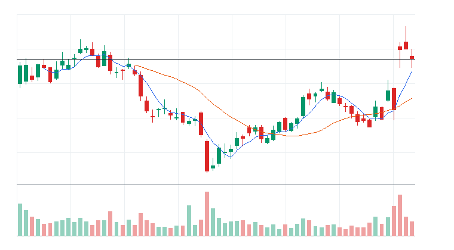
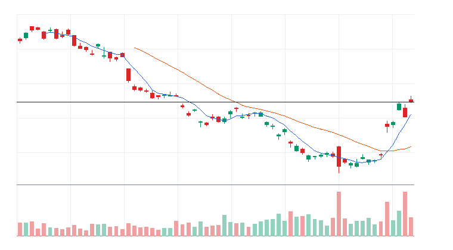
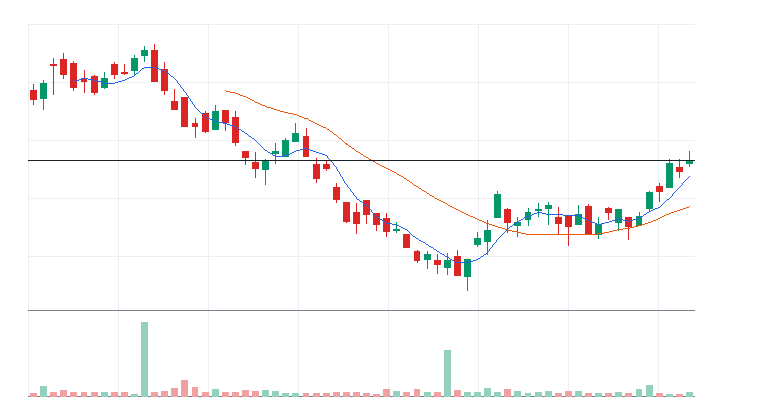
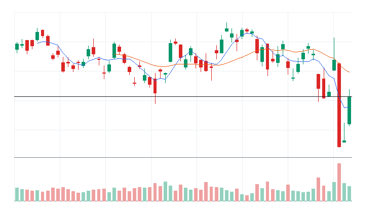
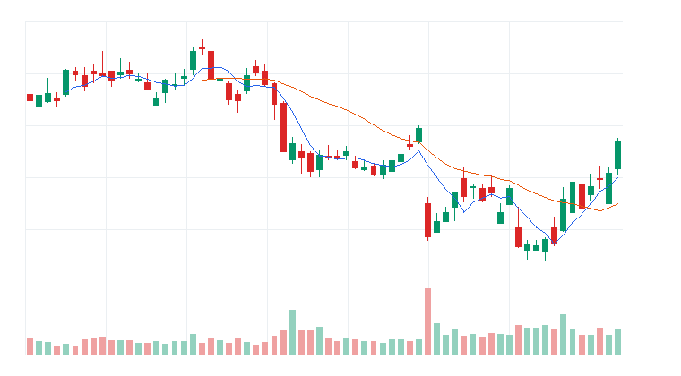
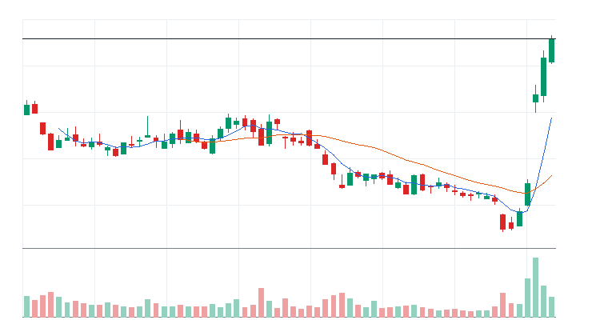

# 오늘의 데일리 트레이딩 요약

**REAL DATA TEST - 가격/거래량은 실제 데이터, 뉴스/ETF 구성종목 확산도/거래대금 유동성 일부 연결**

**목적:** 이 리포트는 최근 오른 자산을 나열하는 것이 아니라, 돈이 몰리는 근거와 다음 매수 주체가 확인할 트레이딩 후보를 찾기 위한 보고서다.

> 핵심 질문: 현재 가격에서 누가 사고 있고, 누가 앞으로 더 비싸게 사줄 수 있는가?

## 시장 국면 판단

- 최종 판정: 중립-상승 (55점)
- 전일 대비: 중립-하락에서 중립-상승으로 개선됐다(+20점).
- 판정 신뢰도: 높음 (100점) - 핵심 지수와 매크로 데이터가 대부분 직접 수집되어 판정 신뢰도가 높다.
- 행동 바이어스: 눌림 매수와 돌파 확인 병행
- 한 줄 결론: S&P 500 중심으로 상승 우위지만, 매크로 점수 50라 추격보다 확인 매수가 낫다.
- 기술적 지표: 상승 추세 유지 (57점, 가중치 65%)
- S&P 500: 71점 | 50일선 아래, 200일선 위, 20일 -3.30%, 60일 -3.00%, 52주 고점 대비 -3.76% -> 기술 점수 71
- Nasdaq 100: 43점 | 50일선 아래, 200일선 위, 20일 -8.99%, 60일 -7.00%, 52주 고점 대비 -11.01% -> 기술 점수 43
- 매크로 시황: 매크로 중립 (50점, 가중치 35%)
- 매크로 요약: 금리, 물가은 우호적이나 신용/유동성 부담이 남아 있다.
- 금리: 중립-우호 57점 / 금리 중립 / confidence HIGH
  - 주요 근거: US 10Y yield 20일 -7.18%, 5일 -0.61%; US 3M yield 20일 -0.37%, 단기금리 방향 확인; US long-duration bonds 20일 +5.01%, 장기채 가격 기준 할인율 부담 확인
  - 확인 사항: 금리 하락이 경기 둔화형 안전자산 선호일 수 있어 단순 우호로 보기 어렵다.
- 물가: 중립-우호 55점 / 물가 중립 / confidence HIGH
  - 주요 근거: Oil ETF 20일 -5.54%, 유가 기반 물가 압력 확인; TIPS ETF 20일 +1.46%, 물가연동채 흐름은 보조 근거; Gold 20일 -0.69%, 금 강세는 방어 수요 여부 확인
  - 확인 사항: 추가 확인 이벤트 없음
- 정책: 중립 50점 / 정책 이벤트 확인 전 중립 / confidence LOW
  - 주요 근거: 정책 톤은 1차 버전에서 일정/이벤트 리스크 기반 중립값으로 반영한다.
  - 확인 사항: FOMC, CPI, PCE, 고용지표 발표 전후에는 매크로 confidence를 보수적으로 해석한다.
- 신용/유동성: 부담 35점 / 신용/유동성 부담 / confidence HIGH
  - 주요 근거: High yield credit 20일 +0.28%, 하이일드 위험선호 확인; HYG-LQD 20일 상대강도 -1.76%, 신용위험 선호/회피 확인; VIX 20일 +30.97%, 변동성 부담 확인
  - 확인 사항: VIX 상승은 유동성/리스크 프리미엄 부담으로 해석한다.
- 환율/글로벌: 중립 51점 / 환율/글로벌 중립 / confidence MEDIUM
  - 주요 근거: US dollar 20일 -0.55%, 달러 강세/약세 확인
  - 확인 사항: 추가 확인 이벤트 없음
- US 10Y yield: 62점 | 하락 시 주식 우호; 5일 -0.61%, 20일 -7.18% -> 매크로 점수 62
- US 3M yield: 50점 | 하락 시 주식 우호; 5일 +1.33%, 20일 -0.37% -> 매크로 점수 50
- US long-duration bonds: 58점 | 상승 시 주식 우호; 5일 +0.28%, 20일 +5.01% -> 매크로 점수 58
- TIPS ETF: 50점 | 상승 시 주식 우호; 5일 -0.35%, 20일 +1.46% -> 매크로 점수 50
- Oil ETF: 66점 | 하락 시 주식 우호; 5일 -9.06%, 20일 -5.54% -> 매크로 점수 66
- Gold: 50점 | 상승 시 주식 우호; 5일 +4.94%, 20일 -0.69% -> 매크로 점수 50
- US dollar: 51점 | 하락 시 주식 우호; 5일 +0.03%, 20일 -0.55% -> 매크로 점수 51
- High yield credit: 51점 | 상승 시 주식 우호; 5일 +0.81%, 20일 +0.28% -> 매크로 점수 51
- Investment grade credit: 50점 | 상승 시 주식 우호; 5일 +0.93%, 20일 +2.04% -> 매크로 점수 50
- VIX: 5점 | 하락 시 주식 우호; 5일 -5.82%, 20일 +30.97% -> 매크로 점수 5
- 데이터 커버리지: 기술 2/2, 매크로 10/10
- 데이터 신뢰도 근거:
  - 직접 지수 데이터: S&P 500, Nasdaq 100
  - 대체 지수 데이터 없음
  - 매크로 데이터: 10/10
  - 누락 데이터 없음
  - stale 데이터 없음

## 모바일 요약

[오늘의 데일리 트레이딩 요약]

생성 성공 / 데이터 모드: REAL_TEST

시장:
- 중립

시장 지배 서사:
1. Travel Services 자금 유입 - 약화 - Invesco QQQ Trust(QQQ), Airbnb Inc.(ABNB), Booking Holdings Inc.(BKNG) 중심으로 5일 +5.76%, 20일 +3.55% 흐름이 형성됨. 직접 촉매 일부 확인.
2. Specialty Business Services 자금 유입 - 약화 - iShares Russell 2000 ETF(IWM), SPDR S&P 500 ETF Trust(SPY), Cintas Corporation(CTAS), Copart Inc.(CPRT) 중심으로 5일 -1.58%, 20일 +4.10% 흐름이 형성됨. 뉴스 직접성 제한.
3. Staffing & Employment 자금 유입 - 약화 - iShares Russell 2000 ETF(IWM), SPDR S&P 500 ETF Trust(SPY), Paychex Inc.(PAYX), Automatic Data Processing Inc.(ADP) 중심으로 5일 +0.30%, 20일 +1.89% 흐름이 형성됨. 뉴스 직접성 제한.

트렌드 강도:
1. Travel Services 자금 유입 - TSI 30 - 잠복 - 진입품질 낮음
2. Specialty Business Services 자금 유입 - TSI 18 - 잠복 - 진입품질 낮음
3. Staffing & Employment 자금 유입 - TSI 26 - 잠복 - 진입품질 낮음

오늘 결론:
- 이커머스/여행 플랫폼 개별 종목 흐름이 ETF 대비 강한지 확인 필요
- 행동 후보는 linkedNarrative와 함께 확인한다.
- 추격보다 진입 조건 확인 후 접근한다.

오늘 실제 행동 후보:
1. Airbnb Inc.(ABNB)(STOCK) - Travel Services 자금 유입 - 52주 고점 부근이라 돌파가 확인되면 신고가 추종 매수가 붙을 수 있음
2. Ferrovial N.V.(FER)(STOCK) - Specialty Business Services 자금 유입 - 단기 추세가 유지되고 거래량이 1.0배 이상이면 눌림 이후 재상승을 시도할 수 있음
3. Charter Communications Inc.(CHTR)(STOCK) - Specialty Business Services 자금 유입 - 단기 추세가 유지되고 거래량이 1.0배 이상이면 눌림 이후 재상승을 시도할 수 있음

다크호스 후보:
1. 다크호스 후보 없음 - 조건 충족 후보 없음

ETF 후보 TOP 5:
1. Utilities Select Sector SPDR Fund(XLU) - 전력망/원전/인프라 병목 - 제외
2. iShares Russell 2000 ETF(IWM) - Specialty Business Services 자금 유입 - 제외
3. iShares U.S. Infrastructure ETF(IFRA) - 전력망/원전/인프라 병목 - 제외
4. SPDR S&P 500 ETF Trust(SPY) - Specialty Business Services 자금 유입 - 제외
5. iShares U.S. Aerospace & Defense ETF(ITA) - 방산/안보 프리미엄 - 거래량 확인 전 관찰

웹 리포트:
https://yoolcool.github.io/DailyTradingThesisAgent/

## 오늘 결론

- 오늘 결론: 조건부 진입
- 신규 진입 후보: 0개
- 조건부 진입 후보: 4개
- 관찰 후보: 82개
- 주요 제한 요인: Entry Quality < 40, 뉴스 직접성 부족, RVOL 미달
- 주문 판단: 시장가 금지 / 지정가 또는 관찰
- 실전 판단: 진입 후보는 있으나, 전일 고점 돌파와 거래량 확인 후 선별적으로 접근한다.

### 후보 제한 요인 집계

- RVOL < 1.00x: 82개
- 거래대금 유동성 낮음: 16개
- Entry Quality 50~54 near miss: 0개
- Entry Quality 40~49 관찰: 0개
- Entry Quality < 40: 155개
- Exhaustion Risk >= 70: 0개
- ETF breadth 샘플 부족: 37개
- 뉴스 직접성 부족: 98개

## 데이터 신뢰도

- 전체 데이터 신뢰도 등급: LOW
- 분석 신뢰도: LOW
- 주문 실행 신뢰도: LOW
- ETF breadth 신뢰도: LOW
- 신뢰도 해석: 테마 확산 판단 제한, 거래대금 유동성 낮음 또는 확인 불가, 프리/애프터마켓 확인 불가
- 리포트 생성 시각: 2026-11-10 13:31 KST
- 가격 기준 거래일: 2026-11-09 US regular close
- 뉴스 수집 시각: 2026-11-10 13:31 KST
- 가장 최근 뉴스 발행 시각: 2026-11-10 12:58 KST
- 뉴스 신선도 상태: FRESH
- 뉴스 소스: Yahoo Finance RSS, MarketWatch RSS, CNBC Markets RSS, SEC EDGAR RSS, Federal Reserve RSS, Finnhub API
- 뉴스 소스 상태: Yahoo Finance RSS CONNECTED, MarketWatch RSS CONNECTED, CNBC Markets RSS PARTIAL, SEC EDGAR RSS PARTIAL, Federal Reserve RSS CONNECTED, Finnhub API DISABLED
- 뉴스 신뢰도: MEDIUM
- 추천 적용 거래일: 2026-11-09 US regular session
- 가격/거래량 데이터 상태: 일부 연결
- 뉴스 데이터 상태: 일부 연결
- ETF 구성종목 확산도 상태: 일부 연결
- ETF 구성종목 샘플 수: 1~4
- 거래대금 유동성 데이터 상태: 일부 연결
- 프리/애프터마켓 데이터 상태: UNAVAILABLE
- 데이터 provider: yfinance, Yahoo Finance RSS, MarketWatch RSS, CNBC Markets RSS, SEC EDGAR RSS, Federal Reserve RSS, Finnhub API, config fallback sample, price-volume dollar-volume fallback
- 실전 사용 경고: 이 리포트는 투자판단 보조용이며, REAL_TEST 모드에서는 일부 데이터가 누락되거나 지연될 수 있다. 실제 주문 전 현재가, 뉴스, 프리마켓/정규장 거래량을 별도 확인해야 한다.

## 0. 시장 상태

- 데이터 모드: REAL_TEST
- 가격/거래량: 일부 연결
- 뉴스: 일부 연결
- ETF 구성종목 확산도: 일부 연결
- 거래대금 유동성: 일부 연결
- 생성 시각: 2026년 11월 10일 화요일 PM 1:31
- 시장 상태: 중립
- 오늘 돈의 방향: 이커머스/여행 플랫폼 개별 종목 흐름이 ETF 대비 강한지 확인 필요
- 강한 테마 TOP 3: Financial Services(68), 전력/유틸리티 ETF(55), Utilities(48)
- 데이터 한계:
  - API 또는 provider 상태에 따라 뉴스/ETF 확산도/거래대금 유동성 반영 범위가 달라질 수 있다.
  - 수집 실패 데이터는 점수 반영에서 제외하거나 confidence를 제한한다.
  - reasonConfidence HIGH는 직접 촉매, 가격/거래량, 확산도/유동성 근거가 함께 있을 때만 사용한다.

## 오늘 시장을 지배하는 서사

### 오늘 시장을 지배하는 서사 TOP 3

#### 1. Travel Services 자금 유입
- 상태: 약화
- narrativeScore: 43
- reasonConfidence: LOW
- 근거 ETF: QQQ
- 근거 개별 종목: ABNB, BKNG
- 돈이 몰리는 이유: Travel Services 자금 유입 관련 Invesco QQQ Trust(QQQ)와 Airbnb Inc.(ABNB), Booking Holdings Inc.(BKNG)의 5일(+5.76%)·20일(+3.55%) 흐름을 함께 본다. 평균 상대 거래량은 1.05배이고, ETF 확산도는 추가 확인이 필요하다. 직접 뉴스/이벤트가 일부 확인된다.
- 다음 매수 주체: Travel Services 자금 유입을 확인한 섹터 ETF 자금과 상대강도 추종 스윙 자금
- 가장 좋은 트레이딩 수단: ETF 우선: QQQ / 개별 종목 우선: BKNG, ABNB
- 서사가 깨지는 조건: QQQ 20일선 이탈 또는 관련 종목 절반 이상 5일선 이탈
- 오늘 행동: 기존 네러티브와 중복을 확인한 뒤 ETF/대표 종목 동조성이 살아날 때만 관찰 편입

상세 narrativeScore 근거 보기

- rawScore: 43
- ETF 평균 moneyFlowScore: 19
- 개별 종목 평균 moneyFlowScore: 57
- ETF 후보 비율: 0%
- 개별 종목 후보 비율: 50%
- 5일 평균 수익률: +6.00%
- 20일 평균 수익률: +4.00%
- 평균 상대 거래량: 1.00배
- ETF 평균 상대 거래량: 1.00배
- 개별주 평균 상대 거래량: 1.00배
- 52주 고점 근접 후보 비율: 33%
- 뉴스 직접성 점수: 7
- ETF 확산도 점수: 0
- 유동성 점수: 3
- 과열 리스크 차감: 0

#### 2. Specialty Business Services 자금 유입
- 상태: 약화
- narrativeScore: 37
- reasonConfidence: LOW
- 근거 ETF: IWM, SPY, QQQ
- 근거 개별 종목: CTAS, CPRT, TRI
- 돈이 몰리는 이유: Specialty Business Services 자금 유입 관련 iShares Russell 2000 ETF(IWM), SPDR S&P 500 ETF Trust(SPY), Invesco QQQ Trust(QQQ)와 Cintas Corporation(CTAS), Copart Inc.(CPRT), Thomson Reuters Corporation(TRI)의 5일(-1.58%)·20일(+4.10%) 흐름을 함께 본다. 평균 상대 거래량은 0.99배이고, ETF 확산도는 추가 확인이 필요하다. 뉴스 직접성은 아직 제한적이다.
- 다음 매수 주체: Specialty Business Services 자금 유입을 확인한 섹터 ETF 자금과 상대강도 추종 스윙 자금
- 가장 좋은 트레이딩 수단: ETF 우선: QQQ, SPY, IWM / 개별 종목 우선: TRI, CTAS, CPRT
- 서사가 깨지는 조건: QQQ 20일선 이탈 또는 관련 종목 절반 이상 5일선 이탈
- 오늘 행동: 기존 네러티브와 중복을 확인한 뒤 ETF/대표 종목 동조성이 살아날 때만 관찰 편입

상세 narrativeScore 근거 보기

- rawScore: 37
- ETF 평균 moneyFlowScore: 37
- 개별 종목 평균 moneyFlowScore: 34
- ETF 후보 비율: 33%
- 개별 종목 후보 비율: 33%
- 5일 평균 수익률: -2.00%
- 20일 평균 수익률: +4.00%
- 평균 상대 거래량: 1.00배
- ETF 평균 상대 거래량: 1.00배
- 개별주 평균 상대 거래량: 1.00배
- 52주 고점 근접 후보 비율: 33%
- 뉴스 직접성 점수: 8
- ETF 확산도 점수: 0
- 유동성 점수: 3
- 과열 리스크 차감: 0

#### 3. Staffing & Employment 자금 유입
- 상태: 약화
- narrativeScore: 34
- reasonConfidence: LOW
- 근거 ETF: IWM, SPY, QQQ
- 근거 개별 종목: PAYX, ADP
- 돈이 몰리는 이유: Staffing & Employment 자금 유입 관련 iShares Russell 2000 ETF(IWM), SPDR S&P 500 ETF Trust(SPY), Invesco QQQ Trust(QQQ)와 Paychex Inc.(PAYX), Automatic Data Processing Inc.(ADP)의 5일(+0.30%)·20일(+1.89%) 흐름을 함께 본다. 평균 상대 거래량은 1.05배이고, ETF 확산도는 추가 확인이 필요하다. 뉴스 직접성은 아직 제한적이다.
- 다음 매수 주체: Staffing & Employment 자금 유입을 확인한 섹터 ETF 자금과 상대강도 추종 스윙 자금
- 가장 좋은 트레이딩 수단: ETF 우선: QQQ, SPY, IWM / 개별 종목 우선: ADP, PAYX
- 서사가 깨지는 조건: QQQ 20일선 이탈 또는 관련 종목 절반 이상 5일선 이탈
- 오늘 행동: 기존 네러티브와 중복을 확인한 뒤 ETF/대표 종목 동조성이 살아날 때만 관찰 편입

상세 narrativeScore 근거 보기

- rawScore: 34
- ETF 평균 moneyFlowScore: 37
- 개별 종목 평균 moneyFlowScore: 35
- ETF 후보 비율: 33%
- 개별 종목 후보 비율: 0%
- 5일 평균 수익률: 0.00%
- 20일 평균 수익률: +2.00%
- 평균 상대 거래량: 1.00배
- ETF 평균 상대 거래량: 1.00배
- 개별주 평균 상대 거래량: 1.00배
- 52주 고점 근접 후보 비율: 40%
- 뉴스 직접성 점수: 7
- ETF 확산도 점수: 0
- 유동성 점수: 3
- 과열 리스크 차감: 0

### 전체 narrative 요약

| 서사명 | 상태 | narrativeScore | reasonConfidence | 대표 ETF | 대표 종목 | 오늘 행동 |
| --- | --- | ---: | --- | --- | --- | --- |
| Travel Services 자금 유입 | 약화 | 43 | LOW | QQQ | ABNB, BKNG | 기존 네러티브와 중복을 확인한 뒤 ETF/대표 종목 동조성이 살아날 때만 관찰 편입 |
| Specialty Business Services 자금 유입 | 약화 | 37 | LOW | IWM, SPY, QQQ | CTAS, CPRT, TRI | 기존 네러티브와 중복을 확인한 뒤 ETF/대표 종목 동조성이 살아날 때만 관찰 편입 |
| Staffing & Employment 자금 유입 | 약화 | 34 | LOW | IWM, SPY, QQQ | PAYX, ADP | 기존 네러티브와 중복을 확인한 뒤 ETF/대표 종목 동조성이 살아날 때만 관찰 편입 |
| 소비 회복/방어주 선별 | 약화 | 30 | LOW | QQQ | AMZN, PDD | 기존 네러티브와 중복을 확인한 뒤 ETF/대표 종목 동조성이 살아날 때만 관찰 편입 |
| Discount Stores 자금 유입 | 약화 | 23 | LOW | QQQ | WMT, COST | 기존 네러티브와 중복을 확인한 뒤 ETF/대표 종목 동조성이 살아날 때만 관찰 편입 |
| 바이오/헬스케어 촉매 | 약화 | 22 | LOW | QQQ | GILD, AMGN, VRTX, REGN | 기존 네러티브와 중복을 확인한 뒤 ETF/대표 종목 동조성이 살아날 때만 관찰 편입 |
| 필수소비재 음료 방어 성장 | 약화 | 21 | LOW | QQQ | PEP, CCEP, KDP, MNST | 기존 네러티브와 중복을 확인한 뒤 ETF/대표 종목 동조성이 살아날 때만 관찰 편입 |
| Aerospace & Defense 자금 유입 | 약화 | 20 | LOW | IWM, SPY, QQQ | NOC, LMT, RTX, KTOS | 기존 네러티브와 중복을 확인한 뒤 ETF/대표 종목 동조성이 살아날 때만 관찰 편입 |
| 소프트웨어 실적/AI 수익화 | 약화 | 14 | LOW | QQQ, IGV, AIQ | ADSK, ROP, INTU, TEAM | 기존 네러티브와 중복을 확인한 뒤 ETF/대표 종목 동조성이 살아날 때만 관찰 편입 |
| 전력 유틸리티 수요 재평가 | 소멸 | 12 | LOW | IWM, SPY, QQQ | ETN, GEV, VRT | 기존 네러티브와 중복을 확인한 뒤 ETF/대표 종목 동조성이 살아날 때만 관찰 편입 |
| Integrated Oil & Gas 자금 유입 | 소멸 | 11 | LOW | IWM, SPY, QQQ | CVX, XOM | 기존 네러티브와 중복을 확인한 뒤 ETF/대표 종목 동조성이 살아날 때만 관찰 편입 |
| Data Storage 자금 유입 | 소멸 | 9 | LOW | IWM, SPY, QQQ | STX, WDC | 기존 네러티브와 중복을 확인한 뒤 ETF/대표 종목 동조성이 살아날 때만 관찰 편입 |
| Bitcoin Mining 자금 유입 | 소멸 | 9 | LOW | IBIT, BLOK | RIOT, MARA, CIFR | 기존 네러티브와 중복을 확인한 뒤 ETF/대표 종목 동조성이 살아날 때만 관찰 편입 |
| Medical Devices 자금 유입 | 약화 | 9 | LOW | QQQ | ISRG, DXCM | 기존 네러티브와 중복을 확인한 뒤 ETF/대표 종목 동조성이 살아날 때만 관찰 편입 |
| 전력망/원전/인프라 병목 | 소멸 | 8 | LOW | XLU, URA, PAVE | CEG, VRT, ETN, PWR | ETF 확산도와 거래량이 같이 살아날 때만 진입 |
| 방산/안보 프리미엄 | 약화 | 7 | LOW | ITA, XAR, SHLD | AVAV, KTOS, PLTR | 뉴스 촉매가 직접 확인될 때만 추세 추종 |
| 위험선호 성장주 재진입 | 소멸 | 6 | LOW | IWM, QQQ, IPO | ARM, COIN, TSLA | 지수 위험선호가 유지될 때만 선별 진입 |
| 매크로 방어/헤지 | 약화 | 5 | LOW | TLT, GLD, XLE | XOM, CVX | 위험회피가 확인될 때만 헤지성 접근 |
| 반도체 설계/공급망 재가속 | 소멸 | 2 | LOW | SMH, SOXQ, SOXX | NXPI, AMD, TSM, NVDA | 기존 네러티브와 중복을 확인한 뒤 ETF/대표 종목 동조성이 살아날 때만 관찰 편입 |
| Internet Content 자금 유입 | 소멸 | 0 | LOW | QQQ | META, GOOGL, GOOG | 기존 네러티브와 중복을 확인한 뒤 ETF/대표 종목 동조성이 살아날 때만 관찰 편입 |
| 비트코인/디지털 자산 위험선호 | 소멸 | 0 | LOW | IBIT, BLOK | RIOT, MSTR, COIN, IREN | 비트코인 베타가 살아날 때만 단기 매매 |
| 반도체 장비 사이클 재평가 | 소멸 | 0 | LOW | SMH, SOXQ, SOXX | ASML, LRCX | 기존 네러티브와 중복을 확인한 뒤 ETF/대표 종목 동조성이 살아날 때만 관찰 편입 |
| AI 인프라 재가속 | 소멸 | 0 | LOW | SMH, SOXX, DRAM | NVDA, MU, VRT, ETN | 추격보다 5일선 지지 후 재상승 확인 |
| AI 소프트웨어/사이버보안 확산 | 소멸 | 0 | LOW | QQQ, IGV, AIQ | MSFT, PLTR, DDOG, TEAM | 추격보다 눌림 후 재상승 확인 |
| 사이버보안 지출 재가속 | 소멸 | 0 | LOW | HACK, CIBR, IHAK | ZS, FTNT, PANW, CRWD | 기존 네러티브와 중복을 확인한 뒤 ETF/대표 종목 동조성이 살아날 때만 관찰 편입 |

## 트렌드 강도 판단

### 1. Travel Services 자금 유입
- Trend Strength Index: 30
- 트렌드 상태 라벨: 잠복
- 테마 확산도: 부족
- ETF 동조성: 부족
- 거래량 강도: 약함
- 과열 위험: 보통 (34)
- 오늘 진입 품질: 낮음 (13)
- 한 줄 판단: Travel Services 자금 유입는 Trend Strength는 높아도 시장 위험선호가 약해 시장 환경 비우호 구간이다.
- 오늘 접근법: Invesco QQQ Trust(QQQ)와 Airbnb Inc.(ABNB)/Booking Holdings Inc.(BKNG)의 거래량 확산이 확인되기 전까지 관찰한다.

트렌드 강도 상세 근거 보기

- 가격 모멘텀: 가격 모멘텀 16/25. 평균 5D +5.76%, 20D +3.55%.
- 거래량 강도: 거래량 강도 9/20. 평균 RVOL 1.05배.
- ETF 동조성: ETF 동조성 -2/15. 관련 ETF Invesco QQQ Trust(QQQ) 흐름을 기준으로 판단.
- 테마 확산도: 테마 확산도 3/20. 상위 1~2개 쏠림 감점 6점 반영.
- 뉴스 촉매: 뉴스/촉매 신선도 1/10. HIGH 직접 촉매 1개.
- 과열 리스크: 과열 리스크 34/100. 단기 급등, 고점 근접, ETF-개별주 괴리, 쏠림을 함께 반영.
- 시장 환경: 시장 환경 3/10. QQQ/SPY/IWM 가격 흐름 기반 위험선호 점수.

### 2. Specialty Business Services 자금 유입
- Trend Strength Index: 18
- 트렌드 상태 라벨: 잠복
- 테마 확산도: 부족
- ETF 동조성: 부족
- 거래량 강도: 약함
- 과열 위험: 낮음 (10)
- 오늘 진입 품질: 낮음 (18)
- 한 줄 판단: Specialty Business Services 자금 유입는 Trend Strength는 높아도 시장 위험선호가 약해 시장 환경 비우호 구간이다.
- 오늘 접근법: iShares Russell 2000 ETF(IWM)/SPDR S&P 500 ETF Trust(SPY)/Invesco QQQ Trust(QQQ)와 Cintas Corporation(CTAS)/Copart Inc.(CPRT)/Thomson Reuters Corporation(TRI)의 거래량 확산이 확인되기 전까지 관찰한다.

트렌드 강도 상세 근거 보기

- 가격 모멘텀: 가격 모멘텀 0/25. 평균 5D -1.58%, 20D +4.10%.
- 거래량 강도: 거래량 강도 6/20. 평균 RVOL 0.99배.
- ETF 동조성: ETF 동조성 4/15. 관련 ETF Invesco QQQ Trust(QQQ), SPDR S&P 500 ETF Trust(SPY), iShares Russell 2000 ETF(IWM) 흐름을 기준으로 판단.
- 테마 확산도: 테마 확산도 3/20. 상위 1~2개 쏠림 감점 3점 반영.
- 뉴스 촉매: 뉴스/촉매 신선도 2/10. HIGH 직접 촉매 0개.
- 과열 리스크: 과열 리스크 10/100. 단기 급등, 고점 근접, ETF-개별주 괴리, 쏠림을 함께 반영.
- 시장 환경: 시장 환경 3/10. QQQ/SPY/IWM 가격 흐름 기반 위험선호 점수.

### 3. Staffing & Employment 자금 유입
- Trend Strength Index: 26
- 트렌드 상태 라벨: 잠복
- 테마 확산도: 약함
- ETF 동조성: 부족
- 거래량 강도: 약함
- 과열 위험: 낮음 (2)
- 오늘 진입 품질: 낮음 (25)
- 한 줄 판단: Staffing & Employment 자금 유입는 Trend Strength는 높아도 시장 위험선호가 약해 시장 환경 비우호 구간이다.
- 오늘 접근법: iShares Russell 2000 ETF(IWM)/SPDR S&P 500 ETF Trust(SPY)/Invesco QQQ Trust(QQQ)와 Paychex Inc.(PAYX)/Automatic Data Processing Inc.(ADP)의 거래량 확산이 확인되기 전까지 관찰한다.

트렌드 강도 상세 근거 보기

- 가격 모멘텀: 가격 모멘텀 3/25. 평균 5D +0.30%, 20D +1.89%.
- 거래량 강도: 거래량 강도 7/20. 평균 RVOL 1.05배.
- ETF 동조성: ETF 동조성 4/15. 관련 ETF Invesco QQQ Trust(QQQ), SPDR S&P 500 ETF Trust(SPY), iShares Russell 2000 ETF(IWM) 흐름을 기준으로 판단.
- 테마 확산도: 테마 확산도 7/20. 상위 1~2개 쏠림 감점 0점 반영.
- 뉴스 촉매: 뉴스/촉매 신선도 2/10. HIGH 직접 촉매 0개.
- 과열 리스크: 과열 리스크 2/100. 단기 급등, 고점 근접, ETF-개별주 괴리, 쏠림을 함께 반영.
- 시장 환경: 시장 환경 3/10. QQQ/SPY/IWM 가격 흐름 기반 위험선호 점수.

## 최근 추천 결과 트래킹

개별주는 데이트레이딩 관점으로 추천 이후 첫 정규장의 장중 최고가와 종가를 추적한다. ETF는 테마/스윙 관점으로 추천 이후 1주일 동안의 최고가와 현재 종가를 추적한다.

### 개별주 Top 3 추천 성과 요약
- 최근 5개 리포트 표본: 14개 (초기 검증 단계)
- 장중 최고가 기준 성공률: +36.36%
- 종가 기준 성공률: +45.45%
- 평균 장중 최고 수익률: +2.30%
- 평균 종가 수익률: +0.36%

### ETF 추천 성과 요약
- 최근 5개 리포트 표본: 0개 (초기 검증 단계)
- 1주 최고가 기준 성공률: 데이터 없음
- 현재 종가 기준 성공률: 데이터 없음
- 평균 1주 최고 수익률: 데이터 없음
- 평균 현재 수익률: 데이터 없음

최근 추천 결과 상세 테이블 펼치기

| 추천일 | 유형 | 순위 | 티커 | 기준가 | 추적 기간 | 상태 | High 수익률 | Close 수익률 | 결과 | 코멘트 |
| --- | --- | ---: | --- | ---: | --- | --- | ---: | ---: | --- | --- |
| 2026-11-10 | STOCK | 3 | CHTR | $121.2 | 2026-11-10 | pending | 데이터 없음 | 데이터 없음 | 추적 대기 | 아직 추적 거래일 데이터가 완성되지 않음 |
| 2026-11-10 | STOCK | 2 | FER | $61.39 | 2026-11-10 | pending | 데이터 없음 | 데이터 없음 | 추적 대기 | 아직 추적 거래일 데이터가 완성되지 않음 |
| 2026-11-10 | STOCK | 1 | ABNB | $190.29 | 2026-11-10 | pending | 데이터 없음 | 데이터 없음 | 추적 대기 | 아직 추적 거래일 데이터가 완성되지 않음 |
| 2026-11-09 | STOCK | 2 | APP | $391.22 | 2026-11-09 | complete | +5.54% | +4.80% | 성공 | 장중 기회와 종가 유지가 모두 확인됨 (일봉 기준) |
| 2026-11-09 | STOCK | 1 | ABNB | $189.99 | 2026-11-09 | complete | +4.15% | +0.16% | 단타 유효 | 장중 기회는 있었지만 종가 유지력은 약함 (일봉 기준) |
| 2026-11-06 | STOCK | 3 | ROP | $490.96 | 2026-11-06 | complete | -2.04% | -2.92% | 실패 | 추천 이후 의미 있는 장중 기회가 부족하고 종가도 약함 (일봉 기준) |
| 2026-11-06 | STOCK | 2 | COST | $1,065.59 | 2026-11-06 | complete | -0.24% | -1.13% | 실패 | 추천 이후 의미 있는 장중 기회가 부족하고 종가도 약함 (일봉 기준) |
| 2026-11-06 | STOCK | 1 | REGN | $902.9 | 2026-11-06 | complete | +0.97% | +0.16% | 추적 대기 | 아직 추적 거래일 데이터가 완성되지 않음 (일봉 기준) |
| 2026-11-04 | STOCK | 3 | IDXX | $672.04 | 2026-11-04 | complete | +6.20% | +3.94% | 성공 | 장중 기회와 종가 유지가 모두 확인됨 (일봉 기준) |
| 2026-11-04 | STOCK | 2 | GEHC | $80.66 | 2026-11-04 | complete | +8.55% | +6.38% | 성공 | 장중 기회와 종가 유지가 모두 확인됨 (일봉 기준) |
| 2026-11-04 | STOCK | 1 | REGN | $973.36 | 2026-11-04 | complete | +1.89% | -4.39% | 제한적 유효 | 제한적인 장중 기회만 발생 (일봉 기준) |
| 2026-11-03 | STOCK | 3 | GEHC | $79.55 | 2026-11-03 | complete | +1.58% | +1.40% | 제한적 유효 | 제한적인 장중 기회만 발생 (일봉 기준) |
| 2026-11-03 | STOCK | 2 | KDP | $36.82 | 2026-11-03 | complete | -2.77% | -5.65% | 실패 | 추천 이후 의미 있는 장중 기회가 부족하고 종가도 약함 (일봉 기준) |
| 2026-11-03 | STOCK | 1 | REGN | $961.26 | 2026-11-03 | complete | +1.48% | +1.26% | 제한적 유효 | 제한적인 장중 기회만 발생 (일봉 기준) |
| 2026-11-02 | STOCK | 3 | AMGN | $466.01 | 2026-11-02 | complete | +0.64% | -0.12% | 실패 | 추천 이후 의미 있는 장중 기회가 부족하고 종가도 약함 (일봉 기준) |
| 2026-11-02 | STOCK | 2 | VRTX | $558.88 | 2026-11-02 | complete | +1.75% | -1.03% | 제한적 유효 | 제한적인 장중 기회만 발생 (일봉 기준) |
| 2026-11-02 | STOCK | 1 | XOM | $187.25 | 2026-11-02 | complete | -1.42% | -4.05% | 실패 | 추천 이후 의미 있는 장중 기회가 부족하고 종가도 약함 (일봉 기준) |
| 2026-10-30 | STOCK | 3 | FER | $56.92 | 2026-10-30 | complete | -0.09% | -2.86% | 실패 | 추천 이후 의미 있는 장중 기회가 부족하고 종가도 약함 (일봉 기준) |
| 2026-10-30 | STOCK | 2 | RTX | $199.4 | 2026-10-30 | complete | +2.41% | +0.20% | 제한적 유효 | 제한적인 장중 기회만 발생 (일봉 기준) |
| 2026-10-30 | STOCK | 1 | LMT | $643.59 | 2026-10-30 | complete | +2.08% | -1.03% | 제한적 유효 | 제한적인 장중 기회만 발생 (일봉 기준) |
| 2026-10-29 | STOCK | 3 | GEHC | $75.82 | 2026-10-29 | complete | +1.99% | +0.79% | 제한적 유효 | 제한적인 장중 기회만 발생 (일봉 기준) |
| 2026-10-29 | STOCK | 2 | LMT | $629.75 | 2026-10-29 | complete | +3.06% | +2.20% | 성공 | 장중 기회와 종가 유지가 모두 확인됨 (일봉 기준) |
| 2026-10-29 | STOCK | 1 | ROP | $440.66 | 2026-10-29 | complete | +2.17% | +2.04% | 제한적 유효 | 제한적인 장중 기회만 발생 (일봉 기준) |
| 2026-10-27 | STOCK | 3 | LMT | $635.2 | 2026-10-27 | complete | -0.26% | -1.92% | 실패 | 추천 이후 의미 있는 장중 기회가 부족하고 종가도 약함 (일봉 기준) |
| 2026-10-27 | STOCK | 2 | ROP | $441.65 | 2026-10-27 | complete | -0.52% | -1.62% | 실패 | 추천 이후 의미 있는 장중 기회가 부족하고 종가도 약함 (일봉 기준) |
| 2026-10-27 | STOCK | 1 | ZS | $260.45 | 2026-10-27 | complete | +2.85% | -0.12% | 제한적 유효 | 제한적인 장중 기회만 발생 (일봉 기준) |
| 2026-10-27 | ETF | 1 | IHAK | $76.25 | 2026-10-27~2026-11-03 | complete | +1.94% | -9.50% | 실패 | 추천 이후 ETF 흐름이 약화됨 |
| 2026-10-26 | STOCK | 3 | CRWD | $257.57 | 2026-10-26 | complete | +2.65% | +1.65% | 제한적 유효 | 제한적인 장중 기회만 발생 (일봉 기준) |
| 2026-10-26 | STOCK | 2 | ROP | $438.14 | 2026-10-26 | complete | +2.88% | +0.80% | 제한적 유효 | 제한적인 장중 기회만 발생 (일봉 기준) |
| 2026-10-26 | STOCK | 1 | ZS | $255.15 | 2026-10-26 | complete | +2.47% | +2.08% | 제한적 유효 | 제한적인 장중 기회만 발생 (일봉 기준) |
| 2026-10-26 | ETF | 1 | IHAK | $74 | 2026-10-26~2026-11-02 | complete | +5.04% | -6.74% | 단기 고점 후 반납 | 1주 내 상승 기회는 있었지만 현재가는 반납 |
| 2026-10-23 | STOCK | 3 | ADP | $294.5 | 2026-10-23 | complete | +5.06% | +3.28% | 성공 | 장중 기회와 종가 유지가 모두 확인됨 (일봉 기준) |
| 2026-10-23 | STOCK | 2 | CTAS | $220.15 | 2026-10-23 | complete | +2.56% | +1.79% | 제한적 유효 | 제한적인 장중 기회만 발생 (일봉 기준) |
| 2026-10-23 | STOCK | 1 | MAR | $404 | 2026-10-23 | complete | -1.77% | -3.29% | 실패 | 추천 이후 의미 있는 장중 기회가 부족하고 종가도 약함 (일봉 기준) |
| 2026-10-22 | STOCK | 3 | TRI | $112.82 | 2026-10-22 | complete | +9.70% | +9.25% | 성공 | 장중 기회와 종가 유지가 모두 확인됨 (일봉 기준) |
| 2026-10-22 | STOCK | 2 | MAR | $397.31 | 2026-10-22 | complete | +1.50% | -0.13% | 제한적 유효 | 제한적인 장중 기회만 발생 (일봉 기준) |
| 2026-10-22 | STOCK | 1 | NOC | $534 | 2026-10-22 | complete | +4.22% | +3.44% | 성공 | 장중 기회와 종가 유지가 모두 확인됨 (일봉 기준) |
| 2026-10-13 | STOCK | 2 | SHOP | $179.22 | 2026-10-13 | complete | -0.01% | -1.51% | 실패 | 추천 이후 의미 있는 장중 기회가 부족하고 종가도 약함 (일봉 기준) |
| 2026-10-13 | STOCK | 1 | PLTR | $209 | 2026-10-13 | complete | +0.90% | -0.16% | 실패 | 추천 이후 의미 있는 장중 기회가 부족하고 종가도 약함 (일봉 기준) |
| 2026-10-12 | STOCK | 3 | ZS | $233.73 | 2026-10-12 | complete | +1.49% | -3.40% | 제한적 유효 | 제한적인 장중 기회만 발생 (일봉 기준) |
| 2026-10-12 | STOCK | 2 | DDOG | $293.26 | 2026-10-12 | complete | +2.53% | -2.04% | 제한적 유효 | 제한적인 장중 기회만 발생 (일봉 기준) |
| 2026-10-12 | STOCK | 1 | PLTR | $209.05 | 2026-10-12 | complete | +1.86% | -0.02% | 제한적 유효 | 제한적인 장중 기회만 발생 (일봉 기준) |
| 2026-10-09 | STOCK | 2 | ZS | $216.81 | 2026-10-09 | complete | +8.07% | +7.80% | 성공 | 장중 기회와 종가 유지가 모두 확인됨 (일봉 기준) |
| 2026-10-09 | STOCK | 1 | PLTR | $198.78 | 2026-10-09 | complete | +5.43% | +5.17% | 성공 | 장중 기회와 종가 유지가 모두 확인됨 (일봉 기준) |
| 2026-10-08 | STOCK | 1 | ADSK | $235.05 | 2026-10-08 | complete | +0.40% | -0.62% | 실패 | 추천 이후 의미 있는 장중 기회가 부족하고 종가도 약함 (일봉 기준) |
| 2026-10-07 | STOCK | 3 | FTNT | $191.27 | 2026-10-07 | complete | +0.50% | -1.04% | 실패 | 추천 이후 의미 있는 장중 기회가 부족하고 종가도 약함 (일봉 기준) |
| 2026-10-07 | STOCK | 2 | AMD | $649.42 | 2026-10-07 | complete | -0.14% | -0.55% | 실패 | 추천 이후 의미 있는 장중 기회가 부족하고 종가도 약함 (일봉 기준) |
| 2026-10-07 | STOCK | 1 | SNPS | $505.17 | 2026-10-07 | complete | +0.86% | -0.49% | 실패 | 추천 이후 의미 있는 장중 기회가 부족하고 종가도 약함 (일봉 기준) |
| 2026-10-07 | ETF | 1 | CIBR | $108.13 | 2026-10-07~2026-10-14 | complete | +2.36% | -12.44% | 단기 고점 후 반납 | 1주 내 상승 기회는 있었지만 현재가는 반납 |
| 2026-10-06 | STOCK | 2 | TSM | $485.8 | 2026-10-06 | complete | +0.04% | -0.72% | 실패 | 추천 이후 의미 있는 장중 기회가 부족하고 종가도 약함 (일봉 기준) |
| 2026-10-06 | STOCK | 1 | SNPS | $488.47 | 2026-10-06 | complete | +3.90% | +3.42% | 성공 | 장중 기회와 종가 유지가 모두 확인됨 (일봉 기준) |
| 2026-10-06 | ETF | 1 | CIBR | $106.01 | 2026-10-06~2026-10-13 | complete | +4.41% | -10.69% | 단기 고점 후 반납 | 1주 내 상승 기회는 있었지만 현재가는 반납 |
| 2026-10-05 | STOCK | 1 | SNPS | $489.9 | 2026-10-05 | complete | +3.77% | -0.29% | 단타 유효 | 장중 기회는 있었지만 종가 유지력은 약함 (일봉 기준) |
| 2026-10-05 | ETF | 1 | SMH | $630.6 | 2026-10-05~2026-10-12 | complete | +1.41% | -22.71% | 실패 | 추천 이후 ETF 흐름이 약화됨 |
| 2026-09-30 | STOCK | 1 | AMAT | $512.01 | 2026-09-30 | complete | +0.67% | -0.12% | 실패 | 추천 이후 의미 있는 장중 기회가 부족하고 종가도 약함 (일봉 기준) |
| 2026-09-28 | STOCK | 3 | DDOG | $268.13 | 2026-09-28 | complete | +1.74% | +0.21% | 제한적 유효 | 제한적인 장중 기회만 발생 (일봉 기준) |
| 2026-09-28 | STOCK | 2 | ARM | $310.32 | 2026-09-28 | complete | -1.02% | -8.70% | 실패 | 추천 이후 의미 있는 장중 기회가 부족하고 종가도 약함 (일봉 기준) |
| 2026-09-28 | STOCK | 1 | QCOM | $201.97 | 2026-09-28 | complete | -1.39% | -7.17% | 실패 | 추천 이후 의미 있는 장중 기회가 부족하고 종가도 약함 (일봉 기준) |
| 2026-09-25 | STOCK | 3 | ARM | $332.56 | 2026-09-25 | complete | -2.13% | -6.69% | 실패 | 추천 이후 의미 있는 장중 기회가 부족하고 종가도 약함 (일봉 기준) |
| 2026-09-25 | STOCK | 2 | CRWD | $262.49 | 2026-09-25 | complete | -1.00% | -3.95% | 실패 | 추천 이후 의미 있는 장중 기회가 부족하고 종가도 약함 (일봉 기준) |

## 오늘 실제 행동 후보

### 1. Airbnb Inc.(ABNB)
- 자산 유형: STOCK
- linkedNarrative: Travel Services 자금 유입
- narrativeStatus: 약화
- narrativeScore: 43
- Trend Strength Index: 30
- Exhaustion Risk: 34 (보통)
- Entry Quality Score: 37 (낮음)
- 트렌드 판단: 테마 확산도가 낮아 개별 종목 이벤트성 흐름일 수 있다.
- moneyFlowScore: 100
- finalRawScore: 104
- reasonConfidence: HIGH
- reasonConfidenceExplanation: 직접 촉매: Yahoo Finance RSS / general_market / under_6h / positive - Why Airbnb (ABNB) stock is up today 가격/거래량, 관련 ETF 동반 강세, 유동성 근거가 함께 확인되어 HIGH로 분류했다.
- tieBreakerReason: 최종 원점수 104, 리스크 패널티 0, 5일 수익률 +11.21%, 상대 거래량 1.32배 순으로 정렬
- 후보별 시장 해석: 중립 / 제한적 - Entry Quality 37 < 50이나 moneyFlow 100, confidence HIGH, RVOL 1.32x로 강한 자금흐름 예외 조건 충족
- 게이트 사유: Entry Quality 37 < 50이나 moneyFlow 100, confidence HIGH, RVOL 1.32x로 강한 자금흐름 예외 조건 충족
- 주문 실행: 시장가 가능
- 직접 촉매: Yahoo Finance RSS / general_market / under_6h / positive - Why Airbnb (ABNB) stock is up today
- 왜 돈이 몰리는가: 20일 +16.39%, 5일 +11.21%, 상대 거래량 1.32배로 가격과 거래량이 함께 개선. 뉴스: Yahoo Finance RSS general_market/under_6h / 유동성: LIQUID
- 누가 더 비싸게 사줄 수 있는지: 개별 주도주를 따라붙는 단기 모멘텀 자금과 관련 ETF 강세를 확인한 트레이더
- 진입 조건: 전일 고점 돌파와 5일선 유지 확인
- 무효화 조건: 20일선 이탈 또는 상대 거래량 0.8배 이하 둔화
- todayActionLabel: 자금흐름 예외 조건부
#### 최근 뉴스/동향 한국어 요약

- 요약: 종목 직접 뉴스 확인 상태이며 뉴스 흐름은 긍정 우위입니다. 후보 선정 후 재확인한 핵심 이슈는 "Why Airbnb (ABNB) stock is up today"입니다.
- 직접 촉매 판단: Airbnb Inc.에 대해 직접 촉매로 분류된 뉴스가 확인됐습니다. 핵심은 "Why Airbnb (ABNB) stock is up today"이며, 시장 일반 재료로 봅니다.
- 뉴스 1: Why Airbnb (ABNB) stock is up today
  - 내용: Airbnb Inc. 관련 기사는 Why Airbnb (ABNB) stock is up today 이슈를 다루며, 주가 변동률 +9.10%를 핵심 내용으로 봅니다.
  - 투자 의미: Airbnb Inc.의 당일 상대강도 확인에는 도움이 되지만, 실적/가이던스 같은 새 펀더멘털 변화로 보기는 어렵습니다.
  - 확인할 점: 거래량 동반 여부, 장중 고점 유지, 관련 ETF 동반 강세
- 뉴스 2: ABNB Q3 2026 deep dive: AI-driven product expansion accelerates growth and margin gains
  - 내용: Airbnb Inc. 관련 기사는 ABNB Q3 2026 deep dive: AI-driven product expansion accelerates growth and margin gains 이슈를 다루며, 주가 변동률 +18.90%, 동반 비교 수치 +10.70%를 핵심 내용으로 봅니다.
  - 투자 의미: Airbnb Inc.의 당일 상대강도 확인에는 도움이 되지만, 실적/가이던스 같은 새 펀더멘털 변화로 보기는 어렵습니다.
  - 확인할 점: 거래량 동반 여부, 장중 고점 유지, 관련 ETF 동반 강세
- 뉴스 3: Airbnb Soars Over 11% After Strong FCF Results - What's the Best ABNB Play Now?
  - 내용: Airbnb Inc. 관련 기사는 Airbnb Soars Over 11% After Strong FCF Results 이슈를 다루며, 주가 변동률 +11.00%를 핵심 내용으로 봅니다.
  - 투자 의미: Airbnb Inc.의 당일 상대강도 확인에는 도움이 되지만, 실적/가이던스 같은 새 펀더멘털 변화로 보기는 어렵습니다.
  - 확인할 점: 거래량 동반 여부, 장중 고점 유지, 관련 ETF 동반 강세
- 매매 해석: 매매 관점에서는 뉴스 자체보다 가격이 진입 조건을 지키는지, 거래량이 동반되는지, 그리고 뉴스가 이미 주가에 반영됐는지를 우선 확인해야 합니다.
- 차트: 

### 2. Ferrovial N.V.(FER)
- 자산 유형: STOCK
- linkedNarrative: Specialty Business Services 자금 유입
- narrativeStatus: 약화
- narrativeScore: 37
- Trend Strength Index: 18
- Exhaustion Risk: 10 (낮음)
- Entry Quality Score: 31 (낮음)
- 트렌드 판단: 테마 확산도가 낮아 개별 종목 이벤트성 흐름일 수 있다.
- moneyFlowScore: 95
- finalRawScore: 95
- reasonConfidence: MEDIUM
- reasonConfidenceExplanation: 직접 촉매 부재 때문에 HIGH가 아니라 MEDIUM으로 제한했다.
- tieBreakerReason: 최종 원점수 95, 리스크 패널티 0, 5일 수익률 +7.42%, 상대 거래량 1.31배 순으로 정렬
- 후보별 시장 해석: 중립 / 제한적 - Entry Quality 31 < 50이나 moneyFlow 95, confidence MEDIUM, RVOL 1.31x로 강한 자금흐름 예외 조건 충족
- 게이트 사유: Entry Quality 31 < 50이나 moneyFlow 95, confidence MEDIUM, RVOL 1.31x로 강한 자금흐름 예외 조건 충족
- 주문 실행: 지정가 권장

- 왜 돈이 몰리는가: 20일 +21.95%, 5일 +7.42%, 상대 거래량 1.31배로 가격과 거래량이 함께 개선. 뉴스: CNBC Markets RSS general_market/under_6h / 유동성: ACCEPTABLE
- 누가 더 비싸게 사줄 수 있는지: 개별 주도주를 따라붙는 단기 모멘텀 자금과 관련 ETF 강세를 확인한 트레이더
- 진입 조건: 20일선 위 눌림 후 재상승 확인
- 무효화 조건: 20일선 이탈 또는 상대 거래량 0.8배 이하 둔화
- todayActionLabel: 자금흐름 예외 조건부
#### 최근 뉴스/동향 한국어 요약

- 요약: 종목 직접 뉴스 확인 상태이며 뉴스 흐름은 긍정 우위입니다. 후보 선정 후 재확인한 핵심 이슈는 "What Ferrovial (FER) Said on Its Q3 Earnings Call"입니다.
- 직접 촉매 판단: Ferrovial N.V.에 대해 직접 촉매로 분류된 뉴스가 확인됐습니다. 핵심은 "What Ferrovial (FER) Said on Its Q3 Earnings Call"이며, 실적 재료로 봅니다.
- 뉴스 1: What Ferrovial (FER) Said on Its Q3 Earnings Call
  - 내용: Ferrovial N.V. 관련 실적 뉴스입니다. 기사 스니펫상 핵심 내용은 Ferrovial (NASDAQ:FER) reported strong growth in its highways and construction businesses during the first nine months of 2026, while providing additional details on recently aw...입니다.
  - 투자 의미: 실적/가이던스 재료는 다음 분기 기대치 변화로 이어질 수 있어 컨센서스 변화와 주가 반응 지속성을 함께 봅니다.
  - 확인할 점: 매출/마진/가이던스 수치, 컨센서스 대비 차이
- 뉴스 2: Is Ferrovial (BME:FER) Reasonable After A €19b Order Book?
  - 내용: Ferrovial N.V. 관련 기사는 Is Ferrovial (BME:FER) Reasonable After A €19b Order Book? 이슈를 다루며, 주가 변동률 +98.40%를 핵심 내용으로 봅니다.
  - 투자 의미: Ferrovial N.V.의 당일 상대강도 확인에는 도움이 되지만, 실적/가이던스 같은 새 펀더멘털 변화로 보기는 어렵습니다.
  - 확인할 점: 거래량 동반 여부, 장중 고점 유지, 관련 ETF 동반 강세
- 뉴스 3: Ferrovial (FER) Q3 2026 Earnings Call Transcript
  - 내용: Ferrovial N.V. 관련 실적 뉴스입니다. 기사 스니펫상 핵심 내용은 Construction order book hits EUR 19 billion all-time high amid major U.S.입니다.
  - 투자 의미: 실적/가이던스 재료는 다음 분기 기대치 변화로 이어질 수 있어 컨센서스 변화와 주가 반응 지속성을 함께 봅니다.
  - 확인할 점: 매출/마진/가이던스 수치, 컨센서스 대비 차이
- 매매 해석: 매매 관점에서는 뉴스 자체보다 가격이 진입 조건을 지키는지, 거래량이 동반되는지, 그리고 뉴스가 이미 주가에 반영됐는지를 우선 확인해야 합니다.
- 차트: 

### 3. Charter Communications Inc.(CHTR)
- 자산 유형: STOCK
- linkedNarrative: Specialty Business Services 자금 유입
- narrativeStatus: 약화
- narrativeScore: 37
- Trend Strength Index: 18
- Exhaustion Risk: 10 (낮음)
- Entry Quality Score: 34 (낮음)
- 트렌드 판단: 테마 확산도가 낮아 개별 종목 이벤트성 흐름일 수 있다.
- moneyFlowScore: 85
- finalRawScore: 85
- reasonConfidence: MEDIUM
- reasonConfidenceExplanation: 직접 촉매 부재 때문에 HIGH가 아니라 MEDIUM으로 제한했다.
- tieBreakerReason: 최종 원점수 85, 리스크 패널티 0, 5일 수익률 +4.90%, 상대 거래량 1.20배 순으로 정렬
- 후보별 시장 해석: 중립 / 제한적 - Entry Quality 34 < 50이나 moneyFlow 85, confidence MEDIUM, RVOL 1.20x로 강한 자금흐름 예외 조건 충족
- 게이트 사유: Entry Quality 34 < 50이나 moneyFlow 85, confidence MEDIUM, RVOL 1.20x로 강한 자금흐름 예외 조건 충족
- 주문 실행: 지정가 권장

- 왜 돈이 몰리는가: 20일 +18.27%, 5일 +4.90%, 상대 거래량 1.20배로 가격과 거래량이 함께 개선. 뉴스: CNBC Markets RSS general_market/under_6h / 유동성: ACCEPTABLE
- 누가 더 비싸게 사줄 수 있는지: 개별 주도주를 따라붙는 단기 모멘텀 자금과 관련 ETF 강세를 확인한 트레이더
- 진입 조건: 20일선 위 눌림 후 재상승 확인
- 무효화 조건: 20일선 이탈 또는 상대 거래량 0.8배 이하 둔화
- todayActionLabel: 자금흐름 예외 조건부
#### 최근 뉴스/동향 한국어 요약

- 요약: 종목 직접 뉴스 확인 상태이며 뉴스 흐름은 긍정 우위입니다. 후보 선정 후 재확인한 핵심 이슈는 "Charter Communications (CHTR) Takes $6.3 Billion Impairment Charge"입니다.
- 직접 촉매 판단: Charter Communications Inc.에 대해 직접 촉매로 분류된 뉴스가 확인됐습니다. 핵심은 "Charter Communications (CHTR) Takes $6.3 Billion Impairment Charge"이며, M&A 재료로 봅니다.
- 뉴스 1: Charter Communications (CHTR) Takes $6.3 Billion Impairment Charge
  - 내용: Charter Communications Inc. 관련 M&A 뉴스입니다. 기사 스니펫상 핵심 내용은 Charter Communications (NasdaqGS:CHTR) reported a third quarter loss tied to a US$6.3b franchise impairment charge.입니다.
  - 투자 의미: M&A 재료는 실적 가시성이나 밸류에이션 기대에 영향을 줄 수 있어 규모와 일정 확인이 중요합니다.
  - 확인할 점: M&A의 금액, 기간, 실적 반영 시점
- 뉴스 2: Charter Communications Inc (CHTR) Q3 2026 Earnings Call Highlights: Cox Integration, Cost ...
  - 내용: Charter Communications Inc. 관련 실적 뉴스입니다. 기사 스니펫상 핵심 내용은 Charter Communications Inc (CHTR) posted a $2.1 billion pro forma net loss on a $6.3 billion impairment charge while targeting $2 billion in new cost savings and a return to Int...입니다.
  - 투자 의미: 실적/가이던스 재료는 다음 분기 기대치 변화로 이어질 수 있어 컨센서스 변화와 주가 반응 지속성을 함께 봅니다.
  - 확인할 점: 매출/마진/가이던스 수치, 컨센서스 대비 차이
- 뉴스 3: Charter (CHTR) Q3 2026 Earnings Call Transcript
  - 내용: Charter Communications Inc.의 실적 또는 가이던스 관련 뉴스입니다. 중립 재료로 분류됩니다.
  - 투자 의미: 실적/가이던스 재료는 다음 분기 기대치 변화로 이어질 수 있어 컨센서스 변화와 주가 반응 지속성을 함께 봅니다.
  - 확인할 점: 매출/마진/가이던스 수치, 컨센서스 대비 차이
- 매매 해석: 매매 관점에서는 뉴스 자체보다 가격이 진입 조건을 지키는지, 거래량이 동반되는지, 그리고 뉴스가 이미 주가에 반영됐는지를 우선 확인해야 합니다.
- 차트: 

## 다크호스 후보

다크호스 후보 없음. 상위 서사 정렬, MA20 위 안착, MA5/MA20 구조 개선, RVOL 0.90x 이상 조건을 동시에 충족한 개별주가 없다.

- darkHorseScore: 조건 충족 후보 없음
- 왜 아직 메인이 아닌가: 확인 조건을 통과한 보조 관찰 후보가 없다.

darkHorseScore 상세 근거 보기

- 서사 정렬: 조건 미충족
- 초기 추세 구조: 조건 미충족
- 베이스 돌파/정돈: 조건 미충족
- 거래량 확인: 조건 미충족
- rawScore: 데이터 없음

## 오늘 돈이 몰리는 테마

- Financial Services: PYPL | 평균 moneyFlowScore 68 | 추세는 확인되지만 선별 진입이 필요한 중간 강도의 테마로 본다.
- 전력/유틸리티 ETF: XLU | 평균 moneyFlowScore 55 | 관심은 유지하되 우선순위는 낮추고 추가 거래량 확인을 기다린다.
- Utilities: CEG, AEP, XEL, EXC | 평균 moneyFlowScore 48 | 관심은 유지하되 우선순위는 낮추고 추가 거래량 확인을 기다린다.
- Consumer Cyclical: SBUX, MAR, ROST, ORLY | 평균 moneyFlowScore 45 | 관심은 유지하되 우선순위는 낮추고 추가 거래량 확인을 기다린다.
- Communication Services: TMUS, CMCSA, WBD, EA, TTWO, CHTR | 평균 moneyFlowScore 40 | 관심은 유지하되 우선순위는 낮추고 추가 거래량 확인을 기다린다.
- 시장 기준 ETF: QQQ, SPY, IWM | 평균 moneyFlowScore 37 | 관심은 유지하되 우선순위는 낮추고 추가 거래량 확인을 기다린다.

## 1. ETF 트레이딩 보고서
### 1-1. ETF 결론
- ETF 우선 후보: 없음
- ETF 관찰 후보: iShares Expanded Tech-Software Sector ETF(IGV), Global X Artificial Intelligence & Technology ETF(AIQ), Global X Robotics & Artificial Intelligence ETF(BOTZ), First Trust NASDAQ Cybersecurity ETF(CIBR), Amplify Cybersecurity ETF(HACK)
- ETF 매매 금지: Roundhill Memory ETF(DRAM), iShares Expanded Tech-Software Sector ETF(IGV), Global X Artificial Intelligence & Technology ETF(AIQ), Global X Robotics & Artificial Intelligence ETF(BOTZ), ROBO Global Robotics and Automation Index ETF(ROBO)
- 오늘 ETF 최우선 1개: 없음
- ETF 섹션 해석: 이 섹션은 개별 종목 선택이 아니라 테마/섹터 단위 자금 흐름을 ETF로 매매할지 판단하기 위한 영역이다.

### 1-2. ETF 후보 TOP 5

선정 기준: ETF 후보는 가격/거래량 1차 점수에 뉴스, ETF 구성종목 확산도, 유동성, 리스크 패널티를 반영한 finalRawScore 기준으로 정렬한다. 표시 점수 100점 후보가 겹치면 tieBreakerReason으로 우선순위를 설명한다.

### [ETF] Utilities Select Sector SPDR Fund(XLU)
- 자산 유형: ETF
- ETF 세부 카테고리: 전력/유틸리티 ETF
- ETF 역할: 테마 베타 매수
- 상태: 매매 금지
- linkedNarrative: 전력망/원전/인프라 병목
- narrativeStatus: 소멸
- narrativeScore: 8
- moneyFlowScore: 55
- finalRawScore: 55
- tieBreakerReason: 최종 원점수 55, 리스크 패널티 0, 5일 수익률 +0.27%, 상대 거래량 1.00배 순으로 정렬
- 과열 리스크: 낮음
- reasonConfidence: MEDIUM
- reasonConfidenceExplanation: ETF 확산도 제한 때문에 HIGH가 아니라 MEDIUM으로 제한했다.

- todayActionLabel: 제외
- 주문 실행: 시장가 가능
- 기준일: 2026-11-09
- 종가: $43.79
- 1일 수익률: +1.53%
- 5일 수익률: +0.27%
- 20일 수익률: +5.19%
- 상대 거래량: 1.00배
- 52주 고점 대비 위치: -8.39%
- whyMoneyIsFlowing: 20일 +5.19%, 5일 +0.27%, 상대 거래량 1.00배로 가격과 거래량이 함께 개선. 뉴스: CNBC Markets RSS general_market/under_6h / 유동성: LIQUID
- likelyNextBuyer: 섹터 베타를 노리는 단기 모멘텀 자금과 리밸런싱 자금
- whyThisCouldTradeHigher: 단기 추세가 유지되고 거래량이 1.0배 이상이면 눌림 이후 재상승을 시도할 수 있음
#### 최근 뉴스/동향 한국어 요약

- 요약: 후보 선정 후 재확인 뉴스 데이터 없음
- 진입 조건: 20일선 위 눌림 후 재상승 확인
- 무효화 조건: 20일선 이탈 또는 상대 거래량 0.8배 이하 둔화
- 차트: 

#### 상세 근거

Utilities Select Sector SPDR Fund(XLU) 상세 근거 펼치기

- moneyFlowScore(최종) 산정 근거:
  - moneyFlowScore(1차): 38
  - 최종 원점수: 55
  - 최종 표시 점수: 55
  - cap 적용: cap 미적용
  - 계산식: +38 + +12 + 0 + +5 + 0 + 0 + 0 = 55
  - 점수 해석: 관찰 후보. 흐름은 있으나 우선순위는 낮음.
  - 가격/거래량 1차 점수: +38
    - 추세: +3
    - 단기 모멘텀: +2
    - 중기 모멘텀: +3
    - 거래량: +10
    - 신고가 근접: +6
    - 이동평균: +14
  - 하위 점수 cap:
    - 가격 모멘텀: 원점수 +3, 상한 적용 +3 / 최대 25
    - 단기 모멘텀: 원점수 +2, 상한 적용 +2 / 최대 20
    - 중기 모멘텀: 원점수 +3, 상한 적용 +3 / 최대 16
    - 거래량: 원점수 +10, 상한 적용 +10 / 최대 20
    - 신고가 근접: 원점수 +6, 상한 적용 +6 / 최대 12
    - 이동평균: 원점수 +14, 상한 적용 +14 / 최대 14
  - 추가 데이터 가감점:
    - 뉴스: +12
    - 유동성: +5
  - ETF 확산도: 0
  - 리스크 패널티: 0
  - 주요 근거: 1차 38, 최종 원점수 55, 표시 55. 이동평균 위 추세 유지, 뉴스 흐름이 가격/거래량 근거 보강, 거래대금 기준 유동성 양호. 주의: ETF 구성종목 확산도 데이터 미연결.
  - 리스크 패널티 산정 근거:
    - 총 리스크 패널티: 0
    - 리스크 등급: LOW
    - 감점된 리스크: 없음
    - 관찰 리스크: ETF breadth data not connected
    - 한 줄 해석: 직접 감점된 주요 리스크는 없지만 관찰 리스크는 계속 확인해야 한다.
- 데이터 사용 현황:
  - 가격/거래량: 사용
  - 뉴스: 사용
  - ETF 확산도: 미연결
  - 거래대금 유동성: 사용
  - 관련 ETF 상대강도: 사용
- 뉴스 확인:
  - 최근 뉴스 상태: 일부 연결
  - 뉴스 소스: CNBC Markets RSS, MarketWatch RSS, Federal Reserve RSS
  - 소스별 상태: Yahoo Finance RSS CONNECTED; MarketWatch RSS CONNECTED; CNBC Markets RSS CONNECTED; SEC EDGAR RSS PARTIAL; Federal Reserve RSS CONNECTED; Finnhub API DISABLED
  - 긍정/중립/부정: 11/4/1
  - 직접성/방향성/신선도: 2/1/4
  - 강한 촉매 수: 1
  - 중요 공시 수: 0
  - 직접 촉매: 없음
  - 보조 뉴스: CNBC Markets RSS sector_theme / general_market / under_6h
  - 뉴스 수집 시각: 2026-11-10 13:31 KST
  - 가장 최근 뉴스 발행 시각: 2026-11-10 12:58 KST
  - 뉴스 신선도 상태: FRESH
  - 뉴스 이후 가격 반응: 긍정
  - 가격 반응 점수 제한: 뉴스 이후 가격 반응과 점수 제한 특이사항 없음
  - 핵심 뉴스 요약: SoftBank Group shares surge 13% as Asian tech stocks track Wall Street rebound
  - 원점수/상한 점수: +22 / +12
  - 점수 반영: +12
  - 주의: SEC EDGAR RSS: no matching RSS items; Finnhub API: FINNHUB_API_KEY not configured
- ETF 구성종목 확산도:
  - 구성종목 데이터 상태: 미연결
  - 샘플 수: 0/0
  - 샘플 신뢰도: UNKNOWN
  - 상승 종목 비율: 데이터 없음
  - 20일선 위 비율: 데이터 없음
  - 50일선 위 비율: 데이터 없음
  - 상위 기여 종목: 데이터 없음
  - 확산도 판단: UNKNOWN
  - 원점수/샘플 상한/반영 점수: 0 / N/A / 0
  - 점수 반영: 0
- 거래대금 유동성:
  - 데이터 상태: 일부 연결
  - 거래대금 기준 유동성: LIQUID
  - 거래대금: $1,240,286,065
  - 평균 거래대금: $1,241,025,678
  - 주문 영향: 시장가 가능
  - 매매 영향: 거래대금이 충분해 시장가 가능 범위로 본다
- reasonConfidence 근거: 가격/거래량, 뉴스, 거래대금 유동성, 관련 ETF 상대강도은 확인됐지만 일부 보조 데이터가 미연결 또는 fallback이라 중간으로 제한한다.
- 후보 선정 후 뉴스/동향 재확인:
  - 재확인 상태: 데이터 없음
- 차트 요약: 최근 20거래일 기준 5일선이 20일선 위에 있음
- 기준일 2026-11-09 | 종가 $43.79 | 1일 +1.53% | 5일 +0.27% | 20일 +5.19% | 상대 거래량 1.00배 | 52주 고점 대비 -8.39% | 데이터 소스: yfinance

### [ETF] iShares Russell 2000 ETF(IWM)
- 자산 유형: ETF
- ETF 세부 카테고리: 시장 기준 ETF
- ETF 역할: 시장 기준 확인
- 상태: 매매 금지
- linkedNarrative: Specialty Business Services 자금 유입
- narrativeStatus: 약화
- narrativeScore: 37
- moneyFlowScore: 61
- finalRawScore: 61
- tieBreakerReason: 최종 원점수 61, 리스크 패널티 0, 5일 수익률 +1.21%, 상대 거래량 1.11배 순으로 정렬
- 과열 리스크: 낮음
- reasonConfidence: MEDIUM
- reasonConfidenceExplanation: ETF 확산도 제한 때문에 HIGH가 아니라 MEDIUM으로 제한했다.

- todayActionLabel: 제외
- 주문 실행: 시장가 가능
- 기준일: 2026-11-09
- 종가: $282.51
- 1일 수익률: +3.23%
- 5일 수익률: +1.21%
- 20일 수익률: +1.66%
- 상대 거래량: 1.11배
- 52주 고점 대비 위치: -7.43%
- whyMoneyIsFlowing: 20일 +1.66%, 5일 +1.21%, 상대 거래량 1.11배로 가격과 거래량이 함께 개선. 뉴스: Yahoo Finance RSS general_market/under_24h / 유동성: LIQUID
- likelyNextBuyer: 섹터 베타를 노리는 단기 모멘텀 자금과 리밸런싱 자금
- whyThisCouldTradeHigher: 단기 추세가 유지되고 거래량이 1.0배 이상이면 눌림 이후 재상승을 시도할 수 있음
#### 최근 뉴스/동향 한국어 요약

- 요약: 후보 선정 후 재확인 뉴스 데이터 없음
- 진입 조건: 20일선 위 눌림 후 재상승 확인
- 무효화 조건: 20일선 이탈 또는 상대 거래량 0.8배 이하 둔화
- 차트: 

#### 상세 근거

iShares Russell 2000 ETF(IWM) 상세 근거 펼치기

- moneyFlowScore(최종) 산정 근거:
  - moneyFlowScore(1차): 44
  - 최종 원점수: 61
  - 최종 표시 점수: 61
  - cap 적용: cap 미적용
  - 계산식: +44 + +12 + 0 + +5 + 0 + 0 + 0 = 61
  - 점수 해석: 관찰 후보. 흐름은 있으나 우선순위는 낮음.
  - 가격/거래량 1차 점수: +44
    - 추세: +8
    - 단기 모멘텀: +5
    - 중기 모멘텀: +1
    - 거래량: +10
    - 신고가 근접: +6
    - 이동평균: +14
  - 하위 점수 cap:
    - 가격 모멘텀: 원점수 +8, 상한 적용 +8 / 최대 25
    - 단기 모멘텀: 원점수 +5, 상한 적용 +5 / 최대 20
    - 중기 모멘텀: 원점수 +1, 상한 적용 +1 / 최대 16
    - 거래량: 원점수 +10, 상한 적용 +10 / 최대 20
    - 신고가 근접: 원점수 +6, 상한 적용 +6 / 최대 12
    - 이동평균: 원점수 +14, 상한 적용 +14 / 최대 14
  - 추가 데이터 가감점:
    - 뉴스: +12
    - 유동성: +5
  - ETF 확산도: 0
  - 리스크 패널티: 0
  - 주요 근거: 1차 44, 최종 원점수 61, 표시 61. 1일 단기 모멘텀 확인, 이동평균 위 추세 유지, 뉴스 흐름이 가격/거래량 근거 보강. 주의: ETF 구성종목 확산도 데이터 미연결.
  - 리스크 패널티 산정 근거:
    - 총 리스크 패널티: 0
    - 리스크 등급: LOW
    - 감점된 리스크: 없음
    - 관찰 리스크: ETF breadth data not connected
    - 한 줄 해석: 직접 감점된 주요 리스크는 없지만 관찰 리스크는 계속 확인해야 한다.
- 데이터 사용 현황:
  - 가격/거래량: 사용
  - 뉴스: 사용
  - ETF 확산도: 미연결
  - 거래대금 유동성: 사용
  - 관련 ETF 상대강도: 사용
- 뉴스 확인:
  - 최근 뉴스 상태: 일부 연결
  - 뉴스 소스: MarketWatch RSS, Federal Reserve RSS, Yahoo Finance RSS
  - 소스별 상태: Yahoo Finance RSS CONNECTED; MarketWatch RSS CONNECTED; CNBC Markets RSS FAILED; SEC EDGAR RSS PARTIAL; Federal Reserve RSS CONNECTED; Finnhub API DISABLED
  - 긍정/중립/부정: 11/5/0
  - 직접성/방향성/신선도: 4/1/4
  - 강한 촉매 수: 0
  - 중요 공시 수: 0
  - 직접 촉매: Yahoo Finance RSS / general_market / under_24h / neutral - What iShares Russell 2000 Index Fund (IWM) Bought: Jackson Leads on Nov. 5
  - 보조 뉴스: MarketWatch RSS sector_theme / general_market / under_6h
  - 뉴스 수집 시각: 2026-11-10 13:31 KST
  - 가장 최근 뉴스 발행 시각: 2026-11-10 09:48 KST
  - 뉴스 신선도 상태: FRESH
  - 뉴스 이후 가격 반응: 긍정
  - 가격 반응 점수 제한: 뉴스 이후 가격 반응과 점수 제한 특이사항 없음
  - 핵심 뉴스 요약: The short seller who saw signs of Nvidia&#x2019;s China scandal months ago claims Megaspeed isn&#x2019;t the only company helping China access chips
  - 원점수/상한 점수: +22 / +12
  - 점수 반영: +12
  - 주의: CNBC Markets RSS: HTTP 403 from https://www.cnbc.com/id/100003114/device/rss/rss.html; SEC EDGAR RSS: no matching RSS items; Finnhub API: FINNHUB_API_KEY not configured
- ETF 구성종목 확산도:
  - 구성종목 데이터 상태: 미연결
  - 샘플 수: 0/0
  - 샘플 신뢰도: UNKNOWN
  - 상승 종목 비율: 데이터 없음
  - 20일선 위 비율: 데이터 없음
  - 50일선 위 비율: 데이터 없음
  - 상위 기여 종목: 데이터 없음
  - 확산도 판단: UNKNOWN
  - 원점수/샘플 상한/반영 점수: 0 / N/A / 0
  - 점수 반영: 0
- 거래대금 유동성:
  - 데이터 상태: 일부 연결
  - 거래대금 기준 유동성: LIQUID
  - 거래대금: $8,170,076,196
  - 평균 거래대금: $7,350,189,800
  - 주문 영향: 시장가 가능
  - 매매 영향: 거래대금이 충분해 시장가 가능 범위로 본다
- reasonConfidence 근거: 가격/거래량, 뉴스, 거래대금 유동성, 관련 ETF 상대강도은 확인됐지만 일부 보조 데이터가 미연결 또는 fallback이라 중간으로 제한한다.
- 후보 선정 후 뉴스/동향 재확인:
  - 재확인 상태: 데이터 없음
- 차트 요약: 최근 20거래일 기준 5일선이 20일선 위에 있음
- 기준일 2026-11-09 | 종가 $282.51 | 1일 +3.23% | 5일 +1.21% | 20일 +1.66% | 상대 거래량 1.11배 | 52주 고점 대비 -7.43% | 데이터 소스: yfinance

### [ETF] iShares U.S. Infrastructure ETF(IFRA)
- 자산 유형: ETF
- ETF 세부 카테고리: 인프라 ETF
- ETF 역할: 테마 베타 매수
- 상태: 매매 금지
- linkedNarrative: 전력망/원전/인프라 병목
- narrativeStatus: 소멸
- narrativeScore: 8
- moneyFlowScore: 34
- finalRawScore: 34
- tieBreakerReason: 최종 원점수 34, 리스크 패널티 -5, 5일 수익률 -1.74%, 상대 거래량 1.04배 순으로 정렬
- 과열 리스크: 낮음
- reasonConfidence: LOW
- reasonConfidenceExplanation: 가격/거래량이 약하거나 핵심 보조 근거가 부족해 LOW로 분류했다.

- todayActionLabel: 제외
- 주문 실행: 추격 금지
- 기준일: 2026-11-09
- 종가: $57.62
- 1일 수익률: +3.06%
- 5일 수익률: -1.74%
- 20일 수익률: +0.91%
- 상대 거래량: 1.04배
- 52주 고점 대비 위치: -10.32%
- whyMoneyIsFlowing: 20일 +0.91%, 5일 -1.74%, 상대 거래량 1.04배로 가격과 거래량이 함께 개선. 뉴스: Yahoo Finance RSS general_market/stale
- likelyNextBuyer: 섹터 베타를 노리는 단기 모멘텀 자금과 리밸런싱 자금
- whyThisCouldTradeHigher: 단기 추세가 유지되고 거래량이 1.0배 이상이면 눌림 이후 재상승을 시도할 수 있음
#### 최근 뉴스/동향 한국어 요약

- 요약: 후보 선정 후 재확인 뉴스 데이터 없음
- 진입 조건: 20일선 위 눌림 후 재상승 확인
- 무효화 조건: 20일선 이탈 또는 상대 거래량 0.8배 이하 둔화
- 차트: 

#### 상세 근거

iShares U.S. Infrastructure ETF(IFRA) 상세 근거 펼치기

- moneyFlowScore(최종) 산정 근거:
  - moneyFlowScore(1차): 32
  - 최종 원점수: 34
  - 최종 표시 점수: 34
  - cap 적용: cap 미적용
  - 계산식: +32 + +12 + 0 - 5 + 0 - 5 + 0 = 34
  - 점수 해석: 매매 금지 또는 우선순위 낮은 후보.
  - 가격/거래량 1차 점수: +32
    - 추세: -1
    - 단기 모멘텀: +2
    - 중기 모멘텀: +1
    - 거래량: +10
    - 신고가 근접: +6
    - 이동평균: +14
  - 하위 점수 cap:
    - 가격 모멘텀: 원점수 -1, 상한 적용 -1 / 최대 25
    - 단기 모멘텀: 원점수 +2, 상한 적용 +2 / 최대 20
    - 중기 모멘텀: 원점수 +1, 상한 적용 +1 / 최대 16
    - 거래량: 원점수 +10, 상한 적용 +10 / 최대 20
    - 신고가 근접: 원점수 +6, 상한 적용 +6 / 최대 12
    - 이동평균: 원점수 +14, 상한 적용 +14 / 최대 14
  - 추가 데이터 가감점:
    - 뉴스: +12
    - 유동성: -5
  - ETF 확산도: 0
  - 리스크 패널티: -5
  - 주요 근거: 1차 32, 최종 원점수 34, 표시 34. 1일 단기 모멘텀 확인, 이동평균 위 추세 유지, 뉴스 흐름이 가격/거래량 근거 보강. 주의: 단기 과열/추격 위험 존재, ETF 구성종목 확산도 데이터 미연결.
  - 리스크 패널티 산정 근거:
    - 총 리스크 패널티: -5
    - 리스크 등급: LOW
    - 감점된 리스크:
      - low liquidity: -5 | 근거: Liquidity signal: LOW. | 대응: Avoid market-order chasing.
    - 관찰 리스크: ETF breadth data not connected
    - 한 줄 해석: 1개 감점 리스크로 총 -5점 반영.
- 데이터 사용 현황:
  - 가격/거래량: 사용
  - 뉴스: 사용
  - ETF 확산도: 미연결
  - 거래대금 유동성: 사용
  - 관련 ETF 상대강도: 사용
- 뉴스 확인:
  - 최근 뉴스 상태: 일부 연결
  - 뉴스 소스: MarketWatch RSS, Federal Reserve RSS, Yahoo Finance RSS
  - 소스별 상태: Yahoo Finance RSS CONNECTED; MarketWatch RSS CONNECTED; CNBC Markets RSS FAILED; SEC EDGAR RSS PARTIAL; Federal Reserve RSS CONNECTED; Finnhub API DISABLED
  - 긍정/중립/부정: 9/7/0
  - 직접성/방향성/신선도: 4/1/4
  - 강한 촉매 수: 0
  - 중요 공시 수: 0
  - 직접 촉매: Yahoo Finance RSS / general_market / stale / neutral - Is iShares U.S. Infrastructure ETF (IFRA) a Strong ETF Right Now?
  - 보조 뉴스: MarketWatch RSS sector_theme / general_market / under_6h
  - 뉴스 수집 시각: 2026-11-10 13:31 KST
  - 가장 최근 뉴스 발행 시각: 2026-11-10 09:48 KST
  - 뉴스 신선도 상태: FRESH
  - 뉴스 이후 가격 반응: 긍정
  - 가격 반응 점수 제한: 뉴스 이후 가격 반응과 점수 제한 특이사항 없음
  - 핵심 뉴스 요약: The short seller who saw signs of Nvidia&#x2019;s China scandal months ago claims Megaspeed isn&#x2019;t the only company helping China access chips
  - 원점수/상한 점수: +20 / +12
  - 점수 반영: +12
  - 주의: CNBC Markets RSS: HTTP 403 from https://www.cnbc.com/id/100003114/device/rss/rss.html; SEC EDGAR RSS: no matching RSS items; Finnhub API: FINNHUB_API_KEY not configured
- ETF 구성종목 확산도:
  - 구성종목 데이터 상태: 미연결
  - 샘플 수: 0/0
  - 샘플 신뢰도: UNKNOWN
  - 상승 종목 비율: 데이터 없음
  - 20일선 위 비율: 데이터 없음
  - 50일선 위 비율: 데이터 없음
  - 상위 기여 종목: 데이터 없음
  - 확산도 판단: UNKNOWN
  - 원점수/샘플 상한/반영 점수: 0 / N/A / 0
  - 점수 반영: 0
- 거래대금 유동성:
  - 데이터 상태: 일부 연결
  - 거래대금 기준 유동성: LOW
  - 거래대금: $17,988,964
  - 평균 거래대금: $17,264,969
  - 주문 영향: 추격 금지
  - 매매 영향: 유동성 부족으로 추격 금지 또는 우선순위 하향
- reasonConfidence 근거: 가격/거래량이 약하거나 주요 데이터가 부족해 낮음.
- 후보 선정 후 뉴스/동향 재확인:
  - 재확인 상태: 데이터 없음
- 차트 요약: 단기 추세 중립
- 기준일 2026-11-09 | 종가 $57.62 | 1일 +3.06% | 5일 -1.74% | 20일 +0.91% | 상대 거래량 1.04배 | 52주 고점 대비 -10.32% | 데이터 소스: yfinance

### [ETF] SPDR S&P 500 ETF Trust(SPY)
- 자산 유형: ETF
- ETF 세부 카테고리: 시장 기준 ETF
- ETF 역할: 시장 기준 확인
- 상태: 매매 금지
- linkedNarrative: Specialty Business Services 자금 유입
- narrativeStatus: 약화
- narrativeScore: 37
- moneyFlowScore: 31
- finalRawScore: 31
- tieBreakerReason: 최종 원점수 31, 리스크 패널티 -6, 5일 수익률 +0.08%, 상대 거래량 1.03배 순으로 정렬
- 과열 리스크: 낮음~중간
- reasonConfidence: LOW
- reasonConfidenceExplanation: 가격/거래량이 약하거나 핵심 보조 근거가 부족해 LOW로 분류했다.

- todayActionLabel: 제외
- 주문 실행: 시장가 가능
- 기준일: 2026-11-09
- 종가: $752.69
- 1일 수익률: +2.37%
- 5일 수익률: +0.08%
- 20일 수익률: -3.27%
- 상대 거래량: 1.03배
- 52주 고점 대비 위치: -3.70%
- whyMoneyIsFlowing: 20일 -3.27%, 5일 +0.08%, 상대 거래량 1.03배로 가격과 거래량이 함께 개선. 뉴스: MarketWatch RSS general_market/under_24h / 유동성: LIQUID
- likelyNextBuyer: 섹터 베타를 노리는 단기 모멘텀 자금과 리밸런싱 자금
- whyThisCouldTradeHigher: 52주 고점 부근이라 돌파가 확인되면 신고가 추종 매수가 붙을 수 있음
#### 최근 뉴스/동향 한국어 요약

- 요약: 후보 선정 후 재확인 뉴스 데이터 없음
- 진입 조건: 전일 고점 돌파와 5일선 유지 확인
- 무효화 조건: 20일선 이탈 또는 상대 거래량 0.8배 이하 둔화
- 차트: 

#### 상세 근거

SPDR S&P 500 ETF Trust(SPY) 상세 근거 펼치기

- moneyFlowScore(최종) 산정 근거:
  - moneyFlowScore(1차): 20
  - 최종 원점수: 31
  - 최종 표시 점수: 31
  - cap 적용: cap 미적용
  - 계산식: +20 + +12 + 0 + +5 + 0 - 6 + 0 = 31
  - 점수 해석: 매매 금지 또는 우선순위 낮은 후보.
  - 가격/거래량 1차 점수: +20
    - 추세: -1
    - 단기 모멘텀: +3
    - 중기 모멘텀: -2
    - 거래량: +10
    - 신고가 근접: +12
    - 이동평균: -2
  - 하위 점수 cap:
    - 가격 모멘텀: 원점수 -1, 상한 적용 -1 / 최대 25
    - 단기 모멘텀: 원점수 +3, 상한 적용 +3 / 최대 20
    - 중기 모멘텀: 원점수 -2, 상한 적용 -2 / 최대 16
    - 거래량: 원점수 +10, 상한 적용 +10 / 최대 20
    - 신고가 근접: 원점수 +12, 상한 적용 +12 / 최대 12
    - 이동평균: 원점수 -2, 상한 적용 -2 / 최대 14
  - 추가 데이터 가감점:
    - 뉴스: +12
    - 유동성: +5
  - ETF 확산도: 0
  - 리스크 패널티: -6
  - 주요 근거: 1차 20, 최종 원점수 31, 표시 31. 1일 단기 모멘텀 확인, 52주 고점 근처, 뉴스 흐름이 가격/거래량 근거 보강. 주의: 단기 과열/추격 위험 존재.
  - 리스크 패널티 산정 근거:
    - 총 리스크 패널티: -6
    - 리스크 등급: LOW
    - 감점된 리스크:
      - 20d moving average break risk: -6 | 근거: Close is below the 20-day moving average. | 대응: Hold off until 20-day moving average is recovered.
    - 관찰 리스크: 주요 관찰 리스크 없음
    - 한 줄 해석: 1개 감점 리스크로 총 -6점 반영.
- 데이터 사용 현황:
  - 가격/거래량: 사용
  - 뉴스: 사용
  - ETF 확산도: 일부 연결
  - 거래대금 유동성: 사용
  - 관련 ETF 상대강도: 사용
- 뉴스 확인:
  - 최근 뉴스 상태: 일부 연결
  - 뉴스 소스: MarketWatch RSS, Federal Reserve RSS, Yahoo Finance RSS
  - 소스별 상태: Yahoo Finance RSS CONNECTED; MarketWatch RSS CONNECTED; CNBC Markets RSS FAILED; SEC EDGAR RSS PARTIAL; Federal Reserve RSS CONNECTED; Finnhub API DISABLED
  - 긍정/중립/부정: 9/7/0
  - 직접성/방향성/신선도: 4/1/4
  - 강한 촉매 수: 0
  - 중요 공시 수: 0
  - 직접 촉매: MarketWatch RSS / general_market / under_24h / positive - Are AMD and Broadcom the real winners of the Nvidia spy scandal?
  - 보조 뉴스: MarketWatch RSS sector_theme / general_market / under_6h
  - 뉴스 수집 시각: 2026-11-10 13:31 KST
  - 가장 최근 뉴스 발행 시각: 2026-11-10 09:48 KST
  - 뉴스 신선도 상태: FRESH
  - 뉴스 이후 가격 반응: 긍정
  - 가격 반응 점수 제한: 뉴스 이후 가격 반응과 점수 제한 특이사항 없음
  - 핵심 뉴스 요약: The short seller who saw signs of Nvidia&#x2019;s China scandal months ago claims Megaspeed isn&#x2019;t the only company helping China access chips
  - 원점수/상한 점수: +20 / +12
  - 점수 반영: +12
  - 주의: CNBC Markets RSS: HTTP 403 from https://www.cnbc.com/id/100003114/device/rss/rss.html; SEC EDGAR RSS: no matching RSS items; Finnhub API: FINNHUB_API_KEY not configured
- ETF 구성종목 확산도:
  - 구성종목 데이터 상태: 일부 연결
  - 샘플 수: 4/4
  - 샘플 신뢰도: INSUFFICIENT
  - 상승 종목 비율: 50%
  - 20일선 위 비율: 50%
  - 50일선 위 비율: 50%
  - 상위 기여 종목: MSFT, AAPL, XOM, NVDA
  - 확산도 판단: NARROW_LEADERSHIP
  - 원점수/샘플 상한/반영 점수: +2 / 0 / 0
  - 점수 반영: 0
- 거래대금 유동성:
  - 데이터 상태: 일부 연결
  - 거래대금 기준 유동성: LIQUID
  - 거래대금: $37,686,586,148
  - 평균 거래대금: $36,568,867,842
  - 주문 영향: 시장가 가능
  - 매매 영향: 거래대금이 충분해 시장가 가능 범위로 본다
- reasonConfidence 근거: 가격/거래량이 약하거나 주요 데이터가 부족해 낮음.
- 후보 선정 후 뉴스/동향 재확인:
  - 재확인 상태: 데이터 없음
- 차트 요약: 20일선 아래라 추세 확인 전까지 보수적 접근
- 기준일 2026-11-09 | 종가 $752.69 | 1일 +2.37% | 5일 +0.08% | 20일 -3.27% | 상대 거래량 1.03배 | 52주 고점 대비 -3.70% | 데이터 소스: yfinance

### [ETF] iShares U.S. Aerospace & Defense ETF(ITA)
- 자산 유형: ETF
- ETF 세부 카테고리: 방산 ETF
- ETF 역할: 방어 섹터 확인
- 상태: 관찰
- linkedNarrative: 방산/안보 프리미엄
- narrativeStatus: 약화
- narrativeScore: 7
- moneyFlowScore: 30
- finalRawScore: 30
- tieBreakerReason: 최종 원점수 30, 리스크 패널티 0, 5일 수익률 +0.15%, 상대 거래량 0.70배 순으로 정렬
- 과열 리스크: 낮음
- reasonConfidence: LOW
- reasonConfidenceExplanation: 가격/거래량이 약하거나 핵심 보조 근거가 부족해 LOW로 분류했다.

- todayActionLabel: 거래량 확인 전 관찰
- 주문 실행: 지정가 권장
- 기준일: 2026-11-09
- 종가: $71.67
- 1일 수익률: +3.90%
- 5일 수익률: +0.15%
- 20일 수익률: +4.36%
- 상대 거래량: 0.70배
- 52주 고점 대비 위치: -16.21%
- whyMoneyIsFlowing: 최근 수익률은 확인되지만 상대 거래량 0.70배라 신규 자금 유입 강도는 약함. 뉴스: Yahoo Finance RSS guidance/under_72h / 유동성: ACCEPTABLE
- likelyNextBuyer: 섹터 베타를 노리는 단기 모멘텀 자금과 리밸런싱 자금
- whyThisCouldTradeHigher: 단기 추세가 유지되고 거래량이 1.0배 이상이면 눌림 이후 재상승을 시도할 수 있음
#### 최근 뉴스/동향 한국어 요약

- 요약: 후보 선정 후 재확인 뉴스 데이터 없음
- 진입 조건: 상대 거래량 1.0배 회복 후 관찰
- 무효화 조건: 거래량 회복 실패
- 차트: 

#### 상세 근거

iShares U.S. Aerospace & Defense ETF(ITA) 상세 근거 펼치기

- moneyFlowScore(최종) 산정 근거:
  - moneyFlowScore(1차): 16
  - 최종 원점수: 30
  - 최종 표시 점수: 30
  - cap 적용: cap 미적용
  - 계산식: +16 + +12 + 0 + +2 + 0 + 0 + 0 = 30
  - 점수 해석: 매매 금지 또는 우선순위 낮은 후보.
  - 가격/거래량 1차 점수: +16
    - 추세: +2
    - 단기 모멘텀: +5
    - 중기 모멘텀: +3
    - 거래량: -8
    - 신고가 근접: 0
    - 이동평균: +14
  - 하위 점수 cap:
    - 가격 모멘텀: 원점수 +2, 상한 적용 +2 / 최대 25
    - 단기 모멘텀: 원점수 +5, 상한 적용 +5 / 최대 20
    - 중기 모멘텀: 원점수 +3, 상한 적용 +3 / 최대 16
    - 거래량: 원점수 -8, 상한 적용 -8 / 최대 20
    - 신고가 근접: 원점수 0, 상한 적용 0 / 최대 12
    - 이동평균: 원점수 +14, 상한 적용 +14 / 최대 14
  - 추가 데이터 가감점:
    - 뉴스: +12
    - 유동성: +2
  - ETF 확산도: 0
  - 리스크 패널티: 0
  - 주요 근거: 1차 16, 최종 원점수 30, 표시 30. 1일 단기 모멘텀 확인, 이동평균 위 추세 유지, 뉴스 흐름이 가격/거래량 근거 보강. 주의: ETF 구성종목 확산도 데이터 미연결.
  - 리스크 패널티 산정 근거:
    - 총 리스크 패널티: 0
    - 리스크 등급: LOW
    - 감점된 리스크: 없음
    - 관찰 리스크: ETF breadth data not connected
    - 한 줄 해석: 직접 감점된 주요 리스크는 없지만 관찰 리스크는 계속 확인해야 한다.
- 데이터 사용 현황:
  - 가격/거래량: 사용
  - 뉴스: 사용
  - ETF 확산도: 미연결
  - 거래대금 유동성: 사용
  - 관련 ETF 상대강도: 사용
- 뉴스 확인:
  - 최근 뉴스 상태: 일부 연결
  - 뉴스 소스: MarketWatch RSS, Federal Reserve RSS, Yahoo Finance RSS
  - 소스별 상태: Yahoo Finance RSS CONNECTED; MarketWatch RSS CONNECTED; CNBC Markets RSS FAILED; SEC EDGAR RSS PARTIAL; Federal Reserve RSS CONNECTED; Finnhub API DISABLED
  - 긍정/중립/부정: 11/4/1
  - 직접성/방향성/신선도: 4/1/4
  - 강한 촉매 수: 5
  - 중요 공시 수: 0
  - 직접 촉매: Yahoo Finance RSS / guidance / under_72h / neutral - After the Midterms, Which of These 3 Defense ETFs Looks Strongest?
  - 보조 뉴스: MarketWatch RSS sector_theme / general_market / under_6h
  - 뉴스 수집 시각: 2026-11-10 13:31 KST
  - 가장 최근 뉴스 발행 시각: 2026-11-10 09:48 KST
  - 뉴스 신선도 상태: FRESH
  - 뉴스 이후 가격 반응: 긍정
  - 가격 반응 점수 제한: 뉴스 이후 가격 반응과 점수 제한 특이사항 없음
  - 핵심 뉴스 요약: The short seller who saw signs of Nvidia&#x2019;s China scandal months ago claims Megaspeed isn&#x2019;t the only company helping China access chips
  - 원점수/상한 점수: +32 / +12
  - 점수 반영: +12
  - 주의: CNBC Markets RSS: HTTP 403 from https://www.cnbc.com/id/100003114/device/rss/rss.html; SEC EDGAR RSS: no matching RSS items; Finnhub API: FINNHUB_API_KEY not configured
- ETF 구성종목 확산도:
  - 구성종목 데이터 상태: 미연결
  - 샘플 수: 0/0
  - 샘플 신뢰도: UNKNOWN
  - 상승 종목 비율: 데이터 없음
  - 20일선 위 비율: 데이터 없음
  - 50일선 위 비율: 데이터 없음
  - 상위 기여 종목: 데이터 없음
  - 확산도 판단: UNKNOWN
  - 원점수/샘플 상한/반영 점수: 0 / N/A / 0
  - 점수 반영: 0
- 거래대금 유동성:
  - 데이터 상태: 일부 연결
  - 거래대금 기준 유동성: ACCEPTABLE
  - 거래대금: $146,299,971
  - 평균 거래대금: $210,284,080
  - 주문 영향: 지정가 권장
  - 매매 영향: 거래대금은 허용 가능하나 지정가를 우선한다
- reasonConfidence 근거: 가격/거래량이 약하거나 주요 데이터가 부족해 낮음.
- 후보 선정 후 뉴스/동향 재확인:
  - 재확인 상태: 데이터 없음
- 차트 요약: 최근 20거래일 기준 5일선이 20일선 위에 있음
- 기준일 2026-11-09 | 종가 $71.67 | 1일 +3.90% | 5일 +0.15% | 20일 +4.36% | 상대 거래량 0.70배 | 52주 고점 대비 -16.21% | 데이터 소스: yfinance

### 1-3. ETF 과열/주의 후보

#### SPDR S&P 500 ETF Trust(SPY)
- moneyFlowScore(최종): 31
- moneyFlowScore 산정 근거 요약: 1차 20, 최종 원점수 31, 표시 31. 1일 단기 모멘텀 확인, 52주 고점 근처, 뉴스 흐름이 가격/거래량 근거 보강. 주의: 단기 과열/추격 위험 존재.
- 과열 리스크: 낮음~중간
- 과열 근거: 시장 기준 ETF는 단기 과열 기준을 완만하게 적용한다.
- 대응: 돌파 확인 후 진입

### 1-4. ETF 제외/매매 금지 후보

#### Roundhill Memory ETF(DRAM)
- moneyFlowScore(최종): 0
- moneyFlowScore 산정 근거 요약: 1차 0, 최종 원점수 -5, 표시 0. 1일 단기 모멘텀 확인, 뉴스 흐름이 가격/거래량 근거 보강, 거래대금 기준 유동성 양호. 주의: 단기 과열/추격 위험 존재, ETF 구성종목 확산도 데이터 미연결.
- 제외 사유: 테마 자금 흐름 약함
- 해제 조건: 20일선 위 눌림 후 재상승 확인

#### iShares Expanded Tech-Software Sector ETF(IGV)
- moneyFlowScore(최종): 0
- moneyFlowScore 산정 근거 요약: 1차 0, 최종 원점수 -3, 표시 0. 1일 단기 모멘텀 확인, 뉴스 흐름이 가격/거래량 근거 보강, 거래대금 기준 유동성 양호. 주의: 단기 과열/추격 위험 존재.
- 제외 사유: 테마 자금 흐름 약함
- 해제 조건: 상대 거래량 1.0배 회복 후 관찰

#### Global X Artificial Intelligence & Technology ETF(AIQ)
- moneyFlowScore(최종): 0
- moneyFlowScore 산정 근거 요약: 1차 0, 최종 원점수 -23, 표시 0. 1일 단기 모멘텀 확인, 뉴스 흐름이 가격/거래량 근거 보강, 거래대금 유동성 주의. 주의: 단기 과열/추격 위험 존재.
- 제외 사유: 테마 자금 흐름 약함
- 해제 조건: 상대 거래량 1.0배 회복 후 관찰

#### Global X Robotics & Artificial Intelligence ETF(BOTZ)
- moneyFlowScore(최종): 0
- moneyFlowScore 산정 근거 요약: 1차 0, 최종 원점수 -23, 표시 0. 1일 단기 모멘텀 확인, 뉴스 흐름이 가격/거래량 근거 보강, 거래대금 유동성 주의. 주의: 단기 과열/추격 위험 존재, ETF 구성종목 확산도 데이터 미연결.
- 제외 사유: 테마 자금 흐름 약함
- 해제 조건: 상대 거래량 1.0배 회복 후 관찰

#### ROBO Global Robotics and Automation Index ETF(ROBO)
- moneyFlowScore(최종): 0
- moneyFlowScore 산정 근거 요약: 1차 4, 최종 원점수 0, 표시 0. 1일 단기 모멘텀 확인, 상대 거래량 증가, 뉴스 흐름이 가격/거래량 근거 보강. 주의: 단기 과열/추격 위험 존재, ETF 구성종목 확산도 데이터 미연결.
- 제외 사유: 테마 자금 흐름 약함
- 해제 조건: 20일선 위 눌림 후 재상승 확인

## 2. 개별 종목 트레이딩 보고서
### 2-1. 오늘 Nasdaq-100 신규 발굴 요약
- 신규 발굴 풀: Nasdaq-100 구성종목 전체
- universe source: fallback from StockAnalysis Nasdaq-100 list checked 2026-06-02
- universe fetchStatus: FALLBACK
- 총 스캔 종목 수: 101
- 데이터 수집 성공: 118
- 데이터 수집 실패: -17
- 상세 데이터 수집 대상: 가격/거래량 1차 스캔 상위 20개
- 오늘 진입 후보: 4
- 오늘 눌림 대기: 0
- 오늘 관찰: 63
- 오늘 매매 금지: 53
- 개별 종목 진입 후보: Airbnb Inc.(ABNB), Ferrovial N.V.(FER), Charter Communications Inc.(CHTR), AppLovin Corporation(APP)
- 개별 종목 눌림 대기: 없음
- 개별 종목 매매 금지: Monolithic Power Systems Inc.(MPWR), T-Mobile US Inc.(TMUS), Amazon.com Inc.(AMZN), Riot Platforms(RIOT)
- 오늘 개별 종목 최우선 1개: Airbnb Inc.(ABNB) - 관련 ETF보다 강함 | 주식 5일 +11.21% vs ETF 평균 -0.26%, 주식 20일 +16.39% vs ETF 평균 -8.94%, 상대 거래량 1.32배 vs ETF 평균 1.07배
- 개별 종목 섹션 해석: 이 섹션은 ETF로 확인된 테마 자금 흐름 안에서 ETF보다 더 강한 돌파 가능성이 있는 개별 종목만 선별하는 영역이다.

### 2-2. 오늘 개별 종목 신규 후보 TOP 5

선정 기준:
1. Nasdaq-100 전체를 moneyFlowScore(1차)로 먼저 스캔
2. moneyFlowScore(1차) 상위 20개를 상세 분석
3. 뉴스/유동성/관련 ETF 대비 상대강도/리스크 패널티를 반영
4. moneyFlowScore(최종), 최종 원점수, 리스크 패널티, 5일 수익률, 상대 거래량 순으로 재정렬

### Airbnb Inc.(ABNB)
- 자산 유형: STOCK
- 상태: 진입 후보
- primaryTheme: 이커머스/여행 플랫폼
- primarySector: Consumer Cyclical
- industry: Travel Services
- relatedEtfs: QQQ
- linkedNarrative: Travel Services 자금 유입
- narrativeStatus: 약화
- narrativeScore: 43
- moneyFlowScore: 100
- finalRawScore: 104
- tieBreakerReason: 최종 원점수 104, 리스크 패널티 0, 5일 수익률 +11.21%, 상대 거래량 1.32배 순으로 정렬
- 과열 리스크: 낮음
- reasonConfidence: HIGH
- reasonConfidenceExplanation: 직접 촉매: Yahoo Finance RSS / general_market / under_6h / positive - Why Airbnb (ABNB) stock is up today 가격/거래량, 관련 ETF 동반 강세, 유동성 근거가 함께 확인되어 HIGH로 분류했다.
- 직접 촉매: Yahoo Finance RSS / general_market / under_6h / positive - Why Airbnb (ABNB) stock is up today
- todayActionLabel: 자금흐름 예외 조건부
- 주문 실행: 시장가 가능
- 기준일: 2026-11-09
- 종가: $190.29
- 1일 수익률: +0.16%
- 5일 수익률: +11.21%
- 20일 수익률: +16.39%
- 상대 거래량: 1.32배
- 52주 고점 대비 위치: -3.83%
- 관련 ETF 대비 상대강도: 관련 ETF보다 강함 | 주식 5일 +11.21% vs ETF 평균 -0.26%, 주식 20일 +16.39% vs ETF 평균 -8.94%, 상대 거래량 1.32배 vs ETF 평균 1.07배
- whyMoneyIsFlowing: 20일 +16.39%, 5일 +11.21%, 상대 거래량 1.32배로 가격과 거래량이 함께 개선. 뉴스: Yahoo Finance RSS general_market/under_6h / 유동성: LIQUID
- likelyNextBuyer: 개별 주도주를 따라붙는 단기 모멘텀 자금과 관련 ETF 강세를 확인한 트레이더
- whyThisCouldTradeHigher: 52주 고점 부근이라 돌파가 확인되면 신고가 추종 매수가 붙을 수 있음
- 왜 ETF가 아니라 이 종목인가: ABNB가 관련 ETF 평균보다 5일/20일 흐름 또는 거래량에서 강해 개별 종목 우선 후보로 본다.
- ETF가 더 나은 경우: ABNB가 관련 ETF 평균보다 약하거나 거래량이 둔화되면 개별 종목보다 관련 ETF를 우선한다.
#### 최근 뉴스/동향 한국어 요약

- 요약: 종목 직접 뉴스 확인 상태이며 뉴스 흐름은 긍정 우위입니다. 후보 선정 후 재확인한 핵심 이슈는 "Why Airbnb (ABNB) stock is up today"입니다.
- 직접 촉매 판단: Airbnb Inc.에 대해 직접 촉매로 분류된 뉴스가 확인됐습니다. 핵심은 "Why Airbnb (ABNB) stock is up today"이며, 시장 일반 재료로 봅니다.
- 뉴스 1: Why Airbnb (ABNB) stock is up today
  - 내용: Airbnb Inc. 관련 기사는 Why Airbnb (ABNB) stock is up today 이슈를 다루며, 주가 변동률 +9.10%를 핵심 내용으로 봅니다.
  - 투자 의미: Airbnb Inc.의 당일 상대강도 확인에는 도움이 되지만, 실적/가이던스 같은 새 펀더멘털 변화로 보기는 어렵습니다.
  - 확인할 점: 거래량 동반 여부, 장중 고점 유지, 관련 ETF 동반 강세
- 뉴스 2: ABNB Q3 2026 deep dive: AI-driven product expansion accelerates growth and margin gains
  - 내용: Airbnb Inc. 관련 기사는 ABNB Q3 2026 deep dive: AI-driven product expansion accelerates growth and margin gains 이슈를 다루며, 주가 변동률 +18.90%, 동반 비교 수치 +10.70%를 핵심 내용으로 봅니다.
  - 투자 의미: Airbnb Inc.의 당일 상대강도 확인에는 도움이 되지만, 실적/가이던스 같은 새 펀더멘털 변화로 보기는 어렵습니다.
  - 확인할 점: 거래량 동반 여부, 장중 고점 유지, 관련 ETF 동반 강세
- 뉴스 3: Airbnb Soars Over 11% After Strong FCF Results - What's the Best ABNB Play Now?
  - 내용: Airbnb Inc. 관련 기사는 Airbnb Soars Over 11% After Strong FCF Results 이슈를 다루며, 주가 변동률 +11.00%를 핵심 내용으로 봅니다.
  - 투자 의미: Airbnb Inc.의 당일 상대강도 확인에는 도움이 되지만, 실적/가이던스 같은 새 펀더멘털 변화로 보기는 어렵습니다.
  - 확인할 점: 거래량 동반 여부, 장중 고점 유지, 관련 ETF 동반 강세
- 매매 해석: 매매 관점에서는 뉴스 자체보다 가격이 진입 조건을 지키는지, 거래량이 동반되는지, 그리고 뉴스가 이미 주가에 반영됐는지를 우선 확인해야 합니다.
- 진입 조건: 전일 고점 돌파와 5일선 유지 확인
- 무효화 조건: 20일선 이탈 또는 상대 거래량 0.8배 이하 둔화
- 차트: 

#### 상세 근거

Airbnb Inc.(ABNB) 상세 근거 펼치기

- moneyFlowScore(최종) 산정 근거:
  - moneyFlowScore(1차): 85
  - 최종 원점수: 104
  - 최종 표시 점수: 100
  - cap 적용: raw score 104 capped to displayed score 100
  - 계산식: +85 + +12 + 0 + +5 + +2 + 0 + 0 = 104 -> 100
  - 점수 해석: 강한 자금 유입 후보. 단, 과열 여부 확인 필수.
  - 가격/거래량 1차 점수: +85
    - 추세: +25
    - 단기 모멘텀: +9
    - 중기 모멘텀: +11
    - 거래량: +14
    - 신고가 근접: +12
    - 이동평균: +14
  - 하위 점수 cap:
    - 가격 모멘텀: 원점수 +25, 상한 적용 +25 / 최대 25
    - 단기 모멘텀: 원점수 +9, 상한 적용 +9 / 최대 20
    - 중기 모멘텀: 원점수 +11, 상한 적용 +11 / 최대 16
    - 거래량: 원점수 +14, 상한 적용 +14 / 최대 20
    - 신고가 근접: 원점수 +12, 상한 적용 +12 / 최대 12
    - 이동평균: 원점수 +14, 상한 적용 +14 / 최대 14
    - 관련 ETF 상대강도: 원점수 +2, 상한 적용 +2 / 최대 8
  - 추가 데이터 가감점:
    - 뉴스: +12
    - 유동성: +5
  - ETF 대비 상대강도: +2
  - 리스크 패널티: 0
  - 주요 근거: 1차 85, 최종 원점수 104, 표시 100. 20일 수익률 강함, 5일 수익률 강함, 상대 거래량 증가. 주의: 큰 감점 제한적.
  - 리스크 패널티 산정 근거:
    - 총 리스크 패널티: 0
    - 리스크 등급: LOW
    - 감점된 리스크: 없음
    - 관찰 리스크: 주요 관찰 리스크 없음
    - 한 줄 해석: 직접 감점된 주요 리스크는 없지만 관찰 리스크는 계속 확인해야 한다.
- 데이터 사용 현황:
  - 가격/거래량: 사용
  - 뉴스: 사용
  - ETF 확산도: 관련 ETF에서 확인
  - 거래대금 유동성: 사용
  - 관련 ETF 상대강도: 사용
- 뉴스 확인:
  - 최근 뉴스 상태: 일부 연결
  - 뉴스 소스: CNBC Markets RSS, MarketWatch RSS, Yahoo Finance RSS
  - 소스별 상태: Yahoo Finance RSS CONNECTED; MarketWatch RSS CONNECTED; CNBC Markets RSS CONNECTED; SEC EDGAR RSS PARTIAL; Federal Reserve RSS CONNECTED; Finnhub API DISABLED
  - 긍정/중립/부정: 11/4/1
  - 직접성/방향성/신선도: 4/1/4
  - 강한 촉매 수: 1
  - 중요 공시 수: 0
  - 직접 촉매: Yahoo Finance RSS / general_market / under_6h / positive - Why Airbnb (ABNB) stock is up today
  - 보조 뉴스: CNBC Markets RSS sector_theme / general_market / under_6h
  - 뉴스 수집 시각: 2026-11-10 13:31 KST
  - 가장 최근 뉴스 발행 시각: 2026-11-10 12:58 KST
  - 뉴스 신선도 상태: FRESH
  - 뉴스 이후 가격 반응: 긍정
  - 가격 반응 점수 제한: 뉴스 이후 가격 반응과 점수 제한 특이사항 없음
  - 핵심 뉴스 요약: SoftBank Group shares surge 13% as Asian tech stocks track Wall Street rebound
  - 원점수/상한 점수: +22 / +12
  - 점수 반영: +12
  - 주의: SEC EDGAR RSS: no matching RSS items; Finnhub API: FINNHUB_API_KEY not configured
- ETF 구성종목 확산도: 관련 ETF에서 확인
- 거래대금 유동성:
  - 데이터 상태: 일부 연결
  - 거래대금 기준 유동성: LIQUID
  - 거래대금: $1,120,142,085
  - 평균 거래대금: $847,367,079
  - 주문 영향: 시장가 가능
  - 매매 영향: 거래대금이 충분해 시장가 가능 범위로 본다
- reasonConfidence 근거: 가격/거래량, 뉴스, 거래대금 유동성, 관련 ETF 상대강도 데이터가 확인되어 신뢰도를 높게 본다.
- 후보 선정 후 뉴스/동향 재확인:
  - 재확인 상태: 일부 연결
  - 재확인 시각: 2026-11-10 13:31 KST
  - 최근 발행 시각: 2026-11-10 09:48 KST
  - 신선도: FRESH
  - 출처: MarketWatch RSS, Yahoo Finance RSS, Federal Reserve RSS
  - 소스별 상태: Yahoo Finance RSS CONNECTED; MarketWatch RSS CONNECTED; CNBC Markets RSS FAILED; SEC EDGAR RSS PARTIAL; Federal Reserve RSS CONNECTED; Finnhub API DISABLED
  - 한국어 요약: 종목 직접 뉴스 확인 상태이며 뉴스 흐름은 긍정 우위입니다. 후보 선정 후 재확인한 핵심 이슈는 "Why Airbnb (ABNB) stock is up today"입니다.
  - 직접 촉매: Yahoo Finance RSS / general_market / under_6h - Why Airbnb (ABNB) stock is up today
  - 한국어 뉴스 요약 1: Why Airbnb (ABNB) stock is up today
    - 내용: Airbnb Inc. 관련 기사는 Why Airbnb (ABNB) stock is up today 이슈를 다루며, 주가 변동률 +9.10%를 핵심 내용으로 봅니다.
    - 투자 의미: Airbnb Inc.의 당일 상대강도 확인에는 도움이 되지만, 실적/가이던스 같은 새 펀더멘털 변화로 보기는 어렵습니다.
    - 확인할 점: 거래량 동반 여부, 장중 고점 유지, 관련 ETF 동반 강세
  - 한국어 뉴스 요약 2: ABNB Q3 2026 deep dive: AI-driven product expansion accelerates growth and margin gains
    - 내용: Airbnb Inc. 관련 기사는 ABNB Q3 2026 deep dive: AI-driven product expansion accelerates growth and margin gains 이슈를 다루며, 주가 변동률 +18.90%, 동반 비교 수치 +10.70%를 핵심 내용으로 봅니다.
    - 투자 의미: Airbnb Inc.의 당일 상대강도 확인에는 도움이 되지만, 실적/가이던스 같은 새 펀더멘털 변화로 보기는 어렵습니다.
    - 확인할 점: 거래량 동반 여부, 장중 고점 유지, 관련 ETF 동반 강세
  - 한국어 뉴스 요약 3: Airbnb Soars Over 11% After Strong FCF Results - What's the Best ABNB Play Now?
    - 내용: Airbnb Inc. 관련 기사는 Airbnb Soars Over 11% After Strong FCF Results 이슈를 다루며, 주가 변동률 +11.00%를 핵심 내용으로 봅니다.
    - 투자 의미: Airbnb Inc.의 당일 상대강도 확인에는 도움이 되지만, 실적/가이던스 같은 새 펀더멘털 변화로 보기는 어렵습니다.
    - 확인할 점: 거래량 동반 여부, 장중 고점 유지, 관련 ETF 동반 강세
  - 원문 헤드라인 1: Yahoo Finance RSS / general_market / under_6h / positive - Why Airbnb (ABNB) stock is up today
  - 원문 헤드라인 2: Yahoo Finance RSS / macro / under_72h / positive - ABNB Q3 2026 deep dive: AI-driven product expansion accelerates growth and margin gains
  - 원문 헤드라인 3: Yahoo Finance RSS / general_market / under_72h / positive - Airbnb Soars Over 11% After Strong FCF Results - What's the Best ABNB Play Now?
  - 주의: CNBC Markets RSS: HTTP 403 from https://www.cnbc.com/id/100003114/device/rss/rss.html; SEC EDGAR RSS: no matching RSS items; Finnhub API: FINNHUB_API_KEY not configured
- 차트 요약: 최근 20거래일 기준 5일선이 20일선 위에 있음
- 기준일 2026-11-09 | 종가 $190.29 | 1일 +0.16% | 5일 +11.21% | 20일 +16.39% | 상대 거래량 1.32배 | 52주 고점 대비 -3.83% | 데이터 소스: yfinance

### Ferrovial N.V.(FER)
- 자산 유형: STOCK
- 상태: 진입 후보
- primaryTheme: Industrials
- primarySector: Industrials
- industry: Infrastructure Operations
- relatedEtfs: QQQ, SPY, IWM
- linkedNarrative: Specialty Business Services 자금 유입
- narrativeStatus: 약화
- narrativeScore: 37
- moneyFlowScore: 95
- finalRawScore: 95
- tieBreakerReason: 최종 원점수 95, 리스크 패널티 0, 5일 수익률 +7.42%, 상대 거래량 1.31배 순으로 정렬
- 과열 리스크: 낮음
- reasonConfidence: MEDIUM
- reasonConfidenceExplanation: 직접 촉매 부재 때문에 HIGH가 아니라 MEDIUM으로 제한했다.

- todayActionLabel: 자금흐름 예외 조건부
- 주문 실행: 지정가 권장
- 기준일: 2026-11-09
- 종가: $61.39
- 1일 수익률: +4.56%
- 5일 수익률: +7.42%
- 20일 수익률: +21.95%
- 상대 거래량: 1.31배
- 52주 고점 대비 위치: -17.92%
- 관련 ETF 대비 상대강도: 관련 ETF보다 강함 | 주식 5일 +7.42% vs ETF 평균 +0.34%, 주식 20일 +21.95% vs ETF 평균 -3.52%, 상대 거래량 1.31배 vs ETF 평균 1.07배
- whyMoneyIsFlowing: 20일 +21.95%, 5일 +7.42%, 상대 거래량 1.31배로 가격과 거래량이 함께 개선. 뉴스: CNBC Markets RSS general_market/under_6h / 유동성: ACCEPTABLE
- likelyNextBuyer: 개별 주도주를 따라붙는 단기 모멘텀 자금과 관련 ETF 강세를 확인한 트레이더
- whyThisCouldTradeHigher: 단기 추세가 유지되고 거래량이 1.0배 이상이면 눌림 이후 재상승을 시도할 수 있음
- 왜 ETF가 아니라 이 종목인가: FER가 관련 ETF 평균보다 5일/20일 흐름 또는 거래량에서 강해 개별 종목 우선 후보로 본다.
- ETF가 더 나은 경우: FER가 관련 ETF 평균보다 약하거나 거래량이 둔화되면 개별 종목보다 관련 ETF를 우선한다.
#### 최근 뉴스/동향 한국어 요약

- 요약: 종목 직접 뉴스 확인 상태이며 뉴스 흐름은 긍정 우위입니다. 후보 선정 후 재확인한 핵심 이슈는 "What Ferrovial (FER) Said on Its Q3 Earnings Call"입니다.
- 직접 촉매 판단: Ferrovial N.V.에 대해 직접 촉매로 분류된 뉴스가 확인됐습니다. 핵심은 "What Ferrovial (FER) Said on Its Q3 Earnings Call"이며, 실적 재료로 봅니다.
- 뉴스 1: What Ferrovial (FER) Said on Its Q3 Earnings Call
  - 내용: Ferrovial N.V. 관련 실적 뉴스입니다. 기사 스니펫상 핵심 내용은 Ferrovial (NASDAQ:FER) reported strong growth in its highways and construction businesses during the first nine months of 2026, while providing additional details on recently aw...입니다.
  - 투자 의미: 실적/가이던스 재료는 다음 분기 기대치 변화로 이어질 수 있어 컨센서스 변화와 주가 반응 지속성을 함께 봅니다.
  - 확인할 점: 매출/마진/가이던스 수치, 컨센서스 대비 차이
- 뉴스 2: Is Ferrovial (BME:FER) Reasonable After A €19b Order Book?
  - 내용: Ferrovial N.V. 관련 기사는 Is Ferrovial (BME:FER) Reasonable After A €19b Order Book? 이슈를 다루며, 주가 변동률 +98.40%를 핵심 내용으로 봅니다.
  - 투자 의미: Ferrovial N.V.의 당일 상대강도 확인에는 도움이 되지만, 실적/가이던스 같은 새 펀더멘털 변화로 보기는 어렵습니다.
  - 확인할 점: 거래량 동반 여부, 장중 고점 유지, 관련 ETF 동반 강세
- 뉴스 3: Ferrovial (FER) Q3 2026 Earnings Call Transcript
  - 내용: Ferrovial N.V. 관련 실적 뉴스입니다. 기사 스니펫상 핵심 내용은 Construction order book hits EUR 19 billion all-time high amid major U.S.입니다.
  - 투자 의미: 실적/가이던스 재료는 다음 분기 기대치 변화로 이어질 수 있어 컨센서스 변화와 주가 반응 지속성을 함께 봅니다.
  - 확인할 점: 매출/마진/가이던스 수치, 컨센서스 대비 차이
- 매매 해석: 매매 관점에서는 뉴스 자체보다 가격이 진입 조건을 지키는지, 거래량이 동반되는지, 그리고 뉴스가 이미 주가에 반영됐는지를 우선 확인해야 합니다.
- 진입 조건: 20일선 위 눌림 후 재상승 확인
- 무효화 조건: 20일선 이탈 또는 상대 거래량 0.8배 이하 둔화
- 차트: 

#### 상세 근거

Ferrovial N.V.(FER) 상세 근거 펼치기

- moneyFlowScore(최종) 산정 근거:
  - moneyFlowScore(1차): 76
  - 최종 원점수: 95
  - 최종 표시 점수: 95
  - cap 적용: cap 미적용
  - 계산식: +76 + +12 + 0 + +2 + +5 + 0 + 0 = 95
  - 점수 해석: 강한 자금 유입 후보. 단, 과열 여부 확인 필수.
  - 가격/거래량 1차 점수: +76
    - 추세: +23
    - 단기 모멘텀: +11
    - 중기 모멘텀: +14
    - 거래량: +14
    - 신고가 근접: 0
    - 이동평균: +14
  - 하위 점수 cap:
    - 가격 모멘텀: 원점수 +23, 상한 적용 +23 / 최대 25
    - 단기 모멘텀: 원점수 +11, 상한 적용 +11 / 최대 20
    - 중기 모멘텀: 원점수 +14, 상한 적용 +14 / 최대 16
    - 거래량: 원점수 +14, 상한 적용 +14 / 최대 20
    - 신고가 근접: 원점수 0, 상한 적용 0 / 최대 12
    - 이동평균: 원점수 +14, 상한 적용 +14 / 최대 14
    - 관련 ETF 상대강도: 원점수 +5, 상한 적용 +5 / 최대 8
  - 추가 데이터 가감점:
    - 뉴스: +12
    - 유동성: +2
  - ETF 대비 상대강도: +5
  - 리스크 패널티: 0
  - 주요 근거: 1차 76, 최종 원점수 95, 표시 95. 20일 수익률 강함, 5일 수익률 강함, 1일 단기 모멘텀 확인. 주의: 큰 감점 제한적.
  - 리스크 패널티 산정 근거:
    - 총 리스크 패널티: 0
    - 리스크 등급: LOW
    - 감점된 리스크: 없음
    - 관찰 리스크: 주요 관찰 리스크 없음
    - 한 줄 해석: 직접 감점된 주요 리스크는 없지만 관찰 리스크는 계속 확인해야 한다.
- 데이터 사용 현황:
  - 가격/거래량: 사용
  - 뉴스: 사용
  - ETF 확산도: 관련 ETF에서 확인
  - 거래대금 유동성: 사용
  - 관련 ETF 상대강도: 사용
- 뉴스 확인:
  - 최근 뉴스 상태: 일부 연결
  - 뉴스 소스: CNBC Markets RSS, MarketWatch RSS, Federal Reserve RSS
  - 소스별 상태: Yahoo Finance RSS CONNECTED; MarketWatch RSS CONNECTED; CNBC Markets RSS CONNECTED; SEC EDGAR RSS PARTIAL; Federal Reserve RSS CONNECTED; Finnhub API DISABLED
  - 긍정/중립/부정: 11/4/1
  - 직접성/방향성/신선도: 2/1/4
  - 강한 촉매 수: 1
  - 중요 공시 수: 0
  - 직접 촉매: 없음
  - 보조 뉴스: CNBC Markets RSS sector_theme / general_market / under_6h
  - 뉴스 수집 시각: 2026-11-10 13:31 KST
  - 가장 최근 뉴스 발행 시각: 2026-11-10 12:58 KST
  - 뉴스 신선도 상태: FRESH
  - 뉴스 이후 가격 반응: 긍정
  - 가격 반응 점수 제한: 뉴스 이후 가격 반응과 점수 제한 특이사항 없음
  - 핵심 뉴스 요약: SoftBank Group shares surge 13% as Asian tech stocks track Wall Street rebound
  - 원점수/상한 점수: +22 / +12
  - 점수 반영: +12
  - 주의: SEC EDGAR RSS: no matching RSS items; Finnhub API: FINNHUB_API_KEY not configured
- ETF 구성종목 확산도: 관련 ETF에서 확인
- 거래대금 유동성:
  - 데이터 상태: 일부 연결
  - 거래대금 기준 유동성: ACCEPTABLE
  - 거래대금: $232,661,961
  - 평균 거래대금: $177,209,909
  - 주문 영향: 지정가 권장
  - 매매 영향: 거래대금은 허용 가능하나 지정가를 우선한다
- reasonConfidence 근거: 가격/거래량, 뉴스, 거래대금 유동성, 관련 ETF 상대강도은 확인됐지만 일부 보조 데이터가 미연결 또는 fallback이라 중간으로 제한한다.
- 후보 선정 후 뉴스/동향 재확인:
  - 재확인 상태: 일부 연결
  - 재확인 시각: 2026-11-10 13:31 KST
  - 최근 발행 시각: 2026-11-10 09:48 KST
  - 신선도: FRESH
  - 출처: MarketWatch RSS, Federal Reserve RSS, Yahoo Finance RSS
  - 소스별 상태: Yahoo Finance RSS CONNECTED; MarketWatch RSS CONNECTED; CNBC Markets RSS FAILED; SEC EDGAR RSS PARTIAL; Federal Reserve RSS CONNECTED; Finnhub API DISABLED
  - 한국어 요약: 종목 직접 뉴스 확인 상태이며 뉴스 흐름은 긍정 우위입니다. 후보 선정 후 재확인한 핵심 이슈는 "What Ferrovial (FER) Said on Its Q3 Earnings Call"입니다.
  - 직접 촉매: Yahoo Finance RSS / earnings / stale - What Ferrovial (FER) Said on Its Q3 Earnings Call
  - 한국어 뉴스 요약 1: What Ferrovial (FER) Said on Its Q3 Earnings Call
    - 내용: Ferrovial N.V. 관련 실적 뉴스입니다. 기사 스니펫상 핵심 내용은 Ferrovial (NASDAQ:FER) reported strong growth in its highways and construction businesses during the first nine months of 2026, while providing additional details on recently aw...입니다.
    - 투자 의미: 실적/가이던스 재료는 다음 분기 기대치 변화로 이어질 수 있어 컨센서스 변화와 주가 반응 지속성을 함께 봅니다.
    - 확인할 점: 매출/마진/가이던스 수치, 컨센서스 대비 차이
  - 한국어 뉴스 요약 2: Is Ferrovial (BME:FER) Reasonable After A €19b Order Book?
    - 내용: Ferrovial N.V. 관련 기사는 Is Ferrovial (BME:FER) Reasonable After A €19b Order Book? 이슈를 다루며, 주가 변동률 +98.40%를 핵심 내용으로 봅니다.
    - 투자 의미: Ferrovial N.V.의 당일 상대강도 확인에는 도움이 되지만, 실적/가이던스 같은 새 펀더멘털 변화로 보기는 어렵습니다.
    - 확인할 점: 거래량 동반 여부, 장중 고점 유지, 관련 ETF 동반 강세
  - 한국어 뉴스 요약 3: Ferrovial (FER) Q3 2026 Earnings Call Transcript
    - 내용: Ferrovial N.V. 관련 실적 뉴스입니다. 기사 스니펫상 핵심 내용은 Construction order book hits EUR 19 billion all-time high amid major U.S.입니다.
    - 투자 의미: 실적/가이던스 재료는 다음 분기 기대치 변화로 이어질 수 있어 컨센서스 변화와 주가 반응 지속성을 함께 봅니다.
    - 확인할 점: 매출/마진/가이던스 수치, 컨센서스 대비 차이
  - 원문 헤드라인 1: Yahoo Finance RSS / earnings / stale / positive - What Ferrovial (FER) Said on Its Q3 Earnings Call
  - 원문 헤드라인 2: Yahoo Finance RSS / contract / stale / positive - Is Ferrovial (BME:FER) Reasonable After A €19b Order Book?
  - 원문 헤드라인 3: Yahoo Finance RSS / earnings / stale / neutral - Ferrovial (FER) Q3 2026 Earnings Call Transcript
  - 주의: CNBC Markets RSS: HTTP 403 from https://www.cnbc.com/id/100003114/device/rss/rss.html; SEC EDGAR RSS: no matching RSS items; Finnhub API: FINNHUB_API_KEY not configured
- 차트 요약: 최근 20거래일 기준 5일선이 20일선 위에 있음
- 기준일 2026-11-09 | 종가 $61.39 | 1일 +4.56% | 5일 +7.42% | 20일 +21.95% | 상대 거래량 1.31배 | 52주 고점 대비 -17.92% | 데이터 소스: yfinance

### Charter Communications Inc.(CHTR)
- 자산 유형: STOCK
- 상태: 진입 후보
- primaryTheme: Communication Services
- primarySector: Communication Services
- industry: Telecom Services
- relatedEtfs: QQQ, SPY, IWM
- linkedNarrative: Specialty Business Services 자금 유입
- narrativeStatus: 약화
- narrativeScore: 37
- moneyFlowScore: 85
- finalRawScore: 85
- tieBreakerReason: 최종 원점수 85, 리스크 패널티 0, 5일 수익률 +4.90%, 상대 거래량 1.20배 순으로 정렬
- 과열 리스크: 낮음
- reasonConfidence: MEDIUM
- reasonConfidenceExplanation: 직접 촉매 부재 때문에 HIGH가 아니라 MEDIUM으로 제한했다.

- todayActionLabel: 자금흐름 예외 조건부
- 주문 실행: 지정가 권장
- 기준일: 2026-11-09
- 종가: $121.2
- 1일 수익률: +2.65%
- 5일 수익률: +4.90%
- 20일 수익률: +18.27%
- 상대 거래량: 1.20배
- 52주 고점 대비 위치: -52.30%
- 관련 ETF 대비 상대강도: 관련 ETF보다 강함 | 주식 5일 +4.90% vs ETF 평균 +0.34%, 주식 20일 +18.27% vs ETF 평균 -3.52%, 상대 거래량 1.20배 vs ETF 평균 1.07배
- whyMoneyIsFlowing: 20일 +18.27%, 5일 +4.90%, 상대 거래량 1.20배로 가격과 거래량이 함께 개선. 뉴스: CNBC Markets RSS general_market/under_6h / 유동성: ACCEPTABLE
- likelyNextBuyer: 개별 주도주를 따라붙는 단기 모멘텀 자금과 관련 ETF 강세를 확인한 트레이더
- whyThisCouldTradeHigher: 단기 추세가 유지되고 거래량이 1.0배 이상이면 눌림 이후 재상승을 시도할 수 있음
- 왜 ETF가 아니라 이 종목인가: CHTR가 관련 ETF 평균보다 5일/20일 흐름 또는 거래량에서 강해 개별 종목 우선 후보로 본다.
- ETF가 더 나은 경우: CHTR가 관련 ETF 평균보다 약하거나 거래량이 둔화되면 개별 종목보다 관련 ETF를 우선한다.
#### 최근 뉴스/동향 한국어 요약

- 요약: 종목 직접 뉴스 확인 상태이며 뉴스 흐름은 긍정 우위입니다. 후보 선정 후 재확인한 핵심 이슈는 "Charter Communications (CHTR) Takes $6.3 Billion Impairment Charge"입니다.
- 직접 촉매 판단: Charter Communications Inc.에 대해 직접 촉매로 분류된 뉴스가 확인됐습니다. 핵심은 "Charter Communications (CHTR) Takes $6.3 Billion Impairment Charge"이며, M&A 재료로 봅니다.
- 뉴스 1: Charter Communications (CHTR) Takes $6.3 Billion Impairment Charge
  - 내용: Charter Communications Inc. 관련 M&A 뉴스입니다. 기사 스니펫상 핵심 내용은 Charter Communications (NasdaqGS:CHTR) reported a third quarter loss tied to a US$6.3b franchise impairment charge.입니다.
  - 투자 의미: M&A 재료는 실적 가시성이나 밸류에이션 기대에 영향을 줄 수 있어 규모와 일정 확인이 중요합니다.
  - 확인할 점: M&A의 금액, 기간, 실적 반영 시점
- 뉴스 2: Charter Communications Inc (CHTR) Q3 2026 Earnings Call Highlights: Cox Integration, Cost ...
  - 내용: Charter Communications Inc. 관련 실적 뉴스입니다. 기사 스니펫상 핵심 내용은 Charter Communications Inc (CHTR) posted a $2.1 billion pro forma net loss on a $6.3 billion impairment charge while targeting $2 billion in new cost savings and a return to Int...입니다.
  - 투자 의미: 실적/가이던스 재료는 다음 분기 기대치 변화로 이어질 수 있어 컨센서스 변화와 주가 반응 지속성을 함께 봅니다.
  - 확인할 점: 매출/마진/가이던스 수치, 컨센서스 대비 차이
- 뉴스 3: Charter (CHTR) Q3 2026 Earnings Call Transcript
  - 내용: Charter Communications Inc.의 실적 또는 가이던스 관련 뉴스입니다. 중립 재료로 분류됩니다.
  - 투자 의미: 실적/가이던스 재료는 다음 분기 기대치 변화로 이어질 수 있어 컨센서스 변화와 주가 반응 지속성을 함께 봅니다.
  - 확인할 점: 매출/마진/가이던스 수치, 컨센서스 대비 차이
- 매매 해석: 매매 관점에서는 뉴스 자체보다 가격이 진입 조건을 지키는지, 거래량이 동반되는지, 그리고 뉴스가 이미 주가에 반영됐는지를 우선 확인해야 합니다.
- 진입 조건: 20일선 위 눌림 후 재상승 확인
- 무효화 조건: 20일선 이탈 또는 상대 거래량 0.8배 이하 둔화
- 차트: 

#### 상세 근거

Charter Communications Inc.(CHTR) 상세 근거 펼치기

- moneyFlowScore(최종) 산정 근거:
  - moneyFlowScore(1차): 66
  - 최종 원점수: 85
  - 최종 표시 점수: 85
  - cap 적용: cap 미적용
  - 계산식: +66 + +12 + 0 + +2 + +5 + 0 + 0 = 85
  - 점수 해석: 강한 자금 유입 후보. 단, 과열 여부 확인 필수.
  - 가격/거래량 1차 점수: +66
    - 추세: +19
    - 단기 모멘텀: +7
    - 중기 모멘텀: +12
    - 거래량: +14
    - 신고가 근접: 0
    - 이동평균: +14
  - 하위 점수 cap:
    - 가격 모멘텀: 원점수 +19, 상한 적용 +19 / 최대 25
    - 단기 모멘텀: 원점수 +7, 상한 적용 +7 / 최대 20
    - 중기 모멘텀: 원점수 +12, 상한 적용 +12 / 최대 16
    - 거래량: 원점수 +14, 상한 적용 +14 / 최대 20
    - 신고가 근접: 원점수 0, 상한 적용 0 / 최대 12
    - 이동평균: 원점수 +14, 상한 적용 +14 / 최대 14
    - 관련 ETF 상대강도: 원점수 +5, 상한 적용 +5 / 최대 8
  - 추가 데이터 가감점:
    - 뉴스: +12
    - 유동성: +2
  - ETF 대비 상대강도: +5
  - 리스크 패널티: 0
  - 주요 근거: 1차 66, 최종 원점수 85, 표시 85. 20일 수익률 강함, 1일 단기 모멘텀 확인, 상대 거래량 증가. 주의: 큰 감점 제한적.
  - 리스크 패널티 산정 근거:
    - 총 리스크 패널티: 0
    - 리스크 등급: LOW
    - 감점된 리스크: 없음
    - 관찰 리스크: 주요 관찰 리스크 없음
    - 한 줄 해석: 직접 감점된 주요 리스크는 없지만 관찰 리스크는 계속 확인해야 한다.
- 데이터 사용 현황:
  - 가격/거래량: 사용
  - 뉴스: 사용
  - ETF 확산도: 관련 ETF에서 확인
  - 거래대금 유동성: 사용
  - 관련 ETF 상대강도: 사용
- 뉴스 확인:
  - 최근 뉴스 상태: 일부 연결
  - 뉴스 소스: CNBC Markets RSS, MarketWatch RSS, Federal Reserve RSS
  - 소스별 상태: Yahoo Finance RSS CONNECTED; MarketWatch RSS CONNECTED; CNBC Markets RSS CONNECTED; SEC EDGAR RSS PARTIAL; Federal Reserve RSS CONNECTED; Finnhub API DISABLED
  - 긍정/중립/부정: 11/4/1
  - 직접성/방향성/신선도: 2/1/4
  - 강한 촉매 수: 1
  - 중요 공시 수: 0
  - 직접 촉매: 없음
  - 보조 뉴스: CNBC Markets RSS sector_theme / general_market / under_6h
  - 뉴스 수집 시각: 2026-11-10 13:31 KST
  - 가장 최근 뉴스 발행 시각: 2026-11-10 12:58 KST
  - 뉴스 신선도 상태: FRESH
  - 뉴스 이후 가격 반응: 긍정
  - 가격 반응 점수 제한: 뉴스 이후 가격 반응과 점수 제한 특이사항 없음
  - 핵심 뉴스 요약: SoftBank Group shares surge 13% as Asian tech stocks track Wall Street rebound
  - 원점수/상한 점수: +22 / +12
  - 점수 반영: +12
  - 주의: SEC EDGAR RSS: no matching RSS items; Finnhub API: FINNHUB_API_KEY not configured
- ETF 구성종목 확산도: 관련 ETF에서 확인
- 거래대금 유동성:
  - 데이터 상태: 일부 연결
  - 거래대금 기준 유동성: ACCEPTABLE
  - 거래대금: $421,521,480
  - 평균 거래대금: $350,567,364
  - 주문 영향: 지정가 권장
  - 매매 영향: 거래대금은 허용 가능하나 지정가를 우선한다
- reasonConfidence 근거: 가격/거래량, 뉴스, 거래대금 유동성, 관련 ETF 상대강도은 확인됐지만 일부 보조 데이터가 미연결 또는 fallback이라 중간으로 제한한다.
- 후보 선정 후 뉴스/동향 재확인:
  - 재확인 상태: 일부 연결
  - 재확인 시각: 2026-11-10 13:31 KST
  - 최근 발행 시각: 2026-11-10 09:48 KST
  - 신선도: FRESH
  - 출처: MarketWatch RSS, Federal Reserve RSS, Yahoo Finance RSS
  - 소스별 상태: Yahoo Finance RSS CONNECTED; MarketWatch RSS CONNECTED; CNBC Markets RSS FAILED; SEC EDGAR RSS PARTIAL; Federal Reserve RSS CONNECTED; Finnhub API DISABLED
  - 한국어 요약: 종목 직접 뉴스 확인 상태이며 뉴스 흐름은 긍정 우위입니다. 후보 선정 후 재확인한 핵심 이슈는 "Charter Communications (CHTR) Takes $6.3 Billion Impairment Charge"입니다.
  - 직접 촉매: Yahoo Finance RSS / mna / under_72h - Charter Communications (CHTR) Takes $6.3 Billion Impairment Charge
  - 한국어 뉴스 요약 1: Charter Communications (CHTR) Takes $6.3 Billion Impairment Charge
    - 내용: Charter Communications Inc. 관련 M&A 뉴스입니다. 기사 스니펫상 핵심 내용은 Charter Communications (NasdaqGS:CHTR) reported a third quarter loss tied to a US$6.3b franchise impairment charge.입니다.
    - 투자 의미: M&A 재료는 실적 가시성이나 밸류에이션 기대에 영향을 줄 수 있어 규모와 일정 확인이 중요합니다.
    - 확인할 점: M&A의 금액, 기간, 실적 반영 시점
  - 한국어 뉴스 요약 2: Charter Communications Inc (CHTR) Q3 2026 Earnings Call Highlights: Cox Integration, Cost ...
    - 내용: Charter Communications Inc. 관련 실적 뉴스입니다. 기사 스니펫상 핵심 내용은 Charter Communications Inc (CHTR) posted a $2.1 billion pro forma net loss on a $6.3 billion impairment charge while targeting $2 billion in new cost savings and a return to Int...입니다.
    - 투자 의미: 실적/가이던스 재료는 다음 분기 기대치 변화로 이어질 수 있어 컨센서스 변화와 주가 반응 지속성을 함께 봅니다.
    - 확인할 점: 매출/마진/가이던스 수치, 컨센서스 대비 차이
  - 한국어 뉴스 요약 3: Charter (CHTR) Q3 2026 Earnings Call Transcript
    - 내용: Charter Communications Inc.의 실적 또는 가이던스 관련 뉴스입니다. 중립 재료로 분류됩니다.
    - 투자 의미: 실적/가이던스 재료는 다음 분기 기대치 변화로 이어질 수 있어 컨센서스 변화와 주가 반응 지속성을 함께 봅니다.
    - 확인할 점: 매출/마진/가이던스 수치, 컨센서스 대비 차이
  - 원문 헤드라인 1: Yahoo Finance RSS / mna / under_72h / mixed - Charter Communications (CHTR) Takes $6.3 Billion Impairment Charge
  - 원문 헤드라인 2: Yahoo Finance RSS / earnings / under_72h / positive - Charter Communications Inc (CHTR) Q3 2026 Earnings Call Highlights: Cox Integration, Cost ...
  - 원문 헤드라인 3: Yahoo Finance RSS / earnings / stale / neutral - Charter (CHTR) Q3 2026 Earnings Call Transcript
  - 주의: CNBC Markets RSS: HTTP 403 from https://www.cnbc.com/id/100003114/device/rss/rss.html; SEC EDGAR RSS: no matching RSS items; Finnhub API: FINNHUB_API_KEY not configured
- 차트 요약: 최근 20거래일 기준 5일선이 20일선 위에 있음
- 기준일 2026-11-09 | 종가 $121.2 | 1일 +2.65% | 5일 +4.90% | 20일 +18.27% | 상대 거래량 1.20배 | 52주 고점 대비 -52.30% | 데이터 소스: yfinance

### T-Mobile US Inc.(TMUS)
- 자산 유형: STOCK
- 상태: 매매 금지
- primaryTheme: Communication Services
- primarySector: Communication Services
- industry: Telecom Services
- relatedEtfs: QQQ, SPY, IWM
- linkedNarrative: Specialty Business Services 자금 유입
- narrativeStatus: 약화
- narrativeScore: 37
- moneyFlowScore: 78
- finalRawScore: 78
- tieBreakerReason: 최종 원점수 78, 리스크 패널티 0, 5일 수익률 +5.34%, 상대 거래량 1.06배 순으로 정렬
- 과열 리스크: 낮음
- reasonConfidence: MEDIUM
- reasonConfidenceExplanation: 직접 촉매 부재 때문에 HIGH가 아니라 MEDIUM으로 제한했다.

- todayActionLabel: 제외
- 주문 실행: 시장가 가능
- 기준일: 2026-11-09
- 종가: $168.71
- 1일 수익률: +4.14%
- 5일 수익률: +5.34%
- 20일 수익률: +11.09%
- 상대 거래량: 1.06배
- 52주 고점 대비 위치: -24.93%
- 관련 ETF 대비 상대강도: 관련 ETF보다 강함 | 주식 5일 +5.34% vs ETF 평균 +0.34%, 주식 20일 +11.09% vs ETF 평균 -3.52%, 상대 거래량 1.06배 vs ETF 평균 1.07배
- whyMoneyIsFlowing: 20일 +11.09%, 5일 +5.34%, 상대 거래량 1.06배로 가격과 거래량이 함께 개선. 뉴스: CNBC Markets RSS general_market/under_6h / 유동성: LIQUID
- likelyNextBuyer: 개별 주도주를 따라붙는 단기 모멘텀 자금과 관련 ETF 강세를 확인한 트레이더
- whyThisCouldTradeHigher: 단기 추세가 유지되고 거래량이 1.0배 이상이면 눌림 이후 재상승을 시도할 수 있음
- 왜 ETF가 아니라 이 종목인가: TMUS가 관련 ETF 평균보다 5일/20일 흐름 또는 거래량에서 강해 개별 종목 우선 후보로 본다.
- ETF가 더 나은 경우: TMUS가 관련 ETF 평균보다 약하거나 거래량이 둔화되면 개별 종목보다 관련 ETF를 우선한다.
#### 최근 뉴스/동향 한국어 요약

- 요약: 후보 선정 후 재확인 뉴스 데이터 없음
- 진입 조건: 20일선 위 눌림 후 재상승 확인
- 무효화 조건: 20일선 이탈 또는 상대 거래량 0.8배 이하 둔화
- 차트: 

#### 상세 근거

T-Mobile US Inc.(TMUS) 상세 근거 펼치기

- moneyFlowScore(최종) 산정 근거:
  - moneyFlowScore(1차): 56
  - 최종 원점수: 78
  - 최종 표시 점수: 78
  - cap 적용: cap 미적용
  - 계산식: +56 + +12 + 0 + +5 + +5 + 0 + 0 = 78
  - 점수 해석: 관심 후보. 눌림 또는 돌파 확인 후 진입 검토.
  - 가격/거래량 1차 점수: +56
    - 추세: +16
    - 단기 모멘텀: +9
    - 중기 모멘텀: +7
    - 거래량: +10
    - 신고가 근접: 0
    - 이동평균: +14
  - 하위 점수 cap:
    - 가격 모멘텀: 원점수 +16, 상한 적용 +16 / 최대 25
    - 단기 모멘텀: 원점수 +9, 상한 적용 +9 / 최대 20
    - 중기 모멘텀: 원점수 +7, 상한 적용 +7 / 최대 16
    - 거래량: 원점수 +10, 상한 적용 +10 / 최대 20
    - 신고가 근접: 원점수 0, 상한 적용 0 / 최대 12
    - 이동평균: 원점수 +14, 상한 적용 +14 / 최대 14
    - 관련 ETF 상대강도: 원점수 +5, 상한 적용 +5 / 최대 8
  - 추가 데이터 가감점:
    - 뉴스: +12
    - 유동성: +5
  - ETF 대비 상대강도: +5
  - 리스크 패널티: 0
  - 주요 근거: 1차 56, 최종 원점수 78, 표시 78. 20일 수익률 강함, 5일 수익률 강함, 1일 단기 모멘텀 확인. 주의: 큰 감점 제한적.
  - 리스크 패널티 산정 근거:
    - 총 리스크 패널티: 0
    - 리스크 등급: LOW
    - 감점된 리스크: 없음
    - 관찰 리스크: 주요 관찰 리스크 없음
    - 한 줄 해석: 직접 감점된 주요 리스크는 없지만 관찰 리스크는 계속 확인해야 한다.
- 데이터 사용 현황:
  - 가격/거래량: 사용
  - 뉴스: 사용
  - ETF 확산도: 관련 ETF에서 확인
  - 거래대금 유동성: 사용
  - 관련 ETF 상대강도: 사용
- 뉴스 확인:
  - 최근 뉴스 상태: 일부 연결
  - 뉴스 소스: CNBC Markets RSS, MarketWatch RSS, Federal Reserve RSS
  - 소스별 상태: Yahoo Finance RSS CONNECTED; MarketWatch RSS CONNECTED; CNBC Markets RSS CONNECTED; SEC EDGAR RSS PARTIAL; Federal Reserve RSS CONNECTED; Finnhub API DISABLED
  - 긍정/중립/부정: 11/4/1
  - 직접성/방향성/신선도: 2/1/4
  - 강한 촉매 수: 1
  - 중요 공시 수: 0
  - 직접 촉매: 없음
  - 보조 뉴스: CNBC Markets RSS sector_theme / general_market / under_6h
  - 뉴스 수집 시각: 2026-11-10 13:31 KST
  - 가장 최근 뉴스 발행 시각: 2026-11-10 12:58 KST
  - 뉴스 신선도 상태: FRESH
  - 뉴스 이후 가격 반응: 긍정
  - 가격 반응 점수 제한: 뉴스 이후 가격 반응과 점수 제한 특이사항 없음
  - 핵심 뉴스 요약: SoftBank Group shares surge 13% as Asian tech stocks track Wall Street rebound
  - 원점수/상한 점수: +22 / +12
  - 점수 반영: +12
  - 주의: SEC EDGAR RSS: no matching RSS items; Finnhub API: FINNHUB_API_KEY not configured
- ETF 구성종목 확산도: 관련 ETF에서 확인
- 거래대금 유동성:
  - 데이터 상태: 일부 연결
  - 거래대금 기준 유동성: LIQUID
  - 거래대금: $1,224,429,696
  - 평균 거래대금: $1,158,185,715
  - 주문 영향: 시장가 가능
  - 매매 영향: 거래대금이 충분해 시장가 가능 범위로 본다
- reasonConfidence 근거: 가격/거래량, 뉴스, 거래대금 유동성, 관련 ETF 상대강도은 확인됐지만 일부 보조 데이터가 미연결 또는 fallback이라 중간으로 제한한다.
- 후보 선정 후 뉴스/동향 재확인:
  - 재확인 상태: 데이터 없음
- 차트 요약: 최근 20거래일 기준 5일선이 20일선 위에 있음
- 기준일 2026-11-09 | 종가 $168.71 | 1일 +4.14% | 5일 +5.34% | 20일 +11.09% | 상대 거래량 1.06배 | 52주 고점 대비 -24.93% | 데이터 소스: yfinance

### AppLovin Corporation(APP)
- 자산 유형: STOCK
- 상태: 진입 후보
- primaryTheme: 클라우드/엔터프라이즈 소프트웨어
- primarySector: Technology
- industry: Software
- relatedEtfs: IGV, AIQ, QQQ
- linkedNarrative: 소프트웨어 실적/AI 수익화
- narrativeStatus: 약화
- narrativeScore: 14
- moneyFlowScore: 100
- finalRawScore: 100
- tieBreakerReason: 최종 원점수 100, 리스크 패널티 -6, 5일 수익률 +79.16%, 상대 거래량 1.31배 순으로 정렬
- 과열 리스크: 낮음
- reasonConfidence: HIGH
- reasonConfidenceExplanation: 직접 촉매: Federal Reserve RSS / macro / under_24h - Federal Reserve Board announces approval of two applications by Mutual Federal Bancorp, MHC, and MFB Bancorp, Inc. 가격/거래량, 관련 ETF 동반 강세, 유동성 근거가 함께 확인되어 HIGH로 분류했다.
- 직접 촉매: Federal Reserve RSS / macro / under_24h - Federal Reserve Board announces approval of two applications by Mutual Federal Bancorp, MHC, and MFB Bancorp, Inc.
- todayActionLabel: 자금흐름 예외 조건부
- 주문 실행: 시장가 가능
- 기준일: 2026-11-09
- 종가: $410
- 1일 수익률: +4.80%
- 5일 수익률: +79.16%
- 20일 수익률: +51.36%
- 상대 거래량: 1.31배
- 52주 고점 대비 위치: -44.45%
- 관련 ETF 대비 상대강도: 관련 ETF보다 강함 | 주식 5일 +79.16% vs ETF 평균 -0.44%, 주식 20일 +51.36% vs ETF 평균 -9.54%, 상대 거래량 1.31배 vs ETF 평균 0.96배
- whyMoneyIsFlowing: 20일 +51.36%, 5일 +79.16%, 상대 거래량 1.31배로 가격과 거래량이 함께 개선. 뉴스: CNBC Markets RSS general_market/under_6h / 유동성: LIQUID
- likelyNextBuyer: 개별 주도주를 따라붙는 단기 모멘텀 자금과 관련 ETF 강세를 확인한 트레이더
- whyThisCouldTradeHigher: 단기 추세가 유지되고 거래량이 1.0배 이상이면 눌림 이후 재상승을 시도할 수 있음
- 왜 ETF가 아니라 이 종목인가: APP가 관련 ETF 평균보다 5일/20일 흐름 또는 거래량에서 강해 개별 종목 우선 후보로 본다.
- ETF가 더 나은 경우: APP가 관련 ETF 평균보다 약하거나 거래량이 둔화되면 개별 종목보다 관련 ETF를 우선한다.
#### 최근 뉴스/동향 한국어 요약

- 요약: 종목 직접 뉴스 확인 상태이며 뉴스 흐름은 긍정 우위입니다. 후보 선정 후 재확인한 핵심 이슈는 "Here is Why Growth Investors Should Buy AppLovin (APP) Now"입니다.
- 직접 촉매 판단: AppLovin Corporation에 대해 직접 촉매로 분류된 뉴스가 확인됐습니다. 핵심은 "Here is Why Growth Investors Should Buy AppLovin (APP) Now"이며, 시장 일반 재료로 봅니다.
- 뉴스 1: Here is Why Growth Investors Should Buy AppLovin (APP) Now
  - 내용: AppLovin Corporation 관련 시장 일반 뉴스입니다. 기사 스니펫상 핵심 내용은 AppLovin (APP) is well positioned to outperform the market, as it exhibits above-average growth in financials.입니다.
  - 투자 의미: 단기 긍정 뉴스 흐름으로 볼 수 있지만, 단독 매수 근거보다는 가격·거래량 조건을 확인하는 보조 근거로 사용합니다.
  - 확인할 점: 원문 수치, 후속 보도, 가격이 진입 조건을 지키는지
- 뉴스 2: The Trade Desk Jumps 8% Ahead of Earnings; Magnite Gains 2%, AppLovin Dips
  - 내용: AppLovin Corporation 관련 기사는 The Trade Desk Jumps 8% Ahead of Earnings; Magnite Gains 2%, AppLovin Dips 이슈를 다루며, 주가 변동률 +8.00%, 동반 비교 수치 +2.00%를 핵심 내용으로 봅니다.
  - 투자 의미: AppLovin Corporation의 당일 상대강도 확인에는 도움이 되지만, 실적/가이던스 같은 새 펀더멘털 변화로 보기는 어렵습니다.
  - 확인할 점: 거래량 동반 여부, 장중 고점 유지, 관련 ETF 동반 강세
- 뉴스 3: AppLovin Jumps 8% as Post-Earnings Rally Extends; Unity Climbs 7%, Trade Desk Dips
  - 내용: AppLovin Corporation 관련 기사는 AppLovin Jumps 8% as Post-Earnings Rally Extends; Unity Climbs 7%, Trade Desk Dips 이슈를 다루며, 주가 변동률 +8.00%, 동반 비교 수치 +7.00%를 핵심 내용으로 봅니다.
  - 투자 의미: AppLovin Corporation의 당일 상대강도 확인에는 도움이 되지만, 실적/가이던스 같은 새 펀더멘털 변화로 보기는 어렵습니다.
  - 확인할 점: 거래량 동반 여부, 장중 고점 유지, 관련 ETF 동반 강세
- 매매 해석: 매매 관점에서는 뉴스 자체보다 가격이 진입 조건을 지키는지, 거래량이 동반되는지, 그리고 뉴스가 이미 주가에 반영됐는지를 우선 확인해야 합니다.
- 진입 조건: 20일선 위 눌림 후 재상승 확인
- 무효화 조건: 20일선 이탈 또는 상대 거래량 0.8배 이하 둔화
- 차트: 

#### 상세 근거

AppLovin Corporation(APP) 상세 근거 펼치기

- moneyFlowScore(최종) 산정 근거:
  - moneyFlowScore(1차): 87
  - 최종 원점수: 100
  - 최종 표시 점수: 100
  - cap 적용: cap 미적용
  - 계산식: +87 + +12 + 0 + +5 + +2 - 6 + 0 = 100
  - 점수 해석: 강한 자금 유입 후보. 단, 과열 여부 확인 필수.
  - 가격/거래량 1차 점수: +87
    - 추세: +25
    - 단기 모멘텀: +18
    - 중기 모멘텀: +16
    - 거래량: +14
    - 신고가 근접: 0
    - 이동평균: +14
  - 하위 점수 cap:
    - 가격 모멘텀: 원점수 +30, 상한 적용 +25 / 최대 25 (cap 적용)
    - 단기 모멘텀: 원점수 +18, 상한 적용 +18 / 최대 20
    - 중기 모멘텀: 원점수 +33, 상한 적용 +16 / 최대 16 (cap 적용)
    - 거래량: 원점수 +14, 상한 적용 +14 / 최대 20
    - 신고가 근접: 원점수 0, 상한 적용 0 / 최대 12
    - 이동평균: 원점수 +14, 상한 적용 +14 / 최대 14
    - 관련 ETF 상대강도: 원점수 +2, 상한 적용 +2 / 최대 8
  - 추가 데이터 가감점:
    - 뉴스: +12
    - 유동성: +5
  - ETF 대비 상대강도: +2
  - 리스크 패널티: -6
  - 주요 근거: 1차 87, 최종 원점수 100, 표시 100. 20일 수익률 강함, 5일 수익률 강함, 1일 단기 모멘텀 확인. 주의: 단기 과열/추격 위험 존재.
  - 리스크 패널티 산정 근거:
    - 총 리스크 패널티: -6
    - 리스크 등급: LOW
    - 감점된 리스크:
      - short-term overheat: -6 | 근거: 5d return +79.16% is extended. | 대응: Prefer pullback or prior high reclaim over chasing.
    - 관찰 리스크: 주요 관찰 리스크 없음
    - 한 줄 해석: 1개 감점 리스크로 총 -6점 반영.
- 데이터 사용 현황:
  - 가격/거래량: 사용
  - 뉴스: 사용
  - ETF 확산도: 관련 ETF에서 확인
  - 거래대금 유동성: 사용
  - 관련 ETF 상대강도: 사용
- 뉴스 확인:
  - 최근 뉴스 상태: 일부 연결
  - 뉴스 소스: CNBC Markets RSS, MarketWatch RSS, Federal Reserve RSS
  - 소스별 상태: Yahoo Finance RSS CONNECTED; MarketWatch RSS CONNECTED; CNBC Markets RSS CONNECTED; SEC EDGAR RSS PARTIAL; Federal Reserve RSS CONNECTED; Finnhub API DISABLED
  - 긍정/중립/부정: 11/4/1
  - 직접성/방향성/신선도: 2/1/4
  - 강한 촉매 수: 1
  - 중요 공시 수: 0
  - 직접 촉매: 없음
  - 보조 뉴스: CNBC Markets RSS sector_theme / general_market / under_6h
  - 뉴스 수집 시각: 2026-11-10 13:31 KST
  - 가장 최근 뉴스 발행 시각: 2026-11-10 12:58 KST
  - 뉴스 신선도 상태: FRESH
  - 뉴스 이후 가격 반응: 긍정
  - 가격 반응 점수 제한: 뉴스 이후 가격 반응과 점수 제한 특이사항 없음
  - 핵심 뉴스 요약: SoftBank Group shares surge 13% as Asian tech stocks track Wall Street rebound
  - 원점수/상한 점수: +22 / +12
  - 점수 반영: +12
  - 주의: SEC EDGAR RSS: no matching RSS items; Finnhub API: FINNHUB_API_KEY not configured
- ETF 구성종목 확산도: 관련 ETF에서 확인
- 거래대금 유동성:
  - 데이터 상태: 일부 연결
  - 거래대금 기준 유동성: LIQUID
  - 거래대금: $3,081,806,000
  - 평균 거래대금: $2,359,695,550
  - 주문 영향: 시장가 가능
  - 매매 영향: 거래대금이 충분해 시장가 가능 범위로 본다
- reasonConfidence 근거: 가격/거래량, 뉴스, 거래대금 유동성, 관련 ETF 상대강도 데이터가 확인되어 신뢰도를 높게 본다.
- 후보 선정 후 뉴스/동향 재확인:
  - 재확인 상태: 일부 연결
  - 재확인 시각: 2026-11-10 13:31 KST
  - 최근 발행 시각: 2026-11-10 09:48 KST
  - 신선도: FRESH
  - 출처: MarketWatch RSS, Federal Reserve RSS, Yahoo Finance RSS
  - 소스별 상태: Yahoo Finance RSS CONNECTED; MarketWatch RSS CONNECTED; CNBC Markets RSS FAILED; SEC EDGAR RSS PARTIAL; Federal Reserve RSS CONNECTED; Finnhub API DISABLED
  - 한국어 요약: 종목 직접 뉴스 확인 상태이며 뉴스 흐름은 긍정 우위입니다. 후보 선정 후 재확인한 핵심 이슈는 "Here is Why Growth Investors Should Buy AppLovin (APP) Now"입니다.
  - 직접 촉매: Yahoo Finance RSS / general_market / under_24h - Here is Why Growth Investors Should Buy AppLovin (APP) Now
  - 한국어 뉴스 요약 1: Here is Why Growth Investors Should Buy AppLovin (APP) Now
    - 내용: AppLovin Corporation 관련 시장 일반 뉴스입니다. 기사 스니펫상 핵심 내용은 AppLovin (APP) is well positioned to outperform the market, as it exhibits above-average growth in financials.입니다.
    - 투자 의미: 단기 긍정 뉴스 흐름으로 볼 수 있지만, 단독 매수 근거보다는 가격·거래량 조건을 확인하는 보조 근거로 사용합니다.
    - 확인할 점: 원문 수치, 후속 보도, 가격이 진입 조건을 지키는지
  - 한국어 뉴스 요약 2: The Trade Desk Jumps 8% Ahead of Earnings; Magnite Gains 2%, AppLovin Dips
    - 내용: AppLovin Corporation 관련 기사는 The Trade Desk Jumps 8% Ahead of Earnings; Magnite Gains 2%, AppLovin Dips 이슈를 다루며, 주가 변동률 +8.00%, 동반 비교 수치 +2.00%를 핵심 내용으로 봅니다.
    - 투자 의미: AppLovin Corporation의 당일 상대강도 확인에는 도움이 되지만, 실적/가이던스 같은 새 펀더멘털 변화로 보기는 어렵습니다.
    - 확인할 점: 거래량 동반 여부, 장중 고점 유지, 관련 ETF 동반 강세
  - 한국어 뉴스 요약 3: AppLovin Jumps 8% as Post-Earnings Rally Extends; Unity Climbs 7%, Trade Desk Dips
    - 내용: AppLovin Corporation 관련 기사는 AppLovin Jumps 8% as Post-Earnings Rally Extends; Unity Climbs 7%, Trade Desk Dips 이슈를 다루며, 주가 변동률 +8.00%, 동반 비교 수치 +7.00%를 핵심 내용으로 봅니다.
    - 투자 의미: AppLovin Corporation의 당일 상대강도 확인에는 도움이 되지만, 실적/가이던스 같은 새 펀더멘털 변화로 보기는 어렵습니다.
    - 확인할 점: 거래량 동반 여부, 장중 고점 유지, 관련 ETF 동반 강세
  - 원문 헤드라인 1: Yahoo Finance RSS / general_market / under_24h / positive - Here is Why Growth Investors Should Buy AppLovin (APP) Now
  - 원문 헤드라인 2: Yahoo Finance RSS / earnings / under_24h / positive - The Trade Desk Jumps 8% Ahead of Earnings; Magnite Gains 2%, AppLovin Dips
  - 원문 헤드라인 3: Yahoo Finance RSS / earnings / stale / neutral - AppLovin Jumps 8% as Post-Earnings Rally Extends; Unity Climbs 7%, Trade Desk Dips
  - 주의: CNBC Markets RSS: HTTP 403 from https://www.cnbc.com/id/100003114/device/rss/rss.html; SEC EDGAR RSS: no matching RSS items; Finnhub API: FINNHUB_API_KEY not configured
- 차트 요약: 최근 20거래일 기준 5일선이 20일선 위에 있음
- 기준일 2026-11-09 | 종가 $410 | 1일 +4.80% | 5일 +79.16% | 20일 +51.36% | 상대 거래량 1.31배 | 52주 고점 대비 -44.45% | 데이터 소스: yfinance

### 2-3. 전일 추천 종목 점검
이 섹션은 실제 계좌 보유 종목이 아니라 전일 리포트에서 제시된 개별 종목 후보의 사후 점검이다.
실제 보유 수량/평단이 입력되지 않았으므로 계좌 수익률이 아니라 추천 기준일 이후 가격 변화를 추적한다.

#### Regeneron Pharmaceuticals Inc.(REGN)
- 전일 추천일: 2026-11-05
- 전일 actionLabel: 자금흐름 예외 조건부
- 전일 moneyFlowScore: 85
- 전일 종가 또는 추천 기준가: $902.9
- 오늘 종가: $919.96
- 추천 이후 수익률: +1.89%
- 진입 조건 충족 여부: 미충족
- 무효화 조건 발생 여부: 발생
- 관련 ETF 대비 상대강도 유지 여부: 유지
- 오늘 상태: 무효화
- 오늘 판단 근거: REGN는 전일 추천 이후 +1.89% 변화. 관련 ETF보다 강함 | 주식 5일 -4.30% vs ETF 평균 -0.26%, 주식 20일 +20.60% vs ETF 평균 -8.94%, 상대 거래량 0.90배 vs ETF 평균 1.07배
- 다음 확인 조건: 거래량 회복 실패

#### Costco Wholesale Corporation(COST)
- 전일 추천일: 2026-11-05
- 전일 actionLabel: 자금흐름 예외 조건부
- 전일 moneyFlowScore: 96
- 전일 종가 또는 추천 기준가: $1,065.59
- 오늘 종가: $1,066.18
- 추천 이후 수익률: +0.06%
- 진입 조건 충족 여부: 미충족
- 무효화 조건 발생 여부: 미발생
- 관련 ETF 대비 상대강도 유지 여부: 유지
- 오늘 상태: 유지
- 오늘 판단 근거: COST는 전일 추천 이후 +0.06% 변화. 관련 ETF보다 강함 | 주식 5일 +2.46% vs ETF 평균 -0.26%, 주식 20일 +11.13% vs ETF 평균 -8.94%, 상대 거래량 0.90배 vs ETF 평균 1.07배
- 다음 확인 조건: 거래량 회복 실패

#### Roper Technologies Inc.(ROP)
- 전일 추천일: 2026-11-05
- 전일 actionLabel: 자금흐름 예외 조건부
- 전일 moneyFlowScore: 99
- 전일 종가 또는 추천 기준가: $490.96
- 오늘 종가: $471.64
- 추천 이후 수익률: -3.94%
- 진입 조건 충족 여부: 미충족
- 무효화 조건 발생 여부: 발생
- 관련 ETF 대비 상대강도 유지 여부: 유지
- 오늘 상태: 무효화
- 오늘 판단 근거: ROP는 전일 추천 이후 -3.94% 변화. 관련 ETF보다 강함 | 주식 5일 -1.65% vs ETF 평균 -0.44%, 주식 20일 +28.40% vs ETF 평균 -9.54%, 상대 거래량 0.98배 vs ETF 평균 0.96배
- 다음 확인 조건: 거래량 회복 실패

#### Charter Communications Inc.(CHTR)
- 전일 추천일: 2026-11-05
- 전일 actionLabel: 자금흐름 예외 조건부
- 전일 moneyFlowScore: 99
- 전일 종가 또는 추천 기준가: $125.86
- 오늘 종가: $121.2
- 추천 이후 수익률: -3.70%
- 진입 조건 충족 여부: 충족 또는 유지
- 무효화 조건 발생 여부: 미발생
- 관련 ETF 대비 상대강도 유지 여부: 유지
- 오늘 상태: 눌림 대기
- 오늘 판단 근거: CHTR는 전일 추천 이후 -3.70% 변화. 관련 ETF보다 강함 | 주식 5일 +4.90% vs ETF 평균 +0.34%, 주식 20일 +18.27% vs ETF 평균 -3.52%, 상대 거래량 1.20배 vs ETF 평균 1.07배
- 다음 확인 조건: 20일선 이탈 또는 상대 거래량 0.8배 이하 둔화

#### Automatic Data Processing Inc.(ADP)
- 전일 추천일: 2026-11-05
- 전일 actionLabel: 자금흐름 예외 조건부
- 전일 moneyFlowScore: 92
- 전일 종가 또는 추천 기준가: $307.14
- 오늘 종가: $302.06
- 추천 이후 수익률: -1.65%
- 진입 조건 충족 여부: 미충족
- 무효화 조건 발생 여부: 발생
- 관련 ETF 대비 상대강도 유지 여부: 유지
- 오늘 상태: 무효화
- 오늘 판단 근거: ADP는 전일 추천 이후 -1.65% 변화. 관련 ETF보다 강함 | 주식 5일 +1.10% vs ETF 평균 +0.34%, 주식 20일 +10.32% vs ETF 평균 -3.52%, 상대 거래량 0.94배 vs ETF 평균 1.07배
- 다음 확인 조건: 거래량 회복 실패

### 2-4. ETF 대비 개별 종목 판단 로직

- 관련 ETF의 5일/20일 수익률과 개별 종목의 5일/20일 수익률을 비교한다.
- 관련 ETF의 상대 거래량과 개별 종목의 상대 거래량을 비교한다.
- 개별 종목이 관련 ETF보다 강하면 개별 종목 우선 가능성으로 본다.
- 개별 종목이 관련 ETF와 비슷하거나 약하면 ETF 우선 / 개별 종목 관찰로 낮춘다.
- 관련 ETF가 더 강하면 개별 종목 대신 ETF를 우선한다.

### 2-5. 개별 종목 제외/주의 후보

#### Monolithic Power Systems Inc.(MPWR)
- moneyFlowScore(최종): 82
- moneyFlowScore 산정 근거 요약: 1차 68, 최종 원점수 82, 표시 82. 5일 수익률 강함, 1일 단기 모멘텀 확인, 상대 거래량 증가. 주의: 단기 과열/추격 위험 존재.
- 제외/주의 사유: 매매 조건 미충족
- 해제 조건: 20일선 위 눌림 후 재상승 확인

#### T-Mobile US Inc.(TMUS)
- moneyFlowScore(최종): 78
- moneyFlowScore 산정 근거 요약: 1차 56, 최종 원점수 78, 표시 78. 20일 수익률 강함, 5일 수익률 강함, 1일 단기 모멘텀 확인. 주의: 큰 감점 제한적.
- 제외/주의 사유: 매매 조건 미충족
- 해제 조건: 20일선 위 눌림 후 재상승 확인

#### Amazon.com Inc.(AMZN)
- moneyFlowScore(최종): 77
- moneyFlowScore 산정 근거 요약: 1차 58, 최종 원점수 77, 표시 77. 5일 수익률 강함, 1일 단기 모멘텀 확인, 이동평균 위 추세 유지. 주의: 큰 감점 제한적.
- 제외/주의 사유: 매매 조건 미충족
- 해제 조건: 20일선 위 눌림 후 재상승 확인

#### Riot Platforms(RIOT)
- moneyFlowScore(최종): 73
- moneyFlowScore 산정 근거 요약: 1차 65, 최종 원점수 73, 표시 73. 5일 수익률 강함, 1일 단기 모멘텀 확인, 이동평균 위 추세 유지. 주의: 단기 과열/추격 위험 존재.
- 제외/주의 사유: 매매 조건 미충족
- 해제 조건: 20일선 위 눌림 후 재상승 확인

#### Starbucks Corporation(SBUX)
- moneyFlowScore(최종): 70
- moneyFlowScore 산정 근거 요약: 1차 51, 최종 원점수 70, 표시 70. 20일 수익률 강함, 1일 단기 모멘텀 확인, 52주 고점 근처. 주의: 큰 감점 제한적.
- 제외/주의 사유: 개별 종목 우선 근거 부족
- 해제 조건: 상대 거래량 1.0배 회복 후 관찰

### Nasdaq-100 전체 moneyFlowScore(1차) 표
이 표는 NASDAQ_100 전체 구성종목을 가격/거래량/추세 중심으로 빠르게 스캔한 moneyFlowScore(1차) 결과다. 뉴스, 유동성, 관련 ETF 대비 상대강도, 리스크 패널티를 반영한 최종 추천 점수는 Top5 카드의 moneyFlowScore(최종)에서 확인한다.

주의: Top5 카드의 moneyFlowScore(최종)는 1차 점수에 상세 데이터 가감점과 리스크 패널티를 더한 값이다. 따라서 아래 전체 표의 1차 순위와 Top5 최종 순위는 다를 수 있다.

- 총 스캔 종목 수: 101
- 점수 계산 성공: 118
- 점수 계산 실패: 2
- moneyFlowScore(1차) 80점 이상: 2
- moneyFlowScore(1차) 65~79점: 4
- moneyFlowScore(1차) 50~64점: 7
- moneyFlowScore(1차) 50점 미만: 107

상위 20개 요약:

| 순위 | 티커 | 이름 | moneyFlowScore(1차) | 최종 표시 점수 | 최종 원점수 | 점수 구간 | 오늘 판단 | 신뢰도 | 1일 | 5일 | 20일 | 상대 거래량 | 관련 ETF |
|---:|---|---|---:|---:|---:|---|---|---|---:|---:|---:|---:|---|
| 1 | APP | AppLovin Corporation | 87 | 100 | 100 | 강한 자금 유입 후보 | 자금흐름 예외 조건부 | HIGH | +4.80% | +79.16% | +51.36% | 1.31 | IGV, AIQ, QQQ |
| 2 | ABNB | Airbnb Inc. | 85 | 100 | 104 | 강한 자금 유입 후보 | 자금흐름 예외 조건부 | HIGH | +0.16% | +11.21% | +16.39% | 1.32 | QQQ |
| 3 | FER | Ferrovial N.V. | 76 | 95 | 95 | 관심 후보 | 자금흐름 예외 조건부 | MEDIUM | +4.56% | +7.42% | +21.95% | 1.31 | QQQ, SPY, IWM |
| 4 | MPWR | Monolithic Power Systems Inc. | 68 | 82 | 82 | 관심 후보 | 제외 | MEDIUM | +16.60% | +11.58% | +5.22% | 1.49 | SMH, SOXX, SOXQ, AIQ |
| 5 | CHTR | Charter Communications Inc. | 66 | 85 | 85 | 관심 후보 | 자금흐름 예외 조건부 | MEDIUM | +2.65% | +4.90% | +18.27% | 1.20 | QQQ, SPY, IWM |
| 6 | RIOT | Riot Platforms | 65 | 73 | 73 | 관심 후보 | 제외 | MEDIUM | +5.69% | +49.16% | +7.23% | 1.08 | IBIT, BLOK |
| 7 | AMZN | Amazon.com Inc. | 58 | 77 | 77 | 관찰 후보 | 제외 | HIGH | +2.94% | +8.67% | +2.85% | 1.04 | QQQ |
| 8 | TMUS | T-Mobile US Inc. | 56 | 78 | 78 | 관찰 후보 | 제외 | MEDIUM | +4.14% | +5.34% | +11.09% | 1.06 | QQQ, SPY, IWM |
| 9 | IDXX | IDEXX Laboratories Inc. | 55 | 67 | 67 | 관찰 후보 | 거래량 확인 전 관찰 | LOW | +4.53% | +5.21% | +34.87% | 0.97 | QQQ |
| 10 | GEHC | GE HealthCare Technologies Inc. | 51 | 63 | 63 | 관찰 후보 | 거래량 확인 전 관찰 | LOW | +2.00% | +5.63% | +24.05% | 0.96 | QQQ |
| 11 | SBUX | Starbucks Corporation | 51 | 70 | 70 | 관찰 후보 | 거래량 확인 전 관찰 | LOW | +3.82% | +4.83% | +18.58% | 0.99 | QQQ, SPY, IWM |
| 12 | NXPI | NXP Semiconductors N.V. | 51 | 69 | 69 | 관찰 후보 | 제외 | MEDIUM | +3.27% | -0.32% | +13.86% | 1.69 | SMH, SOXX, SOXQ, AIQ |
| 13 | MAR | Marriott International Inc. | 50 | 69 | 69 | 관찰 후보 | 제외 | HIGH | +0.17% | +0.21% | +12.96% | 1.33 | QQQ, SPY, IWM |
| 14 | HON | Honeywell International Inc. | 49 | 68 | 68 | 우선순위 낮음/매매 금지 | 제외 | MEDIUM | +4.07% | +2.34% | +9.23% | 1.10 | QQQ, SPY, IWM |
| 15 | PYPL | PayPal Holdings Inc. | 49 | 68 | 68 | 우선순위 낮음/매매 금지 | 제외 | HIGH | +1.37% | +2.16% | +7.14% | 1.00 | QQQ, SPY, IWM |
| 16 | XEL | Xcel Energy Inc. | 48 | 67 | 67 | 우선순위 낮음/매매 금지 | 제외 | MEDIUM | +0.63% | +1.06% | +8.09% | 1.01 | QQQ, SPY, IWM |
| 17 | CEG | Constellation Energy Corporation | 47 | 65 | 65 | 우선순위 낮음/매매 금지 | 제외 | HIGH | +10.46% | +7.32% | -6.06% | 1.86 | QQQ, SPY, IWM |
| 18 | ADSK | Autodesk Inc. | 42 | 58 | 58 | 우선순위 낮음/매매 금지 | 제외 | MEDIUM | +0.62% | +2.11% | +12.76% | 1.02 | IGV, AIQ, QQQ |
| 19 | CTAS | Cintas Corporation | 41 | 60 | 60 | 우선순위 낮음/매매 금지 | 제외 | MEDIUM | +0.36% | -0.72% | +8.74% | 1.12 | QQQ, SPY, IWM |
| 20 | INSM | Insmed Incorporated | 39 | 51 | 51 | 우선순위 낮음/매매 금지 | 거래량 확인 전 관찰 | LOW | +1.48% | +6.21% | +17.80% | 0.69 | QQQ |

NASDAQ_100 전체 moneyFlowScore(1차) 표 펼치기

| 순위 | 티커 | 이름 | moneyFlowScore(1차) | 최종 표시 점수 | 최종 원점수 | 점수 구간 | 오늘 판단 | 신뢰도 | 1일 | 5일 | 20일 | 상대 거래량 | 관련 ETF |
|---:|---|---|---:|---:|---:|---|---|---|---:|---:|---:|---:|---|
| 1 | APP | AppLovin Corporation | 87 | 100 | 100 | 강한 자금 유입 후보 | 자금흐름 예외 조건부 | HIGH | +4.80% | +79.16% | +51.36% | 1.31 | IGV, AIQ, QQQ |
| 2 | ABNB | Airbnb Inc. | 85 | 100 | 104 | 강한 자금 유입 후보 | 자금흐름 예외 조건부 | HIGH | +0.16% | +11.21% | +16.39% | 1.32 | QQQ |
| 3 | FER | Ferrovial N.V. | 76 | 95 | 95 | 관심 후보 | 자금흐름 예외 조건부 | MEDIUM | +4.56% | +7.42% | +21.95% | 1.31 | QQQ, SPY, IWM |
| 4 | MPWR | Monolithic Power Systems Inc. | 68 | 82 | 82 | 관심 후보 | 제외 | MEDIUM | +16.60% | +11.58% | +5.22% | 1.49 | SMH, SOXX, SOXQ, AIQ |
| 5 | CHTR | Charter Communications Inc. | 66 | 85 | 85 | 관심 후보 | 자금흐름 예외 조건부 | MEDIUM | +2.65% | +4.90% | +18.27% | 1.20 | QQQ, SPY, IWM |
| 6 | RIOT | Riot Platforms | 65 | 73 | 73 | 관심 후보 | 제외 | MEDIUM | +5.69% | +49.16% | +7.23% | 1.08 | IBIT, BLOK |
| 7 | AMZN | Amazon.com Inc. | 58 | 77 | 77 | 관찰 후보 | 제외 | HIGH | +2.94% | +8.67% | +2.85% | 1.04 | QQQ |
| 8 | TMUS | T-Mobile US Inc. | 56 | 78 | 78 | 관찰 후보 | 제외 | MEDIUM | +4.14% | +5.34% | +11.09% | 1.06 | QQQ, SPY, IWM |
| 9 | IDXX | IDEXX Laboratories Inc. | 55 | 67 | 67 | 관찰 후보 | 거래량 확인 전 관찰 | LOW | +4.53% | +5.21% | +34.87% | 0.97 | QQQ |
| 10 | GEHC | GE HealthCare Technologies Inc. | 51 | 63 | 63 | 관찰 후보 | 거래량 확인 전 관찰 | LOW | +2.00% | +5.63% | +24.05% | 0.96 | QQQ |
| 11 | SBUX | Starbucks Corporation | 51 | 70 | 70 | 관찰 후보 | 거래량 확인 전 관찰 | LOW | +3.82% | +4.83% | +18.58% | 0.99 | QQQ, SPY, IWM |
| 12 | NXPI | NXP Semiconductors N.V. | 51 | 69 | 69 | 관찰 후보 | 제외 | MEDIUM | +3.27% | -0.32% | +13.86% | 1.69 | SMH, SOXX, SOXQ, AIQ |
| 13 | MAR | Marriott International Inc. | 50 | 69 | 69 | 관찰 후보 | 제외 | HIGH | +0.17% | +0.21% | +12.96% | 1.33 | QQQ, SPY, IWM |
| 14 | HON | Honeywell International Inc. | 49 | 68 | 68 | 우선순위 낮음/매매 금지 | 제외 | MEDIUM | +4.07% | +2.34% | +9.23% | 1.10 | QQQ, SPY, IWM |
| 15 | PYPL | PayPal Holdings Inc. | 49 | 68 | 68 | 우선순위 낮음/매매 금지 | 제외 | HIGH | +1.37% | +2.16% | +7.14% | 1.00 | QQQ, SPY, IWM |
| 16 | XEL | Xcel Energy Inc. | 48 | 67 | 67 | 우선순위 낮음/매매 금지 | 제외 | MEDIUM | +0.63% | +1.06% | +8.09% | 1.01 | QQQ, SPY, IWM |
| 17 | CEG | Constellation Energy Corporation | 47 | 65 | 65 | 우선순위 낮음/매매 금지 | 제외 | HIGH | +10.46% | +7.32% | -6.06% | 1.86 | QQQ, SPY, IWM |
| 18 | ADSK | Autodesk Inc. | 42 | 58 | 58 | 우선순위 낮음/매매 금지 | 제외 | MEDIUM | +0.62% | +2.11% | +12.76% | 1.02 | IGV, AIQ, QQQ |
| 19 | CTAS | Cintas Corporation | 41 | 60 | 60 | 우선순위 낮음/매매 금지 | 제외 | MEDIUM | +0.36% | -0.72% | +8.74% | 1.12 | QQQ, SPY, IWM |
| 20 | INSM | Insmed Incorporated | 39 | 51 | 51 | 우선순위 낮음/매매 금지 | 거래량 확인 전 관찰 | LOW | +1.48% | +6.21% | +17.80% | 0.69 | QQQ |
| 21 | PEP | PepsiCo Inc. | 39 | 41 | 41 | 우선순위 낮음/매매 금지 | 제외 | MEDIUM | +0.38% | +1.04% | +12.00% | 1.15 | QQQ |
| 22 | TXN | Texas Instruments Incorporated | 39 | 36 | 36 | 우선순위 낮음/매매 금지 | 제외 | MEDIUM | +6.62% | -2.08% | +4.97% | 1.09 | SMH, SOXX, SOXQ, AIQ |
| 23 | TTWO | Take-Two Interactive Software Inc. | 38 | 40 | 40 | 우선순위 낮음/매매 금지 | 제외 | MEDIUM | -3.48% | +7.96% | -0.68% | 2.04 | QQQ |
| 24 | FAST | Fastenal Company | 36 | 41 | 41 | 우선순위 낮음/매매 금지 | 거래량 확인 전 관찰 | LOW | +2.98% | +3.84% | +5.98% | 0.83 | QQQ, SPY, IWM |
| 25 | CCEP | Coca-Cola Europacific Partners PLC | 36 | 38 | 38 | 우선순위 낮음/매매 금지 | 거래량 확인 전 관찰 | LOW | +1.17% | +1.65% | +11.81% | 0.78 | QQQ |
| 26 | CPRT | Copart Inc. | 36 | 41 | 41 | 우선순위 낮음/매매 금지 | 거래량 확인 전 관찰 | LOW | +1.56% | +1.63% | +22.55% | 0.67 | QQQ, SPY, IWM |
| 27 | AEP | American Electric Power Company Inc. | 36 | 41 | 41 | 우선순위 낮음/매매 금지 | 제외 | MEDIUM | +1.42% | -1.53% | +3.30% | 1.36 | QQQ, SPY, IWM |
| 28 | MSFT | Microsoft Corporation | 35 | 33 | 33 | 우선순위 낮음/매매 금지 | 거래량 확인 전 관찰 | LOW | +2.75% | +7.51% | +0.74% | 0.97 | QQQ, MAGS, IGV, AIQ |
| 29 | COST | Costco Wholesale Corporation | 35 | 37 | 37 | 우선순위 낮음/매매 금지 | 거래량 확인 전 관찰 | LOW | +1.20% | +2.46% | +11.13% | 0.90 | QQQ |
| 30 | WMT | Walmart Inc. | 35 | 37 | 37 | 우선순위 낮음/매매 금지 | 제외 | MEDIUM | +0.11% | -1.59% | +11.12% | 1.03 | QQQ |
| 31 | KDP | Keurig Dr Pepper Inc. | 33 | 35 | 35 | 우선순위 낮음/매매 금지 | 거래량 확인 전 관찰 | LOW | +0.85% | +0.33% | +12.79% | 0.84 | QQQ |
| 32 | PAYX | Paychex Inc. | 33 | 38 | 38 | 우선순위 낮음/매매 금지 | 제외 | MEDIUM | -1.96% | -0.63% | +9.67% | 1.10 | QQQ, SPY, IWM |
| 33 | CMCSA | Comcast Corporation | 32 | 37 | 37 | 우선순위 낮음/매매 금지 | 거래량 확인 전 관찰 | LOW | +0.49% | +2.68% | +18.52% | 0.72 | QQQ, SPY, IWM |
| 34 | GILD | Gilead Sciences Inc. | 32 | 34 | 34 | 우선순위 낮음/매매 금지 | 거래량 확인 전 관찰 | LOW | +1.46% | -0.59% | +12.56% | 0.63 | QQQ |
| 35 | AAPL | Apple Inc. | 31 | 34 | 34 | 우선순위 낮음/매매 금지 | 거래량 확인 전 관찰 | LOW | +2.43% | +3.66% | +2.85% | 0.98 | QQQ, MAGS, SPY |
| 36 | AVAV | AeroVironment | 31 | 30 | 30 | 우선순위 낮음/매매 금지 | 제외 | LOW | +12.59% | +3.15% | -3.46% | 1.18 | XAR, SHLD, ITA, PPA |
| 37 | AMGN | Amgen Inc. | 31 | 33 | 33 | 우선순위 낮음/매매 금지 | 거래량 확인 전 관찰 | LOW | +1.04% | -0.05% | +11.41% | 0.80 | QQQ |
| 38 | ROP | Roper Technologies Inc. | 31 | 33 | 33 | 우선순위 낮음/매매 금지 | 거래량 확인 전 관찰 | LOW | -1.04% | -1.65% | +28.40% | 0.98 | IGV, AIQ, QQQ |
| 39 | AMD | Advanced Micro Devices Inc. | 28 | 19 | 19 | 우선순위 낮음/매매 금지 | 제외 | LOW | +13.26% | +8.94% | -14.42% | 1.74 | SMH, SOXX, SOXQ, AIQ |
| 40 | ADP | Automatic Data Processing Inc. | 27 | 32 | 32 | 우선순위 낮음/매매 금지 | 거래량 확인 전 관찰 | LOW | -0.43% | +1.10% | +10.32% | 0.94 | QQQ, SPY, IWM |
| 41 | MDLZ | Mondelez International Inc. | 27 | 29 | 29 | 우선순위 낮음/매매 금지 | 거래량 확인 전 관찰 | LOW | +0.64% | +0.09% | +7.53% | 0.74 | QQQ |
| 42 | VRTX | Vertex Pharmaceuticals Incorporated | 27 | 29 | 29 | 우선순위 낮음/매매 금지 | 거래량 확인 전 관찰 | LOW | +0.69% | -0.41% | +8.65% | 0.72 | QQQ |
| 43 | ROST | Ross Stores Inc. | 25 | 30 | 30 | 우선순위 낮음/매매 금지 | 거래량 확인 전 관찰 | LOW | +2.56% | +2.78% | +4.94% | 0.93 | QQQ, SPY, IWM |
| 44 | REGN | Regeneron Pharmaceuticals Inc. | 25 | 27 | 27 | 우선순위 낮음/매매 금지 | 거래량 확인 전 관찰 | LOW | +1.73% | -4.30% | +20.60% | 0.90 | QQQ |
| 45 | ISRG | Intuitive Surgical Inc. | 22 | 20 | 20 | 우선순위 낮음/매매 금지 | 거래량 확인 전 관찰 | LOW | +1.71% | +5.42% | +7.70% | 0.77 | QQQ |
| 46 | QCOM | QUALCOMM Incorporated | 21 | 16 | 16 | 우선순위 낮음/매매 금지 | 제외 | LOW | +3.66% | +5.79% | -1.70% | 1.18 | SMH, SOXX, SOXQ, AIQ |
| 47 | LIN | Linde plc | 20 | 25 | 25 | 우선순위 낮음/매매 금지 | 거래량 확인 전 관찰 | LOW | +0.99% | +0.12% | +6.77% | 0.80 | QQQ, SPY, IWM |
| 48 | VRSK | Verisk Analytics Inc. | 18 | 23 | 23 | 우선순위 낮음/매매 금지 | 거래량 확인 전 관찰 | LOW | -1.95% | -0.45% | +13.02% | 0.68 | QQQ, SPY, IWM |
| 49 | ADI | Analog Devices Inc. | 18 | 9 | 9 | 우선순위 낮음/매매 금지 | 제외 | LOW | +8.55% | -4.41% | -2.85% | 1.31 | SMH, SOXX, SOXQ, AIQ |
| 50 | PCAR | PACCAR Inc. | 16 | 15 | 15 | 우선순위 낮음/매매 금지 | 제외 | LOW | +3.68% | +2.91% | -2.22% | 1.14 | QQQ, SPY, IWM |
| 51 | NOC | Northrop Grumman | 16 | 21 | 21 | 우선순위 낮음/매매 금지 | 거래량 확인 전 관찰 | LOW | +2.68% | -2.93% | +11.15% | 0.74 | QQQ, SPY, IWM |
| 52 | BKNG | Booking Holdings Inc. | 15 | 13 | 13 | 우선순위 낮음/매매 금지 | 거래량 확인 전 관찰 | LOW | +1.76% | +6.33% | +3.19% | 0.76 | QQQ |
| 53 | EXC | Exelon Corporation | 14 | 19 | 19 | 우선순위 낮음/매매 금지 | 거래량 확인 전 관찰 | LOW | +0.07% | -1.72% | +8.38% | 0.86 | QQQ, SPY, IWM |
| 54 | CSX | CSX Corporation | 14 | 19 | 19 | 우선순위 낮음/매매 금지 | 거래량 확인 전 관찰 | LOW | +2.77% | -2.21% | +5.72% | 0.80 | QQQ, SPY, IWM |
| 55 | MNST | Monster Beverage Corporation | 14 | 10 | 10 | 우선순위 낮음/매매 금지 | 제외 | LOW | -0.17% | -4.96% | +4.30% | 1.20 | QQQ |
| 56 | CDNS | Cadence Design Systems Inc. | 13 | 15 | 15 | 우선순위 낮음/매매 금지 | 거래량 확인 전 관찰 | LOW | +5.19% | +2.13% | -3.41% | 0.69 | IGV, AIQ, QQQ |
| 57 | LMT | Lockheed Martin | 11 | 16 | 16 | 우선순위 낮음/매매 금지 | 거래량 확인 전 관찰 | LOW | +3.72% | -8.55% | +14.91% | 0.69 | QQQ, SPY, IWM |
| 58 | RTX | RTX | 10 | 15 | 15 | 우선순위 낮음/매매 금지 | 거래량 확인 전 관찰 | LOW | +3.58% | -3.20% | +5.17% | 0.64 | QQQ, SPY, IWM |
| 59 | AVGO | Broadcom Inc. | 8 | 0 | -1 | 우선순위 낮음/매매 금지 | 제외 | LOW | +8.78% | -0.85% | -9.94% | 1.47 | SMH, SOXX, SOXQ, AIQ |
| 60 | MARA | MARA Holdings | 7 | 1 | 1 | 우선순위 낮음/매매 금지 | 제외 | LOW | +4.57% | +3.27% | -29.66% | 1.13 | IBIT, BLOK |
| 61 | KHC | The Kraft Heinz Company | 7 | 9 | 9 | 우선순위 낮음/매매 금지 | 거래량 확인 전 관찰 | LOW | -0.77% | -2.05% | +8.78% | 0.91 | QQQ |
| 62 | ASML | ASML Holding N.V. | 6 | 0 | -3 | 우선순위 낮음/매매 금지 | 제외 | LOW | +6.21% | -0.84% | -13.54% | 1.23 | SMH, SOXX, SOXQ, AIQ |
| 63 | AMAT | Applied Materials Inc. | 6 | 0 | -3 | 우선순위 낮음/매매 금지 | 제외 | LOW | +11.37% | -1.06% | -25.52% | 1.25 | SMH, SOXX, SOXQ, AIQ |
| 64 | KLAC | KLA Corporation | 6 | 0 | -3 | 우선순위 낮음/매매 금지 | 제외 | LOW | +9.31% | -1.13% | -20.38% | 1.43 | SMH, SOXX, SOXQ, AIQ |
| 65 | INTU | Intuit Inc. | 6 | 8 | 8 | 우선순위 낮음/매매 금지 | 거래량 확인 전 관찰 | LOW | -0.96% | -3.94% | +10.54% | 0.77 | IGV, AIQ, QQQ |
| 66 | ORLY | O'Reilly Automotive Inc. | 4 | 9 | 9 | 우선순위 낮음/매매 금지 | 거래량 확인 전 관찰 | LOW | -0.11% | -1.00% | +3.62% | 0.86 | QQQ, SPY, IWM |
| 67 | SNPS | Synopsys Inc. | 3 | 5 | 5 | 우선순위 낮음/매매 금지 | 거래량 확인 전 관찰 | LOW | +3.67% | +0.19% | -7.07% | 0.79 | IGV, AIQ, QQQ |
| 68 | LRCX | Lam Research Corporation | 3 | 0 | -6 | 우선순위 낮음/매매 금지 | 제외 | LOW | +10.41% | -2.75% | -28.51% | 1.21 | SMH, SOXX, SOXQ, AIQ |
| 69 | PDD | PDD Holdings Inc. | 1 | 0 | -3 | 우선순위 낮음/매매 금지 | 제외 | LOW | -3.05% | -1.44% | -0.52% | 1.13 | QQQ |
| 70 | META | Meta Platforms Inc. | 0 | 0 | -13 | 우선순위 낮음/매매 금지 | 거래량 확인 전 관찰 | LOW | +5.12% | +5.71% | -13.67% | 0.77 | QQQ |
| 71 | GOOGL | Alphabet Inc. Class A | 0 | 0 | -19 | 우선순위 낮음/매매 금지 | 거래량 확인 전 관찰 | LOW | +1.18% | +3.28% | -18.31% | 0.91 | QQQ |
| 72 | GOOG | Alphabet Inc. Class C | 0 | 0 | -20 | 우선순위 낮음/매매 금지 | 거래량 확인 전 관찰 | LOW | +0.73% | +2.87% | -18.04% | 0.90 | QQQ |
| 73 | CCJ | Cameco | 0 | 0 | -11 | 우선순위 낮음/매매 금지 | 거래량 확인 전 관찰 | LOW | +5.71% | +2.71% | -12.48% | 0.88 | QQQ, SPY, IWM |
| 74 | NFLX | Netflix Inc. | 0 | 0 | -22 | 우선순위 낮음/매매 금지 | 거래량 확인 전 관찰 | LOW | +0.85% | +2.58% | -9.43% | 0.75 | QQQ |
| 75 | CIFR | Cipher Mining | 0 | 0 | -25 | 우선순위 낮음/매매 금지 | 거래량 확인 전 관찰 | LOW | +4.05% | -0.73% | -47.62% | 0.85 | IBIT, BLOK |
| 76 | ALNY | Alnylam Pharmaceuticals Inc. | 0 | 0 | -13 | 우선순위 낮음/매매 금지 | 제외 | LOW | +0.43% | -0.88% | -31.01% | 1.15 | QQQ |
| 77 | INTC | Intel Corporation | 0 | 0 | -22 | 우선순위 낮음/매매 금지 | 거래량 확인 전 관찰 | LOW | +5.49% | -1.00% | -41.42% | 0.99 | SMH, SOXX, SOXQ, AIQ |
| 78 | FCX | Freeport-McMoRan | 0 | 0 | -19 | 우선순위 낮음/매매 금지 | 거래량 확인 전 관찰 | LOW | +4.90% | -1.02% | -14.95% | 0.85 | QQQ, SPY, IWM |
| 79 | COIN | Coinbase | 0 | 0 | -28 | 우선순위 낮음/매매 금지 | 거래량 확인 전 관찰 | LOW | +0.99% | -1.26% | -24.55% | 0.76 | QQQ, SPY, IWM |
| 80 | CSGP | CoStar Group Inc. | 0 | 0 | -4 | 우선순위 낮음/매매 금지 | 거래량 확인 전 관찰 | LOW | +2.26% | -1.82% | +6.95% | 0.86 | QQQ, SPY, IWM |
| 81 | ETN | Eaton | 0 | 0 | -2 | 우선순위 낮음/매매 금지 | 제외 | LOW | +5.14% | -1.85% | -15.79% | 1.05 | QQQ, SPY, IWM |
| 82 | CTSH | Cognizant Technology Solutions Corporation | 0 | 0 | -10 | 우선순위 낮음/매매 금지 | 거래량 확인 전 관찰 | LOW | -1.73% | -2.29% | +6.57% | 0.61 | QQQ, SPY, IWM |
| 83 | TSM | Taiwan Semiconductor | 0 | 0 | -10 | 우선순위 낮음/매매 금지 | 제외 | LOW | +3.51% | -2.51% | -12.54% | 1.04 | SMH, SOXX, SOXQ |
| 84 | SHOP | Shopify Inc. | 0 | 0 | -29 | 우선순위 낮음/매매 금지 | 거래량 확인 전 관찰 | LOW | +2.12% | -2.66% | -15.15% | 0.65 | IGV, AIQ, QQQ |
| 85 | IREN | IREN | 0 | 0 | -16 | 우선순위 낮음/매매 금지 | 제외 | LOW | -1.06% | -2.77% | -38.48% | 1.26 | IBIT, BLOK |
| 86 | CSCO | Cisco Systems Inc. | 0 | 0 | -8 | 우선순위 낮음/매매 금지 | 제외 | LOW | +5.11% | -2.91% | -14.47% | 1.08 | QQQ, SPY, IWM |
| 87 | FTNT | Fortinet Inc. | 0 | 0 | -34 | 우선순위 낮음/매매 금지 | 거래량 확인 전 관찰 | LOW | +3.05% | -2.96% | -36.52% | 0.86 | HACK, CIBR, IHAK, IGV |
| 88 | ODFL | Old Dominion Freight Line Inc. | 0 | 0 | -1 | 우선순위 낮음/매매 금지 | 제외 | LOW | +3.62% | -3.03% | -6.06% | 1.35 | QQQ, SPY, IWM |
| 89 | GEV | GE Vernova | 0 | 0 | -8 | 우선순위 낮음/매매 금지 | 제외 | LOW | +7.13% | -3.82% | -16.80% | 1.06 | QQQ, SPY, IWM |
| 90 | MSTR | Strategy Inc. | 0 | 0 | -40 | 우선순위 낮음/매매 금지 | 거래량 확인 전 관찰 | LOW | -2.59% | -3.95% | -17.74% | 0.84 | IGV, AIQ, QQQ |
| 91 | WDAY | Workday Inc. | 0 | 0 | -26 | 우선순위 낮음/매매 금지 | 거래량 확인 전 관찰 | LOW | -1.39% | -4.00% | +1.04% | 0.69 | IGV, AIQ, QQQ |
| 92 | DXCM | DexCom Inc. | 0 | 0 | -30 | 우선순위 낮음/매매 금지 | 거래량 확인 전 관찰 | LOW | +2.09% | -4.35% | -5.64% | 0.80 | QQQ |
| 93 | PWR | Quanta Services | 0 | 0 | -10 | 우선순위 낮음/매매 금지 | 제외 | LOW | +9.35% | -4.78% | -14.87% | 1.06 | QQQ, SPY, IWM |
| 94 | DASH | DoorDash Inc. | 0 | 0 | -33 | 우선순위 낮음/매매 금지 | 거래량 확인 전 관찰 | LOW | +0.72% | -4.79% | -6.84% | 0.94 | QQQ |
| 95 | PLTR | Palantir Technologies Inc. | 0 | 0 | -29 | 우선순위 낮음/매매 금지 | 거래량 확인 전 관찰 | LOW | +5.50% | -5.13% | -19.04% | 0.90 | IGV, AIQ, CIBR, QQQ |
| 96 | ARM | Arm Holdings plc | 0 | 0 | -14 | 우선순위 낮음/매매 금지 | 제외 | LOW | +6.69% | -5.33% | -27.01% | 1.02 | SMH, SOXX, SOXQ, AIQ |
| 97 | CRWD | CrowdStrike Holdings Inc. | 0 | 0 | -35 | 우선순위 낮음/매매 금지 | 거래량 확인 전 관찰 | LOW | +5.38% | -5.47% | -13.09% | 0.87 | HACK, CIBR, IHAK, IGV |
| 98 | ADBE | Adobe Inc. | 0 | 0 | -29 | 우선순위 낮음/매매 금지 | 거래량 확인 전 관찰 | LOW | -0.83% | -5.63% | -0.34% | 0.84 | IGV, AIQ, QQQ |
| 99 | PANW | Palo Alto Networks Inc. | 0 | 0 | -36 | 우선순위 낮음/매매 금지 | 거래량 확인 전 관찰 | LOW | +5.43% | -5.92% | -18.06% | 0.93 | HACK, CIBR, IHAK, IGV |
| 100 | KTOS | Kratos Defense & Security Solutions | 0 | 0 | -6 | 우선순위 낮음/매매 금지 | 제외 | LOW | +7.38% | -6.31% | -9.44% | 1.30 | QQQ, SPY, IWM |
| 101 | TSLA | Tesla Inc. | 0 | 0 | -14 | 우선순위 낮음/매매 금지 | 거래량 확인 전 관찰 | LOW | +5.54% | -6.38% | +0.01% | 0.89 | QQQ |
| 102 | CVX | Chevron | 0 | 0 | -6 | 우선순위 낮음/매매 금지 | 제외 | LOW | -0.86% | -7.46% | -1.96% | 1.13 | QQQ, SPY, IWM |
| 103 | XOM | Exxon Mobil | 0 | 0 | -16 | 우선순위 낮음/매매 금지 | 제외 | LOW | -0.69% | -8.32% | -4.31% | 1.21 | XLE, OIH |
| 104 | MELI | MercadoLibre Inc. | 0 | 0 | -40 | 우선순위 낮음/매매 금지 | 거래량 확인 전 관찰 | LOW | +1.50% | -8.59% | -19.01% | 0.90 | QQQ |
| 105 | BKR | Baker Hughes Company | 0 | 0 | -16 | 우선순위 낮음/매매 금지 | 제외 | LOW | +1.21% | -8.67% | -13.76% | 1.22 | QQQ, SPY, IWM |
| 106 | MRVL | Marvell Technology Inc. | 0 | 0 | -17 | 우선순위 낮음/매매 금지 | 제외 | LOW | +9.49% | -9.81% | -41.85% | 1.14 | SMH, SOXX, SOXQ, AIQ |
| 107 | VRT | Vertiv | 0 | 0 | -31 | 우선순위 낮음/매매 금지 | 거래량 확인 전 관찰 | LOW | +9.63% | -10.60% | -16.25% | 0.85 | QQQ, SPY, IWM |
| 108 | FANG | Diamondback Energy Inc. | 0 | 0 | -16 | 우선순위 낮음/매매 금지 | 제외 | LOW | -0.44% | -10.80% | -8.68% | 1.32 | QQQ, SPY, IWM |
| 109 | ZS | Zscaler Inc. | 0 | 0 | -43 | 우선순위 낮음/매매 금지 | 거래량 확인 전 관찰 | LOW | +0.70% | -11.06% | -11.84% | 0.85 | HACK, CIBR, IHAK, IGV |
| 110 | TRI | Thomson Reuters Corporation | 0 | 0 | -22 | 우선순위 낮음/매매 금지 | 거래량 확인 전 관찰 | LOW | -3.79% | -11.40% | +3.88% | 0.92 | QQQ, SPY, IWM |
| 111 | NVDA | NVIDIA Corporation | 0 | 0 | -20 | 우선순위 낮음/매매 금지 | 제외 | LOW | -4.27% | -11.58% | -21.05% | 3.35 | SMH, SOXX, SOXQ, AIQ, QQQ |
| 112 | MU | Micron Technology Inc. | 0 | 0 | -21 | 우선순위 낮음/매매 금지 | 제외 | LOW | +6.25% | -12.05% | -25.87% | 1.03 | DRAM, SMH, SOXX, SOXQ |
| 113 | WDC | Western Digital Corporation | 0 | 0 | -35 | 우선순위 낮음/매매 금지 | 거래량 확인 전 관찰 | LOW | +9.86% | -14.42% | -25.11% | 0.87 | QQQ, SPY, IWM |
| 114 | STX | Seagate Technology Holdings plc | 0 | 0 | -35 | 우선순위 낮음/매매 금지 | 거래량 확인 전 관찰 | LOW | +9.79% | -14.76% | -32.81% | 0.98 | QQQ, SPY, IWM |
| 115 | DDOG | Datadog Inc. | 0 | 0 | -42 | 우선순위 낮음/매매 금지 | 거래량 확인 전 관찰 | LOW | +0.32% | -16.88% | -37.48% | 0.97 | IGV, AIQ, QQQ |
| 116 | TEAM | Atlassian Corporation | 0 | 0 | -19 | 우선순위 낮음/매매 금지 | 제외 | LOW | +0.79% | -17.20% | -25.44% | 1.42 | IGV, AIQ, QQQ |
| 117 | MCHP | Microchip Technology Incorporated | 0 | 0 | -15 | 우선순위 낮음/매매 금지 | 제외 | LOW | +5.40% | -19.20% | -16.70% | 1.49 | SMH, SOXX, SOXQ, AIQ |
| 118 | AXON | Axon Enterprise Inc. | 0 | 0 | -17 | 우선순위 낮음/매매 금지 | 제외 | LOW | -3.14% | -28.74% | -26.84% | 2.43 | QQQ, SPY, IWM |
| 119 | WBD | Warner Bros. Discovery Inc. | N/A | - | - | 계산 실패 | 돌파 확인 후 관찰 | LOW | - | - | - | - | QQQ |
| 120 | EA | Electronic Arts Inc. | N/A | - | - | 계산 실패 | 돌파 확인 후 관찰 | LOW | - | - | - | - | QQQ |

#### 데이터 수집 실패 종목
- Warner Bros. Discovery Inc.(WBD): ['Close']; ['Close']; stooq fallback failed: HTTP Error 404: Not Found
- Electronic Arts Inc.(EA): ['Close']; empty history from yfinance; stooq fallback failed: HTTP Error 404: Not Found

## 감시 ETF 목록

| 티커 | 카테고리 | moneyFlowScore | 상태 | reasonConfidence | 주요 이유 |
| --- | --- | ---: | --- | --- | --- |
| Roundhill Memory ETF(DRAM) | 메모리/HBM ETF | 0 | 매매 금지 | LOW | 20일 -23.65%, 5일 -9.80%, 상대 거래량 1.05배로 가격과 거래량이 함께 개선. 뉴스: CNBC Markets RSS general_market/under_6h / 유동성: LIQUID |
| VanEck Semiconductor ETF(SMH) | AI 반도체 ETF | 6 | 매매 금지 | LOW | 20일 -17.53%, 5일 -4.11%, 상대 거래량 1.22배로 가격과 거래량이 함께 개선. 뉴스: CNBC Markets RSS general_market/under_6h / 유동성: LIQUID |
| iShares Semiconductor ETF(SOXX) | AI 반도체 ETF | 2 | 매매 금지 | LOW | 20일 -19.19%, 5일 -2.95%, 상대 거래량 1.05배로 가격과 거래량이 함께 개선. 뉴스: Yahoo Finance RSS general_market/stale / 유동성: LIQUID |
| Invesco PHLX Semiconductor ETF(SOXQ) | AI 반도체 ETF | 3 | 매매 금지 | LOW | 20일 -17.95%, 5일 -2.85%, 상대 거래량 1.33배로 가격과 거래량이 함께 개선. 뉴스: Yahoo Finance RSS general_market/stale / 유동성: ACCEPTABLE |
| iShares Expanded Tech-Software Sector ETF(IGV) | 클라우드/엔터프라이즈 소프트웨어 ETF | 0 | 관찰 | LOW | 최근 수익률은 확인되지만 상대 거래량 0.90배라 신규 자금 유입 강도는 약함. 뉴스: Yahoo Finance RSS general_market/stale / 유동성: ACCEPTABLE |
| Global X Artificial Intelligence & Technology ETF(AIQ) | AI 소프트웨어 ETF | 0 | 관찰 | LOW | 최근 수익률은 확인되지만 상대 거래량 0.92배라 신규 자금 유입 강도는 약함. 뉴스: CNBC Markets RSS general_market/under_6h |
| Global X Robotics & Artificial Intelligence ETF(BOTZ) | 로봇/자동화 ETF | 0 | 관찰 | LOW | 최근 수익률은 확인되지만 상대 거래량 0.87배라 신규 자금 유입 강도는 약함. 뉴스: CNBC Markets RSS general_market/under_6h |
| ROBO Global Robotics and Automation Index ETF(ROBO) | 로봇/자동화 ETF | 0 | 매매 금지 | LOW | 20일 -8.53%, 5일 -2.15%, 상대 거래량 1.32배로 가격과 거래량이 함께 개선. 뉴스: MarketWatch RSS general_market/under_6h |
| First Trust NASDAQ Cybersecurity ETF(CIBR) | 사이버보안 ETF | 0 | 관찰 | LOW | 최근 수익률은 확인되지만 상대 거래량 0.69배라 신규 자금 유입 강도는 약함. 뉴스: CNBC Markets RSS general_market/under_6h / 유동성: ACCEPTABLE |
| Amplify Cybersecurity ETF(HACK) | 사이버보안 ETF | 0 | 관찰 | LOW | 최근 수익률은 확인되지만 상대 거래량 0.80배라 신규 자금 유입 강도는 약함. 뉴스: CNBC Markets RSS general_market/under_6h |
| iShares Cybersecurity and Tech ETF(IHAK) | 사이버보안 ETF | 0 | 관찰 | LOW | 최근 수익률은 확인되지만 상대 거래량 0.83배라 신규 자금 유입 강도는 약함. 뉴스: MarketWatch RSS general_market/under_6h |
| iShares U.S. Aerospace & Defense ETF(ITA) | 방산 ETF | 30 | 관찰 | LOW | 최근 수익률은 확인되지만 상대 거래량 0.70배라 신규 자금 유입 강도는 약함. 뉴스: Yahoo Finance RSS guidance/under_72h / 유동성: ACCEPTABLE |
| SPDR S&P Aerospace & Defense ETF(XAR) | 방산 ETF | 23 | 관찰 | LOW | 최근 수익률은 확인되지만 상대 거래량 0.77배라 신규 자금 유입 강도는 약함. 뉴스: CNBC Markets RSS general_market/under_6h |
| Global X Defense Tech ETF(SHLD) | 방산 ETF | 0 | 관찰 | LOW | 최근 수익률은 확인되지만 상대 거래량 0.63배라 신규 자금 유입 강도는 약함. 뉴스: CNBC Markets RSS general_market/under_6h |
| Invesco Aerospace & Defense ETF(PPA) | 방산 ETF | 14 | 관찰 | LOW | 최근 수익률은 확인되지만 상대 거래량 0.85배라 신규 자금 유입 강도는 약함. 뉴스: CNBC Markets RSS general_market/under_6h |
| Global X U.S. Infrastructure Development ETF(PAVE) | 인프라 ETF | 11 | 관찰 | LOW | 최근 수익률은 확인되지만 상대 거래량 0.76배라 신규 자금 유입 강도는 약함. 뉴스: Yahoo Finance RSS general_market/stale |
| First Trust NASDAQ Clean Edge Smart Grid Infrastructure ETF(GRID) | 전력망 인프라 ETF | 0 | 관찰 | LOW | 최근 수익률은 확인되지만 상대 거래량 0.64배라 신규 자금 유입 강도는 약함. 뉴스: CNBC Markets RSS general_market/under_6h |
| iShares U.S. Infrastructure ETF(IFRA) | 인프라 ETF | 34 | 매매 금지 | LOW | 20일 +0.91%, 5일 -1.74%, 상대 거래량 1.04배로 가격과 거래량이 함께 개선. 뉴스: Yahoo Finance RSS general_market/stale |
| Utilities Select Sector SPDR Fund(XLU) | 전력/유틸리티 ETF | 55 | 매매 금지 | MEDIUM | 20일 +5.19%, 5일 +0.27%, 상대 거래량 1.00배로 가격과 거래량이 함께 개선. 뉴스: CNBC Markets RSS general_market/under_6h / 유동성: LIQUID |
| Global X Uranium ETF(URA) | 원전/우라늄 ETF | 17 | 매매 금지 | LOW | 20일 -8.96%, 5일 +4.28%, 상대 거래량 1.09배로 가격과 거래량이 함께 개선. 뉴스: MarketWatch RSS general_market/under_6h / 유동성: ACCEPTABLE |
| VanEck Uranium and Nuclear ETF(NLR) | 원전/우라늄 ETF | 29 | 매매 금지 | LOW | 20일 -5.62%, 5일 +5.49%, 상대 거래량 1.06배로 가격과 거래량이 함께 개선. 뉴스: Yahoo Finance RSS general_market/stale |
| Global X Lithium & Battery Tech ETF(LIT) | 배터리/리튬 ETF | 0 | 관찰 | LOW | 최근 수익률은 확인되지만 상대 거래량 0.67배라 신규 자금 유입 강도는 약함. 뉴스: MarketWatch RSS general_market/under_6h |
| Global X Copper Miners ETF(COPX) | 구리/금속 ETF | 20 | 매매 금지 | LOW | 20일 -11.83%, 5일 +3.31%, 상대 거래량 1.39배로 가격과 거래량이 함께 개선. 뉴스: MarketWatch RSS general_market/under_6h / 유동성: ACCEPTABLE |
| SPDR S&P Metals & Mining ETF(XME) | 금속/광산 ETF | 35 | 매매 금지 | MEDIUM | 20일 -5.98%, 5일 +0.94%, 상대 거래량 1.12배로 가격과 거래량이 함께 개선. 뉴스: MarketWatch RSS general_market/under_6h / 유동성: ACCEPTABLE |
| Energy Select Sector SPDR Fund(XLE) | 전통 에너지 ETF | 0 | 매매 금지 | LOW | 20일 -6.17%, 5일 -7.90%, 상대 거래량 1.08배로 가격과 거래량이 함께 개선. 뉴스: Yahoo Finance RSS general_market/stale / 유동성: LIQUID |
| VanEck Oil Services ETF(OIH) | 전통 에너지 ETF | 0 | 관찰 | LOW | 최근 수익률은 확인되지만 상대 거래량 0.71배라 신규 자금 유입 강도는 약함. 뉴스: Yahoo Finance RSS guidance/stale |
| ARK Innovation ETF(ARKK) | 혁신 성장 ETF | 0 | 관찰 | LOW | 최근 수익률은 확인되지만 상대 거래량 0.78배라 신규 자금 유입 강도는 약함. 뉴스: MarketWatch RSS general_market/under_6h / 유동성: ACCEPTABLE |
| Renaissance IPO ETF(IPO) | IPO/신규상장 ETF | 3 | 매매 금지 | LOW | 20일 -9.68%, 5일 +2.07%, 상대 거래량 1.12배로 가격과 거래량이 함께 개선. 뉴스: MarketWatch RSS general_market/under_6h |
| KraneShares CSI China Internet ETF(KWEB) | 중국 인터넷 ETF | 9 | 관찰 | LOW | 최근 수익률은 확인되지만 상대 거래량 0.97배라 신규 자금 유입 강도는 약함. 뉴스: MarketWatch RSS general_market/under_6h / 유동성: ACCEPTABLE |
| Roundhill Magnificent Seven ETF(MAGS) | 메가캡 플랫폼 ETF | 20 | 매매 금지 | LOW | 20일 -6.61%, 5일 +1.32%, 상대 거래량 1.04배로 가격과 거래량이 함께 개선. 뉴스: Yahoo Finance RSS regulation/stale / 유동성: ACCEPTABLE |
| Invesco QQQ Trust(QQQ) | 시장 기준 ETF | 19 | 매매 금지 | LOW | 20일 -8.94%, 5일 -0.26%, 상대 거래량 1.07배로 가격과 거래량이 함께 개선. 뉴스: Yahoo Finance RSS general_market/under_6h / 유동성: LIQUID |
| SPDR S&P 500 ETF Trust(SPY) | 시장 기준 ETF | 31 | 매매 금지 | LOW | 20일 -3.27%, 5일 +0.08%, 상대 거래량 1.03배로 가격과 거래량이 함께 개선. 뉴스: MarketWatch RSS general_market/under_24h / 유동성: LIQUID |
| iShares Russell 2000 ETF(IWM) | 시장 기준 ETF | 61 | 매매 금지 | MEDIUM | 20일 +1.66%, 5일 +1.21%, 상대 거래량 1.11배로 가격과 거래량이 함께 개선. 뉴스: Yahoo Finance RSS general_market/under_24h / 유동성: LIQUID |
| iShares 20+ Year Treasury Bond ETF(TLT) | 채권 ETF | 35 | 관찰 | LOW | 최근 수익률은 확인되지만 상대 거래량 0.74배라 신규 자금 유입 강도는 약함. 뉴스: MarketWatch RSS general_market/under_6h / 유동성: LIQUID |
| SPDR Gold Shares(GLD) | 금 ETF | 30 | 관찰 | LOW | 최근 수익률은 확인되지만 상대 거래량 0.82배라 신규 자금 유입 강도는 약함. 뉴스: Yahoo Finance RSS general_market/stale / 유동성: LIQUID |
| iShares Bitcoin Trust ETF(IBIT) | 비트코인 ETF | 0 | 관찰 | LOW | 최근 수익률은 확인되지만 상대 거래량 0.75배라 신규 자금 유입 강도는 약함. 뉴스: Yahoo Finance RSS general_market/under_24h / 유동성: LIQUID |
| Amplify Transformational Data Sharing ETF(BLOK) | 비트코인 ETF | 0 | 매매 금지 | LOW | 20일 -13.84%, 5일 +1.40%, 상대 거래량 1.09배로 가격과 거래량이 함께 개선. 뉴스: MarketWatch RSS general_market/under_6h |

## 3. 최종 실행 판단

### 3-1. 오늘 실제로 할 일
1. ETF에서 할 일: ETF 후보는 관찰한다.
2. 개별 종목에서 할 일: Airbnb Inc.(ABNB) 등은 관련 ETF 대비 상대강도가 유지되는지 확인하고 눌림 또는 돌파 조건에서만 검토한다.
3. 하지 말아야 할 일: ETF와 개별 종목을 같은 테마 안에서 중복 매수하지 않는다.

### 3-2. 내일 확인할 조건
- ETF 확인 조건: ETF 후보 TOP 5가 20일선 위에서 유지되는지 확인
- 개별 종목 확인 조건: 관련 ETF 대비 5일/20일 상대강도와 상대 거래량 유지 확인
- 시장 상태 확인 조건: QQQ/SPY/IWM의 5일/20일 추세와 위험선호 유지 여부 확인
- 데이터 보강 필요 항목: 뉴스, ETF 구성종목 확산도, 프리마켓/정규장 거래량, 실제 보유 진입가

## 데이터 수집 상태

- 가격/거래량:
  - 상태: 일부 연결
  - 소스: yfinance
  - 비고: REAL_TEST 가격/거래량 및 차트 생성 사용

- 뉴스:
  - 상태: 일부 연결
  - 소스: Yahoo Finance RSS, MarketWatch RSS, CNBC Markets RSS, SEC EDGAR RSS, Federal Reserve RSS, Finnhub API
  - 소스별 상태: Yahoo Finance RSS CONNECTED; MarketWatch RSS CONNECTED; CNBC Markets RSS PARTIAL; SEC EDGAR RSS PARTIAL; Federal Reserve RSS CONNECTED; Finnhub API DISABLED
  - 수집 뉴스 수: 912
  - 실패/제한 사유: SEC EDGAR RSS: no matching RSS items; Finnhub API: FINNHUB_API_KEY not configured; CNBC Markets RSS: HTTP 403 from https://www.cnbc.com/id/100003114/device/rss/rss.html

- ETF 구성종목 확산도:
  - 상태: 일부 연결
  - 소스: config/etfHoldingsFallback.json 샘플
  - 수집 가능 ETF 수: 13
  - fallback 사용 여부: 사용

- Nasdaq-100 구성종목:
  - 상태: FALLBACK
  - 소스: fallback from StockAnalysis Nasdaq-100 list checked 2026-06-02
  - 총 구성종목 수: 101
  - 비고: remote source returned too few members: 0

- 전일 추천 snapshot:
  - 상태: 연결됨
  - 점검 대상: 5
  - 저장 위치: data/latest-report.json, data/previous-report.json, data/dailyReports/

- 거래대금 유동성:
  - 상태: 일부 연결
  - 소스: 가격/거래량 기반 거래대금 fallback
  - 거래대금 fallback 사용 여부: 사용

- 전체 비고:
- ETF 구성종목 확산도 fallback sample 13개 사용
- 거래대금 기반 유동성 fallback 57개 사용

## 참고: moneyFlowScore 산정 방식과 트렌드 강도

moneyFlowScore는 매수 추천 점수가 아니라 현재 ETF 또는 종목으로 돈이 몰리는 정도를 추적하는 트레이딩 후보 점수다.
Trend Strength Index는 테마 전체의 돈 몰림 강도이고, Entry Quality Score는 오늘 실제 진입 품질이다.
강한 트렌드와 매수 가능성은 분리해서 판단한다.

### 기본 산정 요소
- 20일 수익률: 최근 1개월 수준의 중기 추세를 반영한다.
- 5일 수익률: 최근 1주일 수준의 단기 자금 유입을 반영한다.
- 1일 수익률: 직전 거래일의 단기 추격 매수세를 반영한다.
- 상대 거래량: 가격 상승과 함께 거래량이 늘면 실제 자금 유입 가능성을 높게 본다.
- 52주 고점 대비 위치: 고점 근처 자산은 추세 추종 자금 유입 가능성이 있다.
- ETF 대비 상대강도: 개별 종목에만 적용하며, 관련 ETF보다 강할 때 개별 종목 우선 가능성이 올라간다.

### 계산 구조
- moneyFlowScore(1차) = 추세 + 단기 모멘텀 + 중기 모멘텀 + 거래량 + 신고가 근접 + 이동평균
- moneyFlowScore(최종 원점수) = moneyFlowScore(1차) + 뉴스 + ETF 확산도 + 유동성 + 관련 ETF 대비 상대강도 + 리스크 패널티
- moneyFlowScore(최종 표시 점수) = min(100, max(0, 최종 원점수))
- 하위 점수는 각 최대치를 넘지 않도록 cap 처리하고, 상세 근거에 원점수와 상한 적용 점수를 함께 표시한다.
- 리스크 패널티는 음수로 저장하고 계산식에 그대로 더한다.
- 행동 라벨은 Entry Quality, Exhaustion Risk, RVOL, 거래대금 유동성 게이트를 통과해야 진입 가능으로 표시한다.

주의: 점수가 높아도 진입 조건, 무효화 조건, 리스크 패널티 근거를 함께 확인해야 한다.
