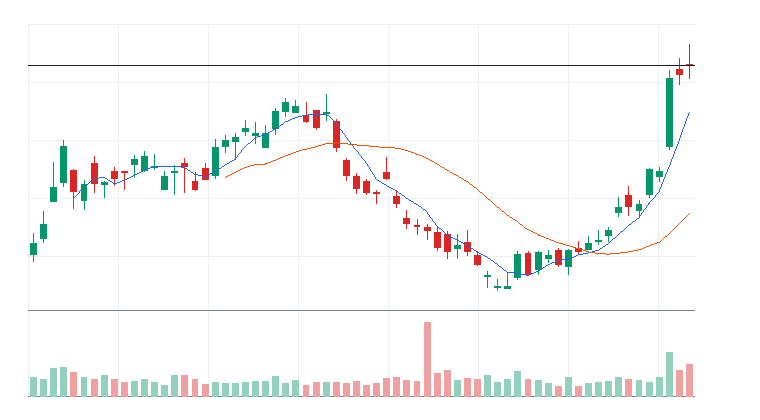
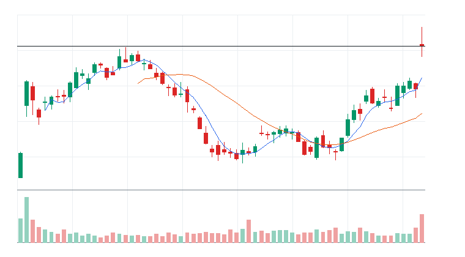
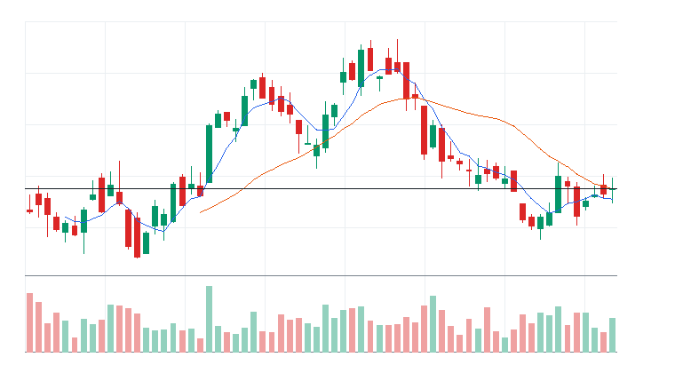
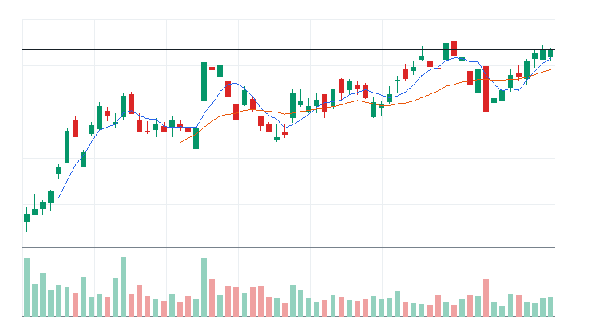
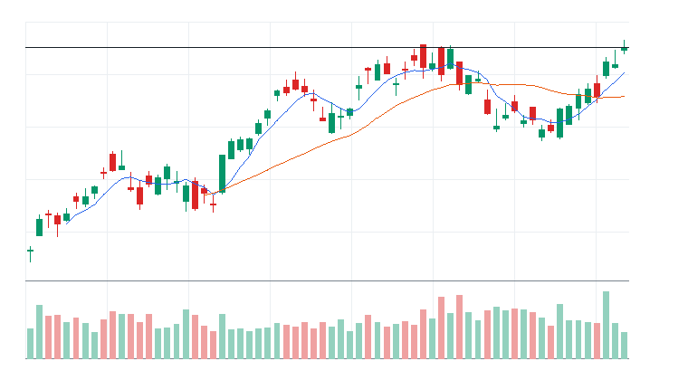
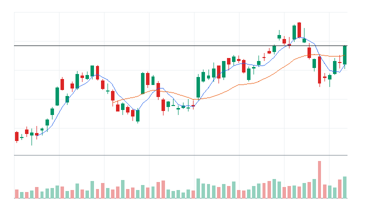
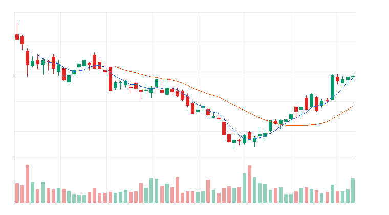
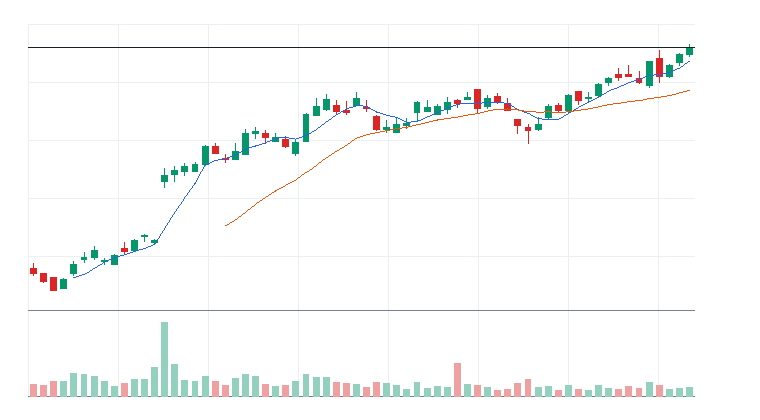

# 오늘의 데일리 트레이딩 요약

**REAL DATA TEST - 가격/거래량은 실제 데이터, 뉴스/ETF 구성종목 확산도/거래대금 유동성 일부 연결**

**목적:** 이 리포트는 최근 오른 자산을 나열하는 것이 아니라, 돈이 몰리는 근거와 다음 매수 주체가 확인할 트레이딩 후보를 찾기 위한 보고서다.

> 핵심 질문: 현재 가격에서 누가 사고 있고, 누가 앞으로 더 비싸게 사줄 수 있는가?

## 시장 국면 판단

- 최종 판정: 기간 조정 (70점)
- 전일 대비: 중립-상승에서 기간 조정으로 개선됐다(+12점).
- 판정 신뢰도: 높음 (100점) - 핵심 지수와 매크로 데이터가 대부분 직접 수집되어 판정 신뢰도가 높다.
- 행동 바이어스: 추격 보류, 돌파 확인
- 한 줄 결론: 장기 추세는 유지되지만 단기 추세가 둔화되어 기간 조정으로 본다. 기술 81점, 매크로 50점.
- 기술적 지표: 상승 추세 우위 (81점, 가중치 65%)
- S&P 500: 97점 | 50일선 위, 200일선 위, 20일 +1.21%, 60일 0.00%, 52주 고점 대비 -1.28% -> 기술 점수 97
- Nasdaq 100: 64점 | 50일선 아래, 200일선 위, 20일 -1.96%, 60일 0.00%, 52주 고점 대비 -4.94% -> 기술 점수 64
- 매크로 시황: 매크로 중립 (50점, 가중치 35%)
- 매크로 요약: 금리은 우호적이나 물가 부담이 남아 있다.
- 금리: 중립-우호 56점 / 금리 중립 / confidence HIGH
  - 주요 근거: US 10Y yield 20일 -4.69%, 5일 -1.96%; US 3M yield 20일 -0.87%, 단기금리 방향 확인; US long-duration bonds 20일 +4.13%, 장기채 가격 기준 할인율 부담 확인
  - 확인 사항: 추가 확인 이벤트 없음
- 물가: 부담 43점 / 물가 부담 / confidence HIGH
  - 주요 근거: Oil ETF 20일 +14.36%, 유가 기반 물가 압력 확인; TIPS ETF 20일 +2.13%, 물가연동채 흐름은 보조 근거; Gold 20일 -1.92%, 금 강세는 방어 수요 여부 확인
  - 확인 사항: 추가 확인 이벤트 없음
- 정책: 중립 50점 / 정책 이벤트 확인 전 중립 / confidence LOW
  - 주요 근거: 정책 톤은 1차 버전에서 일정/이벤트 리스크 기반 중립값으로 반영한다.
  - 확인 사항: FOMC, CPI, PCE, 고용지표 발표 전후에는 매크로 confidence를 보수적으로 해석한다.
- 신용/유동성: 중립 47점 / 신용/유동성 중립 / confidence HIGH
  - 주요 근거: High yield credit 20일 +0.49%, 하이일드 위험선호 확인; HYG-LQD 20일 상대강도 -1.36%, 신용위험 선호/회피 확인; VIX 20일 +3.49%, 변동성 부담 확인
  - 확인 사항: 추가 확인 이벤트 없음
- 환율/글로벌: 중립 48점 / 환율/글로벌 중립 / confidence MEDIUM
  - 주요 근거: US dollar 20일 +1.01%, 달러 강세/약세 확인
  - 확인 사항: 추가 확인 이벤트 없음
- US 10Y yield: 59점 | 하락 시 주식 우호; 5일 -1.96%, 20일 -4.69% -> 매크로 점수 59
- US 3M yield: 53점 | 하락 시 주식 우호; 5일 -1.67%, 20일 -0.87% -> 매크로 점수 53
- US long-duration bonds: 57점 | 상승 시 주식 우호; 5일 +0.93%, 20일 +4.13% -> 매크로 점수 57
- TIPS ETF: 50점 | 상승 시 주식 우호; 5일 +0.67%, 20일 +2.13% -> 매크로 점수 50
- Oil ETF: 24점 | 하락 시 주식 우호; 5일 +4.24%, 20일 +14.36% -> 매크로 점수 24
- Gold: 50점 | 상승 시 주식 우호; 5일 -1.44%, 20일 -1.92% -> 매크로 점수 50
- US dollar: 48점 | 하락 시 주식 우호; 5일 +0.48%, 20일 +1.01% -> 매크로 점수 48
- High yield credit: 51점 | 상승 시 주식 우호; 5일 +0.79%, 20일 +0.49% -> 매크로 점수 51
- Investment grade credit: 50점 | 상승 시 주식 우호; 5일 +0.83%, 20일 +1.85% -> 매크로 점수 50
- VIX: 43점 | 하락 시 주식 우호; 5일 +1.38%, 20일 +3.49% -> 매크로 점수 43
- 데이터 커버리지: 기술 2/2, 매크로 10/10
- 데이터 신뢰도 근거:
  - 직접 지수 데이터: S&P 500, Nasdaq 100
  - 대체 지수 데이터 없음
  - 매크로 데이터: 10/10
  - 누락 데이터 없음
  - stale 데이터 없음

## 모바일 요약

[오늘의 데일리 트레이딩 요약]

생성 성공 / 데이터 모드: REAL_TEST

시장:
- 중립

시장 지배 서사:
1. Integrated Oil & Gas 자금 유입 - 관찰 - VanEck Oil Services ETF(OIH), Energy Select Sector SPDR Fund(XLE), Exxon Mobil(XOM), Chevron(CVX) 중심으로 5일 +1.91%, 20일 +10.88% 흐름이 형성됨. 뉴스 직접성 제한.
2. 매크로 방어/헤지 - 관찰 - VanEck Oil Services ETF(OIH), Energy Select Sector SPDR Fund(XLE), Exxon Mobil(XOM), Chevron(CVX) 중심으로 5일 +1.19%, 20일 +7.62% 흐름이 형성됨. 뉴스 직접성 제한.
3. Aerospace & Defense 자금 유입 - 약화 - SPDR S&P 500 ETF Trust(SPY), iShares Russell 2000 ETF(IWM), Lockheed Martin(LMT), RTX 중심으로 5일 +3.43%, 20일 +7.34% 흐름이 형성됨. 직접 촉매 일부 확인.

트렌드 강도:
1. Integrated Oil & Gas 자금 유입 - TSI 52 - 부상 - 진입품질 낮음
2. 매크로 방어/헤지 - TSI 39 - 잠복 - 진입품질 낮음
3. Aerospace & Defense 자금 유입 - TSI 40 - 잠복 - 진입품질 낮음

오늘 결론:
- 클라우드/엔터프라이즈 소프트웨어 개별 종목 흐름이 ETF 대비 강한지 확인 필요
- 행동 후보는 linkedNarrative와 함께 확인한다.
- 추격보다 진입 조건 확인 후 접근한다.

오늘 실제 행동 후보:
1. Roper Technologies Inc.(ROP)(STOCK) - 소프트웨어 실적/AI 수익화 - 52주 고점 부근이라 돌파가 확인되면 신고가 추종 매수가 붙을 수 있음
2. Lockheed Martin(LMT)(STOCK) - Aerospace & Defense 자금 유입 - 단기 추세가 유지되고 거래량이 1.0배 이상이면 눌림 이후 재상승을 시도할 수 있음
3. GE HealthCare Technologies Inc.(GEHC)(STOCK) - Aerospace & Defense 자금 유입 - 단기 추세가 유지되고 거래량이 1.0배 이상이면 눌림 이후 재상승을 시도할 수 있음

다크호스 후보:
1. 다크호스 후보 없음 - 조건 충족 후보 없음

ETF 후보 TOP 5:
1. VanEck Oil Services ETF(OIH) - Integrated Oil & Gas 자금 유입 - 관찰
2. iShares Cybersecurity and Tech ETF(IHAK) - 사이버보안 지출 재가속 - 제외
3. iShares Expanded Tech-Software Sector ETF(IGV) - 사이버보안 지출 재가속 - 관찰
4. Energy Select Sector SPDR Fund(XLE) - Integrated Oil & Gas 자금 유입 - 거래량 확인 전 관찰
5. First Trust NASDAQ Cybersecurity ETF(CIBR) - 사이버보안 지출 재가속 - 거래량 확인 전 관찰

웹 리포트:
https://yoolcool.github.io/DailyTradingThesisAgent/

## 오늘 결론

- 오늘 결론: 조건부 진입
- 신규 진입 후보: 0개
- 조건부 진입 후보: 3개
- 관찰 후보: 99개
- 주요 제한 요인: Entry Quality < 40, 뉴스 직접성 부족, RVOL 미달
- 주문 판단: 시장가 금지 / 지정가 또는 관찰
- 실전 판단: 진입 후보는 있으나, 전일 고점 돌파와 거래량 확인 후 선별적으로 접근한다.

### 후보 제한 요인 집계

- RVOL < 1.00x: 94개
- 거래대금 유동성 낮음: 15개
- Entry Quality 50~54 near miss: 1개
- Entry Quality 40~49 관찰: 7개
- Entry Quality < 40: 147개
- Exhaustion Risk >= 70: 0개
- ETF breadth 샘플 부족: 37개
- 뉴스 직접성 부족: 98개

## 데이터 신뢰도

- 전체 데이터 신뢰도 등급: LOW
- 분석 신뢰도: LOW
- 주문 실행 신뢰도: LOW
- ETF breadth 신뢰도: LOW
- 신뢰도 해석: 가격/거래량 stale fallback 1개 사용, 테마 확산 판단 제한, 거래대금 유동성 낮음 또는 확인 불가, 프리/애프터마켓 확인 불가
- 리포트 생성 시각: 2026-10-29 11:09 KST
- 가격 기준 거래일: 2026-10-28 US regular close
- 뉴스 수집 시각: 2026-10-29 11:09 KST
- 가장 최근 뉴스 발행 시각: 2026-10-29 10:58 KST
- 뉴스 신선도 상태: FRESH
- 뉴스 소스: Yahoo Finance RSS, MarketWatch RSS, CNBC Markets RSS, SEC EDGAR RSS, Federal Reserve RSS, Finnhub API
- 뉴스 소스 상태: Yahoo Finance RSS CONNECTED, MarketWatch RSS CONNECTED, CNBC Markets RSS PARTIAL, SEC EDGAR RSS PARTIAL, Federal Reserve RSS CONNECTED, Finnhub API DISABLED
- 뉴스 신뢰도: MEDIUM
- 추천 적용 거래일: 2026-10-28 US regular session
- 가격/거래량 데이터 상태: 일부 연결
- 뉴스 데이터 상태: 일부 연결
- ETF 구성종목 확산도 상태: 일부 연결
- ETF 구성종목 샘플 수: 1~4
- 거래대금 유동성 데이터 상태: 일부 연결
- 프리/애프터마켓 데이터 상태: UNAVAILABLE
- 데이터 provider: yfinance, Yahoo Finance RSS, MarketWatch RSS, CNBC Markets RSS, SEC EDGAR RSS, Federal Reserve RSS, Finnhub API, config fallback sample, price-volume dollar-volume fallback
- 실전 사용 경고: 이 리포트는 투자판단 보조용이며, REAL_TEST 모드에서는 일부 데이터가 누락되거나 지연될 수 있다. 실제 주문 전 현재가, 뉴스, 프리마켓/정규장 거래량을 별도 확인해야 한다.

## 0. 시장 상태

- 데이터 모드: REAL_TEST
- 가격/거래량: 일부 연결
- 뉴스: 일부 연결
- ETF 구성종목 확산도: 일부 연결
- 거래대금 유동성: 일부 연결
- 생성 시각: 2026년 10월 29일 목요일 AM 11:09
- 시장 상태: 중립
- 오늘 돈의 방향: 클라우드/엔터프라이즈 소프트웨어 개별 종목 흐름이 ETF 대비 강한지 확인 필요
- 강한 테마 TOP 3: 클라우드/엔터프라이즈 소프트웨어 ETF(62), 전통 에너지 ETF(60), 메모리/HBM ETF(48)
- 데이터 한계:
  - API 또는 provider 상태에 따라 뉴스/ETF 확산도/거래대금 유동성 반영 범위가 달라질 수 있다.
  - 수집 실패 데이터는 점수 반영에서 제외하거나 confidence를 제한한다.
  - reasonConfidence HIGH는 직접 촉매, 가격/거래량, 확산도/유동성 근거가 함께 있을 때만 사용한다.

## 오늘 시장을 지배하는 서사

### 오늘 시장을 지배하는 서사 TOP 3

#### 1. Integrated Oil & Gas 자금 유입
- 상태: 관찰
- narrativeScore: 63
- reasonConfidence: MEDIUM
- 근거 ETF: OIH, XLE
- 근거 개별 종목: XOM, CVX
- 돈이 몰리는 이유: Integrated Oil & Gas 자금 유입 관련 VanEck Oil Services ETF(OIH), Energy Select Sector SPDR Fund(XLE)와 Exxon Mobil(XOM), Chevron(CVX)의 5일(+1.91%)·20일(+10.88%) 흐름을 함께 본다. 평균 상대 거래량은 1.09배이고, ETF 확산도는 추가 확인이 필요하다. 뉴스 직접성은 아직 제한적이다.
- 다음 매수 주체: Integrated Oil & Gas 자금 유입을 확인한 섹터 ETF 자금과 상대강도 추종 스윙 자금
- 가장 좋은 트레이딩 수단: ETF 우선: XLE, OIH / 개별 종목 우선: XOM, CVX
- 서사가 깨지는 조건: XLE 20일선 이탈 또는 관련 종목 절반 이상 5일선 이탈
- 오늘 행동: 기존 네러티브와 중복을 확인한 뒤 ETF/대표 종목 동조성이 살아날 때만 관찰 편입

상세 narrativeScore 근거 보기

- rawScore: 63
- ETF 평균 moneyFlowScore: 60
- 개별 종목 평균 moneyFlowScore: 56
- ETF 후보 비율: 50%
- 개별 종목 후보 비율: 50%
- 5일 평균 수익률: +2.00%
- 20일 평균 수익률: +11.00%
- 평균 상대 거래량: 1.00배
- ETF 평균 상대 거래량: 1.00배
- 개별주 평균 상대 거래량: 1.00배
- 52주 고점 근접 후보 비율: 75%
- 뉴스 직접성 점수: 9
- ETF 확산도 점수: 0
- 유동성 점수: 3
- 과열 리스크 차감: 0

#### 2. 매크로 방어/헤지
- 상태: 관찰
- narrativeScore: 51
- reasonConfidence: LOW
- 근거 ETF: OIH, XLE, TLT, GLD
- 근거 개별 종목: XOM, CVX
- 돈이 몰리는 이유: 매크로 방어/헤지 관련 VanEck Oil Services ETF(OIH), Energy Select Sector SPDR Fund(XLE), iShares 20+ Year Treasury Bond ETF(TLT)와 Exxon Mobil(XOM), Chevron(CVX)의 5일(+1.19%)·20일(+7.62%) 흐름을 함께 본다. 평균 상대 거래량은 1.06배이고, ETF 확산도는 추가 확인이 필요하다. 뉴스 직접성은 아직 제한적이다.
- 다음 매수 주체: 금리/에너지/방어 헤지를 찾는 매크로 자금
- 가장 좋은 트레이딩 수단: ETF 우선: GLD, TLT, XLE / 개별 종목 우선: XOM, CVX
- 서사가 깨지는 조건: 방어 ETF 상대강도 둔화와 위험선호 성장주 재강세
- 오늘 행동: 위험회피가 확인될 때만 헤지성 접근

상세 narrativeScore 근거 보기

- rawScore: 51
- ETF 평균 moneyFlowScore: 39
- 개별 종목 평균 moneyFlowScore: 56
- ETF 후보 비율: 25%
- 개별 종목 후보 비율: 50%
- 5일 평균 수익률: +1.00%
- 20일 평균 수익률: +8.00%
- 평균 상대 거래량: 1.00배
- ETF 평균 상대 거래량: 1.00배
- 개별주 평균 상대 거래량: 1.00배
- 52주 고점 근접 후보 비율: 50%
- 뉴스 직접성 점수: 8
- ETF 확산도 점수: 0
- 유동성 점수: 4
- 과열 리스크 차감: 0

#### 3. Aerospace & Defense 자금 유입
- 상태: 약화
- narrativeScore: 46
- reasonConfidence: LOW
- 근거 ETF: SPY, IWM, QQQ
- 근거 개별 종목: LMT, RTX, NOC
- 돈이 몰리는 이유: Aerospace & Defense 자금 유입 관련 SPDR S&P 500 ETF Trust(SPY), iShares Russell 2000 ETF(IWM), Invesco QQQ Trust(QQQ)와 Lockheed Martin(LMT), RTX, Northrop Grumman(NOC)의 5일(+3.43%)·20일(+7.34%) 흐름을 함께 본다. 평균 상대 거래량은 0.87배이고, ETF 확산도는 추가 확인이 필요하다. 직접 뉴스/이벤트가 일부 확인된다.
- 다음 매수 주체: Aerospace & Defense 자금 유입을 확인한 섹터 ETF 자금과 상대강도 추종 스윙 자금
- 가장 좋은 트레이딩 수단: ETF 우선: QQQ, SPY, IWM / 개별 종목 우선: NOC, LMT, RTX
- 서사가 깨지는 조건: QQQ 20일선 이탈 또는 관련 종목 절반 이상 5일선 이탈
- 오늘 행동: 기존 네러티브와 중복을 확인한 뒤 ETF/대표 종목 동조성이 살아날 때만 관찰 편입

상세 narrativeScore 근거 보기

- rawScore: 46
- ETF 평균 moneyFlowScore: 25
- 개별 종목 평균 moneyFlowScore: 62
- ETF 후보 비율: 0%
- 개별 종목 후보 비율: 67%
- 5일 평균 수익률: +3.00%
- 20일 평균 수익률: +7.00%
- 평균 상대 거래량: 1.00배
- ETF 평균 상대 거래량: 1.00배
- 개별주 평균 상대 거래량: 1.00배
- 52주 고점 근접 후보 비율: 33%
- 뉴스 직접성 점수: 9
- ETF 확산도 점수: -3
- 유동성 점수: 4
- 과열 리스크 차감: 0

### 전체 narrative 요약

| 서사명 | 상태 | narrativeScore | reasonConfidence | 대표 ETF | 대표 종목 | 오늘 행동 |
| --- | --- | ---: | --- | --- | --- | --- |
| Integrated Oil & Gas 자금 유입 | 관찰 | 63 | MEDIUM | OIH, XLE | XOM, CVX | 기존 네러티브와 중복을 확인한 뒤 ETF/대표 종목 동조성이 살아날 때만 관찰 편입 |
| 매크로 방어/헤지 | 관찰 | 51 | LOW | OIH, XLE, TLT | XOM, CVX | 위험회피가 확인될 때만 헤지성 접근 |
| Aerospace & Defense 자금 유입 | 약화 | 46 | LOW | SPY, IWM, QQQ | LMT, RTX, NOC | 기존 네러티브와 중복을 확인한 뒤 ETF/대표 종목 동조성이 살아날 때만 관찰 편입 |
| 사이버보안 지출 재가속 | 약화 | 41 | LOW | IHAK, IGV, CIBR | ZS, PANW, CRWD, FTNT | 기존 네러티브와 중복을 확인한 뒤 ETF/대표 종목 동조성이 살아날 때만 관찰 편입 |
| 소프트웨어 실적/AI 수익화 | 약화 | 40 | LOW | IGV, QQQ, AIQ | ROP, TEAM, SNPS, ADSK | 기존 네러티브와 중복을 확인한 뒤 ETF/대표 종목 동조성이 살아날 때만 관찰 편입 |
| AI 소프트웨어/사이버보안 확산 | 약화 | 34 | LOW | IGV, QQQ, AIQ | TEAM, ZS, MSFT, DDOG | 추격보다 눌림 후 재상승 확인 |
| 전력 유틸리티 수요 재평가 | 약화 | 30 | LOW | SPY, IWM, QQQ | VRT, ETN, GEV | 기존 네러티브와 중복을 확인한 뒤 ETF/대표 종목 동조성이 살아날 때만 관찰 편입 |
| Specialty Business Services 자금 유입 | 약화 | 25 | LOW | SPY, IWM, QQQ | CTAS, TRI | 기존 네러티브와 중복을 확인한 뒤 ETF/대표 종목 동조성이 살아날 때만 관찰 편입 |
| Staffing & Employment 자금 유입 | 약화 | 24 | LOW | SPY, IWM, QQQ | ADP, PAYX | 기존 네러티브와 중복을 확인한 뒤 ETF/대표 종목 동조성이 살아날 때만 관찰 편입 |
| 방산/안보 프리미엄 | 약화 | 23 | LOW | ITA, SHLD, XAR | LMT, RTX, KTOS, AVAV | 뉴스 촉매가 직접 확인될 때만 추세 추종 |
| 바이오/헬스케어 촉매 | 약화 | 18 | LOW | QQQ | GILD, ALNY | 기존 네러티브와 중복을 확인한 뒤 ETF/대표 종목 동조성이 살아날 때만 관찰 편입 |
| 필수소비재 음료 방어 성장 | 약화 | 15 | LOW | QQQ | CCEP, MNST | 기존 네러티브와 중복을 확인한 뒤 ETF/대표 종목 동조성이 살아날 때만 관찰 편입 |
| AI 인프라 재가속 | 소멸 | 14 | LOW | DRAM, SMH, SOXX | VRT, MU, NVDA, ETN | 추격보다 5일선 지지 후 재상승 확인 |
| 반도체 설계/공급망 재가속 | 약화 | 14 | LOW | SOXQ, SMH, SOXX | TXN, NXPI, TSM, NVDA | 기존 네러티브와 중복을 확인한 뒤 ETF/대표 종목 동조성이 살아날 때만 관찰 편입 |
| Data Storage 자금 유입 | 소멸 | 13 | LOW | SPY, IWM, QQQ | STX, WDC | 기존 네러티브와 중복을 확인한 뒤 ETF/대표 종목 동조성이 살아날 때만 관찰 편입 |
| 전력망/원전/인프라 병목 | 소멸 | 12 | LOW | PAVE, GRID, URA | VRT, PWR, ETN, CEG | ETF 확산도와 거래량이 같이 살아날 때만 진입 |
| Discount Stores 자금 유입 | 약화 | 12 | LOW | QQQ | WMT, COST | 기존 네러티브와 중복을 확인한 뒤 ETF/대표 종목 동조성이 살아날 때만 관찰 편입 |
| 위험선호 성장주 재진입 | 소멸 | 10 | LOW | ARKK, QQQ, IPO | TSLA, ARM, COIN | 지수 위험선호가 유지될 때만 선별 진입 |
| Medical Devices 자금 유입 | 약화 | 8 | LOW | QQQ | ISRG, DXCM | 기존 네러티브와 중복을 확인한 뒤 ETF/대표 종목 동조성이 살아날 때만 관찰 편입 |
| 소비 회복/방어주 선별 | 약화 | 5 | LOW | QQQ | PDD, AMZN | 기존 네러티브와 중복을 확인한 뒤 ETF/대표 종목 동조성이 살아날 때만 관찰 편입 |
| Internet Content 자금 유입 | 소멸 | 3 | LOW | QQQ | GOOG, GOOGL, META | 기존 네러티브와 중복을 확인한 뒤 ETF/대표 종목 동조성이 살아날 때만 관찰 편입 |
| Travel Services 자금 유입 | 약화 | 1 | LOW | QQQ | BKNG, ABNB | 기존 네러티브와 중복을 확인한 뒤 ETF/대표 종목 동조성이 살아날 때만 관찰 편입 |
| 반도체 장비 사이클 재평가 | 소멸 | 0 | LOW | SOXQ, SMH, SOXX | ASML, LRCX | 기존 네러티브와 중복을 확인한 뒤 ETF/대표 종목 동조성이 살아날 때만 관찰 편입 |
| Bitcoin Mining 자금 유입 | 소멸 | 0 | LOW | IBIT, BLOK | RIOT, MARA, CIFR | 기존 네러티브와 중복을 확인한 뒤 ETF/대표 종목 동조성이 살아날 때만 관찰 편입 |
| 비트코인/디지털 자산 위험선호 | 소멸 | 0 | LOW | IBIT, BLOK | IREN, MSTR, COIN | 비트코인 베타가 살아날 때만 단기 매매 |

## 트렌드 강도 판단

### 1. Integrated Oil & Gas 자금 유입
- Trend Strength Index: 52
- 트렌드 상태 라벨: 부상
- 테마 확산도: 보통
- ETF 동조성: 강함
- 거래량 강도: 약함
- 과열 위험: 낮음 (14)
- 오늘 진입 품질: 낮음 (37)
- 한 줄 판단: Integrated Oil & Gas 자금 유입는 관찰 가능한 흐름은 있으나 가격, 거래량, 확산도 중 일부 확인이 더 필요하다.
- 오늘 접근법: VanEck Oil Services ETF(OIH)/Energy Select Sector SPDR Fund(XLE) 거래량 증가와 Exxon Mobil(XOM)/Chevron(CVX) 확산을 확인하며 작은 사이즈의 초기 진입 후보로만 본다.

트렌드 강도 상세 근거 보기

- 가격 모멘텀: 가격 모멘텀 11/25. 평균 5D +1.91%, 20D +10.88%.
- 거래량 강도: 거래량 강도 8/20. 평균 RVOL 1.09배.
- ETF 동조성: ETF 동조성 16/15. 관련 ETF Energy Select Sector SPDR Fund(XLE), VanEck Oil Services ETF(OIH) 흐름을 기준으로 판단.
- 테마 확산도: 테마 확산도 11/20. 상위 1~2개 쏠림 감점 3점 반영.
- 뉴스 촉매: 뉴스/촉매 신선도 2/10. HIGH 직접 촉매 0개.
- 과열 리스크: 과열 리스크 14/100. 단기 급등, 고점 근접, ETF-개별주 괴리, 쏠림을 함께 반영.
- 시장 환경: 시장 환경 4/10. QQQ/SPY/IWM 가격 흐름 기반 위험선호 점수.

### 2. 매크로 방어/헤지
- Trend Strength Index: 39
- 트렌드 상태 라벨: 잠복
- 테마 확산도: 약함
- ETF 동조성: 보통
- 거래량 강도: 약함
- 과열 위험: 낮음 (12)
- 오늘 진입 품질: 낮음 (29)
- 한 줄 판단: 매크로 방어/헤지는 관찰 가능한 흐름은 있으나 가격, 거래량, 확산도 중 일부 확인이 더 필요하다.
- 오늘 접근법: VanEck Oil Services ETF(OIH)/Energy Select Sector SPDR Fund(XLE)/iShares 20+ Year Treasury Bond ETF(TLT)와 Exxon Mobil(XOM)/Chevron(CVX)의 거래량 확산이 확인되기 전까지 관찰한다.

트렌드 강도 상세 근거 보기

- 가격 모멘텀: 가격 모멘텀 7/25. 평균 5D +1.19%, 20D +7.62%.
- 거래량 강도: 거래량 강도 7/20. 평균 RVOL 1.06배.
- ETF 동조성: ETF 동조성 11/15. 관련 ETF SPDR Gold Shares(GLD), iShares 20+ Year Treasury Bond ETF(TLT), Energy Select Sector SPDR Fund(XLE), VanEck Oil Services ETF(OIH) 흐름을 기준으로 판단.
- 테마 확산도: 테마 확산도 8/20. 상위 1~2개 쏠림 감점 3점 반영.
- 뉴스 촉매: 뉴스/촉매 신선도 2/10. HIGH 직접 촉매 0개.
- 과열 리스크: 과열 리스크 12/100. 단기 급등, 고점 근접, ETF-개별주 괴리, 쏠림을 함께 반영.
- 시장 환경: 시장 환경 4/10. QQQ/SPY/IWM 가격 흐름 기반 위험선호 점수.

### 3. Aerospace & Defense 자금 유입
- Trend Strength Index: 40
- 트렌드 상태 라벨: 잠복
- 테마 확산도: 약함
- ETF 동조성: 약함
- 거래량 강도: 부족
- 과열 위험: 낮음 (12)
- 오늘 진입 품질: 낮음 (33)
- 한 줄 판단: Aerospace & Defense 자금 유입는 관찰 가능한 흐름은 있으나 가격, 거래량, 확산도 중 일부 확인이 더 필요하다.
- 오늘 접근법: SPDR S&P 500 ETF Trust(SPY)/iShares Russell 2000 ETF(IWM)/Invesco QQQ Trust(QQQ)와 Lockheed Martin(LMT)/RTX/Northrop Grumman(NOC)의 거래량 확산이 확인되기 전까지 관찰한다.

트렌드 강도 상세 근거 보기

- 가격 모멘텀: 가격 모멘텀 14/25. 평균 5D +3.43%, 20D +7.34%.
- 거래량 강도: 거래량 강도 4/20. 평균 RVOL 0.87배.
- ETF 동조성: ETF 동조성 5/15. 관련 ETF Invesco QQQ Trust(QQQ), SPDR S&P 500 ETF Trust(SPY), iShares Russell 2000 ETF(IWM) 흐름을 기준으로 판단.
- 테마 확산도: 테마 확산도 8/20. 상위 1~2개 쏠림 감점 3점 반영.
- 뉴스 촉매: 뉴스/촉매 신선도 5/10. HIGH 직접 촉매 2개.
- 과열 리스크: 과열 리스크 12/100. 단기 급등, 고점 근접, ETF-개별주 괴리, 쏠림을 함께 반영.
- 시장 환경: 시장 환경 4/10. QQQ/SPY/IWM 가격 흐름 기반 위험선호 점수.

## 최근 추천 결과 트래킹

개별주는 데이트레이딩 관점으로 추천 이후 첫 정규장의 장중 최고가와 종가를 추적한다. ETF는 테마/스윙 관점으로 추천 이후 1주일 동안의 최고가와 현재 종가를 추적한다.

### 개별주 Top 3 추천 성과 요약
- 최근 5개 리포트 표본: 15개 (초기 검증 단계)
- 장중 최고가 기준 성공률: +25.00%
- 종가 기준 성공률: +50.00%
- 평균 장중 최고 수익률: +2.61%
- 평균 종가 수익률: +1.27%

### ETF 추천 성과 요약
- 최근 5개 리포트 표본: 2개 (초기 검증 단계)
- 1주 최고가 기준 성공률: +50.00%
- 현재 종가 기준 성공률: +50.00%
- 평균 1주 최고 수익률: +3.49%
- 평균 현재 수익률: +2.11%

최근 추천 결과 상세 테이블 펼치기

| 추천일 | 유형 | 순위 | 티커 | 기준가 | 추적 기간 | 상태 | High 수익률 | Close 수익률 | 결과 | 코멘트 |
| --- | --- | ---: | --- | ---: | --- | --- | ---: | ---: | --- | --- |
| 2026-10-29 | STOCK | 3 | GEHC | $75.82 | 2026-10-29 | pending | 데이터 없음 | 데이터 없음 | 추적 대기 | 아직 추적 거래일 데이터가 완성되지 않음 |
| 2026-10-29 | STOCK | 2 | LMT | $629.75 | 2026-10-29 | pending | 데이터 없음 | 데이터 없음 | 추적 대기 | 아직 추적 거래일 데이터가 완성되지 않음 |
| 2026-10-29 | STOCK | 1 | ROP | $440.66 | 2026-10-29 | pending | 데이터 없음 | 데이터 없음 | 추적 대기 | 아직 추적 거래일 데이터가 완성되지 않음 |
| 2026-10-27 | STOCK | 3 | LMT | $635.2 | 2026-10-27 | complete | -0.26% | -1.92% | 실패 | 추천 이후 의미 있는 장중 기회가 부족하고 종가도 약함 (일봉 기준) |
| 2026-10-27 | STOCK | 2 | ROP | $441.65 | 2026-10-27 | complete | -0.52% | -1.62% | 실패 | 추천 이후 의미 있는 장중 기회가 부족하고 종가도 약함 (일봉 기준) |
| 2026-10-27 | STOCK | 1 | ZS | $260.45 | 2026-10-27 | complete | +2.85% | -0.12% | 제한적 유효 | 제한적인 장중 기회만 발생 (일봉 기준) |
| 2026-10-27 | ETF | 1 | IHAK | $76.25 | 2026-10-27~2026-11-03 | in_progress | +1.94% | +0.58% | 진행 중 | 아직 1주 추적 기간이 끝나지 않음 |
| 2026-10-26 | STOCK | 3 | CRWD | $257.57 | 2026-10-26 | complete | +2.65% | +1.65% | 제한적 유효 | 제한적인 장중 기회만 발생 (일봉 기준) |
| 2026-10-26 | STOCK | 2 | ROP | $438.14 | 2026-10-26 | complete | +2.88% | +0.80% | 제한적 유효 | 제한적인 장중 기회만 발생 (일봉 기준) |
| 2026-10-26 | STOCK | 1 | ZS | $255.15 | 2026-10-26 | complete | +2.47% | +2.08% | 제한적 유효 | 제한적인 장중 기회만 발생 (일봉 기준) |
| 2026-10-26 | ETF | 1 | IHAK | $74 | 2026-10-26~2026-11-02 | in_progress | +5.04% | +3.64% | 진행 중 | 아직 1주 추적 기간이 끝나지 않음 |
| 2026-10-23 | STOCK | 3 | ADP | $294.5 | 2026-10-23 | complete | +5.06% | +3.28% | 성공 | 장중 기회와 종가 유지가 모두 확인됨 (일봉 기준) |
| 2026-10-23 | STOCK | 2 | CTAS | $220.15 | 2026-10-23 | complete | +2.56% | +1.79% | 제한적 유효 | 제한적인 장중 기회만 발생 (일봉 기준) |
| 2026-10-23 | STOCK | 1 | MAR | $404 | 2026-10-23 | complete | -1.77% | -3.29% | 실패 | 추천 이후 의미 있는 장중 기회가 부족하고 종가도 약함 (일봉 기준) |
| 2026-10-22 | STOCK | 3 | TRI | $112.82 | 2026-10-22 | complete | +9.70% | +9.25% | 성공 | 장중 기회와 종가 유지가 모두 확인됨 (일봉 기준) |
| 2026-10-22 | STOCK | 2 | MAR | $397.31 | 2026-10-22 | complete | +1.50% | -0.13% | 제한적 유효 | 제한적인 장중 기회만 발생 (일봉 기준) |
| 2026-10-22 | STOCK | 1 | NOC | $534 | 2026-10-22 | complete | +4.22% | +3.44% | 성공 | 장중 기회와 종가 유지가 모두 확인됨 (일봉 기준) |
| 2026-10-13 | STOCK | 2 | SHOP | $179.22 | 2026-10-13 | complete | -0.01% | -1.51% | 실패 | 추천 이후 의미 있는 장중 기회가 부족하고 종가도 약함 (일봉 기준) |
| 2026-10-13 | STOCK | 1 | PLTR | $209 | 2026-10-13 | complete | +0.90% | -0.16% | 실패 | 추천 이후 의미 있는 장중 기회가 부족하고 종가도 약함 (일봉 기준) |
| 2026-10-12 | STOCK | 3 | ZS | $233.73 | 2026-10-12 | complete | +1.49% | -3.40% | 제한적 유효 | 제한적인 장중 기회만 발생 (일봉 기준) |
| 2026-10-12 | STOCK | 2 | DDOG | $293.26 | 2026-10-12 | complete | +2.53% | -2.04% | 제한적 유효 | 제한적인 장중 기회만 발생 (일봉 기준) |
| 2026-10-12 | STOCK | 1 | PLTR | $209.05 | 2026-10-12 | complete | +1.86% | -0.02% | 제한적 유효 | 제한적인 장중 기회만 발생 (일봉 기준) |
| 2026-10-09 | STOCK | 2 | ZS | $216.81 | 2026-10-09 | complete | +8.07% | +7.80% | 성공 | 장중 기회와 종가 유지가 모두 확인됨 (일봉 기준) |
| 2026-10-09 | STOCK | 1 | PLTR | $198.78 | 2026-10-09 | complete | +5.43% | +5.17% | 성공 | 장중 기회와 종가 유지가 모두 확인됨 (일봉 기준) |
| 2026-10-08 | STOCK | 1 | ADSK | $235.05 | 2026-10-08 | complete | +0.40% | -0.62% | 실패 | 추천 이후 의미 있는 장중 기회가 부족하고 종가도 약함 (일봉 기준) |
| 2026-10-07 | STOCK | 3 | FTNT | $191.27 | 2026-10-07 | complete | +0.50% | -1.04% | 실패 | 추천 이후 의미 있는 장중 기회가 부족하고 종가도 약함 (일봉 기준) |
| 2026-10-07 | STOCK | 2 | AMD | $649.42 | 2026-10-07 | complete | -0.14% | -0.55% | 실패 | 추천 이후 의미 있는 장중 기회가 부족하고 종가도 약함 (일봉 기준) |
| 2026-10-07 | STOCK | 1 | SNPS | $505.17 | 2026-10-07 | complete | +0.86% | -0.49% | 실패 | 추천 이후 의미 있는 장중 기회가 부족하고 종가도 약함 (일봉 기준) |
| 2026-10-07 | ETF | 1 | CIBR | $108.13 | 2026-10-07~2026-10-14 | complete | +2.36% | -0.19% | 단기 고점 후 반납 | 1주 내 상승 기회는 있었지만 현재가는 반납 |
| 2026-10-06 | STOCK | 2 | TSM | $485.8 | 2026-10-06 | complete | +0.04% | -0.72% | 실패 | 추천 이후 의미 있는 장중 기회가 부족하고 종가도 약함 (일봉 기준) |
| 2026-10-06 | STOCK | 1 | SNPS | $488.47 | 2026-10-06 | complete | +3.90% | +3.42% | 성공 | 장중 기회와 종가 유지가 모두 확인됨 (일봉 기준) |
| 2026-10-06 | ETF | 1 | CIBR | $106.01 | 2026-10-06~2026-10-13 | complete | +4.41% | +1.80% | 성공 | 추천 이후 테마 추세가 유지됨 |
| 2026-10-05 | STOCK | 1 | SNPS | $489.9 | 2026-10-05 | complete | +3.77% | -0.29% | 단타 유효 | 장중 기회는 있었지만 종가 유지력은 약함 (일봉 기준) |
| 2026-10-05 | ETF | 1 | SMH | $630.6 | 2026-10-05~2026-10-12 | complete | +1.41% | -9.98% | 실패 | 추천 이후 ETF 흐름이 약화됨 |
| 2026-09-30 | STOCK | 1 | AMAT | $512.01 | 2026-09-30 | complete | +0.67% | -0.12% | 실패 | 추천 이후 의미 있는 장중 기회가 부족하고 종가도 약함 (일봉 기준) |
| 2026-09-28 | STOCK | 3 | DDOG | $268.13 | 2026-09-28 | complete | +1.74% | +0.21% | 제한적 유효 | 제한적인 장중 기회만 발생 (일봉 기준) |
| 2026-09-28 | STOCK | 2 | ARM | $310.32 | 2026-09-28 | complete | -1.02% | -8.70% | 실패 | 추천 이후 의미 있는 장중 기회가 부족하고 종가도 약함 (일봉 기준) |
| 2026-09-28 | STOCK | 1 | QCOM | $201.97 | 2026-09-28 | complete | -1.39% | -7.17% | 실패 | 추천 이후 의미 있는 장중 기회가 부족하고 종가도 약함 (일봉 기준) |
| 2026-09-25 | STOCK | 3 | ARM | $332.56 | 2026-09-25 | complete | -2.13% | -6.69% | 실패 | 추천 이후 의미 있는 장중 기회가 부족하고 종가도 약함 (일봉 기준) |
| 2026-09-25 | STOCK | 2 | CRWD | $262.49 | 2026-09-25 | complete | -1.00% | -3.95% | 실패 | 추천 이후 의미 있는 장중 기회가 부족하고 종가도 약함 (일봉 기준) |
| 2026-09-25 | STOCK | 1 | PLTR | $191.79 | 2026-09-25 | complete | +1.26% | -1.11% | 제한적 유효 | 제한적인 장중 기회만 발생 (일봉 기준) |
| 2026-09-23 | STOCK | 3 | MARA | $13.28 | 2026-09-23 | complete | +2.79% | +0.53% | 제한적 유효 | 제한적인 장중 기회만 발생 (일봉 기준) |
| 2026-09-23 | STOCK | 2 | CIFR | $18.9 | 2026-09-23 | complete | +3.49% | -2.91% | 단타 유효 | 장중 기회는 있었지만 종가 유지력은 약함 (일봉 기준) |
| 2026-09-23 | STOCK | 1 | RIOT | $24.18 | 2026-09-23 | complete | +4.51% | +2.11% | 성공 | 장중 기회와 종가 유지가 모두 확인됨 (일봉 기준) |
| 2026-09-23 | ETF | 3 | ARKK | $90.72 | 2026-09-23~2026-09-30 | complete | +1.63% | -5.07% | 실패 | 추천 이후 ETF 흐름이 약화됨 |
| 2026-09-23 | ETF | 2 | MAGS | $72.97 | 2026-09-23~2026-09-30 | complete | -0.29% | -2.34% | 실패 | 추천 이후 ETF 흐름이 약화됨 |
| 2026-09-23 | ETF | 1 | SMH | $596.03 | 2026-09-23~2026-09-30 | complete | +2.89% | -4.76% | 단기 고점 후 반납 | 1주 내 상승 기회는 있었지만 현재가는 반납 |
| 2026-09-22 | STOCK | 3 | CRWD | $237.65 | 2026-09-22 | complete | +5.53% | +5.22% | 성공 | 장중 기회와 종가 유지가 모두 확인됨 (일봉 기준) |
| 2026-09-22 | STOCK | 2 | RIOT | $23.75 | 2026-09-22 | complete | +6.91% | +4.97% | 성공 | 장중 기회와 종가 유지가 모두 확인됨 (일봉 기준) |
| 2026-09-22 | STOCK | 1 | AMD | $559.82 | 2026-09-22 | complete | +11.56% | +11.42% | 성공 | 장중 기회와 종가 유지가 모두 확인됨 (일봉 기준) |
| 2026-09-21 | STOCK | 3 | CRWD | $237.65 | 2026-09-21 | complete | +5.33% | +4.92% | 성공 | 장중 기회와 종가 유지가 모두 확인됨 (일봉 기준) |
| 2026-09-21 | STOCK | 2 | RIOT | $23.75 | 2026-09-21 | complete | +5.55% | +1.81% | 성공 | 장중 기회와 종가 유지가 모두 확인됨 (일봉 기준) |
| 2026-09-21 | STOCK | 1 | AMD | $559.82 | 2026-09-21 | complete | +10.16% | +9.95% | 성공 | 장중 기회와 종가 유지가 모두 확인됨 (일봉 기준) |
| 2026-09-17 | STOCK | 3 | QCOM | $187.8 | 2026-09-17 | complete | +2.19% | +0.48% | 제한적 유효 | 제한적인 장중 기회만 발생 (일봉 기준) |
| 2026-09-17 | STOCK | 2 | FTNT | $172.37 | 2026-09-17 | complete | +2.16% | +0.12% | 제한적 유효 | 제한적인 장중 기회만 발생 (일봉 기준) |
| 2026-09-17 | STOCK | 1 | CRWD | $242.49 | 2026-09-17 | complete | +3.23% | +1.32% | 성공 | 장중 기회와 종가 유지가 모두 확인됨 (일봉 기준) |
| 2026-09-15 | STOCK | 1 | AMD | $516.13 | 2026-09-15 | complete | -0.48% | -2.31% | 실패 | 추천 이후 의미 있는 장중 기회가 부족하고 종가도 약함 (일봉 기준) |
| 2026-09-14 | STOCK | 1 | AMD | $516.13 | 2026-09-14 | complete | -3.44% | -4.40% | 실패 | 추천 이후 의미 있는 장중 기회가 부족하고 종가도 약함 (일봉 기준) |
| 2026-09-11 | STOCK | 2 | META | $653.69 | 2026-09-11 | complete | +1.61% | -0.87% | 제한적 유효 | 제한적인 장중 기회만 발생 (일봉 기준) |
| 2026-09-11 | STOCK | 1 | AMD | $521.1 | 2026-09-11 | complete | -0.01% | -0.95% | 실패 | 추천 이후 의미 있는 장중 기회가 부족하고 종가도 약함 (일봉 기준) |

## 오늘 실제 행동 후보

### 1. Roper Technologies Inc.(ROP)
- 자산 유형: STOCK
- linkedNarrative: 소프트웨어 실적/AI 수익화
- narrativeStatus: 약화
- narrativeScore: 40
- Trend Strength Index: 38
- Exhaustion Risk: 0 (낮음)
- Entry Quality Score: 50 (관찰)
- 트렌드 판단: 시장 위험선호가 약해 시장 환경 비우호 구간이다.
- moneyFlowScore: 100
- finalRawScore: 110
- reasonConfidence: HIGH
- reasonConfidenceExplanation: 직접 촉매: MarketWatch RSS / macro / under_6h - Is it curtains for COLA? Saving Social Security could mean changing the cost-of-living adjustment. 가격/거래량, 관련 ETF 동반 강세, 유동성 근거가 함께 확인되어 HIGH로 분류했다.
- tieBreakerReason: 최종 원점수 110, 리스크 패널티 0, 5일 수익률 +10.84%, 상대 거래량 1.34배 순으로 정렬
- 후보별 시장 해석: 중립 / 제한적 - 특이 충돌 없음
- 게이트 사유: 통과
- 주문 실행: 지정가 권장
- 직접 촉매: MarketWatch RSS / macro / under_6h - Is it curtains for COLA? Saving Social Security could mean changing the cost-of-living adjustment.
- 왜 돈이 몰리는가: 20일 +26.12%, 5일 +10.84%, 상대 거래량 1.34배로 가격과 거래량이 함께 개선. 뉴스: MarketWatch RSS general_market/under_6h / 유동성: ACCEPTABLE
- 누가 더 비싸게 사줄 수 있는지: 개별 주도주를 따라붙는 단기 모멘텀 자금과 관련 ETF 강세를 확인한 트레이더
- 진입 조건: 전일 고점 돌파와 5일선 유지 확인
- 무효화 조건: 20일선 이탈 또는 상대 거래량 0.8배 이하 둔화
- todayActionLabel: 조건부 진입
#### 최근 뉴스/동향 한국어 요약

- 요약: 종목 직접 뉴스 확인 상태이며 뉴스 흐름은 긍정 우위입니다. 후보 선정 후 재확인한 핵심 이슈는 "Did Earnings Beat Just Shift Roper Technologies (ROP) Investment Narrative?"입니다.
- 직접 촉매 판단: Roper Technologies Inc.에 대해 직접 촉매로 분류된 뉴스가 확인됐습니다. 핵심은 "Did Earnings Beat Just Shift Roper Technologies (ROP) Investment Narrative?"이며, 실적 재료로 봅니다.
- 뉴스 1: Did Earnings Beat Just Shift Roper Technologies (ROP) Investment Narrative?
  - 내용: Roper Technologies Inc. 관련 실적 뉴스입니다. 기사 스니펫상 핵심 내용은 Roper Technologies reported third quarter 2026 sales of US$2,171.8 million and net income of US$484.7 million, with GAAP diluted EPS from continuing operations of US$4.88.입니다.
  - 투자 의미: 실적/가이던스 재료는 다음 분기 기대치 변화로 이어질 수 있어 컨센서스 변화와 주가 반응 지속성을 함께 봅니다.
  - 확인할 점: 매출/마진/가이던스 수치, 컨센서스 대비 차이
- 뉴스 2: Roper (ROP) Q3 2026 Earnings Call Transcript
  - 내용: Roper Technologies Inc. 관련 기사는 Roper (ROP) Q3 2026 Earnings Call Transcript 이슈를 다루며, 주가 변동률 +7.00%를 핵심 내용으로 봅니다.
  - 투자 의미: Roper Technologies Inc.의 당일 상대강도 확인에는 도움이 되지만, 실적/가이던스 같은 새 펀더멘털 변화로 보기는 어렵습니다.
  - 확인할 점: 거래량 동반 여부, 장중 고점 유지, 관련 ETF 동반 강세
- 뉴스 3: Roper Technologies (ROP), What Is Behind The Fresh Attention?
  - 내용: Roper Technologies Inc. 관련 기사는 Roper Technologies (ROP), What Is Behind The Fresh Attention? 이슈를 다루며, 주가 변동률 +23.17%, 동반 비교 수치 +15.16%를 핵심 내용으로 봅니다.
  - 투자 의미: Roper Technologies Inc.의 당일 상대강도 확인에는 도움이 되지만, 실적/가이던스 같은 새 펀더멘털 변화로 보기는 어렵습니다.
  - 확인할 점: 거래량 동반 여부, 장중 고점 유지, 관련 ETF 동반 강세
- 매매 해석: 매매 관점에서는 뉴스 자체보다 가격이 진입 조건을 지키는지, 거래량이 동반되는지, 그리고 뉴스가 이미 주가에 반영됐는지를 우선 확인해야 합니다.
- 차트: 

### 2. Lockheed Martin(LMT)
- 자산 유형: STOCK
- linkedNarrative: Aerospace & Defense 자금 유입
- narrativeStatus: 약화
- narrativeScore: 46
- Trend Strength Index: 40
- Exhaustion Risk: 12 (낮음)
- Entry Quality Score: 47 (관찰)
- 트렌드 판단: 시장 위험선호가 약해 시장 환경 비우호 구간이다.
- moneyFlowScore: 100
- finalRawScore: 103
- reasonConfidence: HIGH
- reasonConfidenceExplanation: 직접 촉매: Yahoo Finance RSS / guidance / under_6h / positive - Lockheed Martin (LMT) Stock Sees Modest Fair Value Lift After Split Analyst Revisions 가격/거래량, 관련 ETF 동반 강세, 유동성 근거가 함께 확인되어 HIGH로 분류했다.
- tieBreakerReason: 최종 원점수 103, 리스크 패널티 0, 5일 수익률 +14.19%, 상대 거래량 1.16배 순으로 정렬
- 후보별 시장 해석: 중립 / 제한적 - Entry Quality 47 < 50이나 moneyFlow 100, confidence HIGH, RVOL 1.16x로 강한 자금흐름 예외 조건 충족
- 게이트 사유: Entry Quality 47 < 50이나 moneyFlow 100, confidence HIGH, RVOL 1.16x로 강한 자금흐름 예외 조건 충족
- 주문 실행: 시장가 가능
- 직접 촉매: Yahoo Finance RSS / guidance / under_6h / positive - Lockheed Martin (LMT) Stock Sees Modest Fair Value Lift After Split Analyst Revisions
- 왜 돈이 몰리는가: 20일 +23.66%, 5일 +14.19%, 상대 거래량 1.16배로 가격과 거래량이 함께 개선. 뉴스: Yahoo Finance RSS guidance/under_6h / 유동성: LIQUID
- 누가 더 비싸게 사줄 수 있는지: 개별 주도주를 따라붙는 단기 모멘텀 자금과 관련 ETF 강세를 확인한 트레이더
- 진입 조건: 20일선 위 눌림 후 재상승 확인
- 무효화 조건: 20일선 이탈 또는 상대 거래량 0.8배 이하 둔화
- todayActionLabel: 자금흐름 예외 조건부
#### 최근 뉴스/동향 한국어 요약

- 요약: 종목 직접 뉴스 확인 상태이며 뉴스 흐름은 긍정 우위입니다. 후보 선정 후 재확인한 핵심 이슈는 "Lockheed Martin (LMT) Stock Sees Modest Fair Value Lift After Split Analyst Revisions"입니다.
- 직접 촉매 판단: Lockheed Martin에 대해 직접 촉매로 분류된 뉴스가 확인됐습니다. 핵심은 "Lockheed Martin (LMT) Stock Sees Modest Fair Value Lift After Split Analyst Revisions"이며, 가이던스 재료로 봅니다.
- 뉴스 1: Lockheed Martin (LMT) Stock Sees Modest Fair Value Lift After Split Analyst Revisions
  - 내용: Lockheed Martin 관련 가이던스 뉴스입니다. 기사 스니펫상 핵심 내용은 Lockheed Martin’s latest analyst update features only modest shifts in fair value estimates, with one framework moving from US$624.95 to US$645.48 and Street targets clustered i...입니다.
  - 투자 의미: 실적/가이던스 재료는 다음 분기 기대치 변화로 이어질 수 있어 컨센서스 변화와 주가 반응 지속성을 함께 봅니다.
  - 확인할 점: 매출/마진/가이던스 수치, 컨센서스 대비 차이
- 뉴스 2: Lockheed Martin Pays $13.80 a Share in Dividends Every Year. Is the Defense Giant Still a Retirement Staple?
  - 내용: Lockheed Martin 관련 기사는 목표가 변화를 다룹니다. 기사 스니펫상 핵심은 Lockheed Martin has raised its dividend for 24 straight years, carries a record $292 billion backlog, and returns billions to shareholders annually, but a troubled F-35 contract...입니다.
  - 투자 의미: 애널리스트 상향은 단기 수급에 우호적일 수 있으나, 목표가 변화가 이미 주가에 반영됐는지 확인해야 합니다.
  - 확인할 점: 계약/수주의 금액, 기간, 실적 반영 시점
- 뉴스 3: Ground Control Station - Global Strategic Business Report: Capitalize on 15.1% CAGR to US$18.3B by 2032; Track Elbit Systems, General Atomics, L3Harris and Lockheed Martin
  - 내용: Lockheed Martin 관련 기사는 Ground Control Station 이슈를 다루며, 주가 변동률 +15.10%를 핵심 내용으로 봅니다.
  - 투자 의미: Lockheed Martin의 당일 상대강도 확인에는 도움이 되지만, 실적/가이던스 같은 새 펀더멘털 변화로 보기는 어렵습니다.
  - 확인할 점: 거래량 동반 여부, 장중 고점 유지, 관련 ETF 동반 강세
- 매매 해석: 매매 관점에서는 뉴스 자체보다 가격이 진입 조건을 지키는지, 거래량이 동반되는지, 그리고 뉴스가 이미 주가에 반영됐는지를 우선 확인해야 합니다.
- 차트: 

### 3. GE HealthCare Technologies Inc.(GEHC)
- 자산 유형: STOCK
- linkedNarrative: Aerospace & Defense 자금 유입
- narrativeStatus: 약화
- narrativeScore: 46
- Trend Strength Index: 40
- Exhaustion Risk: 12 (낮음)
- Entry Quality Score: 29 (낮음)
- 트렌드 판단: 시장 위험선호가 약해 시장 환경 비우호 구간이다.
- moneyFlowScore: 92
- finalRawScore: 92
- reasonConfidence: HIGH
- reasonConfidenceExplanation: 직접 촉매: Yahoo Finance RSS / guidance / under_6h / positive - GE HealthCare (GEHC) stock trades up, here is why 가격/거래량, 관련 ETF 동반 강세, 유동성 근거가 함께 확인되어 HIGH로 분류했다.
- tieBreakerReason: 최종 원점수 92, 리스크 패널티 -4, 5일 수익률 +9.87%, 상대 거래량 2.53배 순으로 정렬
- 후보별 시장 해석: 중립 / 제한적 - Entry Quality 29 < 50이나 moneyFlow 92, confidence HIGH, RVOL 2.53x로 강한 자금흐름 예외 조건 충족
- 게이트 사유: Entry Quality 29 < 50이나 moneyFlow 92, confidence HIGH, RVOL 2.53x로 강한 자금흐름 예외 조건 충족
- 주문 실행: 지정가 권장
- 직접 촉매: Yahoo Finance RSS / guidance / under_6h / positive - GE HealthCare (GEHC) stock trades up, here is why
- 왜 돈이 몰리는가: 20일 +15.99%, 5일 +9.87%, 상대 거래량 2.53배로 가격과 거래량이 함께 개선. 뉴스: Yahoo Finance RSS guidance/under_6h / 유동성: ACCEPTABLE
- 누가 더 비싸게 사줄 수 있는지: 개별 주도주를 따라붙는 단기 모멘텀 자금과 관련 ETF 강세를 확인한 트레이더
- 진입 조건: 20일선 위 눌림 후 재상승 확인
- 무효화 조건: 20일선 이탈 또는 상대 거래량 0.8배 이하 둔화
- todayActionLabel: 자금흐름 예외 조건부
#### 최근 뉴스/동향 한국어 요약

- 요약: 종목 직접 뉴스 확인 상태이며 뉴스 흐름은 긍정 우위입니다. 후보 선정 후 재확인한 핵심 이슈는 "GE HealthCare (GEHC) stock trades up, here is why"입니다.
- 직접 촉매 판단: GE HealthCare Technologies Inc.에 대해 직접 촉매로 분류된 뉴스가 확인됐습니다. 핵심은 "GE HealthCare (GEHC) stock trades up, here is why"이며, 가이던스 재료로 봅니다.
- 뉴스 1: GE HealthCare (GEHC) stock trades up, here is why
  - 내용: GE HealthCare Technologies Inc. 관련 기사는 GE HealthCare (GEHC) stock trades up, here is why 이슈를 다루며, 주가 변동률 +7.20%를 핵심 내용으로 봅니다.
  - 투자 의미: GE HealthCare Technologies Inc.의 당일 상대강도 확인에는 도움이 되지만, 실적/가이던스 같은 새 펀더멘털 변화로 보기는 어렵습니다.
  - 확인할 점: 거래량 동반 여부, 장중 고점 유지, 관련 ETF 동반 강세
- 뉴스 2: GEHC Q3 Earnings Beat Estimates on Strong Growth, '26 View Raised
  - 내용: GE HealthCare Technologies Inc. 관련 기사는 GEHC Q3 Earnings Beat Estimates on Strong Growth, '26 View Raised 이슈를 다루며, 주가 변동률 +8.30%를 핵심 내용으로 봅니다.
  - 투자 의미: GE HealthCare Technologies Inc.의 당일 상대강도 확인에는 도움이 되지만, 실적/가이던스 같은 새 펀더멘털 변화로 보기는 어렵습니다.
  - 확인할 점: 거래량 동반 여부, 장중 고점 유지, 관련 ETF 동반 강세
- 뉴스 3: GE HealthCare: Q3 Earnings Snapshot
  - 내용: GE HealthCare Technologies Inc. 관련 실적 뉴스입니다. 기사 스니펫상 핵심 내용은 CHICAGO (AP) — CHICAGO (AP) — GE HealthCare Technologies Inc.입니다.
  - 투자 의미: 실적/가이던스 재료는 다음 분기 기대치 변화로 이어질 수 있어 컨센서스 변화와 주가 반응 지속성을 함께 봅니다.
  - 확인할 점: 매출/마진/가이던스 수치, 컨센서스 대비 차이
- 매매 해석: 매매 관점에서는 뉴스 자체보다 가격이 진입 조건을 지키는지, 거래량이 동반되는지, 그리고 뉴스가 이미 주가에 반영됐는지를 우선 확인해야 합니다.
- 차트: 

## 다크호스 후보

다크호스 후보 없음. 상위 서사 정렬, MA20 위 안착, MA5/MA20 구조 개선, RVOL 0.90x 이상 조건을 동시에 충족한 개별주가 없다.

- darkHorseScore: 조건 충족 후보 없음
- 왜 아직 메인이 아닌가: 확인 조건을 통과한 보조 관찰 후보가 없다.

darkHorseScore 상세 근거 보기

- 서사 정렬: 조건 미충족
- 초기 추세 구조: 조건 미충족
- 베이스 돌파/정돈: 조건 미충족
- 거래량 확인: 조건 미충족
- rawScore: 데이터 없음

## 오늘 돈이 몰리는 테마

- 클라우드/엔터프라이즈 소프트웨어 ETF: IGV | 평균 moneyFlowScore 62 | 추세는 확인되지만 선별 진입이 필요한 중간 강도의 테마로 본다.
- 전통 에너지 ETF: XLE, OIH | 평균 moneyFlowScore 60 | 관심은 유지하되 우선순위는 낮추고 추가 거래량 확인을 기다린다.
- 메모리/HBM ETF: DRAM | 평균 moneyFlowScore 48 | 관심은 유지하되 우선순위는 낮추고 추가 거래량 확인을 기다린다.
- 사이버보안 ETF: CIBR, HACK, IHAK | 평균 moneyFlowScore 42 | 관심은 유지하되 우선순위는 낮추고 추가 거래량 확인을 기다린다.
- Basic Materials: LIN | 평균 moneyFlowScore 40 | 관심은 유지하되 우선순위는 낮추고 추가 거래량 확인을 기다린다.
- Utilities: CEG, AEP, XEL, EXC | 평균 moneyFlowScore 38 | 관심은 유지하되 우선순위는 낮추고 추가 거래량 확인을 기다린다.

## 1. ETF 트레이딩 보고서
### 1-1. ETF 결론
- ETF 우선 후보: 없음
- ETF 관찰 후보: VanEck Semiconductor ETF(SMH), iShares Semiconductor ETF(SOXX), iShares Expanded Tech-Software Sector ETF(IGV), Global X Artificial Intelligence & Technology ETF(AIQ), ROBO Global Robotics and Automation Index ETF(ROBO)
- ETF 매매 금지: VanEck Semiconductor ETF(SMH), iShares Semiconductor ETF(SOXX), Global X Artificial Intelligence & Technology ETF(AIQ), ROBO Global Robotics and Automation Index ETF(ROBO), SPDR S&P Aerospace & Defense ETF(XAR)
- 오늘 ETF 최우선 1개: 없음
- ETF 섹션 해석: 이 섹션은 개별 종목 선택이 아니라 테마/섹터 단위 자금 흐름을 ETF로 매매할지 판단하기 위한 영역이다.

### 1-2. ETF 후보 TOP 5

선정 기준: ETF 후보는 가격/거래량 1차 점수에 뉴스, ETF 구성종목 확산도, 유동성, 리스크 패널티를 반영한 finalRawScore 기준으로 정렬한다. 표시 점수 100점 후보가 겹치면 tieBreakerReason으로 우선순위를 설명한다.

### [ETF] VanEck Oil Services ETF(OIH)
- 자산 유형: ETF
- ETF 세부 카테고리: 전통 에너지 ETF
- ETF 역할: 테마 베타 매수
- 상태: 관찰
- linkedNarrative: Integrated Oil & Gas 자금 유입
- narrativeStatus: 관찰
- narrativeScore: 63
- moneyFlowScore: 74
- finalRawScore: 74
- tieBreakerReason: 최종 원점수 74, 리스크 패널티 0, 5일 수익률 +3.94%, 상대 거래량 1.52배 순으로 정렬
- 과열 리스크: 낮음
- reasonConfidence: MEDIUM
- reasonConfidenceExplanation: ETF 확산도 제한 때문에 HIGH가 아니라 MEDIUM으로 제한했다.

- todayActionLabel: 관찰
- 주문 실행: 지정가 권장
- 기준일: 2026-10-28
- 종가: $409.1
- 1일 수익률: +0.06%
- 5일 수익률: +3.94%
- 20일 수익률: +8.12%
- 상대 거래량: 1.52배
- 52주 고점 대비 위치: -10.93%
- whyMoneyIsFlowing: 20일 +8.12%, 5일 +3.94%, 상대 거래량 1.52배로 가격과 거래량이 함께 개선. 뉴스: Yahoo Finance RSS guidance/stale / 유동성: ACCEPTABLE
- likelyNextBuyer: 섹터 베타를 노리는 단기 모멘텀 자금과 리밸런싱 자금
- whyThisCouldTradeHigher: 단기 추세가 유지되고 거래량이 1.0배 이상이면 눌림 이후 재상승을 시도할 수 있음
#### 최근 뉴스/동향 한국어 요약

- 요약: 후보 선정 후 재확인 뉴스 데이터 없음
- 진입 조건: 20일선 위 눌림 후 재상승 확인
- 무효화 조건: 20일선 이탈 또는 상대 거래량 0.8배 이하 둔화
- 차트: 

#### 상세 근거

VanEck Oil Services ETF(OIH) 상세 근거 펼치기

- moneyFlowScore(최종) 산정 근거:
  - moneyFlowScore(1차): 60
  - 최종 원점수: 74
  - 최종 표시 점수: 74
  - cap 적용: cap 미적용
  - 계산식: +60 + +12 + 0 + +2 + 0 + 0 + 0 = 74
  - 점수 해석: 관심 후보. 눌림 또는 돌파 확인 후 진입 검토.
  - 가격/거래량 1차 점수: +60
    - 추세: +14
    - 단기 모멘텀: +3
    - 중기 모멘텀: +5
    - 거래량: +18
    - 신고가 근접: +6
    - 이동평균: +14
  - 하위 점수 cap:
    - 가격 모멘텀: 원점수 +14, 상한 적용 +14 / 최대 25
    - 단기 모멘텀: 원점수 +3, 상한 적용 +3 / 최대 20
    - 중기 모멘텀: 원점수 +5, 상한 적용 +5 / 최대 16
    - 거래량: 원점수 +18, 상한 적용 +18 / 최대 20
    - 신고가 근접: 원점수 +6, 상한 적용 +6 / 최대 12
    - 이동평균: 원점수 +14, 상한 적용 +14 / 최대 14
  - 추가 데이터 가감점:
    - 뉴스: +12
    - 유동성: +2
  - ETF 확산도: 0
  - 리스크 패널티: 0
  - 주요 근거: 1차 60, 최종 원점수 74, 표시 74. 20일 수익률 강함, 상대 거래량 증가, 이동평균 위 추세 유지. 주의: 큰 감점 제한적.
  - 리스크 패널티 산정 근거:
    - 총 리스크 패널티: 0
    - 리스크 등급: LOW
    - 감점된 리스크: 없음
    - 관찰 리스크: 주요 관찰 리스크 없음
    - 한 줄 해석: 직접 감점된 주요 리스크는 없지만 관찰 리스크는 계속 확인해야 한다.
- 데이터 사용 현황:
  - 가격/거래량: 사용
  - 뉴스: 사용
  - ETF 확산도: 일부 연결
  - 거래대금 유동성: 사용
  - 관련 ETF 상대강도: 사용
- 뉴스 확인:
  - 최근 뉴스 상태: 일부 연결
  - 뉴스 소스: MarketWatch RSS, Federal Reserve RSS, Yahoo Finance RSS
  - 소스별 상태: Yahoo Finance RSS CONNECTED; MarketWatch RSS CONNECTED; CNBC Markets RSS FAILED; SEC EDGAR RSS PARTIAL; Federal Reserve RSS CONNECTED; Finnhub API DISABLED
  - 긍정/중립/부정: 10/6/0
  - 직접성/방향성/신선도: 4/1/4
  - 강한 촉매 수: 3
  - 중요 공시 수: 0
  - 직접 촉매: Yahoo Finance RSS / guidance / stale / neutral - Oil ETFs to Benefit as Oil Prices Rally Due to Geopolitical Tensions
  - 보조 뉴스: MarketWatch RSS sector_theme / general_market / under_6h
  - 뉴스 수집 시각: 2026-10-29 11:09 KST
  - 가장 최근 뉴스 발행 시각: 2026-10-29 10:58 KST
  - 뉴스 신선도 상태: FRESH
  - 뉴스 이후 가격 반응: 긍정
  - 가격 반응 점수 제한: 뉴스 이후 가격 반응과 점수 제한 특이사항 없음
  - 핵심 뉴스 요약: Why Alphabet&#x2019;s stock could see its worst drop in years after the latest results
  - 원점수/상한 점수: +27 / +12
  - 점수 반영: +12
  - 주의: CNBC Markets RSS: HTTP 403 from https://www.cnbc.com/id/100003114/device/rss/rss.html; SEC EDGAR RSS: no matching RSS items; Finnhub API: FINNHUB_API_KEY not configured
- ETF 구성종목 확산도:
  - 구성종목 데이터 상태: 일부 연결
  - 샘플 수: 1/1
  - 샘플 신뢰도: INSUFFICIENT
  - 상승 종목 비율: 100%
  - 20일선 위 비율: 100%
  - 50일선 위 비율: 100%
  - 상위 기여 종목: XOM
  - 확산도 판단: SAMPLE_TOO_SMALL
  - 원점수/샘플 상한/반영 점수: 0 / 0 / 0
  - 점수 반영: 0
- 거래대금 유동성:
  - 데이터 상태: 일부 연결
  - 거래대금 기준 유동성: ACCEPTABLE
  - 거래대금: $187,326,890
  - 평균 거래대금: $123,321,150
  - 주문 영향: 지정가 권장
  - 매매 영향: 거래대금은 허용 가능하나 지정가를 우선한다
- reasonConfidence 근거: 가격/거래량, 뉴스, 거래대금 유동성, 관련 ETF 상대강도은 확인됐지만 일부 보조 데이터가 미연결 또는 fallback이라 중간으로 제한한다.
- 후보 선정 후 뉴스/동향 재확인:
  - 재확인 상태: 데이터 없음
- 차트 요약: 최근 20거래일 기준 5일선이 20일선 위에 있음
- 기준일 2026-10-28 | 종가 $409.1 | 1일 +0.06% | 5일 +3.94% | 20일 +8.12% | 상대 거래량 1.52배 | 52주 고점 대비 -10.93% | 데이터 소스: yfinance

### [ETF] iShares Cybersecurity and Tech ETF(IHAK)
- 자산 유형: ETF
- ETF 세부 카테고리: 사이버보안 ETF
- ETF 역할: 테마 베타 매수
- 상태: 매매 금지
- linkedNarrative: 사이버보안 지출 재가속
- narrativeStatus: 약화
- narrativeScore: 41
- moneyFlowScore: 73
- finalRawScore: 73
- tieBreakerReason: 최종 원점수 73, 리스크 패널티 -5, 5일 수익률 +9.32%, 상대 거래량 2.99배 순으로 정렬
- 과열 리스크: 낮음
- reasonConfidence: MEDIUM
- reasonConfidenceExplanation: ETF 확산도 제한 때문에 HIGH가 아니라 MEDIUM으로 제한했다.

- todayActionLabel: 제외
- 주문 실행: 추격 금지
- 기준일: 2026-10-28
- 종가: $76.69
- 1일 수익률: -0.69%
- 5일 수익률: +9.32%
- 20일 수익률: +13.41%
- 상대 거래량: 2.99배
- 52주 고점 대비 위치: -1.34%
- whyMoneyIsFlowing: 20일 +13.41%, 5일 +9.32%, 상대 거래량 2.99배로 가격과 거래량이 함께 개선. 뉴스: MarketWatch RSS general_market/under_6h
- likelyNextBuyer: 섹터 베타를 노리는 단기 모멘텀 자금과 리밸런싱 자금
- whyThisCouldTradeHigher: 52주 고점 부근이라 돌파가 확인되면 신고가 추종 매수가 붙을 수 있음
#### 최근 뉴스/동향 한국어 요약

- 요약: 후보 선정 후 재확인 뉴스 데이터 없음
- 진입 조건: 전일 고점 돌파와 5일선 유지 확인
- 무효화 조건: 20일선 이탈 또는 상대 거래량 0.8배 이하 둔화
- 차트: 

#### 상세 근거

iShares Cybersecurity and Tech ETF(IHAK) 상세 근거 펼치기

- moneyFlowScore(최종) 산정 근거:
  - moneyFlowScore(1차): 81
  - 최종 원점수: 73
  - 최종 표시 점수: 73
  - cap 적용: cap 미적용
  - 계산식: +81 + +2 + 0 - 5 + 0 - 5 + 0 = 73
  - 점수 해석: 관심 후보. 눌림 또는 돌파 확인 후 진입 검토.
  - 가격/거래량 1차 점수: +81
    - 추세: +21
    - 단기 모멘텀: +7
    - 중기 모멘텀: +9
    - 거래량: +18
    - 신고가 근접: +12
    - 이동평균: +14
  - 하위 점수 cap:
    - 가격 모멘텀: 원점수 +21, 상한 적용 +21 / 최대 25
    - 단기 모멘텀: 원점수 +7, 상한 적용 +7 / 최대 20
    - 중기 모멘텀: 원점수 +9, 상한 적용 +9 / 최대 16
    - 거래량: 원점수 +18, 상한 적용 +18 / 최대 20
    - 신고가 근접: 원점수 +12, 상한 적용 +12 / 최대 12
    - 이동평균: 원점수 +14, 상한 적용 +14 / 최대 14
  - 추가 데이터 가감점:
    - 뉴스: +2
    - 유동성: -5
  - ETF 확산도: 0
  - 리스크 패널티: -5
  - 주요 근거: 1차 81, 최종 원점수 73, 표시 73. 20일 수익률 강함, 5일 수익률 강함, 상대 거래량 증가. 주의: 단기 과열/추격 위험 존재, ETF 구성종목 확산도 데이터 미연결.
  - 리스크 패널티 산정 근거:
    - 총 리스크 패널티: -5
    - 리스크 등급: LOW
    - 감점된 리스크:
      - low liquidity: -5 | 근거: Liquidity signal: LOW. | 대응: Avoid market-order chasing.
    - 관찰 리스크: ETF breadth data not connected
    - 한 줄 해석: 1개 감점 리스크로 총 -5점 반영.
- 데이터 사용 현황:
  - 가격/거래량: 사용
  - 뉴스: 사용
  - ETF 확산도: 미연결
  - 거래대금 유동성: 사용
  - 관련 ETF 상대강도: 사용
- 뉴스 확인:
  - 최근 뉴스 상태: 일부 연결
  - 뉴스 소스: MarketWatch RSS, CNBC Markets RSS
  - 소스별 상태: Yahoo Finance RSS CONNECTED; MarketWatch RSS CONNECTED; CNBC Markets RSS CONNECTED; SEC EDGAR RSS PARTIAL; Federal Reserve RSS CONNECTED; Finnhub API DISABLED
  - 긍정/중립/부정: 13/3/0
  - 직접성/방향성/신선도: 2/1/4
  - 강한 촉매 수: 2
  - 중요 공시 수: 0
  - 직접 촉매: 없음
  - 보조 뉴스: MarketWatch RSS sector_theme / general_market / under_6h
  - 뉴스 수집 시각: 2026-10-29 11:09 KST
  - 가장 최근 뉴스 발행 시각: 2026-10-29 10:58 KST
  - 뉴스 신선도 상태: FRESH
  - 뉴스 이후 가격 반응: 부정
  - 가격 반응 점수 제한: 뉴스 이후 가격 반응 부정 -> 긍정 점수 제한
  - 핵심 뉴스 요약: Why Alphabet&#x2019;s stock could see its worst drop in years after the latest results
  - 원점수/상한 점수: +24 / +12
  - 점수 반영: +12
  - 주의: SEC EDGAR RSS: no matching RSS items; Finnhub API: FINNHUB_API_KEY not configured
- ETF 구성종목 확산도:
  - 구성종목 데이터 상태: 미연결
  - 샘플 수: 0/0
  - 샘플 신뢰도: UNKNOWN
  - 상승 종목 비율: 데이터 없음
  - 20일선 위 비율: 데이터 없음
  - 50일선 위 비율: 데이터 없음
  - 상위 기여 종목: 데이터 없음
  - 확산도 판단: UNKNOWN
  - 원점수/샘플 상한/반영 점수: 0 / N/A / 0
  - 점수 반영: 0
- 거래대금 유동성:
  - 데이터 상태: 일부 연결
  - 거래대금 기준 유동성: LOW
  - 거래대금: $59,503,771
  - 평균 거래대금: $19,927,513
  - 주문 영향: 추격 금지
  - 매매 영향: 유동성 부족으로 추격 금지 또는 우선순위 하향
- reasonConfidence 근거: 가격/거래량, 뉴스, 거래대금 유동성, 관련 ETF 상대강도은 확인됐지만 일부 보조 데이터가 미연결 또는 fallback이라 중간으로 제한한다.
- 후보 선정 후 뉴스/동향 재확인:
  - 재확인 상태: 데이터 없음
- 차트 요약: 최근 20거래일 기준 5일선이 20일선 위에 있음
- 기준일 2026-10-28 | 종가 $76.69 | 1일 -0.69% | 5일 +9.32% | 20일 +13.41% | 상대 거래량 2.99배 | 52주 고점 대비 -1.34% | 데이터 소스: yfinance

### [ETF] iShares Expanded Tech-Software Sector ETF(IGV)
- 자산 유형: ETF
- ETF 세부 카테고리: 클라우드/엔터프라이즈 소프트웨어 ETF
- ETF 역할: 테마 베타 매수
- 상태: 관찰
- linkedNarrative: 사이버보안 지출 재가속
- narrativeStatus: 약화
- narrativeScore: 41
- moneyFlowScore: 62
- finalRawScore: 62
- tieBreakerReason: 최종 원점수 62, 리스크 패널티 0, 5일 수익률 +2.84%, 상대 거래량 1.13배 순으로 정렬
- 과열 리스크: 낮음
- reasonConfidence: MEDIUM
- reasonConfidenceExplanation: ETF 확산도 제한 때문에 HIGH가 아니라 MEDIUM으로 제한했다.

- todayActionLabel: 관찰
- 주문 실행: 지정가 권장
- 기준일: 2026-10-28
- 종가: $111.91
- 1일 수익률: +0.12%
- 5일 수익률: +2.84%
- 20일 수익률: +5.10%
- 상대 거래량: 1.13배
- 52주 고점 대비 위치: -3.79%
- whyMoneyIsFlowing: 20일 +5.10%, 5일 +2.84%, 상대 거래량 1.13배로 가격과 거래량이 함께 개선. 뉴스: MarketWatch RSS general_market/under_6h / 유동성: ACCEPTABLE
- likelyNextBuyer: 섹터 베타를 노리는 단기 모멘텀 자금과 리밸런싱 자금
- whyThisCouldTradeHigher: 52주 고점 부근이라 돌파가 확인되면 신고가 추종 매수가 붙을 수 있음
#### 최근 뉴스/동향 한국어 요약

- 요약: 후보 선정 후 재확인 뉴스 데이터 없음
- 진입 조건: 전일 고점 돌파와 5일선 유지 확인
- 무효화 조건: 20일선 이탈 또는 상대 거래량 0.8배 이하 둔화
- 차트: 

#### 상세 근거

iShares Expanded Tech-Software Sector ETF(IGV) 상세 근거 펼치기

- moneyFlowScore(최종) 산정 근거:
  - moneyFlowScore(1차): 52
  - 최종 원점수: 62
  - 최종 표시 점수: 62
  - cap 적용: cap 미적용
  - 계산식: +52 + +12 - 4 + +2 + 0 + 0 + 0 = 62
  - 점수 해석: 관찰 후보. 흐름은 있으나 우선순위는 낮음.
  - 가격/거래량 1차 점수: +52
    - 추세: +11
    - 단기 모멘텀: +2
    - 중기 모멘텀: +3
    - 거래량: +10
    - 신고가 근접: +12
    - 이동평균: +14
  - 하위 점수 cap:
    - 가격 모멘텀: 원점수 +11, 상한 적용 +11 / 최대 25
    - 단기 모멘텀: 원점수 +2, 상한 적용 +2 / 최대 20
    - 중기 모멘텀: 원점수 +3, 상한 적용 +3 / 최대 16
    - 거래량: 원점수 +10, 상한 적용 +10 / 최대 20
    - 신고가 근접: 원점수 +12, 상한 적용 +12 / 최대 12
    - 이동평균: 원점수 +14, 상한 적용 +14 / 최대 14
  - 추가 데이터 가감점:
    - 뉴스: +12
    - 유동성: +2
  - ETF 확산도: -4
  - 리스크 패널티: 0
  - 주요 근거: 1차 52, 최종 원점수 62, 표시 62. 52주 고점 근처, 이동평균 위 추세 유지, 뉴스 흐름이 가격/거래량 근거 보강. 주의: 큰 감점 제한적.
  - 리스크 패널티 산정 근거:
    - 총 리스크 패널티: 0
    - 리스크 등급: LOW
    - 감점된 리스크: 없음
    - 관찰 리스크: 주요 관찰 리스크 없음
    - 한 줄 해석: 직접 감점된 주요 리스크는 없지만 관찰 리스크는 계속 확인해야 한다.
- 데이터 사용 현황:
  - 가격/거래량: 사용
  - 뉴스: 사용
  - ETF 확산도: 일부 연결
  - 거래대금 유동성: 사용
  - 관련 ETF 상대강도: 사용
- 뉴스 확인:
  - 최근 뉴스 상태: 일부 연결
  - 뉴스 소스: MarketWatch RSS, CNBC Markets RSS
  - 소스별 상태: Yahoo Finance RSS CONNECTED; MarketWatch RSS CONNECTED; CNBC Markets RSS CONNECTED; SEC EDGAR RSS PARTIAL; Federal Reserve RSS CONNECTED; Finnhub API DISABLED
  - 긍정/중립/부정: 13/3/0
  - 직접성/방향성/신선도: 2/1/4
  - 강한 촉매 수: 2
  - 중요 공시 수: 0
  - 직접 촉매: 없음
  - 보조 뉴스: MarketWatch RSS sector_theme / general_market / under_6h
  - 뉴스 수집 시각: 2026-10-29 11:09 KST
  - 가장 최근 뉴스 발행 시각: 2026-10-29 10:58 KST
  - 뉴스 신선도 상태: FRESH
  - 뉴스 이후 가격 반응: 긍정
  - 가격 반응 점수 제한: 뉴스 이후 가격 반응과 점수 제한 특이사항 없음
  - 핵심 뉴스 요약: Why Alphabet&#x2019;s stock could see its worst drop in years after the latest results
  - 원점수/상한 점수: +24 / +12
  - 점수 반영: +12
  - 주의: SEC EDGAR RSS: no matching RSS items; Finnhub API: FINNHUB_API_KEY not configured
- ETF 구성종목 확산도:
  - 구성종목 데이터 상태: 일부 연결
  - 샘플 수: 3/3
  - 샘플 신뢰도: INSUFFICIENT
  - 상승 종목 비율: 0%
  - 20일선 위 비율: 67%
  - 50일선 위 비율: 100%
  - 상위 기여 종목: AAPL, MSFT, PLTR
  - 확산도 판단: WEAK_BREADTH
  - 원점수/샘플 상한/반영 점수: -4 / 0 / -4
  - 점수 반영: -4
- 거래대금 유동성:
  - 데이터 상태: 일부 연결
  - 거래대금 기준 유동성: ACCEPTABLE
  - 거래대금: $932,635,558
  - 평균 거래대금: $823,683,339
  - 주문 영향: 지정가 권장
  - 매매 영향: 거래대금은 허용 가능하나 지정가를 우선한다
- reasonConfidence 근거: 가격/거래량, 뉴스, 거래대금 유동성, 관련 ETF 상대강도은 확인됐지만 일부 보조 데이터가 미연결 또는 fallback이라 중간으로 제한한다.
- 후보 선정 후 뉴스/동향 재확인:
  - 재확인 상태: 데이터 없음
- 차트 요약: 최근 20거래일 기준 5일선이 20일선 위에 있음
- 기준일 2026-10-28 | 종가 $111.91 | 1일 +0.12% | 5일 +2.84% | 20일 +5.10% | 상대 거래량 1.13배 | 52주 고점 대비 -3.79% | 데이터 소스: yfinance

### [ETF] Energy Select Sector SPDR Fund(XLE)
- 자산 유형: ETF
- ETF 세부 카테고리: 전통 에너지 ETF
- ETF 역할: 테마 베타 매수
- 상태: 관찰
- linkedNarrative: Integrated Oil & Gas 자금 유입
- narrativeStatus: 관찰
- narrativeScore: 63
- moneyFlowScore: 45
- finalRawScore: 45
- tieBreakerReason: 최종 원점수 45, 리스크 패널티 0, 5일 수익률 +0.43%, 상대 거래량 0.88배 순으로 정렬
- 과열 리스크: 낮음
- reasonConfidence: LOW
- reasonConfidenceExplanation: 가격/거래량이 약하거나 핵심 보조 근거가 부족해 LOW로 분류했다.

- todayActionLabel: 거래량 확인 전 관찰
- 주문 실행: 시장가 가능
- 기준일: 2026-10-28
- 종가: $68.45
- 1일 수익률: +0.35%
- 5일 수익률: +0.43%
- 20일 수익률: +11.30%
- 상대 거래량: 0.88배
- 52주 고점 대비 위치: -2.02%
- whyMoneyIsFlowing: 최근 수익률은 확인되지만 상대 거래량 0.88배라 신규 자금 유입 강도는 약함. 뉴스: Yahoo Finance RSS mna/under_24h / 유동성: LIQUID
- likelyNextBuyer: 섹터 베타를 노리는 단기 모멘텀 자금과 리밸런싱 자금
- whyThisCouldTradeHigher: 52주 고점 부근이라 돌파가 확인되면 신고가 추종 매수가 붙을 수 있음
#### 최근 뉴스/동향 한국어 요약

- 요약: 후보 선정 후 재확인 뉴스 데이터 없음
- 진입 조건: 상대 거래량 1.0배 회복 후 관찰
- 무효화 조건: 거래량 회복 실패
- 차트: 

#### 상세 근거

Energy Select Sector SPDR Fund(XLE) 상세 근거 펼치기

- moneyFlowScore(최종) 산정 근거:
  - moneyFlowScore(1차): 28
  - 최종 원점수: 45
  - 최종 표시 점수: 45
  - cap 적용: cap 미적용
  - 계산식: +28 + +12 + 0 + +5 + 0 + 0 + 0 = 45
  - 점수 해석: 매매 금지 또는 우선순위 낮은 후보.
  - 가격/거래량 1차 점수: +28
    - 추세: +6
    - 단기 모멘텀: +1
    - 중기 모멘텀: +7
    - 거래량: -8
    - 신고가 근접: +12
    - 이동평균: +10
  - 하위 점수 cap:
    - 가격 모멘텀: 원점수 +6, 상한 적용 +6 / 최대 25
    - 단기 모멘텀: 원점수 +1, 상한 적용 +1 / 최대 20
    - 중기 모멘텀: 원점수 +7, 상한 적용 +7 / 최대 16
    - 거래량: 원점수 -8, 상한 적용 -8 / 최대 20
    - 신고가 근접: 원점수 +12, 상한 적용 +12 / 최대 12
    - 이동평균: 원점수 +10, 상한 적용 +10 / 최대 14
  - 추가 데이터 가감점:
    - 뉴스: +12
    - 유동성: +5
  - ETF 확산도: 0
  - 리스크 패널티: 0
  - 주요 근거: 1차 28, 최종 원점수 45, 표시 45. 20일 수익률 강함, 52주 고점 근처, 뉴스 흐름이 가격/거래량 근거 보강. 주의: 큰 감점 제한적.
  - 리스크 패널티 산정 근거:
    - 총 리스크 패널티: 0
    - 리스크 등급: LOW
    - 감점된 리스크: 없음
    - 관찰 리스크: 주요 관찰 리스크 없음
    - 한 줄 해석: 직접 감점된 주요 리스크는 없지만 관찰 리스크는 계속 확인해야 한다.
- 데이터 사용 현황:
  - 가격/거래량: 사용
  - 뉴스: 사용
  - ETF 확산도: 일부 연결
  - 거래대금 유동성: 사용
  - 관련 ETF 상대강도: 사용
- 뉴스 확인:
  - 최근 뉴스 상태: 일부 연결
  - 뉴스 소스: MarketWatch RSS, Federal Reserve RSS, Yahoo Finance RSS
  - 소스별 상태: Yahoo Finance RSS CONNECTED; MarketWatch RSS CONNECTED; CNBC Markets RSS FAILED; SEC EDGAR RSS PARTIAL; Federal Reserve RSS CONNECTED; Finnhub API DISABLED
  - 긍정/중립/부정: 10/6/0
  - 직접성/방향성/신선도: 4/1/4
  - 강한 촉매 수: 3
  - 중요 공시 수: 0
  - 직접 촉매: Yahoo Finance RSS / mna / under_24h / neutral - XLE’s Price Has Surged, but Its Dividend Barely Moved
  - 보조 뉴스: MarketWatch RSS sector_theme / general_market / under_6h
  - 뉴스 수집 시각: 2026-10-29 11:09 KST
  - 가장 최근 뉴스 발행 시각: 2026-10-29 10:58 KST
  - 뉴스 신선도 상태: FRESH
  - 뉴스 이후 가격 반응: 긍정
  - 가격 반응 점수 제한: 뉴스 이후 가격 반응과 점수 제한 특이사항 없음
  - 핵심 뉴스 요약: Why Alphabet&#x2019;s stock could see its worst drop in years after the latest results
  - 원점수/상한 점수: +27 / +12
  - 점수 반영: +12
  - 주의: CNBC Markets RSS: HTTP 403 from https://www.cnbc.com/id/100003114/device/rss/rss.html; SEC EDGAR RSS: no matching RSS items; Finnhub API: FINNHUB_API_KEY not configured
- ETF 구성종목 확산도:
  - 구성종목 데이터 상태: 일부 연결
  - 샘플 수: 1/1
  - 샘플 신뢰도: INSUFFICIENT
  - 상승 종목 비율: 100%
  - 20일선 위 비율: 100%
  - 50일선 위 비율: 100%
  - 상위 기여 종목: XOM
  - 확산도 판단: SAMPLE_TOO_SMALL
  - 원점수/샘플 상한/반영 점수: 0 / 0 / 0
  - 점수 반영: 0
- 거래대금 유동성:
  - 데이터 상태: 일부 연결
  - 거래대금 기준 유동성: LIQUID
  - 거래대금: $1,942,843,730
  - 평균 거래대금: $2,200,755,801
  - 주문 영향: 시장가 가능
  - 매매 영향: 거래대금이 충분해 시장가 가능 범위로 본다
- reasonConfidence 근거: 가격/거래량이 약하거나 주요 데이터가 부족해 낮음.
- 후보 선정 후 뉴스/동향 재확인:
  - 재확인 상태: 데이터 없음
- 차트 요약: 20일선 위에서 단기 눌림 확인 구간
- 기준일 2026-10-28 | 종가 $68.45 | 1일 +0.35% | 5일 +0.43% | 20일 +11.30% | 상대 거래량 0.88배 | 52주 고점 대비 -2.02% | 데이터 소스: yfinance

### [ETF] First Trust NASDAQ Cybersecurity ETF(CIBR)
- 자산 유형: ETF
- ETF 세부 카테고리: 사이버보안 ETF
- ETF 역할: 테마 베타 매수
- 상태: 관찰
- linkedNarrative: 사이버보안 지출 재가속
- narrativeStatus: 약화
- narrativeScore: 41
- moneyFlowScore: 30
- finalRawScore: 30
- tieBreakerReason: 최종 원점수 30, 리스크 패널티 0, 5일 수익률 +4.64%, 상대 거래량 0.73배 순으로 정렬
- 과열 리스크: 낮음
- reasonConfidence: LOW
- reasonConfidenceExplanation: 가격/거래량이 약하거나 핵심 보조 근거가 부족해 LOW로 분류했다.

- todayActionLabel: 거래량 확인 전 관찰
- 주문 실행: 지정가 권장
- 기준일: 2026-10-28
- 종가: $107.92
- 1일 수익률: -1.58%
- 5일 수익률: +4.64%
- 20일 수익률: +4.69%
- 상대 거래량: 0.73배
- 52주 고점 대비 위치: -2.49%
- whyMoneyIsFlowing: 최근 수익률은 확인되지만 상대 거래량 0.73배라 신규 자금 유입 강도는 약함. 뉴스: MarketWatch RSS general_market/under_6h / 유동성: ACCEPTABLE
- likelyNextBuyer: 섹터 베타를 노리는 단기 모멘텀 자금과 리밸런싱 자금
- whyThisCouldTradeHigher: 52주 고점 부근이라 돌파가 확인되면 신고가 추종 매수가 붙을 수 있음
#### 최근 뉴스/동향 한국어 요약

- 요약: 후보 선정 후 재확인 뉴스 데이터 없음
- 진입 조건: 상대 거래량 1.0배 회복 후 관찰
- 무효화 조건: 거래량 회복 실패
- 차트: 

#### 상세 근거

First Trust NASDAQ Cybersecurity ETF(CIBR) 상세 근거 펼치기

- moneyFlowScore(최종) 산정 근거:
  - moneyFlowScore(1차): 30
  - 최종 원점수: 30
  - 최종 표시 점수: 30
  - cap 적용: cap 미적용
  - 계산식: +30 + +2 - 4 + +2 + 0 + 0 + 0 = 30
  - 점수 해석: 매매 금지 또는 우선순위 낮은 후보.
  - 가격/거래량 1차 점수: +30
    - 추세: +7
    - 단기 모멘텀: +2
    - 중기 모멘텀: +3
    - 거래량: -8
    - 신고가 근접: +12
    - 이동평균: +14
  - 하위 점수 cap:
    - 가격 모멘텀: 원점수 +7, 상한 적용 +7 / 최대 25
    - 단기 모멘텀: 원점수 +2, 상한 적용 +2 / 최대 20
    - 중기 모멘텀: 원점수 +3, 상한 적용 +3 / 최대 16
    - 거래량: 원점수 -8, 상한 적용 -8 / 최대 20
    - 신고가 근접: 원점수 +12, 상한 적용 +12 / 최대 12
    - 이동평균: 원점수 +14, 상한 적용 +14 / 최대 14
  - 추가 데이터 가감점:
    - 뉴스: +2
    - 유동성: +2
  - ETF 확산도: -4
  - 리스크 패널티: 0
  - 주요 근거: 1차 30, 최종 원점수 30, 표시 30. 52주 고점 근처, 이동평균 위 추세 유지, 뉴스 흐름이 가격/거래량 근거 보강. 주의: 큰 감점 제한적.
  - 리스크 패널티 산정 근거:
    - 총 리스크 패널티: 0
    - 리스크 등급: LOW
    - 감점된 리스크: 없음
    - 관찰 리스크: 주요 관찰 리스크 없음
    - 한 줄 해석: 직접 감점된 주요 리스크는 없지만 관찰 리스크는 계속 확인해야 한다.
- 데이터 사용 현황:
  - 가격/거래량: 사용
  - 뉴스: 사용
  - ETF 확산도: 일부 연결
  - 거래대금 유동성: 사용
  - 관련 ETF 상대강도: 사용
- 뉴스 확인:
  - 최근 뉴스 상태: 일부 연결
  - 뉴스 소스: MarketWatch RSS, CNBC Markets RSS
  - 소스별 상태: Yahoo Finance RSS CONNECTED; MarketWatch RSS CONNECTED; CNBC Markets RSS CONNECTED; SEC EDGAR RSS PARTIAL; Federal Reserve RSS CONNECTED; Finnhub API DISABLED
  - 긍정/중립/부정: 13/3/0
  - 직접성/방향성/신선도: 2/1/4
  - 강한 촉매 수: 2
  - 중요 공시 수: 0
  - 직접 촉매: 없음
  - 보조 뉴스: MarketWatch RSS sector_theme / general_market / under_6h
  - 뉴스 수집 시각: 2026-10-29 11:09 KST
  - 가장 최근 뉴스 발행 시각: 2026-10-29 10:58 KST
  - 뉴스 신선도 상태: FRESH
  - 뉴스 이후 가격 반응: 부정
  - 가격 반응 점수 제한: 뉴스 이후 가격 반응 부정 -> 긍정 점수 제한
  - 핵심 뉴스 요약: Why Alphabet&#x2019;s stock could see its worst drop in years after the latest results
  - 원점수/상한 점수: +24 / +12
  - 점수 반영: +12
  - 주의: SEC EDGAR RSS: no matching RSS items; Finnhub API: FINNHUB_API_KEY not configured
- ETF 구성종목 확산도:
  - 구성종목 데이터 상태: 일부 연결
  - 샘플 수: 2/2
  - 샘플 신뢰도: INSUFFICIENT
  - 상승 종목 비율: 0%
  - 20일선 위 비율: 50%
  - 50일선 위 비율: 100%
  - 상위 기여 종목: MSFT, PLTR
  - 확산도 판단: WEAK_BREADTH
  - 원점수/샘플 상한/반영 점수: -4 / 0 / -4
  - 점수 반영: -4
- 거래대금 유동성:
  - 데이터 상태: 일부 연결
  - 거래대금 기준 유동성: ACCEPTABLE
  - 거래대금: $183,582,712
  - 평균 거래대금: $251,449,823
  - 주문 영향: 지정가 권장
  - 매매 영향: 거래대금은 허용 가능하나 지정가를 우선한다
- reasonConfidence 근거: 가격/거래량이 약하거나 주요 데이터가 부족해 낮음.
- 후보 선정 후 뉴스/동향 재확인:
  - 재확인 상태: 데이터 없음
- 차트 요약: 최근 20거래일 기준 5일선이 20일선 위에 있음
- 기준일 2026-10-28 | 종가 $107.92 | 1일 -1.58% | 5일 +4.64% | 20일 +4.69% | 상대 거래량 0.73배 | 52주 고점 대비 -2.49% | 데이터 소스: yfinance

### 1-3. ETF 과열/주의 후보

해당 없음

### 1-4. ETF 제외/매매 금지 후보

#### VanEck Semiconductor ETF(SMH)
- moneyFlowScore(최종): 0
- moneyFlowScore 산정 근거 요약: 1차 0, 최종 원점수 -4, 표시 0. 뉴스 흐름이 가격/거래량 근거 보강, 거래대금 기준 유동성 양호. 주의: 단기 과열/추격 위험 존재.
- 제외 사유: 테마 자금 흐름 약함
- 해제 조건: 상대 거래량 1.0배 회복 후 관찰

#### iShares Semiconductor ETF(SOXX)
- moneyFlowScore(최종): 0
- moneyFlowScore 산정 근거 요약: 1차 0, 최종 원점수 -5, 표시 0. 1일 단기 모멘텀 확인, 뉴스 흐름이 가격/거래량 근거 보강, 거래대금 기준 유동성 양호. 주의: 단기 과열/추격 위험 존재.
- 제외 사유: 테마 자금 흐름 약함
- 해제 조건: 상대 거래량 1.0배 회복 후 관찰

#### Global X Artificial Intelligence & Technology ETF(AIQ)
- moneyFlowScore(최종): 0
- moneyFlowScore 산정 근거 요약: 1차 1, 최종 원점수 -7, 표시 0. 뉴스 흐름이 가격/거래량 근거 보강, 거래대금 유동성 주의. 주의: 단기 과열/추격 위험 존재.
- 제외 사유: 테마 자금 흐름 약함
- 해제 조건: 상대 거래량 1.0배 회복 후 관찰

#### ROBO Global Robotics and Automation Index ETF(ROBO)
- moneyFlowScore(최종): 0
- moneyFlowScore 산정 근거 요약: 1차 0, 최종 원점수 -15, 표시 0. 뉴스 흐름이 가격/거래량 근거 보강, 거래대금 유동성 주의. 주의: 단기 과열/추격 위험 존재, ETF 구성종목 확산도 데이터 미연결.
- 제외 사유: 테마 자금 흐름 약함
- 해제 조건: 상대 거래량 1.0배 회복 후 관찰

#### SPDR S&P Aerospace & Defense ETF(XAR)
- moneyFlowScore(최종): 0
- moneyFlowScore 산정 근거 요약: 1차 0, 최종 원점수 -15, 표시 0. 뉴스 흐름이 가격/거래량 근거 보강, 거래대금 유동성 주의. 주의: 단기 과열/추격 위험 존재, ETF 구성종목 확산도 데이터 미연결.
- 제외 사유: 테마 자금 흐름 약함
- 해제 조건: 상대 거래량 1.0배 회복 후 관찰

## 2. 개별 종목 트레이딩 보고서
### 2-1. 오늘 Nasdaq-100 신규 발굴 요약
- 신규 발굴 풀: Nasdaq-100 구성종목 전체
- universe source: fallback from StockAnalysis Nasdaq-100 list checked 2026-06-02
- universe fetchStatus: FALLBACK
- 총 스캔 종목 수: 101
- 데이터 수집 성공: 118
- 데이터 수집 실패: -17
- 상세 데이터 수집 대상: 가격/거래량 1차 스캔 상위 20개
- 오늘 진입 후보: 3
- 오늘 눌림 대기: 0
- 오늘 관찰: 70
- 오늘 매매 금지: 47
- 개별 종목 진입 후보: Roper Technologies Inc.(ROP), Lockheed Martin(LMT), GE HealthCare Technologies Inc.(GEHC)
- 개별 종목 눌림 대기: 없음
- 개별 종목 매매 금지: Texas Instruments Incorporated(TXN), Vertiv(VRT), Analog Devices Inc.(ADI)
- 오늘 개별 종목 최우선 1개: Roper Technologies Inc.(ROP) - 관련 ETF보다 강함 | 주식 5일 +10.84% vs ETF 평균 +1.18%, 주식 20일 +26.12% vs ETF 평균 +0.67%, 상대 거래량 1.34배 vs ETF 평균 0.96배
- 개별 종목 섹션 해석: 이 섹션은 ETF로 확인된 테마 자금 흐름 안에서 ETF보다 더 강한 돌파 가능성이 있는 개별 종목만 선별하는 영역이다.

### 2-2. 오늘 개별 종목 신규 후보 TOP 5

선정 기준:
1. Nasdaq-100 전체를 moneyFlowScore(1차)로 먼저 스캔
2. moneyFlowScore(1차) 상위 20개를 상세 분석
3. 뉴스/유동성/관련 ETF 대비 상대강도/리스크 패널티를 반영
4. moneyFlowScore(최종), 최종 원점수, 리스크 패널티, 5일 수익률, 상대 거래량 순으로 재정렬

### Roper Technologies Inc.(ROP)
- 자산 유형: STOCK
- 상태: 진입 후보
- primaryTheme: 클라우드/엔터프라이즈 소프트웨어
- primarySector: Technology
- industry: Software Application
- relatedEtfs: IGV, AIQ, QQQ
- linkedNarrative: 소프트웨어 실적/AI 수익화
- narrativeStatus: 약화
- narrativeScore: 40
- moneyFlowScore: 100
- finalRawScore: 110
- tieBreakerReason: 최종 원점수 110, 리스크 패널티 0, 5일 수익률 +10.84%, 상대 거래량 1.34배 순으로 정렬
- 과열 리스크: 낮음
- reasonConfidence: HIGH
- reasonConfidenceExplanation: 직접 촉매: MarketWatch RSS / macro / under_6h - Is it curtains for COLA? Saving Social Security could mean changing the cost-of-living adjustment. 가격/거래량, 관련 ETF 동반 강세, 유동성 근거가 함께 확인되어 HIGH로 분류했다.
- 직접 촉매: MarketWatch RSS / macro / under_6h - Is it curtains for COLA? Saving Social Security could mean changing the cost-of-living adjustment.
- todayActionLabel: 조건부 진입
- 주문 실행: 지정가 권장
- 기준일: 2026-10-28
- 종가: $440.66
- 1일 수익률: +1.42%
- 5일 수익률: +10.84%
- 20일 수익률: +26.12%
- 상대 거래량: 1.34배
- 52주 고점 대비 위치: -3.32%
- 관련 ETF 대비 상대강도: 관련 ETF보다 강함 | 주식 5일 +10.84% vs ETF 평균 +1.18%, 주식 20일 +26.12% vs ETF 평균 +0.67%, 상대 거래량 1.34배 vs ETF 평균 0.96배
- whyMoneyIsFlowing: 20일 +26.12%, 5일 +10.84%, 상대 거래량 1.34배로 가격과 거래량이 함께 개선. 뉴스: MarketWatch RSS general_market/under_6h / 유동성: ACCEPTABLE
- likelyNextBuyer: 개별 주도주를 따라붙는 단기 모멘텀 자금과 관련 ETF 강세를 확인한 트레이더
- whyThisCouldTradeHigher: 52주 고점 부근이라 돌파가 확인되면 신고가 추종 매수가 붙을 수 있음
- 왜 ETF가 아니라 이 종목인가: ROP가 관련 ETF 평균보다 5일/20일 흐름 또는 거래량에서 강해 개별 종목 우선 후보로 본다.
- ETF가 더 나은 경우: ROP가 관련 ETF 평균보다 약하거나 거래량이 둔화되면 개별 종목보다 관련 ETF를 우선한다.
#### 최근 뉴스/동향 한국어 요약

- 요약: 종목 직접 뉴스 확인 상태이며 뉴스 흐름은 긍정 우위입니다. 후보 선정 후 재확인한 핵심 이슈는 "Did Earnings Beat Just Shift Roper Technologies (ROP) Investment Narrative?"입니다.
- 직접 촉매 판단: Roper Technologies Inc.에 대해 직접 촉매로 분류된 뉴스가 확인됐습니다. 핵심은 "Did Earnings Beat Just Shift Roper Technologies (ROP) Investment Narrative?"이며, 실적 재료로 봅니다.
- 뉴스 1: Did Earnings Beat Just Shift Roper Technologies (ROP) Investment Narrative?
  - 내용: Roper Technologies Inc. 관련 실적 뉴스입니다. 기사 스니펫상 핵심 내용은 Roper Technologies reported third quarter 2026 sales of US$2,171.8 million and net income of US$484.7 million, with GAAP diluted EPS from continuing operations of US$4.88.입니다.
  - 투자 의미: 실적/가이던스 재료는 다음 분기 기대치 변화로 이어질 수 있어 컨센서스 변화와 주가 반응 지속성을 함께 봅니다.
  - 확인할 점: 매출/마진/가이던스 수치, 컨센서스 대비 차이
- 뉴스 2: Roper (ROP) Q3 2026 Earnings Call Transcript
  - 내용: Roper Technologies Inc. 관련 기사는 Roper (ROP) Q3 2026 Earnings Call Transcript 이슈를 다루며, 주가 변동률 +7.00%를 핵심 내용으로 봅니다.
  - 투자 의미: Roper Technologies Inc.의 당일 상대강도 확인에는 도움이 되지만, 실적/가이던스 같은 새 펀더멘털 변화로 보기는 어렵습니다.
  - 확인할 점: 거래량 동반 여부, 장중 고점 유지, 관련 ETF 동반 강세
- 뉴스 3: Roper Technologies (ROP), What Is Behind The Fresh Attention?
  - 내용: Roper Technologies Inc. 관련 기사는 Roper Technologies (ROP), What Is Behind The Fresh Attention? 이슈를 다루며, 주가 변동률 +23.17%, 동반 비교 수치 +15.16%를 핵심 내용으로 봅니다.
  - 투자 의미: Roper Technologies Inc.의 당일 상대강도 확인에는 도움이 되지만, 실적/가이던스 같은 새 펀더멘털 변화로 보기는 어렵습니다.
  - 확인할 점: 거래량 동반 여부, 장중 고점 유지, 관련 ETF 동반 강세
- 매매 해석: 매매 관점에서는 뉴스 자체보다 가격이 진입 조건을 지키는지, 거래량이 동반되는지, 그리고 뉴스가 이미 주가에 반영됐는지를 우선 확인해야 합니다.
- 진입 조건: 전일 고점 돌파와 5일선 유지 확인
- 무효화 조건: 20일선 이탈 또는 상대 거래량 0.8배 이하 둔화
- 차트: 

#### 상세 근거

Roper Technologies Inc.(ROP) 상세 근거 펼치기

- moneyFlowScore(최종) 산정 근거:
  - moneyFlowScore(1차): 91
  - 최종 원점수: 110
  - 최종 표시 점수: 100
  - cap 적용: raw score 110 capped to displayed score 100
  - 계산식: +91 + +12 + 0 + +2 + +5 + 0 + 0 = 110 -> 100
  - 점수 해석: 강한 자금 유입 후보. 단, 과열 여부 확인 필수.
  - 가격/거래량 1차 점수: +91
    - 추세: +25
    - 단기 모멘텀: +10
    - 중기 모멘텀: +16
    - 거래량: +14
    - 신고가 근접: +12
    - 이동평균: +14
  - 하위 점수 cap:
    - 가격 모멘텀: 원점수 +29, 상한 적용 +25 / 최대 25 (cap 적용)
    - 단기 모멘텀: 원점수 +10, 상한 적용 +10 / 최대 20
    - 중기 모멘텀: 원점수 +17, 상한 적용 +16 / 최대 16 (cap 적용)
    - 거래량: 원점수 +14, 상한 적용 +14 / 최대 20
    - 신고가 근접: 원점수 +12, 상한 적용 +12 / 최대 12
    - 이동평균: 원점수 +14, 상한 적용 +14 / 최대 14
    - 관련 ETF 상대강도: 원점수 +5, 상한 적용 +5 / 최대 8
  - 추가 데이터 가감점:
    - 뉴스: +12
    - 유동성: +2
  - ETF 대비 상대강도: +5
  - 리스크 패널티: 0
  - 주요 근거: 1차 91, 최종 원점수 110, 표시 100. 20일 수익률 강함, 5일 수익률 강함, 상대 거래량 증가. 주의: 큰 감점 제한적.
  - 리스크 패널티 산정 근거:
    - 총 리스크 패널티: 0
    - 리스크 등급: LOW
    - 감점된 리스크: 없음
    - 관찰 리스크: 주요 관찰 리스크 없음
    - 한 줄 해석: 직접 감점된 주요 리스크는 없지만 관찰 리스크는 계속 확인해야 한다.
- 데이터 사용 현황:
  - 가격/거래량: 사용
  - 뉴스: 사용
  - ETF 확산도: 관련 ETF에서 확인
  - 거래대금 유동성: 사용
  - 관련 ETF 상대강도: 사용
- 뉴스 확인:
  - 최근 뉴스 상태: 일부 연결
  - 뉴스 소스: MarketWatch RSS, CNBC Markets RSS
  - 소스별 상태: Yahoo Finance RSS CONNECTED; MarketWatch RSS CONNECTED; CNBC Markets RSS CONNECTED; SEC EDGAR RSS PARTIAL; Federal Reserve RSS CONNECTED; Finnhub API DISABLED
  - 긍정/중립/부정: 13/3/0
  - 직접성/방향성/신선도: 2/1/4
  - 강한 촉매 수: 2
  - 중요 공시 수: 0
  - 직접 촉매: 없음
  - 보조 뉴스: MarketWatch RSS sector_theme / general_market / under_6h
  - 뉴스 수집 시각: 2026-10-29 11:09 KST
  - 가장 최근 뉴스 발행 시각: 2026-10-29 10:58 KST
  - 뉴스 신선도 상태: FRESH
  - 뉴스 이후 가격 반응: 긍정
  - 가격 반응 점수 제한: 뉴스 이후 가격 반응과 점수 제한 특이사항 없음
  - 핵심 뉴스 요약: Why Alphabet&#x2019;s stock could see its worst drop in years after the latest results
  - 원점수/상한 점수: +24 / +12
  - 점수 반영: +12
  - 주의: SEC EDGAR RSS: no matching RSS items; Finnhub API: FINNHUB_API_KEY not configured
- ETF 구성종목 확산도: 관련 ETF에서 확인
- 거래대금 유동성:
  - 데이터 상태: 일부 연결
  - 거래대금 기준 유동성: ACCEPTABLE
  - 거래대금: $515,395,936
  - 평균 거래대금: $385,487,165
  - 주문 영향: 지정가 권장
  - 매매 영향: 거래대금은 허용 가능하나 지정가를 우선한다
- reasonConfidence 근거: 가격/거래량, 뉴스, 거래대금 유동성, 관련 ETF 상대강도 데이터가 확인되어 신뢰도를 높게 본다.
- 후보 선정 후 뉴스/동향 재확인:
  - 재확인 상태: 일부 연결
  - 재확인 시각: 2026-10-29 11:09 KST
  - 최근 발행 시각: 2026-10-29 10:58 KST
  - 신선도: FRESH
  - 출처: MarketWatch RSS, Federal Reserve RSS, Yahoo Finance RSS
  - 소스별 상태: Yahoo Finance RSS CONNECTED; MarketWatch RSS CONNECTED; CNBC Markets RSS FAILED; SEC EDGAR RSS PARTIAL; Federal Reserve RSS CONNECTED; Finnhub API DISABLED
  - 한국어 요약: 종목 직접 뉴스 확인 상태이며 뉴스 흐름은 긍정 우위입니다. 후보 선정 후 재확인한 핵심 이슈는 "Did Earnings Beat Just Shift Roper Technologies (ROP) Investment Narrative?"입니다.
  - 직접 촉매: Yahoo Finance RSS / earnings / under_72h - Did Earnings Beat Just Shift Roper Technologies (ROP) Investment Narrative?
  - 한국어 뉴스 요약 1: Did Earnings Beat Just Shift Roper Technologies (ROP) Investment Narrative?
    - 내용: Roper Technologies Inc. 관련 실적 뉴스입니다. 기사 스니펫상 핵심 내용은 Roper Technologies reported third quarter 2026 sales of US$2,171.8 million and net income of US$484.7 million, with GAAP diluted EPS from continuing operations of US$4.88.입니다.
    - 투자 의미: 실적/가이던스 재료는 다음 분기 기대치 변화로 이어질 수 있어 컨센서스 변화와 주가 반응 지속성을 함께 봅니다.
    - 확인할 점: 매출/마진/가이던스 수치, 컨센서스 대비 차이
  - 한국어 뉴스 요약 2: Roper (ROP) Q3 2026 Earnings Call Transcript
    - 내용: Roper Technologies Inc. 관련 기사는 Roper (ROP) Q3 2026 Earnings Call Transcript 이슈를 다루며, 주가 변동률 +7.00%를 핵심 내용으로 봅니다.
    - 투자 의미: Roper Technologies Inc.의 당일 상대강도 확인에는 도움이 되지만, 실적/가이던스 같은 새 펀더멘털 변화로 보기는 어렵습니다.
    - 확인할 점: 거래량 동반 여부, 장중 고점 유지, 관련 ETF 동반 강세
  - 한국어 뉴스 요약 3: Roper Technologies (ROP), What Is Behind The Fresh Attention?
    - 내용: Roper Technologies Inc. 관련 기사는 Roper Technologies (ROP), What Is Behind The Fresh Attention? 이슈를 다루며, 주가 변동률 +23.17%, 동반 비교 수치 +15.16%를 핵심 내용으로 봅니다.
    - 투자 의미: Roper Technologies Inc.의 당일 상대강도 확인에는 도움이 되지만, 실적/가이던스 같은 새 펀더멘털 변화로 보기는 어렵습니다.
    - 확인할 점: 거래량 동반 여부, 장중 고점 유지, 관련 ETF 동반 강세
  - 원문 헤드라인 1: Yahoo Finance RSS / earnings / under_72h / positive - Did Earnings Beat Just Shift Roper Technologies (ROP) Investment Narrative?
  - 원문 헤드라인 2: Yahoo Finance RSS / earnings / stale / positive - Roper (ROP) Q3 2026 Earnings Call Transcript
  - 원문 헤드라인 3: Yahoo Finance RSS / earnings / under_72h / positive - Roper Technologies (ROP), What Is Behind The Fresh Attention?
  - 주의: CNBC Markets RSS: HTTP 403 from https://www.cnbc.com/id/100003114/device/rss/rss.html; SEC EDGAR RSS: no matching RSS items; Finnhub API: FINNHUB_API_KEY not configured
- 차트 요약: 최근 20거래일 기준 5일선이 20일선 위에 있음
- 기준일 2026-10-28 | 종가 $440.66 | 1일 +1.42% | 5일 +10.84% | 20일 +26.12% | 상대 거래량 1.34배 | 52주 고점 대비 -3.32% | 데이터 소스: yfinance

### Lockheed Martin(LMT)
- 자산 유형: STOCK
- 상태: 진입 후보
- primaryTheme: Industrials
- primarySector: Industrials
- industry: Aerospace & Defense
- relatedEtfs: QQQ, SPY, IWM
- linkedNarrative: Aerospace & Defense 자금 유입
- narrativeStatus: 약화
- narrativeScore: 46
- moneyFlowScore: 100
- finalRawScore: 103
- tieBreakerReason: 최종 원점수 103, 리스크 패널티 0, 5일 수익률 +14.19%, 상대 거래량 1.16배 순으로 정렬
- 과열 리스크: 낮음
- reasonConfidence: HIGH
- reasonConfidenceExplanation: 직접 촉매: Yahoo Finance RSS / guidance / under_6h / positive - Lockheed Martin (LMT) Stock Sees Modest Fair Value Lift After Split Analyst Revisions 가격/거래량, 관련 ETF 동반 강세, 유동성 근거가 함께 확인되어 HIGH로 분류했다.
- 직접 촉매: Yahoo Finance RSS / guidance / under_6h / positive - Lockheed Martin (LMT) Stock Sees Modest Fair Value Lift After Split Analyst Revisions
- todayActionLabel: 자금흐름 예외 조건부
- 주문 실행: 시장가 가능
- 기준일: 2026-10-28
- 종가: $629.75
- 1일 수익률: +1.09%
- 5일 수익률: +14.19%
- 20일 수익률: +23.66%
- 상대 거래량: 1.16배
- 52주 고점 대비 위치: -9.00%
- 관련 ETF 대비 상대강도: 관련 ETF보다 강함 | 주식 5일 +14.19% vs ETF 평균 +0.57%, 주식 20일 +23.66% vs ETF 평균 +0.19%, 상대 거래량 1.16배 vs ETF 평균 0.79배
- whyMoneyIsFlowing: 20일 +23.66%, 5일 +14.19%, 상대 거래량 1.16배로 가격과 거래량이 함께 개선. 뉴스: Yahoo Finance RSS guidance/under_6h / 유동성: LIQUID
- likelyNextBuyer: 개별 주도주를 따라붙는 단기 모멘텀 자금과 관련 ETF 강세를 확인한 트레이더
- whyThisCouldTradeHigher: 단기 추세가 유지되고 거래량이 1.0배 이상이면 눌림 이후 재상승을 시도할 수 있음
- 왜 ETF가 아니라 이 종목인가: LMT가 관련 ETF 평균보다 5일/20일 흐름 또는 거래량에서 강해 개별 종목 우선 후보로 본다.
- ETF가 더 나은 경우: LMT가 관련 ETF 평균보다 약하거나 거래량이 둔화되면 개별 종목보다 관련 ETF를 우선한다.
#### 최근 뉴스/동향 한국어 요약

- 요약: 종목 직접 뉴스 확인 상태이며 뉴스 흐름은 긍정 우위입니다. 후보 선정 후 재확인한 핵심 이슈는 "Lockheed Martin (LMT) Stock Sees Modest Fair Value Lift After Split Analyst Revisions"입니다.
- 직접 촉매 판단: Lockheed Martin에 대해 직접 촉매로 분류된 뉴스가 확인됐습니다. 핵심은 "Lockheed Martin (LMT) Stock Sees Modest Fair Value Lift After Split Analyst Revisions"이며, 가이던스 재료로 봅니다.
- 뉴스 1: Lockheed Martin (LMT) Stock Sees Modest Fair Value Lift After Split Analyst Revisions
  - 내용: Lockheed Martin 관련 가이던스 뉴스입니다. 기사 스니펫상 핵심 내용은 Lockheed Martin’s latest analyst update features only modest shifts in fair value estimates, with one framework moving from US$624.95 to US$645.48 and Street targets clustered i...입니다.
  - 투자 의미: 실적/가이던스 재료는 다음 분기 기대치 변화로 이어질 수 있어 컨센서스 변화와 주가 반응 지속성을 함께 봅니다.
  - 확인할 점: 매출/마진/가이던스 수치, 컨센서스 대비 차이
- 뉴스 2: Lockheed Martin Pays $13.80 a Share in Dividends Every Year. Is the Defense Giant Still a Retirement Staple?
  - 내용: Lockheed Martin 관련 기사는 목표가 변화를 다룹니다. 기사 스니펫상 핵심은 Lockheed Martin has raised its dividend for 24 straight years, carries a record $292 billion backlog, and returns billions to shareholders annually, but a troubled F-35 contract...입니다.
  - 투자 의미: 애널리스트 상향은 단기 수급에 우호적일 수 있으나, 목표가 변화가 이미 주가에 반영됐는지 확인해야 합니다.
  - 확인할 점: 계약/수주의 금액, 기간, 실적 반영 시점
- 뉴스 3: Ground Control Station - Global Strategic Business Report: Capitalize on 15.1% CAGR to US$18.3B by 2032; Track Elbit Systems, General Atomics, L3Harris and Lockheed Martin
  - 내용: Lockheed Martin 관련 기사는 Ground Control Station 이슈를 다루며, 주가 변동률 +15.10%를 핵심 내용으로 봅니다.
  - 투자 의미: Lockheed Martin의 당일 상대강도 확인에는 도움이 되지만, 실적/가이던스 같은 새 펀더멘털 변화로 보기는 어렵습니다.
  - 확인할 점: 거래량 동반 여부, 장중 고점 유지, 관련 ETF 동반 강세
- 매매 해석: 매매 관점에서는 뉴스 자체보다 가격이 진입 조건을 지키는지, 거래량이 동반되는지, 그리고 뉴스가 이미 주가에 반영됐는지를 우선 확인해야 합니다.
- 진입 조건: 20일선 위 눌림 후 재상승 확인
- 무효화 조건: 20일선 이탈 또는 상대 거래량 0.8배 이하 둔화
- 차트: 

#### 상세 근거

Lockheed Martin(LMT) 상세 근거 펼치기

- moneyFlowScore(최종) 산정 근거:
  - moneyFlowScore(1차): 83
  - 최종 원점수: 103
  - 최종 표시 점수: 100
  - cap 적용: raw score 103 capped to displayed score 100
  - 계산식: +83 + +12 + 0 + +5 + +3 + 0 + 0 = 103 -> 100
  - 점수 해석: 강한 자금 유입 후보. 단, 과열 여부 확인 필수.
  - 가격/거래량 1차 점수: +83
    - 추세: +25
    - 단기 모멘텀: +13
    - 중기 모멘텀: +15
    - 거래량: +10
    - 신고가 근접: +6
    - 이동평균: +14
  - 하위 점수 cap:
    - 가격 모멘텀: 원점수 +29, 상한 적용 +25 / 최대 25 (cap 적용)
    - 단기 모멘텀: 원점수 +13, 상한 적용 +13 / 최대 20
    - 중기 모멘텀: 원점수 +15, 상한 적용 +15 / 최대 16
    - 거래량: 원점수 +10, 상한 적용 +10 / 최대 20
    - 신고가 근접: 원점수 +6, 상한 적용 +6 / 최대 12
    - 이동평균: 원점수 +14, 상한 적용 +14 / 최대 14
    - 관련 ETF 상대강도: 원점수 +3, 상한 적용 +3 / 최대 8
  - 추가 데이터 가감점:
    - 뉴스: +12
    - 유동성: +5
  - ETF 대비 상대강도: +3
  - 리스크 패널티: 0
  - 주요 근거: 1차 83, 최종 원점수 103, 표시 100. 20일 수익률 강함, 5일 수익률 강함, 이동평균 위 추세 유지. 주의: 큰 감점 제한적.
  - 리스크 패널티 산정 근거:
    - 총 리스크 패널티: 0
    - 리스크 등급: LOW
    - 감점된 리스크: 없음
    - 관찰 리스크: 주요 관찰 리스크 없음
    - 한 줄 해석: 직접 감점된 주요 리스크는 없지만 관찰 리스크는 계속 확인해야 한다.
- 데이터 사용 현황:
  - 가격/거래량: 사용
  - 뉴스: 사용
  - ETF 확산도: 관련 ETF에서 확인
  - 거래대금 유동성: 사용
  - 관련 ETF 상대강도: 사용
- 뉴스 확인:
  - 최근 뉴스 상태: 일부 연결
  - 뉴스 소스: MarketWatch RSS, Yahoo Finance RSS, Federal Reserve RSS
  - 소스별 상태: Yahoo Finance RSS CONNECTED; MarketWatch RSS CONNECTED; CNBC Markets RSS FAILED; SEC EDGAR RSS PARTIAL; Federal Reserve RSS CONNECTED; Finnhub API DISABLED
  - 긍정/중립/부정: 10/6/0
  - 직접성/방향성/신선도: 4/1/4
  - 강한 촉매 수: 9
  - 중요 공시 수: 0
  - 직접 촉매: Yahoo Finance RSS / guidance / under_6h / positive - Lockheed Martin (LMT) Stock Sees Modest Fair Value Lift After Split Analyst Revisions
  - 보조 뉴스: MarketWatch RSS sector_theme / general_market / under_6h
  - 뉴스 수집 시각: 2026-10-29 11:09 KST
  - 가장 최근 뉴스 발행 시각: 2026-10-29 10:58 KST
  - 뉴스 신선도 상태: FRESH
  - 뉴스 이후 가격 반응: 긍정
  - 가격 반응 점수 제한: 뉴스 이후 가격 반응과 점수 제한 특이사항 없음
  - 핵심 뉴스 요약: Why Alphabet&#x2019;s stock could see its worst drop in years after the latest results
  - 원점수/상한 점수: +39 / +12
  - 점수 반영: +12
  - 주의: CNBC Markets RSS: HTTP 403 from https://www.cnbc.com/id/100003114/device/rss/rss.html; SEC EDGAR RSS: no matching RSS items; Finnhub API: FINNHUB_API_KEY not configured
- ETF 구성종목 확산도: 관련 ETF에서 확인
- 거래대금 유동성:
  - 데이터 상태: 일부 연결
  - 거래대금 기준 유동성: LIQUID
  - 거래대금: $1,047,211,275
  - 평균 거래대금: $903,165,409
  - 주문 영향: 시장가 가능
  - 매매 영향: 거래대금이 충분해 시장가 가능 범위로 본다
- reasonConfidence 근거: 가격/거래량, 뉴스, 거래대금 유동성, 관련 ETF 상대강도 데이터가 확인되어 신뢰도를 높게 본다.
- 후보 선정 후 뉴스/동향 재확인:
  - 재확인 상태: 일부 연결
  - 재확인 시각: 2026-10-29 11:09 KST
  - 최근 발행 시각: 2026-10-29 10:58 KST
  - 신선도: FRESH
  - 출처: MarketWatch RSS, Yahoo Finance RSS, Federal Reserve RSS
  - 소스별 상태: Yahoo Finance RSS CONNECTED; MarketWatch RSS CONNECTED; CNBC Markets RSS FAILED; SEC EDGAR RSS PARTIAL; Federal Reserve RSS CONNECTED; Finnhub API DISABLED
  - 한국어 요약: 종목 직접 뉴스 확인 상태이며 뉴스 흐름은 긍정 우위입니다. 후보 선정 후 재확인한 핵심 이슈는 "Lockheed Martin (LMT) Stock Sees Modest Fair Value Lift After Split Analyst Revisions"입니다.
  - 직접 촉매: Yahoo Finance RSS / guidance / under_6h - Lockheed Martin (LMT) Stock Sees Modest Fair Value Lift After Split Analyst Revisions
  - 한국어 뉴스 요약 1: Lockheed Martin (LMT) Stock Sees Modest Fair Value Lift After Split Analyst Revisions
    - 내용: Lockheed Martin 관련 가이던스 뉴스입니다. 기사 스니펫상 핵심 내용은 Lockheed Martin’s latest analyst update features only modest shifts in fair value estimates, with one framework moving from US$624.95 to US$645.48 and Street targets clustered i...입니다.
    - 투자 의미: 실적/가이던스 재료는 다음 분기 기대치 변화로 이어질 수 있어 컨센서스 변화와 주가 반응 지속성을 함께 봅니다.
    - 확인할 점: 매출/마진/가이던스 수치, 컨센서스 대비 차이
  - 한국어 뉴스 요약 2: Lockheed Martin Pays $13.80 a Share in Dividends Every Year. Is the Defense Giant Still a Retirement Staple?
    - 내용: Lockheed Martin 관련 기사는 목표가 변화를 다룹니다. 기사 스니펫상 핵심은 Lockheed Martin has raised its dividend for 24 straight years, carries a record $292 billion backlog, and returns billions to shareholders annually, but a troubled F-35 contract...입니다.
    - 투자 의미: 애널리스트 상향은 단기 수급에 우호적일 수 있으나, 목표가 변화가 이미 주가에 반영됐는지 확인해야 합니다.
    - 확인할 점: 계약/수주의 금액, 기간, 실적 반영 시점
  - 한국어 뉴스 요약 3: Ground Control Station - Global Strategic Business Report: Capitalize on 15.1% CAGR to US$18.3B by 2032; Track Elbit Systems, General Atomics, L3Harris and Lockheed Martin
    - 내용: Lockheed Martin 관련 기사는 Ground Control Station 이슈를 다루며, 주가 변동률 +15.10%를 핵심 내용으로 봅니다.
    - 투자 의미: Lockheed Martin의 당일 상대강도 확인에는 도움이 되지만, 실적/가이던스 같은 새 펀더멘털 변화로 보기는 어렵습니다.
    - 확인할 점: 거래량 동반 여부, 장중 고점 유지, 관련 ETF 동반 강세
  - 원문 헤드라인 1: Yahoo Finance RSS / guidance / under_6h / positive - Lockheed Martin (LMT) Stock Sees Modest Fair Value Lift After Split Analyst Revisions
  - 원문 헤드라인 2: Yahoo Finance RSS / contract / under_24h / positive - Lockheed Martin Pays $13.80 a Share in Dividends Every Year. Is the Defense Giant Still a Retirement Staple?
  - 원문 헤드라인 3: Yahoo Finance RSS / offering / under_24h / mixed - Ground Control Station - Global Strategic Business Report: Capitalize on 15.1% CAGR to US$18.3B by 2032; Track Elbit Systems, General Atomics, L3Harris and Lockheed Martin
  - 주의: CNBC Markets RSS: HTTP 403 from https://www.cnbc.com/id/100003114/device/rss/rss.html; SEC EDGAR RSS: no matching RSS items; Finnhub API: FINNHUB_API_KEY not configured
- 차트 요약: 최근 20거래일 기준 5일선이 20일선 위에 있음
- 기준일 2026-10-28 | 종가 $629.75 | 1일 +1.09% | 5일 +14.19% | 20일 +23.66% | 상대 거래량 1.16배 | 52주 고점 대비 -9.00% | 데이터 소스: yfinance

### GE HealthCare Technologies Inc.(GEHC)
- 자산 유형: STOCK
- 상태: 진입 후보
- primaryTheme: 바이오/헬스케어
- primarySector: Healthcare
- industry: Health Information Services
- relatedEtfs: QQQ
- linkedNarrative: Aerospace & Defense 자금 유입
- narrativeStatus: 약화
- narrativeScore: 46
- moneyFlowScore: 92
- finalRawScore: 92
- tieBreakerReason: 최종 원점수 92, 리스크 패널티 -4, 5일 수익률 +9.87%, 상대 거래량 2.53배 순으로 정렬
- 과열 리스크: 낮음
- reasonConfidence: HIGH
- reasonConfidenceExplanation: 직접 촉매: Yahoo Finance RSS / guidance / under_6h / positive - GE HealthCare (GEHC) stock trades up, here is why 가격/거래량, 관련 ETF 동반 강세, 유동성 근거가 함께 확인되어 HIGH로 분류했다.
- 직접 촉매: Yahoo Finance RSS / guidance / under_6h / positive - GE HealthCare (GEHC) stock trades up, here is why
- todayActionLabel: 자금흐름 예외 조건부
- 주문 실행: 지정가 권장
- 기준일: 2026-10-28
- 종가: $75.82
- 1일 수익률: +6.62%
- 5일 수익률: +9.87%
- 20일 수익률: +15.99%
- 상대 거래량: 2.53배
- 52주 고점 대비 위치: -15.54%
- 관련 ETF 대비 상대강도: 관련 ETF보다 강함 | 주식 5일 +9.87% vs ETF 평균 +0.06%, 주식 20일 +15.99% vs ETF 평균 -1.91%, 상대 거래량 2.53배 vs ETF 평균 0.82배
- whyMoneyIsFlowing: 20일 +15.99%, 5일 +9.87%, 상대 거래량 2.53배로 가격과 거래량이 함께 개선. 뉴스: Yahoo Finance RSS guidance/under_6h / 유동성: ACCEPTABLE
- likelyNextBuyer: 개별 주도주를 따라붙는 단기 모멘텀 자금과 관련 ETF 강세를 확인한 트레이더
- whyThisCouldTradeHigher: 단기 추세가 유지되고 거래량이 1.0배 이상이면 눌림 이후 재상승을 시도할 수 있음
- 왜 ETF가 아니라 이 종목인가: GEHC가 관련 ETF 평균보다 5일/20일 흐름 또는 거래량에서 강해 개별 종목 우선 후보로 본다.
- ETF가 더 나은 경우: GEHC가 관련 ETF 평균보다 약하거나 거래량이 둔화되면 개별 종목보다 관련 ETF를 우선한다.
#### 최근 뉴스/동향 한국어 요약

- 요약: 종목 직접 뉴스 확인 상태이며 뉴스 흐름은 긍정 우위입니다. 후보 선정 후 재확인한 핵심 이슈는 "GE HealthCare (GEHC) stock trades up, here is why"입니다.
- 직접 촉매 판단: GE HealthCare Technologies Inc.에 대해 직접 촉매로 분류된 뉴스가 확인됐습니다. 핵심은 "GE HealthCare (GEHC) stock trades up, here is why"이며, 가이던스 재료로 봅니다.
- 뉴스 1: GE HealthCare (GEHC) stock trades up, here is why
  - 내용: GE HealthCare Technologies Inc. 관련 기사는 GE HealthCare (GEHC) stock trades up, here is why 이슈를 다루며, 주가 변동률 +7.20%를 핵심 내용으로 봅니다.
  - 투자 의미: GE HealthCare Technologies Inc.의 당일 상대강도 확인에는 도움이 되지만, 실적/가이던스 같은 새 펀더멘털 변화로 보기는 어렵습니다.
  - 확인할 점: 거래량 동반 여부, 장중 고점 유지, 관련 ETF 동반 강세
- 뉴스 2: GEHC Q3 Earnings Beat Estimates on Strong Growth, '26 View Raised
  - 내용: GE HealthCare Technologies Inc. 관련 기사는 GEHC Q3 Earnings Beat Estimates on Strong Growth, '26 View Raised 이슈를 다루며, 주가 변동률 +8.30%를 핵심 내용으로 봅니다.
  - 투자 의미: GE HealthCare Technologies Inc.의 당일 상대강도 확인에는 도움이 되지만, 실적/가이던스 같은 새 펀더멘털 변화로 보기는 어렵습니다.
  - 확인할 점: 거래량 동반 여부, 장중 고점 유지, 관련 ETF 동반 강세
- 뉴스 3: GE HealthCare: Q3 Earnings Snapshot
  - 내용: GE HealthCare Technologies Inc. 관련 실적 뉴스입니다. 기사 스니펫상 핵심 내용은 CHICAGO (AP) — CHICAGO (AP) — GE HealthCare Technologies Inc.입니다.
  - 투자 의미: 실적/가이던스 재료는 다음 분기 기대치 변화로 이어질 수 있어 컨센서스 변화와 주가 반응 지속성을 함께 봅니다.
  - 확인할 점: 매출/마진/가이던스 수치, 컨센서스 대비 차이
- 매매 해석: 매매 관점에서는 뉴스 자체보다 가격이 진입 조건을 지키는지, 거래량이 동반되는지, 그리고 뉴스가 이미 주가에 반영됐는지를 우선 확인해야 합니다.
- 진입 조건: 20일선 위 눌림 후 재상승 확인
- 무효화 조건: 20일선 이탈 또는 상대 거래량 0.8배 이하 둔화
- 차트: 

#### 상세 근거

GE HealthCare Technologies Inc.(GEHC) 상세 근거 펼치기

- moneyFlowScore(최종) 산정 근거:
  - moneyFlowScore(1차): 81
  - 최종 원점수: 92
  - 최종 표시 점수: 92
  - cap 적용: cap 미적용
  - 계산식: +81 + +12 + 0 + +2 + +1 - 4 + 0 = 92
  - 점수 해석: 강한 자금 유입 후보. 단, 과열 여부 확인 필수.
  - 가격/거래량 1차 점수: +81
    - 추세: +23
    - 단기 모멘텀: +16
    - 중기 모멘텀: +10
    - 거래량: +18
    - 신고가 근접: 0
    - 이동평균: +14
  - 하위 점수 cap:
    - 가격 모멘텀: 원점수 +23, 상한 적용 +23 / 최대 25
    - 단기 모멘텀: 원점수 +16, 상한 적용 +16 / 최대 20
    - 중기 모멘텀: 원점수 +10, 상한 적용 +10 / 최대 16
    - 거래량: 원점수 +18, 상한 적용 +18 / 최대 20
    - 신고가 근접: 원점수 0, 상한 적용 0 / 최대 12
    - 이동평균: 원점수 +14, 상한 적용 +14 / 최대 14
    - 관련 ETF 상대강도: 원점수 +1, 상한 적용 +1 / 최대 8
  - 추가 데이터 가감점:
    - 뉴스: +12
    - 유동성: +2
  - ETF 대비 상대강도: +1
  - 리스크 패널티: -4
  - 주요 근거: 1차 81, 최종 원점수 92, 표시 92. 20일 수익률 강함, 5일 수익률 강함, 1일 단기 모멘텀 확인. 주의: 단기 과열/추격 위험 존재.
  - 리스크 패널티 산정 근거:
    - 총 리스크 패널티: -4
    - 리스크 등급: LOW
    - 감점된 리스크:
      - extreme 1d move: -4 | 근거: 1d return +6.62% is unusually strong. | 대응: Confirm next-session volume retention.
    - 관찰 리스크: 주요 관찰 리스크 없음
    - 한 줄 해석: 1개 감점 리스크로 총 -4점 반영.
- 데이터 사용 현황:
  - 가격/거래량: 사용
  - 뉴스: 사용
  - ETF 확산도: 관련 ETF에서 확인
  - 거래대금 유동성: 사용
  - 관련 ETF 상대강도: 사용
- 뉴스 확인:
  - 최근 뉴스 상태: 일부 연결
  - 뉴스 소스: MarketWatch RSS, Yahoo Finance RSS, CNBC Markets RSS
  - 소스별 상태: Yahoo Finance RSS CONNECTED; MarketWatch RSS CONNECTED; CNBC Markets RSS CONNECTED; SEC EDGAR RSS PARTIAL; Federal Reserve RSS CONNECTED; Finnhub API DISABLED
  - 긍정/중립/부정: 13/3/0
  - 직접성/방향성/신선도: 4/1/4
  - 강한 촉매 수: 4
  - 중요 공시 수: 0
  - 직접 촉매: Yahoo Finance RSS / guidance / under_6h / positive - GE HealthCare (GEHC) stock trades up, here is why
  - 보조 뉴스: MarketWatch RSS sector_theme / general_market / under_6h
  - 뉴스 수집 시각: 2026-10-29 11:09 KST
  - 가장 최근 뉴스 발행 시각: 2026-10-29 10:58 KST
  - 뉴스 신선도 상태: FRESH
  - 뉴스 이후 가격 반응: 긍정
  - 가격 반응 점수 제한: 뉴스 이후 가격 반응과 점수 제한 특이사항 없음
  - 핵심 뉴스 요약: Why Alphabet&#x2019;s stock could see its worst drop in years after the latest results
  - 원점수/상한 점수: +30 / +12
  - 점수 반영: +12
  - 주의: SEC EDGAR RSS: no matching RSS items; Finnhub API: FINNHUB_API_KEY not configured
- ETF 구성종목 확산도: 관련 ETF에서 확인
- 거래대금 유동성:
  - 데이터 상태: 일부 연결
  - 거래대금 기준 유동성: ACCEPTABLE
  - 거래대금: $725,544,326
  - 평균 거래대금: $286,960,503
  - 주문 영향: 지정가 권장
  - 매매 영향: 거래대금은 허용 가능하나 지정가를 우선한다
- reasonConfidence 근거: 가격/거래량, 뉴스, 거래대금 유동성, 관련 ETF 상대강도 데이터가 확인되어 신뢰도를 높게 본다.
- 후보 선정 후 뉴스/동향 재확인:
  - 재확인 상태: 일부 연결
  - 재확인 시각: 2026-10-29 11:09 KST
  - 최근 발행 시각: 2026-10-29 10:58 KST
  - 신선도: FRESH
  - 출처: MarketWatch RSS, Yahoo Finance RSS, Federal Reserve RSS
  - 소스별 상태: Yahoo Finance RSS CONNECTED; MarketWatch RSS CONNECTED; CNBC Markets RSS FAILED; SEC EDGAR RSS PARTIAL; Federal Reserve RSS CONNECTED; Finnhub API DISABLED
  - 한국어 요약: 종목 직접 뉴스 확인 상태이며 뉴스 흐름은 긍정 우위입니다. 후보 선정 후 재확인한 핵심 이슈는 "GE HealthCare (GEHC) stock trades up, here is why"입니다.
  - 직접 촉매: Yahoo Finance RSS / guidance / under_6h - GE HealthCare (GEHC) stock trades up, here is why
  - 한국어 뉴스 요약 1: GE HealthCare (GEHC) stock trades up, here is why
    - 내용: GE HealthCare Technologies Inc. 관련 기사는 GE HealthCare (GEHC) stock trades up, here is why 이슈를 다루며, 주가 변동률 +7.20%를 핵심 내용으로 봅니다.
    - 투자 의미: GE HealthCare Technologies Inc.의 당일 상대강도 확인에는 도움이 되지만, 실적/가이던스 같은 새 펀더멘털 변화로 보기는 어렵습니다.
    - 확인할 점: 거래량 동반 여부, 장중 고점 유지, 관련 ETF 동반 강세
  - 한국어 뉴스 요약 2: GEHC Q3 Earnings Beat Estimates on Strong Growth, '26 View Raised
    - 내용: GE HealthCare Technologies Inc. 관련 기사는 GEHC Q3 Earnings Beat Estimates on Strong Growth, '26 View Raised 이슈를 다루며, 주가 변동률 +8.30%를 핵심 내용으로 봅니다.
    - 투자 의미: GE HealthCare Technologies Inc.의 당일 상대강도 확인에는 도움이 되지만, 실적/가이던스 같은 새 펀더멘털 변화로 보기는 어렵습니다.
    - 확인할 점: 거래량 동반 여부, 장중 고점 유지, 관련 ETF 동반 강세
  - 한국어 뉴스 요약 3: GE HealthCare: Q3 Earnings Snapshot
    - 내용: GE HealthCare Technologies Inc. 관련 실적 뉴스입니다. 기사 스니펫상 핵심 내용은 CHICAGO (AP) — CHICAGO (AP) — GE HealthCare Technologies Inc.입니다.
    - 투자 의미: 실적/가이던스 재료는 다음 분기 기대치 변화로 이어질 수 있어 컨센서스 변화와 주가 반응 지속성을 함께 봅니다.
    - 확인할 점: 매출/마진/가이던스 수치, 컨센서스 대비 차이
  - 원문 헤드라인 1: Yahoo Finance RSS / guidance / under_6h / positive - GE HealthCare (GEHC) stock trades up, here is why
  - 원문 헤드라인 2: Yahoo Finance RSS / earnings / under_24h / positive - GEHC Q3 Earnings Beat Estimates on Strong Growth, '26 View Raised
  - 원문 헤드라인 3: Yahoo Finance RSS / earnings / under_24h / neutral - GE HealthCare: Q3 Earnings Snapshot
  - 주의: CNBC Markets RSS: HTTP 403 from https://www.cnbc.com/id/100003114/device/rss/rss.html; SEC EDGAR RSS: no matching RSS items; Finnhub API: FINNHUB_API_KEY not configured
- 차트 요약: 최근 20거래일 기준 5일선이 20일선 위에 있음
- 기준일 2026-10-28 | 종가 $75.82 | 1일 +6.62% | 5일 +9.87% | 20일 +15.99% | 상대 거래량 2.53배 | 52주 고점 대비 -15.54% | 데이터 소스: yfinance

### Exelon Corporation(EXC)
- 자산 유형: STOCK
- 상태: 관찰
- primaryTheme: Utilities
- primarySector: Utilities
- industry: Utilities Regulated Electric
- relatedEtfs: QQQ, SPY, IWM
- linkedNarrative: Aerospace & Defense 자금 유입
- narrativeStatus: 약화
- narrativeScore: 46
- moneyFlowScore: 80
- finalRawScore: 80
- tieBreakerReason: 최종 원점수 80, 리스크 패널티 0, 5일 수익률 +4.00%, 상대 거래량 1.70배 순으로 정렬
- 과열 리스크: 낮음
- reasonConfidence: MEDIUM
- reasonConfidenceExplanation: 직접 촉매 부재 때문에 HIGH가 아니라 MEDIUM으로 제한했다.

- todayActionLabel: 관찰
- 주문 실행: 지정가 권장
- 기준일: 2026-10-28
- 종가: $44.77
- 1일 수익률: +0.16%
- 5일 수익률: +4.00%
- 20일 수익률: +10.82%
- 상대 거래량: 1.70배
- 52주 고점 대비 위치: -11.61%
- 관련 ETF 대비 상대강도: 관련 ETF보다 강함 | 주식 5일 +4.00% vs ETF 평균 +0.57%, 주식 20일 +10.82% vs ETF 평균 +0.19%, 상대 거래량 1.70배 vs ETF 평균 0.79배
- whyMoneyIsFlowing: 20일 +10.82%, 5일 +4.00%, 상대 거래량 1.70배로 가격과 거래량이 함께 개선. 뉴스: MarketWatch RSS general_market/under_6h / 유동성: ACCEPTABLE
- likelyNextBuyer: 개별 주도주를 따라붙는 단기 모멘텀 자금과 관련 ETF 강세를 확인한 트레이더
- whyThisCouldTradeHigher: 단기 추세가 유지되고 거래량이 1.0배 이상이면 눌림 이후 재상승을 시도할 수 있음
- 왜 ETF가 아니라 이 종목인가: EXC가 관련 ETF 평균보다 5일/20일 흐름 또는 거래량에서 강해 개별 종목 우선 후보로 본다.
- ETF가 더 나은 경우: EXC가 관련 ETF 평균보다 약하거나 거래량이 둔화되면 개별 종목보다 관련 ETF를 우선한다.
#### 최근 뉴스/동향 한국어 요약

- 요약: 후보 선정 후 재확인 뉴스 데이터 없음
- 진입 조건: 20일선 위 눌림 후 재상승 확인
- 무효화 조건: 20일선 이탈 또는 상대 거래량 0.8배 이하 둔화
- 차트: 

#### 상세 근거

Exelon Corporation(EXC) 상세 근거 펼치기

- moneyFlowScore(최종) 산정 근거:
  - moneyFlowScore(1차): 63
  - 최종 원점수: 80
  - 최종 표시 점수: 80
  - cap 적용: cap 미적용
  - 계산식: +63 + +12 + 0 + +2 + +3 + 0 + 0 = 80
  - 점수 해석: 강한 자금 유입 후보. 단, 과열 여부 확인 필수.
  - 가격/거래량 1차 점수: +63
    - 추세: +15
    - 단기 모멘텀: +3
    - 중기 모멘텀: +7
    - 거래량: +18
    - 신고가 근접: +6
    - 이동평균: +14
  - 하위 점수 cap:
    - 가격 모멘텀: 원점수 +15, 상한 적용 +15 / 최대 25
    - 단기 모멘텀: 원점수 +3, 상한 적용 +3 / 최대 20
    - 중기 모멘텀: 원점수 +7, 상한 적용 +7 / 최대 16
    - 거래량: 원점수 +18, 상한 적용 +18 / 최대 20
    - 신고가 근접: 원점수 +6, 상한 적용 +6 / 최대 12
    - 이동평균: 원점수 +14, 상한 적용 +14 / 최대 14
    - 관련 ETF 상대강도: 원점수 +3, 상한 적용 +3 / 최대 8
  - 추가 데이터 가감점:
    - 뉴스: +12
    - 유동성: +2
  - ETF 대비 상대강도: +3
  - 리스크 패널티: 0
  - 주요 근거: 1차 63, 최종 원점수 80, 표시 80. 20일 수익률 강함, 상대 거래량 증가, 이동평균 위 추세 유지. 주의: 큰 감점 제한적.
  - 리스크 패널티 산정 근거:
    - 총 리스크 패널티: 0
    - 리스크 등급: LOW
    - 감점된 리스크: 없음
    - 관찰 리스크: 주요 관찰 리스크 없음
    - 한 줄 해석: 직접 감점된 주요 리스크는 없지만 관찰 리스크는 계속 확인해야 한다.
- 데이터 사용 현황:
  - 가격/거래량: 사용
  - 뉴스: 사용
  - ETF 확산도: 관련 ETF에서 확인
  - 거래대금 유동성: 사용
  - 관련 ETF 상대강도: 사용
- 뉴스 확인:
  - 최근 뉴스 상태: 일부 연결
  - 뉴스 소스: MarketWatch RSS, CNBC Markets RSS, Yahoo Finance RSS
  - 소스별 상태: Yahoo Finance RSS CONNECTED; MarketWatch RSS CONNECTED; CNBC Markets RSS CONNECTED; SEC EDGAR RSS PARTIAL; Federal Reserve RSS CONNECTED; Finnhub API DISABLED
  - 긍정/중립/부정: 13/3/0
  - 직접성/방향성/신선도: 2/1/4
  - 강한 촉매 수: 2
  - 중요 공시 수: 0
  - 직접 촉매: 없음
  - 보조 뉴스: MarketWatch RSS sector_theme / general_market / under_6h
  - 뉴스 수집 시각: 2026-10-29 11:09 KST
  - 가장 최근 뉴스 발행 시각: 2026-10-29 10:58 KST
  - 뉴스 신선도 상태: FRESH
  - 뉴스 이후 가격 반응: 긍정
  - 가격 반응 점수 제한: 뉴스 이후 가격 반응과 점수 제한 특이사항 없음
  - 핵심 뉴스 요약: Why Alphabet&#x2019;s stock could see its worst drop in years after the latest results
  - 원점수/상한 점수: +24 / +12
  - 점수 반영: +12
  - 주의: SEC EDGAR RSS: no matching RSS items; Finnhub API: FINNHUB_API_KEY not configured
- ETF 구성종목 확산도: 관련 ETF에서 확인
- 거래대금 유동성:
  - 데이터 상태: 일부 연결
  - 거래대금 기준 유동성: ACCEPTABLE
  - 거래대금: $543,794,328
  - 평균 거래대금: $319,767,934
  - 주문 영향: 지정가 권장
  - 매매 영향: 거래대금은 허용 가능하나 지정가를 우선한다
- reasonConfidence 근거: 가격/거래량, 뉴스, 거래대금 유동성, 관련 ETF 상대강도은 확인됐지만 일부 보조 데이터가 미연결 또는 fallback이라 중간으로 제한한다.
- 후보 선정 후 뉴스/동향 재확인:
  - 재확인 상태: 데이터 없음
- 차트 요약: 최근 20거래일 기준 5일선이 20일선 위에 있음
- 기준일 2026-10-28 | 종가 $44.77 | 1일 +0.16% | 5일 +4.00% | 20일 +10.82% | 상대 거래량 1.70배 | 52주 고점 대비 -11.61% | 데이터 소스: yfinance

### Atlassian Corporation(TEAM)
- 자산 유형: STOCK
- 상태: 관찰
- primaryTheme: 클라우드/엔터프라이즈 소프트웨어
- primarySector: Technology
- industry: Software Application
- relatedEtfs: IGV, AIQ, QQQ
- linkedNarrative: 소프트웨어 실적/AI 수익화
- narrativeStatus: 약화
- narrativeScore: 40
- moneyFlowScore: 72
- finalRawScore: 72
- tieBreakerReason: 최종 원점수 72, 리스크 패널티 0, 5일 수익률 -2.39%, 상대 거래량 1.06배 순으로 정렬
- 과열 리스크: 낮음
- reasonConfidence: MEDIUM
- reasonConfidenceExplanation: 직접 촉매 부재 때문에 HIGH가 아니라 MEDIUM으로 제한했다.

- todayActionLabel: 관찰
- 주문 실행: 지정가 권장
- 기준일: 2026-10-28
- 종가: $220.12
- 1일 수익률: +0.32%
- 5일 수익률: -2.39%
- 20일 수익률: +22.77%
- 상대 거래량: 1.06배
- 52주 고점 대비 위치: -4.28%
- 관련 ETF 대비 상대강도: 관련 ETF보다 강함 | 주식 5일 -2.39% vs ETF 평균 +1.18%, 주식 20일 +22.77% vs ETF 평균 +0.67%, 상대 거래량 1.06배 vs ETF 평균 0.96배
- whyMoneyIsFlowing: 20일 +22.77%, 5일 -2.39%, 상대 거래량 1.06배로 가격과 거래량이 함께 개선. 뉴스: MarketWatch RSS general_market/under_6h / 유동성: ACCEPTABLE
- likelyNextBuyer: 개별 주도주를 따라붙는 단기 모멘텀 자금과 관련 ETF 강세를 확인한 트레이더
- whyThisCouldTradeHigher: 52주 고점 부근이라 돌파가 확인되면 신고가 추종 매수가 붙을 수 있음
- 왜 ETF가 아니라 이 종목인가: TEAM가 관련 ETF 평균보다 5일/20일 흐름 또는 거래량에서 강해 개별 종목 우선 후보로 본다.
- ETF가 더 나은 경우: TEAM가 관련 ETF 평균보다 약하거나 거래량이 둔화되면 개별 종목보다 관련 ETF를 우선한다.
#### 최근 뉴스/동향 한국어 요약

- 요약: 후보 선정 후 재확인 뉴스 데이터 없음
- 진입 조건: 전일 고점 돌파와 5일선 유지 확인
- 무효화 조건: 20일선 이탈 또는 상대 거래량 0.8배 이하 둔화
- 차트: 

#### 상세 근거

Atlassian Corporation(TEAM) 상세 근거 펼치기

- moneyFlowScore(최종) 산정 근거:
  - moneyFlowScore(1차): 53
  - 최종 원점수: 72
  - 최종 표시 점수: 72
  - cap 적용: cap 미적용
  - 계산식: +53 + +12 + 0 + +2 + +5 + 0 + 0 = 72
  - 점수 해석: 관심 후보. 눌림 또는 돌파 확인 후 진입 검토.
  - 가격/거래량 1차 점수: +53
    - 추세: +8
    - 단기 모멘텀: -2
    - 중기 모멘텀: +15
    - 거래량: +10
    - 신고가 근접: +12
    - 이동평균: +10
  - 하위 점수 cap:
    - 가격 모멘텀: 원점수 +8, 상한 적용 +8 / 최대 25
    - 단기 모멘텀: 원점수 -2, 상한 적용 -2 / 최대 20
    - 중기 모멘텀: 원점수 +15, 상한 적용 +15 / 최대 16
    - 거래량: 원점수 +10, 상한 적용 +10 / 최대 20
    - 신고가 근접: 원점수 +12, 상한 적용 +12 / 최대 12
    - 이동평균: 원점수 +10, 상한 적용 +10 / 최대 14
    - 관련 ETF 상대강도: 원점수 +5, 상한 적용 +5 / 최대 8
  - 추가 데이터 가감점:
    - 뉴스: +12
    - 유동성: +2
  - ETF 대비 상대강도: +5
  - 리스크 패널티: 0
  - 주요 근거: 1차 53, 최종 원점수 72, 표시 72. 20일 수익률 강함, 52주 고점 근처, 관련 ETF 강세 테마 안의 개별 종목. 주의: 큰 감점 제한적.
  - 리스크 패널티 산정 근거:
    - 총 리스크 패널티: 0
    - 리스크 등급: LOW
    - 감점된 리스크: 없음
    - 관찰 리스크: 주요 관찰 리스크 없음
    - 한 줄 해석: 직접 감점된 주요 리스크는 없지만 관찰 리스크는 계속 확인해야 한다.
- 데이터 사용 현황:
  - 가격/거래량: 사용
  - 뉴스: 사용
  - ETF 확산도: 관련 ETF에서 확인
  - 거래대금 유동성: 사용
  - 관련 ETF 상대강도: 사용
- 뉴스 확인:
  - 최근 뉴스 상태: 일부 연결
  - 뉴스 소스: MarketWatch RSS, CNBC Markets RSS
  - 소스별 상태: Yahoo Finance RSS CONNECTED; MarketWatch RSS CONNECTED; CNBC Markets RSS CONNECTED; SEC EDGAR RSS PARTIAL; Federal Reserve RSS CONNECTED; Finnhub API DISABLED
  - 긍정/중립/부정: 13/3/0
  - 직접성/방향성/신선도: 2/1/4
  - 강한 촉매 수: 2
  - 중요 공시 수: 0
  - 직접 촉매: 없음
  - 보조 뉴스: MarketWatch RSS sector_theme / general_market / under_6h
  - 뉴스 수집 시각: 2026-10-29 11:09 KST
  - 가장 최근 뉴스 발행 시각: 2026-10-29 10:58 KST
  - 뉴스 신선도 상태: FRESH
  - 뉴스 이후 가격 반응: 긍정
  - 가격 반응 점수 제한: 뉴스 이후 가격 반응과 점수 제한 특이사항 없음
  - 핵심 뉴스 요약: Why Alphabet&#x2019;s stock could see its worst drop in years after the latest results
  - 원점수/상한 점수: +24 / +12
  - 점수 반영: +12
  - 주의: SEC EDGAR RSS: no matching RSS items; Finnhub API: FINNHUB_API_KEY not configured
- ETF 구성종목 확산도: 관련 ETF에서 확인
- 거래대금 유동성:
  - 데이터 상태: 일부 연결
  - 거래대금 기준 유동성: ACCEPTABLE
  - 거래대금: $535,816,104
  - 평균 거래대금: $507,426,127
  - 주문 영향: 지정가 권장
  - 매매 영향: 거래대금은 허용 가능하나 지정가를 우선한다
- reasonConfidence 근거: 가격/거래량, 뉴스, 거래대금 유동성, 관련 ETF 상대강도은 확인됐지만 일부 보조 데이터가 미연결 또는 fallback이라 중간으로 제한한다.
- 후보 선정 후 뉴스/동향 재확인:
  - 재확인 상태: 데이터 없음
- 차트 요약: 20일선 위에서 단기 눌림 확인 구간
- 기준일 2026-10-28 | 종가 $220.12 | 1일 +0.32% | 5일 -2.39% | 20일 +22.77% | 상대 거래량 1.06배 | 52주 고점 대비 -4.28% | 데이터 소스: yfinance

### 2-3. 전일 추천 종목 점검
이 섹션은 실제 계좌 보유 종목이 아니라 전일 리포트에서 제시된 개별 종목 후보의 사후 점검이다.
실제 보유 수량/평단이 입력되지 않았으므로 계좌 수익률이 아니라 추천 기준일 이후 가격 변화를 추적한다.

#### Zscaler Inc.(ZS)
- 전일 추천일: 2026-10-23
- 전일 actionLabel: 자금흐름 예외 조건부
- 전일 moneyFlowScore: 100
- 전일 종가 또는 추천 기준가: $255.15
- 오늘 종가: $255.8
- 추천 이후 수익률: +0.25%
- 진입 조건 충족 여부: 미충족
- 무효화 조건 발생 여부: 미발생
- 관련 ETF 대비 상대강도 유지 여부: 유지
- 오늘 상태: 유지
- 오늘 판단 근거: ZS는 전일 추천 이후 +0.25% 변화. 관련 ETF보다 강함 | 주식 5일 +10.58% vs ETF 평균 +6.05%, 주식 20일 +28.27% vs ETF 평균 +7.87%, 상대 거래량 0.87배 vs ETF 평균 1.42배
- 다음 확인 조건: 거래량 회복 실패

#### Roper Technologies Inc.(ROP)
- 전일 추천일: 2026-10-23
- 전일 actionLabel: 자금흐름 예외 조건부
- 전일 moneyFlowScore: 100
- 전일 종가 또는 추천 기준가: $438.14
- 오늘 종가: $440.66
- 추천 이후 수익률: +0.58%
- 진입 조건 충족 여부: 충족 또는 유지
- 무효화 조건 발생 여부: 미발생
- 관련 ETF 대비 상대강도 유지 여부: 유지
- 오늘 상태: 눌림 대기
- 오늘 판단 근거: ROP는 전일 추천 이후 +0.58% 변화. 관련 ETF보다 강함 | 주식 5일 +10.84% vs ETF 평균 +1.18%, 주식 20일 +26.12% vs ETF 평균 +0.67%, 상대 거래량 1.34배 vs ETF 평균 0.96배
- 다음 확인 조건: 20일선 이탈 또는 상대 거래량 0.8배 이하 둔화

#### CrowdStrike Holdings Inc.(CRWD)
- 전일 추천일: 2026-10-23
- 전일 actionLabel: 자금흐름 예외 조건부
- 전일 moneyFlowScore: 98
- 전일 종가 또는 추천 기준가: $257.57
- 오늘 종가: $266.66
- 추천 이후 수익률: +3.53%
- 진입 조건 충족 여부: 미충족
- 무효화 조건 발생 여부: 미발생
- 관련 ETF 대비 상대강도 유지 여부: 유지
- 오늘 상태: 유지
- 오늘 판단 근거: CRWD는 전일 추천 이후 +3.53% 변화. 관련 ETF와 비슷함 | 주식 5일 +11.41% vs ETF 평균 +6.05%, 주식 20일 +0.72% vs ETF 평균 +7.87%, 상대 거래량 0.88배 vs ETF 평균 1.42배
- 다음 확인 조건: 거래량 회복 실패

#### Lockheed Martin(LMT)
- 전일 추천일: 2026-10-23
- 전일 actionLabel: 자금흐름 예외 조건부
- 전일 moneyFlowScore: 89
- 전일 종가 또는 추천 기준가: $604.18
- 오늘 종가: $629.75
- 추천 이후 수익률: +4.23%
- 진입 조건 충족 여부: 충족 또는 유지
- 무효화 조건 발생 여부: 미발생
- 관련 ETF 대비 상대강도 유지 여부: 유지
- 오늘 상태: 눌림 대기
- 오늘 판단 근거: LMT는 전일 추천 이후 +4.23% 변화. 관련 ETF보다 강함 | 주식 5일 +14.19% vs ETF 평균 +0.57%, 주식 20일 +23.66% vs ETF 평균 +0.19%, 상대 거래량 1.16배 vs ETF 평균 0.79배
- 다음 확인 조건: 20일선 이탈 또는 상대 거래량 0.8배 이하 둔화

### 2-4. ETF 대비 개별 종목 판단 로직

- 관련 ETF의 5일/20일 수익률과 개별 종목의 5일/20일 수익률을 비교한다.
- 관련 ETF의 상대 거래량과 개별 종목의 상대 거래량을 비교한다.
- 개별 종목이 관련 ETF보다 강하면 개별 종목 우선 가능성으로 본다.
- 개별 종목이 관련 ETF와 비슷하거나 약하면 ETF 우선 / 개별 종목 관찰로 낮춘다.
- 관련 ETF가 더 강하면 개별 종목 대신 ETF를 우선한다.

### 2-5. 개별 종목 제외/주의 후보

#### Texas Instruments Incorporated(TXN)
- moneyFlowScore(최종): 82
- moneyFlowScore 산정 근거 요약: 1차 64, 최종 원점수 82, 표시 82. 20일 수익률 강함, 5일 수익률 강함, 이동평균 위 추세 유지. 주의: 큰 감점 제한적.
- 제외/주의 사유: 매매 조건 미충족
- 해제 조건: 20일선 위 눌림 후 재상승 확인

#### Vertiv(VRT)
- moneyFlowScore(최종): 82
- moneyFlowScore 산정 근거 요약: 1차 66, 최종 원점수 82, 표시 82. 5일 수익률 강함, 1일 단기 모멘텀 확인, 상대 거래량 증가. 주의: 단기 과열/추격 위험 존재.
- 제외/주의 사유: 매매 조건 미충족
- 해제 조건: 20일선 위 눌림 후 재상승 확인

#### Exelon Corporation(EXC)
- moneyFlowScore(최종): 80
- moneyFlowScore 산정 근거 요약: 1차 63, 최종 원점수 80, 표시 80. 20일 수익률 강함, 상대 거래량 증가, 이동평균 위 추세 유지. 주의: 큰 감점 제한적.
- 제외/주의 사유: 개별 종목 우선 근거 부족
- 해제 조건: 20일선 위 눌림 후 재상승 확인

#### Analog Devices Inc.(ADI)
- moneyFlowScore(최종): 79
- moneyFlowScore 산정 근거 요약: 1차 61, 최종 원점수 79, 표시 79. 5일 수익률 강함, 52주 고점 근처, 이동평균 위 추세 유지. 주의: 큰 감점 제한적.
- 제외/주의 사유: 매매 조건 미충족
- 해제 조건: 전일 고점 돌파와 5일선 유지 확인

#### Exxon Mobil(XOM)
- moneyFlowScore(최종): 78
- moneyFlowScore 산정 근거 요약: 1차 55, 최종 원점수 78, 표시 78. 20일 수익률 강함, 52주 고점 근처, 이동평균 위 추세 유지. 주의: 큰 감점 제한적.
- 제외/주의 사유: 개별 종목 우선 근거 부족
- 해제 조건: 전일 고점 돌파와 5일선 유지 확인

### Nasdaq-100 전체 moneyFlowScore(1차) 표
이 표는 NASDAQ_100 전체 구성종목을 가격/거래량/추세 중심으로 빠르게 스캔한 moneyFlowScore(1차) 결과다. 뉴스, 유동성, 관련 ETF 대비 상대강도, 리스크 패널티를 반영한 최종 추천 점수는 Top5 카드의 moneyFlowScore(최종)에서 확인한다.

주의: Top5 카드의 moneyFlowScore(최종)는 1차 점수에 상세 데이터 가감점과 리스크 패널티를 더한 값이다. 따라서 아래 전체 표의 1차 순위와 Top5 최종 순위는 다를 수 있다.

- 총 스캔 종목 수: 101
- 점수 계산 성공: 118
- 점수 계산 실패: 2
- moneyFlowScore(1차) 80점 이상: 3
- moneyFlowScore(1차) 65~79점: 1
- moneyFlowScore(1차) 50~64점: 8
- moneyFlowScore(1차) 50점 미만: 108

상위 20개 요약:

| 순위 | 티커 | 이름 | moneyFlowScore(1차) | 최종 표시 점수 | 최종 원점수 | 점수 구간 | 오늘 판단 | 신뢰도 | 1일 | 5일 | 20일 | 상대 거래량 | 관련 ETF |
|---:|---|---|---:|---:|---:|---|---|---|---:|---:|---:|---:|---|
| 1 | ROP | Roper Technologies Inc. | 91 | 100 | 110 | 강한 자금 유입 후보 | 조건부 진입 | HIGH | +1.42% | +10.84% | +26.12% | 1.34 | IGV, AIQ, QQQ |
| 2 | LMT | Lockheed Martin | 83 | 100 | 103 | 강한 자금 유입 후보 | 자금흐름 예외 조건부 | HIGH | +1.09% | +14.19% | +23.66% | 1.16 | QQQ, SPY, IWM |
| 3 | GEHC | GE HealthCare Technologies Inc. | 81 | 92 | 92 | 강한 자금 유입 후보 | 자금흐름 예외 조건부 | HIGH | +6.62% | +9.87% | +15.99% | 2.53 | QQQ |
| 4 | VRT | Vertiv | 66 | 82 | 82 | 관심 후보 | 제외 | HIGH | +16.48% | +14.51% | +0.68% | 2.94 | QQQ, SPY, IWM |
| 5 | TXN | Texas Instruments Incorporated | 64 | 82 | 82 | 관찰 후보 | 제외 | MEDIUM | +0.30% | +8.85% | +10.62% | 1.10 | SMH, SOXX, SOXQ, AIQ |
| 6 | EXC | Exelon Corporation | 63 | 80 | 80 | 관찰 후보 | 관찰 | MEDIUM | +0.16% | +4.00% | +10.82% | 1.70 | QQQ, SPY, IWM |
| 7 | ADI | Analog Devices Inc. | 61 | 79 | 79 | 관찰 후보 | 제외 | HIGH | +0.69% | +5.50% | +7.96% | 1.14 | SMH, SOXX, SOXQ, AIQ |
| 8 | AMGN | Amgen Inc. | 57 | 75 | 75 | 관찰 후보 | 제외 | HIGH | +0.87% | +3.08% | +7.19% | 1.12 | QQQ |
| 9 | XOM | Exxon Mobil | 55 | 78 | 78 | 관찰 후보 | 관찰 | MEDIUM | +1.17% | +2.21% | +11.84% | 1.10 | XLE, OIH |
| 10 | TEAM | Atlassian Corporation | 53 | 72 | 72 | 관찰 후보 | 관찰 | MEDIUM | +0.32% | -2.39% | +22.77% | 1.06 | IGV, AIQ, QQQ |
| 11 | ZS | Zscaler Inc. | 51 | 57 | 57 | 관찰 후보 | 거래량 확인 전 관찰 | LOW | -1.67% | +10.58% | +28.27% | 0.87 | HACK, CIBR, IHAK, IGV |
| 12 | NXPI | NXP Semiconductors N.V. | 51 | 59 | 59 | 관찰 후보 | 제외 | MEDIUM | -0.71% | +3.85% | +5.96% | 2.43 | SMH, SOXX, SOXQ, AIQ |
| 13 | CSX | CSX Corporation | 44 | 47 | 47 | 우선순위 낮음/매매 금지 | 거래량 확인 전 관찰 | LOW | -0.55% | +7.40% | +11.76% | 0.90 | QQQ, SPY, IWM |
| 14 | ORLY | O'Reilly Automotive Inc. | 44 | 61 | 61 | 우선순위 낮음/매매 금지 | 제외 | HIGH | +0.69% | +1.39% | +5.89% | 1.69 | QQQ, SPY, IWM |
| 15 | CDNS | Cadence Design Systems Inc. | 43 | 52 | 52 | 우선순위 낮음/매매 금지 | 제외 | MEDIUM | -0.18% | +5.03% | +3.72% | 1.13 | IGV, AIQ, QQQ |
| 16 | MSFT | Microsoft Corporation | 43 | 55 | 55 | 우선순위 낮음/매매 금지 | 제외 | MEDIUM | -0.06% | -0.36% | +3.53% | 1.38 | QQQ, MAGS, IGV, AIQ |
| 17 | RTX | RTX | 42 | 62 | 62 | 우선순위 낮음/매매 금지 | 제외 | HIGH | +0.64% | +2.21% | +5.49% | 1.03 | QQQ, SPY, IWM |
| 18 | VRTX | Vertex Pharmaceuticals Incorporated | 42 | 57 | 57 | 우선순위 낮음/매매 금지 | 제외 | MEDIUM | +1.66% | +0.99% | +1.32% | 1.01 | QQQ |
| 19 | AEP | American Electric Power Company Inc. | 42 | 49 | 49 | 우선순위 낮음/매매 금지 | 제외 | HIGH | -1.61% | +0.64% | +8.06% | 1.84 | QQQ, SPY, IWM |
| 20 | SNPS | Synopsys Inc. | 38 | 56 | 56 | 우선순위 낮음/매매 금지 | 거래량 확인 전 관찰 | LOW | +1.57% | +6.80% | +10.79% | 0.86 | IGV, AIQ, QQQ |

NASDAQ_100 전체 moneyFlowScore(1차) 표 펼치기

| 순위 | 티커 | 이름 | moneyFlowScore(1차) | 최종 표시 점수 | 최종 원점수 | 점수 구간 | 오늘 판단 | 신뢰도 | 1일 | 5일 | 20일 | 상대 거래량 | 관련 ETF |
|---:|---|---|---:|---:|---:|---|---|---|---:|---:|---:|---:|---|
| 1 | ROP | Roper Technologies Inc. | 91 | 100 | 110 | 강한 자금 유입 후보 | 조건부 진입 | HIGH | +1.42% | +10.84% | +26.12% | 1.34 | IGV, AIQ, QQQ |
| 2 | LMT | Lockheed Martin | 83 | 100 | 103 | 강한 자금 유입 후보 | 자금흐름 예외 조건부 | HIGH | +1.09% | +14.19% | +23.66% | 1.16 | QQQ, SPY, IWM |
| 3 | GEHC | GE HealthCare Technologies Inc. | 81 | 92 | 92 | 강한 자금 유입 후보 | 자금흐름 예외 조건부 | HIGH | +6.62% | +9.87% | +15.99% | 2.53 | QQQ |
| 4 | VRT | Vertiv | 66 | 82 | 82 | 관심 후보 | 제외 | HIGH | +16.48% | +14.51% | +0.68% | 2.94 | QQQ, SPY, IWM |
| 5 | TXN | Texas Instruments Incorporated | 64 | 82 | 82 | 관찰 후보 | 제외 | MEDIUM | +0.30% | +8.85% | +10.62% | 1.10 | SMH, SOXX, SOXQ, AIQ |
| 6 | EXC | Exelon Corporation | 63 | 80 | 80 | 관찰 후보 | 관찰 | MEDIUM | +0.16% | +4.00% | +10.82% | 1.70 | QQQ, SPY, IWM |
| 7 | ADI | Analog Devices Inc. | 61 | 79 | 79 | 관찰 후보 | 제외 | HIGH | +0.69% | +5.50% | +7.96% | 1.14 | SMH, SOXX, SOXQ, AIQ |
| 8 | AMGN | Amgen Inc. | 57 | 75 | 75 | 관찰 후보 | 제외 | HIGH | +0.87% | +3.08% | +7.19% | 1.12 | QQQ |
| 9 | XOM | Exxon Mobil | 55 | 78 | 78 | 관찰 후보 | 관찰 | MEDIUM | +1.17% | +2.21% | +11.84% | 1.10 | XLE, OIH |
| 10 | TEAM | Atlassian Corporation | 53 | 72 | 72 | 관찰 후보 | 관찰 | MEDIUM | +0.32% | -2.39% | +22.77% | 1.06 | IGV, AIQ, QQQ |
| 11 | ZS | Zscaler Inc. | 51 | 57 | 57 | 관찰 후보 | 거래량 확인 전 관찰 | LOW | -1.67% | +10.58% | +28.27% | 0.87 | HACK, CIBR, IHAK, IGV |
| 12 | NXPI | NXP Semiconductors N.V. | 51 | 59 | 59 | 관찰 후보 | 제외 | MEDIUM | -0.71% | +3.85% | +5.96% | 2.43 | SMH, SOXX, SOXQ, AIQ |
| 13 | CSX | CSX Corporation | 44 | 47 | 47 | 우선순위 낮음/매매 금지 | 거래량 확인 전 관찰 | LOW | -0.55% | +7.40% | +11.76% | 0.90 | QQQ, SPY, IWM |
| 14 | ORLY | O'Reilly Automotive Inc. | 44 | 61 | 61 | 우선순위 낮음/매매 금지 | 제외 | HIGH | +0.69% | +1.39% | +5.89% | 1.69 | QQQ, SPY, IWM |
| 15 | CDNS | Cadence Design Systems Inc. | 43 | 52 | 52 | 우선순위 낮음/매매 금지 | 제외 | MEDIUM | -0.18% | +5.03% | +3.72% | 1.13 | IGV, AIQ, QQQ |
| 16 | MSFT | Microsoft Corporation | 43 | 55 | 55 | 우선순위 낮음/매매 금지 | 제외 | MEDIUM | -0.06% | -0.36% | +3.53% | 1.38 | QQQ, MAGS, IGV, AIQ |
| 17 | RTX | RTX | 42 | 62 | 62 | 우선순위 낮음/매매 금지 | 제외 | HIGH | +0.64% | +2.21% | +5.49% | 1.03 | QQQ, SPY, IWM |
| 18 | VRTX | Vertex Pharmaceuticals Incorporated | 42 | 57 | 57 | 우선순위 낮음/매매 금지 | 제외 | MEDIUM | +1.66% | +0.99% | +1.32% | 1.01 | QQQ |
| 19 | AEP | American Electric Power Company Inc. | 42 | 49 | 49 | 우선순위 낮음/매매 금지 | 제외 | HIGH | -1.61% | +0.64% | +8.06% | 1.84 | QQQ, SPY, IWM |
| 20 | SNPS | Synopsys Inc. | 38 | 56 | 56 | 우선순위 낮음/매매 금지 | 거래량 확인 전 관찰 | LOW | +1.57% | +6.80% | +10.79% | 0.86 | IGV, AIQ, QQQ |
| 21 | AVGO | Broadcom Inc. | 37 | 38 | 38 | 우선순위 낮음/매매 금지 | 제외 | MEDIUM | +2.77% | +4.15% | +0.18% | 1.03 | SMH, SOXX, SOXQ, AIQ |
| 22 | FANG | Diamondback Energy Inc. | 37 | 40 | 40 | 우선순위 낮음/매매 금지 | 거래량 확인 전 관찰 | LOW | +0.85% | +2.63% | +12.19% | 0.55 | QQQ, SPY, IWM |
| 23 | LIN | Linde plc | 37 | 40 | 40 | 우선순위 낮음/매매 금지 | 제외 | MEDIUM | -0.10% | +1.52% | +7.06% | 1.08 | QQQ, SPY, IWM |
| 24 | ADP | Automatic Data Processing Inc. | 37 | 40 | 40 | 우선순위 낮음/매매 금지 | 제외 | MEDIUM | -2.64% | -3.10% | +10.58% | 1.58 | QQQ, SPY, IWM |
| 25 | MU | Micron Technology Inc. | 36 | 40 | 40 | 우선순위 낮음/매매 금지 | 제외 | MEDIUM | +5.86% | +7.61% | -7.69% | 1.13 | DRAM, SMH, SOXX, SOXQ |
| 26 | PANW | Palo Alto Networks Inc. | 33 | 35 | 35 | 우선순위 낮음/매매 금지 | 거래량 확인 전 관찰 | LOW | -1.79% | +13.60% | -0.71% | 0.87 | HACK, CIBR, IHAK, IGV |
| 27 | CRWD | CrowdStrike Holdings Inc. | 33 | 35 | 35 | 우선순위 낮음/매매 금지 | 거래량 확인 전 관찰 | LOW | -0.51% | +11.41% | +0.72% | 0.88 | HACK, CIBR, IHAK, IGV |
| 28 | KDP | Keurig Dr Pepper Inc. | 33 | 34 | 34 | 우선순위 낮음/매매 금지 | 거래량 확인 전 관찰 | LOW | +0.20% | +1.33% | +15.13% | 0.97 | QQQ |
| 29 | CTAS | Cintas Corporation | 33 | 36 | 36 | 우선순위 낮음/매매 금지 | 제외 | MEDIUM | -0.93% | -3.33% | +9.10% | 1.25 | QQQ, SPY, IWM |
| 30 | GILD | Gilead Sciences Inc. | 32 | 33 | 33 | 우선순위 낮음/매매 금지 | 거래량 확인 전 관찰 | LOW | +0.08% | +3.67% | +6.81% | 0.87 | QQQ |
| 31 | SBUX | Starbucks Corporation | 31 | 34 | 34 | 우선순위 낮음/매매 금지 | 거래량 확인 전 관찰 | LOW | +0.16% | +4.16% | +9.83% | 0.81 | QQQ, SPY, IWM |
| 32 | PYPL | PayPal Holdings Inc. | 31 | 34 | 34 | 우선순위 낮음/매매 금지 | 제외 | LOW | +0.82% | -1.14% | +7.65% | 1.01 | QQQ, SPY, IWM |
| 33 | CVX | Chevron | 30 | 33 | 33 | 우선순위 낮음/매매 금지 | 거래량 확인 전 관찰 | LOW | +0.43% | +1.07% | +12.24% | 0.87 | QQQ, SPY, IWM |
| 34 | TSLA | Tesla Inc. | 29 | 30 | 30 | 우선순위 낮음/매매 금지 | 거래량 확인 전 관찰 | LOW | -0.80% | +4.59% | +13.93% | 0.95 | QQQ |
| 35 | CTSH | Cognizant Technology Solutions Corporation | 29 | 32 | 32 | 우선순위 낮음/매매 금지 | 제외 | LOW | +0.21% | -4.59% | +15.53% | 1.12 | QQQ, SPY, IWM |
| 36 | ALNY | Alnylam Pharmaceuticals Inc. | 27 | 28 | 28 | 우선순위 낮음/매매 금지 | 제외 | LOW | +2.47% | +3.24% | -5.81% | 1.38 | QQQ |
| 37 | MAR | Marriott International Inc. | 27 | 30 | 30 | 우선순위 낮음/매매 금지 | 거래량 확인 전 관찰 | LOW | +1.07% | -2.38% | +10.89% | 0.84 | QQQ, SPY, IWM |
| 38 | CCEP | Coca-Cola Europacific Partners PLC | 26 | 27 | 27 | 우선순위 낮음/매매 금지 | 거래량 확인 전 관찰 | LOW | +0.21% | +0.75% | +9.25% | 0.68 | QQQ |
| 39 | TRI | Thomson Reuters Corporation | 24 | 27 | 27 | 우선순위 낮음/매매 금지 | 거래량 확인 전 관찰 | LOW | -0.27% | +0.72% | +19.27% | 0.93 | QQQ, SPY, IWM |
| 40 | SHOP | Shopify Inc. | 23 | 28 | 28 | 우선순위 낮음/매매 금지 | 거래량 확인 전 관찰 | LOW | +1.45% | -3.48% | +13.43% | 0.73 | IGV, AIQ, QQQ |
| 41 | NOC | Northrop Grumman | 22 | 25 | 25 | 우선순위 낮음/매매 금지 | 거래량 확인 전 관찰 | LOW | +0.28% | +2.50% | +14.33% | 0.65 | QQQ, SPY, IWM |
| 42 | REGN | Regeneron Pharmaceuticals Inc. | 21 | 22 | 22 | 우선순위 낮음/매매 금지 | 거래량 확인 전 관찰 | LOW | -0.35% | +0.94% | +7.25% | 0.83 | QQQ |
| 43 | FER | Ferrovial N.V. | 20 | 19 | 19 | 우선순위 낮음/매매 금지 | 거래량 확인 전 관찰 | LOW | +0.94% | +9.02% | +0.79% | 0.82 | QQQ, SPY, IWM |
| 44 | ISRG | Intuitive Surgical Inc. | 19 | 20 | 20 | 우선순위 낮음/매매 금지 | 거래량 확인 전 관찰 | LOW | -0.38% | +3.75% | +9.23% | 0.80 | QQQ |
| 45 | PAYX | Paychex Inc. | 19 | 22 | 22 | 우선순위 낮음/매매 금지 | 제외 | LOW | -0.96% | -3.81% | +9.86% | 1.11 | QQQ, SPY, IWM |
| 46 | WMT | Walmart Inc. | 18 | 19 | 19 | 우선순위 낮음/매매 금지 | 거래량 확인 전 관찰 | LOW | -0.46% | +0.82% | +14.29% | 0.72 | QQQ |
| 47 | XEL | Xcel Energy Inc. | 18 | 21 | 21 | 우선순위 낮음/매매 금지 | 거래량 확인 전 관찰 | LOW | -1.23% | +0.52% | +9.51% | 0.99 | QQQ, SPY, IWM |
| 48 | INTU | Intuit Inc. | 18 | 23 | 23 | 우선순위 낮음/매매 금지 | 거래량 확인 전 관찰 | LOW | -0.08% | -2.21% | +19.03% | 0.62 | IGV, AIQ, QQQ |
| 49 | DDOG | Datadog Inc. | 17 | 22 | 22 | 우선순위 낮음/매매 금지 | 거래량 확인 전 관찰 | LOW | -0.86% | +1.95% | +1.67% | 0.94 | IGV, AIQ, QQQ |
| 50 | PWR | Quanta Services | 17 | 14 | 14 | 우선순위 낮음/매매 금지 | 제외 | LOW | +4.85% | +0.96% | -5.54% | 1.72 | QQQ, SPY, IWM |
| 51 | ADSK | Autodesk Inc. | 17 | 22 | 22 | 우선순위 낮음/매매 금지 | 거래량 확인 전 관찰 | LOW | +0.12% | -1.00% | +15.97% | 0.71 | IGV, AIQ, QQQ |
| 52 | AAPL | Apple Inc. | 16 | 19 | 19 | 우선순위 낮음/매매 금지 | 거래량 확인 전 관찰 | LOW | -0.94% | -0.05% | +3.25% | 0.93 | QQQ, MAGS, SPY |
| 53 | VRSK | Verisk Analytics Inc. | 16 | 19 | 19 | 우선순위 낮음/매매 금지 | 거래량 확인 전 관찰 | LOW | +1.10% | -1.32% | +13.08% | 0.78 | QQQ, SPY, IWM |
| 54 | FAST | Fastenal Company | 15 | 18 | 18 | 우선순위 낮음/매매 금지 | 거래량 확인 전 관찰 | LOW | -0.19% | -1.98% | +3.88% | 0.68 | QQQ, SPY, IWM |
| 55 | MNST | Monster Beverage Corporation | 15 | 16 | 16 | 우선순위 낮음/매매 금지 | 거래량 확인 전 관찰 | LOW | +0.48% | -2.08% | +9.71% | 0.85 | QQQ |
| 56 | CPRT | Copart Inc. | 14 | 17 | 17 | 우선순위 낮음/매매 금지 | 거래량 확인 전 관찰 | LOW | +0.14% | +4.97% | +6.16% | 0.99 | QQQ, SPY, IWM |
| 57 | MCHP | Microchip Technology Incorporated | 14 | 15 | 15 | 우선순위 낮음/매매 금지 | 거래량 확인 전 관찰 | LOW | -0.67% | +3.21% | +2.39% | 0.94 | SMH, SOXX, SOXQ, AIQ |
| 58 | IDXX | IDEXX Laboratories Inc. | 14 | 15 | 15 | 우선순위 낮음/매매 금지 | 거래량 확인 전 관찰 | LOW | +0.30% | +1.70% | +7.80% | 0.69 | QQQ |
| 59 | RIOT | Riot Platforms | 13 | 3 | 3 | 우선순위 낮음/매매 금지 | 제외 | LOW | +6.56% | +3.07% | -28.29% | 1.36 | IBIT, BLOK |
| 60 | FTNT | Fortinet Inc. | 13 | 13 | 13 | 우선순위 낮음/매매 금지 | 제외 | LOW | -5.90% | +0.02% | -2.62% | 2.71 | HACK, CIBR, IHAK, IGV |
| 61 | MDLZ | Mondelez International Inc. | 13 | 14 | 14 | 우선순위 낮음/매매 금지 | 거래량 확인 전 관찰 | LOW | -0.77% | -1.39% | +7.00% | 0.79 | QQQ |
| 62 | COST | Costco Wholesale Corporation | 13 | 14 | 14 | 우선순위 낮음/매매 금지 | 거래량 확인 전 관찰 | LOW | -0.95% | -1.56% | +7.95% | 0.82 | QQQ |
| 63 | HON | Honeywell International Inc. | 11 | 14 | 14 | 우선순위 낮음/매매 금지 | 거래량 확인 전 관찰 | LOW | +0.21% | +2.11% | +3.94% | 0.93 | QQQ, SPY, IWM |
| 64 | WDAY | Workday Inc. | 11 | 16 | 16 | 우선순위 낮음/매매 금지 | 거래량 확인 전 관찰 | LOW | -0.54% | +0.69% | +7.30% | 0.95 | IGV, AIQ, QQQ |
| 65 | KTOS | Kratos Defense & Security Solutions | 10 | 9 | 9 | 우선순위 낮음/매매 금지 | 거래량 확인 전 관찰 | LOW | -0.36% | +6.27% | -3.56% | 0.63 | QQQ, SPY, IWM |
| 66 | AXON | Axon Enterprise Inc. | 10 | 9 | 9 | 우선순위 낮음/매매 금지 | 거래량 확인 전 관찰 | LOW | -0.63% | +5.11% | +0.15% | 0.74 | QQQ, SPY, IWM |
| 67 | QCOM | QUALCOMM Incorporated | 10 | 11 | 11 | 우선순위 낮음/매매 금지 | 거래량 확인 전 관찰 | LOW | -0.65% | +2.82% | -0.58% | 0.93 | SMH, SOXX, SOXQ, AIQ |
| 68 | STX | Seagate Technology Holdings plc | 10 | 7 | 7 | 우선순위 낮음/매매 금지 | 제외 | LOW | +4.51% | +0.15% | -24.33% | 1.84 | QQQ, SPY, IWM |
| 69 | IREN | IREN | 9 | 3 | 3 | 우선순위 낮음/매매 금지 | 제외 | LOW | +5.10% | +3.59% | -29.45% | 1.02 | IBIT, BLOK |
| 70 | INSM | Insmed Incorporated | 8 | 3 | 3 | 우선순위 낮음/매매 금지 | 제외 | LOW | +2.13% | +3.13% | -15.03% | 1.42 | QQQ |
| 71 | GOOG | Alphabet Inc. Class C | 7 | 2 | 2 | 우선순위 낮음/매매 금지 | 제외 | LOW | +1.60% | -2.74% | -5.53% | 2.03 | QQQ |
| 72 | GOOGL | Alphabet Inc. Class A | 6 | 1 | 1 | 우선순위 낮음/매매 금지 | 제외 | LOW | +1.34% | -2.95% | -5.58% | 2.37 | QQQ |
| 73 | AMAT | Applied Materials Inc. | 5 | 0 | 0 | 우선순위 낮음/매매 금지 | 제외 | LOW | +5.07% | +1.73% | -18.65% | 1.02 | SMH, SOXX, SOXQ, AIQ |
| 74 | KHC | The Kraft Heinz Company | 5 | 6 | 6 | 우선순위 낮음/매매 금지 | 거래량 확인 전 관찰 | LOW | -0.83% | +1.53% | +5.02% | 0.61 | QQQ |
| 75 | WDC | Western Digital Corporation | 4 | 7 | 7 | 우선순위 낮음/매매 금지 | 거래량 확인 전 관찰 | LOW | +4.08% | +4.73% | -12.77% | 0.73 | QQQ, SPY, IWM |
| 76 | CSCO | Cisco Systems Inc. | 1 | 0 | -2 | 우선순위 낮음/매매 금지 | 거래량 확인 전 관찰 | LOW | -0.98% | +2.82% | +2.47% | 0.78 | QQQ, SPY, IWM |
| 77 | BKR | Baker Hughes Company | 1 | 0 | -2 | 우선순위 낮음/매매 금지 | 제외 | LOW | -7.36% | -2.39% | -0.44% | 2.70 | QQQ, SPY, IWM |
| 78 | AVAV | AeroVironment | 0 | 0 | -17 | 우선순위 낮음/매매 금지 | 거래량 확인 전 관찰 | LOW | -0.62% | +7.18% | -11.44% | 0.59 | XAR, SHLD, ITA, PPA |
| 79 | ARM | Arm Holdings plc | 0 | 0 | -15 | 우선순위 낮음/매매 금지 | 거래량 확인 전 관찰 | LOW | +4.10% | +4.11% | -18.56% | 0.87 | SMH, SOXX, SOXQ, AIQ |
| 80 | MRVL | Marvell Technology Inc. | 0 | 0 | -7 | 우선순위 낮음/매매 금지 | 거래량 확인 전 관찰 | LOW | +3.32% | +2.82% | -4.75% | 0.76 | SMH, SOXX, SOXQ, AIQ |
| 81 | INTC | Intel Corporation | 0 | 0 | -19 | 우선순위 낮음/매매 금지 | 거래량 확인 전 관찰 | LOW | +1.91% | +2.76% | -20.54% | 0.85 | SMH, SOXX, SOXQ, AIQ |
| 82 | CCJ | Cameco | 0 | 0 | -10 | 우선순위 낮음/매매 금지 | 거래량 확인 전 관찰 | LOW | +1.74% | +2.22% | -3.27% | 0.57 | QQQ, SPY, IWM |
| 83 | TSM | Taiwan Semiconductor | 0 | 0 | -5 | 우선순위 낮음/매매 금지 | 거래량 확인 전 관찰 | LOW | +0.60% | +1.76% | -3.66% | 0.70 | SMH, SOXX, SOXQ |
| 84 | ETN | Eaton | 0 | 0 | -3 | 우선순위 낮음/매매 금지 | 제외 | LOW | +2.26% | -0.27% | -8.57% | 1.12 | QQQ, SPY, IWM |
| 85 | ASML | ASML Holding N.V. | 0 | 0 | -24 | 우선순위 낮음/매매 금지 | 거래량 확인 전 관찰 | LOW | +1.67% | -0.83% | -8.21% | 0.70 | SMH, SOXX, SOXQ, AIQ |
| 86 | AMD | Advanced Micro Devices Inc. | 0 | 0 | -26 | 우선순위 낮음/매매 금지 | 거래량 확인 전 관찰 | LOW | +2.80% | -1.26% | -12.60% | 0.87 | SMH, SOXX, SOXQ, AIQ |
| 87 | PEP | PepsiCo Inc. | 0 | 1 | 1 | 우선순위 낮음/매매 금지 | 거래량 확인 전 관찰 | LOW | -0.65% | -1.54% | +4.66% | 0.59 | QQQ |
| 88 | PDD | PDD Holdings Inc. | 0 | 0 | -6 | 우선순위 낮음/매매 금지 | 제외 | LOW | -1.19% | -1.59% | -0.60% | 1.18 | QQQ |
| 89 | CHTR | Charter Communications Inc. | 0 | 0 | -25 | 우선순위 낮음/매매 금지 | 거래량 확인 전 관찰 | LOW | +0.44% | -1.74% | -4.97% | 0.80 | QQQ, SPY, IWM |
| 90 | DXCM | DexCom Inc. | 0 | 0 | -7 | 우선순위 낮음/매매 금지 | 제외 | LOW | +0.08% | -2.04% | -8.89% | 1.25 | QQQ |
| 91 | ADBE | Adobe Inc. | 0 | 5 | 5 | 우선순위 낮음/매매 금지 | 거래량 확인 전 관찰 | LOW | +0.56% | -2.08% | +4.09% | 0.81 | IGV, AIQ, QQQ |
| 92 | CMCSA | Comcast Corporation | 0 | 0 | -24 | 우선순위 낮음/매매 금지 | 거래량 확인 전 관찰 | LOW | -1.24% | -2.31% | -0.87% | 0.98 | QQQ, SPY, IWM |
| 93 | PLTR | Palantir Technologies Inc. | 0 | 0 | -5 | 우선순위 낮음/매매 금지 | 거래량 확인 전 관찰 | LOW | -0.97% | -2.43% | +5.22% | 0.92 | IGV, AIQ, CIBR, QQQ |
| 94 | ROST | Ross Stores Inc. | 0 | 0 | -20 | 우선순위 낮음/매매 금지 | 거래량 확인 전 관찰 | LOW | -0.92% | -2.65% | -2.32% | 0.91 | QQQ, SPY, IWM |
| 95 | LRCX | Lam Research Corporation | 0 | 0 | -8 | 우선순위 낮음/매매 금지 | 제외 | LOW | +5.39% | -2.68% | -22.74% | 1.07 | SMH, SOXX, SOXQ, AIQ |
| 96 | KLAC | KLA Corporation | 0 | 0 | -10 | 우선순위 낮음/매매 금지 | 제외 | LOW | +3.33% | -2.85% | -18.55% | 1.08 | SMH, SOXX, SOXQ, AIQ |
| 97 | CIFR | Cipher Mining | 0 | 0 | -10 | 우선순위 낮음/매매 금지 | 제외 | LOW | +4.60% | -2.85% | -43.95% | 1.08 | IBIT, BLOK |
| 98 | AMZN | Amazon.com Inc. | 0 | 0 | -12 | 우선순위 낮음/매매 금지 | 거래량 확인 전 관찰 | LOW | +0.59% | -2.96% | +2.19% | 0.97 | QQQ |
| 99 | APP | AppLovin Corporation | 0 | 0 | -33 | 우선순위 낮음/매매 금지 | 거래량 확인 전 관찰 | LOW | -1.08% | -2.96% | -10.49% | 0.56 | IGV, AIQ, QQQ |
| 100 | NVDA | NVIDIA Corporation | 0 | 0 | -23 | 우선순위 낮음/매매 금지 | 거래량 확인 전 관찰 | LOW | -1.17% | -2.97% | -5.69% | 0.92 | SMH, SOXX, SOXQ, AIQ, QQQ |
| 101 | FCX | Freeport-McMoRan | 0 | 0 | -23 | 우선순위 낮음/매매 금지 | 거래량 확인 전 관찰 | LOW | +0.99% | -3.34% | -4.86% | 0.88 | QQQ, SPY, IWM |
| 102 | TMUS | T-Mobile US Inc. | 0 | 0 | -11 | 우선순위 낮음/매매 금지 | 제외 | LOW | +0.85% | -3.69% | -9.20% | 1.27 | QQQ, SPY, IWM |
| 103 | ABNB | Airbnb Inc. | 0 | 0 | -25 | 우선순위 낮음/매매 금지 | 거래량 확인 전 관찰 | LOW | -1.64% | -4.40% | +3.36% | 0.81 | QQQ |
| 104 | CEG | Constellation Energy Corporation | 0 | 0 | -20 | 우선순위 낮음/매매 금지 | 거래량 확인 전 관찰 | LOW | -0.35% | -4.68% | +1.60% | 0.60 | QQQ, SPY, IWM |
| 105 | NFLX | Netflix Inc. | 0 | 0 | -40 | 우선순위 낮음/매매 금지 | 거래량 확인 전 관찰 | LOW | -0.85% | -4.69% | -10.91% | 0.95 | QQQ |
| 106 | GEV | GE Vernova | 0 | 0 | -7 | 우선순위 낮음/매매 금지 | 제외 | LOW | -1.90% | -5.17% | -7.62% | 2.13 | QQQ, SPY, IWM |
| 107 | TTWO | Take-Two Interactive Software Inc. | 0 | 0 | -39 | 우선순위 낮음/매매 금지 | 거래량 확인 전 관찰 | LOW | -2.98% | -5.27% | -5.88% | 0.93 | QQQ |
| 108 | MSTR | Strategy Inc. | 0 | 0 | -19 | 우선순위 낮음/매매 금지 | 거래량 확인 전 관찰 | LOW | +2.66% | -5.42% | -5.18% | 0.65 | IGV, AIQ, QQQ |
| 109 | MPWR | Monolithic Power Systems Inc. | 0 | 0 | -37 | 우선순위 낮음/매매 금지 | 거래량 확인 전 관찰 | LOW | -0.06% | -5.62% | -10.09% | 0.86 | SMH, SOXX, SOXQ, AIQ |
| 110 | MARA | MARA Holdings | 0 | 0 | -16 | 우선순위 낮음/매매 금지 | 제외 | LOW | +3.67% | -5.65% | -35.13% | 1.15 | IBIT, BLOK |
| 111 | BKNG | Booking Holdings Inc. | 0 | 0 | -20 | 우선순위 낮음/매매 금지 | 제외 | LOW | -1.47% | -6.59% | -9.19% | 1.27 | QQQ |
| 112 | PCAR | PACCAR Inc. | 0 | 0 | -19 | 우선순위 낮음/매매 금지 | 제외 | LOW | -1.26% | -7.08% | -6.73% | 1.10 | QQQ, SPY, IWM |
| 113 | DASH | DoorDash Inc. | 0 | 0 | -22 | 우선순위 낮음/매매 금지 | 제외 | LOW | -0.63% | -8.11% | -7.66% | 1.16 | QQQ |
| 114 | ODFL | Old Dominion Freight Line Inc. | 0 | 0 | -7 | 우선순위 낮음/매매 금지 | 제외 | LOW | -7.33% | -8.25% | -0.30% | 2.60 | QQQ, SPY, IWM |
| 115 | COIN | Coinbase | 0 | 0 | -40 | 우선순위 낮음/매매 금지 | 거래량 확인 전 관찰 | LOW | +0.76% | -8.34% | -12.92% | 0.75 | QQQ, SPY, IWM |
| 116 | MELI | MercadoLibre Inc. | 0 | 0 | -35 | 우선순위 낮음/매매 금지 | 거래량 확인 전 관찰 | LOW | -0.44% | -9.80% | -3.21% | 0.94 | QQQ |
| 117 | META | Meta Platforms Inc. | 0 | 0 | -18 | 우선순위 낮음/매매 금지 | 제외 | LOW | -1.24% | -12.19% | -15.54% | 1.62 | QQQ |
| 118 | CSGP | CoStar Group Inc. | 0 | 0 | -7 | 우선순위 낮음/매매 금지 | 제외 | LOW | -13.96% | -16.29% | +0.51% | 3.01 | QQQ, SPY, IWM |
| 119 | WBD | Warner Bros. Discovery Inc. | N/A | - | - | 계산 실패 | 돌파 확인 후 관찰 | LOW | - | - | - | - | QQQ |
| 120 | EA | Electronic Arts Inc. | N/A | - | - | 계산 실패 | 돌파 확인 후 관찰 | LOW | - | - | - | - | QQQ |

#### 데이터 수집 실패 종목
- Warner Bros. Discovery Inc.(WBD): ['Close']; ['Close']; stooq fallback failed: HTTP Error 404: Not Found
- Electronic Arts Inc.(EA): ['Close']; ['Close']; stooq fallback failed: HTTP Error 404: Not Found

## 감시 ETF 목록

| 티커 | 카테고리 | moneyFlowScore | 상태 | reasonConfidence | 주요 이유 |
| --- | --- | ---: | --- | --- | --- |
| Roundhill Memory ETF(DRAM) | 메모리/HBM ETF | 48 | 매매 금지 | MEDIUM | 20일 -10.34%, 5일 +10.09%, 상대 거래량 1.14배로 가격과 거래량이 함께 개선. 뉴스: MarketWatch RSS general_market/under_6h / 유동성: LIQUID |
| VanEck Semiconductor ETF(SMH) | AI 반도체 ETF | 0 | 관찰 | LOW | 최근 수익률은 확인되지만 상대 거래량 0.74배라 신규 자금 유입 강도는 약함. 뉴스: MarketWatch RSS general_market/under_6h / 유동성: LIQUID |
| iShares Semiconductor ETF(SOXX) | AI 반도체 ETF | 0 | 관찰 | LOW | 최근 수익률은 확인되지만 상대 거래량 0.92배라 신규 자금 유입 강도는 약함. 뉴스: MarketWatch RSS general_market/under_6h / 유동성: LIQUID |
| Invesco PHLX Semiconductor ETF(SOXQ) | AI 반도체 ETF | 16 | 매매 금지 | LOW | 20일 -7.47%, 5일 +1.59%, 상대 거래량 1.51배로 가격과 거래량이 함께 개선. 뉴스: MarketWatch RSS general_market/under_6h / 유동성: ACCEPTABLE |
| iShares Expanded Tech-Software Sector ETF(IGV) | 클라우드/엔터프라이즈 소프트웨어 ETF | 62 | 관찰 | MEDIUM | 20일 +5.10%, 5일 +2.84%, 상대 거래량 1.13배로 가격과 거래량이 함께 개선. 뉴스: MarketWatch RSS general_market/under_6h / 유동성: ACCEPTABLE |
| Global X Artificial Intelligence & Technology ETF(AIQ) | AI 소프트웨어 ETF | 0 | 관찰 | LOW | 최근 수익률은 확인되지만 상대 거래량 0.94배라 신규 자금 유입 강도는 약함. 뉴스: MarketWatch RSS general_market/under_6h |
| Global X Robotics & Artificial Intelligence ETF(BOTZ) | 로봇/자동화 ETF | 5 | 매매 금지 | LOW | 20일 -3.41%, 5일 +1.31%, 상대 거래량 1.08배로 가격과 거래량이 함께 개선. 뉴스: MarketWatch RSS general_market/under_6h |
| ROBO Global Robotics and Automation Index ETF(ROBO) | 로봇/자동화 ETF | 0 | 관찰 | LOW | 최근 수익률은 확인되지만 상대 거래량 0.64배라 신규 자금 유입 강도는 약함. 뉴스: MarketWatch RSS general_market/under_6h |
| First Trust NASDAQ Cybersecurity ETF(CIBR) | 사이버보안 ETF | 30 | 관찰 | LOW | 최근 수익률은 확인되지만 상대 거래량 0.73배라 신규 자금 유입 강도는 약함. 뉴스: MarketWatch RSS general_market/under_6h / 유동성: ACCEPTABLE |
| Amplify Cybersecurity ETF(HACK) | 사이버보안 ETF | 22 | 관찰 | LOW | 최근 수익률은 확인되지만 상대 거래량 0.83배라 신규 자금 유입 강도는 약함. 뉴스: MarketWatch RSS general_market/under_6h |
| iShares Cybersecurity and Tech ETF(IHAK) | 사이버보안 ETF | 73 | 매매 금지 | MEDIUM | 20일 +13.41%, 5일 +9.32%, 상대 거래량 2.99배로 가격과 거래량이 함께 개선. 뉴스: MarketWatch RSS general_market/under_6h |
| iShares U.S. Aerospace & Defense ETF(ITA) | 방산 ETF | 19 | 관찰 | LOW | 최근 수익률은 확인되지만 상대 거래량 0.78배라 신규 자금 유입 강도는 약함. 뉴스: MarketWatch RSS general_market/under_6h / 유동성: ACCEPTABLE |
| SPDR S&P Aerospace & Defense ETF(XAR) | 방산 ETF | 0 | 관찰 | LOW | 최근 수익률은 확인되지만 상대 거래량 0.80배라 신규 자금 유입 강도는 약함. 뉴스: MarketWatch RSS general_market/under_6h |
| Global X Defense Tech ETF(SHLD) | 방산 ETF | 18 | 관찰 | LOW | 최근 수익률은 확인되지만 상대 거래량 0.70배라 신규 자금 유입 강도는 약함. 뉴스: MarketWatch RSS general_market/under_6h |
| Invesco Aerospace & Defense ETF(PPA) | 방산 ETF | 9 | 관찰 | LOW | 최근 수익률은 확인되지만 상대 거래량 0.84배라 신규 자금 유입 강도는 약함. 뉴스: MarketWatch RSS general_market/under_6h |
| Global X U.S. Infrastructure Development ETF(PAVE) | 인프라 ETF | 31 | 매매 금지 | LOW | 20일 +1.60%, 5일 +0.38%, 상대 거래량 1.12배로 가격과 거래량이 함께 개선. 뉴스: Yahoo Finance RSS general_market/stale |
| First Trust NASDAQ Clean Edge Smart Grid Infrastructure ETF(GRID) | 전력망 인프라 ETF | 0 | 관찰 | LOW | 최근 수익률은 확인되지만 상대 거래량 0.70배라 신규 자금 유입 강도는 약함. 뉴스: Yahoo Finance RSS general_market/stale |
| iShares U.S. Infrastructure ETF(IFRA) | 인프라 ETF | 21 | 관찰 | LOW | 최근 수익률은 확인되지만 상대 거래량 0.68배라 신규 자금 유입 강도는 약함. 뉴스: Yahoo Finance RSS general_market/stale |
| Utilities Select Sector SPDR Fund(XLU) | 전력/유틸리티 ETF | 22 | 관찰 | LOW | 최근 수익률은 확인되지만 상대 거래량 0.60배라 신규 자금 유입 강도는 약함. 뉴스: Yahoo Finance RSS macro/stale / 유동성: ACCEPTABLE |
| Global X Uranium ETF(URA) | 원전/우라늄 ETF | 0 | 관찰 | LOW | 최근 수익률은 확인되지만 상대 거래량 0.94배라 신규 자금 유입 강도는 약함. 뉴스: MarketWatch RSS general_market/under_6h / 유동성: ACCEPTABLE |
| VanEck Uranium and Nuclear ETF(NLR) | 원전/우라늄 ETF | 0 | 관찰 | LOW | 최근 수익률은 확인되지만 상대 거래량 0.91배라 신규 자금 유입 강도는 약함. 뉴스: Yahoo Finance RSS general_market/stale |
| Global X Lithium & Battery Tech ETF(LIT) | 배터리/리튬 ETF | 0 | 관찰 | LOW | 최근 수익률은 확인되지만 상대 거래량 0.75배라 신규 자금 유입 강도는 약함. 뉴스: MarketWatch RSS general_market/under_6h |
| Global X Copper Miners ETF(COPX) | 구리/금속 ETF | 3 | 매매 금지 | LOW | 20일 -9.29%, 5일 -1.53%, 상대 거래량 1.07배로 가격과 거래량이 함께 개선. 뉴스: MarketWatch RSS general_market/under_6h / 유동성: ACCEPTABLE |
| SPDR S&P Metals & Mining ETF(XME) | 금속/광산 ETF | 0 | 관찰 | LOW | 최근 수익률은 확인되지만 상대 거래량 0.71배라 신규 자금 유입 강도는 약함. 뉴스: MarketWatch RSS general_market/under_6h / 유동성: ACCEPTABLE |
| Energy Select Sector SPDR Fund(XLE) | 전통 에너지 ETF | 45 | 관찰 | LOW | 최근 수익률은 확인되지만 상대 거래량 0.88배라 신규 자금 유입 강도는 약함. 뉴스: Yahoo Finance RSS mna/under_24h / 유동성: LIQUID |
| VanEck Oil Services ETF(OIH) | 전통 에너지 ETF | 74 | 관찰 | MEDIUM | 20일 +8.12%, 5일 +3.94%, 상대 거래량 1.52배로 가격과 거래량이 함께 개선. 뉴스: Yahoo Finance RSS guidance/stale / 유동성: ACCEPTABLE |
| ARK Innovation ETF(ARKK) | 혁신 성장 ETF | 22 | 관찰 | LOW | 최근 수익률은 확인되지만 상대 거래량 0.64배라 신규 자금 유입 강도는 약함. 뉴스: Yahoo Finance RSS general_market/stale / 유동성: ACCEPTABLE |
| Renaissance IPO ETF(IPO) | IPO/신규상장 ETF | 4 | 매매 금지 | LOW | 20일 -3.80%, 5일 +0.46%, 상대 거래량 1.14배로 가격과 거래량이 함께 개선. 뉴스: MarketWatch RSS general_market/under_6h |
| KraneShares CSI China Internet ETF(KWEB) | 중국 인터넷 ETF | 0 | 관찰 | LOW | 최근 수익률은 확인되지만 상대 거래량 0.70배라 신규 자금 유입 강도는 약함. 뉴스: MarketWatch RSS general_market/under_6h / 유동성: ACCEPTABLE |
| Roundhill Magnificent Seven ETF(MAGS) | 메가캡 플랫폼 ETF | 0 | 관찰 | LOW | 최근 수익률은 확인되지만 상대 거래량 0.97배라 신규 자금 유입 강도는 약함. 뉴스: MarketWatch RSS general_market/under_6h / 유동성: ACCEPTABLE |
| Invesco QQQ Trust(QQQ) | 시장 기준 ETF | 12 | 관찰 | LOW | 최근 수익률은 확인되지만 상대 거래량 0.82배라 신규 자금 유입 강도는 약함. 뉴스: MarketWatch RSS general_market/under_6h / 유동성: LIQUID |
| SPDR S&P 500 ETF Trust(SPY) | 시장 기준 ETF | 32 | 관찰 | LOW | 최근 수익률은 확인되지만 상대 거래량 0.79배라 신규 자금 유입 강도는 약함. 뉴스: Yahoo Finance RSS macro/under_24h / 유동성: LIQUID |
| iShares Russell 2000 ETF(IWM) | 시장 기준 ETF | 30 | 관찰 | LOW | 최근 수익률은 확인되지만 상대 거래량 0.76배라 신규 자금 유입 강도는 약함. 뉴스: Yahoo Finance RSS general_market/stale / 유동성: LIQUID |
| iShares 20+ Year Treasury Bond ETF(TLT) | 채권 ETF | 21 | 관찰 | LOW | 최근 수익률은 확인되지만 상대 거래량 0.83배라 신규 자금 유입 강도는 약함. 뉴스: MarketWatch RSS general_market/under_6h / 유동성: LIQUID |
| SPDR Gold Shares(GLD) | 금 ETF | 15 | 매매 금지 | LOW | 20일 -1.92%, 5일 -1.44%, 상대 거래량 1.14배로 가격과 거래량이 함께 개선. 뉴스: Yahoo Finance RSS general_market/stale / 유동성: LIQUID |
| iShares Bitcoin Trust ETF(IBIT) | 비트코인 ETF | 0 | 관찰 | LOW | 최근 수익률은 확인되지만 상대 거래량 0.57배라 신규 자금 유입 강도는 약함. 뉴스: Yahoo Finance RSS guidance/under_72h / 유동성: ACCEPTABLE |
| Amplify Transformational Data Sharing ETF(BLOK) | 비트코인 ETF | 0 | 관찰 | LOW | 최근 수익률은 확인되지만 상대 거래량 0.92배라 신규 자금 유입 강도는 약함. 뉴스: MarketWatch RSS general_market/under_6h |

## 3. 최종 실행 판단

### 3-1. 오늘 실제로 할 일
1. ETF에서 할 일: ETF 후보는 관찰한다.
2. 개별 종목에서 할 일: Roper Technologies Inc.(ROP) 등은 관련 ETF 대비 상대강도가 유지되는지 확인하고 눌림 또는 돌파 조건에서만 검토한다.
3. 하지 말아야 할 일: ETF와 개별 종목을 같은 테마 안에서 중복 매수하지 않는다.

### 3-2. 내일 확인할 조건
- ETF 확인 조건: ETF 후보 TOP 5가 20일선 위에서 유지되는지 확인
- 개별 종목 확인 조건: 관련 ETF 대비 5일/20일 상대강도와 상대 거래량 유지 확인
- 시장 상태 확인 조건: QQQ/SPY/IWM의 5일/20일 추세와 위험선호 유지 여부 확인
- 데이터 보강 필요 항목: 뉴스, ETF 구성종목 확산도, 프리마켓/정규장 거래량, 실제 보유 진입가

## 데이터 수집 상태

- 가격/거래량:
  - 상태: 일부 연결
  - 소스: yfinance
  - 비고: REAL_TEST 가격/거래량 및 차트 생성 사용

- 뉴스:
  - 상태: 일부 연결
  - 소스: Yahoo Finance RSS, MarketWatch RSS, CNBC Markets RSS, SEC EDGAR RSS, Federal Reserve RSS, Finnhub API
  - 소스별 상태: Yahoo Finance RSS CONNECTED; MarketWatch RSS CONNECTED; CNBC Markets RSS PARTIAL; SEC EDGAR RSS PARTIAL; Federal Reserve RSS CONNECTED; Finnhub API DISABLED
  - 수집 뉴스 수: 912
  - 실패/제한 사유: SEC EDGAR RSS: no matching RSS items; Finnhub API: FINNHUB_API_KEY not configured; CNBC Markets RSS: HTTP 403 from https://www.cnbc.com/id/100003114/device/rss/rss.html

- ETF 구성종목 확산도:
  - 상태: 일부 연결
  - 소스: config/etfHoldingsFallback.json 샘플
  - 수집 가능 ETF 수: 13
  - fallback 사용 여부: 사용

- Nasdaq-100 구성종목:
  - 상태: FALLBACK
  - 소스: fallback from StockAnalysis Nasdaq-100 list checked 2026-06-02
  - 총 구성종목 수: 101
  - 비고: remote source returned too few members: 0

- 전일 추천 snapshot:
  - 상태: 연결됨
  - 점검 대상: 4
  - 저장 위치: data/latest-report.json, data/previous-report.json, data/dailyReports/

- 거래대금 유동성:
  - 상태: 일부 연결
  - 소스: 가격/거래량 기반 거래대금 fallback
  - 거래대금 fallback 사용 여부: 사용

- 전체 비고:
- ETF 구성종목 확산도 fallback sample 13개 사용
- 거래대금 기반 유동성 fallback 57개 사용

## 참고: moneyFlowScore 산정 방식과 트렌드 강도

moneyFlowScore는 매수 추천 점수가 아니라 현재 ETF 또는 종목으로 돈이 몰리는 정도를 추적하는 트레이딩 후보 점수다.
Trend Strength Index는 테마 전체의 돈 몰림 강도이고, Entry Quality Score는 오늘 실제 진입 품질이다.
강한 트렌드와 매수 가능성은 분리해서 판단한다.

### 기본 산정 요소
- 20일 수익률: 최근 1개월 수준의 중기 추세를 반영한다.
- 5일 수익률: 최근 1주일 수준의 단기 자금 유입을 반영한다.
- 1일 수익률: 직전 거래일의 단기 추격 매수세를 반영한다.
- 상대 거래량: 가격 상승과 함께 거래량이 늘면 실제 자금 유입 가능성을 높게 본다.
- 52주 고점 대비 위치: 고점 근처 자산은 추세 추종 자금 유입 가능성이 있다.
- ETF 대비 상대강도: 개별 종목에만 적용하며, 관련 ETF보다 강할 때 개별 종목 우선 가능성이 올라간다.

### 계산 구조
- moneyFlowScore(1차) = 추세 + 단기 모멘텀 + 중기 모멘텀 + 거래량 + 신고가 근접 + 이동평균
- moneyFlowScore(최종 원점수) = moneyFlowScore(1차) + 뉴스 + ETF 확산도 + 유동성 + 관련 ETF 대비 상대강도 + 리스크 패널티
- moneyFlowScore(최종 표시 점수) = min(100, max(0, 최종 원점수))
- 하위 점수는 각 최대치를 넘지 않도록 cap 처리하고, 상세 근거에 원점수와 상한 적용 점수를 함께 표시한다.
- 리스크 패널티는 음수로 저장하고 계산식에 그대로 더한다.
- 행동 라벨은 Entry Quality, Exhaustion Risk, RVOL, 거래대금 유동성 게이트를 통과해야 진입 가능으로 표시한다.

주의: 점수가 높아도 진입 조건, 무효화 조건, 리스크 패널티 근거를 함께 확인해야 한다.
