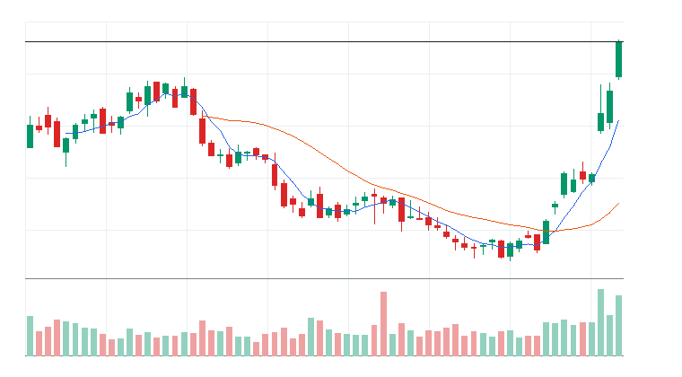
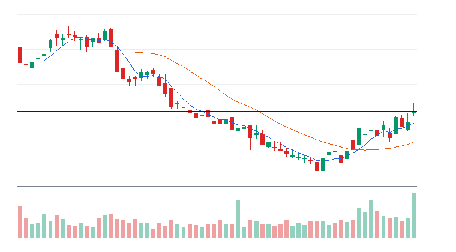
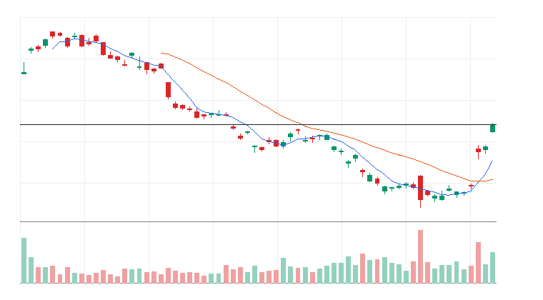
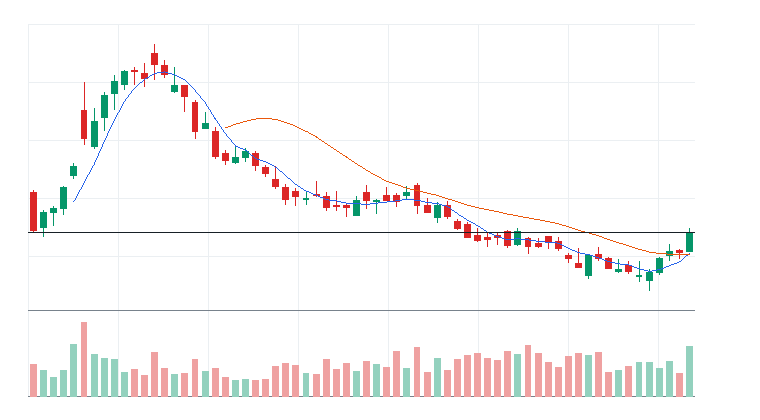
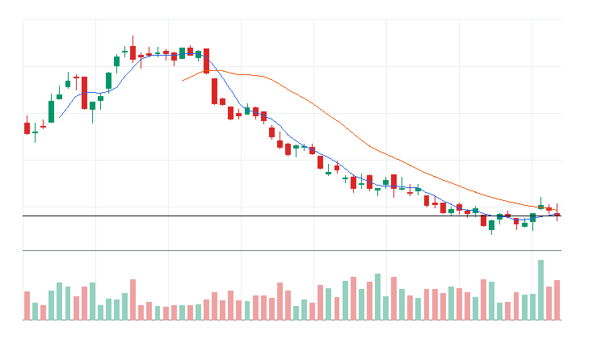
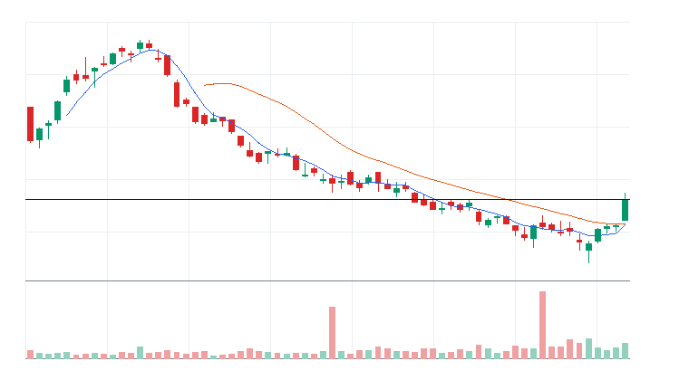
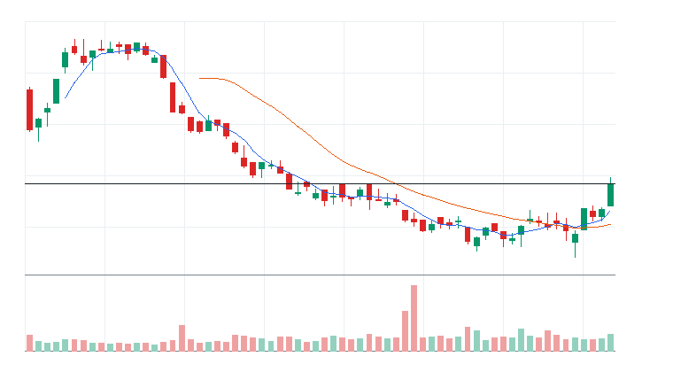
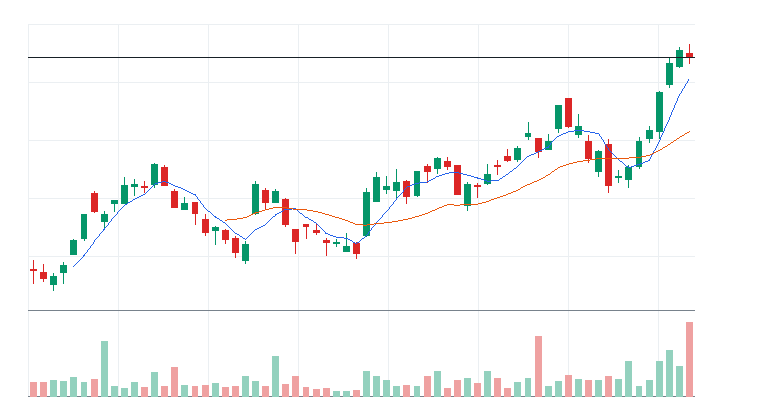
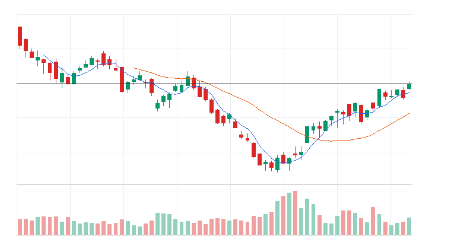
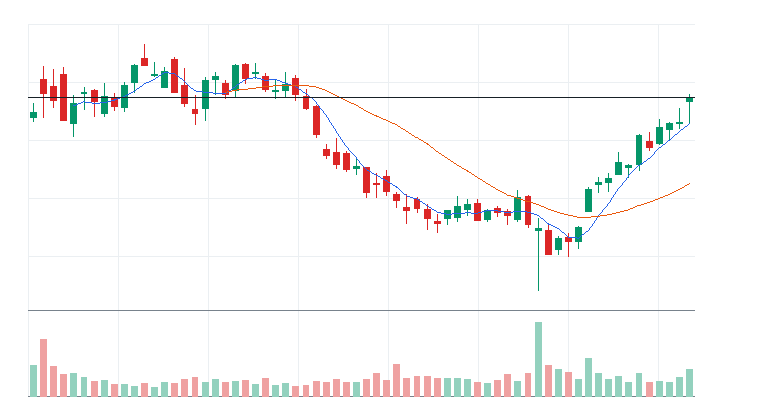

# 오늘의 데일리 트레이딩 요약

**REAL DATA TEST - 가격/거래량은 실제 데이터, 뉴스/ETF 구성종목 확산도/거래대금 유동성 일부 연결**

**목적:** 이 리포트는 최근 오른 자산을 나열하는 것이 아니라, 돈이 몰리는 근거와 다음 매수 주체가 확인할 트레이딩 후보를 찾기 위한 보고서다.

> 핵심 질문: 현재 가격에서 누가 사고 있고, 누가 앞으로 더 비싸게 사줄 수 있는가?

## 시장 국면 판단

- 최종 판정: 기간 조정 (72점)
- 전일 대비: 기간 조정은 유지됐지만 점수는 전일보다 강화됐다(+12점).
- 판정 신뢰도: 높음 (100점) - 핵심 지수와 매크로 데이터가 대부분 직접 수집되어 판정 신뢰도가 높다.
- 행동 바이어스: 추격 보류, 돌파 확인
- 한 줄 결론: 장기 추세는 유지되지만 단기 추세가 둔화되어 기간 조정으로 본다. 기술 85점, 매크로 50점.
- 기술적 지표: 상승 추세 우위 (85점, 가중치 65%)
- S&P 500: 100점 | 50일선 위, 200일선 위, 20일 +0.70%, 60일 0.00%, 52주 고점 대비 -1.58% -> 기술 점수 100
- Nasdaq 100: 69점 | 50일선 아래, 200일선 위, 20일 -3.60%, 60일 0.00%, 52주 고점 대비 -6.25% -> 기술 점수 69
- 매크로 시황: 매크로 중립 (50점, 가중치 35%)
- 매크로 요약: 금리 중심으로 매크로가 위험자산에 우호적이다.
- 금리: 중립-우호 55점 / 금리 중립 / confidence HIGH
  - 주요 근거: US 10Y yield 20일 -4.74%, 5일 +0.73%; US 3M yield 20일 +0.40%, 단기금리 방향 확인; US long-duration bonds 20일 +4.86%, 장기채 가격 기준 할인율 부담 확인
  - 확인 사항: 추가 확인 이벤트 없음
- 물가: 중립 45점 / 물가 중립 / confidence HIGH
  - 주요 근거: Oil ETF 20일 +12.11%, 유가 기반 물가 압력 확인; TIPS ETF 20일 +2.04%, 물가연동채 흐름은 보조 근거; Gold 20일 -3.71%, 금 강세는 방어 수요 여부 확인
  - 확인 사항: 추가 확인 이벤트 없음
- 정책: 중립 50점 / 정책 이벤트 확인 전 중립 / confidence LOW
  - 주요 근거: 정책 톤은 1차 버전에서 일정/이벤트 리스크 기반 중립값으로 반영한다.
  - 확인 사항: FOMC, CPI, PCE, 고용지표 발표 전후에는 매크로 confidence를 보수적으로 해석한다.
- 신용/유동성: 중립 50점 / 신용/유동성 중립 / confidence HIGH
  - 주요 근거: High yield credit 20일 +0.88%, 하이일드 위험선호 확인; HYG-LQD 20일 상대강도 -1.27%, 신용위험 선호/회피 확인; VIX 20일 +4.94%, 변동성 부담 확인
  - 확인 사항: 추가 확인 이벤트 없음
- 환율/글로벌: 중립 49점 / 환율/글로벌 중립 / confidence MEDIUM
  - 주요 근거: US dollar 20일 +0.28%, 달러 강세/약세 확인
  - 확인 사항: 추가 확인 이벤트 없음
- US 10Y yield: 57점 | 하락 시 주식 우호; 5일 +0.73%, 20일 -4.74% -> 매크로 점수 57
- US 3M yield: 50점 | 하락 시 주식 우호; 5일 -0.60%, 20일 +0.40% -> 매크로 점수 50
- US long-duration bonds: 58점 | 상승 시 주식 우호; 5일 -0.31%, 20일 +4.86% -> 매크로 점수 58
- TIPS ETF: 50점 | 상승 시 주식 우호; 5일 +0.10%, 20일 +2.04% -> 매크로 점수 50
- Oil ETF: 28점 | 하락 시 주식 우호; 5일 +3.50%, 20일 +12.11% -> 매크로 점수 28
- Gold: 50점 | 상승 시 주식 우호; 5일 -0.12%, 20일 -3.71% -> 매크로 점수 50
- US dollar: 49점 | 하락 시 주식 우호; 5일 +0.48%, 20일 +0.28% -> 매크로 점수 49
- High yield credit: 52점 | 상승 시 주식 우호; 5일 +0.62%, 20일 +0.88% -> 매크로 점수 52
- Investment grade credit: 50점 | 상승 시 주식 우호; 5일 -0.06%, 20일 +2.15% -> 매크로 점수 50
- VIX: 50점 | 하락 시 주식 우호; 5일 -9.62%, 20일 +4.94% -> 매크로 점수 50
- 데이터 커버리지: 기술 2/2, 매크로 10/10
- 데이터 신뢰도 근거:
  - 직접 지수 데이터: S&P 500, Nasdaq 100
  - 대체 지수 데이터 없음
  - 매크로 데이터: 10/10
  - 누락 데이터 없음
  - stale 데이터 없음

## 모바일 요약

[오늘의 데일리 트레이딩 요약]

생성 성공 / 데이터 모드: REAL_TEST

시장:
- 중립

시장 지배 서사:
1. 방산/안보 프리미엄 - 관찰 - SPDR S&P Aerospace & Defense ETF(XAR), iShares U.S. Aerospace & Defense ETF(ITA), Lockheed Martin(LMT), Kratos Defense & Security Solutions(KTOS) 중심으로 5일 +6.45%, 20일 +7.00% 흐름이 형성됨. 직접 촉매 일부 확인.
2. Aerospace & Defense 자금 유입 - 약화 - SPDR S&P 500 ETF Trust(SPY), iShares Russell 2000 ETF(IWM), Lockheed Martin(LMT), RTX 중심으로 5일 +3.04%, 20일 +8.44% 흐름이 형성됨. 직접 촉매 일부 확인.
3. 바이오/헬스케어 촉매 - 소멸 - Invesco QQQ Trust(QQQ), Gilead Sciences Inc.(GILD), Alnylam Pharmaceuticals Inc.(ALNY) 중심으로 5일 -5.51%, 20일 -5.35% 흐름이 형성됨. 직접 촉매 일부 확인.

트렌드 강도:
1. 방산/안보 프리미엄 - TSI 74 - 확인 - 진입품질 보통
2. Aerospace & Defense 자금 유입 - TSI 47 - 잠복 - 진입품질 낮음
3. 바이오/헬스케어 촉매 - TSI 20 - 잠복 - 진입품질 낮음

오늘 결론:
- Industrials 개별 종목 흐름이 ETF 대비 강한지 확인 필요
- 행동 후보는 linkedNarrative와 함께 확인한다.
- 추격보다 진입 조건 확인 후 접근한다.

오늘 실제 행동 후보:
1. Lockheed Martin(LMT)(STOCK) - 방산/안보 프리미엄 - 단기 추세가 유지되고 거래량이 1.0배 이상이면 눌림 이후 재상승을 시도할 수 있음
2. RTX(STOCK) - 방산/안보 프리미엄 - 단기 추세가 유지되고 거래량이 1.0배 이상이면 눌림 이후 재상승을 시도할 수 있음
3. Ferrovial N.V.(FER)(STOCK) - Aerospace & Defense 자금 유입 - 단기 추세가 유지되고 거래량이 1.0배 이상이면 눌림 이후 재상승을 시도할 수 있음

다크호스 후보:
1. Kratos Defense & Security Solutions(KTOS) - darkHorseScore 70 - 베이스 돌파 확인

ETF 후보 TOP 5:
1. iShares U.S. Aerospace & Defense ETF(ITA) - 방산/안보 프리미엄 - 관찰
2. SPDR S&P Aerospace & Defense ETF(XAR) - 방산/안보 프리미엄 - 관찰
3. Invesco Aerospace & Defense ETF(PPA) - 방산/안보 프리미엄 - 제외
4. iShares Cybersecurity and Tech ETF(IHAK) - 사이버보안 지출 재가속 - 제외
5. Utilities Select Sector SPDR Fund(XLU) - 전력망/원전/인프라 병목 - 거래량 확인 전 관찰

웹 리포트:
https://yoolcool.github.io/DailyTradingThesisAgent/

## 오늘 결론

- 오늘 결론: 조건부 진입
- 신규 진입 후보: 0개
- 조건부 진입 후보: 5개
- 관찰 후보: 88개
- 주요 제한 요인: Entry Quality < 40, 뉴스 직접성 부족, RVOL 미달
- 주문 판단: 시장가 금지 / 지정가 또는 관찰
- 실전 판단: 진입 후보는 있으나, 전일 고점 돌파와 거래량 확인 후 선별적으로 접근한다.

### 후보 제한 요인 집계

- RVOL < 1.00x: 80개
- 거래대금 유동성 낮음: 16개
- Entry Quality 50~54 near miss: 1개
- Entry Quality 40~49 관찰: 8개
- Entry Quality < 40: 145개
- Exhaustion Risk >= 70: 0개
- ETF breadth 샘플 부족: 37개
- 뉴스 직접성 부족: 98개

## 데이터 신뢰도

- 전체 데이터 신뢰도 등급: LOW
- 분석 신뢰도: LOW
- 주문 실행 신뢰도: LOW
- ETF breadth 신뢰도: LOW
- 신뢰도 해석: 테마 확산 판단 제한, 거래대금 유동성 낮음 또는 확인 불가, 프리/애프터마켓 확인 불가
- 리포트 생성 시각: 2026-10-30 11:26 KST
- 가격 기준 거래일: 2026-10-29 US regular close
- 뉴스 수집 시각: 2026-10-30 11:26 KST
- 가장 최근 뉴스 발행 시각: 2026-10-30 10:35 KST
- 뉴스 신선도 상태: FRESH
- 뉴스 소스: Yahoo Finance RSS, MarketWatch RSS, CNBC Markets RSS, SEC EDGAR RSS, Federal Reserve RSS, Finnhub API
- 뉴스 소스 상태: Yahoo Finance RSS CONNECTED, MarketWatch RSS CONNECTED, CNBC Markets RSS PARTIAL, SEC EDGAR RSS PARTIAL, Federal Reserve RSS CONNECTED, Finnhub API DISABLED
- 뉴스 신뢰도: MEDIUM
- 추천 적용 거래일: 2026-10-29 US regular session
- 가격/거래량 데이터 상태: 일부 연결
- 뉴스 데이터 상태: 일부 연결
- ETF 구성종목 확산도 상태: 일부 연결
- ETF 구성종목 샘플 수: 1~4
- 거래대금 유동성 데이터 상태: 일부 연결
- 프리/애프터마켓 데이터 상태: UNAVAILABLE
- 데이터 provider: yfinance, Yahoo Finance RSS, MarketWatch RSS, CNBC Markets RSS, SEC EDGAR RSS, Federal Reserve RSS, Finnhub API, config fallback sample, price-volume dollar-volume fallback
- 실전 사용 경고: 이 리포트는 투자판단 보조용이며, REAL_TEST 모드에서는 일부 데이터가 누락되거나 지연될 수 있다. 실제 주문 전 현재가, 뉴스, 프리마켓/정규장 거래량을 별도 확인해야 한다.

## 0. 시장 상태

- 데이터 모드: REAL_TEST
- 가격/거래량: 일부 연결
- 뉴스: 일부 연결
- ETF 구성종목 확산도: 일부 연결
- 거래대금 유동성: 일부 연결
- 생성 시각: 2026년 10월 30일 금요일 AM 11:26
- 시장 상태: 중립
- 오늘 돈의 방향: Industrials 개별 종목 흐름이 ETF 대비 강한지 확인 필요
- 강한 테마 TOP 3: 바이오/헬스케어(50), 방산 ETF(49), Utilities(46)
- 데이터 한계:
  - API 또는 provider 상태에 따라 뉴스/ETF 확산도/거래대금 유동성 반영 범위가 달라질 수 있다.
  - 수집 실패 데이터는 점수 반영에서 제외하거나 confidence를 제한한다.
  - reasonConfidence HIGH는 직접 촉매, 가격/거래량, 확산도/유동성 근거가 함께 있을 때만 사용한다.

## 오늘 시장을 지배하는 서사

### 오늘 시장을 지배하는 서사 TOP 3

#### 1. 방산/안보 프리미엄
- 상태: 관찰
- narrativeScore: 58
- reasonConfidence: LOW
- 근거 ETF: XAR, ITA, SHLD
- 근거 개별 종목: LMT, KTOS, RTX, AVAV, PLTR
- 돈이 몰리는 이유: 방산/안보 프리미엄 관련 SPDR S&P Aerospace & Defense ETF(XAR), iShares U.S. Aerospace & Defense ETF(ITA), Global X Defense Tech ETF(SHLD)와 Lockheed Martin(LMT), Kratos Defense & Security Solutions(KTOS), RTX, AeroVironment(AVAV)의 5일(+6.45%)·20일(+7.00%) 흐름을 함께 본다. 평균 상대 거래량은 1.22배이고, ETF 확산도는 추가 확인이 필요하다. 직접 뉴스/이벤트가 일부 확인된다.
- 다음 매수 주체: 지정학 리스크와 안보 예산 기대를 사는 테마 ETF 자금
- 가장 좋은 트레이딩 수단: ETF 우선: XAR, SHLD, ITA / 개별 종목 우선: AVAV, KTOS, PLTR
- 서사가 깨지는 조건: 방산 ETF 20일선 이탈 또는 안보 이벤트 프리미엄 둔화
- 오늘 행동: 뉴스 촉매가 직접 확인될 때만 추세 추종

상세 narrativeScore 근거 보기

- rawScore: 58
- ETF 평균 moneyFlowScore: 49
- 개별 종목 평균 moneyFlowScore: 59
- ETF 후보 비율: 50%
- 개별 종목 후보 비율: 67%
- 5일 평균 수익률: +6.00%
- 20일 평균 수익률: +7.00%
- 평균 상대 거래량: 1.00배
- ETF 평균 상대 거래량: 1.00배
- 개별주 평균 상대 거래량: 1.00배
- 52주 고점 근접 후보 비율: 0%
- 뉴스 직접성 점수: 9
- ETF 확산도 점수: 0
- 유동성 점수: 1
- 과열 리스크 차감: 0

#### 2. Aerospace & Defense 자금 유입
- 상태: 약화
- narrativeScore: 48
- reasonConfidence: LOW
- 근거 ETF: SPY, IWM, QQQ
- 근거 개별 종목: LMT, RTX, NOC
- 돈이 몰리는 이유: Aerospace & Defense 자금 유입 관련 SPDR S&P 500 ETF Trust(SPY), iShares Russell 2000 ETF(IWM), Invesco QQQ Trust(QQQ)와 Lockheed Martin(LMT), RTX, Northrop Grumman(NOC)의 5일(+3.04%)·20일(+8.44%) 흐름을 함께 본다. 평균 상대 거래량은 1.24배이고, ETF 확산도는 추가 확인이 필요하다. 직접 뉴스/이벤트가 일부 확인된다.
- 다음 매수 주체: Aerospace & Defense 자금 유입을 확인한 섹터 ETF 자금과 상대강도 추종 스윙 자금
- 가장 좋은 트레이딩 수단: ETF 우선: QQQ, SPY, IWM / 개별 종목 우선: NOC, LMT, RTX
- 서사가 깨지는 조건: QQQ 20일선 이탈 또는 관련 종목 절반 이상 5일선 이탈
- 오늘 행동: 기존 네러티브와 중복을 확인한 뒤 ETF/대표 종목 동조성이 살아날 때만 관찰 편입

상세 narrativeScore 근거 보기

- rawScore: 48
- ETF 평균 moneyFlowScore: 23
- 개별 종목 평균 moneyFlowScore: 69
- ETF 후보 비율: 0%
- 개별 종목 후보 비율: 67%
- 5일 평균 수익률: +3.00%
- 20일 평균 수익률: +8.00%
- 평균 상대 거래량: 1.00배
- ETF 평균 상대 거래량: 1.00배
- 개별주 평균 상대 거래량: 1.00배
- 52주 고점 근접 후보 비율: 17%
- 뉴스 직접성 점수: 6
- ETF 확산도 점수: -1
- 유동성 점수: 4
- 과열 리스크 차감: 0

#### 3. 바이오/헬스케어 촉매
- 상태: 소멸
- narrativeScore: 32
- reasonConfidence: LOW
- 근거 ETF: QQQ
- 근거 개별 종목: GILD, ALNY
- 돈이 몰리는 이유: 바이오/헬스케어 촉매 관련 Invesco QQQ Trust(QQQ)와 Gilead Sciences Inc.(GILD), Alnylam Pharmaceuticals Inc.(ALNY)의 5일(-5.51%)·20일(-5.35%) 흐름을 함께 본다. 평균 상대 거래량은 2.88배이고, ETF 확산도는 추가 확인이 필요하다. 직접 뉴스/이벤트가 일부 확인된다.
- 다음 매수 주체: 바이오/헬스케어 촉매을 확인한 섹터 ETF 자금과 상대강도 추종 스윙 자금
- 가장 좋은 트레이딩 수단: ETF 우선: QQQ / 개별 종목 우선: ALNY, GILD
- 서사가 깨지는 조건: QQQ 20일선 이탈 또는 관련 종목 절반 이상 5일선 이탈
- 오늘 행동: 기존 네러티브와 중복을 확인한 뒤 ETF/대표 종목 동조성이 살아날 때만 관찰 편입

상세 narrativeScore 근거 보기

- rawScore: 32
- ETF 평균 moneyFlowScore: 5
- 개별 종목 평균 moneyFlowScore: 46
- ETF 후보 비율: 0%
- 개별 종목 후보 비율: 50%
- 5일 평균 수익률: -6.00%
- 20일 평균 수익률: -5.00%
- 평균 상대 거래량: 3.00배
- ETF 평균 상대 거래량: 1.00배
- 개별주 평균 상대 거래량: 4.00배
- 52주 고점 근접 후보 비율: 33%
- 뉴스 직접성 점수: 4
- ETF 확산도 점수: -4
- 유동성 점수: 3
- 과열 리스크 차감: 0

### 전체 narrative 요약

| 서사명 | 상태 | narrativeScore | reasonConfidence | 대표 ETF | 대표 종목 | 오늘 행동 |
| --- | --- | ---: | --- | --- | --- | --- |
| 방산/안보 프리미엄 | 관찰 | 58 | LOW | XAR, ITA, SHLD | LMT, KTOS, RTX, AVAV | 뉴스 촉매가 직접 확인될 때만 추세 추종 |
| Aerospace & Defense 자금 유입 | 약화 | 48 | LOW | SPY, IWM, QQQ | LMT, RTX, NOC | 기존 네러티브와 중복을 확인한 뒤 ETF/대표 종목 동조성이 살아날 때만 관찰 편입 |
| 바이오/헬스케어 촉매 | 소멸 | 32 | LOW | QQQ | GILD, ALNY | 기존 네러티브와 중복을 확인한 뒤 ETF/대표 종목 동조성이 살아날 때만 관찰 편입 |
| Integrated Oil & Gas 자금 유입 | 약화 | 32 | LOW | XLE, OIH | XOM, CVX | 기존 네러티브와 중복을 확인한 뒤 ETF/대표 종목 동조성이 살아날 때만 관찰 편입 |
| 매크로 방어/헤지 | 약화 | 28 | LOW | XLE, TLT, GLD | XOM, CVX | 위험회피가 확인될 때만 헤지성 접근 |
| 전력 유틸리티 수요 재평가 | 소멸 | 27 | LOW | SPY, IWM, QQQ | VRT, GEV, ETN | 기존 네러티브와 중복을 확인한 뒤 ETF/대표 종목 동조성이 살아날 때만 관찰 편입 |
| Specialty Business Services 자금 유입 | 약화 | 20 | LOW | SPY, IWM, QQQ | CTAS, TRI | 기존 네러티브와 중복을 확인한 뒤 ETF/대표 종목 동조성이 살아날 때만 관찰 편입 |
| 사이버보안 지출 재가속 | 약화 | 18 | LOW | IHAK, CIBR, HACK | CRWD, ZS, PANW, FTNT | 기존 네러티브와 중복을 확인한 뒤 ETF/대표 종목 동조성이 살아날 때만 관찰 편입 |
| 전력망/원전/인프라 병목 | 소멸 | 16 | LOW | PAVE, GRID, URA | VRT, PWR, ETN, CEG | ETF 확산도와 거래량이 같이 살아날 때만 진입 |
| 소프트웨어 실적/AI 수익화 | 약화 | 14 | LOW | IGV, QQQ, AIQ | ROP, SNPS, ADSK, DDOG | 기존 네러티브와 중복을 확인한 뒤 ETF/대표 종목 동조성이 살아날 때만 관찰 편입 |
| 필수소비재 음료 방어 성장 | 약화 | 14 | LOW | QQQ | MNST, CCEP | 기존 네러티브와 중복을 확인한 뒤 ETF/대표 종목 동조성이 살아날 때만 관찰 편입 |
| Staffing & Employment 자금 유입 | 약화 | 14 | LOW | SPY, IWM, QQQ | ADP, PAYX | 기존 네러티브와 중복을 확인한 뒤 ETF/대표 종목 동조성이 살아날 때만 관찰 편입 |
| Data Storage 자금 유입 | 소멸 | 10 | LOW | SPY, IWM, QQQ | WDC, STX | 기존 네러티브와 중복을 확인한 뒤 ETF/대표 종목 동조성이 살아날 때만 관찰 편입 |
| AI 인프라 재가속 | 소멸 | 9 | LOW | SMH, SOXX, DRAM | VRT, NVDA, MU, ETN | 추격보다 5일선 지지 후 재상승 확인 |
| 반도체 설계/공급망 재가속 | 소멸 | 8 | LOW | SMH, SOXX, SOXQ | NXPI, TXN, TSM, NVDA | 기존 네러티브와 중복을 확인한 뒤 ETF/대표 종목 동조성이 살아날 때만 관찰 편입 |
| AI 소프트웨어/사이버보안 확산 | 약화 | 8 | LOW | IGV, QQQ, AIQ | MSFT, DDOG, TEAM, PLTR | 추격보다 눌림 후 재상승 확인 |
| Discount Stores 자금 유입 | 약화 | 8 | LOW | QQQ | WMT, COST | 기존 네러티브와 중복을 확인한 뒤 ETF/대표 종목 동조성이 살아날 때만 관찰 편입 |
| 위험선호 성장주 재진입 | 소멸 | 7 | LOW | ARKK, QQQ, IPO | TSLA, ARM, COIN | 지수 위험선호가 유지될 때만 선별 진입 |
| Medical Devices 자금 유입 | 약화 | 4 | LOW | QQQ | ISRG, DXCM | 기존 네러티브와 중복을 확인한 뒤 ETF/대표 종목 동조성이 살아날 때만 관찰 편입 |
| Internet Content 자금 유입 | 소멸 | 3 | LOW | QQQ | META, GOOGL, GOOG | 기존 네러티브와 중복을 확인한 뒤 ETF/대표 종목 동조성이 살아날 때만 관찰 편입 |
| 소비 회복/방어주 선별 | 약화 | 3 | LOW | QQQ | PDD, AMZN | 기존 네러티브와 중복을 확인한 뒤 ETF/대표 종목 동조성이 살아날 때만 관찰 편입 |
| 반도체 장비 사이클 재평가 | 소멸 | 0 | LOW | SMH, SOXX, SOXQ | ASML, LRCX | 기존 네러티브와 중복을 확인한 뒤 ETF/대표 종목 동조성이 살아날 때만 관찰 편입 |
| Travel Services 자금 유입 | 약화 | 0 | LOW | QQQ | BKNG, ABNB | 기존 네러티브와 중복을 확인한 뒤 ETF/대표 종목 동조성이 살아날 때만 관찰 편입 |
| Bitcoin Mining 자금 유입 | 소멸 | 0 | LOW | IBIT, BLOK | RIOT, MARA, CIFR | 기존 네러티브와 중복을 확인한 뒤 ETF/대표 종목 동조성이 살아날 때만 관찰 편입 |
| 비트코인/디지털 자산 위험선호 | 소멸 | 0 | LOW | IBIT, BLOK | MSTR, COIN, IREN | 비트코인 베타가 살아날 때만 단기 매매 |

## 트렌드 강도 판단

### 1. 방산/안보 프리미엄
- Trend Strength Index: 74
- 트렌드 상태 라벨: 확인
- 테마 확산도: 보통
- ETF 동조성: 강함
- 거래량 강도: 보통
- 과열 위험: 낮음 (5)
- 오늘 진입 품질: 보통 (61)
- 한 줄 판단: 방산/안보 프리미엄는 돈이 강하게 몰리지만 오늘 진입 품질은 아직 제한적이라 추격보다 조건 확인이 필요하다.
- 오늘 접근법: SPDR S&P Aerospace & Defense ETF(XAR)/iShares U.S. Aerospace & Defense ETF(ITA)/Global X Defense Tech ETF(SHLD) 동반 강세가 유지되는 동안 돌파 추격보다 전일 고점 재돌파 또는 5일선 눌림 회복을 기다린다.

트렌드 강도 상세 근거 보기

- 가격 모멘텀: 가격 모멘텀 20/25. 평균 5D +6.45%, 20D +7.00%.
- 거래량 강도: 거래량 강도 10/20. 평균 RVOL 1.22배.
- ETF 동조성: ETF 동조성 16/15. 관련 ETF SPDR S&P Aerospace & Defense ETF(XAR), Global X Defense Tech ETF(SHLD), iShares U.S. Aerospace & Defense ETF(ITA), Invesco Aerospace & Defense ETF(PPA) 흐름을 기준으로 판단.
- 테마 확산도: 테마 확산도 13/20. 상위 1~2개 쏠림 감점 0점 반영.
- 뉴스 촉매: 뉴스/촉매 신선도 10/10. HIGH 직접 촉매 3개.
- 과열 리스크: 과열 리스크 5/100. 단기 급등, 고점 근접, ETF-개별주 괴리, 쏠림을 함께 반영.
- 시장 환경: 시장 환경 5/10. QQQ/SPY/IWM 가격 흐름 기반 위험선호 점수.

### 2. Aerospace & Defense 자금 유입
- Trend Strength Index: 47
- 트렌드 상태 라벨: 잠복
- 테마 확산도: 약함
- ETF 동조성: 약함
- 거래량 강도: 보통
- 과열 위험: 낮음 (12)
- 오늘 진입 품질: 낮음 (38)
- 한 줄 판단: Aerospace & Defense 자금 유입는 관찰 가능한 흐름은 있으나 가격, 거래량, 확산도 중 일부 확인이 더 필요하다.
- 오늘 접근법: SPDR S&P 500 ETF Trust(SPY)/iShares Russell 2000 ETF(IWM)/Invesco QQQ Trust(QQQ)와 Lockheed Martin(LMT)/RTX/Northrop Grumman(NOC)의 거래량 확산이 확인되기 전까지 관찰한다.

트렌드 강도 상세 근거 보기

- 가격 모멘텀: 가격 모멘텀 12/25. 평균 5D +3.04%, 20D +8.44%.
- 거래량 강도: 거래량 강도 10/20. 평균 RVOL 1.24배.
- ETF 동조성: ETF 동조성 7/15. 관련 ETF Invesco QQQ Trust(QQQ), SPDR S&P 500 ETF Trust(SPY), iShares Russell 2000 ETF(IWM) 흐름을 기준으로 판단.
- 테마 확산도: 테마 확산도 8/20. 상위 1~2개 쏠림 감점 3점 반영.
- 뉴스 촉매: 뉴스/촉매 신선도 5/10. HIGH 직접 촉매 2개.
- 과열 리스크: 과열 리스크 12/100. 단기 급등, 고점 근접, ETF-개별주 괴리, 쏠림을 함께 반영.
- 시장 환경: 시장 환경 5/10. QQQ/SPY/IWM 가격 흐름 기반 위험선호 점수.

### 3. 바이오/헬스케어 촉매
- Trend Strength Index: 20
- 트렌드 상태 라벨: 잠복
- 테마 확산도: 부족
- ETF 동조성: 부족
- 거래량 강도: 강함
- 과열 위험: 보통 (31)
- 오늘 진입 품질: 낮음 (9)
- 한 줄 판단: 바이오/헬스케어 촉매는 테마 확산도가 낮아 아직 개별 종목 이벤트성 흐름에 가깝다.
- 오늘 접근법: Invesco QQQ Trust(QQQ)와 Gilead Sciences Inc.(GILD)/Alnylam Pharmaceuticals Inc.(ALNY)의 거래량 확산이 확인되기 전까지 관찰한다.

트렌드 강도 상세 근거 보기

- 가격 모멘텀: 가격 모멘텀 -8/25. 평균 5D -5.51%, 20D -5.35%.
- 거래량 강도: 거래량 강도 16/20. 평균 RVOL 2.88배.
- ETF 동조성: ETF 동조성 2/15. 관련 ETF Invesco QQQ Trust(QQQ) 흐름을 기준으로 판단.
- 테마 확산도: 테마 확산도 4/20. 상위 1~2개 쏠림 감점 6점 반영.
- 뉴스 촉매: 뉴스/촉매 신선도 1/10. HIGH 직접 촉매 1개.
- 과열 리스크: 과열 리스크 31/100. 단기 급등, 고점 근접, ETF-개별주 괴리, 쏠림을 함께 반영.
- 시장 환경: 시장 환경 5/10. QQQ/SPY/IWM 가격 흐름 기반 위험선호 점수.

## 최근 추천 결과 트래킹

개별주는 데이트레이딩 관점으로 추천 이후 첫 정규장의 장중 최고가와 종가를 추적한다. ETF는 테마/스윙 관점으로 추천 이후 1주일 동안의 최고가와 현재 종가를 추적한다.

### 개별주 Top 3 추천 성과 요약
- 최근 5개 리포트 표본: 15개 (초기 검증 단계)
- 장중 최고가 기준 성공률: +16.67%
- 종가 기준 성공률: +50.00%
- 평균 장중 최고 수익률: +1.93%
- 평균 종가 수익률: +0.64%

### ETF 추천 성과 요약
- 최근 5개 리포트 표본: 2개 (초기 검증 단계)
- 1주 최고가 기준 성공률: +50.00%
- 현재 종가 기준 성공률: +50.00%
- 평균 1주 최고 수익률: +3.49%
- 평균 현재 수익률: +0.77%

최근 추천 결과 상세 테이블 펼치기

| 추천일 | 유형 | 순위 | 티커 | 기준가 | 추적 기간 | 상태 | High 수익률 | Close 수익률 | 결과 | 코멘트 |
| --- | --- | ---: | --- | ---: | --- | --- | ---: | ---: | --- | --- |
| 2026-10-30 | STOCK | 3 | FER | $56.92 | 2026-10-30 | pending | 데이터 없음 | 데이터 없음 | 추적 대기 | 아직 추적 거래일 데이터가 완성되지 않음 |
| 2026-10-30 | STOCK | 2 | RTX | $199.4 | 2026-10-30 | pending | 데이터 없음 | 데이터 없음 | 추적 대기 | 아직 추적 거래일 데이터가 완성되지 않음 |
| 2026-10-30 | STOCK | 1 | LMT | $643.59 | 2026-10-30 | pending | 데이터 없음 | 데이터 없음 | 추적 대기 | 아직 추적 거래일 데이터가 완성되지 않음 |
| 2026-10-29 | STOCK | 3 | GEHC | $75.82 | 2026-10-29 | complete | +1.99% | +0.79% | 제한적 유효 | 제한적인 장중 기회만 발생 (일봉 기준) |
| 2026-10-29 | STOCK | 2 | LMT | $629.75 | 2026-10-29 | complete | +3.06% | +2.20% | 성공 | 장중 기회와 종가 유지가 모두 확인됨 (일봉 기준) |
| 2026-10-29 | STOCK | 1 | ROP | $440.66 | 2026-10-29 | complete | +2.17% | +2.04% | 제한적 유효 | 제한적인 장중 기회만 발생 (일봉 기준) |
| 2026-10-27 | STOCK | 3 | LMT | $635.2 | 2026-10-27 | complete | -0.26% | -1.92% | 실패 | 추천 이후 의미 있는 장중 기회가 부족하고 종가도 약함 (일봉 기준) |
| 2026-10-27 | STOCK | 2 | ROP | $441.65 | 2026-10-27 | complete | -0.52% | -1.62% | 실패 | 추천 이후 의미 있는 장중 기회가 부족하고 종가도 약함 (일봉 기준) |
| 2026-10-27 | STOCK | 1 | ZS | $260.45 | 2026-10-27 | complete | +2.85% | -0.12% | 제한적 유효 | 제한적인 장중 기회만 발생 (일봉 기준) |
| 2026-10-27 | ETF | 1 | IHAK | $76.25 | 2026-10-27~2026-11-03 | in_progress | +1.94% | -0.73% | 진행 중 | 아직 1주 추적 기간이 끝나지 않음 |
| 2026-10-26 | STOCK | 3 | CRWD | $257.57 | 2026-10-26 | complete | +2.65% | +1.65% | 제한적 유효 | 제한적인 장중 기회만 발생 (일봉 기준) |
| 2026-10-26 | STOCK | 2 | ROP | $438.14 | 2026-10-26 | complete | +2.88% | +0.80% | 제한적 유효 | 제한적인 장중 기회만 발생 (일봉 기준) |
| 2026-10-26 | STOCK | 1 | ZS | $255.15 | 2026-10-26 | complete | +2.47% | +2.08% | 제한적 유효 | 제한적인 장중 기회만 발생 (일봉 기준) |
| 2026-10-26 | ETF | 1 | IHAK | $74 | 2026-10-26~2026-11-02 | in_progress | +5.04% | +2.28% | 진행 중 | 아직 1주 추적 기간이 끝나지 않음 |
| 2026-10-23 | STOCK | 3 | ADP | $294.5 | 2026-10-23 | complete | +5.06% | +3.28% | 성공 | 장중 기회와 종가 유지가 모두 확인됨 (일봉 기준) |
| 2026-10-23 | STOCK | 2 | CTAS | $220.15 | 2026-10-23 | complete | +2.56% | +1.79% | 제한적 유효 | 제한적인 장중 기회만 발생 (일봉 기준) |
| 2026-10-23 | STOCK | 1 | MAR | $404 | 2026-10-23 | complete | -1.77% | -3.29% | 실패 | 추천 이후 의미 있는 장중 기회가 부족하고 종가도 약함 (일봉 기준) |
| 2026-10-22 | STOCK | 3 | TRI | $112.82 | 2026-10-22 | complete | +9.70% | +9.25% | 성공 | 장중 기회와 종가 유지가 모두 확인됨 (일봉 기준) |
| 2026-10-22 | STOCK | 2 | MAR | $397.31 | 2026-10-22 | complete | +1.50% | -0.13% | 제한적 유효 | 제한적인 장중 기회만 발생 (일봉 기준) |
| 2026-10-22 | STOCK | 1 | NOC | $534 | 2026-10-22 | complete | +4.22% | +3.44% | 성공 | 장중 기회와 종가 유지가 모두 확인됨 (일봉 기준) |
| 2026-10-13 | STOCK | 2 | SHOP | $179.22 | 2026-10-13 | complete | -0.01% | -1.51% | 실패 | 추천 이후 의미 있는 장중 기회가 부족하고 종가도 약함 (일봉 기준) |
| 2026-10-13 | STOCK | 1 | PLTR | $209 | 2026-10-13 | complete | +0.90% | -0.16% | 실패 | 추천 이후 의미 있는 장중 기회가 부족하고 종가도 약함 (일봉 기준) |
| 2026-10-12 | STOCK | 3 | ZS | $233.73 | 2026-10-12 | complete | +1.49% | -3.40% | 제한적 유효 | 제한적인 장중 기회만 발생 (일봉 기준) |
| 2026-10-12 | STOCK | 2 | DDOG | $293.26 | 2026-10-12 | complete | +2.53% | -2.04% | 제한적 유효 | 제한적인 장중 기회만 발생 (일봉 기준) |
| 2026-10-12 | STOCK | 1 | PLTR | $209.05 | 2026-10-12 | complete | +1.86% | -0.02% | 제한적 유효 | 제한적인 장중 기회만 발생 (일봉 기준) |
| 2026-10-09 | STOCK | 2 | ZS | $216.81 | 2026-10-09 | complete | +8.07% | +7.80% | 성공 | 장중 기회와 종가 유지가 모두 확인됨 (일봉 기준) |
| 2026-10-09 | STOCK | 1 | PLTR | $198.78 | 2026-10-09 | complete | +5.43% | +5.17% | 성공 | 장중 기회와 종가 유지가 모두 확인됨 (일봉 기준) |
| 2026-10-08 | STOCK | 1 | ADSK | $235.05 | 2026-10-08 | complete | +0.40% | -0.62% | 실패 | 추천 이후 의미 있는 장중 기회가 부족하고 종가도 약함 (일봉 기준) |
| 2026-10-07 | STOCK | 3 | FTNT | $191.27 | 2026-10-07 | complete | +0.50% | -1.04% | 실패 | 추천 이후 의미 있는 장중 기회가 부족하고 종가도 약함 (일봉 기준) |
| 2026-10-07 | STOCK | 2 | AMD | $649.42 | 2026-10-07 | complete | -0.14% | -0.55% | 실패 | 추천 이후 의미 있는 장중 기회가 부족하고 종가도 약함 (일봉 기준) |
| 2026-10-07 | STOCK | 1 | SNPS | $505.17 | 2026-10-07 | complete | +0.86% | -0.49% | 실패 | 추천 이후 의미 있는 장중 기회가 부족하고 종가도 약함 (일봉 기준) |
| 2026-10-07 | ETF | 1 | CIBR | $108.13 | 2026-10-07~2026-10-14 | complete | +2.36% | -2.89% | 단기 고점 후 반납 | 1주 내 상승 기회는 있었지만 현재가는 반납 |
| 2026-10-06 | STOCK | 2 | TSM | $485.8 | 2026-10-06 | complete | +0.04% | -0.72% | 실패 | 추천 이후 의미 있는 장중 기회가 부족하고 종가도 약함 (일봉 기준) |
| 2026-10-06 | STOCK | 1 | SNPS | $488.47 | 2026-10-06 | complete | +3.90% | +3.42% | 성공 | 장중 기회와 종가 유지가 모두 확인됨 (일봉 기준) |
| 2026-10-06 | ETF | 1 | CIBR | $106.01 | 2026-10-06~2026-10-13 | complete | +4.41% | -0.95% | 단기 고점 후 반납 | 1주 내 상승 기회는 있었지만 현재가는 반납 |
| 2026-10-05 | STOCK | 1 | SNPS | $489.9 | 2026-10-05 | complete | +3.77% | -0.29% | 단타 유효 | 장중 기회는 있었지만 종가 유지력은 약함 (일봉 기준) |
| 2026-10-05 | ETF | 1 | SMH | $630.6 | 2026-10-05~2026-10-12 | complete | +1.41% | -10.93% | 실패 | 추천 이후 ETF 흐름이 약화됨 |
| 2026-09-30 | STOCK | 1 | AMAT | $512.01 | 2026-09-30 | complete | +0.67% | -0.12% | 실패 | 추천 이후 의미 있는 장중 기회가 부족하고 종가도 약함 (일봉 기준) |
| 2026-09-28 | STOCK | 3 | DDOG | $268.13 | 2026-09-28 | complete | +1.74% | +0.21% | 제한적 유효 | 제한적인 장중 기회만 발생 (일봉 기준) |
| 2026-09-28 | STOCK | 2 | ARM | $310.32 | 2026-09-28 | complete | -1.02% | -8.70% | 실패 | 추천 이후 의미 있는 장중 기회가 부족하고 종가도 약함 (일봉 기준) |
| 2026-09-28 | STOCK | 1 | QCOM | $201.97 | 2026-09-28 | complete | -1.39% | -7.17% | 실패 | 추천 이후 의미 있는 장중 기회가 부족하고 종가도 약함 (일봉 기준) |
| 2026-09-25 | STOCK | 3 | ARM | $332.56 | 2026-09-25 | complete | -2.13% | -6.69% | 실패 | 추천 이후 의미 있는 장중 기회가 부족하고 종가도 약함 (일봉 기준) |
| 2026-09-25 | STOCK | 2 | CRWD | $262.49 | 2026-09-25 | complete | -1.00% | -3.95% | 실패 | 추천 이후 의미 있는 장중 기회가 부족하고 종가도 약함 (일봉 기준) |
| 2026-09-25 | STOCK | 1 | PLTR | $191.79 | 2026-09-25 | complete | +1.26% | -1.11% | 제한적 유효 | 제한적인 장중 기회만 발생 (일봉 기준) |
| 2026-09-23 | STOCK | 3 | MARA | $13.28 | 2026-09-23 | complete | +2.79% | +0.53% | 제한적 유효 | 제한적인 장중 기회만 발생 (일봉 기준) |
| 2026-09-23 | STOCK | 2 | CIFR | $18.9 | 2026-09-23 | complete | +3.49% | -2.91% | 단타 유효 | 장중 기회는 있었지만 종가 유지력은 약함 (일봉 기준) |
| 2026-09-23 | STOCK | 1 | RIOT | $24.18 | 2026-09-23 | complete | +4.51% | +2.11% | 성공 | 장중 기회와 종가 유지가 모두 확인됨 (일봉 기준) |
| 2026-09-23 | ETF | 3 | ARKK | $90.72 | 2026-09-23~2026-09-30 | complete | +1.63% | -5.24% | 실패 | 추천 이후 ETF 흐름이 약화됨 |
| 2026-09-23 | ETF | 2 | MAGS | $72.97 | 2026-09-23~2026-09-30 | complete | -0.29% | -4.48% | 실패 | 추천 이후 ETF 흐름이 약화됨 |
| 2026-09-23 | ETF | 1 | SMH | $596.03 | 2026-09-23~2026-09-30 | complete | +2.89% | -5.76% | 단기 고점 후 반납 | 1주 내 상승 기회는 있었지만 현재가는 반납 |
| 2026-09-22 | STOCK | 3 | CRWD | $237.65 | 2026-09-22 | complete | +5.53% | +5.22% | 성공 | 장중 기회와 종가 유지가 모두 확인됨 (일봉 기준) |
| 2026-09-22 | STOCK | 2 | RIOT | $23.75 | 2026-09-22 | complete | +6.91% | +4.97% | 성공 | 장중 기회와 종가 유지가 모두 확인됨 (일봉 기준) |
| 2026-09-22 | STOCK | 1 | AMD | $559.82 | 2026-09-22 | complete | +11.56% | +11.42% | 성공 | 장중 기회와 종가 유지가 모두 확인됨 (일봉 기준) |
| 2026-09-21 | STOCK | 3 | CRWD | $237.65 | 2026-09-21 | complete | +5.33% | +4.92% | 성공 | 장중 기회와 종가 유지가 모두 확인됨 (일봉 기준) |
| 2026-09-21 | STOCK | 2 | RIOT | $23.75 | 2026-09-21 | complete | +5.55% | +1.81% | 성공 | 장중 기회와 종가 유지가 모두 확인됨 (일봉 기준) |
| 2026-09-21 | STOCK | 1 | AMD | $559.82 | 2026-09-21 | complete | +10.16% | +9.95% | 성공 | 장중 기회와 종가 유지가 모두 확인됨 (일봉 기준) |
| 2026-09-17 | STOCK | 3 | QCOM | $187.8 | 2026-09-17 | complete | +2.19% | +0.48% | 제한적 유효 | 제한적인 장중 기회만 발생 (일봉 기준) |
| 2026-09-17 | STOCK | 2 | FTNT | $172.37 | 2026-09-17 | complete | +2.16% | +0.12% | 제한적 유효 | 제한적인 장중 기회만 발생 (일봉 기준) |
| 2026-09-17 | STOCK | 1 | CRWD | $242.49 | 2026-09-17 | complete | +3.23% | +1.32% | 성공 | 장중 기회와 종가 유지가 모두 확인됨 (일봉 기준) |
| 2026-09-15 | STOCK | 1 | AMD | $516.13 | 2026-09-15 | complete | -0.48% | -2.31% | 실패 | 추천 이후 의미 있는 장중 기회가 부족하고 종가도 약함 (일봉 기준) |

## 오늘 실제 행동 후보

### 1. Lockheed Martin(LMT)
- 자산 유형: STOCK
- linkedNarrative: 방산/안보 프리미엄
- narrativeStatus: 관찰
- narrativeScore: 58
- Trend Strength Index: 74
- Exhaustion Risk: 5 (낮음)
- Entry Quality Score: 62 (보통)
- 트렌드 판단: Trend Strength는 중간이지만 Entry Quality가 좋아 초기 진입 후보로 본다.
- moneyFlowScore: 100
- finalRawScore: 105
- reasonConfidence: HIGH
- reasonConfidenceExplanation: 직접 촉매: Yahoo Finance RSS / guidance / under_24h - Top Analyst Reports for Lam Research, Lockheed Martin & Equinor 가격/거래량, 관련 ETF 동반 강세, 유동성 근거가 함께 확인되어 HIGH로 분류했다.
- tieBreakerReason: 최종 원점수 105, 리스크 패널티 0, 5일 수익률 +9.10%, 상대 거래량 1.37배 순으로 정렬
- 후보별 시장 해석: 중립 / 제한적 - 특이 충돌 없음
- 게이트 사유: 통과
- 주문 실행: 시장가 가능
- 직접 촉매: Yahoo Finance RSS / guidance / under_24h - Top Analyst Reports for Lam Research, Lockheed Martin & Equinor
- 왜 돈이 몰리는가: 20일 +27.32%, 5일 +9.10%, 상대 거래량 1.37배로 가격과 거래량이 함께 개선. 뉴스: CNBC Markets RSS guidance/under_6h / 유동성: LIQUID
- 누가 더 비싸게 사줄 수 있는지: 개별 주도주를 따라붙는 단기 모멘텀 자금과 관련 ETF 강세를 확인한 트레이더
- 진입 조건: 20일선 위 눌림 후 재상승 확인
- 무효화 조건: 20일선 이탈 또는 상대 거래량 0.8배 이하 둔화
- todayActionLabel: 조건부 진입
#### 최근 뉴스/동향 한국어 요약

- 요약: 종목 직접 뉴스 확인 상태이며 뉴스 흐름은 긍정 우위입니다. 후보 선정 후 재확인한 핵심 이슈는 "What Is Lockheed Martin (LMT) Signaling With Its $694 Million Hypersonic Expansion?"입니다.
- 직접 촉매 판단: Lockheed Martin에 대해 직접 촉매로 분류된 뉴스가 확인됐습니다. 핵심은 "What Is Lockheed Martin (LMT) Signaling With Its $694 Million Hypersonic Expansion?"이며, 가이던스 재료로 봅니다.
- 뉴스 1: What Is Lockheed Martin (LMT) Signaling With Its $694 Million Hypersonic Expansion?
  - 내용: Lockheed Martin 관련 가이던스 뉴스입니다. 기사 스니펫상 핵심 내용은 Lockheed Martin (NYSE:LMT) received a US$694 million U.S.입니다.
  - 투자 의미: 실적/가이던스 재료는 다음 분기 기대치 변화로 이어질 수 있어 컨센서스 변화와 주가 반응 지속성을 함께 봅니다.
  - 확인할 점: 매출/마진/가이던스 수치, 컨센서스 대비 차이
- 뉴스 2: Lockheed Martin (LMT) Stock Sees Modest Fair Value Lift After Split Analyst Revisions
  - 내용: Lockheed Martin 관련 가이던스 뉴스입니다. 기사 스니펫상 핵심 내용은 Lockheed Martin’s latest analyst update features only modest shifts in fair value estimates, with one framework moving from US$624.95 to US$645.48 and Street targets clustered i...입니다.
  - 투자 의미: 실적/가이던스 재료는 다음 분기 기대치 변화로 이어질 수 있어 컨센서스 변화와 주가 반응 지속성을 함께 봅니다.
  - 확인할 점: 매출/마진/가이던스 수치, 컨센서스 대비 차이
- 뉴스 3: Lockheed Martin (LMT): Selling After Strong Performance and a Favorable Gain
  - 내용: Lockheed Martin 관련 기사는 Lockheed Martin (LMT): Selling After Strong Performance and a Favorable Gain 이슈를 다루며, 주가 변동률 +2.30%, 동반 비교 수치 +12.75%를 핵심 내용으로 봅니다.
  - 투자 의미: Lockheed Martin의 당일 상대강도 확인에는 도움이 되지만, 실적/가이던스 같은 새 펀더멘털 변화로 보기는 어렵습니다.
  - 확인할 점: 거래량 동반 여부, 장중 고점 유지, 관련 ETF 동반 강세
- 매매 해석: 매매 관점에서는 뉴스 자체보다 가격이 진입 조건을 지키는지, 거래량이 동반되는지, 그리고 뉴스가 이미 주가에 반영됐는지를 우선 확인해야 합니다.
- 차트: 

### 2. RTX
- 자산 유형: STOCK
- linkedNarrative: 방산/안보 프리미엄
- narrativeStatus: 관찰
- narrativeScore: 58
- Trend Strength Index: 74
- Exhaustion Risk: 5 (낮음)
- Entry Quality Score: 53 (관찰)
- 트렌드 판단: 시장 위험선호가 약해 시장 환경 비우호 구간이다.
- moneyFlowScore: 73
- finalRawScore: 73
- reasonConfidence: HIGH
- reasonConfidenceExplanation: 직접 촉매: Yahoo Finance RSS / general_market / under_24h / neutral - RTX Board of Directors Declares Quarterly Cash Dividend 가격/거래량, 관련 ETF 동반 강세, 유동성 근거가 함께 확인되어 HIGH로 분류했다.
- tieBreakerReason: 최종 원점수 73, 리스크 패널티 0, 5일 수익률 +2.41%, 상대 거래량 2.13배 순으로 정렬
- 후보별 시장 해석: 중립 / 제한적 - 특이 충돌 없음
- 게이트 사유: 통과
- 주문 실행: 시장가 가능
- 직접 촉매: Yahoo Finance RSS / general_market / under_24h / neutral - RTX Board of Directors Declares Quarterly Cash Dividend
- 왜 돈이 몰리는가: 20일 +7.78%, 5일 +2.41%, 상대 거래량 2.13배로 가격과 거래량이 함께 개선. 뉴스: Yahoo Finance RSS general_market/under_24h / 유동성: LIQUID
- 누가 더 비싸게 사줄 수 있는지: 개별 주도주를 따라붙는 단기 모멘텀 자금과 관련 ETF 강세를 확인한 트레이더
- 진입 조건: 20일선 위 눌림 후 재상승 확인
- 무효화 조건: 20일선 이탈 또는 상대 거래량 0.8배 이하 둔화
- todayActionLabel: 조건부 진입
#### 최근 뉴스/동향 한국어 요약

- 요약: 종목 직접 뉴스 확인 상태이며 뉴스 흐름은 긍정 우위입니다. 후보 선정 후 재확인한 핵심 이슈는 "RTX (RTX) Could Be 14% Undervalued As Raised Guidance Lifts The Valuation Case"입니다.
- 직접 촉매 판단: RTX에 대해 직접 촉매로 분류된 뉴스가 확인됐습니다. 핵심은 "RTX (RTX) Could Be 14% Undervalued As Raised Guidance Lifts The Valuation Case"이며, 실적 재료로 봅니다.
- 뉴스 1: RTX (RTX) Could Be 14% Undervalued As Raised Guidance Lifts The Valuation Case
  - 내용: RTX 관련 기사는 RTX (RTX) Could Be 14% Undervalued As Raised Guidance Lifts The Valuation Case 이슈를 다루며, 주가 변동률 +14.00%, 동반 비교 수치 +4.36%를 핵심 내용으로 봅니다.
  - 투자 의미: RTX의 당일 상대강도 확인에는 도움이 되지만, 실적/가이던스 같은 새 펀더멘털 변화로 보기는 어렵습니다.
  - 확인할 점: 거래량 동반 여부, 장중 고점 유지, 관련 ETF 동반 강세
- 뉴스 2: RTX (RTX): buy, sell, or hold post Q3 earnings?
  - 내용: RTX 관련 기사는 RTX (RTX): buy, sell, or hold post Q3 earnings? 이슈를 다루며, 주가 변동률 +11.10%, 동반 비교 수치 +7.50%를 핵심 내용으로 봅니다.
  - 투자 의미: RTX의 당일 상대강도 확인에는 도움이 되지만, 실적/가이던스 같은 새 펀더멘털 변화로 보기는 어렵습니다.
  - 확인할 점: 거래량 동반 여부, 장중 고점 유지, 관련 ETF 동반 강세
- 뉴스 3: Air Europa extends exclusive Boeing 787 nacelle maintenance agreement with RTX's Collins Aerospace
  - 내용: RTX 관련 시장 일반 뉴스입니다. 기사 스니펫상 핵심 내용은 Air Europa has extended its exclusive Boeing 787 nacelle maintenance agreement with Collins Aerospace, an RTX (NYSE: RTX) business, through 2037.입니다.
  - 투자 의미: 단기 긍정 뉴스 흐름으로 볼 수 있지만, 단독 매수 근거보다는 가격·거래량 조건을 확인하는 보조 근거로 사용합니다.
  - 확인할 점: 원문 수치, 후속 보도, 가격이 진입 조건을 지키는지
- 매매 해석: 매매 관점에서는 뉴스 자체보다 가격이 진입 조건을 지키는지, 거래량이 동반되는지, 그리고 뉴스가 이미 주가에 반영됐는지를 우선 확인해야 합니다.
- 차트: 

### 3. Ferrovial N.V.(FER)
- 자산 유형: STOCK
- linkedNarrative: Aerospace & Defense 자금 유입
- narrativeStatus: 약화
- narrativeScore: 48
- Trend Strength Index: 47
- Exhaustion Risk: 12 (낮음)
- Entry Quality Score: 39 (낮음)
- 트렌드 판단: 시장 위험선호가 약해 시장 환경 비우호 구간이다.
- moneyFlowScore: 88
- finalRawScore: 88
- reasonConfidence: HIGH
- reasonConfidenceExplanation: 직접 촉매: CNBC Markets RSS / general_market / under_24h - Cruise companies aim to keep fuel costs down. Their strategies for doing so differ 가격/거래량, 관련 ETF 동반 강세, 유동성 근거가 함께 확인되어 HIGH로 분류했다.
- tieBreakerReason: 최종 원점수 88, 리스크 패널티 0, 5일 수익률 +14.50%, 상대 거래량 1.33배 순으로 정렬
- 후보별 시장 해석: 중립 / 제한적 - Entry Quality 39 < 50이나 moneyFlow 88, confidence HIGH, RVOL 1.33x로 강한 자금흐름 예외 조건 충족
- 게이트 사유: Entry Quality 39 < 50이나 moneyFlow 88, confidence HIGH, RVOL 1.33x로 강한 자금흐름 예외 조건 충족
- 주문 실행: 지정가 권장
- 직접 촉매: CNBC Markets RSS / general_market / under_24h - Cruise companies aim to keep fuel costs down. Their strategies for doing so differ
- 왜 돈이 몰리는가: 20일 +7.52%, 5일 +14.50%, 상대 거래량 1.33배로 가격과 거래량이 함께 개선. 뉴스: CNBC Markets RSS guidance/under_6h / 유동성: ACCEPTABLE
- 누가 더 비싸게 사줄 수 있는지: 개별 주도주를 따라붙는 단기 모멘텀 자금과 관련 ETF 강세를 확인한 트레이더
- 진입 조건: 20일선 위 눌림 후 재상승 확인
- 무효화 조건: 20일선 이탈 또는 상대 거래량 0.8배 이하 둔화
- todayActionLabel: 자금흐름 예외 조건부
#### 최근 뉴스/동향 한국어 요약

- 요약: 종목 직접 뉴스 확인 상태이며 뉴스 흐름은 긍정 우위입니다. 후보 선정 후 재확인한 핵심 이슈는 "What Ferrovial (FER) Said on Its Q3 Earnings Call"입니다.
- 직접 촉매 판단: Ferrovial N.V.에 대해 직접 촉매로 분류된 뉴스가 확인됐습니다. 핵심은 "What Ferrovial (FER) Said on Its Q3 Earnings Call"이며, 실적 재료로 봅니다.
- 뉴스 1: What Ferrovial (FER) Said on Its Q3 Earnings Call
  - 내용: Ferrovial N.V. 관련 실적 뉴스입니다. 기사 스니펫상 핵심 내용은 Ferrovial (NASDAQ:FER) reported strong growth in its highways and construction businesses during the first nine months of 2026, while providing additional details on recently aw...입니다.
  - 투자 의미: 실적/가이던스 재료는 다음 분기 기대치 변화로 이어질 수 있어 컨센서스 변화와 주가 반응 지속성을 함께 봅니다.
  - 확인할 점: 매출/마진/가이던스 수치, 컨센서스 대비 차이
- 뉴스 2: Is Ferrovial (BME:FER) Reasonable After A €19b Order Book?
  - 내용: Ferrovial N.V. 관련 기사는 Is Ferrovial (BME:FER) Reasonable After A €19b Order Book? 이슈를 다루며, 주가 변동률 +98.40%를 핵심 내용으로 봅니다.
  - 투자 의미: Ferrovial N.V.의 당일 상대강도 확인에는 도움이 되지만, 실적/가이던스 같은 새 펀더멘털 변화로 보기는 어렵습니다.
  - 확인할 점: 거래량 동반 여부, 장중 고점 유지, 관련 ETF 동반 강세
- 뉴스 3: Ferrovial (FER) Q3 2026 Earnings Call Transcript
  - 내용: Ferrovial N.V. 관련 실적 뉴스입니다. 기사 스니펫상 핵심 내용은 Construction order book hits EUR 19 billion all-time high amid major U.S.입니다.
  - 투자 의미: 실적/가이던스 재료는 다음 분기 기대치 변화로 이어질 수 있어 컨센서스 변화와 주가 반응 지속성을 함께 봅니다.
  - 확인할 점: 매출/마진/가이던스 수치, 컨센서스 대비 차이
- 매매 해석: 매매 관점에서는 뉴스 자체보다 가격이 진입 조건을 지키는지, 거래량이 동반되는지, 그리고 뉴스가 이미 주가에 반영됐는지를 우선 확인해야 합니다.
- 차트: 

## 다크호스 후보

> 메인 행동 후보를 대체하지 않는 보조 관찰 섹션이다. 상위 서사 안에서 아직 과열되지 않았지만 초기 추세 전환, 베이스 돌파, 거래량 회복이 시작되는 개별주만 표시한다.

### 1. Kratos Defense & Security Solutions(KTOS)
- 소속 서사: 방산/안보 프리미엄
- darkHorseScore: 70 (다크호스 후보)
- 단계: 베이스 돌파 확인
- Confidence: LOW
- 5D / 20D / RVOL: +13.90% / +1.80% / 1.37x
- MA 구조: 종가 $43.59 / MA5 $41.04 / MA20 $40.89
- 선정 이유: KTOS는 방산/안보 프리미엄 서사에 속하고 종가가 MA20 위에 있으며 MA5/MA20 정렬이 개선되고 있다. 최근 15거래일 베이스는 상단 돌파 상태이고, RVOL 1.37x로 거래량 확인은 충분하다. Exhaustion Risk 5로 아직 메인 후보 대비 과열 상한 안에 있다.
- 확인 조건: 돌파 후 고점 위 안착 유지, MA5 위 종가 유지, 관련 ETF 동반 강세
- 무효화 조건: MA20 $40.89 종가 이탈, 최근 스윙 저점 $36.37 이탈, RVOL 0.80x 이하 둔화
- 왜 아직 메인이 아닌가: Entry Quality 42 < 50
#### 최근 뉴스/동향 한국어 요약

- 요약: 후보 선정 후 재확인 뉴스 데이터 없음

darkHorseScore 상세 근거 보기

- 서사 정렬: 13/20
- 초기 추세 구조: 24/30
- 베이스 돌파/정돈: 13/20
- 거래량 확인: 7/15
- 낮은 과열: 10/10
- 유동성 리스크 보정: 3/5
- 리스크 차감: -0
- rawScore: 70

- 차트: 

## 오늘 돈이 몰리는 테마

- 바이오/헬스케어: AMGN, GILD, ISRG, VRTX, REGN, IDXX, ALNY, DXCM | 평균 moneyFlowScore 50 | 관심은 유지하되 우선순위는 낮추고 추가 거래량 확인을 기다린다.
- 방산 ETF: ITA, XAR, SHLD, PPA | 평균 moneyFlowScore 49 | 관심은 유지하되 우선순위는 낮추고 추가 거래량 확인을 기다린다.
- Utilities: CEG, AEP, XEL, EXC | 평균 moneyFlowScore 46 | 관심은 유지하되 우선순위는 낮추고 추가 거래량 확인을 기다린다.
- 전력/유틸리티 ETF: XLU | 평균 moneyFlowScore 42 | 관심은 유지하되 우선순위는 낮추고 추가 거래량 확인을 기다린다.
- Consumer Cyclical: SBUX, MAR, ROST, ORLY | 평균 moneyFlowScore 39 | 관심은 유지하되 우선순위는 낮추고 추가 거래량 확인을 기다린다.
- Industrials: HON, ADP, CSX, CTAS, PCAR, FAST, FER, ODFL | 평균 moneyFlowScore 38 | 관심은 유지하되 우선순위는 낮추고 추가 거래량 확인을 기다린다.

## 1. ETF 트레이딩 보고서
### 1-1. ETF 결론
- ETF 우선 후보: 없음
- ETF 관찰 후보: Roundhill Memory ETF(DRAM), VanEck Semiconductor ETF(SMH), iShares Semiconductor ETF(SOXX), Invesco PHLX Semiconductor ETF(SOXQ), Global X Artificial Intelligence & Technology ETF(AIQ)
- ETF 매매 금지: Roundhill Memory ETF(DRAM), VanEck Semiconductor ETF(SMH), iShares Semiconductor ETF(SOXX), Invesco PHLX Semiconductor ETF(SOXQ), Global X Artificial Intelligence & Technology ETF(AIQ)
- 오늘 ETF 최우선 1개: 없음
- ETF 섹션 해석: 이 섹션은 개별 종목 선택이 아니라 테마/섹터 단위 자금 흐름을 ETF로 매매할지 판단하기 위한 영역이다.

### 1-2. ETF 후보 TOP 5

선정 기준: ETF 후보는 가격/거래량 1차 점수에 뉴스, ETF 구성종목 확산도, 유동성, 리스크 패널티를 반영한 finalRawScore 기준으로 정렬한다. 표시 점수 100점 후보가 겹치면 tieBreakerReason으로 우선순위를 설명한다.

### [ETF] iShares U.S. Aerospace & Defense ETF(ITA)
- 자산 유형: ETF
- ETF 세부 카테고리: 방산 ETF
- ETF 역할: 방어 섹터 확인
- 상태: 관찰
- linkedNarrative: 방산/안보 프리미엄
- narrativeStatus: 관찰
- narrativeScore: 58
- moneyFlowScore: 60
- finalRawScore: 60
- tieBreakerReason: 최종 원점수 60, 리스크 패널티 0, 5일 수익률 +4.80%, 상대 거래량 1.30배 순으로 정렬
- 과열 리스크: 낮음
- reasonConfidence: MEDIUM
- reasonConfidenceExplanation: ETF 확산도 제한 때문에 HIGH가 아니라 MEDIUM으로 제한했다.

- todayActionLabel: 관찰
- 주문 실행: 지정가 권장
- 기준일: 2026-10-29
- 종가: $214.3
- 1일 수익률: +3.16%
- 5일 수익률: +4.80%
- 20일 수익률: +3.01%
- 상대 거래량: 1.30배
- 52주 고점 대비 위치: -16.48%
- whyMoneyIsFlowing: 20일 +3.01%, 5일 +4.80%, 상대 거래량 1.30배로 가격과 거래량이 함께 개선. 뉴스: CNBC Markets RSS guidance/under_6h / 유동성: ACCEPTABLE
- likelyNextBuyer: 섹터 베타를 노리는 단기 모멘텀 자금과 리밸런싱 자금
- whyThisCouldTradeHigher: 단기 추세가 유지되고 거래량이 1.0배 이상이면 눌림 이후 재상승을 시도할 수 있음
#### 최근 뉴스/동향 한국어 요약

- 요약: 후보 선정 후 재확인 뉴스 데이터 없음
- 진입 조건: 20일선 위 눌림 후 재상승 확인
- 무효화 조건: 20일선 이탈 또는 상대 거래량 0.8배 이하 둔화
- 차트: 

#### 상세 근거

iShares U.S. Aerospace & Defense ETF(ITA) 상세 근거 펼치기

- moneyFlowScore(최종) 산정 근거:
  - moneyFlowScore(1차): 46
  - 최종 원점수: 60
  - 최종 표시 점수: 60
  - cap 적용: cap 미적용
  - 계산식: +46 + +12 + 0 + +2 + 0 + 0 + 0 = 60
  - 점수 해석: 관찰 후보. 흐름은 있으나 우선순위는 낮음.
  - 가격/거래량 1차 점수: +46
    - 추세: +12
    - 단기 모멘텀: +8
    - 중기 모멘텀: +2
    - 거래량: +14
    - 신고가 근접: 0
    - 이동평균: +10
  - 하위 점수 cap:
    - 가격 모멘텀: 원점수 +12, 상한 적용 +12 / 최대 25
    - 단기 모멘텀: 원점수 +8, 상한 적용 +8 / 최대 20
    - 중기 모멘텀: 원점수 +2, 상한 적용 +2 / 최대 16
    - 거래량: 원점수 +14, 상한 적용 +14 / 최대 20
    - 신고가 근접: 원점수 0, 상한 적용 0 / 최대 12
    - 이동평균: 원점수 +10, 상한 적용 +10 / 최대 14
  - 추가 데이터 가감점:
    - 뉴스: +12
    - 유동성: +2
  - ETF 확산도: 0
  - 리스크 패널티: 0
  - 주요 근거: 1차 46, 최종 원점수 60, 표시 60. 1일 단기 모멘텀 확인, 상대 거래량 증가, 이동평균 위 추세 유지. 주의: ETF 구성종목 확산도 데이터 미연결.
  - 리스크 패널티 산정 근거:
    - 총 리스크 패널티: 0
    - 리스크 등급: LOW
    - 감점된 리스크: 없음
    - 관찰 리스크: ETF breadth data not connected
    - 한 줄 해석: 직접 감점된 주요 리스크는 없지만 관찰 리스크는 계속 확인해야 한다.
- 데이터 사용 현황:
  - 가격/거래량: 사용
  - 뉴스: 사용
  - ETF 확산도: 미연결
  - 거래대금 유동성: 사용
  - 관련 ETF 상대강도: 사용
- 뉴스 확인:
  - 최근 뉴스 상태: 일부 연결
  - 뉴스 소스: CNBC Markets RSS, MarketWatch RSS, Federal Reserve RSS
  - 소스별 상태: Yahoo Finance RSS CONNECTED; MarketWatch RSS CONNECTED; CNBC Markets RSS CONNECTED; SEC EDGAR RSS PARTIAL; Federal Reserve RSS CONNECTED; Finnhub API DISABLED
  - 긍정/중립/부정: 11/5/0
  - 직접성/방향성/신선도: 2/1/4
  - 강한 촉매 수: 5
  - 중요 공시 수: 0
  - 직접 촉매: 없음
  - 보조 뉴스: CNBC Markets RSS sector_theme / guidance / under_6h
  - 뉴스 수집 시각: 2026-10-30 11:26 KST
  - 가장 최근 뉴스 발행 시각: 2026-10-30 10:06 KST
  - 뉴스 신선도 상태: FRESH
  - 뉴스 이후 가격 반응: 긍정
  - 가격 반응 점수 제한: 뉴스 이후 가격 반응과 점수 제한 특이사항 없음
  - 핵심 뉴스 요약: Intel plunges on a major guidance miss. What went wrong — and how to proceed
  - 원점수/상한 점수: +30 / +12
  - 점수 반영: +12
  - 주의: SEC EDGAR RSS: no matching RSS items; Finnhub API: FINNHUB_API_KEY not configured
- ETF 구성종목 확산도:
  - 구성종목 데이터 상태: 미연결
  - 샘플 수: 0/0
  - 샘플 신뢰도: UNKNOWN
  - 상승 종목 비율: 데이터 없음
  - 20일선 위 비율: 데이터 없음
  - 50일선 위 비율: 데이터 없음
  - 상위 기여 종목: 데이터 없음
  - 확산도 판단: UNKNOWN
  - 원점수/샘플 상한/반영 점수: 0 / N/A / 0
  - 점수 반영: 0
- 거래대금 유동성:
  - 데이터 상태: 일부 연결
  - 거래대금 기준 유동성: ACCEPTABLE
  - 거래대금: $245,930,680
  - 평균 거래대금: $189,815,154
  - 주문 영향: 지정가 권장
  - 매매 영향: 거래대금은 허용 가능하나 지정가를 우선한다
- reasonConfidence 근거: 가격/거래량, 뉴스, 거래대금 유동성, 관련 ETF 상대강도은 확인됐지만 일부 보조 데이터가 미연결 또는 fallback이라 중간으로 제한한다.
- 후보 선정 후 뉴스/동향 재확인:
  - 재확인 상태: 데이터 없음
- 차트 요약: 최근 20거래일 기준 5일선이 20일선 위에 있음
- 기준일 2026-10-29 | 종가 $214.3 | 1일 +3.16% | 5일 +4.80% | 20일 +3.01% | 상대 거래량 1.30배 | 52주 고점 대비 -16.48% | 데이터 소스: yfinance

### [ETF] SPDR S&P Aerospace & Defense ETF(XAR)
- 자산 유형: ETF
- ETF 세부 카테고리: 방산 ETF
- ETF 역할: 방어 섹터 확인
- 상태: 관찰
- linkedNarrative: 방산/안보 프리미엄
- narrativeStatus: 관찰
- narrativeScore: 58
- moneyFlowScore: 61
- finalRawScore: 61
- tieBreakerReason: 최종 원점수 61, 리스크 패널티 0, 5일 수익률 +7.78%, 상대 거래량 1.07배 순으로 정렬
- 과열 리스크: 낮음
- reasonConfidence: MEDIUM
- reasonConfidenceExplanation: ETF 확산도 제한 때문에 HIGH가 아니라 MEDIUM으로 제한했다.

- todayActionLabel: 관찰
- 주문 실행: 지정가 권장
- 기준일: 2026-10-29
- 종가: $235.29
- 1일 수익률: +4.58%
- 5일 수익률: +7.78%
- 20일 수익률: +1.59%
- 상대 거래량: 1.07배
- 52주 고점 대비 위치: -20.99%
- whyMoneyIsFlowing: 20일 +1.59%, 5일 +7.78%, 상대 거래량 1.07배로 가격과 거래량이 함께 개선. 뉴스: Yahoo Finance RSS general_market/under_72h / 유동성: ACCEPTABLE
- likelyNextBuyer: 섹터 베타를 노리는 단기 모멘텀 자금과 리밸런싱 자금
- whyThisCouldTradeHigher: 단기 추세가 유지되고 거래량이 1.0배 이상이면 눌림 이후 재상승을 시도할 수 있음
#### 최근 뉴스/동향 한국어 요약

- 요약: 후보 선정 후 재확인 뉴스 데이터 없음
- 진입 조건: 20일선 위 눌림 후 재상승 확인
- 무효화 조건: 20일선 이탈 또는 상대 거래량 0.8배 이하 둔화
- 차트: 

#### 상세 근거

SPDR S&P Aerospace & Defense ETF(XAR) 상세 근거 펼치기

- moneyFlowScore(최종) 산정 근거:
  - moneyFlowScore(1차): 47
  - 최종 원점수: 61
  - 최종 표시 점수: 61
  - cap 적용: cap 미적용
  - 계산식: +47 + +12 + 0 + +2 + 0 + 0 + 0 = 61
  - 점수 해석: 관찰 후보. 흐름은 있으나 우선순위는 낮음.
  - 가격/거래량 1차 점수: +47
    - 추세: +14
    - 단기 모멘텀: +12
    - 중기 모멘텀: +1
    - 거래량: +10
    - 신고가 근접: 0
    - 이동평균: +10
  - 하위 점수 cap:
    - 가격 모멘텀: 원점수 +14, 상한 적용 +14 / 최대 25
    - 단기 모멘텀: 원점수 +12, 상한 적용 +12 / 최대 20
    - 중기 모멘텀: 원점수 +1, 상한 적용 +1 / 최대 16
    - 거래량: 원점수 +10, 상한 적용 +10 / 최대 20
    - 신고가 근접: 원점수 0, 상한 적용 0 / 최대 12
    - 이동평균: 원점수 +10, 상한 적용 +10 / 최대 14
  - 추가 데이터 가감점:
    - 뉴스: +12
    - 유동성: +2
  - ETF 확산도: 0
  - 리스크 패널티: 0
  - 주요 근거: 1차 47, 최종 원점수 61, 표시 61. 5일 수익률 강함, 1일 단기 모멘텀 확인, 이동평균 위 추세 유지. 주의: ETF 구성종목 확산도 데이터 미연결.
  - 리스크 패널티 산정 근거:
    - 총 리스크 패널티: 0
    - 리스크 등급: LOW
    - 감점된 리스크: 없음
    - 관찰 리스크: ETF breadth data not connected
    - 한 줄 해석: 직접 감점된 주요 리스크는 없지만 관찰 리스크는 계속 확인해야 한다.
- 데이터 사용 현황:
  - 가격/거래량: 사용
  - 뉴스: 사용
  - ETF 확산도: 미연결
  - 거래대금 유동성: 사용
  - 관련 ETF 상대강도: 사용
- 뉴스 확인:
  - 최근 뉴스 상태: 일부 연결
  - 뉴스 소스: MarketWatch RSS, Federal Reserve RSS, Yahoo Finance RSS
  - 소스별 상태: Yahoo Finance RSS CONNECTED; MarketWatch RSS CONNECTED; CNBC Markets RSS FAILED; SEC EDGAR RSS PARTIAL; Federal Reserve RSS CONNECTED; Finnhub API DISABLED
  - 긍정/중립/부정: 9/7/0
  - 직접성/방향성/신선도: 4/1/4
  - 강한 촉매 수: 1
  - 중요 공시 수: 0
  - 직접 촉매: Yahoo Finance RSS / general_market / under_72h / neutral - Should You Invest in the State Street SPDR S&P Aerospace & Defense ETF (XAR)?
  - 보조 뉴스: MarketWatch RSS sector_theme / general_market / under_6h
  - 뉴스 수집 시각: 2026-10-30 11:26 KST
  - 가장 최근 뉴스 발행 시각: 2026-10-30 09:14 KST
  - 뉴스 신선도 상태: FRESH
  - 뉴스 이후 가격 반응: 긍정
  - 가격 반응 점수 제한: 뉴스 이후 가격 반응과 점수 제한 특이사항 없음
  - 핵심 뉴스 요약: A Starbucks turnaround is brewing &#x2014;&#xa0;but perhaps not quickly enough for investors
  - 원점수/상한 점수: +22 / +12
  - 점수 반영: +12
  - 주의: CNBC Markets RSS: HTTP 403 from https://www.cnbc.com/id/100003114/device/rss/rss.html; SEC EDGAR RSS: no matching RSS items; Finnhub API: FINNHUB_API_KEY not configured
- ETF 구성종목 확산도:
  - 구성종목 데이터 상태: 미연결
  - 샘플 수: 0/0
  - 샘플 신뢰도: UNKNOWN
  - 상승 종목 비율: 데이터 없음
  - 20일선 위 비율: 데이터 없음
  - 50일선 위 비율: 데이터 없음
  - 상위 기여 종목: 데이터 없음
  - 확산도 판단: UNKNOWN
  - 원점수/샘플 상한/반영 점수: 0 / N/A / 0
  - 점수 반영: 0
- 거래대금 유동성:
  - 데이터 상태: 일부 연결
  - 거래대금 기준 유동성: ACCEPTABLE
  - 거래대금: $118,233,225
  - 평균 거래대금: $110,171,013
  - 주문 영향: 지정가 권장
  - 매매 영향: 거래대금은 허용 가능하나 지정가를 우선한다
- reasonConfidence 근거: 가격/거래량, 뉴스, 거래대금 유동성, 관련 ETF 상대강도은 확인됐지만 일부 보조 데이터가 미연결 또는 fallback이라 중간으로 제한한다.
- 후보 선정 후 뉴스/동향 재확인:
  - 재확인 상태: 데이터 없음
- 차트 요약: 단기 추세 중립
- 기준일 2026-10-29 | 종가 $235.29 | 1일 +4.58% | 5일 +7.78% | 20일 +1.59% | 상대 거래량 1.07배 | 52주 고점 대비 -20.99% | 데이터 소스: yfinance

### [ETF] Invesco Aerospace & Defense ETF(PPA)
- 자산 유형: ETF
- ETF 세부 카테고리: 방산 ETF
- ETF 역할: 방어 섹터 확인
- 상태: 매매 금지
- linkedNarrative: 방산/안보 프리미엄
- narrativeStatus: 관찰
- narrativeScore: 58
- moneyFlowScore: 49
- finalRawScore: 49
- tieBreakerReason: 최종 원점수 49, 리스크 패널티 -5, 5일 수익률 +4.94%, 상대 거래량 1.10배 순으로 정렬
- 과열 리스크: 낮음
- reasonConfidence: MEDIUM
- reasonConfidenceExplanation: ETF 확산도 제한 때문에 HIGH가 아니라 MEDIUM으로 제한했다.

- todayActionLabel: 제외
- 주문 실행: 추격 금지
- 기준일: 2026-10-29
- 종가: $162.16
- 1일 수익률: +2.59%
- 5일 수익률: +4.94%
- 20일 수익률: +4.24%
- 상대 거래량: 1.10배
- 52주 고점 대비 위치: -12.96%
- whyMoneyIsFlowing: 20일 +4.24%, 5일 +4.94%, 상대 거래량 1.10배로 가격과 거래량이 함께 개선. 뉴스: MarketWatch RSS general_market/under_6h
- likelyNextBuyer: 섹터 베타를 노리는 단기 모멘텀 자금과 리밸런싱 자금
- whyThisCouldTradeHigher: 단기 추세가 유지되고 거래량이 1.0배 이상이면 눌림 이후 재상승을 시도할 수 있음
#### 최근 뉴스/동향 한국어 요약

- 요약: 후보 선정 후 재확인 뉴스 데이터 없음
- 진입 조건: 20일선 위 눌림 후 재상승 확인
- 무효화 조건: 20일선 이탈 또는 상대 거래량 0.8배 이하 둔화
- 차트: 

#### 상세 근거

Invesco Aerospace & Defense ETF(PPA) 상세 근거 펼치기

- moneyFlowScore(최종) 산정 근거:
  - moneyFlowScore(1차): 47
  - 최종 원점수: 49
  - 최종 표시 점수: 49
  - cap 적용: cap 미적용
  - 계산식: +47 + +12 + 0 - 5 + 0 - 5 + 0 = 49
  - 점수 해석: 매매 금지 또는 우선순위 낮은 후보.
  - 가격/거래량 1차 점수: +47
    - 추세: +13
    - 단기 모멘텀: +7
    - 중기 모멘텀: +3
    - 거래량: +10
    - 신고가 근접: 0
    - 이동평균: +14
  - 하위 점수 cap:
    - 가격 모멘텀: 원점수 +13, 상한 적용 +13 / 최대 25
    - 단기 모멘텀: 원점수 +7, 상한 적용 +7 / 최대 20
    - 중기 모멘텀: 원점수 +3, 상한 적용 +3 / 최대 16
    - 거래량: 원점수 +10, 상한 적용 +10 / 최대 20
    - 신고가 근접: 원점수 0, 상한 적용 0 / 최대 12
    - 이동평균: 원점수 +14, 상한 적용 +14 / 최대 14
  - 추가 데이터 가감점:
    - 뉴스: +12
    - 유동성: -5
  - ETF 확산도: 0
  - 리스크 패널티: -5
  - 주요 근거: 1차 47, 최종 원점수 49, 표시 49. 1일 단기 모멘텀 확인, 이동평균 위 추세 유지, 뉴스 흐름이 가격/거래량 근거 보강. 주의: 단기 과열/추격 위험 존재, ETF 구성종목 확산도 데이터 미연결.
  - 리스크 패널티 산정 근거:
    - 총 리스크 패널티: -5
    - 리스크 등급: LOW
    - 감점된 리스크:
      - low liquidity: -5 | 근거: Liquidity signal: LOW. | 대응: Avoid market-order chasing.
    - 관찰 리스크: ETF breadth data not connected
    - 한 줄 해석: 1개 감점 리스크로 총 -5점 반영.
- 데이터 사용 현황:
  - 가격/거래량: 사용
  - 뉴스: 사용
  - ETF 확산도: 미연결
  - 거래대금 유동성: 사용
  - 관련 ETF 상대강도: 사용
- 뉴스 확인:
  - 최근 뉴스 상태: 일부 연결
  - 뉴스 소스: MarketWatch RSS, Federal Reserve RSS, Yahoo Finance RSS
  - 소스별 상태: Yahoo Finance RSS CONNECTED; MarketWatch RSS CONNECTED; CNBC Markets RSS FAILED; SEC EDGAR RSS PARTIAL; Federal Reserve RSS CONNECTED; Finnhub API DISABLED
  - 긍정/중립/부정: 11/5/0
  - 직접성/방향성/신선도: 2/1/4
  - 강한 촉매 수: 1
  - 중요 공시 수: 0
  - 직접 촉매: 없음
  - 보조 뉴스: MarketWatch RSS sector_theme / general_market / under_6h
  - 뉴스 수집 시각: 2026-10-30 11:26 KST
  - 가장 최근 뉴스 발행 시각: 2026-10-30 09:14 KST
  - 뉴스 신선도 상태: FRESH
  - 뉴스 이후 가격 반응: 긍정
  - 가격 반응 점수 제한: 뉴스 이후 가격 반응과 점수 제한 특이사항 없음
  - 핵심 뉴스 요약: A Starbucks turnaround is brewing &#x2014;&#xa0;but perhaps not quickly enough for investors
  - 원점수/상한 점수: +22 / +12
  - 점수 반영: +12
  - 주의: CNBC Markets RSS: HTTP 403 from https://www.cnbc.com/id/100003114/device/rss/rss.html; SEC EDGAR RSS: no matching RSS items; Finnhub API: FINNHUB_API_KEY not configured
- ETF 구성종목 확산도:
  - 구성종목 데이터 상태: 미연결
  - 샘플 수: 0/0
  - 샘플 신뢰도: UNKNOWN
  - 상승 종목 비율: 데이터 없음
  - 20일선 위 비율: 데이터 없음
  - 50일선 위 비율: 데이터 없음
  - 상위 기여 종목: 데이터 없음
  - 확산도 판단: UNKNOWN
  - 원점수/샘플 상한/반영 점수: 0 / N/A / 0
  - 점수 반영: 0
- 거래대금 유동성:
  - 데이터 상태: 일부 연결
  - 거래대금 기준 유동성: LOW
  - 거래대금: $46,588,568
  - 평균 거래대금: $42,411,326
  - 주문 영향: 추격 금지
  - 매매 영향: 유동성 부족으로 추격 금지 또는 우선순위 하향
- reasonConfidence 근거: 가격/거래량, 뉴스, 거래대금 유동성, 관련 ETF 상대강도은 확인됐지만 일부 보조 데이터가 미연결 또는 fallback이라 중간으로 제한한다.
- 후보 선정 후 뉴스/동향 재확인:
  - 재확인 상태: 데이터 없음
- 차트 요약: 최근 20거래일 기준 5일선이 20일선 위에 있음
- 기준일 2026-10-29 | 종가 $162.16 | 1일 +2.59% | 5일 +4.94% | 20일 +4.24% | 상대 거래량 1.10배 | 52주 고점 대비 -12.96% | 데이터 소스: yfinance

### [ETF] iShares Cybersecurity and Tech ETF(IHAK)
- 자산 유형: ETF
- ETF 세부 카테고리: 사이버보안 ETF
- ETF 역할: 테마 베타 매수
- 상태: 매매 금지
- linkedNarrative: 사이버보안 지출 재가속
- narrativeStatus: 약화
- narrativeScore: 18
- moneyFlowScore: 56
- finalRawScore: 56
- tieBreakerReason: 최종 원점수 56, 리스크 패널티 -5, 5일 수익률 +6.55%, 상대 거래량 1.46배 순으로 정렬
- 과열 리스크: 낮음
- reasonConfidence: MEDIUM
- reasonConfidenceExplanation: ETF 확산도 제한 때문에 HIGH가 아니라 MEDIUM으로 제한했다.

- todayActionLabel: 제외
- 주문 실행: 추격 금지
- 기준일: 2026-10-29
- 종가: $75.69
- 1일 수익률: -1.30%
- 5일 수익률: +6.55%
- 20일 수익률: +10.80%
- 상대 거래량: 1.46배
- 52주 고점 대비 위치: -2.62%
- whyMoneyIsFlowing: 20일 +10.80%, 5일 +6.55%, 상대 거래량 1.46배로 가격과 거래량이 함께 개선. 뉴스: CNBC Markets RSS guidance/under_6h
- likelyNextBuyer: 섹터 베타를 노리는 단기 모멘텀 자금과 리밸런싱 자금
- whyThisCouldTradeHigher: 52주 고점 부근이라 돌파가 확인되면 신고가 추종 매수가 붙을 수 있음
#### 최근 뉴스/동향 한국어 요약

- 요약: 후보 선정 후 재확인 뉴스 데이터 없음
- 진입 조건: 전일 고점 돌파와 5일선 유지 확인
- 무효화 조건: 20일선 이탈 또는 상대 거래량 0.8배 이하 둔화
- 차트: 

#### 상세 근거

iShares Cybersecurity and Tech ETF(IHAK) 상세 근거 펼치기

- moneyFlowScore(최종) 산정 근거:
  - moneyFlowScore(1차): 64
  - 최종 원점수: 56
  - 최종 표시 점수: 56
  - cap 적용: cap 미적용
  - 계산식: +64 + +2 + 0 - 5 + 0 - 5 + 0 = 56
  - 점수 해석: 관찰 후보. 흐름은 있으나 우선순위는 낮음.
  - 가격/거래량 1차 점수: +64
    - 추세: +17
    - 단기 모멘텀: +4
    - 중기 모멘텀: +7
    - 거래량: +14
    - 신고가 근접: +12
    - 이동평균: +10
  - 하위 점수 cap:
    - 가격 모멘텀: 원점수 +17, 상한 적용 +17 / 최대 25
    - 단기 모멘텀: 원점수 +4, 상한 적용 +4 / 최대 20
    - 중기 모멘텀: 원점수 +7, 상한 적용 +7 / 최대 16
    - 거래량: 원점수 +14, 상한 적용 +14 / 최대 20
    - 신고가 근접: 원점수 +12, 상한 적용 +12 / 최대 12
    - 이동평균: 원점수 +10, 상한 적용 +10 / 최대 14
  - 추가 데이터 가감점:
    - 뉴스: +2
    - 유동성: -5
  - ETF 확산도: 0
  - 리스크 패널티: -5
  - 주요 근거: 1차 64, 최종 원점수 56, 표시 56. 20일 수익률 강함, 5일 수익률 강함, 상대 거래량 증가. 주의: 단기 과열/추격 위험 존재, ETF 구성종목 확산도 데이터 미연결.
  - 리스크 패널티 산정 근거:
    - 총 리스크 패널티: -5
    - 리스크 등급: LOW
    - 감점된 리스크:
      - low liquidity: -5 | 근거: Liquidity signal: LOW. | 대응: Avoid market-order chasing.
    - 관찰 리스크: ETF breadth data not connected
    - 한 줄 해석: 1개 감점 리스크로 총 -5점 반영.
- 데이터 사용 현황:
  - 가격/거래량: 사용
  - 뉴스: 사용
  - ETF 확산도: 미연결
  - 거래대금 유동성: 사용
  - 관련 ETF 상대강도: 사용
- 뉴스 확인:
  - 최근 뉴스 상태: 일부 연결
  - 뉴스 소스: CNBC Markets RSS, MarketWatch RSS, Federal Reserve RSS
  - 소스별 상태: Yahoo Finance RSS CONNECTED; MarketWatch RSS CONNECTED; CNBC Markets RSS CONNECTED; SEC EDGAR RSS PARTIAL; Federal Reserve RSS CONNECTED; Finnhub API DISABLED
  - 긍정/중립/부정: 11/5/0
  - 직접성/방향성/신선도: 2/1/4
  - 강한 촉매 수: 5
  - 중요 공시 수: 0
  - 직접 촉매: 없음
  - 보조 뉴스: CNBC Markets RSS sector_theme / guidance / under_6h
  - 뉴스 수집 시각: 2026-10-30 11:26 KST
  - 가장 최근 뉴스 발행 시각: 2026-10-30 10:06 KST
  - 뉴스 신선도 상태: FRESH
  - 뉴스 이후 가격 반응: 부정
  - 가격 반응 점수 제한: 뉴스 이후 가격 반응 부정 -> 긍정 점수 제한
  - 핵심 뉴스 요약: Intel plunges on a major guidance miss. What went wrong — and how to proceed
  - 원점수/상한 점수: +30 / +12
  - 점수 반영: +12
  - 주의: SEC EDGAR RSS: no matching RSS items; Finnhub API: FINNHUB_API_KEY not configured
- ETF 구성종목 확산도:
  - 구성종목 데이터 상태: 미연결
  - 샘플 수: 0/0
  - 샘플 신뢰도: UNKNOWN
  - 상승 종목 비율: 데이터 없음
  - 20일선 위 비율: 데이터 없음
  - 50일선 위 비율: 데이터 없음
  - 상위 기여 종목: 데이터 없음
  - 확산도 판단: UNKNOWN
  - 원점수/샘플 상한/반영 점수: 0 / N/A / 0
  - 점수 반영: 0
- 거래대금 유동성:
  - 데이터 상태: 일부 연결
  - 거래대금 기준 유동성: LOW
  - 거래대금: $29,927,826
  - 평균 거래대금: $20,463,548
  - 주문 영향: 추격 금지
  - 매매 영향: 유동성 부족으로 추격 금지 또는 우선순위 하향
- reasonConfidence 근거: 가격/거래량, 뉴스, 거래대금 유동성, 관련 ETF 상대강도은 확인됐지만 일부 보조 데이터가 미연결 또는 fallback이라 중간으로 제한한다.
- 후보 선정 후 뉴스/동향 재확인:
  - 재확인 상태: 데이터 없음
- 차트 요약: 20일선 위에서 단기 눌림 확인 구간
- 기준일 2026-10-29 | 종가 $75.69 | 1일 -1.30% | 5일 +6.55% | 20일 +10.80% | 상대 거래량 1.46배 | 52주 고점 대비 -2.62% | 데이터 소스: yfinance

### [ETF] Utilities Select Sector SPDR Fund(XLU)
- 자산 유형: ETF
- ETF 세부 카테고리: 전력/유틸리티 ETF
- ETF 역할: 테마 베타 매수
- 상태: 관찰
- linkedNarrative: 전력망/원전/인프라 병목
- narrativeStatus: 소멸
- narrativeScore: 16
- moneyFlowScore: 42
- finalRawScore: 42
- tieBreakerReason: 최종 원점수 42, 리스크 패널티 0, 5일 수익률 +0.63%, 상대 거래량 0.83배 순으로 정렬
- 과열 리스크: 낮음
- reasonConfidence: LOW
- reasonConfidenceExplanation: 가격/거래량이 약하거나 핵심 보조 근거가 부족해 LOW로 분류했다.

- todayActionLabel: 거래량 확인 전 관찰
- 주문 실행: 시장가 가능
- 기준일: 2026-10-29
- 종가: $43.14
- 1일 수익률: +1.53%
- 5일 수익률: +0.63%
- 20일 수익률: +8.72%
- 상대 거래량: 0.83배
- 52주 고점 대비 위치: -9.75%
- whyMoneyIsFlowing: 최근 수익률은 확인되지만 상대 거래량 0.83배라 신규 자금 유입 강도는 약함. 뉴스: Yahoo Finance RSS macro/stale / 유동성: LIQUID
- likelyNextBuyer: 섹터 베타를 노리는 단기 모멘텀 자금과 리밸런싱 자금
- whyThisCouldTradeHigher: 단기 추세가 유지되고 거래량이 1.0배 이상이면 눌림 이후 재상승을 시도할 수 있음
#### 최근 뉴스/동향 한국어 요약

- 요약: 후보 선정 후 재확인 뉴스 데이터 없음
- 진입 조건: 상대 거래량 1.0배 회복 후 관찰
- 무효화 조건: 거래량 회복 실패
- 차트: 

#### 상세 근거

Utilities Select Sector SPDR Fund(XLU) 상세 근거 펼치기

- moneyFlowScore(최종) 산정 근거:
  - moneyFlowScore(1차): 25
  - 최종 원점수: 42
  - 최종 표시 점수: 42
  - cap 적용: cap 미적용
  - 계산식: +25 + +12 + 0 + +5 + 0 + 0 + 0 = 42
  - 점수 해석: 매매 금지 또는 우선순위 낮은 후보.
  - 가격/거래량 1차 점수: +25
    - 추세: +5
    - 단기 모멘텀: +2
    - 중기 모멘텀: +6
    - 거래량: -8
    - 신고가 근접: +6
    - 이동평균: +14
  - 하위 점수 cap:
    - 가격 모멘텀: 원점수 +5, 상한 적용 +5 / 최대 25
    - 단기 모멘텀: 원점수 +2, 상한 적용 +2 / 최대 20
    - 중기 모멘텀: 원점수 +6, 상한 적용 +6 / 최대 16
    - 거래량: 원점수 -8, 상한 적용 -8 / 최대 20
    - 신고가 근접: 원점수 +6, 상한 적용 +6 / 최대 12
    - 이동평균: 원점수 +14, 상한 적용 +14 / 최대 14
  - 추가 데이터 가감점:
    - 뉴스: +12
    - 유동성: +5
  - ETF 확산도: 0
  - 리스크 패널티: 0
  - 주요 근거: 1차 25, 최종 원점수 42, 표시 42. 20일 수익률 강함, 이동평균 위 추세 유지, 뉴스 흐름이 가격/거래량 근거 보강. 주의: ETF 구성종목 확산도 데이터 미연결.
  - 리스크 패널티 산정 근거:
    - 총 리스크 패널티: 0
    - 리스크 등급: LOW
    - 감점된 리스크: 없음
    - 관찰 리스크: ETF breadth data not connected
    - 한 줄 해석: 직접 감점된 주요 리스크는 없지만 관찰 리스크는 계속 확인해야 한다.
- 데이터 사용 현황:
  - 가격/거래량: 사용
  - 뉴스: 사용
  - ETF 확산도: 미연결
  - 거래대금 유동성: 사용
  - 관련 ETF 상대강도: 사용
- 뉴스 확인:
  - 최근 뉴스 상태: 일부 연결
  - 뉴스 소스: MarketWatch RSS, Federal Reserve RSS, Yahoo Finance RSS
  - 소스별 상태: Yahoo Finance RSS CONNECTED; MarketWatch RSS CONNECTED; CNBC Markets RSS FAILED; SEC EDGAR RSS PARTIAL; Federal Reserve RSS CONNECTED; Finnhub API DISABLED
  - 긍정/중립/부정: 7/9/0
  - 직접성/방향성/신선도: 4/1/4
  - 강한 촉매 수: 1
  - 중요 공시 수: 0
  - 직접 촉매: Yahoo Finance RSS / macro / stale / neutral - Utilities Are Bouncing Back—These 2 Giants Could Signal the Next Big Sector Rally
  - 보조 뉴스: MarketWatch RSS sector_theme / general_market / under_6h
  - 뉴스 수집 시각: 2026-10-30 11:26 KST
  - 가장 최근 뉴스 발행 시각: 2026-10-30 09:14 KST
  - 뉴스 신선도 상태: FRESH
  - 뉴스 이후 가격 반응: 긍정
  - 가격 반응 점수 제한: 뉴스 이후 가격 반응과 점수 제한 특이사항 없음
  - 핵심 뉴스 요약: A Starbucks turnaround is brewing &#x2014;&#xa0;but perhaps not quickly enough for investors
  - 원점수/상한 점수: +20 / +12
  - 점수 반영: +12
  - 주의: CNBC Markets RSS: HTTP 403 from https://www.cnbc.com/id/100003114/device/rss/rss.html; SEC EDGAR RSS: no matching RSS items; Finnhub API: FINNHUB_API_KEY not configured
- ETF 구성종목 확산도:
  - 구성종목 데이터 상태: 미연결
  - 샘플 수: 0/0
  - 샘플 신뢰도: UNKNOWN
  - 상승 종목 비율: 데이터 없음
  - 20일선 위 비율: 데이터 없음
  - 50일선 위 비율: 데이터 없음
  - 상위 기여 종목: 데이터 없음
  - 확산도 판단: UNKNOWN
  - 원점수/샘플 상한/반영 점수: 0 / N/A / 0
  - 점수 반영: 0
- 거래대금 유동성:
  - 데이터 상태: 일부 연결
  - 거래대금 기준 유동성: LIQUID
  - 거래대금: $1,072,076,454
  - 평균 거래대금: $1,289,556,842
  - 주문 영향: 시장가 가능
  - 매매 영향: 거래대금이 충분해 시장가 가능 범위로 본다
- reasonConfidence 근거: 가격/거래량이 약하거나 주요 데이터가 부족해 낮음.
- 후보 선정 후 뉴스/동향 재확인:
  - 재확인 상태: 데이터 없음
- 차트 요약: 최근 20거래일 기준 5일선이 20일선 위에 있음
- 기준일 2026-10-29 | 종가 $43.14 | 1일 +1.53% | 5일 +0.63% | 20일 +8.72% | 상대 거래량 0.83배 | 52주 고점 대비 -9.75% | 데이터 소스: yfinance

### 1-3. ETF 과열/주의 후보

해당 없음

### 1-4. ETF 제외/매매 금지 후보

#### Roundhill Memory ETF(DRAM)
- moneyFlowScore(최종): 0
- moneyFlowScore 산정 근거 요약: 1차 0, 최종 원점수 -8, 표시 0. 5일 수익률 강함, 뉴스 흐름이 가격/거래량 근거 보강, 거래대금 기준 유동성 양호. 주의: 단기 과열/추격 위험 존재, ETF 구성종목 확산도 데이터 미연결.
- 제외 사유: 테마 자금 흐름 약함
- 해제 조건: 상대 거래량 1.0배 회복 후 관찰

#### VanEck Semiconductor ETF(SMH)
- moneyFlowScore(최종): 0
- moneyFlowScore 산정 근거 요약: 1차 0, 최종 원점수 -15, 표시 0. 5일 수익률 강함, 뉴스 흐름이 가격/거래량 근거 보강, 거래대금 기준 유동성 양호. 주의: 단기 과열/추격 위험 존재.
- 제외 사유: 테마 자금 흐름 약함
- 해제 조건: 상대 거래량 1.0배 회복 후 관찰

#### iShares Semiconductor ETF(SOXX)
- moneyFlowScore(최종): 0
- moneyFlowScore 산정 근거 요약: 1차 0, 최종 원점수 -15, 표시 0. 5일 수익률 강함, 뉴스 흐름이 가격/거래량 근거 보강, 거래대금 기준 유동성 양호. 주의: 단기 과열/추격 위험 존재.
- 제외 사유: 테마 자금 흐름 약함
- 해제 조건: 상대 거래량 1.0배 회복 후 관찰

#### Invesco PHLX Semiconductor ETF(SOXQ)
- moneyFlowScore(최종): 0
- moneyFlowScore 산정 근거 요약: 1차 0, 최종 원점수 -20, 표시 0. 5일 수익률 강함, 뉴스 흐름이 가격/거래량 근거 보강, 거래대금 기준 유동성 양호. 주의: 단기 과열/추격 위험 존재.
- 제외 사유: 테마 자금 흐름 약함
- 해제 조건: 상대 거래량 1.0배 회복 후 관찰

#### Global X Artificial Intelligence & Technology ETF(AIQ)
- moneyFlowScore(최종): 0
- moneyFlowScore 산정 근거 요약: 1차 0, 최종 원점수 -31, 표시 0. 뉴스 흐름이 가격/거래량 근거 보강, 거래대금 유동성 주의. 주의: 단기 과열/추격 위험 존재.
- 제외 사유: 테마 자금 흐름 약함
- 해제 조건: 상대 거래량 1.0배 회복 후 관찰

## 2. 개별 종목 트레이딩 보고서
### 2-1. 오늘 Nasdaq-100 신규 발굴 요약
- 신규 발굴 풀: Nasdaq-100 구성종목 전체
- universe source: fallback from StockAnalysis Nasdaq-100 list checked 2026-06-02
- universe fetchStatus: FALLBACK
- 총 스캔 종목 수: 101
- 데이터 수집 성공: 118
- 데이터 수집 실패: -17
- 상세 데이터 수집 대상: 가격/거래량 1차 스캔 상위 20개
- 오늘 진입 후보: 6
- 오늘 눌림 대기: 0
- 오늘 관찰: 61
- 오늘 매매 금지: 53
- 개별 종목 진입 후보: Lockheed Martin(LMT), RTX, Ferrovial N.V.(FER), NXP Semiconductors N.V.(NXPI), Roper Technologies Inc.(ROP)
- 개별 종목 눌림 대기: 없음
- 개별 종목 매매 금지: Insmed Incorporated(INSM)
- 오늘 개별 종목 최우선 1개: Lockheed Martin(LMT) - 관련 ETF보다 강함 | 주식 5일 +9.10% vs ETF 평균 +1.63%, 주식 20일 +27.32% vs ETF 평균 -0.37%, 상대 거래량 1.37배 vs ETF 평균 0.99배
- 개별 종목 섹션 해석: 이 섹션은 ETF로 확인된 테마 자금 흐름 안에서 ETF보다 더 강한 돌파 가능성이 있는 개별 종목만 선별하는 영역이다.

### 2-2. 오늘 개별 종목 신규 후보 TOP 5

선정 기준:
1. Nasdaq-100 전체를 moneyFlowScore(1차)로 먼저 스캔
2. moneyFlowScore(1차) 상위 20개를 상세 분석
3. 뉴스/유동성/관련 ETF 대비 상대강도/리스크 패널티를 반영
4. moneyFlowScore(최종), 최종 원점수, 리스크 패널티, 5일 수익률, 상대 거래량 순으로 재정렬

### Lockheed Martin(LMT)
- 자산 유형: STOCK
- 상태: 진입 후보
- primaryTheme: Industrials
- primarySector: Industrials
- industry: Aerospace & Defense
- relatedEtfs: QQQ, SPY, IWM
- linkedNarrative: 방산/안보 프리미엄
- narrativeStatus: 관찰
- narrativeScore: 58
- moneyFlowScore: 100
- finalRawScore: 105
- tieBreakerReason: 최종 원점수 105, 리스크 패널티 0, 5일 수익률 +9.10%, 상대 거래량 1.37배 순으로 정렬
- 과열 리스크: 낮음
- reasonConfidence: HIGH
- reasonConfidenceExplanation: 직접 촉매: Yahoo Finance RSS / guidance / under_24h - Top Analyst Reports for Lam Research, Lockheed Martin & Equinor 가격/거래량, 관련 ETF 동반 강세, 유동성 근거가 함께 확인되어 HIGH로 분류했다.
- 직접 촉매: Yahoo Finance RSS / guidance / under_24h - Top Analyst Reports for Lam Research, Lockheed Martin & Equinor
- todayActionLabel: 조건부 진입
- 주문 실행: 시장가 가능
- 기준일: 2026-10-29
- 종가: $643.59
- 1일 수익률: +2.20%
- 5일 수익률: +9.10%
- 20일 수익률: +27.32%
- 상대 거래량: 1.37배
- 52주 고점 대비 위치: -7.00%
- 관련 ETF 대비 상대강도: 관련 ETF보다 강함 | 주식 5일 +9.10% vs ETF 평균 +1.63%, 주식 20일 +27.32% vs ETF 평균 -0.37%, 상대 거래량 1.37배 vs ETF 평균 0.99배
- whyMoneyIsFlowing: 20일 +27.32%, 5일 +9.10%, 상대 거래량 1.37배로 가격과 거래량이 함께 개선. 뉴스: CNBC Markets RSS guidance/under_6h / 유동성: LIQUID
- likelyNextBuyer: 개별 주도주를 따라붙는 단기 모멘텀 자금과 관련 ETF 강세를 확인한 트레이더
- whyThisCouldTradeHigher: 단기 추세가 유지되고 거래량이 1.0배 이상이면 눌림 이후 재상승을 시도할 수 있음
- 왜 ETF가 아니라 이 종목인가: LMT가 관련 ETF 평균보다 5일/20일 흐름 또는 거래량에서 강해 개별 종목 우선 후보로 본다.
- ETF가 더 나은 경우: LMT가 관련 ETF 평균보다 약하거나 거래량이 둔화되면 개별 종목보다 관련 ETF를 우선한다.
#### 최근 뉴스/동향 한국어 요약

- 요약: 종목 직접 뉴스 확인 상태이며 뉴스 흐름은 긍정 우위입니다. 후보 선정 후 재확인한 핵심 이슈는 "What Is Lockheed Martin (LMT) Signaling With Its $694 Million Hypersonic Expansion?"입니다.
- 직접 촉매 판단: Lockheed Martin에 대해 직접 촉매로 분류된 뉴스가 확인됐습니다. 핵심은 "What Is Lockheed Martin (LMT) Signaling With Its $694 Million Hypersonic Expansion?"이며, 가이던스 재료로 봅니다.
- 뉴스 1: What Is Lockheed Martin (LMT) Signaling With Its $694 Million Hypersonic Expansion?
  - 내용: Lockheed Martin 관련 가이던스 뉴스입니다. 기사 스니펫상 핵심 내용은 Lockheed Martin (NYSE:LMT) received a US$694 million U.S.입니다.
  - 투자 의미: 실적/가이던스 재료는 다음 분기 기대치 변화로 이어질 수 있어 컨센서스 변화와 주가 반응 지속성을 함께 봅니다.
  - 확인할 점: 매출/마진/가이던스 수치, 컨센서스 대비 차이
- 뉴스 2: Lockheed Martin (LMT) Stock Sees Modest Fair Value Lift After Split Analyst Revisions
  - 내용: Lockheed Martin 관련 가이던스 뉴스입니다. 기사 스니펫상 핵심 내용은 Lockheed Martin’s latest analyst update features only modest shifts in fair value estimates, with one framework moving from US$624.95 to US$645.48 and Street targets clustered i...입니다.
  - 투자 의미: 실적/가이던스 재료는 다음 분기 기대치 변화로 이어질 수 있어 컨센서스 변화와 주가 반응 지속성을 함께 봅니다.
  - 확인할 점: 매출/마진/가이던스 수치, 컨센서스 대비 차이
- 뉴스 3: Lockheed Martin (LMT): Selling After Strong Performance and a Favorable Gain
  - 내용: Lockheed Martin 관련 기사는 Lockheed Martin (LMT): Selling After Strong Performance and a Favorable Gain 이슈를 다루며, 주가 변동률 +2.30%, 동반 비교 수치 +12.75%를 핵심 내용으로 봅니다.
  - 투자 의미: Lockheed Martin의 당일 상대강도 확인에는 도움이 되지만, 실적/가이던스 같은 새 펀더멘털 변화로 보기는 어렵습니다.
  - 확인할 점: 거래량 동반 여부, 장중 고점 유지, 관련 ETF 동반 강세
- 매매 해석: 매매 관점에서는 뉴스 자체보다 가격이 진입 조건을 지키는지, 거래량이 동반되는지, 그리고 뉴스가 이미 주가에 반영됐는지를 우선 확인해야 합니다.
- 진입 조건: 20일선 위 눌림 후 재상승 확인
- 무효화 조건: 20일선 이탈 또는 상대 거래량 0.8배 이하 둔화
- 차트: 

#### 상세 근거

Lockheed Martin(LMT) 상세 근거 펼치기

- moneyFlowScore(최종) 산정 근거:
  - moneyFlowScore(1차): 85
  - 최종 원점수: 105
  - 최종 표시 점수: 100
  - cap 적용: raw score 105 capped to displayed score 100
  - 계산식: +85 + +12 + 0 + +5 + +3 + 0 + 0 = 105 -> 100
  - 점수 해석: 강한 자금 유입 후보. 단, 과열 여부 확인 필수.
  - 가격/거래량 1차 점수: +85
    - 추세: +25
    - 단기 모멘텀: +10
    - 중기 모멘텀: +16
    - 거래량: +14
    - 신고가 근접: +6
    - 이동평균: +14
  - 하위 점수 cap:
    - 가격 모멘텀: 원점수 +27, 상한 적용 +25 / 최대 25 (cap 적용)
    - 단기 모멘텀: 원점수 +10, 상한 적용 +10 / 최대 20
    - 중기 모멘텀: 원점수 +18, 상한 적용 +16 / 최대 16 (cap 적용)
    - 거래량: 원점수 +14, 상한 적용 +14 / 최대 20
    - 신고가 근접: 원점수 +6, 상한 적용 +6 / 최대 12
    - 이동평균: 원점수 +14, 상한 적용 +14 / 최대 14
    - 관련 ETF 상대강도: 원점수 +3, 상한 적용 +3 / 최대 8
  - 추가 데이터 가감점:
    - 뉴스: +12
    - 유동성: +5
  - ETF 대비 상대강도: +3
  - 리스크 패널티: 0
  - 주요 근거: 1차 85, 최종 원점수 105, 표시 100. 20일 수익률 강함, 5일 수익률 강함, 1일 단기 모멘텀 확인. 주의: 큰 감점 제한적.
  - 리스크 패널티 산정 근거:
    - 총 리스크 패널티: 0
    - 리스크 등급: LOW
    - 감점된 리스크: 없음
    - 관찰 리스크: 주요 관찰 리스크 없음
    - 한 줄 해석: 직접 감점된 주요 리스크는 없지만 관찰 리스크는 계속 확인해야 한다.
- 데이터 사용 현황:
  - 가격/거래량: 사용
  - 뉴스: 사용
  - ETF 확산도: 관련 ETF에서 확인
  - 거래대금 유동성: 사용
  - 관련 ETF 상대강도: 사용
- 뉴스 확인:
  - 최근 뉴스 상태: 일부 연결
  - 뉴스 소스: CNBC Markets RSS, MarketWatch RSS, Federal Reserve RSS, Yahoo Finance RSS
  - 소스별 상태: Yahoo Finance RSS CONNECTED; MarketWatch RSS CONNECTED; CNBC Markets RSS CONNECTED; SEC EDGAR RSS PARTIAL; Federal Reserve RSS CONNECTED; Finnhub API DISABLED
  - 긍정/중립/부정: 12/4/0
  - 직접성/방향성/신선도: 2/1/4
  - 강한 촉매 수: 6
  - 중요 공시 수: 0
  - 직접 촉매: 없음
  - 보조 뉴스: CNBC Markets RSS sector_theme / guidance / under_6h
  - 뉴스 수집 시각: 2026-10-30 11:26 KST
  - 가장 최근 뉴스 발행 시각: 2026-10-30 10:06 KST
  - 뉴스 신선도 상태: FRESH
  - 뉴스 이후 가격 반응: 긍정
  - 가격 반응 점수 제한: 뉴스 이후 가격 반응과 점수 제한 특이사항 없음
  - 핵심 뉴스 요약: Intel plunges on a major guidance miss. What went wrong — and how to proceed
  - 원점수/상한 점수: +33 / +12
  - 점수 반영: +12
  - 주의: SEC EDGAR RSS: no matching RSS items; Finnhub API: FINNHUB_API_KEY not configured
- ETF 구성종목 확산도: 관련 ETF에서 확인
- 거래대금 유동성:
  - 데이터 상태: 일부 연결
  - 거래대금 기준 유동성: LIQUID
  - 거래대금: $1,320,067,449
  - 평균 거래대금: $960,229,844
  - 주문 영향: 시장가 가능
  - 매매 영향: 거래대금이 충분해 시장가 가능 범위로 본다
- reasonConfidence 근거: 가격/거래량, 뉴스, 거래대금 유동성, 관련 ETF 상대강도 데이터가 확인되어 신뢰도를 높게 본다.
- 후보 선정 후 뉴스/동향 재확인:
  - 재확인 상태: 일부 연결
  - 재확인 시각: 2026-10-30 11:26 KST
  - 최근 발행 시각: 2026-10-30 09:14 KST
  - 신선도: FRESH
  - 출처: MarketWatch RSS, Federal Reserve RSS, Yahoo Finance RSS
  - 소스별 상태: Yahoo Finance RSS CONNECTED; MarketWatch RSS CONNECTED; CNBC Markets RSS FAILED; SEC EDGAR RSS PARTIAL; Federal Reserve RSS CONNECTED; Finnhub API DISABLED
  - 한국어 요약: 종목 직접 뉴스 확인 상태이며 뉴스 흐름은 긍정 우위입니다. 후보 선정 후 재확인한 핵심 이슈는 "What Is Lockheed Martin (LMT) Signaling With Its $694 Million Hypersonic Expansion?"입니다.
  - 직접 촉매: Yahoo Finance RSS / guidance / under_24h - What Is Lockheed Martin (LMT) Signaling With Its $694 Million Hypersonic Expansion?
  - 한국어 뉴스 요약 1: What Is Lockheed Martin (LMT) Signaling With Its $694 Million Hypersonic Expansion?
    - 내용: Lockheed Martin 관련 가이던스 뉴스입니다. 기사 스니펫상 핵심 내용은 Lockheed Martin (NYSE:LMT) received a US$694 million U.S.입니다.
    - 투자 의미: 실적/가이던스 재료는 다음 분기 기대치 변화로 이어질 수 있어 컨센서스 변화와 주가 반응 지속성을 함께 봅니다.
    - 확인할 점: 매출/마진/가이던스 수치, 컨센서스 대비 차이
  - 한국어 뉴스 요약 2: Lockheed Martin (LMT) Stock Sees Modest Fair Value Lift After Split Analyst Revisions
    - 내용: Lockheed Martin 관련 가이던스 뉴스입니다. 기사 스니펫상 핵심 내용은 Lockheed Martin’s latest analyst update features only modest shifts in fair value estimates, with one framework moving from US$624.95 to US$645.48 and Street targets clustered i...입니다.
    - 투자 의미: 실적/가이던스 재료는 다음 분기 기대치 변화로 이어질 수 있어 컨센서스 변화와 주가 반응 지속성을 함께 봅니다.
    - 확인할 점: 매출/마진/가이던스 수치, 컨센서스 대비 차이
  - 한국어 뉴스 요약 3: Lockheed Martin (LMT): Selling After Strong Performance and a Favorable Gain
    - 내용: Lockheed Martin 관련 기사는 Lockheed Martin (LMT): Selling After Strong Performance and a Favorable Gain 이슈를 다루며, 주가 변동률 +2.30%, 동반 비교 수치 +12.75%를 핵심 내용으로 봅니다.
    - 투자 의미: Lockheed Martin의 당일 상대강도 확인에는 도움이 되지만, 실적/가이던스 같은 새 펀더멘털 변화로 보기는 어렵습니다.
    - 확인할 점: 거래량 동반 여부, 장중 고점 유지, 관련 ETF 동반 강세
  - 원문 헤드라인 1: Yahoo Finance RSS / guidance / under_24h / mixed - What Is Lockheed Martin (LMT) Signaling With Its $694 Million Hypersonic Expansion?
  - 원문 헤드라인 2: Yahoo Finance RSS / guidance / under_72h / positive - Lockheed Martin (LMT) Stock Sees Modest Fair Value Lift After Split Analyst Revisions
  - 원문 헤드라인 3: Yahoo Finance RSS / macro / under_24h / positive - Lockheed Martin (LMT): Selling After Strong Performance and a Favorable Gain
  - 주의: CNBC Markets RSS: HTTP 403 from https://www.cnbc.com/id/100003114/device/rss/rss.html; SEC EDGAR RSS: no matching RSS items; Finnhub API: FINNHUB_API_KEY not configured
- 차트 요약: 최근 20거래일 기준 5일선이 20일선 위에 있음
- 기준일 2026-10-29 | 종가 $643.59 | 1일 +2.20% | 5일 +9.10% | 20일 +27.32% | 상대 거래량 1.37배 | 52주 고점 대비 -7.00% | 데이터 소스: yfinance

### RTX
- 자산 유형: STOCK
- 상태: 진입 후보
- primaryTheme: Industrials
- primarySector: Industrials
- industry: Aerospace & Defense
- relatedEtfs: QQQ, SPY, IWM
- linkedNarrative: 방산/안보 프리미엄
- narrativeStatus: 관찰
- narrativeScore: 58
- moneyFlowScore: 73
- finalRawScore: 73
- tieBreakerReason: 최종 원점수 73, 리스크 패널티 0, 5일 수익률 +2.41%, 상대 거래량 2.13배 순으로 정렬
- 과열 리스크: 낮음
- reasonConfidence: HIGH
- reasonConfidenceExplanation: 직접 촉매: Yahoo Finance RSS / general_market / under_24h / neutral - RTX Board of Directors Declares Quarterly Cash Dividend 가격/거래량, 관련 ETF 동반 강세, 유동성 근거가 함께 확인되어 HIGH로 분류했다.
- 직접 촉매: Yahoo Finance RSS / general_market / under_24h / neutral - RTX Board of Directors Declares Quarterly Cash Dividend
- todayActionLabel: 조건부 진입
- 주문 실행: 시장가 가능
- 기준일: 2026-10-29
- 종가: $199.4
- 1일 수익률: +1.82%
- 5일 수익률: +2.41%
- 20일 수익률: +7.78%
- 상대 거래량: 2.13배
- 52주 고점 대비 위치: -12.11%
- 관련 ETF 대비 상대강도: 관련 ETF보다 강함 | 주식 5일 +2.41% vs ETF 평균 +1.63%, 주식 20일 +7.78% vs ETF 평균 -0.37%, 상대 거래량 2.13배 vs ETF 평균 0.99배
- whyMoneyIsFlowing: 20일 +7.78%, 5일 +2.41%, 상대 거래량 2.13배로 가격과 거래량이 함께 개선. 뉴스: Yahoo Finance RSS general_market/under_24h / 유동성: LIQUID
- likelyNextBuyer: 개별 주도주를 따라붙는 단기 모멘텀 자금과 관련 ETF 강세를 확인한 트레이더
- whyThisCouldTradeHigher: 단기 추세가 유지되고 거래량이 1.0배 이상이면 눌림 이후 재상승을 시도할 수 있음
- 왜 ETF가 아니라 이 종목인가: RTX가 관련 ETF 평균보다 5일/20일 흐름 또는 거래량에서 강해 개별 종목 우선 후보로 본다.
- ETF가 더 나은 경우: RTX가 관련 ETF 평균보다 약하거나 거래량이 둔화되면 개별 종목보다 관련 ETF를 우선한다.
#### 최근 뉴스/동향 한국어 요약

- 요약: 종목 직접 뉴스 확인 상태이며 뉴스 흐름은 긍정 우위입니다. 후보 선정 후 재확인한 핵심 이슈는 "RTX (RTX) Could Be 14% Undervalued As Raised Guidance Lifts The Valuation Case"입니다.
- 직접 촉매 판단: RTX에 대해 직접 촉매로 분류된 뉴스가 확인됐습니다. 핵심은 "RTX (RTX) Could Be 14% Undervalued As Raised Guidance Lifts The Valuation Case"이며, 실적 재료로 봅니다.
- 뉴스 1: RTX (RTX) Could Be 14% Undervalued As Raised Guidance Lifts The Valuation Case
  - 내용: RTX 관련 기사는 RTX (RTX) Could Be 14% Undervalued As Raised Guidance Lifts The Valuation Case 이슈를 다루며, 주가 변동률 +14.00%, 동반 비교 수치 +4.36%를 핵심 내용으로 봅니다.
  - 투자 의미: RTX의 당일 상대강도 확인에는 도움이 되지만, 실적/가이던스 같은 새 펀더멘털 변화로 보기는 어렵습니다.
  - 확인할 점: 거래량 동반 여부, 장중 고점 유지, 관련 ETF 동반 강세
- 뉴스 2: RTX (RTX): buy, sell, or hold post Q3 earnings?
  - 내용: RTX 관련 기사는 RTX (RTX): buy, sell, or hold post Q3 earnings? 이슈를 다루며, 주가 변동률 +11.10%, 동반 비교 수치 +7.50%를 핵심 내용으로 봅니다.
  - 투자 의미: RTX의 당일 상대강도 확인에는 도움이 되지만, 실적/가이던스 같은 새 펀더멘털 변화로 보기는 어렵습니다.
  - 확인할 점: 거래량 동반 여부, 장중 고점 유지, 관련 ETF 동반 강세
- 뉴스 3: Air Europa extends exclusive Boeing 787 nacelle maintenance agreement with RTX's Collins Aerospace
  - 내용: RTX 관련 시장 일반 뉴스입니다. 기사 스니펫상 핵심 내용은 Air Europa has extended its exclusive Boeing 787 nacelle maintenance agreement with Collins Aerospace, an RTX (NYSE: RTX) business, through 2037.입니다.
  - 투자 의미: 단기 긍정 뉴스 흐름으로 볼 수 있지만, 단독 매수 근거보다는 가격·거래량 조건을 확인하는 보조 근거로 사용합니다.
  - 확인할 점: 원문 수치, 후속 보도, 가격이 진입 조건을 지키는지
- 매매 해석: 매매 관점에서는 뉴스 자체보다 가격이 진입 조건을 지키는지, 거래량이 동반되는지, 그리고 뉴스가 이미 주가에 반영됐는지를 우선 확인해야 합니다.
- 진입 조건: 20일선 위 눌림 후 재상승 확인
- 무효화 조건: 20일선 이탈 또는 상대 거래량 0.8배 이하 둔화
- 차트: 

#### 상세 근거

RTX 상세 근거 펼치기

- moneyFlowScore(최종) 산정 근거:
  - moneyFlowScore(1차): 53
  - 최종 원점수: 73
  - 최종 표시 점수: 73
  - cap 적용: cap 미적용
  - 계산식: +53 + +12 + 0 + +5 + +3 + 0 + 0 = 73
  - 점수 해석: 관심 후보. 눌림 또는 돌파 확인 후 진입 검토.
  - 가격/거래량 1차 점수: +53
    - 추세: +12
    - 단기 모멘텀: +4
    - 중기 모멘텀: +5
    - 거래량: +18
    - 신고가 근접: 0
    - 이동평균: +14
  - 하위 점수 cap:
    - 가격 모멘텀: 원점수 +12, 상한 적용 +12 / 최대 25
    - 단기 모멘텀: 원점수 +4, 상한 적용 +4 / 최대 20
    - 중기 모멘텀: 원점수 +5, 상한 적용 +5 / 최대 16
    - 거래량: 원점수 +18, 상한 적용 +18 / 최대 20
    - 신고가 근접: 원점수 0, 상한 적용 0 / 최대 12
    - 이동평균: 원점수 +14, 상한 적용 +14 / 최대 14
    - 관련 ETF 상대강도: 원점수 +3, 상한 적용 +3 / 최대 8
  - 추가 데이터 가감점:
    - 뉴스: +12
    - 유동성: +5
  - ETF 대비 상대강도: +3
  - 리스크 패널티: 0
  - 주요 근거: 1차 53, 최종 원점수 73, 표시 73. 상대 거래량 증가, 이동평균 위 추세 유지, 관련 ETF 강세 테마 안의 개별 종목. 주의: 큰 감점 제한적.
  - 리스크 패널티 산정 근거:
    - 총 리스크 패널티: 0
    - 리스크 등급: LOW
    - 감점된 리스크: 없음
    - 관찰 리스크: 주요 관찰 리스크 없음
    - 한 줄 해석: 직접 감점된 주요 리스크는 없지만 관찰 리스크는 계속 확인해야 한다.
- 데이터 사용 현황:
  - 가격/거래량: 사용
  - 뉴스: 사용
  - ETF 확산도: 관련 ETF에서 확인
  - 거래대금 유동성: 사용
  - 관련 ETF 상대강도: 사용
- 뉴스 확인:
  - 최근 뉴스 상태: 일부 연결
  - 뉴스 소스: CNBC Markets RSS, MarketWatch RSS, Federal Reserve RSS, Yahoo Finance RSS
  - 소스별 상태: Yahoo Finance RSS CONNECTED; MarketWatch RSS CONNECTED; CNBC Markets RSS CONNECTED; SEC EDGAR RSS PARTIAL; Federal Reserve RSS CONNECTED; Finnhub API DISABLED
  - 긍정/중립/부정: 11/5/0
  - 직접성/방향성/신선도: 4/1/4
  - 강한 촉매 수: 5
  - 중요 공시 수: 0
  - 직접 촉매: Yahoo Finance RSS / general_market / under_24h / neutral - RTX Board of Directors Declares Quarterly Cash Dividend
  - 보조 뉴스: CNBC Markets RSS sector_theme / guidance / under_6h
  - 뉴스 수집 시각: 2026-10-30 11:26 KST
  - 가장 최근 뉴스 발행 시각: 2026-10-30 10:06 KST
  - 뉴스 신선도 상태: FRESH
  - 뉴스 이후 가격 반응: 긍정
  - 가격 반응 점수 제한: 뉴스 이후 가격 반응과 점수 제한 특이사항 없음
  - 핵심 뉴스 요약: Intel plunges on a major guidance miss. What went wrong — and how to proceed
  - 원점수/상한 점수: +32 / +12
  - 점수 반영: +12
  - 주의: SEC EDGAR RSS: no matching RSS items; Finnhub API: FINNHUB_API_KEY not configured
- ETF 구성종목 확산도: 관련 ETF에서 확인
- 거래대금 유동성:
  - 데이터 상태: 일부 연결
  - 거래대금 기준 유동성: LIQUID
  - 거래대금: $2,334,854,360
  - 평균 거래대금: $1,095,436,801
  - 주문 영향: 시장가 가능
  - 매매 영향: 거래대금이 충분해 시장가 가능 범위로 본다
- reasonConfidence 근거: 가격/거래량, 뉴스, 거래대금 유동성, 관련 ETF 상대강도 데이터가 확인되어 신뢰도를 높게 본다.
- 후보 선정 후 뉴스/동향 재확인:
  - 재확인 상태: 일부 연결
  - 재확인 시각: 2026-10-30 11:26 KST
  - 최근 발행 시각: 2026-10-30 09:14 KST
  - 신선도: FRESH
  - 출처: MarketWatch RSS, Federal Reserve RSS, Yahoo Finance RSS
  - 소스별 상태: Yahoo Finance RSS CONNECTED; MarketWatch RSS CONNECTED; CNBC Markets RSS FAILED; SEC EDGAR RSS PARTIAL; Federal Reserve RSS CONNECTED; Finnhub API DISABLED
  - 한국어 요약: 종목 직접 뉴스 확인 상태이며 뉴스 흐름은 긍정 우위입니다. 후보 선정 후 재확인한 핵심 이슈는 "RTX (RTX) Could Be 14% Undervalued As Raised Guidance Lifts The Valuation Case"입니다.
  - 직접 촉매: Yahoo Finance RSS / earnings / under_24h - RTX (RTX) Could Be 14% Undervalued As Raised Guidance Lifts The Valuation Case
  - 한국어 뉴스 요약 1: RTX (RTX) Could Be 14% Undervalued As Raised Guidance Lifts The Valuation Case
    - 내용: RTX 관련 기사는 RTX (RTX) Could Be 14% Undervalued As Raised Guidance Lifts The Valuation Case 이슈를 다루며, 주가 변동률 +14.00%, 동반 비교 수치 +4.36%를 핵심 내용으로 봅니다.
    - 투자 의미: RTX의 당일 상대강도 확인에는 도움이 되지만, 실적/가이던스 같은 새 펀더멘털 변화로 보기는 어렵습니다.
    - 확인할 점: 거래량 동반 여부, 장중 고점 유지, 관련 ETF 동반 강세
  - 한국어 뉴스 요약 2: RTX (RTX): buy, sell, or hold post Q3 earnings?
    - 내용: RTX 관련 기사는 RTX (RTX): buy, sell, or hold post Q3 earnings? 이슈를 다루며, 주가 변동률 +11.10%, 동반 비교 수치 +7.50%를 핵심 내용으로 봅니다.
    - 투자 의미: RTX의 당일 상대강도 확인에는 도움이 되지만, 실적/가이던스 같은 새 펀더멘털 변화로 보기는 어렵습니다.
    - 확인할 점: 거래량 동반 여부, 장중 고점 유지, 관련 ETF 동반 강세
  - 한국어 뉴스 요약 3: Air Europa extends exclusive Boeing 787 nacelle maintenance agreement with RTX's Collins Aerospace
    - 내용: RTX 관련 시장 일반 뉴스입니다. 기사 스니펫상 핵심 내용은 Air Europa has extended its exclusive Boeing 787 nacelle maintenance agreement with Collins Aerospace, an RTX (NYSE: RTX) business, through 2037.입니다.
    - 투자 의미: 단기 긍정 뉴스 흐름으로 볼 수 있지만, 단독 매수 근거보다는 가격·거래량 조건을 확인하는 보조 근거로 사용합니다.
    - 확인할 점: 원문 수치, 후속 보도, 가격이 진입 조건을 지키는지
  - 원문 헤드라인 1: Yahoo Finance RSS / earnings / under_24h / positive - RTX (RTX) Could Be 14% Undervalued As Raised Guidance Lifts The Valuation Case
  - 원문 헤드라인 2: Yahoo Finance RSS / earnings / under_72h / positive - RTX (RTX): buy, sell, or hold post Q3 earnings?
  - 원문 헤드라인 3: Yahoo Finance RSS / general_market / under_72h / positive - Air Europa extends exclusive Boeing 787 nacelle maintenance agreement with RTX's Collins Aerospace
  - 주의: CNBC Markets RSS: HTTP 403 from https://www.cnbc.com/id/100003114/device/rss/rss.html; SEC EDGAR RSS: no matching RSS items; Finnhub API: FINNHUB_API_KEY not configured
- 차트 요약: 최근 20거래일 기준 5일선이 20일선 위에 있음
- 기준일 2026-10-29 | 종가 $199.4 | 1일 +1.82% | 5일 +2.41% | 20일 +7.78% | 상대 거래량 2.13배 | 52주 고점 대비 -12.11% | 데이터 소스: yfinance

### Kratos Defense & Security Solutions(KTOS)
- 자산 유형: STOCK
- 상태: 관찰
- primaryTheme: Industrials
- primarySector: Industrials
- industry: Aerospace & Defense
- relatedEtfs: QQQ, SPY, IWM
- linkedNarrative: 방산/안보 프리미엄
- narrativeStatus: 관찰
- narrativeScore: 58
- moneyFlowScore: 79
- finalRawScore: 79
- tieBreakerReason: 최종 원점수 79, 리스크 패널티 0, 5일 수익률 +13.90%, 상대 거래량 1.37배 순으로 정렬
- 과열 리스크: 낮음
- reasonConfidence: HIGH
- reasonConfidenceExplanation: 직접 촉매: CNBC Markets RSS / general_market / under_6h - Binance &apos;potential security issue&apos; sees $2.54 billion frozen by the likes of Circle, Tether 가격/거래량, 관련 ETF 동반 강세, 유동성 근거가 함께 확인되어 HIGH로 분류했다.
- 직접 촉매: CNBC Markets RSS / general_market / under_6h - Binance &apos;potential security issue&apos; sees $2.54 billion frozen by the likes of Circle, Tether
- todayActionLabel: 관찰
- 주문 실행: 지정가 권장
- 기준일: 2026-10-29
- 종가: $43.59
- 1일 수익률: +5.88%
- 5일 수익률: +13.90%
- 20일 수익률: +1.80%
- 상대 거래량: 1.37배
- 52주 고점 대비 위치: -67.47%
- 관련 ETF 대비 상대강도: 관련 ETF보다 강함 | 주식 5일 +13.90% vs ETF 평균 +1.63%, 주식 20일 +1.80% vs ETF 평균 -0.37%, 상대 거래량 1.37배 vs ETF 평균 0.99배
- whyMoneyIsFlowing: 20일 +1.80%, 5일 +13.90%, 상대 거래량 1.37배로 가격과 거래량이 함께 개선. 뉴스: CNBC Markets RSS guidance/under_6h / 유동성: ACCEPTABLE
- likelyNextBuyer: 개별 주도주를 따라붙는 단기 모멘텀 자금과 관련 ETF 강세를 확인한 트레이더
- whyThisCouldTradeHigher: 단기 추세가 유지되고 거래량이 1.0배 이상이면 눌림 이후 재상승을 시도할 수 있음
- 왜 ETF가 아니라 이 종목인가: KTOS가 관련 ETF 평균보다 5일/20일 흐름 또는 거래량에서 강해 개별 종목 우선 후보로 본다.
- ETF가 더 나은 경우: KTOS가 관련 ETF 평균보다 약하거나 거래량이 둔화되면 개별 종목보다 관련 ETF를 우선한다.
#### 최근 뉴스/동향 한국어 요약

- 요약: 후보 선정 후 재확인 뉴스 데이터 없음
- 진입 조건: 20일선 위 눌림 후 재상승 확인
- 무효화 조건: 20일선 이탈 또는 상대 거래량 0.8배 이하 둔화
- 차트: 

#### 상세 근거

Kratos Defense & Security Solutions(KTOS) 상세 근거 펼치기

- moneyFlowScore(최종) 산정 근거:
  - moneyFlowScore(1차): 62
  - 최종 원점수: 79
  - 최종 표시 점수: 79
  - cap 적용: cap 미적용
  - 계산식: +62 + +12 + 0 + +2 + +3 + 0 + 0 = 79
  - 점수 해석: 관심 후보. 눌림 또는 돌파 확인 후 진입 검토.
  - 가격/거래량 1차 점수: +62
    - 추세: +19
    - 단기 모멘텀: +18
    - 중기 모멘텀: +1
    - 거래량: +14
    - 신고가 근접: 0
    - 이동평균: +10
  - 하위 점수 cap:
    - 가격 모멘텀: 원점수 +19, 상한 적용 +19 / 최대 25
    - 단기 모멘텀: 원점수 +18, 상한 적용 +18 / 최대 20
    - 중기 모멘텀: 원점수 +1, 상한 적용 +1 / 최대 16
    - 거래량: 원점수 +14, 상한 적용 +14 / 최대 20
    - 신고가 근접: 원점수 0, 상한 적용 0 / 최대 12
    - 이동평균: 원점수 +10, 상한 적용 +10 / 최대 14
    - 관련 ETF 상대강도: 원점수 +3, 상한 적용 +3 / 최대 8
  - 추가 데이터 가감점:
    - 뉴스: +12
    - 유동성: +2
  - ETF 대비 상대강도: +3
  - 리스크 패널티: 0
  - 주요 근거: 1차 62, 최종 원점수 79, 표시 79. 5일 수익률 강함, 1일 단기 모멘텀 확인, 상대 거래량 증가. 주의: 큰 감점 제한적.
  - 리스크 패널티 산정 근거:
    - 총 리스크 패널티: 0
    - 리스크 등급: LOW
    - 감점된 리스크: 없음
    - 관찰 리스크: 주요 관찰 리스크 없음
    - 한 줄 해석: 직접 감점된 주요 리스크는 없지만 관찰 리스크는 계속 확인해야 한다.
- 데이터 사용 현황:
  - 가격/거래량: 사용
  - 뉴스: 사용
  - ETF 확산도: 관련 ETF에서 확인
  - 거래대금 유동성: 사용
  - 관련 ETF 상대강도: 사용
- 뉴스 확인:
  - 최근 뉴스 상태: 일부 연결
  - 뉴스 소스: CNBC Markets RSS, MarketWatch RSS, Federal Reserve RSS
  - 소스별 상태: Yahoo Finance RSS CONNECTED; MarketWatch RSS CONNECTED; CNBC Markets RSS CONNECTED; SEC EDGAR RSS PARTIAL; Federal Reserve RSS CONNECTED; Finnhub API DISABLED
  - 긍정/중립/부정: 11/5/0
  - 직접성/방향성/신선도: 2/1/4
  - 강한 촉매 수: 5
  - 중요 공시 수: 0
  - 직접 촉매: 없음
  - 보조 뉴스: CNBC Markets RSS sector_theme / guidance / under_6h
  - 뉴스 수집 시각: 2026-10-30 11:26 KST
  - 가장 최근 뉴스 발행 시각: 2026-10-30 10:06 KST
  - 뉴스 신선도 상태: FRESH
  - 뉴스 이후 가격 반응: 긍정
  - 가격 반응 점수 제한: 뉴스 이후 가격 반응과 점수 제한 특이사항 없음
  - 핵심 뉴스 요약: Intel plunges on a major guidance miss. What went wrong — and how to proceed
  - 원점수/상한 점수: +30 / +12
  - 점수 반영: +12
  - 주의: SEC EDGAR RSS: no matching RSS items; Finnhub API: FINNHUB_API_KEY not configured
- ETF 구성종목 확산도: 관련 ETF에서 확인
- 거래대금 유동성:
  - 데이터 상태: 일부 연결
  - 거래대금 기준 유동성: ACCEPTABLE
  - 거래대금: $270,772,362
  - 평균 거래대금: $197,474,687
  - 주문 영향: 지정가 권장
  - 매매 영향: 거래대금은 허용 가능하나 지정가를 우선한다
- reasonConfidence 근거: 가격/거래량, 뉴스, 거래대금 유동성, 관련 ETF 상대강도 데이터가 확인되어 신뢰도를 높게 본다.
- 후보 선정 후 뉴스/동향 재확인:
  - 재확인 상태: 데이터 없음
- 차트 요약: 최근 20거래일 기준 5일선이 20일선 위에 있음
- 기준일 2026-10-29 | 종가 $43.59 | 1일 +5.88% | 5일 +13.90% | 20일 +1.80% | 상대 거래량 1.37배 | 52주 고점 대비 -67.47% | 데이터 소스: yfinance

### Starbucks Corporation(SBUX)
- 자산 유형: STOCK
- 상태: 관찰
- primaryTheme: Consumer Cyclical
- primarySector: Consumer Cyclical
- industry: Restaurants
- relatedEtfs: QQQ, SPY, IWM
- linkedNarrative: Aerospace & Defense 자금 유입
- narrativeStatus: 약화
- narrativeScore: 48
- moneyFlowScore: 84
- finalRawScore: 84
- tieBreakerReason: 최종 원점수 84, 리스크 패널티 0, 5일 수익률 +3.53%, 상대 거래량 1.14배 순으로 정렬
- 과열 리스크: 낮음~중간
- reasonConfidence: HIGH
- reasonConfidenceExplanation: 직접 촉매: Yahoo Finance RSS / earnings / under_6h / neutral - Nasdaq 100 Futures Dip On Weak Intel, Amazon Earnings With Bloated Capex Worries Weighing On Sentiment — AMZN, INTC, SBUX, PLTR, ASTS In Focus 가격/거래량, 관련 ETF 동반 강세, 유동성 근거가 함께 확인되어 HIGH로 분류했다.
- 직접 촉매: Yahoo Finance RSS / earnings / under_6h / neutral - Nasdaq 100 Futures Dip On Weak Intel, Amazon Earnings With Bloated Capex Worries Weighing On Sentiment — AMZN, INTC, SBUX, PLTR, ASTS In Focus
- todayActionLabel: 관찰
- 주문 실행: 시장가 가능
- 기준일: 2026-10-29
- 종가: $105.51
- 1일 수익률: +2.24%
- 5일 수익률: +3.53%
- 20일 수익률: +11.20%
- 상대 거래량: 1.14배
- 52주 고점 대비 위치: -4.52%
- 관련 ETF 대비 상대강도: 관련 ETF보다 강함 | 주식 5일 +3.53% vs ETF 평균 +1.63%, 주식 20일 +11.20% vs ETF 평균 -0.37%, 상대 거래량 1.14배 vs ETF 평균 0.99배
- whyMoneyIsFlowing: 20일 +11.20%, 5일 +3.53%, 상대 거래량 1.14배로 가격과 거래량이 함께 개선. 뉴스: Yahoo Finance RSS earnings/under_6h / 유동성: LIQUID
- likelyNextBuyer: 개별 주도주를 따라붙는 단기 모멘텀 자금과 관련 ETF 강세를 확인한 트레이더
- whyThisCouldTradeHigher: 52주 고점 부근이라 돌파가 확인되면 신고가 추종 매수가 붙을 수 있음
- 왜 ETF가 아니라 이 종목인가: SBUX가 관련 ETF 평균보다 5일/20일 흐름 또는 거래량에서 강해 개별 종목 우선 후보로 본다.
- ETF가 더 나은 경우: SBUX가 관련 ETF 평균보다 약하거나 거래량이 둔화되면 개별 종목보다 관련 ETF를 우선한다.
#### 최근 뉴스/동향 한국어 요약

- 요약: 후보 선정 후 재확인 뉴스 데이터 없음
- 진입 조건: 전일 고점 돌파와 5일선 유지 확인
- 무효화 조건: 20일선 이탈 또는 상대 거래량 0.8배 이하 둔화
- 차트: 

#### 상세 근거

Starbucks Corporation(SBUX) 상세 근거 펼치기

- moneyFlowScore(최종) 산정 근거:
  - moneyFlowScore(1차): 64
  - 최종 원점수: 84
  - 최종 표시 점수: 84
  - cap 적용: cap 미적용
  - 계산식: +64 + +12 + 0 + +5 + +3 + 0 + 0 = 84
  - 점수 해석: 강한 자금 유입 후보. 단, 과열 여부 확인 필수.
  - 가격/거래량 1차 점수: +64
    - 추세: +15
    - 단기 모멘텀: +6
    - 중기 모멘텀: +7
    - 거래량: +10
    - 신고가 근접: +12
    - 이동평균: +14
  - 하위 점수 cap:
    - 가격 모멘텀: 원점수 +15, 상한 적용 +15 / 최대 25
    - 단기 모멘텀: 원점수 +6, 상한 적용 +6 / 최대 20
    - 중기 모멘텀: 원점수 +7, 상한 적용 +7 / 최대 16
    - 거래량: 원점수 +10, 상한 적용 +10 / 최대 20
    - 신고가 근접: 원점수 +12, 상한 적용 +12 / 최대 12
    - 이동평균: 원점수 +14, 상한 적용 +14 / 최대 14
    - 관련 ETF 상대강도: 원점수 +3, 상한 적용 +3 / 최대 8
  - 추가 데이터 가감점:
    - 뉴스: +12
    - 유동성: +5
  - ETF 대비 상대강도: +3
  - 리스크 패널티: 0
  - 주요 근거: 1차 64, 최종 원점수 84, 표시 84. 20일 수익률 강함, 1일 단기 모멘텀 확인, 52주 고점 근처. 주의: 큰 감점 제한적.
  - 리스크 패널티 산정 근거:
    - 총 리스크 패널티: 0
    - 리스크 등급: LOW
    - 감점된 리스크: 없음
    - 관찰 리스크: 주요 관찰 리스크 없음
    - 한 줄 해석: 직접 감점된 주요 리스크는 없지만 관찰 리스크는 계속 확인해야 한다.
- 데이터 사용 현황:
  - 가격/거래량: 사용
  - 뉴스: 사용
  - ETF 확산도: 관련 ETF에서 확인
  - 거래대금 유동성: 사용
  - 관련 ETF 상대강도: 사용
- 뉴스 확인:
  - 최근 뉴스 상태: 일부 연결
  - 뉴스 소스: CNBC Markets RSS, MarketWatch RSS, Yahoo Finance RSS
  - 소스별 상태: Yahoo Finance RSS CONNECTED; MarketWatch RSS CONNECTED; CNBC Markets RSS CONNECTED; SEC EDGAR RSS PARTIAL; Federal Reserve RSS CONNECTED; Finnhub API DISABLED
  - 긍정/중립/부정: 10/6/0
  - 직접성/방향성/신선도: 4/1/4
  - 강한 촉매 수: 7
  - 중요 공시 수: 0
  - 직접 촉매: Yahoo Finance RSS / earnings / under_6h / neutral - Nasdaq 100 Futures Dip On Weak Intel, Amazon Earnings With Bloated Capex Worries Weighing On Sentiment — AMZN, INTC, SBUX, PLTR, ASTS In Focus
  - 보조 뉴스: CNBC Markets RSS sector_theme / guidance / under_6h
  - 뉴스 수집 시각: 2026-10-30 11:26 KST
  - 가장 최근 뉴스 발행 시각: 2026-10-30 10:06 KST
  - 뉴스 신선도 상태: FRESH
  - 뉴스 이후 가격 반응: 긍정
  - 가격 반응 점수 제한: 뉴스 이후 가격 반응과 점수 제한 특이사항 없음
  - 핵심 뉴스 요약: Intel plunges on a major guidance miss. What went wrong — and how to proceed
  - 원점수/상한 점수: +33 / +12
  - 점수 반영: +12
  - 주의: SEC EDGAR RSS: no matching RSS items; Finnhub API: FINNHUB_API_KEY not configured
- ETF 구성종목 확산도: 관련 ETF에서 확인
- 거래대금 유동성:
  - 데이터 상태: 일부 연결
  - 거래대금 기준 유동성: LIQUID
  - 거래대금: $1,167,964,047
  - 평균 거래대금: $1,021,058,781
  - 주문 영향: 시장가 가능
  - 매매 영향: 거래대금이 충분해 시장가 가능 범위로 본다
- reasonConfidence 근거: 가격/거래량, 뉴스, 거래대금 유동성, 관련 ETF 상대강도 데이터가 확인되어 신뢰도를 높게 본다.
- 후보 선정 후 뉴스/동향 재확인:
  - 재확인 상태: 데이터 없음
- 차트 요약: 최근 20거래일 기준 5일선이 20일선 위에 있음
- 기준일 2026-10-29 | 종가 $105.51 | 1일 +2.24% | 5일 +3.53% | 20일 +11.20% | 상대 거래량 1.14배 | 52주 고점 대비 -4.52% | 데이터 소스: yfinance

### Ferrovial N.V.(FER)
- 자산 유형: STOCK
- 상태: 진입 후보
- primaryTheme: Industrials
- primarySector: Industrials
- industry: Infrastructure Operations
- relatedEtfs: QQQ, SPY, IWM
- linkedNarrative: Aerospace & Defense 자금 유입
- narrativeStatus: 약화
- narrativeScore: 48
- moneyFlowScore: 88
- finalRawScore: 88
- tieBreakerReason: 최종 원점수 88, 리스크 패널티 0, 5일 수익률 +14.50%, 상대 거래량 1.33배 순으로 정렬
- 과열 리스크: 낮음
- reasonConfidence: HIGH
- reasonConfidenceExplanation: 직접 촉매: CNBC Markets RSS / general_market / under_24h - Cruise companies aim to keep fuel costs down. Their strategies for doing so differ 가격/거래량, 관련 ETF 동반 강세, 유동성 근거가 함께 확인되어 HIGH로 분류했다.
- 직접 촉매: CNBC Markets RSS / general_market / under_24h - Cruise companies aim to keep fuel costs down. Their strategies for doing so differ
- todayActionLabel: 자금흐름 예외 조건부
- 주문 실행: 지정가 권장
- 기준일: 2026-10-29
- 종가: $56.92
- 1일 수익률: +4.38%
- 5일 수익률: +14.50%
- 20일 수익률: +7.52%
- 상대 거래량: 1.33배
- 52주 고점 대비 위치: -23.89%
- 관련 ETF 대비 상대강도: 관련 ETF보다 강함 | 주식 5일 +14.50% vs ETF 평균 +1.63%, 주식 20일 +7.52% vs ETF 평균 -0.37%, 상대 거래량 1.33배 vs ETF 평균 0.99배
- whyMoneyIsFlowing: 20일 +7.52%, 5일 +14.50%, 상대 거래량 1.33배로 가격과 거래량이 함께 개선. 뉴스: CNBC Markets RSS guidance/under_6h / 유동성: ACCEPTABLE
- likelyNextBuyer: 개별 주도주를 따라붙는 단기 모멘텀 자금과 관련 ETF 강세를 확인한 트레이더
- whyThisCouldTradeHigher: 단기 추세가 유지되고 거래량이 1.0배 이상이면 눌림 이후 재상승을 시도할 수 있음
- 왜 ETF가 아니라 이 종목인가: FER가 관련 ETF 평균보다 5일/20일 흐름 또는 거래량에서 강해 개별 종목 우선 후보로 본다.
- ETF가 더 나은 경우: FER가 관련 ETF 평균보다 약하거나 거래량이 둔화되면 개별 종목보다 관련 ETF를 우선한다.
#### 최근 뉴스/동향 한국어 요약

- 요약: 종목 직접 뉴스 확인 상태이며 뉴스 흐름은 긍정 우위입니다. 후보 선정 후 재확인한 핵심 이슈는 "What Ferrovial (FER) Said on Its Q3 Earnings Call"입니다.
- 직접 촉매 판단: Ferrovial N.V.에 대해 직접 촉매로 분류된 뉴스가 확인됐습니다. 핵심은 "What Ferrovial (FER) Said on Its Q3 Earnings Call"이며, 실적 재료로 봅니다.
- 뉴스 1: What Ferrovial (FER) Said on Its Q3 Earnings Call
  - 내용: Ferrovial N.V. 관련 실적 뉴스입니다. 기사 스니펫상 핵심 내용은 Ferrovial (NASDAQ:FER) reported strong growth in its highways and construction businesses during the first nine months of 2026, while providing additional details on recently aw...입니다.
  - 투자 의미: 실적/가이던스 재료는 다음 분기 기대치 변화로 이어질 수 있어 컨센서스 변화와 주가 반응 지속성을 함께 봅니다.
  - 확인할 점: 매출/마진/가이던스 수치, 컨센서스 대비 차이
- 뉴스 2: Is Ferrovial (BME:FER) Reasonable After A €19b Order Book?
  - 내용: Ferrovial N.V. 관련 기사는 Is Ferrovial (BME:FER) Reasonable After A €19b Order Book? 이슈를 다루며, 주가 변동률 +98.40%를 핵심 내용으로 봅니다.
  - 투자 의미: Ferrovial N.V.의 당일 상대강도 확인에는 도움이 되지만, 실적/가이던스 같은 새 펀더멘털 변화로 보기는 어렵습니다.
  - 확인할 점: 거래량 동반 여부, 장중 고점 유지, 관련 ETF 동반 강세
- 뉴스 3: Ferrovial (FER) Q3 2026 Earnings Call Transcript
  - 내용: Ferrovial N.V. 관련 실적 뉴스입니다. 기사 스니펫상 핵심 내용은 Construction order book hits EUR 19 billion all-time high amid major U.S.입니다.
  - 투자 의미: 실적/가이던스 재료는 다음 분기 기대치 변화로 이어질 수 있어 컨센서스 변화와 주가 반응 지속성을 함께 봅니다.
  - 확인할 점: 매출/마진/가이던스 수치, 컨센서스 대비 차이
- 매매 해석: 매매 관점에서는 뉴스 자체보다 가격이 진입 조건을 지키는지, 거래량이 동반되는지, 그리고 뉴스가 이미 주가에 반영됐는지를 우선 확인해야 합니다.
- 진입 조건: 20일선 위 눌림 후 재상승 확인
- 무효화 조건: 20일선 이탈 또는 상대 거래량 0.8배 이하 둔화
- 차트: 

#### 상세 근거

Ferrovial N.V.(FER) 상세 근거 펼치기

- moneyFlowScore(최종) 산정 근거:
  - moneyFlowScore(1차): 71
  - 최종 원점수: 88
  - 최종 표시 점수: 88
  - cap 적용: cap 미적용
  - 계산식: +71 + +12 + 0 + +2 + +3 + 0 + 0 = 88
  - 점수 해석: 강한 자금 유입 후보. 단, 과열 여부 확인 필수.
  - 가격/거래량 1차 점수: +71
    - 추세: +21
    - 단기 모멘텀: +17
    - 중기 모멘텀: +5
    - 거래량: +14
    - 신고가 근접: 0
    - 이동평균: +14
  - 하위 점수 cap:
    - 가격 모멘텀: 원점수 +21, 상한 적용 +21 / 최대 25
    - 단기 모멘텀: 원점수 +17, 상한 적용 +17 / 최대 20
    - 중기 모멘텀: 원점수 +5, 상한 적용 +5 / 최대 16
    - 거래량: 원점수 +14, 상한 적용 +14 / 최대 20
    - 신고가 근접: 원점수 0, 상한 적용 0 / 최대 12
    - 이동평균: 원점수 +14, 상한 적용 +14 / 최대 14
    - 관련 ETF 상대강도: 원점수 +3, 상한 적용 +3 / 최대 8
  - 추가 데이터 가감점:
    - 뉴스: +12
    - 유동성: +2
  - ETF 대비 상대강도: +3
  - 리스크 패널티: 0
  - 주요 근거: 1차 71, 최종 원점수 88, 표시 88. 5일 수익률 강함, 1일 단기 모멘텀 확인, 상대 거래량 증가. 주의: 큰 감점 제한적.
  - 리스크 패널티 산정 근거:
    - 총 리스크 패널티: 0
    - 리스크 등급: LOW
    - 감점된 리스크: 없음
    - 관찰 리스크: 주요 관찰 리스크 없음
    - 한 줄 해석: 직접 감점된 주요 리스크는 없지만 관찰 리스크는 계속 확인해야 한다.
- 데이터 사용 현황:
  - 가격/거래량: 사용
  - 뉴스: 사용
  - ETF 확산도: 관련 ETF에서 확인
  - 거래대금 유동성: 사용
  - 관련 ETF 상대강도: 사용
- 뉴스 확인:
  - 최근 뉴스 상태: 일부 연결
  - 뉴스 소스: CNBC Markets RSS, MarketWatch RSS, Federal Reserve RSS
  - 소스별 상태: Yahoo Finance RSS CONNECTED; MarketWatch RSS CONNECTED; CNBC Markets RSS CONNECTED; SEC EDGAR RSS PARTIAL; Federal Reserve RSS CONNECTED; Finnhub API DISABLED
  - 긍정/중립/부정: 11/5/0
  - 직접성/방향성/신선도: 2/1/4
  - 강한 촉매 수: 5
  - 중요 공시 수: 0
  - 직접 촉매: 없음
  - 보조 뉴스: CNBC Markets RSS sector_theme / guidance / under_6h
  - 뉴스 수집 시각: 2026-10-30 11:26 KST
  - 가장 최근 뉴스 발행 시각: 2026-10-30 10:06 KST
  - 뉴스 신선도 상태: FRESH
  - 뉴스 이후 가격 반응: 긍정
  - 가격 반응 점수 제한: 뉴스 이후 가격 반응과 점수 제한 특이사항 없음
  - 핵심 뉴스 요약: Intel plunges on a major guidance miss. What went wrong — and how to proceed
  - 원점수/상한 점수: +30 / +12
  - 점수 반영: +12
  - 주의: SEC EDGAR RSS: no matching RSS items; Finnhub API: FINNHUB_API_KEY not configured
- ETF 구성종목 확산도: 관련 ETF에서 확인
- 거래대금 유동성:
  - 데이터 상태: 일부 연결
  - 거래대금 기준 유동성: ACCEPTABLE
  - 거래대금: $186,356,080
  - 평균 거래대금: $140,254,864
  - 주문 영향: 지정가 권장
  - 매매 영향: 거래대금은 허용 가능하나 지정가를 우선한다
- reasonConfidence 근거: 가격/거래량, 뉴스, 거래대금 유동성, 관련 ETF 상대강도 데이터가 확인되어 신뢰도를 높게 본다.
- 후보 선정 후 뉴스/동향 재확인:
  - 재확인 상태: 일부 연결
  - 재확인 시각: 2026-10-30 11:26 KST
  - 최근 발행 시각: 2026-10-30 09:14 KST
  - 신선도: FRESH
  - 출처: MarketWatch RSS, Federal Reserve RSS, Yahoo Finance RSS
  - 소스별 상태: Yahoo Finance RSS CONNECTED; MarketWatch RSS CONNECTED; CNBC Markets RSS FAILED; SEC EDGAR RSS PARTIAL; Federal Reserve RSS CONNECTED; Finnhub API DISABLED
  - 한국어 요약: 종목 직접 뉴스 확인 상태이며 뉴스 흐름은 긍정 우위입니다. 후보 선정 후 재확인한 핵심 이슈는 "What Ferrovial (FER) Said on Its Q3 Earnings Call"입니다.
  - 직접 촉매: Yahoo Finance RSS / earnings / under_24h - What Ferrovial (FER) Said on Its Q3 Earnings Call
  - 한국어 뉴스 요약 1: What Ferrovial (FER) Said on Its Q3 Earnings Call
    - 내용: Ferrovial N.V. 관련 실적 뉴스입니다. 기사 스니펫상 핵심 내용은 Ferrovial (NASDAQ:FER) reported strong growth in its highways and construction businesses during the first nine months of 2026, while providing additional details on recently aw...입니다.
    - 투자 의미: 실적/가이던스 재료는 다음 분기 기대치 변화로 이어질 수 있어 컨센서스 변화와 주가 반응 지속성을 함께 봅니다.
    - 확인할 점: 매출/마진/가이던스 수치, 컨센서스 대비 차이
  - 한국어 뉴스 요약 2: Is Ferrovial (BME:FER) Reasonable After A €19b Order Book?
    - 내용: Ferrovial N.V. 관련 기사는 Is Ferrovial (BME:FER) Reasonable After A €19b Order Book? 이슈를 다루며, 주가 변동률 +98.40%를 핵심 내용으로 봅니다.
    - 투자 의미: Ferrovial N.V.의 당일 상대강도 확인에는 도움이 되지만, 실적/가이던스 같은 새 펀더멘털 변화로 보기는 어렵습니다.
    - 확인할 점: 거래량 동반 여부, 장중 고점 유지, 관련 ETF 동반 강세
  - 한국어 뉴스 요약 3: Ferrovial (FER) Q3 2026 Earnings Call Transcript
    - 내용: Ferrovial N.V. 관련 실적 뉴스입니다. 기사 스니펫상 핵심 내용은 Construction order book hits EUR 19 billion all-time high amid major U.S.입니다.
    - 투자 의미: 실적/가이던스 재료는 다음 분기 기대치 변화로 이어질 수 있어 컨센서스 변화와 주가 반응 지속성을 함께 봅니다.
    - 확인할 점: 매출/마진/가이던스 수치, 컨센서스 대비 차이
  - 원문 헤드라인 1: Yahoo Finance RSS / earnings / under_24h / positive - What Ferrovial (FER) Said on Its Q3 Earnings Call
  - 원문 헤드라인 2: Yahoo Finance RSS / contract / under_72h / positive - Is Ferrovial (BME:FER) Reasonable After A €19b Order Book?
  - 원문 헤드라인 3: Yahoo Finance RSS / earnings / under_72h / neutral - Ferrovial (FER) Q3 2026 Earnings Call Transcript
  - 주의: CNBC Markets RSS: HTTP 403 from https://www.cnbc.com/id/100003114/device/rss/rss.html; SEC EDGAR RSS: no matching RSS items; Finnhub API: FINNHUB_API_KEY not configured
- 차트 요약: 최근 20거래일 기준 5일선이 20일선 위에 있음
- 기준일 2026-10-29 | 종가 $56.92 | 1일 +4.38% | 5일 +14.50% | 20일 +7.52% | 상대 거래량 1.33배 | 52주 고점 대비 -23.89% | 데이터 소스: yfinance

### 2-3. 전일 추천 종목 점검
이 섹션은 실제 계좌 보유 종목이 아니라 전일 리포트에서 제시된 개별 종목 후보의 사후 점검이다.
실제 보유 수량/평단이 입력되지 않았으므로 계좌 수익률이 아니라 추천 기준일 이후 가격 변화를 추적한다.

#### Zscaler Inc.(ZS)
- 전일 추천일: 2026-10-26
- 전일 actionLabel: 조건부 진입
- 전일 moneyFlowScore: 95
- 전일 종가 또는 추천 기준가: $260.45
- 오늘 종가: $247.82
- 추천 이후 수익률: -4.85%
- 진입 조건 충족 여부: 미충족
- 무효화 조건 발생 여부: 미발생
- 관련 ETF 대비 상대강도 유지 여부: 유지
- 오늘 상태: 유지
- 오늘 판단 근거: ZS는 전일 추천 이후 -4.85% 변화. 관련 ETF보다 강함 | 주식 5일 +4.23% vs ETF 평균 +3.39%, 주식 20일 +24.67% vs ETF 평균 +4.54%, 상대 거래량 0.94배 vs ETF 평균 1.28배
- 다음 확인 조건: 거래량 회복 실패

#### Roper Technologies Inc.(ROP)
- 전일 추천일: 2026-10-26
- 전일 actionLabel: 조건부 진입
- 전일 moneyFlowScore: 100
- 전일 종가 또는 추천 기준가: $441.65
- 오늘 종가: $449.65
- 추천 이후 수익률: +1.81%
- 진입 조건 충족 여부: 충족 또는 유지
- 무효화 조건 발생 여부: 미발생
- 관련 ETF 대비 상대강도 유지 여부: 유지
- 오늘 상태: 눌림 대기
- 오늘 판단 근거: ROP는 전일 추천 이후 +1.81% 변화. 관련 ETF보다 강함 | 주식 5일 +3.08% vs ETF 평균 +0.75%, 주식 20일 +24.01% vs ETF 평균 -2.67%, 상대 거래량 1.32배 vs ETF 평균 1.07배
- 다음 확인 조건: 20일선 이탈 또는 상대 거래량 0.8배 이하 둔화

#### Lockheed Martin(LMT)
- 전일 추천일: 2026-10-26
- 전일 actionLabel: 자금흐름 예외 조건부
- 전일 moneyFlowScore: 100
- 전일 종가 또는 추천 기준가: $635.2
- 오늘 종가: $643.59
- 추천 이후 수익률: +1.32%
- 진입 조건 충족 여부: 충족 또는 유지
- 무효화 조건 발생 여부: 미발생
- 관련 ETF 대비 상대강도 유지 여부: 유지
- 오늘 상태: 눌림 대기
- 오늘 판단 근거: LMT는 전일 추천 이후 +1.32% 변화. 관련 ETF보다 강함 | 주식 5일 +9.10% vs ETF 평균 +1.63%, 주식 20일 +27.32% vs ETF 평균 -0.37%, 상대 거래량 1.37배 vs ETF 평균 0.99배
- 다음 확인 조건: 20일선 이탈 또는 상대 거래량 0.8배 이하 둔화

### 2-4. ETF 대비 개별 종목 판단 로직

- 관련 ETF의 5일/20일 수익률과 개별 종목의 5일/20일 수익률을 비교한다.
- 관련 ETF의 상대 거래량과 개별 종목의 상대 거래량을 비교한다.
- 개별 종목이 관련 ETF보다 강하면 개별 종목 우선 가능성으로 본다.
- 개별 종목이 관련 ETF와 비슷하거나 약하면 ETF 우선 / 개별 종목 관찰로 낮춘다.
- 관련 ETF가 더 강하면 개별 종목 대신 ETF를 우선한다.

### 2-5. 개별 종목 제외/주의 후보

#### Starbucks Corporation(SBUX)
- moneyFlowScore(최종): 84
- moneyFlowScore 산정 근거 요약: 1차 64, 최종 원점수 84, 표시 84. 20일 수익률 강함, 1일 단기 모멘텀 확인, 52주 고점 근처. 주의: 큰 감점 제한적.
- 제외/주의 사유: 개별 종목 우선 근거 부족
- 해제 조건: 전일 고점 돌파와 5일선 유지 확인

#### GE HealthCare Technologies Inc.(GEHC)
- moneyFlowScore(최종): 84
- moneyFlowScore 산정 근거 요약: 1차 70, 최종 원점수 84, 표시 84. 20일 수익률 강함, 5일 수익률 강함, 상대 거래량 증가. 주의: 큰 감점 제한적.
- 제외/주의 사유: 개별 종목 우선 근거 부족
- 해제 조건: 20일선 위 눌림 후 재상승 확인

#### Insmed Incorporated(INSM)
- moneyFlowScore(최종): 82
- moneyFlowScore 산정 근거 요약: 1차 69, 최종 원점수 82, 표시 82. 5일 수익률 강함, 1일 단기 모멘텀 확인, 상대 거래량 증가. 주의: 단기 과열/추격 위험 존재.
- 제외/주의 사유: 매매 조건 미충족
- 해제 조건: 20일선 위 눌림 후 재상승 확인

#### Kratos Defense & Security Solutions(KTOS)
- moneyFlowScore(최종): 79
- moneyFlowScore 산정 근거 요약: 1차 62, 최종 원점수 79, 표시 79. 5일 수익률 강함, 1일 단기 모멘텀 확인, 상대 거래량 증가. 주의: 큰 감점 제한적.
- 제외/주의 사유: 개별 종목 우선 근거 부족
- 해제 조건: 20일선 위 눌림 후 재상승 확인

#### Amgen Inc.(AMGN)
- moneyFlowScore(최종): 76
- moneyFlowScore 산정 근거 요약: 1차 59, 최종 원점수 76, 표시 76. 20일 수익률 강함, 52주 고점 근처, 이동평균 위 추세 유지. 주의: 큰 감점 제한적.
- 제외/주의 사유: 개별 종목 우선 근거 부족
- 해제 조건: 전일 고점 돌파와 5일선 유지 확인

### Nasdaq-100 전체 moneyFlowScore(1차) 표
이 표는 NASDAQ_100 전체 구성종목을 가격/거래량/추세 중심으로 빠르게 스캔한 moneyFlowScore(1차) 결과다. 뉴스, 유동성, 관련 ETF 대비 상대강도, 리스크 패널티를 반영한 최종 추천 점수는 Top5 카드의 moneyFlowScore(최종)에서 확인한다.

주의: Top5 카드의 moneyFlowScore(최종)는 1차 점수에 상세 데이터 가감점과 리스크 패널티를 더한 값이다. 따라서 아래 전체 표의 1차 순위와 Top5 최종 순위는 다를 수 있다.

- 총 스캔 종목 수: 101
- 점수 계산 성공: 118
- 점수 계산 실패: 2
- moneyFlowScore(1차) 80점 이상: 1
- moneyFlowScore(1차) 65~79점: 6
- moneyFlowScore(1차) 50~64점: 11
- moneyFlowScore(1차) 50점 미만: 102

상위 20개 요약:

| 순위 | 티커 | 이름 | moneyFlowScore(1차) | 최종 표시 점수 | 최종 원점수 | 점수 구간 | 오늘 판단 | 신뢰도 | 1일 | 5일 | 20일 | 상대 거래량 | 관련 ETF |
|---:|---|---|---:|---:|---:|---|---|---|---:|---:|---:|---:|---|
| 1 | LMT | Lockheed Martin | 85 | 100 | 105 | 강한 자금 유입 후보 | 조건부 진입 | HIGH | +2.20% | +9.10% | +27.32% | 1.37 | QQQ, SPY, IWM |
| 2 | NXPI | NXP Semiconductors N.V. | 78 | 95 | 95 | 관심 후보 | 자금흐름 예외 조건부 | MEDIUM | +5.69% | +11.86% | +11.21% | 1.50 | SMH, SOXX, SOXQ, AIQ |
| 3 | ROP | Roper Technologies Inc. | 75 | 90 | 90 | 관심 후보 | 자금흐름 예외 조건부 | HIGH | +2.04% | +3.08% | +24.01% | 1.32 | IGV, AIQ, QQQ |
| 4 | GILD | Gilead Sciences Inc. | 74 | 91 | 91 | 관심 후보 | 자금흐름 예외 조건부 | HIGH | +4.03% | +5.36% | +12.28% | 1.41 | QQQ |
| 5 | FER | Ferrovial N.V. | 71 | 88 | 88 | 관심 후보 | 자금흐름 예외 조건부 | HIGH | +4.38% | +14.50% | +7.52% | 1.33 | QQQ, SPY, IWM |
| 6 | GEHC | GE HealthCare Technologies Inc. | 70 | 84 | 84 | 관심 후보 | 관찰 | MEDIUM | +0.79% | +7.00% | +19.44% | 1.21 | QQQ |
| 7 | INSM | Insmed Incorporated | 69 | 82 | 82 | 관심 후보 | 제외 | MEDIUM | +15.06% | +17.39% | +2.76% | 3.04 | QQQ |
| 8 | SBUX | Starbucks Corporation | 64 | 84 | 84 | 관찰 후보 | 관찰 | HIGH | +2.24% | +3.53% | +11.20% | 1.14 | QQQ, SPY, IWM |
| 9 | KTOS | Kratos Defense & Security Solutions | 62 | 79 | 79 | 관찰 후보 | 관찰 | HIGH | +5.88% | +13.90% | +1.80% | 1.37 | QQQ, SPY, IWM |
| 10 | AMGN | Amgen Inc. | 59 | 76 | 76 | 관찰 후보 | 관찰 | HIGH | +1.97% | +3.01% | +13.13% | 1.13 | QQQ |
| 11 | EXC | Exelon Corporation | 56 | 73 | 73 | 관찰 후보 | 관찰 | HIGH | +2.55% | +2.36% | +13.44% | 1.48 | QQQ, SPY, IWM |
| 12 | CSX | CSX Corporation | 56 | 73 | 73 | 관찰 후보 | 관찰 | HIGH | +0.50% | +1.10% | +12.25% | 1.25 | QQQ, SPY, IWM |
| 13 | KDP | Keurig Dr Pepper Inc. | 55 | 69 | 69 | 관찰 후보 | 제외 | MEDIUM | +1.06% | +0.31% | +15.02% | 1.17 | QQQ |
| 14 | VRT | Vertiv | 53 | 67 | 67 | 관찰 후보 | 제외 | HIGH | +1.23% | +25.73% | -0.08% | 1.39 | QQQ, SPY, IWM |
| 15 | RTX | RTX | 53 | 73 | 73 | 관찰 후보 | 조건부 진입 | HIGH | +1.82% | +2.41% | +7.78% | 2.13 | QQQ, SPY, IWM |
| 16 | REGN | Regeneron Pharmaceuticals Inc. | 53 | 67 | 67 | 관찰 후보 | 제외 | MEDIUM | +0.68% | -0.04% | +11.43% | 1.25 | QQQ |
| 17 | AVAV | AeroVironment | 51 | 66 | 66 | 관찰 후보 | 제외 | MEDIUM | +7.09% | +14.60% | -3.87% | 1.20 | XAR, SHLD, ITA, PPA |
| 18 | XEL | Xcel Energy Inc. | 51 | 68 | 68 | 관찰 후보 | 제외 | HIGH | +2.41% | +0.18% | +12.03% | 1.23 | QQQ, SPY, IWM |
| 19 | ADI | Analog Devices Inc. | 49 | 62 | 62 | 우선순위 낮음/매매 금지 | 거래량 확인 전 관찰 | LOW | +1.17% | +12.32% | +7.09% | 0.92 | SMH, SOXX, SOXQ, AIQ |
| 20 | TXN | Texas Instruments Incorporated | 47 | 60 | 60 | 우선순위 낮음/매매 금지 | 거래량 확인 전 관찰 | LOW | +1.00% | +11.96% | +11.24% | 0.83 | SMH, SOXX, SOXQ, AIQ |

NASDAQ_100 전체 moneyFlowScore(1차) 표 펼치기

| 순위 | 티커 | 이름 | moneyFlowScore(1차) | 최종 표시 점수 | 최종 원점수 | 점수 구간 | 오늘 판단 | 신뢰도 | 1일 | 5일 | 20일 | 상대 거래량 | 관련 ETF |
|---:|---|---|---:|---:|---:|---|---|---|---:|---:|---:|---:|---|
| 1 | LMT | Lockheed Martin | 85 | 100 | 105 | 강한 자금 유입 후보 | 조건부 진입 | HIGH | +2.20% | +9.10% | +27.32% | 1.37 | QQQ, SPY, IWM |
| 2 | NXPI | NXP Semiconductors N.V. | 78 | 95 | 95 | 관심 후보 | 자금흐름 예외 조건부 | MEDIUM | +5.69% | +11.86% | +11.21% | 1.50 | SMH, SOXX, SOXQ, AIQ |
| 3 | ROP | Roper Technologies Inc. | 75 | 90 | 90 | 관심 후보 | 자금흐름 예외 조건부 | HIGH | +2.04% | +3.08% | +24.01% | 1.32 | IGV, AIQ, QQQ |
| 4 | GILD | Gilead Sciences Inc. | 74 | 91 | 91 | 관심 후보 | 자금흐름 예외 조건부 | HIGH | +4.03% | +5.36% | +12.28% | 1.41 | QQQ |
| 5 | FER | Ferrovial N.V. | 71 | 88 | 88 | 관심 후보 | 자금흐름 예외 조건부 | HIGH | +4.38% | +14.50% | +7.52% | 1.33 | QQQ, SPY, IWM |
| 6 | GEHC | GE HealthCare Technologies Inc. | 70 | 84 | 84 | 관심 후보 | 관찰 | MEDIUM | +0.79% | +7.00% | +19.44% | 1.21 | QQQ |
| 7 | INSM | Insmed Incorporated | 69 | 82 | 82 | 관심 후보 | 제외 | MEDIUM | +15.06% | +17.39% | +2.76% | 3.04 | QQQ |
| 8 | SBUX | Starbucks Corporation | 64 | 84 | 84 | 관찰 후보 | 관찰 | HIGH | +2.24% | +3.53% | +11.20% | 1.14 | QQQ, SPY, IWM |
| 9 | KTOS | Kratos Defense & Security Solutions | 62 | 79 | 79 | 관찰 후보 | 관찰 | HIGH | +5.88% | +13.90% | +1.80% | 1.37 | QQQ, SPY, IWM |
| 10 | AMGN | Amgen Inc. | 59 | 76 | 76 | 관찰 후보 | 관찰 | HIGH | +1.97% | +3.01% | +13.13% | 1.13 | QQQ |
| 11 | EXC | Exelon Corporation | 56 | 73 | 73 | 관찰 후보 | 관찰 | HIGH | +2.55% | +2.36% | +13.44% | 1.48 | QQQ, SPY, IWM |
| 12 | CSX | CSX Corporation | 56 | 73 | 73 | 관찰 후보 | 관찰 | HIGH | +0.50% | +1.10% | +12.25% | 1.25 | QQQ, SPY, IWM |
| 13 | KDP | Keurig Dr Pepper Inc. | 55 | 69 | 69 | 관찰 후보 | 제외 | MEDIUM | +1.06% | +0.31% | +15.02% | 1.17 | QQQ |
| 14 | VRT | Vertiv | 53 | 67 | 67 | 관찰 후보 | 제외 | HIGH | +1.23% | +25.73% | -0.08% | 1.39 | QQQ, SPY, IWM |
| 15 | RTX | RTX | 53 | 73 | 73 | 관찰 후보 | 조건부 진입 | HIGH | +1.82% | +2.41% | +7.78% | 2.13 | QQQ, SPY, IWM |
| 16 | REGN | Regeneron Pharmaceuticals Inc. | 53 | 67 | 67 | 관찰 후보 | 제외 | MEDIUM | +0.68% | -0.04% | +11.43% | 1.25 | QQQ |
| 17 | AVAV | AeroVironment | 51 | 66 | 66 | 관찰 후보 | 제외 | MEDIUM | +7.09% | +14.60% | -3.87% | 1.20 | XAR, SHLD, ITA, PPA |
| 18 | XEL | Xcel Energy Inc. | 51 | 68 | 68 | 관찰 후보 | 제외 | HIGH | +2.41% | +0.18% | +12.03% | 1.23 | QQQ, SPY, IWM |
| 19 | ADI | Analog Devices Inc. | 49 | 62 | 62 | 우선순위 낮음/매매 금지 | 거래량 확인 전 관찰 | LOW | +1.17% | +12.32% | +7.09% | 0.92 | SMH, SOXX, SOXQ, AIQ |
| 20 | TXN | Texas Instruments Incorporated | 47 | 60 | 60 | 우선순위 낮음/매매 금지 | 거래량 확인 전 관찰 | LOW | +1.00% | +11.96% | +11.24% | 0.83 | SMH, SOXX, SOXQ, AIQ |
| 21 | VRTX | Vertex Pharmaceuticals Incorporated | 47 | 47 | 47 | 우선순위 낮음/매매 금지 | 제외 | MEDIUM | +1.95% | +0.90% | +6.56% | 1.19 | QQQ |
| 22 | PWR | Quanta Services | 45 | 42 | 42 | 우선순위 낮음/매매 금지 | 제외 | MEDIUM | +4.66% | +14.98% | -4.14% | 1.61 | QQQ, SPY, IWM |
| 23 | AAPL | Apple Inc. | 45 | 48 | 48 | 우선순위 낮음/매매 금지 | 제외 | MEDIUM | +1.48% | +0.20% | +5.63% | 1.10 | QQQ, MAGS, SPY |
| 24 | MSFT | Microsoft Corporation | 44 | 39 | 39 | 우선순위 낮음/매매 금지 | 제외 | MEDIUM | -0.16% | +1.74% | +3.38% | 1.86 | QQQ, MAGS, IGV, AIQ |
| 25 | CDNS | Cadence Design Systems Inc. | 42 | 43 | 43 | 우선순위 낮음/매매 금지 | 제외 | MEDIUM | +0.08% | +10.69% | -2.28% | 1.09 | IGV, AIQ, QQQ |
| 26 | MNST | Monster Beverage Corporation | 42 | 42 | 42 | 우선순위 낮음/매매 금지 | 제외 | MEDIUM | +1.51% | -2.01% | +9.99% | 1.20 | QQQ |
| 27 | HON | Honeywell International Inc. | 40 | 43 | 43 | 우선순위 낮음/매매 금지 | 제외 | MEDIUM | +1.31% | +1.75% | +3.90% | 1.06 | QQQ, SPY, IWM |
| 28 | CRWD | CrowdStrike Holdings Inc. | 39 | 44 | 44 | 우선순위 낮음/매매 금지 | 제외 | MEDIUM | -2.07% | +9.75% | -1.86% | 1.08 | HACK, CIBR, IHAK, IGV |
| 29 | FANG | Diamondback Energy Inc. | 39 | 42 | 42 | 우선순위 낮음/매매 금지 | 거래량 확인 전 관찰 | LOW | +0.10% | +4.71% | +11.28% | 0.58 | QQQ, SPY, IWM |
| 30 | CCEP | Coca-Cola Europacific Partners PLC | 39 | 39 | 39 | 우선순위 낮음/매매 금지 | 제외 | MEDIUM | -0.16% | -2.88% | +10.07% | 1.09 | QQQ |
| 31 | SNPS | Synopsys Inc. | 38 | 35 | 35 | 우선순위 낮음/매매 금지 | 거래량 확인 전 관찰 | LOW | +1.72% | +16.03% | -0.07% | 0.86 | IGV, AIQ, QQQ |
| 32 | AEP | American Electric Power Company Inc. | 38 | 41 | 41 | 우선순위 낮음/매매 금지 | 제외 | MEDIUM | +0.89% | -1.00% | +8.01% | 1.26 | QQQ, SPY, IWM |
| 33 | XOM | Exxon Mobil | 37 | 41 | 41 | 우선순위 낮음/매매 금지 | 거래량 확인 전 관찰 | LOW | +0.70% | +2.84% | +11.88% | 0.95 | XLE, OIH |
| 34 | CVX | Chevron | 36 | 39 | 39 | 우선순위 낮음/매매 금지 | 거래량 확인 전 관찰 | LOW | +0.99% | +2.11% | +11.76% | 0.78 | QQQ, SPY, IWM |
| 35 | TSLA | Tesla Inc. | 35 | 31 | 31 | 우선순위 낮음/매매 금지 | 거래량 확인 전 관찰 | LOW | -0.23% | +7.67% | +13.89% | 0.61 | QQQ |
| 36 | LIN | Linde plc | 35 | 38 | 38 | 우선순위 낮음/매매 금지 | 제외 | MEDIUM | -0.99% | -1.41% | +7.18% | 1.38 | QQQ, SPY, IWM |
| 37 | MAR | Marriott International Inc. | 34 | 37 | 37 | 우선순위 낮음/매매 금지 | 거래량 확인 전 관찰 | LOW | +1.33% | +0.72% | +12.64% | 0.93 | QQQ, SPY, IWM |
| 38 | ZS | Zscaler Inc. | 33 | 38 | 38 | 우선순위 낮음/매매 금지 | 거래량 확인 전 관찰 | LOW | -3.12% | +4.23% | +24.67% | 0.94 | HACK, CIBR, IHAK, IGV |
| 39 | WMT | Walmart Inc. | 33 | 33 | 33 | 우선순위 낮음/매매 금지 | 거래량 확인 전 관찰 | LOW | +2.09% | +0.11% | +16.30% | 0.81 | QQQ |
| 40 | NOC | Northrop Grumman | 30 | 33 | 33 | 우선순위 낮음/매매 금지 | 거래량 확인 전 관찰 | LOW | +1.73% | +1.81% | +16.67% | 0.96 | QQQ, SPY, IWM |
| 41 | KLAC | KLA Corporation | 29 | 23 | 23 | 우선순위 낮음/매매 금지 | 제외 | LOW | +5.45% | +13.26% | -16.42% | 1.37 | SMH, SOXX, SOXQ, AIQ |
| 42 | MDLZ | Mondelez International Inc. | 29 | 29 | 29 | 우선순위 낮음/매매 금지 | 제외 | LOW | +1.07% | -4.08% | +8.26% | 1.06 | QQQ |
| 43 | MCHP | Microchip Technology Incorporated | 27 | 23 | 23 | 우선순위 낮음/매매 금지 | 거래량 확인 전 관찰 | LOW | +1.87% | +8.86% | +3.34% | 0.80 | SMH, SOXX, SOXQ, AIQ |
| 44 | FAST | Fastenal Company | 25 | 28 | 28 | 우선순위 낮음/매매 금지 | 거래량 확인 전 관찰 | LOW | +2.14% | -0.34% | +4.62% | 0.77 | QQQ, SPY, IWM |
| 45 | CTAS | Cintas Corporation | 25 | 28 | 28 | 우선순위 낮음/매매 금지 | 거래량 확인 전 관찰 | LOW | +2.47% | -2.66% | +11.49% | 0.88 | QQQ, SPY, IWM |
| 46 | VRSK | Verisk Analytics Inc. | 25 | 28 | 28 | 우선순위 낮음/매매 금지 | 제외 | LOW | +0.48% | -6.21% | +13.26% | 1.16 | QQQ, SPY, IWM |
| 47 | IDXX | IDEXX Laboratories Inc. | 24 | 24 | 24 | 우선순위 낮음/매매 금지 | 거래량 확인 전 관찰 | LOW | +2.32% | +1.63% | +11.25% | 0.92 | QQQ |
| 48 | ADP | Automatic Data Processing Inc. | 24 | 27 | 27 | 우선순위 낮음/매매 금지 | 제외 | LOW | +0.25% | -7.10% | +8.38% | 1.12 | QQQ, SPY, IWM |
| 49 | QCOM | QUALCOMM Incorporated | 22 | 18 | 18 | 우선순위 낮음/매매 금지 | 거래량 확인 전 관찰 | LOW | +1.33% | +7.28% | +1.82% | 0.83 | SMH, SOXX, SOXQ, AIQ |
| 50 | PANW | Palo Alto Networks Inc. | 22 | 21 | 21 | 우선순위 낮음/매매 금지 | 제외 | LOW | -3.53% | +7.23% | -3.96% | 1.38 | HACK, CIBR, IHAK, IGV |
| 51 | ISRG | Intuitive Surgical Inc. | 22 | 22 | 22 | 우선순위 낮음/매매 금지 | 거래량 확인 전 관찰 | LOW | +1.03% | +1.11% | +11.84% | 0.82 | QQQ |
| 52 | AXON | Axon Enterprise Inc. | 20 | 19 | 19 | 우선순위 낮음/매매 금지 | 거래량 확인 전 관찰 | LOW | +3.52% | +5.66% | +3.75% | 0.73 | QQQ, SPY, IWM |
| 53 | COST | Costco Wholesale Corporation | 20 | 20 | 20 | 우선순위 낮음/매매 금지 | 거래량 확인 전 관찰 | LOW | +1.36% | -2.17% | +8.87% | 0.77 | QQQ |
| 54 | ORLY | O'Reilly Automotive Inc. | 20 | 23 | 23 | 우선순위 낮음/매매 금지 | 제외 | LOW | -2.62% | -4.27% | +3.58% | 2.10 | QQQ, SPY, IWM |
| 55 | CPRT | Copart Inc. | 16 | 19 | 19 | 우선순위 낮음/매매 금지 | 거래량 확인 전 관찰 | LOW | +2.04% | +1.58% | +8.28% | 0.84 | QQQ, SPY, IWM |
| 56 | GEV | GE Vernova | 15 | 12 | 12 | 우선순위 낮음/매매 금지 | 제외 | LOW | +1.12% | +7.30% | -10.09% | 1.20 | QQQ, SPY, IWM |
| 57 | DDOG | Datadog Inc. | 14 | 9 | 9 | 우선순위 낮음/매매 금지 | 제외 | LOW | -4.51% | +3.14% | -3.84% | 1.37 | IGV, AIQ, QQQ |
| 58 | DASH | DoorDash Inc. | 14 | 8 | 8 | 우선순위 낮음/매매 금지 | 제외 | LOW | +5.61% | -3.73% | -1.74% | 2.59 | QQQ |
| 59 | TEAM | Atlassian Corporation | 14 | 9 | 9 | 우선순위 낮음/매매 금지 | 제외 | LOW | -7.28% | -8.54% | +7.47% | 1.73 | IGV, AIQ, QQQ |
| 60 | PYPL | PayPal Holdings Inc. | 13 | 16 | 16 | 우선순위 낮음/매매 금지 | 거래량 확인 전 관찰 | LOW | +0.71% | -1.02% | +7.33% | 0.88 | QQQ, SPY, IWM |
| 61 | WDAY | Workday Inc. | 13 | 14 | 14 | 우선순위 낮음/매매 금지 | 제외 | LOW | -4.36% | -6.92% | +4.66% | 1.33 | IGV, AIQ, QQQ |
| 62 | WDC | Western Digital Corporation | 11 | 10 | 10 | 우선순위 낮음/매매 금지 | 거래량 확인 전 관찰 | LOW | -0.25% | +11.64% | -14.52% | 0.56 | QQQ, SPY, IWM |
| 63 | TRI | Thomson Reuters Corporation | 11 | 14 | 14 | 우선순위 낮음/매매 금지 | 거래량 확인 전 관찰 | LOW | +0.22% | -5.61% | +17.10% | 0.88 | QQQ, SPY, IWM |
| 64 | INTU | Intuit Inc. | 11 | 12 | 12 | 우선순위 낮음/매매 금지 | 거래량 확인 전 관찰 | LOW | +0.91% | -6.68% | +17.12% | 0.83 | IGV, AIQ, QQQ |
| 65 | INTC | Intel Corporation | 10 | 4 | 4 | 우선순위 낮음/매매 금지 | 제외 | LOW | -3.62% | +7.70% | -23.28% | 1.28 | SMH, SOXX, SOXQ, AIQ |
| 66 | DXCM | DexCom Inc. | 10 | 4 | 4 | 우선순위 낮음/매매 금지 | 제외 | LOW | +1.67% | +2.06% | -7.31% | 1.33 | QQQ |
| 67 | ROST | Ross Stores Inc. | 10 | 13 | 13 | 우선순위 낮음/매매 금지 | 거래량 확인 전 관찰 | LOW | +1.89% | -1.85% | -0.77% | 0.91 | QQQ, SPY, IWM |
| 68 | BKR | Baker Hughes Company | 9 | 6 | 6 | 우선순위 낮음/매매 금지 | 제외 | LOW | -0.27% | +1.66% | -2.00% | 1.32 | QQQ, SPY, IWM |
| 69 | ARM | Arm Holdings plc | 8 | 2 | 2 | 우선순위 낮음/매매 금지 | 제외 | LOW | -3.02% | +8.89% | -21.75% | 1.00 | SMH, SOXX, SOXQ, AIQ |
| 70 | ADSK | Autodesk Inc. | 8 | 9 | 9 | 우선순위 낮음/매매 금지 | 거래량 확인 전 관찰 | LOW | -0.27% | -5.19% | +14.40% | 0.91 | IGV, AIQ, QQQ |
| 71 | FCX | Freeport-McMoRan | 6 | 3 | 3 | 우선순위 낮음/매매 금지 | 제외 | LOW | -0.69% | +2.40% | -4.53% | 1.02 | QQQ, SPY, IWM |
| 72 | SHOP | Shopify Inc. | 6 | 1 | 1 | 우선순위 낮음/매매 금지 | 거래량 확인 전 관찰 | LOW | -0.79% | -1.14% | +11.94% | 0.59 | IGV, AIQ, QQQ |
| 73 | CMCSA | Comcast Corporation | 5 | 8 | 8 | 우선순위 낮음/매매 금지 | 거래량 확인 전 관찰 | LOW | +3.25% | -2.50% | +2.63% | 0.92 | QQQ, SPY, IWM |
| 74 | AMD | Advanced Micro Devices Inc. | 4 | 0 | -6 | 우선순위 낮음/매매 금지 | 거래량 확인 전 관찰 | LOW | -2.08% | +11.52% | -8.01% | 0.85 | SMH, SOXX, SOXQ, AIQ |
| 75 | PEP | PepsiCo Inc. | 3 | 3 | 3 | 우선순위 낮음/매매 금지 | 거래량 확인 전 관찰 | LOW | +0.87% | -3.63% | +6.52% | 0.63 | QQQ |
| 76 | RIOT | Riot Platforms | 2 | 0 | -4 | 우선순위 낮음/매매 금지 | 제외 | LOW | -4.91% | +6.59% | -29.93% | 1.02 | IBIT, BLOK |
| 77 | CEG | Constellation Energy Corporation | 2 | 0 | -1 | 우선순위 낮음/매매 금지 | 거래량 확인 전 관찰 | LOW | +2.52% | +3.67% | +2.19% | 0.65 | QQQ, SPY, IWM |
| 78 | AMAT | Applied Materials Inc. | 1 | 0 | -9 | 우선순위 낮음/매매 금지 | 거래량 확인 전 관찰 | LOW | +1.36% | +12.27% | -20.34% | 0.95 | SMH, SOXX, SOXQ, AIQ |
| 79 | AMZN | Amazon.com Inc. | 1 | 0 | -5 | 우선순위 낮음/매매 금지 | 제외 | LOW | -4.25% | -2.63% | -1.79% | 2.20 | QQQ |
| 80 | LRCX | Lam Research Corporation | 0 | 0 | -12 | 우선순위 낮음/매매 금지 | 거래량 확인 전 관찰 | LOW | +0.22% | +10.53% | -25.20% | 0.96 | SMH, SOXX, SOXQ, AIQ |
| 81 | STX | Seagate Technology Holdings plc | 0 | 0 | -12 | 우선순위 낮음/매매 금지 | 거래량 확인 전 관찰 | LOW | +0.36% | +9.08% | -25.92% | 0.88 | QQQ, SPY, IWM |
| 82 | MU | Micron Technology Inc. | 0 | 0 | -22 | 우선순위 낮음/매매 금지 | 거래량 확인 전 관찰 | LOW | -4.98% | +9.08% | -14.86% | 0.85 | DRAM, SMH, SOXX, SOXQ |
| 83 | ASML | ASML Holding N.V. | 0 | 0 | -14 | 우선순위 낮음/매매 금지 | 거래량 확인 전 관찰 | LOW | +0.77% | +7.38% | -7.34% | 0.84 | SMH, SOXX, SOXQ, AIQ |
| 84 | AVGO | Broadcom Inc. | 0 | 0 | -10 | 우선순위 낮음/매매 금지 | 거래량 확인 전 관찰 | LOW | -1.94% | +6.73% | +0.40% | 0.78 | SMH, SOXX, SOXQ, AIQ |
| 85 | ETN | Eaton | 0 | 0 | -14 | 우선순위 낮음/매매 금지 | 거래량 확인 전 관찰 | LOW | +0.21% | +6.70% | -9.96% | 0.89 | QQQ, SPY, IWM |
| 86 | CCJ | Cameco | 0 | 0 | -10 | 우선순위 낮음/매매 금지 | 거래량 확인 전 관찰 | LOW | -0.42% | +5.78% | -2.57% | 0.96 | QQQ, SPY, IWM |
| 87 | TSM | Taiwan Semiconductor | 0 | 0 | -10 | 우선순위 낮음/매매 금지 | 거래량 확인 전 관찰 | LOW | -1.75% | +4.72% | -5.96% | 0.74 | SMH, SOXX, SOXQ |
| 88 | CSCO | Cisco Systems Inc. | 0 | 0 | -13 | 우선순위 낮음/매매 금지 | 거래량 확인 전 관찰 | LOW | -1.54% | +3.53% | -0.16% | 0.88 | QQQ, SPY, IWM |
| 89 | IREN | IREN | 0 | 0 | -33 | 우선순위 낮음/매매 금지 | 거래량 확인 전 관찰 | LOW | -8.98% | +2.90% | -35.42% | 0.93 | IBIT, BLOK |
| 90 | MPWR | Monolithic Power Systems Inc. | 0 | 0 | -6 | 우선순위 낮음/매매 금지 | 제외 | LOW | -1.02% | +2.64% | -11.92% | 1.03 | SMH, SOXX, SOXQ, AIQ |
| 91 | NVDA | NVIDIA Corporation | 0 | 0 | -28 | 우선순위 낮음/매매 금지 | 거래량 확인 전 관찰 | LOW | -0.80% | +0.68% | -7.45% | 0.77 | SMH, SOXX, SOXQ, AIQ, QQQ |
| 92 | PDD | PDD Holdings Inc. | 0 | 0 | -9 | 우선순위 낮음/매매 금지 | 거래량 확인 전 관찰 | LOW | +2.34% | +0.14% | +3.63% | 0.97 | QQQ |
| 93 | PLTR | Palantir Technologies Inc. | 0 | 0 | -4 | 우선순위 낮음/매매 금지 | 거래량 확인 전 관찰 | LOW | -0.20% | +0.12% | +3.36% | 0.88 | IGV, AIQ, CIBR, QQQ |
| 94 | MARA | MARA Holdings | 0 | 0 | -33 | 우선순위 낮음/매매 금지 | 거래량 확인 전 관찰 | LOW | -2.45% | -1.10% | -36.04% | 0.95 | IBIT, BLOK |
| 95 | MRVL | Marvell Technology Inc. | 0 | 0 | -16 | 우선순위 낮음/매매 금지 | 제외 | LOW | -13.24% | -2.30% | -18.55% | 1.93 | SMH, SOXX, SOXQ, AIQ |
| 96 | CHTR | Charter Communications Inc. | 0 | 3 | 3 | 우선순위 낮음/매매 금지 | 거래량 확인 전 관찰 | LOW | +3.43% | -2.48% | -2.13% | 0.64 | QQQ, SPY, IWM |
| 97 | CIFR | Cipher Mining | 0 | 0 | -43 | 우선순위 낮음/매매 금지 | 거래량 확인 전 관찰 | LOW | -8.68% | -2.64% | -47.61% | 0.80 | IBIT, BLOK |
| 98 | MSTR | Strategy Inc. | 0 | 0 | -39 | 우선순위 낮음/매매 금지 | 거래량 확인 전 관찰 | LOW | -2.44% | -2.87% | -11.76% | 0.69 | IGV, AIQ, QQQ |
| 99 | APP | AppLovin Corporation | 0 | 0 | -20 | 우선순위 낮음/매매 금지 | 제외 | LOW | -1.95% | -3.55% | -9.38% | 1.01 | IGV, AIQ, QQQ |
| 100 | META | Meta Platforms Inc. | 0 | 0 | -15 | 우선순위 낮음/매매 금지 | 제외 | LOW | +1.96% | -3.75% | -13.97% | 1.38 | QQQ |
| 101 | KHC | The Kraft Heinz Company | 0 | 0 | -4 | 우선순위 낮음/매매 금지 | 거래량 확인 전 관찰 | LOW | +0.17% | -4.74% | +6.41% | 0.84 | QQQ |
| 102 | COIN | Coinbase | 0 | 0 | -21 | 우선순위 낮음/매매 금지 | 제외 | LOW | -1.07% | -5.03% | -15.16% | 1.06 | QQQ, SPY, IWM |
| 103 | ABNB | Airbnb Inc. | 0 | 0 | -26 | 우선순위 낮음/매매 금지 | 거래량 확인 전 관찰 | LOW | +0.24% | -5.30% | +3.73% | 0.80 | QQQ |
| 104 | BKNG | Booking Holdings Inc. | 0 | 0 | -36 | 우선순위 낮음/매매 금지 | 거래량 확인 전 관찰 | LOW | +1.68% | -6.62% | -6.15% | 0.88 | QQQ |
| 105 | PCAR | PACCAR Inc. | 0 | 0 | -18 | 우선순위 낮음/매매 금지 | 제외 | LOW | -0.13% | -6.66% | -6.96% | 1.12 | QQQ, SPY, IWM |
| 106 | TTWO | Take-Two Interactive Software Inc. | 0 | 0 | -20 | 우선순위 낮음/매매 금지 | 제외 | LOW | -0.97% | -6.94% | -5.02% | 1.02 | QQQ |
| 107 | TMUS | T-Mobile US Inc. | 0 | 0 | -17 | 우선순위 낮음/매매 금지 | 제외 | LOW | -0.53% | -7.24% | -8.93% | 1.07 | QQQ, SPY, IWM |
| 108 | NFLX | Netflix Inc. | 0 | 0 | -24 | 우선순위 낮음/매매 금지 | 제외 | LOW | +0.10% | -7.46% | -8.55% | 1.02 | QQQ |
| 109 | PAYX | Paychex Inc. | 0 | 0 | -1 | 우선순위 낮음/매매 금지 | 거래량 확인 전 관찰 | LOW | +1.07% | -7.95% | +8.46% | 0.76 | QQQ, SPY, IWM |
| 110 | ADBE | Adobe Inc. | 0 | 0 | -11 | 우선순위 낮음/매매 금지 | 거래량 확인 전 관찰 | LOW | -0.66% | -8.29% | +2.83% | 0.80 | IGV, AIQ, QQQ |
| 111 | MELI | MercadoLibre Inc. | 0 | 0 | -35 | 우선순위 낮음/매매 금지 | 거래량 확인 전 관찰 | LOW | -0.77% | -9.03% | -1.48% | 0.79 | QQQ |
| 112 | ODFL | Old Dominion Freight Line Inc. | 0 | 0 | -7 | 우선순위 낮음/매매 금지 | 제외 | LOW | -0.56% | -9.24% | -3.23% | 1.77 | QQQ, SPY, IWM |
| 113 | GOOG | Alphabet Inc. Class C | 0 | 0 | -22 | 우선순위 낮음/매매 금지 | 제외 | LOW | -12.29% | -11.98% | -15.71% | 4.60 | QQQ |
| 114 | GOOGL | Alphabet Inc. Class A | 0 | 0 | -22 | 우선순위 낮음/매매 금지 | 제외 | LOW | -12.64% | -12.46% | -16.09% | 4.50 | QQQ |
| 115 | CTSH | Cognizant Technology Solutions Corporation | 0 | 0 | -4 | 우선순위 낮음/매매 금지 | 제외 | LOW | -5.79% | -15.19% | +2.69% | 1.22 | QQQ, SPY, IWM |
| 116 | FTNT | Fortinet Inc. | 0 | 0 | -17 | 우선순위 낮음/매매 금지 | 제외 | LOW | -20.09% | -19.59% | -22.17% | 3.67 | HACK, CIBR, IHAK, IGV |
| 117 | CSGP | CoStar Group Inc. | 0 | 0 | -6 | 우선순위 낮음/매매 금지 | 제외 | LOW | +2.18% | -20.62% | +1.52% | 1.15 | QQQ, SPY, IWM |
| 118 | ALNY | Alnylam Pharmaceuticals Inc. | 0 | 0 | -22 | 우선순위 낮음/매매 금지 | 제외 | LOW | -25.13% | -23.44% | -24.73% | 6.21 | QQQ |
| 119 | WBD | Warner Bros. Discovery Inc. | N/A | - | - | 계산 실패 | 돌파 확인 후 관찰 | LOW | - | - | - | - | QQQ |
| 120 | EA | Electronic Arts Inc. | N/A | - | - | 계산 실패 | 돌파 확인 후 관찰 | LOW | - | - | - | - | QQQ |

#### 데이터 수집 실패 종목
- Warner Bros. Discovery Inc.(WBD): ['Close']; ['Close']; stooq fallback failed: HTTP Error 404: Not Found
- Electronic Arts Inc.(EA): ['Close']; ['Close']; stooq fallback failed: HTTP Error 404: Not Found

## 감시 ETF 목록

| 티커 | 카테고리 | moneyFlowScore | 상태 | reasonConfidence | 주요 이유 |
| --- | --- | ---: | --- | --- | --- |
| Roundhill Memory ETF(DRAM) | 메모리/HBM ETF | 0 | 관찰 | LOW | 최근 수익률은 확인되지만 상대 거래량 0.96배라 신규 자금 유입 강도는 약함. 뉴스: CNBC Markets RSS guidance/under_6h / 유동성: LIQUID |
| VanEck Semiconductor ETF(SMH) | AI 반도체 ETF | 0 | 관찰 | LOW | 최근 수익률은 확인되지만 상대 거래량 0.68배라 신규 자금 유입 강도는 약함. 뉴스: CNBC Markets RSS guidance/under_6h / 유동성: LIQUID |
| iShares Semiconductor ETF(SOXX) | AI 반도체 ETF | 0 | 관찰 | LOW | 최근 수익률은 확인되지만 상대 거래량 0.71배라 신규 자금 유입 강도는 약함. 뉴스: CNBC Markets RSS guidance/under_6h / 유동성: LIQUID |
| Invesco PHLX Semiconductor ETF(SOXQ) | AI 반도체 ETF | 0 | 관찰 | LOW | 최근 수익률은 확인되지만 상대 거래량 0.77배라 신규 자금 유입 강도는 약함. 뉴스: CNBC Markets RSS guidance/under_6h / 유동성: ACCEPTABLE |
| iShares Expanded Tech-Software Sector ETF(IGV) | 클라우드/엔터프라이즈 소프트웨어 ETF | 9 | 매매 금지 | LOW | 20일 -0.24%, 5일 -0.69%, 상대 거래량 1.49배로 가격과 거래량이 함께 개선. 뉴스: CNBC Markets RSS guidance/under_6h / 유동성: LIQUID |
| Global X Artificial Intelligence & Technology ETF(AIQ) | AI 소프트웨어 ETF | 0 | 관찰 | LOW | 최근 수익률은 확인되지만 상대 거래량 0.69배라 신규 자금 유입 강도는 약함. 뉴스: CNBC Markets RSS guidance/under_6h |
| Global X Robotics & Artificial Intelligence ETF(BOTZ) | 로봇/자동화 ETF | 0 | 매매 금지 | LOW | 20일 -5.67%, 5일 +2.26%, 상대 거래량 1.05배로 가격과 거래량이 함께 개선. 뉴스: CNBC Markets RSS guidance/under_6h |
| ROBO Global Robotics and Automation Index ETF(ROBO) | 로봇/자동화 ETF | 0 | 관찰 | LOW | 최근 수익률은 확인되지만 상대 거래량 0.49배라 신규 자금 유입 강도는 약함. 뉴스: CNBC Markets RSS guidance/under_6h |
| First Trust NASDAQ Cybersecurity ETF(CIBR) | 사이버보안 ETF | 20 | 매매 금지 | LOW | 20일 +1.18%, 5일 +2.13%, 상대 거래량 1.45배로 가격과 거래량이 함께 개선. 뉴스: Yahoo Finance RSS product/stale / 유동성: ACCEPTABLE |
| Amplify Cybersecurity ETF(HACK) | 사이버보안 ETF | 13 | 관찰 | LOW | 최근 수익률은 확인되지만 상대 거래량 0.73배라 신규 자금 유입 강도는 약함. 뉴스: CNBC Markets RSS guidance/under_6h |
| iShares Cybersecurity and Tech ETF(IHAK) | 사이버보안 ETF | 56 | 매매 금지 | MEDIUM | 20일 +10.80%, 5일 +6.55%, 상대 거래량 1.46배로 가격과 거래량이 함께 개선. 뉴스: CNBC Markets RSS guidance/under_6h |
| iShares U.S. Aerospace & Defense ETF(ITA) | 방산 ETF | 60 | 관찰 | MEDIUM | 20일 +3.01%, 5일 +4.80%, 상대 거래량 1.30배로 가격과 거래량이 함께 개선. 뉴스: CNBC Markets RSS guidance/under_6h / 유동성: ACCEPTABLE |
| SPDR S&P Aerospace & Defense ETF(XAR) | 방산 ETF | 61 | 관찰 | MEDIUM | 20일 +1.59%, 5일 +7.78%, 상대 거래량 1.07배로 가격과 거래량이 함께 개선. 뉴스: Yahoo Finance RSS general_market/under_72h / 유동성: ACCEPTABLE |
| Global X Defense Tech ETF(SHLD) | 방산 ETF | 25 | 관찰 | LOW | 최근 수익률은 확인되지만 상대 거래량 0.83배라 신규 자금 유입 강도는 약함. 뉴스: MarketWatch RSS general_market/under_6h |
| Invesco Aerospace & Defense ETF(PPA) | 방산 ETF | 49 | 매매 금지 | MEDIUM | 20일 +4.24%, 5일 +4.94%, 상대 거래량 1.10배로 가격과 거래량이 함께 개선. 뉴스: MarketWatch RSS general_market/under_6h |
| Global X U.S. Infrastructure Development ETF(PAVE) | 인프라 ETF | 28 | 관찰 | LOW | 최근 수익률은 확인되지만 상대 거래량 0.88배라 신규 자금 유입 강도는 약함. 뉴스: CNBC Markets RSS guidance/under_6h |
| First Trust NASDAQ Clean Edge Smart Grid Infrastructure ETF(GRID) | 전력망 인프라 ETF | 0 | 관찰 | LOW | 최근 수익률은 확인되지만 상대 거래량 0.76배라 신규 자금 유입 강도는 약함. 뉴스: Yahoo Finance RSS general_market/stale |
| iShares U.S. Infrastructure ETF(IFRA) | 인프라 ETF | 27 | 관찰 | LOW | 최근 수익률은 확인되지만 상대 거래량 0.47배라 신규 자금 유입 강도는 약함. 뉴스: Yahoo Finance RSS general_market/stale |
| Utilities Select Sector SPDR Fund(XLU) | 전력/유틸리티 ETF | 42 | 관찰 | LOW | 최근 수익률은 확인되지만 상대 거래량 0.83배라 신규 자금 유입 강도는 약함. 뉴스: Yahoo Finance RSS macro/stale / 유동성: LIQUID |
| Global X Uranium ETF(URA) | 원전/우라늄 ETF | 0 | 관찰 | LOW | 최근 수익률은 확인되지만 상대 거래량 0.97배라 신규 자금 유입 강도는 약함. 뉴스: MarketWatch RSS general_market/under_6h / 유동성: ACCEPTABLE |
| VanEck Uranium and Nuclear ETF(NLR) | 원전/우라늄 ETF | 0 | 매매 금지 | LOW | 20일 -7.12%, 5일 +5.05%, 상대 거래량 1.04배로 가격과 거래량이 함께 개선. 뉴스: Yahoo Finance RSS general_market/stale |
| Global X Lithium & Battery Tech ETF(LIT) | 배터리/리튬 ETF | 0 | 관찰 | LOW | 최근 수익률은 확인되지만 상대 거래량 0.54배라 신규 자금 유입 강도는 약함. 뉴스: MarketWatch RSS general_market/under_6h |
| Global X Copper Miners ETF(COPX) | 구리/금속 ETF | 0 | 관찰 | LOW | 최근 수익률은 확인되지만 상대 거래량 0.74배라 신규 자금 유입 강도는 약함. 뉴스: MarketWatch RSS general_market/under_6h / 유동성: ACCEPTABLE |
| SPDR S&P Metals & Mining ETF(XME) | 금속/광산 ETF | 0 | 관찰 | LOW | 최근 수익률은 확인되지만 상대 거래량 0.58배라 신규 자금 유입 강도는 약함. 뉴스: MarketWatch RSS general_market/under_6h |
| Energy Select Sector SPDR Fund(XLE) | 전통 에너지 ETF | 45 | 관찰 | LOW | 최근 수익률은 확인되지만 상대 거래량 0.80배라 신규 자금 유입 강도는 약함. 뉴스: Yahoo Finance RSS mna/under_72h / 유동성: LIQUID |
| VanEck Oil Services ETF(OIH) | 전통 에너지 ETF | 22 | 관찰 | LOW | 최근 수익률은 확인되지만 상대 거래량 0.51배라 신규 자금 유입 강도는 약함. 뉴스: Yahoo Finance RSS guidance/stale |
| ARK Innovation ETF(ARKK) | 혁신 성장 ETF | 14 | 관찰 | LOW | 최근 수익률은 확인되지만 상대 거래량 0.54배라 신규 자금 유입 강도는 약함. 뉴스: Yahoo Finance RSS general_market/stale / 유동성: ACCEPTABLE |
| Renaissance IPO ETF(IPO) | IPO/신규상장 ETF | 0 | 관찰 | LOW | 최근 수익률은 확인되지만 상대 거래량 0.80배라 신규 자금 유입 강도는 약함. 뉴스: MarketWatch RSS general_market/under_6h |
| KraneShares CSI China Internet ETF(KWEB) | 중국 인터넷 ETF | 0 | 관찰 | LOW | 최근 수익률은 확인되지만 상대 거래량 0.66배라 신규 자금 유입 강도는 약함. 뉴스: MarketWatch RSS general_market/under_6h / 유동성: ACCEPTABLE |
| Roundhill Magnificent Seven ETF(MAGS) | 메가캡 플랫폼 ETF | 9 | 매매 금지 | LOW | 20일 -2.44%, 5일 -1.06%, 상대 거래량 1.72배로 가격과 거래량이 함께 개선. 뉴스: MarketWatch RSS general_market/under_6h / 유동성: ACCEPTABLE |
| Invesco QQQ Trust(QQQ) | 시장 기준 ETF | 5 | 매매 금지 | LOW | 20일 -3.60%, 5일 +1.54%, 상대 거래량 1.03배로 가격과 거래량이 함께 개선. 뉴스: Yahoo Finance RSS earnings/under_24h / 유동성: LIQUID |
| SPDR S&P 500 ETF Trust(SPY) | 시장 기준 ETF | 32 | 매매 금지 | LOW | 20일 +0.70%, 5일 +0.71%, 상대 거래량 1.06배로 가격과 거래량이 함께 개선. 뉴스: Yahoo Finance RSS general_market/under_6h / 유동성: LIQUID |
| iShares Russell 2000 ETF(IWM) | 시장 기준 ETF | 32 | 관찰 | LOW | 최근 수익률은 확인되지만 상대 거래량 0.89배라 신규 자금 유입 강도는 약함. 뉴스: Yahoo Finance RSS general_market/stale / 유동성: LIQUID |
| iShares 20+ Year Treasury Bond ETF(TLT) | 채권 ETF | 34 | 관찰 | LOW | 최근 수익률은 확인되지만 상대 거래량 0.66배라 신규 자금 유입 강도는 약함. 뉴스: MarketWatch RSS general_market/under_6h / 유동성: LIQUID |
| SPDR Gold Shares(GLD) | 금 ETF | 0 | 매매 금지 | LOW | 20일 -3.71%, 5일 -0.12%, 상대 거래량 1.14배로 가격과 거래량이 함께 개선. 뉴스: Yahoo Finance RSS general_market/stale / 유동성: LIQUID |
| iShares Bitcoin Trust ETF(IBIT) | 비트코인 ETF | 0 | 관찰 | LOW | 최근 수익률은 확인되지만 상대 거래량 0.95배라 신규 자금 유입 강도는 약함. 뉴스: Yahoo Finance RSS guidance/under_72h / 유동성: LIQUID |
| Amplify Transformational Data Sharing ETF(BLOK) | 비트코인 ETF | 0 | 관찰 | LOW | 최근 수익률은 확인되지만 상대 거래량 0.67배라 신규 자금 유입 강도는 약함. 뉴스: MarketWatch RSS general_market/under_6h |

## 3. 최종 실행 판단

### 3-1. 오늘 실제로 할 일
1. ETF에서 할 일: ETF 후보는 관찰한다.
2. 개별 종목에서 할 일: Lockheed Martin(LMT) 등은 관련 ETF 대비 상대강도가 유지되는지 확인하고 눌림 또는 돌파 조건에서만 검토한다.
3. 하지 말아야 할 일: ETF와 개별 종목을 같은 테마 안에서 중복 매수하지 않는다.

### 3-2. 내일 확인할 조건
- ETF 확인 조건: ETF 후보 TOP 5가 20일선 위에서 유지되는지 확인
- 개별 종목 확인 조건: 관련 ETF 대비 5일/20일 상대강도와 상대 거래량 유지 확인
- 시장 상태 확인 조건: QQQ/SPY/IWM의 5일/20일 추세와 위험선호 유지 여부 확인
- 데이터 보강 필요 항목: 뉴스, ETF 구성종목 확산도, 프리마켓/정규장 거래량, 실제 보유 진입가

## 데이터 수집 상태

- 가격/거래량:
  - 상태: 일부 연결
  - 소스: yfinance
  - 비고: REAL_TEST 가격/거래량 및 차트 생성 사용

- 뉴스:
  - 상태: 일부 연결
  - 소스: Yahoo Finance RSS, MarketWatch RSS, CNBC Markets RSS, SEC EDGAR RSS, Federal Reserve RSS, Finnhub API
  - 소스별 상태: Yahoo Finance RSS CONNECTED; MarketWatch RSS CONNECTED; CNBC Markets RSS PARTIAL; SEC EDGAR RSS PARTIAL; Federal Reserve RSS CONNECTED; Finnhub API DISABLED
  - 수집 뉴스 수: 912
  - 실패/제한 사유: SEC EDGAR RSS: no matching RSS items; Finnhub API: FINNHUB_API_KEY not configured; CNBC Markets RSS: HTTP 403 from https://www.cnbc.com/id/100003114/device/rss/rss.html

- ETF 구성종목 확산도:
  - 상태: 일부 연결
  - 소스: config/etfHoldingsFallback.json 샘플
  - 수집 가능 ETF 수: 13
  - fallback 사용 여부: 사용

- Nasdaq-100 구성종목:
  - 상태: FALLBACK
  - 소스: fallback from StockAnalysis Nasdaq-100 list checked 2026-06-02
  - 총 구성종목 수: 101
  - 비고: remote source returned too few members: 0

- 전일 추천 snapshot:
  - 상태: 연결됨
  - 점검 대상: 3
  - 저장 위치: data/latest-report.json, data/previous-report.json, data/dailyReports/

- 거래대금 유동성:
  - 상태: 일부 연결
  - 소스: 가격/거래량 기반 거래대금 fallback
  - 거래대금 fallback 사용 여부: 사용

- 전체 비고:
- ETF 구성종목 확산도 fallback sample 13개 사용
- 거래대금 기반 유동성 fallback 57개 사용

## 참고: moneyFlowScore 산정 방식과 트렌드 강도

moneyFlowScore는 매수 추천 점수가 아니라 현재 ETF 또는 종목으로 돈이 몰리는 정도를 추적하는 트레이딩 후보 점수다.
Trend Strength Index는 테마 전체의 돈 몰림 강도이고, Entry Quality Score는 오늘 실제 진입 품질이다.
강한 트렌드와 매수 가능성은 분리해서 판단한다.

### 기본 산정 요소
- 20일 수익률: 최근 1개월 수준의 중기 추세를 반영한다.
- 5일 수익률: 최근 1주일 수준의 단기 자금 유입을 반영한다.
- 1일 수익률: 직전 거래일의 단기 추격 매수세를 반영한다.
- 상대 거래량: 가격 상승과 함께 거래량이 늘면 실제 자금 유입 가능성을 높게 본다.
- 52주 고점 대비 위치: 고점 근처 자산은 추세 추종 자금 유입 가능성이 있다.
- ETF 대비 상대강도: 개별 종목에만 적용하며, 관련 ETF보다 강할 때 개별 종목 우선 가능성이 올라간다.

### 계산 구조
- moneyFlowScore(1차) = 추세 + 단기 모멘텀 + 중기 모멘텀 + 거래량 + 신고가 근접 + 이동평균
- moneyFlowScore(최종 원점수) = moneyFlowScore(1차) + 뉴스 + ETF 확산도 + 유동성 + 관련 ETF 대비 상대강도 + 리스크 패널티
- moneyFlowScore(최종 표시 점수) = min(100, max(0, 최종 원점수))
- 하위 점수는 각 최대치를 넘지 않도록 cap 처리하고, 상세 근거에 원점수와 상한 적용 점수를 함께 표시한다.
- 리스크 패널티는 음수로 저장하고 계산식에 그대로 더한다.
- 행동 라벨은 Entry Quality, Exhaustion Risk, RVOL, 거래대금 유동성 게이트를 통과해야 진입 가능으로 표시한다.

주의: 점수가 높아도 진입 조건, 무효화 조건, 리스크 패널티 근거를 함께 확인해야 한다.
