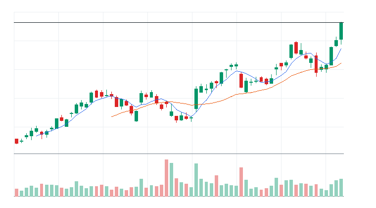
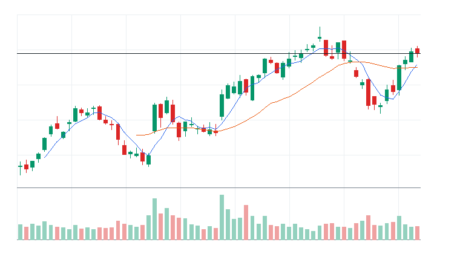
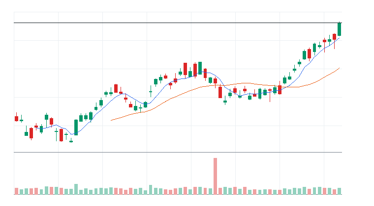
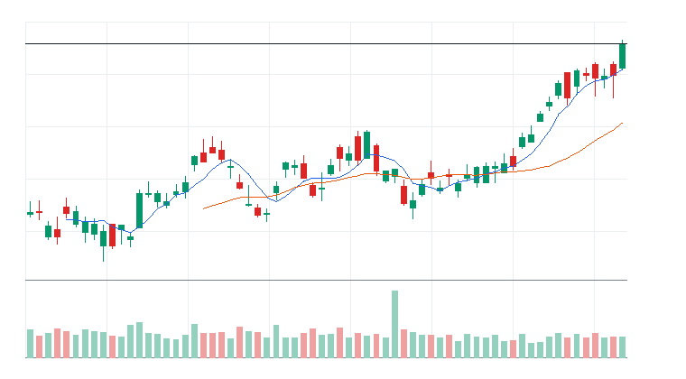

# 오늘의 데일리 트레이딩 요약

**REAL DATA TEST - 가격/거래량은 실제 데이터, 뉴스/ETF 구성종목 확산도/거래대금 유동성 일부 연결**

**목적:** 이 리포트는 최근 오른 자산을 나열하는 것이 아니라, 돈이 몰리는 근거와 다음 매수 주체가 확인할 트레이딩 후보를 찾기 위한 보고서다.

> 핵심 질문: 현재 가격에서 누가 사고 있고, 누가 앞으로 더 비싸게 사줄 수 있는가?

## 시장 국면 판단

- 최종 판정: 중립-상승 (58점)
- 전일 대비: 기간 조정에서 중립-상승으로 악화됐다(-13점).
- 판정 신뢰도: 높음 (100점) - 핵심 지수와 매크로 데이터가 대부분 직접 수집되어 판정 신뢰도가 높다.
- 행동 바이어스: 눌림 매수와 돌파 확인 병행
- 한 줄 결론: S&P 500 중심으로 상승 우위지만, 매크로 점수 47라 추격보다 확인 매수가 낫다.
- 기술적 지표: 상승 추세 유지 (64점, 가중치 65%)
- S&P 500: 69점 | 50일선 아래, 200일선 위, 20일 -1.55%, 60일 +3.00%, 52주 고점 대비 -2.82% -> 기술 점수 69
- Nasdaq 100: 58점 | 50일선 아래, 200일선 위, 20일 -5.39%, 60일 +3.00%, 52주 고점 대비 -7.66% -> 기술 점수 58
- 매크로 시황: 매크로 중립 (47점, 가중치 35%)
- 매크로 요약: 금리은 우호적이나 물가, 신용/유동성 부담이 남아 있다.
- 금리: 중립-우호 55점 / 금리 중립 / confidence HIGH
  - 주요 근거: US 10Y yield 20일 -3.78%, 5일 -2.16%; US 3M yield 20일 -0.93%, 단기금리 방향 확인; US long-duration bonds 20일 +2.55%, 장기채 가격 기준 할인율 부담 확인
  - 확인 사항: 추가 확인 이벤트 없음
- 물가: 부담 44점 / 물가 부담 / confidence HIGH
  - 주요 근거: Oil ETF 20일 +14.29%, 유가 기반 물가 압력 확인; TIPS ETF 20일 +1.63%, 물가연동채 흐름은 보조 근거; Gold 20일 -6.81%, 금 강세는 방어 수요 여부 확인
  - 확인 사항: 추가 확인 이벤트 없음
- 정책: 중립 50점 / 정책 이벤트 확인 전 중립 / confidence LOW
  - 주요 근거: 정책 톤은 1차 버전에서 일정/이벤트 리스크 기반 중립값으로 반영한다.
  - 확인 사항: FOMC, CPI, PCE, 고용지표 발표 전후에는 매크로 confidence를 보수적으로 해석한다.
- 신용/유동성: 위험 34점 / 신용/유동성 부담 / confidence HIGH
  - 주요 근거: High yield credit 20일 -1.04%, 하이일드 위험선호 확인; HYG-LQD 20일 상대강도 -1.66%, 신용위험 선호/회피 확인; VIX 20일 +30.80%, 변동성 부담 확인
  - 확인 사항: VIX 상승은 유동성/리스크 프리미엄 부담으로 해석한다.
- 환율/글로벌: 중립 48점 / 환율/글로벌 중립 / confidence MEDIUM
  - 주요 근거: US dollar 20일 +1.19%, 달러 강세/약세 확인
  - 확인 사항: 추가 확인 이벤트 없음
- US 10Y yield: 58점 | 하락 시 주식 우호; 5일 -2.16%, 20일 -3.78% -> 매크로 점수 58
- US 3M yield: 52점 | 하락 시 주식 우호; 5일 -0.93%, 20일 -0.93% -> 매크로 점수 52
- US long-duration bonds: 55점 | 상승 시 주식 우호; 5일 +1.61%, 20일 +2.55% -> 매크로 점수 55
- TIPS ETF: 50점 | 상승 시 주식 우호; 5일 +0.66%, 20일 +1.63% -> 매크로 점수 50
- Oil ETF: 23점 | 하락 시 주식 우호; 5일 +4.80%, 20일 +14.29% -> 매크로 점수 23
- Gold: 50점 | 상승 시 주식 우호; 5일 -4.03%, 20일 -6.81% -> 매크로 점수 50
- US dollar: 48점 | 하락 시 주식 우호; 5일 +0.14%, 20일 +1.19% -> 매크로 점수 48
- High yield credit: 49점 | 상승 시 주식 우호; 5일 +0.25%, 20일 -1.04% -> 매크로 점수 49
- Investment grade credit: 50점 | 상승 시 주식 우호; 5일 +0.44%, 20일 +0.62% -> 매크로 점수 50
- VIX: 3점 | 하락 시 주식 우호; 5일 -2.70%, 20일 +30.80% -> 매크로 점수 3
- 데이터 커버리지: 기술 2/2, 매크로 10/10
- 데이터 신뢰도 근거:
  - 직접 지수 데이터: S&P 500, Nasdaq 100
  - 대체 지수 데이터 없음
  - 매크로 데이터: 10/10
  - 누락 데이터 없음
  - stale 데이터 없음

## 모바일 요약

[오늘의 데일리 트레이딩 요약]

생성 성공 / 데이터 모드: REAL_TEST

시장:
- 중립

시장 지배 서사:
1. Integrated Oil & Gas 자금 유입 - 지배 - Energy Select Sector SPDR Fund(XLE), VanEck Oil Services ETF(OIH), Chevron(CVX), Exxon Mobil(XOM) 중심으로 5일 +2.90%, 20일 +10.21% 흐름이 형성됨. 뉴스 직접성 제한.
2. 사이버보안 지출 재가속 - 지배 - iShares Cybersecurity and Tech ETF(IHAK), First Trust NASDAQ Cybersecurity ETF(CIBR), Zscaler Inc.(ZS), CrowdStrike Holdings Inc.(CRWD) 중심으로 5일 +10.94%, 20일 +8.64% 흐름이 형성됨. 직접 촉매 일부 확인.
3. 매크로 방어/헤지 - 부상 - Energy Select Sector SPDR Fund(XLE), VanEck Oil Services ETF(OIH), Chevron(CVX), Exxon Mobil(XOM) 중심으로 5일 +1.53%, 20일 +6.10% 흐름이 형성됨. 뉴스 직접성 제한.

트렌드 강도:
1. Integrated Oil & Gas 자금 유입 - TSI 68 - 부상 - 진입품질 관찰
2. 사이버보안 지출 재가속 - TSI 74 - 확인 - 진입품질 관찰
3. 매크로 방어/헤지 - TSI 52 - 부상 - 진입품질 낮음

오늘 결론:
- 사이버보안 개별 종목 흐름이 ETF 대비 강한지 확인 필요
- 행동 후보는 linkedNarrative와 함께 확인한다.
- 추격보다 진입 조건 확인 후 접근한다.

오늘 실제 행동 후보:
1. Zscaler Inc.(ZS)(STOCK) - 사이버보안 지출 재가속 - 단기 추세가 유지되고 거래량이 1.0배 이상이면 눌림 이후 재상승을 시도할 수 있음
2. Roper Technologies Inc.(ROP)(STOCK) - AI 소프트웨어/사이버보안 확산 - 단기 추세가 유지되고 거래량이 1.0배 이상이면 눌림 이후 재상승을 시도할 수 있음
3. CrowdStrike Holdings Inc.(CRWD)(STOCK) - 사이버보안 지출 재가속 - 단기 추세가 유지되고 거래량이 1.0배 이상이면 눌림 이후 재상승을 시도할 수 있음

다크호스 후보:
1. Chevron(CVX) - darkHorseScore 85 - 초기 관찰
2. Exxon Mobil(XOM) - darkHorseScore 85 - 초기 관찰

ETF 후보 TOP 5:
1. First Trust NASDAQ Cybersecurity ETF(CIBR) - 사이버보안 지출 재가속 - 관찰
2. iShares Cybersecurity and Tech ETF(IHAK) - 사이버보안 지출 재가속 - 자금흐름 예외 조건부
3. Energy Select Sector SPDR Fund(XLE) - Integrated Oil & Gas 자금 유입 - 관찰
4. Amplify Cybersecurity ETF(HACK) - 사이버보안 지출 재가속 - 제외
5. VanEck Oil Services ETF(OIH) - Integrated Oil & Gas 자금 유입 - 제외

웹 리포트:
https://yoolcool.github.io/DailyTradingThesisAgent/

## 오늘 결론

- 오늘 결론: 조건부 진입
- 신규 진입 후보: 0개
- 조건부 진입 후보: 5개
- 관찰 후보: 112개
- 주요 제한 요인: Entry Quality < 40, RVOL 미달, 뉴스 직접성 부족
- 주문 판단: 시장가 금지 / 지정가 또는 관찰
- 실전 판단: 진입 후보는 있으나, 전일 고점 돌파와 거래량 확인 후 선별적으로 접근한다.

### 후보 제한 요인 집계

- RVOL < 1.00x: 108개
- 거래대금 유동성 낮음: 14개
- Entry Quality 50~54 near miss: 0개
- Entry Quality 40~49 관찰: 5개
- Entry Quality < 40: 150개
- Exhaustion Risk >= 70: 0개
- ETF breadth 샘플 부족: 37개
- 뉴스 직접성 부족: 98개

## 데이터 신뢰도

- 전체 데이터 신뢰도 등급: LOW
- 분석 신뢰도: LOW
- 주문 실행 신뢰도: LOW
- ETF breadth 신뢰도: LOW
- 신뢰도 해석: 테마 확산 판단 제한, 거래대금 유동성 낮음 또는 확인 불가, 프리/애프터마켓 확인 불가
- 리포트 생성 시각: 2026-10-26 10:01 KST
- 가격 기준 거래일: 2026-10-23 US regular close
- 뉴스 수집 시각: 2026-10-26 10:01 KST
- 가장 최근 뉴스 발행 시각: 2026-10-26 09:37 KST
- 뉴스 신선도 상태: FRESH
- 뉴스 소스: Yahoo Finance RSS, MarketWatch RSS, CNBC Markets RSS, SEC EDGAR RSS, Federal Reserve RSS, Finnhub API
- 뉴스 소스 상태: Yahoo Finance RSS CONNECTED, MarketWatch RSS CONNECTED, CNBC Markets RSS PARTIAL, SEC EDGAR RSS PARTIAL, Federal Reserve RSS CONNECTED, Finnhub API DISABLED
- 뉴스 신뢰도: MEDIUM
- 추천 적용 거래일: 2026-10-25 US regular session
- 가격/거래량 데이터 상태: 일부 연결
- 뉴스 데이터 상태: 일부 연결
- ETF 구성종목 확산도 상태: 일부 연결
- ETF 구성종목 샘플 수: 1~4
- 거래대금 유동성 데이터 상태: 일부 연결
- 프리/애프터마켓 데이터 상태: UNAVAILABLE
- 데이터 provider: yfinance, Yahoo Finance RSS, MarketWatch RSS, CNBC Markets RSS, SEC EDGAR RSS, Federal Reserve RSS, Finnhub API, config fallback sample, price-volume dollar-volume fallback
- 실전 사용 경고: 이 리포트는 투자판단 보조용이며, REAL_TEST 모드에서는 일부 데이터가 누락되거나 지연될 수 있다. 실제 주문 전 현재가, 뉴스, 프리마켓/정규장 거래량을 별도 확인해야 한다.

## 0. 시장 상태

- 데이터 모드: REAL_TEST
- 가격/거래량: 일부 연결
- 뉴스: 일부 연결
- ETF 구성종목 확산도: 일부 연결
- 거래대금 유동성: 일부 연결
- 생성 시각: 2026년 10월 26일 월요일 AM 10:01
- 시장 상태: 중립
- 오늘 돈의 방향: 사이버보안 개별 종목 흐름이 ETF 대비 강한지 확인 필요
- 강한 테마 TOP 3: 사이버보안 ETF(84), 사이버보안(72), 전통 에너지 ETF(70)
- 데이터 한계:
  - API 또는 provider 상태에 따라 뉴스/ETF 확산도/거래대금 유동성 반영 범위가 달라질 수 있다.
  - 수집 실패 데이터는 점수 반영에서 제외하거나 confidence를 제한한다.
  - reasonConfidence HIGH는 직접 촉매, 가격/거래량, 확산도/유동성 근거가 함께 있을 때만 사용한다.

## 오늘 시장을 지배하는 서사

### 오늘 시장을 지배하는 서사 TOP 3

#### 1. Integrated Oil & Gas 자금 유입
- 상태: 지배
- narrativeScore: 90
- reasonConfidence: MEDIUM
- 근거 ETF: XLE, OIH
- 근거 개별 종목: CVX, XOM
- 돈이 몰리는 이유: Integrated Oil & Gas 자금 유입 관련 Energy Select Sector SPDR Fund(XLE), VanEck Oil Services ETF(OIH)와 Chevron(CVX), Exxon Mobil(XOM)의 5일(+2.90%)·20일(+10.21%) 흐름을 함께 본다. 평균 상대 거래량은 1.32배이고, ETF 확산도는 추가 확인이 필요하다. 뉴스 직접성은 아직 제한적이다.
- 다음 매수 주체: Integrated Oil & Gas 자금 유입을 확인한 섹터 ETF 자금과 상대강도 추종 스윙 자금
- 가장 좋은 트레이딩 수단: ETF 우선: XLE, OIH / 개별 종목 우선: XOM, CVX
- 서사가 깨지는 조건: XLE 20일선 이탈 또는 관련 종목 절반 이상 5일선 이탈
- 오늘 행동: 기존 네러티브와 중복을 확인한 뒤 ETF/대표 종목 동조성이 살아날 때만 관찰 편입

상세 narrativeScore 근거 보기

- rawScore: 90
- ETF 평균 moneyFlowScore: 70
- 개별 종목 평균 moneyFlowScore: 83
- ETF 후보 비율: 100%
- 개별 종목 후보 비율: 100%
- 5일 평균 수익률: +3.00%
- 20일 평균 수익률: +10.00%
- 평균 상대 거래량: 1.00배
- ETF 평균 상대 거래량: 2.00배
- 개별주 평균 상대 거래량: 1.00배
- 52주 고점 근접 후보 비율: 75%
- 뉴스 직접성 점수: 12
- ETF 확산도 점수: 0
- 유동성 점수: 4
- 과열 리스크 차감: 0

#### 2. 사이버보안 지출 재가속
- 상태: 지배
- narrativeScore: 80
- reasonConfidence: MEDIUM
- 근거 ETF: IHAK, CIBR, HACK
- 근거 개별 종목: ZS, CRWD, PANW, FTNT
- 돈이 몰리는 이유: 사이버보안 지출 재가속 관련 iShares Cybersecurity and Tech ETF(IHAK), First Trust NASDAQ Cybersecurity ETF(CIBR), Amplify Cybersecurity ETF(HACK)와 Zscaler Inc.(ZS), CrowdStrike Holdings Inc.(CRWD), Palo Alto Networks Inc.(PANW), Fortinet Inc.(FTNT)의 5일(+10.94%)·20일(+8.64%) 흐름을 함께 본다. 평균 상대 거래량은 1.30배이고, ETF 확산도는 추가 확인이 필요하다. 직접 뉴스/이벤트가 일부 확인된다.
- 다음 매수 주체: 사이버보안 지출 재가속을 확인한 섹터 ETF 자금과 상대강도 추종 스윙 자금
- 가장 좋은 트레이딩 수단: ETF 우선: HACK, CIBR, IHAK / 개별 종목 우선: CRWD, PANW, FTNT
- 서사가 깨지는 조건: HACK 20일선 이탈 또는 관련 종목 절반 이상 5일선 이탈
- 오늘 행동: 기존 네러티브와 중복을 확인한 뒤 ETF/대표 종목 동조성이 살아날 때만 관찰 편입

상세 narrativeScore 근거 보기

- rawScore: 80
- ETF 평균 moneyFlowScore: 73
- 개별 종목 평균 moneyFlowScore: 72
- ETF 후보 비율: 75%
- 개별 종목 후보 비율: 75%
- 5일 평균 수익률: +11.00%
- 20일 평균 수익률: +9.00%
- 평균 상대 거래량: 1.00배
- ETF 평균 상대 거래량: 1.00배
- 개별주 평균 상대 거래량: 1.00배
- 52주 고점 근접 후보 비율: 38%
- 뉴스 직접성 점수: 10
- ETF 확산도 점수: 0
- 유동성 점수: 1
- 과열 리스크 차감: 0

#### 3. 매크로 방어/헤지
- 상태: 부상
- narrativeScore: 68
- reasonConfidence: MEDIUM
- 근거 ETF: XLE, OIH, TLT, GLD
- 근거 개별 종목: CVX, XOM
- 돈이 몰리는 이유: 매크로 방어/헤지 관련 Energy Select Sector SPDR Fund(XLE), VanEck Oil Services ETF(OIH), iShares 20+ Year Treasury Bond ETF(TLT)와 Chevron(CVX), Exxon Mobil(XOM)의 5일(+1.53%)·20일(+6.10%) 흐름을 함께 본다. 평균 상대 거래량은 1.20배이고, ETF 확산도는 추가 확인이 필요하다. 뉴스 직접성은 아직 제한적이다.
- 다음 매수 주체: 금리/에너지/방어 헤지를 찾는 매크로 자금
- 가장 좋은 트레이딩 수단: ETF 우선: GLD, TLT, XLE / 개별 종목 우선: XOM, CVX
- 서사가 깨지는 조건: 방어 ETF 상대강도 둔화와 위험선호 성장주 재강세
- 오늘 행동: 위험회피가 확인될 때만 헤지성 접근

상세 narrativeScore 근거 보기

- rawScore: 68
- ETF 평균 moneyFlowScore: 41
- 개별 종목 평균 moneyFlowScore: 83
- ETF 후보 비율: 50%
- 개별 종목 후보 비율: 100%
- 5일 평균 수익률: +2.00%
- 20일 평균 수익률: +6.00%
- 평균 상대 거래량: 1.00배
- ETF 평균 상대 거래량: 1.00배
- 개별주 평균 상대 거래량: 1.00배
- 52주 고점 근접 후보 비율: 50%
- 뉴스 직접성 점수: 9
- ETF 확산도 점수: 0
- 유동성 점수: 5
- 과열 리스크 차감: 0

### 전체 narrative 요약

| 서사명 | 상태 | narrativeScore | reasonConfidence | 대표 ETF | 대표 종목 | 오늘 행동 |
| --- | --- | ---: | --- | --- | --- | --- |
| Integrated Oil & Gas 자금 유입 | 지배 | 90 | MEDIUM | XLE, OIH | CVX, XOM | 기존 네러티브와 중복을 확인한 뒤 ETF/대표 종목 동조성이 살아날 때만 관찰 편입 |
| 사이버보안 지출 재가속 | 지배 | 80 | MEDIUM | IHAK, CIBR, HACK | ZS, CRWD, PANW, FTNT | 기존 네러티브와 중복을 확인한 뒤 ETF/대표 종목 동조성이 살아날 때만 관찰 편입 |
| 매크로 방어/헤지 | 부상 | 68 | MEDIUM | XLE, OIH, TLT | CVX, XOM | 위험회피가 확인될 때만 헤지성 접근 |
| AI 소프트웨어/사이버보안 확산 | 약화 | 35 | LOW | IGV, AIQ, QQQ | ZS, TEAM, PLTR, DDOG | 추격보다 눌림 후 재상승 확인 |
| Specialty Business Services 자금 유입 | 약화 | 35 | LOW | QQQ, SPY, IWM | CTAS, TRI | 기존 네러티브와 중복을 확인한 뒤 ETF/대표 종목 동조성이 살아날 때만 관찰 편입 |
| Medical Devices 자금 유입 | 약화 | 17 | LOW | QQQ | ISRG, DXCM | 기존 네러티브와 중복을 확인한 뒤 ETF/대표 종목 동조성이 살아날 때만 관찰 편입 |
| 소프트웨어 실적/AI 수익화 | 약화 | 12 | LOW | IGV, AIQ, QQQ | SHOP, MSFT, MSTR | 기존 네러티브와 중복을 확인한 뒤 ETF/대표 종목 동조성이 살아날 때만 관찰 편입 |
| 방산/안보 프리미엄 | 약화 | 9 | LOW | SHLD, XAR, ITA | LMT, PLTR, AVAV, KTOS | 뉴스 촉매가 직접 확인될 때만 추세 추종 |
| Discount Stores 자금 유입 | 약화 | 8 | LOW | QQQ | COST, WMT | 기존 네러티브와 중복을 확인한 뒤 ETF/대표 종목 동조성이 살아날 때만 관찰 편입 |
| 필수소비재 음료 방어 성장 | 약화 | 5 | LOW | QQQ | CCEP, MNST | 기존 네러티브와 중복을 확인한 뒤 ETF/대표 종목 동조성이 살아날 때만 관찰 편입 |
| 반도체 설계/공급망 재가속 | 소멸 | 0 | LOW | SMH, SOXX, SOXQ | TXN, TSM, NVDA, AMD | 기존 네러티브와 중복을 확인한 뒤 ETF/대표 종목 동조성이 살아날 때만 관찰 편입 |
| 위험선호 성장주 재진입 | 소멸 | 0 | LOW | ARKK, QQQ, IPO | TSLA, ARM, COIN | 지수 위험선호가 유지될 때만 선별 진입 |
| Aerospace & Defense 자금 유입 | 소멸 | 0 | LOW | QQQ, SPY, IWM | KTOS, AVAV | 기존 네러티브와 중복을 확인한 뒤 ETF/대표 종목 동조성이 살아날 때만 관찰 편입 |
| 바이오/헬스케어 촉매 | 소멸 | 0 | LOW | QQQ | GILD, ALNY | 기존 네러티브와 중복을 확인한 뒤 ETF/대표 종목 동조성이 살아날 때만 관찰 편입 |
| 반도체 장비 사이클 재평가 | 소멸 | 0 | LOW | SMH, SOXX, SOXQ | ASML, LRCX | 기존 네러티브와 중복을 확인한 뒤 ETF/대표 종목 동조성이 살아날 때만 관찰 편입 |
| Data Storage 자금 유입 | 소멸 | 0 | LOW | QQQ, SPY, IWM | STX, WDC | 기존 네러티브와 중복을 확인한 뒤 ETF/대표 종목 동조성이 살아날 때만 관찰 편입 |
| Travel Services 자금 유입 | 약화 | 0 | LOW | QQQ | ABNB, BKNG | 기존 네러티브와 중복을 확인한 뒤 ETF/대표 종목 동조성이 살아날 때만 관찰 편입 |
| 전력 유틸리티 수요 재평가 | 소멸 | 0 | LOW | QQQ, SPY, IWM | ETN, GEV, VRT | 기존 네러티브와 중복을 확인한 뒤 ETF/대표 종목 동조성이 살아날 때만 관찰 편입 |
| 소비 회복/방어주 선별 | 약화 | 0 | LOW | QQQ | PDD, AMZN | 기존 네러티브와 중복을 확인한 뒤 ETF/대표 종목 동조성이 살아날 때만 관찰 편입 |
| AI 인프라 재가속 | 소멸 | 0 | LOW | SMH, SOXX, DRAM | NVDA, MU, VRT, ETN | 추격보다 5일선 지지 후 재상승 확인 |
| 전력망/원전/인프라 병목 | 소멸 | 0 | LOW | GRID, PAVE, URA | VRT, ETN, PWR, CEG | ETF 확산도와 거래량이 같이 살아날 때만 진입 |
| Internet Content 자금 유입 | 소멸 | 0 | LOW | QQQ | META, GOOGL, GOOG | 기존 네러티브와 중복을 확인한 뒤 ETF/대표 종목 동조성이 살아날 때만 관찰 편입 |
| 비트코인/디지털 자산 위험선호 | 소멸 | 0 | LOW | IBIT, BLOK | MSTR, COIN, IREN | 비트코인 베타가 살아날 때만 단기 매매 |
| Bitcoin Mining 자금 유입 | 소멸 | 0 | LOW | IBIT, BLOK | RIOT, MARA, CIFR | 기존 네러티브와 중복을 확인한 뒤 ETF/대표 종목 동조성이 살아날 때만 관찰 편입 |

## 트렌드 강도 판단

### 1. Integrated Oil & Gas 자금 유입
- Trend Strength Index: 68
- 트렌드 상태 라벨: 부상
- 테마 확산도: 강함
- ETF 동조성: 강함
- 거래량 강도: 보통
- 과열 위험: 낮음 (20)
- 오늘 진입 품질: 관찰 (47)
- 한 줄 판단: Integrated Oil & Gas 자금 유입는 가격, 거래량, ETF, 확산도가 함께 확인되어 테마 단위 자금 유입이 선명하다.
- 오늘 접근법: Energy Select Sector SPDR Fund(XLE)/VanEck Oil Services ETF(OIH) 거래량 증가와 Chevron(CVX)/Exxon Mobil(XOM) 확산을 확인하며 작은 사이즈의 초기 진입 후보로만 본다.

트렌드 강도 상세 근거 보기

- 가격 모멘텀: 가격 모멘텀 16/25. 평균 5D +2.90%, 20D +10.21%.
- 거래량 강도: 거래량 강도 13/20. 평균 RVOL 1.32배.
- ETF 동조성: ETF 동조성 16/15. 관련 ETF Energy Select Sector SPDR Fund(XLE), VanEck Oil Services ETF(OIH) 흐름을 기준으로 판단.
- 테마 확산도: 테마 확산도 17/20. 상위 1~2개 쏠림 감점 0점 반영.
- 뉴스 촉매: 뉴스/촉매 신선도 3/10. HIGH 직접 촉매 0개.
- 과열 리스크: 과열 리스크 20/100. 단기 급등, 고점 근접, ETF-개별주 괴리, 쏠림을 함께 반영.
- 시장 환경: 시장 환경 3/10. QQQ/SPY/IWM 가격 흐름 기반 위험선호 점수.

### 2. 사이버보안 지출 재가속
- Trend Strength Index: 74
- 트렌드 상태 라벨: 확인
- 테마 확산도: 보통
- ETF 동조성: 강함
- 거래량 강도: 보통
- 과열 위험: 낮음 (21)
- 오늘 진입 품질: 관찰 (53)
- 한 줄 판단: 사이버보안 지출 재가속는 Trend Strength는 높아도 시장 위험선호가 약해 시장 환경 비우호 구간이다.
- 오늘 접근법: iShares Cybersecurity and Tech ETF(IHAK)/First Trust NASDAQ Cybersecurity ETF(CIBR)/Amplify Cybersecurity ETF(HACK) 동반 강세가 유지되는 동안 돌파 추격보다 전일 고점 재돌파 또는 5일선 눌림 회복을 기다린다.

트렌드 강도 상세 근거 보기

- 가격 모멘텀: 가격 모멘텀 21/25. 평균 5D +10.94%, 20D +8.64%.
- 거래량 강도: 거래량 강도 13/20. 평균 RVOL 1.30배.
- ETF 동조성: ETF 동조성 16/15. 관련 ETF Amplify Cybersecurity ETF(HACK), First Trust NASDAQ Cybersecurity ETF(CIBR), iShares Cybersecurity and Tech ETF(IHAK), iShares Expanded Tech-Software Sector ETF(IGV) 흐름을 기준으로 판단.
- 테마 확산도: 테마 확산도 14/20. 상위 1~2개 쏠림 감점 0점 반영.
- 뉴스 촉매: 뉴스/촉매 신선도 7/10. HIGH 직접 촉매 1개.
- 과열 리스크: 과열 리스크 21/100. 단기 급등, 고점 근접, ETF-개별주 괴리, 쏠림을 함께 반영.
- 시장 환경: 시장 환경 3/10. QQQ/SPY/IWM 가격 흐름 기반 위험선호 점수.

### 3. 매크로 방어/헤지
- Trend Strength Index: 52
- 트렌드 상태 라벨: 부상
- 테마 확산도: 보통
- ETF 동조성: 보통
- 거래량 강도: 보통
- 과열 위험: 낮음 (13)
- 오늘 진입 품질: 낮음 (38)
- 한 줄 판단: 매크로 방어/헤지는 Trend Strength는 높아도 시장 위험선호가 약해 시장 환경 비우호 구간이다.
- 오늘 접근법: Energy Select Sector SPDR Fund(XLE)/VanEck Oil Services ETF(OIH)/iShares 20+ Year Treasury Bond ETF(TLT) 거래량 증가와 Chevron(CVX)/Exxon Mobil(XOM) 확산을 확인하며 작은 사이즈의 초기 진입 후보로만 본다.

트렌드 강도 상세 근거 보기

- 가격 모멘텀: 가격 모멘텀 10/25. 평균 5D +1.53%, 20D +6.10%.
- 거래량 강도: 거래량 강도 11/20. 평균 RVOL 1.20배.
- ETF 동조성: ETF 동조성 11/15. 관련 ETF SPDR Gold Shares(GLD), iShares 20+ Year Treasury Bond ETF(TLT), Energy Select Sector SPDR Fund(XLE), VanEck Oil Services ETF(OIH) 흐름을 기준으로 판단.
- 테마 확산도: 테마 확산도 14/20. 상위 1~2개 쏠림 감점 0점 반영.
- 뉴스 촉매: 뉴스/촉매 신선도 3/10. HIGH 직접 촉매 0개.
- 과열 리스크: 과열 리스크 13/100. 단기 급등, 고점 근접, ETF-개별주 괴리, 쏠림을 함께 반영.
- 시장 환경: 시장 환경 3/10. QQQ/SPY/IWM 가격 흐름 기반 위험선호 점수.

## 최근 추천 결과 트래킹

개별주는 데이트레이딩 관점으로 추천 이후 첫 정규장의 장중 최고가와 종가를 추적한다. ETF는 테마/스윙 관점으로 추천 이후 1주일 동안의 최고가와 현재 종가를 추적한다.

### 개별주 Top 3 추천 성과 요약
- 최근 5개 리포트 표본: 14개 (초기 검증 단계)
- 장중 최고가 기준 성공률: +27.27%
- 종가 기준 성공률: +36.36%
- 평균 장중 최고 수익률: +2.55%
- 평균 종가 수익률: +0.66%

### ETF 추천 성과 요약
- 최근 5개 리포트 표본: 1개 (초기 검증 단계)
- 1주 최고가 기준 성공률: 데이터 없음
- 현재 종가 기준 성공률: 0.00%
- 평균 1주 최고 수익률: 데이터 없음
- 평균 현재 수익률: 0.00%

최근 추천 결과 상세 테이블 펼치기

| 추천일 | 유형 | 순위 | 티커 | 기준가 | 추적 기간 | 상태 | High 수익률 | Close 수익률 | 결과 | 코멘트 |
| --- | --- | ---: | --- | ---: | --- | --- | ---: | ---: | --- | --- |
| 2026-10-26 | STOCK | 3 | CRWD | $257.57 | 2026-10-26 | pending | 데이터 없음 | 데이터 없음 | 추적 대기 | 아직 추적 거래일 데이터가 완성되지 않음 |
| 2026-10-26 | STOCK | 2 | ROP | $438.14 | 2026-10-26 | pending | 데이터 없음 | 데이터 없음 | 추적 대기 | 아직 추적 거래일 데이터가 완성되지 않음 |
| 2026-10-26 | STOCK | 1 | ZS | $255.15 | 2026-10-26 | pending | 데이터 없음 | 데이터 없음 | 추적 대기 | 아직 추적 거래일 데이터가 완성되지 않음 |
| 2026-10-26 | ETF | 1 | IHAK | $74 | 2026-10-26~2026-11-02 | in_progress | 데이터 없음 | 0.00% | 진행 중 | 아직 1주 추적 기간이 끝나지 않음 (일봉 high 미확보 시 close 기준 보조) |
| 2026-10-23 | STOCK | 3 | ADP | $294.5 | 2026-10-23 | complete | +5.06% | +3.28% | 성공 | 장중 기회와 종가 유지가 모두 확인됨 (일봉 기준) |
| 2026-10-23 | STOCK | 2 | CTAS | $220.15 | 2026-10-23 | complete | +2.56% | +1.79% | 제한적 유효 | 제한적인 장중 기회만 발생 (일봉 기준) |
| 2026-10-23 | STOCK | 1 | MAR | $404 | 2026-10-23 | complete | -1.77% | -3.29% | 실패 | 추천 이후 의미 있는 장중 기회가 부족하고 종가도 약함 (일봉 기준) |
| 2026-10-22 | STOCK | 3 | TRI | $112.82 | 2026-10-22 | complete | +9.70% | +9.25% | 성공 | 장중 기회와 종가 유지가 모두 확인됨 (일봉 기준) |
| 2026-10-22 | STOCK | 2 | MAR | $397.31 | 2026-10-22 | complete | +1.50% | -0.13% | 제한적 유효 | 제한적인 장중 기회만 발생 (일봉 기준) |
| 2026-10-22 | STOCK | 1 | NOC | $534 | 2026-10-22 | complete | +4.22% | +3.44% | 성공 | 장중 기회와 종가 유지가 모두 확인됨 (일봉 기준) |
| 2026-10-13 | STOCK | 2 | SHOP | $179.22 | 2026-10-13 | complete | -0.01% | -1.51% | 실패 | 추천 이후 의미 있는 장중 기회가 부족하고 종가도 약함 (일봉 기준) |
| 2026-10-13 | STOCK | 1 | PLTR | $209 | 2026-10-13 | complete | +0.90% | -0.16% | 실패 | 추천 이후 의미 있는 장중 기회가 부족하고 종가도 약함 (일봉 기준) |
| 2026-10-12 | STOCK | 3 | ZS | $233.73 | 2026-10-12 | complete | +1.49% | -3.40% | 제한적 유효 | 제한적인 장중 기회만 발생 (일봉 기준) |
| 2026-10-12 | STOCK | 2 | DDOG | $293.26 | 2026-10-12 | complete | +2.53% | -2.04% | 제한적 유효 | 제한적인 장중 기회만 발생 (일봉 기준) |
| 2026-10-12 | STOCK | 1 | PLTR | $209.05 | 2026-10-12 | complete | +1.86% | -0.02% | 제한적 유효 | 제한적인 장중 기회만 발생 (일봉 기준) |
| 2026-10-09 | STOCK | 2 | ZS | $216.81 | 2026-10-09 | complete | +8.07% | +7.80% | 성공 | 장중 기회와 종가 유지가 모두 확인됨 (일봉 기준) |
| 2026-10-09 | STOCK | 1 | PLTR | $198.78 | 2026-10-09 | complete | +5.43% | +5.17% | 성공 | 장중 기회와 종가 유지가 모두 확인됨 (일봉 기준) |
| 2026-10-08 | STOCK | 1 | ADSK | $235.05 | 2026-10-08 | complete | +0.40% | -0.62% | 실패 | 추천 이후 의미 있는 장중 기회가 부족하고 종가도 약함 (일봉 기준) |
| 2026-10-07 | STOCK | 3 | FTNT | $191.27 | 2026-10-07 | complete | +0.50% | -1.04% | 실패 | 추천 이후 의미 있는 장중 기회가 부족하고 종가도 약함 (일봉 기준) |
| 2026-10-07 | STOCK | 2 | AMD | $649.42 | 2026-10-07 | complete | -0.14% | -0.55% | 실패 | 추천 이후 의미 있는 장중 기회가 부족하고 종가도 약함 (일봉 기준) |
| 2026-10-07 | STOCK | 1 | SNPS | $505.17 | 2026-10-07 | complete | +0.86% | -0.49% | 실패 | 추천 이후 의미 있는 장중 기회가 부족하고 종가도 약함 (일봉 기준) |
| 2026-10-07 | ETF | 1 | CIBR | $108.13 | 2026-10-07~2026-10-14 | complete | +2.36% | -1.86% | 단기 고점 후 반납 | 1주 내 상승 기회는 있었지만 현재가는 반납 |
| 2026-10-06 | STOCK | 2 | TSM | $485.8 | 2026-10-06 | complete | +0.04% | -0.72% | 실패 | 추천 이후 의미 있는 장중 기회가 부족하고 종가도 약함 (일봉 기준) |
| 2026-10-06 | STOCK | 1 | SNPS | $488.47 | 2026-10-06 | complete | +3.90% | +3.42% | 성공 | 장중 기회와 종가 유지가 모두 확인됨 (일봉 기준) |
| 2026-10-06 | ETF | 1 | CIBR | $106.01 | 2026-10-06~2026-10-13 | complete | +4.41% | +0.10% | 단기 고점 후 반납 | 1주 내 상승 기회는 있었지만 현재가는 반납 |
| 2026-10-05 | STOCK | 1 | SNPS | $489.9 | 2026-10-05 | complete | +3.77% | -0.29% | 단타 유효 | 장중 기회는 있었지만 종가 유지력은 약함 (일봉 기준) |
| 2026-10-05 | ETF | 1 | SMH | $630.6 | 2026-10-05~2026-10-12 | complete | +1.41% | -16.40% | 실패 | 추천 이후 ETF 흐름이 약화됨 |
| 2026-09-30 | STOCK | 1 | AMAT | $512.01 | 2026-09-30 | complete | +0.67% | -0.12% | 실패 | 추천 이후 의미 있는 장중 기회가 부족하고 종가도 약함 (일봉 기준) |
| 2026-09-28 | STOCK | 3 | DDOG | $268.13 | 2026-09-28 | complete | +1.74% | +0.21% | 제한적 유효 | 제한적인 장중 기회만 발생 (일봉 기준) |
| 2026-09-28 | STOCK | 2 | ARM | $310.32 | 2026-09-28 | complete | -1.02% | -8.70% | 실패 | 추천 이후 의미 있는 장중 기회가 부족하고 종가도 약함 (일봉 기준) |
| 2026-09-28 | STOCK | 1 | QCOM | $201.97 | 2026-09-28 | complete | -1.39% | -7.17% | 실패 | 추천 이후 의미 있는 장중 기회가 부족하고 종가도 약함 (일봉 기준) |
| 2026-09-25 | STOCK | 3 | ARM | $332.56 | 2026-09-25 | complete | -2.13% | -6.69% | 실패 | 추천 이후 의미 있는 장중 기회가 부족하고 종가도 약함 (일봉 기준) |
| 2026-09-25 | STOCK | 2 | CRWD | $262.49 | 2026-09-25 | complete | -1.00% | -3.95% | 실패 | 추천 이후 의미 있는 장중 기회가 부족하고 종가도 약함 (일봉 기준) |
| 2026-09-25 | STOCK | 1 | PLTR | $191.79 | 2026-09-25 | complete | +1.26% | -1.11% | 제한적 유효 | 제한적인 장중 기회만 발생 (일봉 기준) |
| 2026-09-23 | STOCK | 3 | MARA | $13.28 | 2026-09-23 | complete | +2.79% | +0.53% | 제한적 유효 | 제한적인 장중 기회만 발생 (일봉 기준) |
| 2026-09-23 | STOCK | 2 | CIFR | $18.9 | 2026-09-23 | complete | +3.49% | -2.91% | 단타 유효 | 장중 기회는 있었지만 종가 유지력은 약함 (일봉 기준) |
| 2026-09-23 | STOCK | 1 | RIOT | $24.18 | 2026-09-23 | complete | +4.51% | +2.11% | 성공 | 장중 기회와 종가 유지가 모두 확인됨 (일봉 기준) |
| 2026-09-23 | ETF | 3 | ARKK | $90.72 | 2026-09-23~2026-09-30 | complete | +1.63% | -9.62% | 실패 | 추천 이후 ETF 흐름이 약화됨 |
| 2026-09-23 | ETF | 2 | MAGS | $72.97 | 2026-09-23~2026-09-30 | complete | -0.29% | -3.97% | 실패 | 추천 이후 ETF 흐름이 약화됨 |
| 2026-09-23 | ETF | 1 | SMH | $596.03 | 2026-09-23~2026-09-30 | complete | +2.89% | -11.55% | 단기 고점 후 반납 | 1주 내 상승 기회는 있었지만 현재가는 반납 |
| 2026-09-22 | STOCK | 3 | CRWD | $237.65 | 2026-09-22 | complete | +5.53% | +5.22% | 성공 | 장중 기회와 종가 유지가 모두 확인됨 (일봉 기준) |
| 2026-09-22 | STOCK | 2 | RIOT | $23.75 | 2026-09-22 | complete | +6.91% | +4.97% | 성공 | 장중 기회와 종가 유지가 모두 확인됨 (일봉 기준) |
| 2026-09-22 | STOCK | 1 | AMD | $559.82 | 2026-09-22 | complete | +11.56% | +11.42% | 성공 | 장중 기회와 종가 유지가 모두 확인됨 (일봉 기준) |
| 2026-09-21 | STOCK | 3 | CRWD | $237.65 | 2026-09-21 | complete | +5.33% | +4.92% | 성공 | 장중 기회와 종가 유지가 모두 확인됨 (일봉 기준) |
| 2026-09-21 | STOCK | 2 | RIOT | $23.75 | 2026-09-21 | complete | +5.55% | +1.81% | 성공 | 장중 기회와 종가 유지가 모두 확인됨 (일봉 기준) |
| 2026-09-21 | STOCK | 1 | AMD | $559.82 | 2026-09-21 | complete | +10.16% | +9.95% | 성공 | 장중 기회와 종가 유지가 모두 확인됨 (일봉 기준) |
| 2026-09-17 | STOCK | 3 | QCOM | $187.8 | 2026-09-17 | complete | +2.19% | +0.48% | 제한적 유효 | 제한적인 장중 기회만 발생 (일봉 기준) |
| 2026-09-17 | STOCK | 2 | FTNT | $172.37 | 2026-09-17 | complete | +2.16% | +0.12% | 제한적 유효 | 제한적인 장중 기회만 발생 (일봉 기준) |
| 2026-09-17 | STOCK | 1 | CRWD | $242.49 | 2026-09-17 | complete | +3.23% | +1.32% | 성공 | 장중 기회와 종가 유지가 모두 확인됨 (일봉 기준) |
| 2026-09-15 | STOCK | 1 | AMD | $516.13 | 2026-09-15 | complete | -0.48% | -2.31% | 실패 | 추천 이후 의미 있는 장중 기회가 부족하고 종가도 약함 (일봉 기준) |
| 2026-09-14 | STOCK | 1 | AMD | $516.13 | 2026-09-14 | complete | -3.44% | -4.40% | 실패 | 추천 이후 의미 있는 장중 기회가 부족하고 종가도 약함 (일봉 기준) |
| 2026-09-11 | STOCK | 2 | META | $653.69 | 2026-09-11 | complete | +1.61% | -0.87% | 제한적 유효 | 제한적인 장중 기회만 발생 (일봉 기준) |
| 2026-09-11 | STOCK | 1 | AMD | $521.1 | 2026-09-11 | complete | -0.01% | -0.95% | 실패 | 추천 이후 의미 있는 장중 기회가 부족하고 종가도 약함 (일봉 기준) |
| 2026-09-10 | STOCK | 3 | TSM | $439 | 2026-09-10 | complete | -1.47% | -2.50% | 실패 | 추천 이후 의미 있는 장중 기회가 부족하고 종가도 약함 (일봉 기준) |
| 2026-09-10 | STOCK | 2 | AMD | $505.74 | 2026-09-10 | complete | +2.09% | -0.42% | 제한적 유효 | 제한적인 장중 기회만 발생 (일봉 기준) |
| 2026-09-10 | STOCK | 1 | CEG | $299.05 | 2026-09-10 | complete | -1.41% | -4.37% | 실패 | 추천 이후 의미 있는 장중 기회가 부족하고 종가도 약함 (일봉 기준) |
| 2026-09-10 | ETF | 1 | DRAM | $61.1 | 2026-09-10~2026-09-17 | complete | -1.73% | -22.98% | 실패 | 추천 이후 ETF 흐름이 약화됨 |
| 2026-09-09 | STOCK | 1 | MU | $1,016.59 | 2026-09-09 | complete | +2.54% | +1.10% | 제한적 유효 | 제한적인 장중 기회만 발생 (일봉 기준) |
| 2026-09-08 | STOCK | 1 | MU | $1,016.59 | 2026-09-08 | complete | +2.41% | -1.61% | 제한적 유효 | 제한적인 장중 기회만 발생 (일봉 기준) |
| 2026-09-07 | STOCK | 1 | MU | $1,016.59 | 2026-09-07 | pending | 데이터 없음 | 데이터 없음 | 추적 대기 | 아직 추적 거래일 데이터가 완성되지 않음 |

## 오늘 실제 행동 후보

### 1. Zscaler Inc.(ZS)
- 자산 유형: STOCK
- linkedNarrative: 사이버보안 지출 재가속
- narrativeStatus: 지배
- narrativeScore: 80
- Trend Strength Index: 74
- Exhaustion Risk: 21 (낮음)
- Entry Quality Score: 39 (낮음)
- 트렌드 판단: 시장 위험선호가 약해 시장 환경 비우호 구간이다.
- moneyFlowScore: 100
- finalRawScore: 104
- reasonConfidence: MEDIUM
- reasonConfidenceExplanation: 직접 촉매 부재 때문에 HIGH가 아니라 MEDIUM으로 제한했다.
- tieBreakerReason: 최종 원점수 104, 리스크 패널티 -10, 5일 수익률 +23.04%, 상대 거래량 1.45배 순으로 정렬
- 후보별 시장 해석: 중립 / 제한적 - Entry Quality 39 < 50이나 moneyFlow 100, confidence MEDIUM, RVOL 1.45x로 강한 자금흐름 예외 조건 충족
- 게이트 사유: Entry Quality 39 < 50이나 moneyFlow 100, confidence MEDIUM, RVOL 1.45x로 강한 자금흐름 예외 조건 충족
- 주문 실행: 시장가 가능

- 왜 돈이 몰리는가: 20일 +32.17%, 5일 +23.04%, 상대 거래량 1.45배로 가격과 거래량이 함께 개선. 뉴스: CNBC Markets RSS mna/under_6h / 유동성: LIQUID
- 누가 더 비싸게 사줄 수 있는지: 개별 주도주를 따라붙는 단기 모멘텀 자금과 관련 ETF 강세를 확인한 트레이더
- 진입 조건: 20일선 위 눌림 후 재상승 확인
- 무효화 조건: 20일선 이탈 또는 상대 거래량 0.8배 이하 둔화
- todayActionLabel: 자금흐름 예외 조건부
#### 최근 뉴스/동향 한국어 요약

- 요약: 종목 직접 뉴스 확인 상태이며 뉴스 흐름은 긍정 우위입니다. 후보 선정 후 재확인한 핵심 이슈는 "Why Did Zscaler (ZS) Move Today?"입니다.
- 직접 촉매 판단: Zscaler Inc.에 대해 직접 촉매로 분류된 뉴스가 확인됐습니다. 핵심은 "Why Did Zscaler (ZS) Move Today?"이며, 가이던스 재료로 봅니다.
- 뉴스 1: Why Did Zscaler (ZS) Move Today?
  - 내용: Zscaler Inc. 관련 기사는 Why Did Zscaler (ZS) Move Today? 이슈를 다루며, 주가 변동률 +13.10%, 동반 비교 수치 +67.10%를 핵심 내용으로 봅니다.
  - 투자 의미: Zscaler Inc.의 당일 상대강도 확인에는 도움이 되지만, 실적/가이던스 같은 새 펀더멘털 변화로 보기는 어렵습니다.
  - 확인할 점: 거래량 동반 여부, 장중 고점 유지, 관련 ETF 동반 강세
- 뉴스 2: Zscaler's Data Security Push: Can Its Security Tools Win More Deals?
  - 내용: Zscaler Inc. 관련 기사는 Zscaler's Data Security Push: Can Its Security Tools Win More Deals? 이슈를 다루며, 주가 변동률 +70.00%를 핵심 내용으로 봅니다.
  - 투자 의미: Zscaler Inc.의 당일 상대강도 확인에는 도움이 되지만, 실적/가이던스 같은 새 펀더멘털 변화로 보기는 어렵습니다.
  - 확인할 점: 거래량 동반 여부, 장중 고점 유지, 관련 ETF 동반 강세
- 뉴스 3: How Nvidia AI Security Tie Up At Zscaler (ZS) Has Changed Its Investment Story
  - 내용: Zscaler Inc. 관련 기사는 How Nvidia AI Security Tie Up At Zscaler (ZS) Has Changed Its Investment Story 이슈를 다루며, 주가 변동률 +30.00%를 핵심 내용으로 봅니다.
  - 투자 의미: Zscaler Inc.의 당일 상대강도 확인에는 도움이 되지만, 실적/가이던스 같은 새 펀더멘털 변화로 보기는 어렵습니다.
  - 확인할 점: 거래량 동반 여부, 장중 고점 유지, 관련 ETF 동반 강세
- 매매 해석: 매매 관점에서는 뉴스 자체보다 가격이 진입 조건을 지키는지, 거래량이 동반되는지, 그리고 뉴스가 이미 주가에 반영됐는지를 우선 확인해야 합니다.
- 차트: 

### 2. Roper Technologies Inc.(ROP)
- 자산 유형: STOCK
- linkedNarrative: AI 소프트웨어/사이버보안 확산
- narrativeStatus: 약화
- narrativeScore: 35
- Trend Strength Index: 44
- Exhaustion Risk: 17 (낮음)
- Entry Quality Score: 46 (관찰)
- 트렌드 판단: 시장 위험선호가 약해 시장 환경 비우호 구간이다.
- moneyFlowScore: 100
- finalRawScore: 102
- reasonConfidence: HIGH
- reasonConfidenceExplanation: 직접 촉매: Yahoo Finance RSS / earnings / stale / positive - Roper (ROP) Q3 2026 Earnings Call Transcript 가격/거래량, 관련 ETF 동반 강세, 유동성 근거가 함께 확인되어 HIGH로 분류했다.
- tieBreakerReason: 최종 원점수 102, 리스크 패널티 0, 5일 수익률 +14.48%, 상대 거래량 1.45배 순으로 정렬
- 후보별 시장 해석: 중립 / 제한적 - Entry Quality 46 < 50이나 moneyFlow 100, confidence HIGH, RVOL 1.45x로 강한 자금흐름 예외 조건 충족
- 게이트 사유: Entry Quality 46 < 50이나 moneyFlow 100, confidence HIGH, RVOL 1.45x로 강한 자금흐름 예외 조건 충족
- 주문 실행: 지정가 권장
- 직접 촉매: Yahoo Finance RSS / earnings / stale / positive - Roper (ROP) Q3 2026 Earnings Call Transcript
- 왜 돈이 몰리는가: 20일 +22.19%, 5일 +14.48%, 상대 거래량 1.45배로 가격과 거래량이 함께 개선. 뉴스: Yahoo Finance RSS earnings/stale / 유동성: ACCEPTABLE
- 누가 더 비싸게 사줄 수 있는지: 개별 주도주를 따라붙는 단기 모멘텀 자금과 관련 ETF 강세를 확인한 트레이더
- 진입 조건: 20일선 위 눌림 후 재상승 확인
- 무효화 조건: 20일선 이탈 또는 상대 거래량 0.8배 이하 둔화
- todayActionLabel: 자금흐름 예외 조건부
#### 최근 뉴스/동향 한국어 요약

- 요약: 종목 직접 뉴스 확인 상태이며 뉴스 흐름은 긍정 우위입니다. 후보 선정 후 재확인한 핵심 이슈는 "Roper (ROP) Q3 2026 Earnings Call Transcript"입니다.
- 직접 촉매 판단: Roper Technologies Inc.에 대해 직접 촉매로 분류된 뉴스가 확인됐습니다. 핵심은 "Roper (ROP) Q3 2026 Earnings Call Transcript"이며, 실적 재료로 봅니다.
- 뉴스 1: Roper (ROP) Q3 2026 Earnings Call Transcript
  - 내용: Roper Technologies Inc. 관련 기사는 Roper (ROP) Q3 2026 Earnings Call Transcript 이슈를 다루며, 주가 변동률 +7.00%를 핵심 내용으로 봅니다.
  - 투자 의미: Roper Technologies Inc.의 당일 상대강도 확인에는 도움이 되지만, 실적/가이던스 같은 새 펀더멘털 변화로 보기는 어렵습니다.
  - 확인할 점: 거래량 동반 여부, 장중 고점 유지, 관련 ETF 동반 강세
- 뉴스 2: Roper Technologies Q3 Earnings Call Highlights
  - 내용: Roper Technologies Inc. 관련 기사는 Roper Technologies Q3 Earnings Call Highlights 이슈를 다루며, 주가 변동률 +7.00%, 동반 비교 수치 +15.00%를 핵심 내용으로 봅니다.
  - 투자 의미: Roper Technologies Inc.의 당일 상대강도 확인에는 도움이 되지만, 실적/가이던스 같은 새 펀더멘털 변화로 보기는 어렵습니다.
  - 확인할 점: 거래량 동반 여부, 장중 고점 유지, 관련 ETF 동반 강세
- 뉴스 3: Roper Technologies (ROP) Q3 Earnings Beat Estimates
  - 내용: Roper Technologies Inc. 관련 기사는 Roper Technologies (ROP) Q3 Earnings Beat Estimates 이슈를 다루며, 주가 변동률 +1.73%, 동반 비교 수치 -0.26%를 핵심 내용으로 봅니다.
  - 투자 의미: Roper Technologies Inc.의 당일 상대강도 확인에는 도움이 되지만, 실적/가이던스 같은 새 펀더멘털 변화로 보기는 어렵습니다.
  - 확인할 점: 거래량 동반 여부, 장중 고점 유지, 관련 ETF 동반 강세
- 매매 해석: 매매 관점에서는 뉴스 자체보다 가격이 진입 조건을 지키는지, 거래량이 동반되는지, 그리고 뉴스가 이미 주가에 반영됐는지를 우선 확인해야 합니다.
- 차트: 

### 3. CrowdStrike Holdings Inc.(CRWD)
- 자산 유형: STOCK
- linkedNarrative: 사이버보안 지출 재가속
- narrativeStatus: 지배
- narrativeScore: 80
- Trend Strength Index: 74
- Exhaustion Risk: 21 (낮음)
- Entry Quality Score: 35 (낮음)
- 트렌드 판단: 시장 위험선호가 약해 시장 환경 비우호 구간이다.
- moneyFlowScore: 98
- finalRawScore: 98
- reasonConfidence: HIGH
- reasonConfidenceExplanation: 직접 촉매: Yahoo Finance RSS / general_market / under_6h - Up Over 100% in 2026, Is CrowdStrike Still a Buy? 가격/거래량, 관련 ETF 동반 강세, 유동성 근거가 함께 확인되어 HIGH로 분류했다.
- tieBreakerReason: 최종 원점수 98, 리스크 패널티 -4, 5일 수익률 +13.27%, 상대 거래량 1.55배 순으로 정렬
- 후보별 시장 해석: 중립 / 제한적 - Entry Quality 35 < 50이나 moneyFlow 98, confidence HIGH, RVOL 1.55x로 강한 자금흐름 예외 조건 충족
- 게이트 사유: Entry Quality 35 < 50이나 moneyFlow 98, confidence HIGH, RVOL 1.55x로 강한 자금흐름 예외 조건 충족
- 주문 실행: 시장가 가능
- 직접 촉매: Yahoo Finance RSS / general_market / under_6h - Up Over 100% in 2026, Is CrowdStrike Still a Buy?
- 왜 돈이 몰리는가: 20일 +2.16%, 5일 +13.27%, 상대 거래량 1.55배로 가격과 거래량이 함께 개선. 뉴스: CNBC Markets RSS mna/under_6h / 유동성: LIQUID
- 누가 더 비싸게 사줄 수 있는지: 개별 주도주를 따라붙는 단기 모멘텀 자금과 관련 ETF 강세를 확인한 트레이더
- 진입 조건: 20일선 위 눌림 후 재상승 확인
- 무효화 조건: 20일선 이탈 또는 상대 거래량 0.8배 이하 둔화
- todayActionLabel: 자금흐름 예외 조건부
#### 최근 뉴스/동향 한국어 요약

- 요약: 종목 직접 뉴스 확인 상태이며 뉴스 흐름은 긍정 우위입니다. 후보 선정 후 재확인한 핵심 이슈는 "What Is CrowdStrike (CRWD) Asking With A Reported $500 Million Security Deal?"입니다.
- 직접 촉매 판단: CrowdStrike Holdings Inc.에 대해 직접 촉매로 분류된 뉴스가 확인됐습니다. 핵심은 "What Is CrowdStrike (CRWD) Asking With A Reported $500 Million Security Deal?"이며, M&A 재료로 봅니다.
- 뉴스 1: What Is CrowdStrike (CRWD) Asking With A Reported $500 Million Security Deal?
  - 내용: CrowdStrike Holdings Inc. 관련 M&A 뉴스입니다. 기사 스니펫상 핵심 내용은 CrowdStrike Holdings (NasdaqGS:CRWD) is in advanced talks to acquire Orion Security System Ltd.입니다.
  - 투자 의미: M&A 재료는 실적 가시성이나 밸류에이션 기대에 영향을 줄 수 있어 규모와 일정 확인이 중요합니다.
  - 확인할 점: M&A의 금액, 기간, 실적 반영 시점
- 뉴스 2: CrowdStrike’s CEO Says a Wave of Cyber Attacks Are Coming
  - 내용: CrowdStrike Holdings Inc. 관련 실적 뉴스입니다. 기사 스니펫상 핵심 내용은 CrowdStrike's CEO just warned that newly discovered flaws in the software powering most of the internet will trigger a wave of break-ins, and the stock market rewarded that fore...입니다.
  - 투자 의미: 실적/가이던스 재료는 다음 분기 기대치 변화로 이어질 수 있어 컨센서스 변화와 주가 반응 지속성을 함께 봅니다.
  - 확인할 점: 매출/마진/가이던스 수치, 컨센서스 대비 차이
- 뉴스 3: SailPoint Soars 11%, Palo Alto Up 6%, CrowdStrike Up 6% as Cybersecurity Stocks Rally
  - 내용: CrowdStrike Holdings Inc. 관련 기사는 SailPoint Soars 11%, Palo Alto Up 6%, CrowdStrike Up 6% as Cybersecurity Stocks Rally 이슈를 다루며, 주가 변동률 +6.00%, 동반 비교 수치 +11.00%를 핵심 내용으로 봅니다.
  - 투자 의미: CrowdStrike Holdings Inc.의 당일 상대강도 확인에는 도움이 되지만, 실적/가이던스 같은 새 펀더멘털 변화로 보기는 어렵습니다.
  - 확인할 점: 거래량 동반 여부, 장중 고점 유지, 관련 ETF 동반 강세
- 매매 해석: 매매 관점에서는 뉴스 자체보다 가격이 진입 조건을 지키는지, 거래량이 동반되는지, 그리고 뉴스가 이미 주가에 반영됐는지를 우선 확인해야 합니다.
- 차트: 

## 다크호스 후보

> 메인 행동 후보를 대체하지 않는 보조 관찰 섹션이다. 상위 서사 안에서 아직 과열되지 않았지만 초기 추세 전환, 베이스 돌파, 거래량 회복이 시작되는 개별주만 표시한다.

### 1. Chevron(CVX)
- 소속 서사: Integrated Oil & Gas 자금 유입
- darkHorseScore: 85 (강한 다크호스)
- 단계: 초기 관찰
- Confidence: MEDIUM
- 5D / 20D / RVOL: +3.65% / +14.07% / 1.10x
- MA 구조: 종가 $233.21 / MA5 $227.35 / MA20 $215.37
- 선정 이유: CVX는 Integrated Oil & Gas 자금 유입 서사에 속하고 종가가 MA20 위에 있으며 MA5/MA20 정렬이 개선되고 있다. 최근 15거래일 베이스는 상단 돌파 상태이고, RVOL 1.10x로 거래량 확인은 보통 수준이다. Exhaustion Risk 20로 아직 메인 후보 대비 과열 상한 안에 있다.
- 확인 조건: 돌파 후 고점 위 안착 유지, RVOL 1.20x 이상 재증가, MA5 위 종가 유지, 관련 ETF 동반 강세
- 무효화 조건: MA20 $215.37 종가 이탈, 최근 스윙 저점 $213.75 이탈, RVOL 0.80x 이하 둔화
- 왜 아직 메인이 아닌가: Entry Quality 49 < 50, RVOL 1.10x < 1.20x
#### 최근 뉴스/동향 한국어 요약

- 요약: 후보 선정 후 재확인 뉴스 데이터 없음

darkHorseScore 상세 근거 보기

- 서사 정렬: 20/20
- 초기 추세 구조: 24/30
- 베이스 돌파/정돈: 15/20
- 거래량 확인: 11/15
- 낮은 과열: 10/10
- 유동성 리스크 보정: 5/5
- 리스크 차감: -0
- rawScore: 85

- 차트: 

### 2. Exxon Mobil(XOM)
- 소속 서사: Integrated Oil & Gas 자금 유입
- darkHorseScore: 85 (강한 다크호스)
- 단계: 초기 관찰
- Confidence: LOW
- 5D / 20D / RVOL: +2.36% / +14.09% / 1.01x
- MA 구조: 종가 $183.21 / MA5 $179.13 / MA20 $170.85
- 선정 이유: XOM는 Integrated Oil & Gas 자금 유입 서사에 속하고 종가가 MA20 위에 있으며 MA5/MA20 정렬이 개선되고 있다. 최근 15거래일 베이스는 상단 돌파 상태이고, RVOL 1.01x로 거래량 확인은 보통 수준이다. Exhaustion Risk 20로 아직 메인 후보 대비 과열 상한 안에 있다.
- 확인 조건: 돌파 후 고점 위 안착 유지, RVOL 1.20x 이상 재증가, MA5 위 종가 유지, 관련 ETF 동반 강세
- 무효화 조건: MA20 $170.85 종가 이탈, 최근 스윙 저점 $171.01 이탈, RVOL 0.80x 이하 둔화
- 왜 아직 메인이 아닌가: Entry Quality 49 < 50, RVOL 1.01x < 1.20x
#### 최근 뉴스/동향 한국어 요약

- 요약: 후보 선정 후 재확인 뉴스 데이터 없음

darkHorseScore 상세 근거 보기

- 서사 정렬: 20/20
- 초기 추세 구조: 24/30
- 베이스 돌파/정돈: 15/20
- 거래량 확인: 11/15
- 낮은 과열: 10/10
- 유동성 리스크 보정: 5/5
- 리스크 차감: -0
- rawScore: 85

- 차트: 

## 오늘 돈이 몰리는 테마

- 사이버보안 ETF: CIBR, HACK, IHAK | 평균 moneyFlowScore 84 | 단일 종목 이벤트보다 테마 단위 자금 흐름이 선명한 구간으로 본다.
- 사이버보안: PANW, CRWD, FTNT, ZS | 평균 moneyFlowScore 72 | 추세는 확인되지만 선별 진입이 필요한 중간 강도의 테마로 본다.
- 전통 에너지 ETF: XLE, OIH | 평균 moneyFlowScore 70 | 추세는 확인되지만 선별 진입이 필요한 중간 강도의 테마로 본다.
- Real Estate: CSGP | 평균 moneyFlowScore 58 | 관심은 유지하되 우선순위는 낮추고 추가 거래량 확인을 기다린다.
- 클라우드/엔터프라이즈 소프트웨어 ETF: IGV | 평균 moneyFlowScore 40 | 관심은 유지하되 우선순위는 낮추고 추가 거래량 확인을 기다린다.
- Energy: BKR, FANG, CCJ, XOM, CVX | 평균 moneyFlowScore 39 | 관심은 유지하되 우선순위는 낮추고 추가 거래량 확인을 기다린다.

## 1. ETF 트레이딩 보고서
### 1-1. ETF 결론
- ETF 우선 후보: 없음
- ETF 관찰 후보: Roundhill Memory ETF(DRAM), VanEck Semiconductor ETF(SMH), Invesco PHLX Semiconductor ETF(SOXQ), iShares Expanded Tech-Software Sector ETF(IGV), ROBO Global Robotics and Automation Index ETF(ROBO)
- ETF 매매 금지: Roundhill Memory ETF(DRAM), VanEck Semiconductor ETF(SMH), iShares Semiconductor ETF(SOXX), Invesco PHLX Semiconductor ETF(SOXQ), Global X Robotics & Artificial Intelligence ETF(BOTZ)
- 오늘 ETF 최우선 1개: iShares Cybersecurity and Tech ETF(IHAK) - 전일 고점 돌파와 5일선 유지 확인
- ETF 섹션 해석: 이 섹션은 개별 종목 선택이 아니라 테마/섹터 단위 자금 흐름을 ETF로 매매할지 판단하기 위한 영역이다.

### 1-2. ETF 후보 TOP 5

선정 기준: ETF 후보는 가격/거래량 1차 점수에 뉴스, ETF 구성종목 확산도, 유동성, 리스크 패널티를 반영한 finalRawScore 기준으로 정렬한다. 표시 점수 100점 후보가 겹치면 tieBreakerReason으로 우선순위를 설명한다.

### [ETF] First Trust NASDAQ Cybersecurity ETF(CIBR)
- 자산 유형: ETF
- ETF 세부 카테고리: 사이버보안 ETF
- ETF 역할: 테마 베타 매수
- 상태: 관찰
- linkedNarrative: 사이버보안 지출 재가속
- narrativeStatus: 지배
- narrativeScore: 80
- moneyFlowScore: 83
- finalRawScore: 83
- tieBreakerReason: 최종 원점수 83, 리스크 패널티 0, 5일 수익률 +7.39%, 상대 거래량 1.37배 순으로 정렬
- 과열 리스크: 낮음~중간
- reasonConfidence: MEDIUM
- reasonConfidenceExplanation: ETF 확산도 제한 때문에 HIGH가 아니라 MEDIUM으로 제한했다.

- todayActionLabel: 관찰
- 주문 실행: 지정가 권장
- 기준일: 2026-10-23
- 종가: $106.12
- 1일 수익률: +3.22%
- 5일 수익률: +7.39%
- 20일 수익률: +5.12%
- 상대 거래량: 1.37배
- 52주 고점 대비 위치: -4.12%
- whyMoneyIsFlowing: 20일 +5.12%, 5일 +7.39%, 상대 거래량 1.37배로 가격과 거래량이 함께 개선. 뉴스: CNBC Markets RSS mna/under_6h / 유동성: ACCEPTABLE
- likelyNextBuyer: 섹터 베타를 노리는 단기 모멘텀 자금과 리밸런싱 자금
- whyThisCouldTradeHigher: 52주 고점 부근이라 돌파가 확인되면 신고가 추종 매수가 붙을 수 있음
#### 최근 뉴스/동향 한국어 요약

- 요약: 후보 선정 후 재확인 뉴스 데이터 없음
- 진입 조건: 전일 고점 돌파와 5일선 유지 확인
- 무효화 조건: 20일선 이탈 또는 상대 거래량 0.8배 이하 둔화
- 차트: 

#### 상세 근거

First Trust NASDAQ Cybersecurity ETF(CIBR) 상세 근거 펼치기

- moneyFlowScore(최종) 산정 근거:
  - moneyFlowScore(1차): 69
  - 최종 원점수: 83
  - 최종 표시 점수: 83
  - cap 적용: cap 미적용
  - 계산식: +69 + +12 + 0 + +2 + 0 + 0 + 0 = 83
  - 점수 해석: 강한 자금 유입 후보. 단, 과열 여부 확인 필수.
  - 가격/거래량 1차 점수: +69
    - 추세: +16
    - 단기 모멘텀: +10
    - 중기 모멘텀: +3
    - 거래량: +14
    - 신고가 근접: +12
    - 이동평균: +14
  - 하위 점수 cap:
    - 가격 모멘텀: 원점수 +16, 상한 적용 +16 / 최대 25
    - 단기 모멘텀: 원점수 +10, 상한 적용 +10 / 최대 20
    - 중기 모멘텀: 원점수 +3, 상한 적용 +3 / 최대 16
    - 거래량: 원점수 +14, 상한 적용 +14 / 최대 20
    - 신고가 근접: 원점수 +12, 상한 적용 +12 / 최대 12
    - 이동평균: 원점수 +14, 상한 적용 +14 / 최대 14
  - 추가 데이터 가감점:
    - 뉴스: +12
    - 유동성: +2
  - ETF 확산도: 0
  - 리스크 패널티: 0
  - 주요 근거: 1차 69, 최종 원점수 83, 표시 83. 5일 수익률 강함, 1일 단기 모멘텀 확인, 상대 거래량 증가. 주의: 큰 감점 제한적.
  - 리스크 패널티 산정 근거:
    - 총 리스크 패널티: 0
    - 리스크 등급: LOW
    - 감점된 리스크: 없음
    - 관찰 리스크: 주요 관찰 리스크 없음
    - 한 줄 해석: 직접 감점된 주요 리스크는 없지만 관찰 리스크는 계속 확인해야 한다.
- 데이터 사용 현황:
  - 가격/거래량: 사용
  - 뉴스: 사용
  - ETF 확산도: 일부 연결
  - 거래대금 유동성: 사용
  - 관련 ETF 상대강도: 사용
- 뉴스 확인:
  - 최근 뉴스 상태: 일부 연결
  - 뉴스 소스: CNBC Markets RSS, MarketWatch RSS
  - 소스별 상태: Yahoo Finance RSS CONNECTED; MarketWatch RSS CONNECTED; CNBC Markets RSS CONNECTED; SEC EDGAR RSS PARTIAL; Federal Reserve RSS CONNECTED; Finnhub API DISABLED
  - 긍정/중립/부정: 11/5/0
  - 직접성/방향성/신선도: 2/1/4
  - 강한 촉매 수: 3
  - 중요 공시 수: 0
  - 직접 촉매: 없음
  - 보조 뉴스: CNBC Markets RSS sector_theme / mna / under_6h
  - 뉴스 수집 시각: 2026-10-26 10:01 KST
  - 가장 최근 뉴스 발행 시각: 2026-10-26 09:37 KST
  - 뉴스 신선도 상태: FRESH
  - 뉴스 이후 가격 반응: 긍정
  - 가격 반응 점수 제한: 뉴스 이후 가격 반응과 점수 제한 특이사항 없음
  - 핵심 뉴스 요약: SpaceX closes $40 billion debt deal for AI chips, Elon Musk says
  - 원점수/상한 점수: +24 / +12
  - 점수 반영: +12
  - 주의: SEC EDGAR RSS: no matching RSS items; Finnhub API: FINNHUB_API_KEY not configured
- ETF 구성종목 확산도:
  - 구성종목 데이터 상태: 일부 연결
  - 샘플 수: 2/2
  - 샘플 신뢰도: INSUFFICIENT
  - 상승 종목 비율: 50%
  - 20일선 위 비율: 50%
  - 50일선 위 비율: 100%
  - 상위 기여 종목: PLTR, MSFT
  - 확산도 판단: NARROW_LEADERSHIP
  - 원점수/샘플 상한/반영 점수: +2 / 0 / 0
  - 점수 반영: 0
- 거래대금 유동성:
  - 데이터 상태: 일부 연결
  - 거래대금 기준 유동성: ACCEPTABLE
  - 거래대금: $337,058,344
  - 평균 거래대금: $245,412,051
  - 주문 영향: 지정가 권장
  - 매매 영향: 거래대금은 허용 가능하나 지정가를 우선한다
- reasonConfidence 근거: 가격/거래량, 뉴스, 거래대금 유동성, 관련 ETF 상대강도은 확인됐지만 일부 보조 데이터가 미연결 또는 fallback이라 중간으로 제한한다.
- 후보 선정 후 뉴스/동향 재확인:
  - 재확인 상태: 데이터 없음
- 차트 요약: 단기 추세 중립
- 기준일 2026-10-23 | 종가 $106.12 | 1일 +3.22% | 5일 +7.39% | 20일 +5.12% | 상대 거래량 1.37배 | 52주 고점 대비 -4.12% | 데이터 소스: yfinance

### [ETF] iShares Cybersecurity and Tech ETF(IHAK)
- 자산 유형: ETF
- ETF 세부 카테고리: 사이버보안 ETF
- ETF 역할: 테마 베타 매수
- 상태: 진입 후보
- linkedNarrative: 사이버보안 지출 재가속
- narrativeStatus: 지배
- narrativeScore: 80
- moneyFlowScore: 90
- finalRawScore: 90
- tieBreakerReason: 최종 원점수 90, 리스크 패널티 -5, 5일 수익률 +10.94%, 상대 거래량 1.73배 순으로 정렬
- 과열 리스크: 낮음~중간
- reasonConfidence: MEDIUM
- reasonConfidenceExplanation: ETF 확산도 제한 때문에 HIGH가 아니라 MEDIUM으로 제한했다.

- todayActionLabel: 자금흐름 예외 조건부
- 주문 실행: 추격 금지
- 기준일: 2026-10-23
- 종가: $74
- 1일 수익률: +4.17%
- 5일 수익률: +10.94%
- 20일 수익률: +12.02%
- 상대 거래량: 1.73배
- 52주 고점 대비 위치: -0.11%
- whyMoneyIsFlowing: 20일 +12.02%, 5일 +10.94%, 상대 거래량 1.73배로 가격과 거래량이 함께 개선. 뉴스: CNBC Markets RSS mna/under_6h
- likelyNextBuyer: 섹터 베타를 노리는 단기 모멘텀 자금과 리밸런싱 자금
- whyThisCouldTradeHigher: 52주 고점 부근이라 돌파가 확인되면 신고가 추종 매수가 붙을 수 있음
#### 최근 뉴스/동향 한국어 요약

- 요약: 섹터/테마 뉴스 중심 상태이며 뉴스 흐름은 긍정 우위입니다. 후보 선정 후 재확인한 핵심 이슈는 "&#x2018;She&#x2019;s living the dream&#x2019;: My stepmother said I can buy my childhood home for $850,000. Is she taking advantage of me?"입니다.
- 직접 촉매 판단: iShares Cybersecurity and Tech ETF에 대해 강한 직접 촉매는 확인되지 않았습니다.
- 뉴스 1: My spouse was awarded $90,000 from my 401(k) in our divorce. How is that fair?
  - 내용: iShares Cybersecurity and Tech ETF 관련 계약/수주 뉴스입니다. 기사 스니펫상 핵심 내용은 &#x201c;I retired in 2020 and subsequently went through a divorce a few years later.&#x201d;입니다.
  - 투자 의미: 계약/수주 재료는 실적 가시성이나 밸류에이션 기대에 영향을 줄 수 있어 규모와 일정 확인이 중요합니다.
  - 확인할 점: 계약/수주의 금액, 기간, 실적 반영 시점
- 뉴스 2: My husband wants to sell our $1.5 million home and invest the proceeds. But this is where we raised our kids &#x2014; and I can&#x2019;t bear to leave.
  - 내용: iShares Cybersecurity and Tech ETF 관련 기사는 목표가 변화를 다룹니다. 기사 스니펫상 핵심은 &#x201c;He wants to buy something for $600,000 now that we are empty-nesters.&#x201d;입니다.
  - 투자 의미: 애널리스트 상향은 단기 수급에 우호적일 수 있으나, 목표가 변화가 이미 주가에 반영됐는지 확인해야 합니다.
  - 확인할 점: 원문 수치, 후속 보도, 가격이 진입 조건을 지키는지
- 뉴스 3: We stopped helping our neighbors with free home repairs and our friendship cooled. Who&#x2019;s to blame?
  - 내용: iShares Cybersecurity and Tech ETF 관련 시장 일반 뉴스입니다. 기사 스니펫상 핵심 내용은 &#x201c;Last summer, they complained about needing to replace their roof.입니다.
  - 투자 의미: 단기 긍정 뉴스 흐름으로 볼 수 있지만, 단독 매수 근거보다는 가격·거래량 조건을 확인하는 보조 근거로 사용합니다.
  - 확인할 점: 원문 수치, 후속 보도, 가격이 진입 조건을 지키는지
- 매매 해석: 매매 관점에서는 뉴스 자체보다 가격이 진입 조건을 지키는지, 거래량이 동반되는지, 그리고 뉴스가 이미 주가에 반영됐는지를 우선 확인해야 합니다.
- 진입 조건: 전일 고점 돌파와 5일선 유지 확인
- 무효화 조건: 20일선 이탈 또는 상대 거래량 0.8배 이하 둔화
- 차트: 

#### 상세 근거

iShares Cybersecurity and Tech ETF(IHAK) 상세 근거 펼치기

- moneyFlowScore(최종) 산정 근거:
  - moneyFlowScore(1차): 88
  - 최종 원점수: 90
  - 최종 표시 점수: 90
  - cap 적용: cap 미적용
  - 계산식: +88 + +12 + 0 - 5 + 0 - 5 + 0 = 90
  - 점수 해석: 강한 자금 유입 후보. 단, 과열 여부 확인 필수.
  - 가격/거래량 1차 점수: +88
    - 추세: +22
    - 단기 모멘텀: +14
    - 중기 모멘텀: +8
    - 거래량: +18
    - 신고가 근접: +12
    - 이동평균: +14
  - 하위 점수 cap:
    - 가격 모멘텀: 원점수 +22, 상한 적용 +22 / 최대 25
    - 단기 모멘텀: 원점수 +14, 상한 적용 +14 / 최대 20
    - 중기 모멘텀: 원점수 +8, 상한 적용 +8 / 최대 16
    - 거래량: 원점수 +18, 상한 적용 +18 / 최대 20
    - 신고가 근접: 원점수 +12, 상한 적용 +12 / 최대 12
    - 이동평균: 원점수 +14, 상한 적용 +14 / 최대 14
  - 추가 데이터 가감점:
    - 뉴스: +12
    - 유동성: -5
  - ETF 확산도: 0
  - 리스크 패널티: -5
  - 주요 근거: 1차 88, 최종 원점수 90, 표시 90. 20일 수익률 강함, 5일 수익률 강함, 1일 단기 모멘텀 확인. 주의: 단기 과열/추격 위험 존재, ETF 구성종목 확산도 데이터 미연결.
  - 리스크 패널티 산정 근거:
    - 총 리스크 패널티: -5
    - 리스크 등급: LOW
    - 감점된 리스크:
      - low liquidity: -5 | 근거: Liquidity signal: LOW. | 대응: Avoid market-order chasing.
    - 관찰 리스크: ETF breadth data not connected
    - 한 줄 해석: 1개 감점 리스크로 총 -5점 반영.
- 데이터 사용 현황:
  - 가격/거래량: 사용
  - 뉴스: 사용
  - ETF 확산도: 미연결
  - 거래대금 유동성: 사용
  - 관련 ETF 상대강도: 사용
- 뉴스 확인:
  - 최근 뉴스 상태: 일부 연결
  - 뉴스 소스: CNBC Markets RSS, MarketWatch RSS
  - 소스별 상태: Yahoo Finance RSS CONNECTED; MarketWatch RSS CONNECTED; CNBC Markets RSS CONNECTED; SEC EDGAR RSS PARTIAL; Federal Reserve RSS CONNECTED; Finnhub API DISABLED
  - 긍정/중립/부정: 11/5/0
  - 직접성/방향성/신선도: 2/1/4
  - 강한 촉매 수: 3
  - 중요 공시 수: 0
  - 직접 촉매: 없음
  - 보조 뉴스: CNBC Markets RSS sector_theme / mna / under_6h
  - 뉴스 수집 시각: 2026-10-26 10:01 KST
  - 가장 최근 뉴스 발행 시각: 2026-10-26 09:37 KST
  - 뉴스 신선도 상태: FRESH
  - 뉴스 이후 가격 반응: 긍정
  - 가격 반응 점수 제한: 뉴스 이후 가격 반응과 점수 제한 특이사항 없음
  - 핵심 뉴스 요약: SpaceX closes $40 billion debt deal for AI chips, Elon Musk says
  - 원점수/상한 점수: +24 / +12
  - 점수 반영: +12
  - 주의: SEC EDGAR RSS: no matching RSS items; Finnhub API: FINNHUB_API_KEY not configured
- ETF 구성종목 확산도:
  - 구성종목 데이터 상태: 미연결
  - 샘플 수: 0/0
  - 샘플 신뢰도: UNKNOWN
  - 상승 종목 비율: 데이터 없음
  - 20일선 위 비율: 데이터 없음
  - 50일선 위 비율: 데이터 없음
  - 상위 기여 종목: 데이터 없음
  - 확산도 판단: UNKNOWN
  - 원점수/샘플 상한/반영 점수: 0 / N/A / 0
  - 점수 반영: 0
- 거래대금 유동성:
  - 데이터 상태: 일부 연결
  - 거래대금 기준 유동성: LOW
  - 거래대금: $26,936,000
  - 평균 거래대금: $15,567,380
  - 주문 영향: 추격 금지
  - 매매 영향: 유동성 부족으로 추격 금지 또는 우선순위 하향
- reasonConfidence 근거: 가격/거래량, 뉴스, 거래대금 유동성, 관련 ETF 상대강도은 확인됐지만 일부 보조 데이터가 미연결 또는 fallback이라 중간으로 제한한다.
- 후보 선정 후 뉴스/동향 재확인:
  - 재확인 상태: 일부 연결
  - 재확인 시각: 2026-10-26 10:01 KST
  - 최근 발행 시각: 2026-10-26 05:15 KST
  - 신선도: FRESH
  - 출처: MarketWatch RSS, Yahoo Finance RSS, Federal Reserve RSS
  - 소스별 상태: Yahoo Finance RSS CONNECTED; MarketWatch RSS CONNECTED; CNBC Markets RSS FAILED; SEC EDGAR RSS PARTIAL; Federal Reserve RSS CONNECTED; Finnhub API DISABLED
  - 한국어 요약: 섹터/테마 뉴스 중심 상태이며 뉴스 흐름은 긍정 우위입니다. 후보 선정 후 재확인한 핵심 이슈는 "&#x2018;She&#x2019;s living the dream&#x2019;: My stepmother said I can buy my childhood home for $850,000. Is she taking advantage of me?"입니다.
  - 직접 촉매: 없음
  - 한국어 뉴스 요약 1: My spouse was awarded $90,000 from my 401(k) in our divorce. How is that fair?
    - 내용: iShares Cybersecurity and Tech ETF 관련 계약/수주 뉴스입니다. 기사 스니펫상 핵심 내용은 &#x201c;I retired in 2020 and subsequently went through a divorce a few years later.&#x201d;입니다.
    - 투자 의미: 계약/수주 재료는 실적 가시성이나 밸류에이션 기대에 영향을 줄 수 있어 규모와 일정 확인이 중요합니다.
    - 확인할 점: 계약/수주의 금액, 기간, 실적 반영 시점
  - 한국어 뉴스 요약 2: My husband wants to sell our $1.5 million home and invest the proceeds. But this is where we raised our kids &#x2014; and I can&#x2019;t bear to leave.
    - 내용: iShares Cybersecurity and Tech ETF 관련 기사는 목표가 변화를 다룹니다. 기사 스니펫상 핵심은 &#x201c;He wants to buy something for $600,000 now that we are empty-nesters.&#x201d;입니다.
    - 투자 의미: 애널리스트 상향은 단기 수급에 우호적일 수 있으나, 목표가 변화가 이미 주가에 반영됐는지 확인해야 합니다.
    - 확인할 점: 원문 수치, 후속 보도, 가격이 진입 조건을 지키는지
  - 한국어 뉴스 요약 3: We stopped helping our neighbors with free home repairs and our friendship cooled. Who&#x2019;s to blame?
    - 내용: iShares Cybersecurity and Tech ETF 관련 시장 일반 뉴스입니다. 기사 스니펫상 핵심 내용은 &#x201c;Last summer, they complained about needing to replace their roof.입니다.
    - 투자 의미: 단기 긍정 뉴스 흐름으로 볼 수 있지만, 단독 매수 근거보다는 가격·거래량 조건을 확인하는 보조 근거로 사용합니다.
    - 확인할 점: 원문 수치, 후속 보도, 가격이 진입 조건을 지키는지
  - 원문 헤드라인 1: MarketWatch RSS / contract / under_24h / positive - My spouse was awarded $90,000 from my 401(k) in our divorce. How is that fair?
  - 원문 헤드라인 2: MarketWatch RSS / general_market / under_24h / positive - My husband wants to sell our $1.5 million home and invest the proceeds. But this is where we raised our kids &#x2014; and I can&#x2019;t bear to leave.
  - 원문 헤드라인 3: MarketWatch RSS / general_market / under_6h / positive - We stopped helping our neighbors with free home repairs and our friendship cooled. Who&#x2019;s to blame?
  - 주의: CNBC Markets RSS: HTTP 403 from https://www.cnbc.com/id/100003114/device/rss/rss.html; SEC EDGAR RSS: no matching RSS items; Finnhub API: FINNHUB_API_KEY not configured
- 차트 요약: 최근 20거래일 기준 5일선이 20일선 위에 있음
- 기준일 2026-10-23 | 종가 $74 | 1일 +4.17% | 5일 +10.94% | 20일 +12.02% | 상대 거래량 1.73배 | 52주 고점 대비 -0.11% | 데이터 소스: yfinance

### [ETF] Energy Select Sector SPDR Fund(XLE)
- 자산 유형: ETF
- ETF 세부 카테고리: 전통 에너지 ETF
- ETF 역할: 테마 베타 매수
- 상태: 관찰
- linkedNarrative: Integrated Oil & Gas 자금 유입
- narrativeStatus: 지배
- narrativeScore: 90
- moneyFlowScore: 76
- finalRawScore: 76
- tieBreakerReason: 최종 원점수 76, 리스크 패널티 0, 5일 수익률 +1.60%, 상대 거래량 1.20배 순으로 정렬
- 과열 리스크: 낮음~중간
- reasonConfidence: MEDIUM
- reasonConfidenceExplanation: ETF 확산도 제한 때문에 HIGH가 아니라 MEDIUM으로 제한했다.

- todayActionLabel: 관찰
- 주문 실행: 시장가 가능
- 기준일: 2026-10-23
- 종가: $69.33
- 1일 수익률: +2.60%
- 5일 수익률: +1.60%
- 20일 수익률: +11.75%
- 상대 거래량: 1.20배
- 52주 고점 대비 위치: -0.56%
- whyMoneyIsFlowing: 20일 +11.75%, 5일 +1.60%, 상대 거래량 1.20배로 가격과 거래량이 함께 개선. 뉴스: Yahoo Finance RSS general_market/under_72h / 유동성: LIQUID
- likelyNextBuyer: 섹터 베타를 노리는 단기 모멘텀 자금과 리밸런싱 자금
- whyThisCouldTradeHigher: 52주 고점 부근이라 돌파가 확인되면 신고가 추종 매수가 붙을 수 있음
#### 최근 뉴스/동향 한국어 요약

- 요약: 후보 선정 후 재확인 뉴스 데이터 없음
- 진입 조건: 전일 고점 돌파와 5일선 유지 확인
- 무효화 조건: 20일선 이탈 또는 상대 거래량 0.8배 이하 둔화
- 차트: 

#### 상세 근거

Energy Select Sector SPDR Fund(XLE) 상세 근거 펼치기

- moneyFlowScore(최종) 산정 근거:
  - moneyFlowScore(1차): 59
  - 최종 원점수: 76
  - 최종 표시 점수: 76
  - cap 적용: cap 미적용
  - 계산식: +59 + +12 + 0 + +5 + 0 + 0 + 0 = 76
  - 점수 해석: 관심 후보. 눌림 또는 돌파 확인 후 진입 검토.
  - 가격/거래량 1차 점수: +59
    - 추세: +7
    - 단기 모멘텀: +4
    - 중기 모멘텀: +8
    - 거래량: +14
    - 신고가 근접: +12
    - 이동평균: +14
  - 하위 점수 cap:
    - 가격 모멘텀: 원점수 +7, 상한 적용 +7 / 최대 25
    - 단기 모멘텀: 원점수 +4, 상한 적용 +4 / 최대 20
    - 중기 모멘텀: 원점수 +8, 상한 적용 +8 / 최대 16
    - 거래량: 원점수 +14, 상한 적용 +14 / 최대 20
    - 신고가 근접: 원점수 +12, 상한 적용 +12 / 최대 12
    - 이동평균: 원점수 +14, 상한 적용 +14 / 최대 14
  - 추가 데이터 가감점:
    - 뉴스: +12
    - 유동성: +5
  - ETF 확산도: 0
  - 리스크 패널티: 0
  - 주요 근거: 1차 59, 최종 원점수 76, 표시 76. 20일 수익률 강함, 1일 단기 모멘텀 확인, 상대 거래량 증가. 주의: 큰 감점 제한적.
  - 리스크 패널티 산정 근거:
    - 총 리스크 패널티: 0
    - 리스크 등급: LOW
    - 감점된 리스크: 없음
    - 관찰 리스크: 주요 관찰 리스크 없음
    - 한 줄 해석: 직접 감점된 주요 리스크는 없지만 관찰 리스크는 계속 확인해야 한다.
- 데이터 사용 현황:
  - 가격/거래량: 사용
  - 뉴스: 사용
  - ETF 확산도: 일부 연결
  - 거래대금 유동성: 사용
  - 관련 ETF 상대강도: 사용
- 뉴스 확인:
  - 최근 뉴스 상태: 일부 연결
  - 뉴스 소스: MarketWatch RSS, Yahoo Finance RSS, Federal Reserve RSS
  - 소스별 상태: Yahoo Finance RSS CONNECTED; MarketWatch RSS CONNECTED; CNBC Markets RSS FAILED; SEC EDGAR RSS PARTIAL; Federal Reserve RSS CONNECTED; Finnhub API DISABLED
  - 긍정/중립/부정: 11/5/0
  - 직접성/방향성/신선도: 4/1/4
  - 강한 촉매 수: 1
  - 중요 공시 수: 0
  - 직접 촉매: Yahoo Finance RSS / general_market / under_72h / neutral - Sector Update: Energy Stocks Rise Premarket Friday
  - 보조 뉴스: MarketWatch RSS sector_theme / general_market / under_6h
  - 뉴스 수집 시각: 2026-10-26 10:01 KST
  - 가장 최근 뉴스 발행 시각: 2026-10-26 05:15 KST
  - 뉴스 신선도 상태: FRESH
  - 뉴스 이후 가격 반응: 긍정
  - 가격 반응 점수 제한: 뉴스 이후 가격 반응과 점수 제한 특이사항 없음
  - 핵심 뉴스 요약: &#x2018;She&#x2019;s living the dream&#x2019;: My stepmother said I can buy my childhood home for $850,000. Is she taking advantage of me?
  - 원점수/상한 점수: +24 / +12
  - 점수 반영: +12
  - 주의: CNBC Markets RSS: HTTP 403 from https://www.cnbc.com/id/100003114/device/rss/rss.html; SEC EDGAR RSS: no matching RSS items; Finnhub API: FINNHUB_API_KEY not configured
- ETF 구성종목 확산도:
  - 구성종목 데이터 상태: 일부 연결
  - 샘플 수: 1/1
  - 샘플 신뢰도: INSUFFICIENT
  - 상승 종목 비율: 100%
  - 20일선 위 비율: 100%
  - 50일선 위 비율: 100%
  - 상위 기여 종목: XOM
  - 확산도 판단: SAMPLE_TOO_SMALL
  - 원점수/샘플 상한/반영 점수: 0 / 0 / 0
  - 점수 반영: 0
- 거래대금 유동성:
  - 데이터 상태: 일부 연결
  - 거래대금 기준 유동성: LIQUID
  - 거래대금: $2,679,160,788
  - 평균 거래대금: $2,224,459,983
  - 주문 영향: 시장가 가능
  - 매매 영향: 거래대금이 충분해 시장가 가능 범위로 본다
- reasonConfidence 근거: 가격/거래량, 뉴스, 거래대금 유동성, 관련 ETF 상대강도은 확인됐지만 일부 보조 데이터가 미연결 또는 fallback이라 중간으로 제한한다.
- 후보 선정 후 뉴스/동향 재확인:
  - 재확인 상태: 데이터 없음
- 차트 요약: 최근 20거래일 기준 5일선이 20일선 위에 있음
- 기준일 2026-10-23 | 종가 $69.33 | 1일 +2.60% | 5일 +1.60% | 20일 +11.75% | 상대 거래량 1.20배 | 52주 고점 대비 -0.56% | 데이터 소스: yfinance

### [ETF] Amplify Cybersecurity ETF(HACK)
- 자산 유형: ETF
- ETF 세부 카테고리: 사이버보안 ETF
- ETF 역할: 테마 베타 매수
- 상태: 매매 금지
- linkedNarrative: 사이버보안 지출 재가속
- narrativeStatus: 지배
- narrativeScore: 80
- moneyFlowScore: 78
- finalRawScore: 78
- tieBreakerReason: 최종 원점수 78, 리스크 패널티 -5, 5일 수익률 +9.17%, 상대 거래량 1.36배 순으로 정렬
- 과열 리스크: 낮음~중간
- reasonConfidence: MEDIUM
- reasonConfidenceExplanation: ETF 확산도 제한 때문에 HIGH가 아니라 MEDIUM으로 제한했다.

- todayActionLabel: 제외
- 주문 실행: 추격 금지
- 기준일: 2026-10-23
- 종가: $127.83
- 1일 수익률: +4.16%
- 5일 수익률: +9.17%
- 20일 수익률: +8.01%
- 상대 거래량: 1.36배
- 52주 고점 대비 위치: -2.95%
- whyMoneyIsFlowing: 20일 +8.01%, 5일 +9.17%, 상대 거래량 1.36배로 가격과 거래량이 함께 개선. 뉴스: CNBC Markets RSS mna/under_6h
- likelyNextBuyer: 섹터 베타를 노리는 단기 모멘텀 자금과 리밸런싱 자금
- whyThisCouldTradeHigher: 52주 고점 부근이라 돌파가 확인되면 신고가 추종 매수가 붙을 수 있음
#### 최근 뉴스/동향 한국어 요약

- 요약: 후보 선정 후 재확인 뉴스 데이터 없음
- 진입 조건: 전일 고점 돌파와 5일선 유지 확인
- 무효화 조건: 20일선 이탈 또는 상대 거래량 0.8배 이하 둔화
- 차트: 

#### 상세 근거

Amplify Cybersecurity ETF(HACK) 상세 근거 펼치기

- moneyFlowScore(최종) 산정 근거:
  - moneyFlowScore(1차): 76
  - 최종 원점수: 78
  - 최종 표시 점수: 78
  - cap 적용: cap 미적용
  - 계산식: +76 + +12 + 0 - 5 + 0 - 5 + 0 = 78
  - 점수 해석: 관심 후보. 눌림 또는 돌파 확인 후 진입 검토.
  - 가격/거래량 1차 점수: +76
    - 추세: +19
    - 단기 모멘텀: +12
    - 중기 모멘텀: +5
    - 거래량: +14
    - 신고가 근접: +12
    - 이동평균: +14
  - 하위 점수 cap:
    - 가격 모멘텀: 원점수 +19, 상한 적용 +19 / 최대 25
    - 단기 모멘텀: 원점수 +12, 상한 적용 +12 / 최대 20
    - 중기 모멘텀: 원점수 +5, 상한 적용 +5 / 최대 16
    - 거래량: 원점수 +14, 상한 적용 +14 / 최대 20
    - 신고가 근접: 원점수 +12, 상한 적용 +12 / 최대 12
    - 이동평균: 원점수 +14, 상한 적용 +14 / 최대 14
  - 추가 데이터 가감점:
    - 뉴스: +12
    - 유동성: -5
  - ETF 확산도: 0
  - 리스크 패널티: -5
  - 주요 근거: 1차 76, 최종 원점수 78, 표시 78. 20일 수익률 강함, 5일 수익률 강함, 1일 단기 모멘텀 확인. 주의: 단기 과열/추격 위험 존재.
  - 리스크 패널티 산정 근거:
    - 총 리스크 패널티: -5
    - 리스크 등급: LOW
    - 감점된 리스크:
      - low liquidity: -5 | 근거: Liquidity signal: LOW. | 대응: Avoid market-order chasing.
    - 관찰 리스크: 주요 관찰 리스크 없음
    - 한 줄 해석: 1개 감점 리스크로 총 -5점 반영.
- 데이터 사용 현황:
  - 가격/거래량: 사용
  - 뉴스: 사용
  - ETF 확산도: 일부 연결
  - 거래대금 유동성: 사용
  - 관련 ETF 상대강도: 사용
- 뉴스 확인:
  - 최근 뉴스 상태: 일부 연결
  - 뉴스 소스: CNBC Markets RSS, MarketWatch RSS
  - 소스별 상태: Yahoo Finance RSS CONNECTED; MarketWatch RSS CONNECTED; CNBC Markets RSS CONNECTED; SEC EDGAR RSS PARTIAL; Federal Reserve RSS CONNECTED; Finnhub API DISABLED
  - 긍정/중립/부정: 11/5/0
  - 직접성/방향성/신선도: 2/1/4
  - 강한 촉매 수: 3
  - 중요 공시 수: 0
  - 직접 촉매: 없음
  - 보조 뉴스: CNBC Markets RSS sector_theme / mna / under_6h
  - 뉴스 수집 시각: 2026-10-26 10:01 KST
  - 가장 최근 뉴스 발행 시각: 2026-10-26 09:37 KST
  - 뉴스 신선도 상태: FRESH
  - 뉴스 이후 가격 반응: 긍정
  - 가격 반응 점수 제한: 뉴스 이후 가격 반응과 점수 제한 특이사항 없음
  - 핵심 뉴스 요약: SpaceX closes $40 billion debt deal for AI chips, Elon Musk says
  - 원점수/상한 점수: +24 / +12
  - 점수 반영: +12
  - 주의: SEC EDGAR RSS: no matching RSS items; Finnhub API: FINNHUB_API_KEY not configured
- ETF 구성종목 확산도:
  - 구성종목 데이터 상태: 일부 연결
  - 샘플 수: 2/2
  - 샘플 신뢰도: INSUFFICIENT
  - 상승 종목 비율: 50%
  - 20일선 위 비율: 50%
  - 50일선 위 비율: 100%
  - 상위 기여 종목: PLTR, MSFT
  - 확산도 판단: NARROW_LEADERSHIP
  - 원점수/샘플 상한/반영 점수: +2 / 0 / 0
  - 점수 반영: 0
- 거래대금 유동성:
  - 데이터 상태: 일부 연결
  - 거래대금 기준 유동성: LOW
  - 거래대금: $67,660,419
  - 평균 거래대금: $49,757,828
  - 주문 영향: 추격 금지
  - 매매 영향: 유동성 부족으로 추격 금지 또는 우선순위 하향
- reasonConfidence 근거: 가격/거래량, 뉴스, 거래대금 유동성, 관련 ETF 상대강도은 확인됐지만 일부 보조 데이터가 미연결 또는 fallback이라 중간으로 제한한다.
- 후보 선정 후 뉴스/동향 재확인:
  - 재확인 상태: 데이터 없음
- 차트 요약: 단기 추세 중립
- 기준일 2026-10-23 | 종가 $127.83 | 1일 +4.16% | 5일 +9.17% | 20일 +8.01% | 상대 거래량 1.36배 | 52주 고점 대비 -2.95% | 데이터 소스: yfinance

### [ETF] VanEck Oil Services ETF(OIH)
- 자산 유형: ETF
- ETF 세부 카테고리: 전통 에너지 ETF
- ETF 역할: 테마 베타 매수
- 상태: 매매 금지
- linkedNarrative: Integrated Oil & Gas 자금 유입
- narrativeStatus: 지배
- narrativeScore: 90
- moneyFlowScore: 63
- finalRawScore: 63
- tieBreakerReason: 최종 원점수 63, 리스크 패널티 0, 5일 수익률 +3.97%, 상대 거래량 1.97배 순으로 정렬
- 과열 리스크: 낮음
- reasonConfidence: MEDIUM
- reasonConfidenceExplanation: ETF 확산도 제한 때문에 HIGH가 아니라 MEDIUM으로 제한했다.

- todayActionLabel: 제외
- 주문 실행: 지정가 권장
- 기준일: 2026-10-23
- 종가: $397.36
- 1일 수익률: +5.40%
- 5일 수익률: +3.97%
- 20일 수익률: +0.93%
- 상대 거래량: 1.97배
- 52주 고점 대비 위치: -13.48%
- whyMoneyIsFlowing: 20일 +0.93%, 5일 +3.97%, 상대 거래량 1.97배로 가격과 거래량이 함께 개선. 뉴스: Yahoo Finance RSS guidance/stale / 유동성: ACCEPTABLE
- likelyNextBuyer: 섹터 베타를 노리는 단기 모멘텀 자금과 리밸런싱 자금
- whyThisCouldTradeHigher: 단기 추세가 유지되고 거래량이 1.0배 이상이면 눌림 이후 재상승을 시도할 수 있음
#### 최근 뉴스/동향 한국어 요약

- 요약: 후보 선정 후 재확인 뉴스 데이터 없음
- 진입 조건: 20일선 위 눌림 후 재상승 확인
- 무효화 조건: 20일선 이탈 또는 상대 거래량 0.8배 이하 둔화
- 차트: 

#### 상세 근거

VanEck Oil Services ETF(OIH) 상세 근거 펼치기

- moneyFlowScore(최종) 산정 근거:
  - moneyFlowScore(1차): 49
  - 최종 원점수: 63
  - 최종 표시 점수: 63
  - cap 적용: cap 미적용
  - 계산식: +49 + +12 + 0 + +2 + 0 + 0 + 0 = 63
  - 점수 해석: 관찰 후보. 흐름은 있으나 우선순위는 낮음.
  - 가격/거래량 1차 점수: +49
    - 추세: +10
    - 단기 모멘텀: +10
    - 중기 모멘텀: +1
    - 거래량: +18
    - 신고가 근접: 0
    - 이동평균: +10
  - 하위 점수 cap:
    - 가격 모멘텀: 원점수 +10, 상한 적용 +10 / 최대 25
    - 단기 모멘텀: 원점수 +10, 상한 적용 +10 / 최대 20
    - 중기 모멘텀: 원점수 +1, 상한 적용 +1 / 최대 16
    - 거래량: 원점수 +18, 상한 적용 +18 / 최대 20
    - 신고가 근접: 원점수 0, 상한 적용 0 / 최대 12
    - 이동평균: 원점수 +10, 상한 적용 +10 / 최대 14
  - 추가 데이터 가감점:
    - 뉴스: +12
    - 유동성: +2
  - ETF 확산도: 0
  - 리스크 패널티: 0
  - 주요 근거: 1차 49, 최종 원점수 63, 표시 63. 1일 단기 모멘텀 확인, 상대 거래량 증가, 이동평균 위 추세 유지. 주의: 큰 감점 제한적.
  - 리스크 패널티 산정 근거:
    - 총 리스크 패널티: 0
    - 리스크 등급: LOW
    - 감점된 리스크: 없음
    - 관찰 리스크: 주요 관찰 리스크 없음
    - 한 줄 해석: 직접 감점된 주요 리스크는 없지만 관찰 리스크는 계속 확인해야 한다.
- 데이터 사용 현황:
  - 가격/거래량: 사용
  - 뉴스: 사용
  - ETF 확산도: 일부 연결
  - 거래대금 유동성: 사용
  - 관련 ETF 상대강도: 사용
- 뉴스 확인:
  - 최근 뉴스 상태: 일부 연결
  - 뉴스 소스: MarketWatch RSS, Yahoo Finance RSS, Federal Reserve RSS
  - 소스별 상태: Yahoo Finance RSS CONNECTED; MarketWatch RSS CONNECTED; CNBC Markets RSS FAILED; SEC EDGAR RSS PARTIAL; Federal Reserve RSS CONNECTED; Finnhub API DISABLED
  - 긍정/중립/부정: 10/6/0
  - 직접성/방향성/신선도: 4/1/4
  - 강한 촉매 수: 2
  - 중요 공시 수: 0
  - 직접 촉매: Yahoo Finance RSS / guidance / stale / neutral - Oil ETFs to Benefit as Oil Prices Rally Due to Geopolitical Tensions
  - 보조 뉴스: MarketWatch RSS sector_theme / general_market / under_6h
  - 뉴스 수집 시각: 2026-10-26 10:01 KST
  - 가장 최근 뉴스 발행 시각: 2026-10-26 05:15 KST
  - 뉴스 신선도 상태: FRESH
  - 뉴스 이후 가격 반응: 긍정
  - 가격 반응 점수 제한: 뉴스 이후 가격 반응과 점수 제한 특이사항 없음
  - 핵심 뉴스 요약: &#x2018;She&#x2019;s living the dream&#x2019;: My stepmother said I can buy my childhood home for $850,000. Is she taking advantage of me?
  - 원점수/상한 점수: +25 / +12
  - 점수 반영: +12
  - 주의: CNBC Markets RSS: HTTP 403 from https://www.cnbc.com/id/100003114/device/rss/rss.html; SEC EDGAR RSS: no matching RSS items; Finnhub API: FINNHUB_API_KEY not configured
- ETF 구성종목 확산도:
  - 구성종목 데이터 상태: 일부 연결
  - 샘플 수: 1/1
  - 샘플 신뢰도: INSUFFICIENT
  - 상승 종목 비율: 100%
  - 20일선 위 비율: 100%
  - 50일선 위 비율: 100%
  - 상위 기여 종목: XOM
  - 확산도 판단: SAMPLE_TOO_SMALL
  - 원점수/샘플 상한/반영 점수: 0 / 0 / 0
  - 점수 반영: 0
- 거래대금 유동성:
  - 데이터 상태: 일부 연결
  - 거래대금 기준 유동성: ACCEPTABLE
  - 거래대금: $227,448,864
  - 평균 거래대금: $115,641,694
  - 주문 영향: 지정가 권장
  - 매매 영향: 거래대금은 허용 가능하나 지정가를 우선한다
- reasonConfidence 근거: 가격/거래량, 뉴스, 거래대금 유동성, 관련 ETF 상대강도은 확인됐지만 일부 보조 데이터가 미연결 또는 fallback이라 중간으로 제한한다.
- 후보 선정 후 뉴스/동향 재확인:
  - 재확인 상태: 데이터 없음
- 차트 요약: 최근 20거래일 기준 5일선이 20일선 위에 있음
- 기준일 2026-10-23 | 종가 $397.36 | 1일 +5.40% | 5일 +3.97% | 20일 +0.93% | 상대 거래량 1.97배 | 52주 고점 대비 -13.48% | 데이터 소스: yfinance

### 1-3. ETF 과열/주의 후보

#### iShares Cybersecurity and Tech ETF(IHAK)
- moneyFlowScore(최종): 90
- moneyFlowScore 산정 근거 요약: 1차 88, 최종 원점수 90, 표시 90. 20일 수익률 강함, 5일 수익률 강함, 1일 단기 모멘텀 확인. 주의: 단기 과열/추격 위험 존재, ETF 구성종목 확산도 데이터 미연결.
- 과열 리스크: 낮음~중간
- 과열 근거: 사이버보안 ETF 기준 단기 급등과 고점 근접 조합 확인
- 대응: 돌파 확인 후 진입

#### First Trust NASDAQ Cybersecurity ETF(CIBR)
- moneyFlowScore(최종): 83
- moneyFlowScore 산정 근거 요약: 1차 69, 최종 원점수 83, 표시 83. 5일 수익률 강함, 1일 단기 모멘텀 확인, 상대 거래량 증가. 주의: 큰 감점 제한적.
- 과열 리스크: 낮음~중간
- 과열 근거: 사이버보안 ETF 기준 단기 급등과 고점 근접 조합 확인
- 대응: 돌파 확인 후 진입

#### Amplify Cybersecurity ETF(HACK)
- moneyFlowScore(최종): 78
- moneyFlowScore 산정 근거 요약: 1차 76, 최종 원점수 78, 표시 78. 20일 수익률 강함, 5일 수익률 강함, 1일 단기 모멘텀 확인. 주의: 단기 과열/추격 위험 존재.
- 과열 리스크: 낮음~중간
- 과열 근거: 사이버보안 ETF 기준 단기 급등과 고점 근접 조합 확인
- 대응: 돌파 확인 후 진입

#### Energy Select Sector SPDR Fund(XLE)
- moneyFlowScore(최종): 76
- moneyFlowScore 산정 근거 요약: 1차 59, 최종 원점수 76, 표시 76. 20일 수익률 강함, 1일 단기 모멘텀 확인, 상대 거래량 증가. 주의: 큰 감점 제한적.
- 과열 리스크: 낮음~중간
- 과열 근거: 전통 에너지 ETF 기준 단기 급등과 고점 근접 조합 확인
- 대응: 돌파 확인 후 진입

### 1-4. ETF 제외/매매 금지 후보

#### Roundhill Memory ETF(DRAM)
- moneyFlowScore(최종): 0
- moneyFlowScore 산정 근거 요약: 1차 0, 최종 원점수 -9, 표시 0. 1일 단기 모멘텀 확인, 뉴스 흐름이 가격/거래량 근거 보강, 거래대금 기준 유동성 양호. 주의: 단기 과열/추격 위험 존재, ETF 구성종목 확산도 데이터 미연결.
- 제외 사유: 테마 자금 흐름 약함
- 해제 조건: 상대 거래량 1.0배 회복 후 관찰

#### VanEck Semiconductor ETF(SMH)
- moneyFlowScore(최종): 0
- moneyFlowScore 산정 근거 요약: 1차 0, 최종 원점수 -22, 표시 0. 뉴스 흐름이 가격/거래량 근거 보강, 거래대금 기준 유동성 양호. 주의: 단기 과열/추격 위험 존재.
- 제외 사유: 테마 자금 흐름 약함
- 해제 조건: 상대 거래량 1.0배 회복 후 관찰

#### iShares Semiconductor ETF(SOXX)
- moneyFlowScore(최종): 0
- moneyFlowScore 산정 근거 요약: 1차 0, 최종 원점수 -6, 표시 0. 뉴스 흐름이 가격/거래량 근거 보강, 거래대금 기준 유동성 양호. 주의: 단기 과열/추격 위험 존재.
- 제외 사유: 테마 자금 흐름 약함
- 해제 조건: 20일선 위 눌림 후 재상승 확인

#### Invesco PHLX Semiconductor ETF(SOXQ)
- moneyFlowScore(최종): 0
- moneyFlowScore 산정 근거 요약: 1차 0, 최종 원점수 -39, 표시 0. 뉴스 흐름이 가격/거래량 근거 보강, 거래대금 유동성 주의. 주의: 단기 과열/추격 위험 존재.
- 제외 사유: 테마 자금 흐름 약함
- 해제 조건: 상대 거래량 1.0배 회복 후 관찰

#### Global X Robotics & Artificial Intelligence ETF(BOTZ)
- moneyFlowScore(최종): 0
- moneyFlowScore 산정 근거 요약: 1차 0, 최종 원점수 -6, 표시 0. 뉴스 흐름이 가격/거래량 근거 보강, 거래대금 유동성 주의. 주의: 단기 과열/추격 위험 존재, ETF 구성종목 확산도 데이터 미연결.
- 제외 사유: 테마 자금 흐름 약함
- 해제 조건: 20일선 위 눌림 후 재상승 확인

## 2. 개별 종목 트레이딩 보고서
### 2-1. 오늘 Nasdaq-100 신규 발굴 요약
- 신규 발굴 풀: Nasdaq-100 구성종목 전체
- universe source: fallback from StockAnalysis Nasdaq-100 list checked 2026-06-02
- universe fetchStatus: FALLBACK
- 총 스캔 종목 수: 101
- 데이터 수집 성공: 118
- 데이터 수집 실패: -17
- 상세 데이터 수집 대상: 가격/거래량 1차 스캔 상위 20개
- 오늘 진입 후보: 3
- 오늘 눌림 대기: 1
- 오늘 관찰: 87
- 오늘 매매 금지: 29
- 개별 종목 진입 후보: Zscaler Inc.(ZS), Roper Technologies Inc.(ROP), Lockheed Martin(LMT)
- 개별 종목 눌림 대기: CrowdStrike Holdings Inc.(CRWD)
- 개별 종목 매매 금지: Cintas Corporation(CTAS), Intuitive Surgical Inc.(ISRG)
- 오늘 개별 종목 최우선 1개: Zscaler Inc.(ZS) - 관련 ETF보다 강함 | 주식 5일 +23.04% vs ETF 평균 +8.37%, 주식 20일 +32.17% vs ETF 평균 +7.37%, 상대 거래량 1.45배 vs ETF 평균 1.33배
- 개별 종목 섹션 해석: 이 섹션은 ETF로 확인된 테마 자금 흐름 안에서 ETF보다 더 강한 돌파 가능성이 있는 개별 종목만 선별하는 영역이다.

### 2-2. 오늘 개별 종목 신규 후보 TOP 5

선정 기준:
1. Nasdaq-100 전체를 moneyFlowScore(1차)로 먼저 스캔
2. moneyFlowScore(1차) 상위 20개를 상세 분석
3. 뉴스/유동성/관련 ETF 대비 상대강도/리스크 패널티를 반영
4. moneyFlowScore(최종), 최종 원점수, 리스크 패널티, 5일 수익률, 상대 거래량 순으로 재정렬

### Zscaler Inc.(ZS)
- 자산 유형: STOCK
- 상태: 진입 후보
- primaryTheme: 사이버보안
- primarySector: Technology
- industry: Cybersecurity
- relatedEtfs: HACK, CIBR, IHAK, IGV
- linkedNarrative: 사이버보안 지출 재가속
- narrativeStatus: 지배
- narrativeScore: 80
- moneyFlowScore: 100
- finalRawScore: 104
- tieBreakerReason: 최종 원점수 104, 리스크 패널티 -10, 5일 수익률 +23.04%, 상대 거래량 1.45배 순으로 정렬
- 과열 리스크: 낮음
- reasonConfidence: MEDIUM
- reasonConfidenceExplanation: 직접 촉매 부재 때문에 HIGH가 아니라 MEDIUM으로 제한했다.

- todayActionLabel: 자금흐름 예외 조건부
- 주문 실행: 시장가 가능
- 기준일: 2026-10-23
- 종가: $255.15
- 1일 수익률: +7.31%
- 5일 수익률: +23.04%
- 20일 수익률: +32.17%
- 상대 거래량: 1.45배
- 52주 고점 대비 위치: -24.29%
- 관련 ETF 대비 상대강도: 관련 ETF보다 강함 | 주식 5일 +23.04% vs ETF 평균 +8.37%, 주식 20일 +32.17% vs ETF 평균 +7.37%, 상대 거래량 1.45배 vs ETF 평균 1.33배
- whyMoneyIsFlowing: 20일 +32.17%, 5일 +23.04%, 상대 거래량 1.45배로 가격과 거래량이 함께 개선. 뉴스: CNBC Markets RSS mna/under_6h / 유동성: LIQUID
- likelyNextBuyer: 개별 주도주를 따라붙는 단기 모멘텀 자금과 관련 ETF 강세를 확인한 트레이더
- whyThisCouldTradeHigher: 단기 추세가 유지되고 거래량이 1.0배 이상이면 눌림 이후 재상승을 시도할 수 있음
- 왜 ETF가 아니라 이 종목인가: ZS가 관련 ETF 평균보다 5일/20일 흐름 또는 거래량에서 강해 개별 종목 우선 후보로 본다.
- ETF가 더 나은 경우: ZS가 관련 ETF 평균보다 약하거나 거래량이 둔화되면 개별 종목보다 관련 ETF를 우선한다.
#### 최근 뉴스/동향 한국어 요약

- 요약: 종목 직접 뉴스 확인 상태이며 뉴스 흐름은 긍정 우위입니다. 후보 선정 후 재확인한 핵심 이슈는 "Why Did Zscaler (ZS) Move Today?"입니다.
- 직접 촉매 판단: Zscaler Inc.에 대해 직접 촉매로 분류된 뉴스가 확인됐습니다. 핵심은 "Why Did Zscaler (ZS) Move Today?"이며, 가이던스 재료로 봅니다.
- 뉴스 1: Why Did Zscaler (ZS) Move Today?
  - 내용: Zscaler Inc. 관련 기사는 Why Did Zscaler (ZS) Move Today? 이슈를 다루며, 주가 변동률 +13.10%, 동반 비교 수치 +67.10%를 핵심 내용으로 봅니다.
  - 투자 의미: Zscaler Inc.의 당일 상대강도 확인에는 도움이 되지만, 실적/가이던스 같은 새 펀더멘털 변화로 보기는 어렵습니다.
  - 확인할 점: 거래량 동반 여부, 장중 고점 유지, 관련 ETF 동반 강세
- 뉴스 2: Zscaler's Data Security Push: Can Its Security Tools Win More Deals?
  - 내용: Zscaler Inc. 관련 기사는 Zscaler's Data Security Push: Can Its Security Tools Win More Deals? 이슈를 다루며, 주가 변동률 +70.00%를 핵심 내용으로 봅니다.
  - 투자 의미: Zscaler Inc.의 당일 상대강도 확인에는 도움이 되지만, 실적/가이던스 같은 새 펀더멘털 변화로 보기는 어렵습니다.
  - 확인할 점: 거래량 동반 여부, 장중 고점 유지, 관련 ETF 동반 강세
- 뉴스 3: How Nvidia AI Security Tie Up At Zscaler (ZS) Has Changed Its Investment Story
  - 내용: Zscaler Inc. 관련 기사는 How Nvidia AI Security Tie Up At Zscaler (ZS) Has Changed Its Investment Story 이슈를 다루며, 주가 변동률 +30.00%를 핵심 내용으로 봅니다.
  - 투자 의미: Zscaler Inc.의 당일 상대강도 확인에는 도움이 되지만, 실적/가이던스 같은 새 펀더멘털 변화로 보기는 어렵습니다.
  - 확인할 점: 거래량 동반 여부, 장중 고점 유지, 관련 ETF 동반 강세
- 매매 해석: 매매 관점에서는 뉴스 자체보다 가격이 진입 조건을 지키는지, 거래량이 동반되는지, 그리고 뉴스가 이미 주가에 반영됐는지를 우선 확인해야 합니다.
- 진입 조건: 20일선 위 눌림 후 재상승 확인
- 무효화 조건: 20일선 이탈 또는 상대 거래량 0.8배 이하 둔화
- 차트: 

#### 상세 근거

Zscaler Inc.(ZS) 상세 근거 펼치기

- moneyFlowScore(최종) 산정 근거:
  - moneyFlowScore(1차): 89
  - 최종 원점수: 104
  - 최종 표시 점수: 100
  - cap 적용: raw score 104 capped to displayed score 100
  - 계산식: +89 + +12 + 0 + +5 + +8 - 10 + 0 = 104 -> 100
  - 점수 해석: 강한 자금 유입 후보. 단, 과열 여부 확인 필수.
  - 가격/거래량 1차 점수: +89
    - 추세: +25
    - 단기 모멘텀: +20
    - 중기 모멘텀: +16
    - 거래량: +14
    - 신고가 근접: 0
    - 이동평균: +14
  - 하위 점수 cap:
    - 가격 모멘텀: 원점수 +30, 상한 적용 +25 / 최대 25 (cap 적용)
    - 단기 모멘텀: 원점수 +20, 상한 적용 +20 / 최대 20
    - 중기 모멘텀: 원점수 +21, 상한 적용 +16 / 최대 16 (cap 적용)
    - 거래량: 원점수 +14, 상한 적용 +14 / 최대 20
    - 신고가 근접: 원점수 0, 상한 적용 0 / 최대 12
    - 이동평균: 원점수 +14, 상한 적용 +14 / 최대 14
    - 관련 ETF 상대강도: 원점수 +8, 상한 적용 +8 / 최대 8
  - 추가 데이터 가감점:
    - 뉴스: +12
    - 유동성: +5
  - ETF 대비 상대강도: +8
  - 리스크 패널티: -10
  - 주요 근거: 1차 89, 최종 원점수 104, 표시 100. 20일 수익률 강함, 5일 수익률 강함, 1일 단기 모멘텀 확인. 주의: 단기 과열/추격 위험 존재.
  - 리스크 패널티 산정 근거:
    - 총 리스크 패널티: -10
    - 리스크 등급: MEDIUM
    - 감점된 리스크:
      - short-term overheat: -6 | 근거: 5d return +23.04% is extended. | 대응: Prefer pullback or prior high reclaim over chasing.
      - extreme 1d move: -4 | 근거: 1d return +7.31% is unusually strong. | 대응: Confirm next-session volume retention.
    - 관찰 리스크: 주요 관찰 리스크 없음
    - 한 줄 해석: 2개 감점 리스크로 총 -10점 반영.
- 데이터 사용 현황:
  - 가격/거래량: 사용
  - 뉴스: 사용
  - ETF 확산도: 관련 ETF에서 확인
  - 거래대금 유동성: 사용
  - 관련 ETF 상대강도: 사용
- 뉴스 확인:
  - 최근 뉴스 상태: 일부 연결
  - 뉴스 소스: CNBC Markets RSS, MarketWatch RSS
  - 소스별 상태: Yahoo Finance RSS CONNECTED; MarketWatch RSS CONNECTED; CNBC Markets RSS CONNECTED; SEC EDGAR RSS PARTIAL; Federal Reserve RSS CONNECTED; Finnhub API DISABLED
  - 긍정/중립/부정: 11/5/0
  - 직접성/방향성/신선도: 2/1/4
  - 강한 촉매 수: 3
  - 중요 공시 수: 0
  - 직접 촉매: 없음
  - 보조 뉴스: CNBC Markets RSS sector_theme / mna / under_6h
  - 뉴스 수집 시각: 2026-10-26 10:01 KST
  - 가장 최근 뉴스 발행 시각: 2026-10-26 09:37 KST
  - 뉴스 신선도 상태: FRESH
  - 뉴스 이후 가격 반응: 긍정
  - 가격 반응 점수 제한: 뉴스 이후 가격 반응과 점수 제한 특이사항 없음
  - 핵심 뉴스 요약: SpaceX closes $40 billion debt deal for AI chips, Elon Musk says
  - 원점수/상한 점수: +24 / +12
  - 점수 반영: +12
  - 주의: SEC EDGAR RSS: no matching RSS items; Finnhub API: FINNHUB_API_KEY not configured
- ETF 구성종목 확산도: 관련 ETF에서 확인
- 거래대금 유동성:
  - 데이터 상태: 일부 연결
  - 거래대금 기준 유동성: LIQUID
  - 거래대금: $1,017,155,475
  - 평균 거래대금: $702,755,818
  - 주문 영향: 시장가 가능
  - 매매 영향: 거래대금이 충분해 시장가 가능 범위로 본다
- reasonConfidence 근거: 가격/거래량, 뉴스, 거래대금 유동성, 관련 ETF 상대강도은 확인됐지만 일부 보조 데이터가 미연결 또는 fallback이라 중간으로 제한한다.
- 후보 선정 후 뉴스/동향 재확인:
  - 재확인 상태: 일부 연결
  - 재확인 시각: 2026-10-26 10:01 KST
  - 최근 발행 시각: 2026-10-26 05:15 KST
  - 신선도: FRESH
  - 출처: MarketWatch RSS, Yahoo Finance RSS, Federal Reserve RSS
  - 소스별 상태: Yahoo Finance RSS CONNECTED; MarketWatch RSS CONNECTED; CNBC Markets RSS FAILED; SEC EDGAR RSS PARTIAL; Federal Reserve RSS CONNECTED; Finnhub API DISABLED
  - 한국어 요약: 종목 직접 뉴스 확인 상태이며 뉴스 흐름은 긍정 우위입니다. 후보 선정 후 재확인한 핵심 이슈는 "Why Did Zscaler (ZS) Move Today?"입니다.
  - 직접 촉매: Yahoo Finance RSS / guidance / under_72h - Why Did Zscaler (ZS) Move Today?
  - 한국어 뉴스 요약 1: Why Did Zscaler (ZS) Move Today?
    - 내용: Zscaler Inc. 관련 기사는 Why Did Zscaler (ZS) Move Today? 이슈를 다루며, 주가 변동률 +13.10%, 동반 비교 수치 +67.10%를 핵심 내용으로 봅니다.
    - 투자 의미: Zscaler Inc.의 당일 상대강도 확인에는 도움이 되지만, 실적/가이던스 같은 새 펀더멘털 변화로 보기는 어렵습니다.
    - 확인할 점: 거래량 동반 여부, 장중 고점 유지, 관련 ETF 동반 강세
  - 한국어 뉴스 요약 2: Zscaler's Data Security Push: Can Its Security Tools Win More Deals?
    - 내용: Zscaler Inc. 관련 기사는 Zscaler's Data Security Push: Can Its Security Tools Win More Deals? 이슈를 다루며, 주가 변동률 +70.00%를 핵심 내용으로 봅니다.
    - 투자 의미: Zscaler Inc.의 당일 상대강도 확인에는 도움이 되지만, 실적/가이던스 같은 새 펀더멘털 변화로 보기는 어렵습니다.
    - 확인할 점: 거래량 동반 여부, 장중 고점 유지, 관련 ETF 동반 강세
  - 한국어 뉴스 요약 3: How Nvidia AI Security Tie Up At Zscaler (ZS) Has Changed Its Investment Story
    - 내용: Zscaler Inc. 관련 기사는 How Nvidia AI Security Tie Up At Zscaler (ZS) Has Changed Its Investment Story 이슈를 다루며, 주가 변동률 +30.00%를 핵심 내용으로 봅니다.
    - 투자 의미: Zscaler Inc.의 당일 상대강도 확인에는 도움이 되지만, 실적/가이던스 같은 새 펀더멘털 변화로 보기는 어렵습니다.
    - 확인할 점: 거래량 동반 여부, 장중 고점 유지, 관련 ETF 동반 강세
  - 원문 헤드라인 1: Yahoo Finance RSS / guidance / under_72h / negative - Why Did Zscaler (ZS) Move Today?
  - 원문 헤드라인 2: Yahoo Finance RSS / mna / stale / positive - Zscaler's Data Security Push: Can Its Security Tools Win More Deals?
  - 원문 헤드라인 3: Yahoo Finance RSS / analyst_upgrade / under_72h / positive - How Nvidia AI Security Tie Up At Zscaler (ZS) Has Changed Its Investment Story
  - 주의: CNBC Markets RSS: HTTP 403 from https://www.cnbc.com/id/100003114/device/rss/rss.html; SEC EDGAR RSS: no matching RSS items; Finnhub API: FINNHUB_API_KEY not configured
- 차트 요약: 최근 20거래일 기준 5일선이 20일선 위에 있음
- 기준일 2026-10-23 | 종가 $255.15 | 1일 +7.31% | 5일 +23.04% | 20일 +32.17% | 상대 거래량 1.45배 | 52주 고점 대비 -24.29% | 데이터 소스: yfinance

### Chevron(CVX)
- 자산 유형: STOCK
- 상태: 관찰
- primaryTheme: Energy
- primarySector: Energy
- industry: Integrated Oil & Gas
- relatedEtfs: QQQ, SPY, IWM
- linkedNarrative: Integrated Oil & Gas 자금 유입
- narrativeStatus: 지배
- narrativeScore: 90
- moneyFlowScore: 84
- finalRawScore: 84
- tieBreakerReason: 최종 원점수 84, 리스크 패널티 0, 5일 수익률 +3.65%, 상대 거래량 1.10배 순으로 정렬
- 과열 리스크: 낮음~중간
- reasonConfidence: MEDIUM
- reasonConfidenceExplanation: 직접 촉매 부재 때문에 HIGH가 아니라 MEDIUM으로 제한했다.

- todayActionLabel: 관찰
- 주문 실행: 시장가 가능
- 기준일: 2026-10-23
- 종가: $233.21
- 1일 수익률: +2.88%
- 5일 수익률: +3.65%
- 20일 수익률: +14.07%
- 상대 거래량: 1.10배
- 52주 고점 대비 위치: -0.23%
- 관련 ETF 대비 상대강도: 관련 ETF보다 강함 | 주식 5일 +3.65% vs ETF 평균 +0.26%, 주식 20일 +14.07% vs ETF 평균 -3.03%, 상대 거래량 1.10배 vs ETF 평균 0.82배
- whyMoneyIsFlowing: 20일 +14.07%, 5일 +3.65%, 상대 거래량 1.10배로 가격과 거래량이 함께 개선. 뉴스: CNBC Markets RSS mna/under_6h / 유동성: LIQUID
- likelyNextBuyer: 개별 주도주를 따라붙는 단기 모멘텀 자금과 관련 ETF 강세를 확인한 트레이더
- whyThisCouldTradeHigher: 52주 고점 부근이라 돌파가 확인되면 신고가 추종 매수가 붙을 수 있음
- 왜 ETF가 아니라 이 종목인가: CVX가 관련 ETF 평균보다 5일/20일 흐름 또는 거래량에서 강해 개별 종목 우선 후보로 본다.
- ETF가 더 나은 경우: CVX가 관련 ETF 평균보다 약하거나 거래량이 둔화되면 개별 종목보다 관련 ETF를 우선한다.
#### 최근 뉴스/동향 한국어 요약

- 요약: 후보 선정 후 재확인 뉴스 데이터 없음
- 진입 조건: 전일 고점 돌파와 5일선 유지 확인
- 무효화 조건: 20일선 이탈 또는 상대 거래량 0.8배 이하 둔화
- 차트: 

#### 상세 근거

Chevron(CVX) 상세 근거 펼치기

- moneyFlowScore(최종) 산정 근거:
  - moneyFlowScore(1차): 67
  - 최종 원점수: 84
  - 최종 표시 점수: 84
  - cap 적용: cap 미적용
  - 계산식: +67 + +12 + 0 + +5 + 0 + 0 + 0 = 84
  - 점수 해석: 강한 자금 유입 후보. 단, 과열 여부 확인 필수.
  - 가격/거래량 1차 점수: +67
    - 추세: +16
    - 단기 모멘텀: +6
    - 중기 모멘텀: +9
    - 거래량: +10
    - 신고가 근접: +12
    - 이동평균: +14
  - 하위 점수 cap:
    - 가격 모멘텀: 원점수 +16, 상한 적용 +16 / 최대 25
    - 단기 모멘텀: 원점수 +6, 상한 적용 +6 / 최대 20
    - 중기 모멘텀: 원점수 +9, 상한 적용 +9 / 최대 16
    - 거래량: 원점수 +10, 상한 적용 +10 / 최대 20
    - 신고가 근접: 원점수 +12, 상한 적용 +12 / 최대 12
    - 이동평균: 원점수 +14, 상한 적용 +14 / 최대 14
    - 관련 ETF 상대강도: 원점수 0, 상한 적용 0 / 최대 8
  - 추가 데이터 가감점:
    - 뉴스: +12
    - 유동성: +5
  - ETF 대비 상대강도: 0
  - 리스크 패널티: 0
  - 주요 근거: 1차 67, 최종 원점수 84, 표시 84. 20일 수익률 강함, 1일 단기 모멘텀 확인, 52주 고점 근처. 주의: 큰 감점 제한적.
  - 리스크 패널티 산정 근거:
    - 총 리스크 패널티: 0
    - 리스크 등급: LOW
    - 감점된 리스크: 없음
    - 관찰 리스크: related ETF relative strength mapping needs confirmation
    - 한 줄 해석: 직접 감점된 주요 리스크는 없지만 관찰 리스크는 계속 확인해야 한다.
- 데이터 사용 현황:
  - 가격/거래량: 사용
  - 뉴스: 사용
  - ETF 확산도: 관련 ETF에서 확인
  - 거래대금 유동성: 사용
  - 관련 ETF 상대강도: 사용
- 뉴스 확인:
  - 최근 뉴스 상태: 일부 연결
  - 뉴스 소스: CNBC Markets RSS, MarketWatch RSS
  - 소스별 상태: Yahoo Finance RSS CONNECTED; MarketWatch RSS CONNECTED; CNBC Markets RSS CONNECTED; SEC EDGAR RSS PARTIAL; Federal Reserve RSS CONNECTED; Finnhub API DISABLED
  - 긍정/중립/부정: 11/5/0
  - 직접성/방향성/신선도: 2/1/4
  - 강한 촉매 수: 3
  - 중요 공시 수: 0
  - 직접 촉매: 없음
  - 보조 뉴스: CNBC Markets RSS sector_theme / mna / under_6h
  - 뉴스 수집 시각: 2026-10-26 10:01 KST
  - 가장 최근 뉴스 발행 시각: 2026-10-26 09:37 KST
  - 뉴스 신선도 상태: FRESH
  - 뉴스 이후 가격 반응: 긍정
  - 가격 반응 점수 제한: 뉴스 이후 가격 반응과 점수 제한 특이사항 없음
  - 핵심 뉴스 요약: SpaceX closes $40 billion debt deal for AI chips, Elon Musk says
  - 원점수/상한 점수: +24 / +12
  - 점수 반영: +12
  - 주의: SEC EDGAR RSS: no matching RSS items; Finnhub API: FINNHUB_API_KEY not configured
- ETF 구성종목 확산도: 관련 ETF에서 확인
- 거래대금 유동성:
  - 데이터 상태: 일부 연결
  - 거래대금 기준 유동성: LIQUID
  - 거래대금: $1,898,446,005
  - 평균 거래대금: $1,721,029,165
  - 주문 영향: 시장가 가능
  - 매매 영향: 거래대금이 충분해 시장가 가능 범위로 본다
- reasonConfidence 근거: 가격/거래량, 뉴스, 거래대금 유동성, 관련 ETF 상대강도은 확인됐지만 일부 보조 데이터가 미연결 또는 fallback이라 중간으로 제한한다.
- 후보 선정 후 뉴스/동향 재확인:
  - 재확인 상태: 데이터 없음
- 차트 요약: 최근 20거래일 기준 5일선이 20일선 위에 있음
- 기준일 2026-10-23 | 종가 $233.21 | 1일 +2.88% | 5일 +3.65% | 20일 +14.07% | 상대 거래량 1.10배 | 52주 고점 대비 -0.23% | 데이터 소스: yfinance

### Roper Technologies Inc.(ROP)
- 자산 유형: STOCK
- 상태: 진입 후보
- primaryTheme: 클라우드/엔터프라이즈 소프트웨어
- primarySector: Technology
- industry: Software Application
- relatedEtfs: IGV, AIQ, QQQ
- linkedNarrative: AI 소프트웨어/사이버보안 확산
- narrativeStatus: 약화
- narrativeScore: 35
- moneyFlowScore: 100
- finalRawScore: 102
- tieBreakerReason: 최종 원점수 102, 리스크 패널티 0, 5일 수익률 +14.48%, 상대 거래량 1.45배 순으로 정렬
- 과열 리스크: 낮음
- reasonConfidence: HIGH
- reasonConfidenceExplanation: 직접 촉매: Yahoo Finance RSS / earnings / stale / positive - Roper (ROP) Q3 2026 Earnings Call Transcript 가격/거래량, 관련 ETF 동반 강세, 유동성 근거가 함께 확인되어 HIGH로 분류했다.
- 직접 촉매: Yahoo Finance RSS / earnings / stale / positive - Roper (ROP) Q3 2026 Earnings Call Transcript
- todayActionLabel: 자금흐름 예외 조건부
- 주문 실행: 지정가 권장
- 기준일: 2026-10-23
- 종가: $438.14
- 1일 수익률: +0.44%
- 5일 수익률: +14.48%
- 20일 수익률: +22.19%
- 상대 거래량: 1.45배
- 52주 고점 대비 위치: -9.36%
- 관련 ETF 대비 상대강도: 관련 ETF보다 강함 | 주식 5일 +14.48% vs ETF 평균 +1.89%, 주식 20일 +22.19% vs ETF 평균 -2.22%, 상대 거래량 1.45배 vs ETF 평균 1.46배
- whyMoneyIsFlowing: 20일 +22.19%, 5일 +14.48%, 상대 거래량 1.45배로 가격과 거래량이 함께 개선. 뉴스: Yahoo Finance RSS earnings/stale / 유동성: ACCEPTABLE
- likelyNextBuyer: 개별 주도주를 따라붙는 단기 모멘텀 자금과 관련 ETF 강세를 확인한 트레이더
- whyThisCouldTradeHigher: 단기 추세가 유지되고 거래량이 1.0배 이상이면 눌림 이후 재상승을 시도할 수 있음
- 왜 ETF가 아니라 이 종목인가: ROP가 관련 ETF 평균보다 5일/20일 흐름 또는 거래량에서 강해 개별 종목 우선 후보로 본다.
- ETF가 더 나은 경우: ROP가 관련 ETF 평균보다 약하거나 거래량이 둔화되면 개별 종목보다 관련 ETF를 우선한다.
#### 최근 뉴스/동향 한국어 요약

- 요약: 종목 직접 뉴스 확인 상태이며 뉴스 흐름은 긍정 우위입니다. 후보 선정 후 재확인한 핵심 이슈는 "Roper (ROP) Q3 2026 Earnings Call Transcript"입니다.
- 직접 촉매 판단: Roper Technologies Inc.에 대해 직접 촉매로 분류된 뉴스가 확인됐습니다. 핵심은 "Roper (ROP) Q3 2026 Earnings Call Transcript"이며, 실적 재료로 봅니다.
- 뉴스 1: Roper (ROP) Q3 2026 Earnings Call Transcript
  - 내용: Roper Technologies Inc. 관련 기사는 Roper (ROP) Q3 2026 Earnings Call Transcript 이슈를 다루며, 주가 변동률 +7.00%를 핵심 내용으로 봅니다.
  - 투자 의미: Roper Technologies Inc.의 당일 상대강도 확인에는 도움이 되지만, 실적/가이던스 같은 새 펀더멘털 변화로 보기는 어렵습니다.
  - 확인할 점: 거래량 동반 여부, 장중 고점 유지, 관련 ETF 동반 강세
- 뉴스 2: Roper Technologies Q3 Earnings Call Highlights
  - 내용: Roper Technologies Inc. 관련 기사는 Roper Technologies Q3 Earnings Call Highlights 이슈를 다루며, 주가 변동률 +7.00%, 동반 비교 수치 +15.00%를 핵심 내용으로 봅니다.
  - 투자 의미: Roper Technologies Inc.의 당일 상대강도 확인에는 도움이 되지만, 실적/가이던스 같은 새 펀더멘털 변화로 보기는 어렵습니다.
  - 확인할 점: 거래량 동반 여부, 장중 고점 유지, 관련 ETF 동반 강세
- 뉴스 3: Roper Technologies (ROP) Q3 Earnings Beat Estimates
  - 내용: Roper Technologies Inc. 관련 기사는 Roper Technologies (ROP) Q3 Earnings Beat Estimates 이슈를 다루며, 주가 변동률 +1.73%, 동반 비교 수치 -0.26%를 핵심 내용으로 봅니다.
  - 투자 의미: Roper Technologies Inc.의 당일 상대강도 확인에는 도움이 되지만, 실적/가이던스 같은 새 펀더멘털 변화로 보기는 어렵습니다.
  - 확인할 점: 거래량 동반 여부, 장중 고점 유지, 관련 ETF 동반 강세
- 매매 해석: 매매 관점에서는 뉴스 자체보다 가격이 진입 조건을 지키는지, 거래량이 동반되는지, 그리고 뉴스가 이미 주가에 반영됐는지를 우선 확인해야 합니다.
- 진입 조건: 20일선 위 눌림 후 재상승 확인
- 무효화 조건: 20일선 이탈 또는 상대 거래량 0.8배 이하 둔화
- 차트: 

#### 상세 근거

Roper Technologies Inc.(ROP) 상세 근거 펼치기

- moneyFlowScore(최종) 산정 근거:
  - moneyFlowScore(1차): 85
  - 최종 원점수: 102
  - 최종 표시 점수: 100
  - cap 적용: raw score 102 capped to displayed score 100
  - 계산식: +85 + +12 + 0 + +2 + +3 + 0 + 0 = 102 -> 100
  - 점수 해석: 강한 자금 유입 후보. 단, 과열 여부 확인 필수.
  - 가격/거래량 1차 점수: +85
    - 추세: +25
    - 단기 모멘텀: +12
    - 중기 모멘텀: +14
    - 거래량: +14
    - 신고가 근접: +6
    - 이동평균: +14
  - 하위 점수 cap:
    - 가격 모멘텀: 원점수 +28, 상한 적용 +25 / 최대 25 (cap 적용)
    - 단기 모멘텀: 원점수 +12, 상한 적용 +12 / 최대 20
    - 중기 모멘텀: 원점수 +14, 상한 적용 +14 / 최대 16
    - 거래량: 원점수 +14, 상한 적용 +14 / 최대 20
    - 신고가 근접: 원점수 +6, 상한 적용 +6 / 최대 12
    - 이동평균: 원점수 +14, 상한 적용 +14 / 최대 14
    - 관련 ETF 상대강도: 원점수 +3, 상한 적용 +3 / 최대 8
  - 추가 데이터 가감점:
    - 뉴스: +12
    - 유동성: +2
  - ETF 대비 상대강도: +3
  - 리스크 패널티: 0
  - 주요 근거: 1차 85, 최종 원점수 102, 표시 100. 20일 수익률 강함, 5일 수익률 강함, 상대 거래량 증가. 주의: 큰 감점 제한적.
  - 리스크 패널티 산정 근거:
    - 총 리스크 패널티: 0
    - 리스크 등급: LOW
    - 감점된 리스크: 없음
    - 관찰 리스크: 주요 관찰 리스크 없음
    - 한 줄 해석: 직접 감점된 주요 리스크는 없지만 관찰 리스크는 계속 확인해야 한다.
- 데이터 사용 현황:
  - 가격/거래량: 사용
  - 뉴스: 사용
  - ETF 확산도: 관련 ETF에서 확인
  - 거래대금 유동성: 사용
  - 관련 ETF 상대강도: 사용
- 뉴스 확인:
  - 최근 뉴스 상태: 일부 연결
  - 뉴스 소스: MarketWatch RSS, Yahoo Finance RSS, Federal Reserve RSS
  - 소스별 상태: Yahoo Finance RSS CONNECTED; MarketWatch RSS CONNECTED; CNBC Markets RSS FAILED; SEC EDGAR RSS PARTIAL; Federal Reserve RSS CONNECTED; Finnhub API DISABLED
  - 긍정/중립/부정: 12/4/0
  - 직접성/방향성/신선도: 4/1/4
  - 강한 촉매 수: 9
  - 중요 공시 수: 0
  - 직접 촉매: Yahoo Finance RSS / earnings / stale / positive - Roper (ROP) Q3 2026 Earnings Call Transcript
  - 보조 뉴스: MarketWatch RSS sector_theme / general_market / under_6h
  - 뉴스 수집 시각: 2026-10-26 10:01 KST
  - 가장 최근 뉴스 발행 시각: 2026-10-26 05:15 KST
  - 뉴스 신선도 상태: FRESH
  - 뉴스 이후 가격 반응: 긍정
  - 가격 반응 점수 제한: 뉴스 이후 가격 반응과 점수 제한 특이사항 없음
  - 핵심 뉴스 요약: &#x2018;She&#x2019;s living the dream&#x2019;: My stepmother said I can buy my childhood home for $850,000. Is she taking advantage of me?
  - 원점수/상한 점수: +41 / +12
  - 점수 반영: +12
  - 주의: CNBC Markets RSS: HTTP 403 from https://www.cnbc.com/id/100003114/device/rss/rss.html; SEC EDGAR RSS: no matching RSS items; Finnhub API: FINNHUB_API_KEY not configured
- ETF 구성종목 확산도: 관련 ETF에서 확인
- 거래대금 유동성:
  - 데이터 상태: 일부 연결
  - 거래대금 기준 유동성: ACCEPTABLE
  - 거래대금: $508,855,796
  - 평균 거래대금: $351,180,164
  - 주문 영향: 지정가 권장
  - 매매 영향: 거래대금은 허용 가능하나 지정가를 우선한다
- reasonConfidence 근거: 가격/거래량, 뉴스, 거래대금 유동성, 관련 ETF 상대강도 데이터가 확인되어 신뢰도를 높게 본다.
- 후보 선정 후 뉴스/동향 재확인:
  - 재확인 상태: 일부 연결
  - 재확인 시각: 2026-10-26 10:01 KST
  - 최근 발행 시각: 2026-10-26 05:15 KST
  - 신선도: FRESH
  - 출처: MarketWatch RSS, Yahoo Finance RSS, Federal Reserve RSS
  - 소스별 상태: Yahoo Finance RSS CONNECTED; MarketWatch RSS CONNECTED; CNBC Markets RSS FAILED; SEC EDGAR RSS PARTIAL; Federal Reserve RSS CONNECTED; Finnhub API DISABLED
  - 한국어 요약: 종목 직접 뉴스 확인 상태이며 뉴스 흐름은 긍정 우위입니다. 후보 선정 후 재확인한 핵심 이슈는 "Roper (ROP) Q3 2026 Earnings Call Transcript"입니다.
  - 직접 촉매: Yahoo Finance RSS / earnings / stale - Roper (ROP) Q3 2026 Earnings Call Transcript
  - 한국어 뉴스 요약 1: Roper (ROP) Q3 2026 Earnings Call Transcript
    - 내용: Roper Technologies Inc. 관련 기사는 Roper (ROP) Q3 2026 Earnings Call Transcript 이슈를 다루며, 주가 변동률 +7.00%를 핵심 내용으로 봅니다.
    - 투자 의미: Roper Technologies Inc.의 당일 상대강도 확인에는 도움이 되지만, 실적/가이던스 같은 새 펀더멘털 변화로 보기는 어렵습니다.
    - 확인할 점: 거래량 동반 여부, 장중 고점 유지, 관련 ETF 동반 강세
  - 한국어 뉴스 요약 2: Roper Technologies Q3 Earnings Call Highlights
    - 내용: Roper Technologies Inc. 관련 기사는 Roper Technologies Q3 Earnings Call Highlights 이슈를 다루며, 주가 변동률 +7.00%, 동반 비교 수치 +15.00%를 핵심 내용으로 봅니다.
    - 투자 의미: Roper Technologies Inc.의 당일 상대강도 확인에는 도움이 되지만, 실적/가이던스 같은 새 펀더멘털 변화로 보기는 어렵습니다.
    - 확인할 점: 거래량 동반 여부, 장중 고점 유지, 관련 ETF 동반 강세
  - 한국어 뉴스 요약 3: Roper Technologies (ROP) Q3 Earnings Beat Estimates
    - 내용: Roper Technologies Inc. 관련 기사는 Roper Technologies (ROP) Q3 Earnings Beat Estimates 이슈를 다루며, 주가 변동률 +1.73%, 동반 비교 수치 -0.26%를 핵심 내용으로 봅니다.
    - 투자 의미: Roper Technologies Inc.의 당일 상대강도 확인에는 도움이 되지만, 실적/가이던스 같은 새 펀더멘털 변화로 보기는 어렵습니다.
    - 확인할 점: 거래량 동반 여부, 장중 고점 유지, 관련 ETF 동반 강세
  - 원문 헤드라인 1: Yahoo Finance RSS / earnings / stale / positive - Roper (ROP) Q3 2026 Earnings Call Transcript
  - 원문 헤드라인 2: Yahoo Finance RSS / earnings / stale / positive - Roper Technologies Q3 Earnings Call Highlights
  - 원문 헤드라인 3: Yahoo Finance RSS / earnings / stale / positive - Roper Technologies (ROP) Q3 Earnings Beat Estimates
  - 주의: CNBC Markets RSS: HTTP 403 from https://www.cnbc.com/id/100003114/device/rss/rss.html; SEC EDGAR RSS: no matching RSS items; Finnhub API: FINNHUB_API_KEY not configured
- 차트 요약: 최근 20거래일 기준 5일선이 20일선 위에 있음
- 기준일 2026-10-23 | 종가 $438.14 | 1일 +0.44% | 5일 +14.48% | 20일 +22.19% | 상대 거래량 1.45배 | 52주 고점 대비 -9.36% | 데이터 소스: yfinance

### CrowdStrike Holdings Inc.(CRWD)
- 자산 유형: STOCK
- 상태: 진입 후보
- primaryTheme: 사이버보안
- primarySector: Technology
- industry: Cybersecurity
- relatedEtfs: HACK, CIBR, IHAK, IGV
- linkedNarrative: 사이버보안 지출 재가속
- narrativeStatus: 지배
- narrativeScore: 80
- moneyFlowScore: 98
- finalRawScore: 98
- tieBreakerReason: 최종 원점수 98, 리스크 패널티 -4, 5일 수익률 +13.27%, 상대 거래량 1.55배 순으로 정렬
- 과열 리스크: 낮음
- reasonConfidence: HIGH
- reasonConfidenceExplanation: 직접 촉매: Yahoo Finance RSS / general_market / under_6h - Up Over 100% in 2026, Is CrowdStrike Still a Buy? 가격/거래량, 관련 ETF 동반 강세, 유동성 근거가 함께 확인되어 HIGH로 분류했다.
- 직접 촉매: Yahoo Finance RSS / general_market / under_6h - Up Over 100% in 2026, Is CrowdStrike Still a Buy?
- todayActionLabel: 자금흐름 예외 조건부
- 주문 실행: 시장가 가능
- 기준일: 2026-10-23
- 종가: $257.57
- 1일 수익률: +8.25%
- 5일 수익률: +13.27%
- 20일 수익률: +2.16%
- 상대 거래량: 1.55배
- 52주 고점 대비 위치: -10.25%
- 관련 ETF 대비 상대강도: 관련 ETF와 비슷함 | 주식 5일 +13.27% vs ETF 평균 +8.37%, 주식 20일 +2.16% vs ETF 평균 +7.37%, 상대 거래량 1.55배 vs ETF 평균 1.33배
- whyMoneyIsFlowing: 20일 +2.16%, 5일 +13.27%, 상대 거래량 1.55배로 가격과 거래량이 함께 개선. 뉴스: CNBC Markets RSS mna/under_6h / 유동성: LIQUID
- likelyNextBuyer: 개별 주도주를 따라붙는 단기 모멘텀 자금과 관련 ETF 강세를 확인한 트레이더
- whyThisCouldTradeHigher: 단기 추세가 유지되고 거래량이 1.0배 이상이면 눌림 이후 재상승을 시도할 수 있음
- 왜 ETF가 아니라 이 종목인가: 관련 ETF와 비슷함 | 주식 5일 +13.27% vs ETF 평균 +8.37%, 주식 20일 +2.16% vs ETF 평균 +7.37%, 상대 거래량 1.55배 vs ETF 평균 1.33배. 개별 종목 우선으로 격상하려면 관련 ETF 대비 상대강도 유지가 더 필요하다.
- ETF가 더 나은 경우: CRWD가 관련 ETF 평균보다 약하거나 거래량이 둔화되면 개별 종목보다 관련 ETF를 우선한다.
#### 최근 뉴스/동향 한국어 요약

- 요약: 종목 직접 뉴스 확인 상태이며 뉴스 흐름은 긍정 우위입니다. 후보 선정 후 재확인한 핵심 이슈는 "What Is CrowdStrike (CRWD) Asking With A Reported $500 Million Security Deal?"입니다.
- 직접 촉매 판단: CrowdStrike Holdings Inc.에 대해 직접 촉매로 분류된 뉴스가 확인됐습니다. 핵심은 "What Is CrowdStrike (CRWD) Asking With A Reported $500 Million Security Deal?"이며, M&A 재료로 봅니다.
- 뉴스 1: What Is CrowdStrike (CRWD) Asking With A Reported $500 Million Security Deal?
  - 내용: CrowdStrike Holdings Inc. 관련 M&A 뉴스입니다. 기사 스니펫상 핵심 내용은 CrowdStrike Holdings (NasdaqGS:CRWD) is in advanced talks to acquire Orion Security System Ltd.입니다.
  - 투자 의미: M&A 재료는 실적 가시성이나 밸류에이션 기대에 영향을 줄 수 있어 규모와 일정 확인이 중요합니다.
  - 확인할 점: M&A의 금액, 기간, 실적 반영 시점
- 뉴스 2: CrowdStrike’s CEO Says a Wave of Cyber Attacks Are Coming
  - 내용: CrowdStrike Holdings Inc. 관련 실적 뉴스입니다. 기사 스니펫상 핵심 내용은 CrowdStrike's CEO just warned that newly discovered flaws in the software powering most of the internet will trigger a wave of break-ins, and the stock market rewarded that fore...입니다.
  - 투자 의미: 실적/가이던스 재료는 다음 분기 기대치 변화로 이어질 수 있어 컨센서스 변화와 주가 반응 지속성을 함께 봅니다.
  - 확인할 점: 매출/마진/가이던스 수치, 컨센서스 대비 차이
- 뉴스 3: SailPoint Soars 11%, Palo Alto Up 6%, CrowdStrike Up 6% as Cybersecurity Stocks Rally
  - 내용: CrowdStrike Holdings Inc. 관련 기사는 SailPoint Soars 11%, Palo Alto Up 6%, CrowdStrike Up 6% as Cybersecurity Stocks Rally 이슈를 다루며, 주가 변동률 +6.00%, 동반 비교 수치 +11.00%를 핵심 내용으로 봅니다.
  - 투자 의미: CrowdStrike Holdings Inc.의 당일 상대강도 확인에는 도움이 되지만, 실적/가이던스 같은 새 펀더멘털 변화로 보기는 어렵습니다.
  - 확인할 점: 거래량 동반 여부, 장중 고점 유지, 관련 ETF 동반 강세
- 매매 해석: 매매 관점에서는 뉴스 자체보다 가격이 진입 조건을 지키는지, 거래량이 동반되는지, 그리고 뉴스가 이미 주가에 반영됐는지를 우선 확인해야 합니다.
- 진입 조건: 20일선 위 눌림 후 재상승 확인
- 무효화 조건: 20일선 이탈 또는 상대 거래량 0.8배 이하 둔화
- 차트: 

#### 상세 근거

CrowdStrike Holdings Inc.(CRWD) 상세 근거 펼치기

- moneyFlowScore(최종) 산정 근거:
  - moneyFlowScore(1차): 77
  - 최종 원점수: 98
  - 최종 표시 점수: 98
  - cap 적용: cap 미적용
  - 계산식: +77 + +12 + 0 + +5 + +8 - 4 + 0 = 98
  - 점수 해석: 강한 자금 유입 후보. 단, 과열 여부 확인 필수.
  - 가격/거래량 1차 점수: +77
    - 추세: +19
    - 단기 모멘텀: +19
    - 중기 모멘텀: +1
    - 거래량: +18
    - 신고가 근접: +6
    - 이동평균: +14
  - 하위 점수 cap:
    - 가격 모멘텀: 원점수 +19, 상한 적용 +19 / 최대 25
    - 단기 모멘텀: 원점수 +19, 상한 적용 +19 / 최대 20
    - 중기 모멘텀: 원점수 +1, 상한 적용 +1 / 최대 16
    - 거래량: 원점수 +18, 상한 적용 +18 / 최대 20
    - 신고가 근접: 원점수 +6, 상한 적용 +6 / 최대 12
    - 이동평균: 원점수 +14, 상한 적용 +14 / 최대 14
    - 관련 ETF 상대강도: 원점수 +8, 상한 적용 +8 / 최대 8
  - 추가 데이터 가감점:
    - 뉴스: +12
    - 유동성: +5
  - ETF 대비 상대강도: +8
  - 리스크 패널티: -4
  - 주요 근거: 1차 77, 최종 원점수 98, 표시 98. 5일 수익률 강함, 1일 단기 모멘텀 확인, 상대 거래량 증가. 주의: 단기 과열/추격 위험 존재.
  - 리스크 패널티 산정 근거:
    - 총 리스크 패널티: -4
    - 리스크 등급: LOW
    - 감점된 리스크:
      - extreme 1d move: -4 | 근거: 1d return +8.25% is unusually strong. | 대응: Confirm next-session volume retention.
    - 관찰 리스크: 주요 관찰 리스크 없음
    - 한 줄 해석: 1개 감점 리스크로 총 -4점 반영.
- 데이터 사용 현황:
  - 가격/거래량: 사용
  - 뉴스: 사용
  - ETF 확산도: 관련 ETF에서 확인
  - 거래대금 유동성: 사용
  - 관련 ETF 상대강도: 사용
- 뉴스 확인:
  - 최근 뉴스 상태: 일부 연결
  - 뉴스 소스: CNBC Markets RSS, MarketWatch RSS, Yahoo Finance RSS
  - 소스별 상태: Yahoo Finance RSS CONNECTED; MarketWatch RSS CONNECTED; CNBC Markets RSS CONNECTED; SEC EDGAR RSS PARTIAL; Federal Reserve RSS CONNECTED; Finnhub API DISABLED
  - 긍정/중립/부정: 11/5/0
  - 직접성/방향성/신선도: 2/1/4
  - 강한 촉매 수: 3
  - 중요 공시 수: 0
  - 직접 촉매: 없음
  - 보조 뉴스: CNBC Markets RSS sector_theme / mna / under_6h
  - 뉴스 수집 시각: 2026-10-26 10:01 KST
  - 가장 최근 뉴스 발행 시각: 2026-10-26 09:37 KST
  - 뉴스 신선도 상태: FRESH
  - 뉴스 이후 가격 반응: 긍정
  - 가격 반응 점수 제한: 뉴스 이후 가격 반응과 점수 제한 특이사항 없음
  - 핵심 뉴스 요약: SpaceX closes $40 billion debt deal for AI chips, Elon Musk says
  - 원점수/상한 점수: +24 / +12
  - 점수 반영: +12
  - 주의: SEC EDGAR RSS: no matching RSS items; Finnhub API: FINNHUB_API_KEY not configured
- ETF 구성종목 확산도: 관련 ETF에서 확인
- 거래대금 유동성:
  - 데이터 상태: 일부 연결
  - 거래대금 기준 유동성: LIQUID
  - 거래대금: $3,443,066,975
  - 평균 거래대금: $2,218,964,262
  - 주문 영향: 시장가 가능
  - 매매 영향: 거래대금이 충분해 시장가 가능 범위로 본다
- reasonConfidence 근거: 가격/거래량, 뉴스, 거래대금 유동성, 관련 ETF 상대강도 데이터가 확인되어 신뢰도를 높게 본다.
- 후보 선정 후 뉴스/동향 재확인:
  - 재확인 상태: 일부 연결
  - 재확인 시각: 2026-10-26 10:01 KST
  - 최근 발행 시각: 2026-10-26 05:15 KST
  - 신선도: FRESH
  - 출처: MarketWatch RSS, Yahoo Finance RSS, Federal Reserve RSS
  - 소스별 상태: Yahoo Finance RSS CONNECTED; MarketWatch RSS CONNECTED; CNBC Markets RSS FAILED; SEC EDGAR RSS PARTIAL; Federal Reserve RSS CONNECTED; Finnhub API DISABLED
  - 한국어 요약: 종목 직접 뉴스 확인 상태이며 뉴스 흐름은 긍정 우위입니다. 후보 선정 후 재확인한 핵심 이슈는 "What Is CrowdStrike (CRWD) Asking With A Reported $500 Million Security Deal?"입니다.
  - 직접 촉매: Yahoo Finance RSS / mna / under_72h - What Is CrowdStrike (CRWD) Asking With A Reported $500 Million Security Deal?
  - 한국어 뉴스 요약 1: What Is CrowdStrike (CRWD) Asking With A Reported $500 Million Security Deal?
    - 내용: CrowdStrike Holdings Inc. 관련 M&A 뉴스입니다. 기사 스니펫상 핵심 내용은 CrowdStrike Holdings (NasdaqGS:CRWD) is in advanced talks to acquire Orion Security System Ltd.입니다.
    - 투자 의미: M&A 재료는 실적 가시성이나 밸류에이션 기대에 영향을 줄 수 있어 규모와 일정 확인이 중요합니다.
    - 확인할 점: M&A의 금액, 기간, 실적 반영 시점
  - 한국어 뉴스 요약 2: CrowdStrike’s CEO Says a Wave of Cyber Attacks Are Coming
    - 내용: CrowdStrike Holdings Inc. 관련 실적 뉴스입니다. 기사 스니펫상 핵심 내용은 CrowdStrike's CEO just warned that newly discovered flaws in the software powering most of the internet will trigger a wave of break-ins, and the stock market rewarded that fore...입니다.
    - 투자 의미: 실적/가이던스 재료는 다음 분기 기대치 변화로 이어질 수 있어 컨센서스 변화와 주가 반응 지속성을 함께 봅니다.
    - 확인할 점: 매출/마진/가이던스 수치, 컨센서스 대비 차이
  - 한국어 뉴스 요약 3: SailPoint Soars 11%, Palo Alto Up 6%, CrowdStrike Up 6% as Cybersecurity Stocks Rally
    - 내용: CrowdStrike Holdings Inc. 관련 기사는 SailPoint Soars 11%, Palo Alto Up 6%, CrowdStrike Up 6% as Cybersecurity Stocks Rally 이슈를 다루며, 주가 변동률 +6.00%, 동반 비교 수치 +11.00%를 핵심 내용으로 봅니다.
    - 투자 의미: CrowdStrike Holdings Inc.의 당일 상대강도 확인에는 도움이 되지만, 실적/가이던스 같은 새 펀더멘털 변화로 보기는 어렵습니다.
    - 확인할 점: 거래량 동반 여부, 장중 고점 유지, 관련 ETF 동반 강세
  - 원문 헤드라인 1: Yahoo Finance RSS / mna / under_72h / neutral - What Is CrowdStrike (CRWD) Asking With A Reported $500 Million Security Deal?
  - 원문 헤드라인 2: Yahoo Finance RSS / earnings / under_72h / neutral - CrowdStrike’s CEO Says a Wave of Cyber Attacks Are Coming
  - 원문 헤드라인 3: Yahoo Finance RSS / general_market / under_72h / positive - SailPoint Soars 11%, Palo Alto Up 6%, CrowdStrike Up 6% as Cybersecurity Stocks Rally
  - 주의: CNBC Markets RSS: HTTP 403 from https://www.cnbc.com/id/100003114/device/rss/rss.html; SEC EDGAR RSS: no matching RSS items; Finnhub API: FINNHUB_API_KEY not configured
- 차트 요약: 단기 추세 중립
- 기준일 2026-10-23 | 종가 $257.57 | 1일 +8.25% | 5일 +13.27% | 20일 +2.16% | 상대 거래량 1.55배 | 52주 고점 대비 -10.25% | 데이터 소스: yfinance

### Exxon Mobil(XOM)
- 자산 유형: STOCK
- 상태: 관찰
- primaryTheme: Energy
- primarySector: Energy
- industry: Integrated Oil & Gas
- relatedEtfs: XLE, OIH
- linkedNarrative: Integrated Oil & Gas 자금 유입
- narrativeStatus: 지배
- narrativeScore: 90
- moneyFlowScore: 82
- finalRawScore: 82
- tieBreakerReason: 최종 원점수 82, 리스크 패널티 0, 5일 수익률 +2.36%, 상대 거래량 1.01배 순으로 정렬
- 과열 리스크: 낮음~중간
- reasonConfidence: MEDIUM
- reasonConfidenceExplanation: 직접 촉매 부재 때문에 HIGH가 아니라 MEDIUM으로 제한했다.

- todayActionLabel: 관찰
- 주문 실행: 시장가 가능
- 기준일: 2026-10-23
- 종가: $183.21
- 1일 수익률: +2.79%
- 5일 수익률: +2.36%
- 20일 수익률: +14.09%
- 상대 거래량: 1.01배
- 52주 고점 대비 위치: -0.29%
- 관련 ETF 대비 상대강도: 관련 ETF와 비슷함 | 주식 5일 +2.36% vs ETF 평균 +2.79%, 주식 20일 +14.09% vs ETF 평균 +6.34%, 상대 거래량 1.01배 vs ETF 평균 1.58배
- whyMoneyIsFlowing: 20일 +14.09%, 5일 +2.36%, 상대 거래량 1.01배로 가격과 거래량이 함께 개선. 뉴스: CNBC Markets RSS mna/under_6h / 유동성: LIQUID
- likelyNextBuyer: 개별 주도주를 따라붙는 단기 모멘텀 자금과 관련 ETF 강세를 확인한 트레이더
- whyThisCouldTradeHigher: 52주 고점 부근이라 돌파가 확인되면 신고가 추종 매수가 붙을 수 있음
- 왜 ETF가 아니라 이 종목인가: 관련 ETF와 비슷함 | 주식 5일 +2.36% vs ETF 평균 +2.79%, 주식 20일 +14.09% vs ETF 평균 +6.34%, 상대 거래량 1.01배 vs ETF 평균 1.58배. 개별 종목 우선으로 격상하려면 관련 ETF 대비 상대강도 유지가 더 필요하다.
- ETF가 더 나은 경우: XOM가 관련 ETF 평균보다 약하거나 거래량이 둔화되면 개별 종목보다 관련 ETF를 우선한다.
#### 최근 뉴스/동향 한국어 요약

- 요약: 후보 선정 후 재확인 뉴스 데이터 없음
- 진입 조건: 전일 고점 돌파와 5일선 유지 확인
- 무효화 조건: 20일선 이탈 또는 상대 거래량 0.8배 이하 둔화
- 차트: 

#### 상세 근거

Exxon Mobil(XOM) 상세 근거 펼치기

- moneyFlowScore(최종) 산정 근거:
  - moneyFlowScore(1차): 59
  - 최종 원점수: 82
  - 최종 표시 점수: 82
  - cap 적용: cap 미적용
  - 계산식: +59 + +12 + 0 + +5 + +6 + 0 + 0 = 82
  - 점수 해석: 강한 자금 유입 후보. 단, 과열 여부 확인 필수.
  - 가격/거래량 1차 점수: +59
    - 추세: +9
    - 단기 모멘텀: +5
    - 중기 모멘텀: +9
    - 거래량: +10
    - 신고가 근접: +12
    - 이동평균: +14
  - 하위 점수 cap:
    - 가격 모멘텀: 원점수 +9, 상한 적용 +9 / 최대 25
    - 단기 모멘텀: 원점수 +5, 상한 적용 +5 / 최대 20
    - 중기 모멘텀: 원점수 +9, 상한 적용 +9 / 최대 16
    - 거래량: 원점수 +10, 상한 적용 +10 / 최대 20
    - 신고가 근접: 원점수 +12, 상한 적용 +12 / 최대 12
    - 이동평균: 원점수 +14, 상한 적용 +14 / 최대 14
    - 관련 ETF 상대강도: 원점수 +6, 상한 적용 +6 / 최대 8
  - 추가 데이터 가감점:
    - 뉴스: +12
    - 유동성: +5
  - ETF 대비 상대강도: +6
  - 리스크 패널티: 0
  - 주요 근거: 1차 59, 최종 원점수 82, 표시 82. 20일 수익률 강함, 1일 단기 모멘텀 확인, 52주 고점 근처. 주의: 큰 감점 제한적.
  - 리스크 패널티 산정 근거:
    - 총 리스크 패널티: 0
    - 리스크 등급: LOW
    - 감점된 리스크: 없음
    - 관찰 리스크: 주요 관찰 리스크 없음
    - 한 줄 해석: 직접 감점된 주요 리스크는 없지만 관찰 리스크는 계속 확인해야 한다.
- 데이터 사용 현황:
  - 가격/거래량: 사용
  - 뉴스: 사용
  - ETF 확산도: 관련 ETF에서 확인
  - 거래대금 유동성: 사용
  - 관련 ETF 상대강도: 사용
- 뉴스 확인:
  - 최근 뉴스 상태: 일부 연결
  - 뉴스 소스: CNBC Markets RSS, MarketWatch RSS, Yahoo Finance RSS
  - 소스별 상태: Yahoo Finance RSS CONNECTED; MarketWatch RSS CONNECTED; CNBC Markets RSS CONNECTED; SEC EDGAR RSS PARTIAL; Federal Reserve RSS CONNECTED; Finnhub API DISABLED
  - 긍정/중립/부정: 10/6/0
  - 직접성/방향성/신선도: 2/1/4
  - 강한 촉매 수: 3
  - 중요 공시 수: 0
  - 직접 촉매: 없음
  - 보조 뉴스: CNBC Markets RSS sector_theme / mna / under_6h
  - 뉴스 수집 시각: 2026-10-26 10:01 KST
  - 가장 최근 뉴스 발행 시각: 2026-10-26 09:37 KST
  - 뉴스 신선도 상태: FRESH
  - 뉴스 이후 가격 반응: 긍정
  - 가격 반응 점수 제한: 뉴스 이후 가격 반응과 점수 제한 특이사항 없음
  - 핵심 뉴스 요약: SpaceX closes $40 billion debt deal for AI chips, Elon Musk says
  - 원점수/상한 점수: +23 / +12
  - 점수 반영: +12
  - 주의: SEC EDGAR RSS: no matching RSS items; Finnhub API: FINNHUB_API_KEY not configured
- ETF 구성종목 확산도: 관련 ETF에서 확인
- 거래대금 유동성:
  - 데이터 상태: 일부 연결
  - 거래대금 기준 유동성: LIQUID
  - 거래대금: $2,110,157,817
  - 평균 거래대금: $2,088,412,622
  - 주문 영향: 시장가 가능
  - 매매 영향: 거래대금이 충분해 시장가 가능 범위로 본다
- reasonConfidence 근거: 가격/거래량, 뉴스, 거래대금 유동성, 관련 ETF 상대강도은 확인됐지만 일부 보조 데이터가 미연결 또는 fallback이라 중간으로 제한한다.
- 후보 선정 후 뉴스/동향 재확인:
  - 재확인 상태: 데이터 없음
- 차트 요약: 최근 20거래일 기준 5일선이 20일선 위에 있음
- 기준일 2026-10-23 | 종가 $183.21 | 1일 +2.79% | 5일 +2.36% | 20일 +14.09% | 상대 거래량 1.01배 | 52주 고점 대비 -0.29% | 데이터 소스: yfinance

### 2-3. 전일 추천 종목 점검
이 섹션은 실제 계좌 보유 종목이 아니라 전일 리포트에서 제시된 개별 종목 후보의 사후 점검이다.
실제 보유 수량/평단이 입력되지 않았으므로 계좌 수익률이 아니라 추천 기준일 이후 가격 변화를 추적한다.

#### Northrop Grumman(NOC)
- 전일 추천일: 2026-10-20
- 전일 actionLabel: 자금흐름 예외 조건부
- 전일 moneyFlowScore: 87
- 전일 종가 또는 추천 기준가: $534
- 오늘 종가: $551.44
- 추천 이후 수익률: +3.27%
- 진입 조건 충족 여부: 미충족
- 무효화 조건 발생 여부: 발생
- 관련 ETF 대비 상대강도 유지 여부: 유지
- 오늘 상태: 무효화
- 오늘 판단 근거: NOC는 전일 추천 이후 +3.27% 변화. 관련 ETF보다 강함 | 주식 5일 +6.07% vs ETF 평균 +0.26%, 주식 20일 +8.02% vs ETF 평균 -3.03%, 상대 거래량 0.73배 vs ETF 평균 0.82배
- 다음 확인 조건: 거래량 회복 실패

#### Marriott International Inc.(MAR)
- 전일 추천일: 2026-10-20
- 전일 actionLabel: 자금흐름 예외 조건부
- 전일 moneyFlowScore: 88
- 전일 종가 또는 추천 기준가: $397.31
- 오늘 종가: $390.71
- 추천 이후 수익률: -1.66%
- 진입 조건 충족 여부: 미충족
- 무효화 조건 발생 여부: 발생
- 관련 ETF 대비 상대강도 유지 여부: 유지
- 오늘 상태: 무효화
- 오늘 판단 근거: MAR는 전일 추천 이후 -1.66% 변화. 관련 ETF보다 강함 | 주식 5일 +0.69% vs ETF 평균 +0.26%, 주식 20일 +10.99% vs ETF 평균 -3.03%, 상대 거래량 0.99배 vs ETF 평균 0.82배
- 다음 확인 조건: 거래량 회복 실패

#### Thomson Reuters Corporation(TRI)
- 전일 추천일: 2026-10-20
- 전일 actionLabel: 자금흐름 예외 조건부
- 전일 moneyFlowScore: 88
- 전일 종가 또는 추천 기준가: $112.82
- 오늘 종가: $123.17
- 추천 이후 수익률: +9.17%
- 진입 조건 충족 여부: 미충족
- 무효화 조건 발생 여부: 미발생
- 관련 ETF 대비 상대강도 유지 여부: 유지
- 오늘 상태: 유지
- 오늘 판단 근거: TRI는 전일 추천 이후 +9.17% 변화. 관련 ETF보다 강함 | 주식 5일 +12.99% vs ETF 평균 +0.26%, 주식 20일 +24.43% vs ETF 평균 -3.03%, 상대 거래량 0.96배 vs ETF 평균 0.82배
- 다음 확인 조건: 거래량 회복 실패

#### Automatic Data Processing Inc.(ADP)
- 전일 추천일: 2026-10-20
- 전일 actionLabel: 자금흐름 예외 조건부
- 전일 moneyFlowScore: 85
- 전일 종가 또는 추천 기준가: $292.75
- 오늘 종가: $304.16
- 추천 이후 수익률: +3.90%
- 진입 조건 충족 여부: 미충족
- 무효화 조건 발생 여부: 미발생
- 관련 ETF 대비 상대강도 유지 여부: 유지
- 오늘 상태: 유지
- 오늘 판단 근거: ADP는 전일 추천 이후 +3.90% 변화. 관련 ETF보다 강함 | 주식 5일 +5.28% vs ETF 평균 +0.26%, 주식 20일 +15.36% vs ETF 평균 -3.03%, 상대 거래량 0.90배 vs ETF 평균 0.82배
- 다음 확인 조건: 거래량 회복 실패

#### Coca-Cola Europacific Partners PLC(CCEP)
- 전일 추천일: 2026-10-20
- 전일 actionLabel: 자금흐름 예외 조건부
- 전일 moneyFlowScore: 88
- 전일 종가 또는 추천 기준가: $113.41
- 오늘 종가: $110.84
- 추천 이후 수익률: -2.27%
- 진입 조건 충족 여부: 미충족
- 무효화 조건 발생 여부: 발생
- 관련 ETF 대비 상대강도 유지 여부: 유지
- 오늘 상태: 무효화
- 오늘 판단 근거: CCEP는 전일 추천 이후 -2.27% 변화. 관련 ETF보다 강함 | 주식 5일 -1.39% vs ETF 평균 -0.76%, 주식 20일 +8.96% vs ETF 평균 -5.39%, 상대 거래량 0.92배 vs ETF 평균 0.82배
- 다음 확인 조건: 거래량 회복 실패

### 2-4. ETF 대비 개별 종목 판단 로직

- 관련 ETF의 5일/20일 수익률과 개별 종목의 5일/20일 수익률을 비교한다.
- 관련 ETF의 상대 거래량과 개별 종목의 상대 거래량을 비교한다.
- 개별 종목이 관련 ETF보다 강하면 개별 종목 우선 가능성으로 본다.
- 개별 종목이 관련 ETF와 비슷하거나 약하면 ETF 우선 / 개별 종목 관찰로 낮춘다.
- 관련 ETF가 더 강하면 개별 종목 대신 ETF를 우선한다.

### 2-5. 개별 종목 제외/주의 후보

#### CrowdStrike Holdings Inc.(CRWD)
- moneyFlowScore(최종): 98
- moneyFlowScore 산정 근거 요약: 1차 77, 최종 원점수 98, 표시 98. 5일 수익률 강함, 1일 단기 모멘텀 확인, 상대 거래량 증가. 주의: 단기 과열/추격 위험 존재.
- 제외/주의 사유: 개별 종목 우선 근거 부족
- 해제 조건: 20일선 위 눌림 후 재상승 확인

#### Chevron(CVX)
- moneyFlowScore(최종): 84
- moneyFlowScore 산정 근거 요약: 1차 67, 최종 원점수 84, 표시 84. 20일 수익률 강함, 1일 단기 모멘텀 확인, 52주 고점 근처. 주의: 큰 감점 제한적.
- 제외/주의 사유: 개별 종목 우선 근거 부족
- 해제 조건: 전일 고점 돌파와 5일선 유지 확인

#### Exxon Mobil(XOM)
- moneyFlowScore(최종): 82
- moneyFlowScore 산정 근거 요약: 1차 59, 최종 원점수 82, 표시 82. 20일 수익률 강함, 1일 단기 모멘텀 확인, 52주 고점 근처. 주의: 큰 감점 제한적.
- 제외/주의 사유: 개별 종목 우선 근거 부족
- 해제 조건: 전일 고점 돌파와 5일선 유지 확인

#### Cintas Corporation(CTAS)
- moneyFlowScore(최종): 78
- moneyFlowScore 산정 근거 요약: 1차 64, 최종 원점수 78, 표시 78. 20일 수익률 강함, 52주 고점 근처, 이동평균 위 추세 유지. 주의: 큰 감점 제한적.
- 제외/주의 사유: 매매 조건 미충족
- 해제 조건: 전일 고점 돌파와 5일선 유지 확인

#### Intuitive Surgical Inc.(ISRG)
- moneyFlowScore(최종): 77
- moneyFlowScore 산정 근거 요약: 1차 60, 최종 원점수 77, 표시 77. 20일 수익률 강함, 5일 수익률 강함, 상대 거래량 증가. 주의: 큰 감점 제한적.
- 제외/주의 사유: 매매 조건 미충족
- 해제 조건: 20일선 위 눌림 후 재상승 확인

### Nasdaq-100 전체 moneyFlowScore(1차) 표
이 표는 NASDAQ_100 전체 구성종목을 가격/거래량/추세 중심으로 빠르게 스캔한 moneyFlowScore(1차) 결과다. 뉴스, 유동성, 관련 ETF 대비 상대강도, 리스크 패널티를 반영한 최종 추천 점수는 Top5 카드의 moneyFlowScore(최종)에서 확인한다.

주의: Top5 카드의 moneyFlowScore(최종)는 1차 점수에 상세 데이터 가감점과 리스크 패널티를 더한 값이다. 따라서 아래 전체 표의 1차 순위와 Top5 최종 순위는 다를 수 있다.

- 총 스캔 종목 수: 101
- 점수 계산 성공: 118
- 점수 계산 실패: 2
- moneyFlowScore(1차) 80점 이상: 2
- moneyFlowScore(1차) 65~79점: 3
- moneyFlowScore(1차) 50~64점: 9
- moneyFlowScore(1차) 50점 미만: 106

상위 20개 요약:

| 순위 | 티커 | 이름 | moneyFlowScore(1차) | 최종 표시 점수 | 최종 원점수 | 점수 구간 | 오늘 판단 | 신뢰도 | 1일 | 5일 | 20일 | 상대 거래량 | 관련 ETF |
|---:|---|---|---:|---:|---:|---|---|---|---:|---:|---:|---:|---|
| 1 | ZS | Zscaler Inc. | 89 | 100 | 104 | 강한 자금 유입 후보 | 자금흐름 예외 조건부 | MEDIUM | +7.31% | +23.04% | +32.17% | 1.45 | HACK, CIBR, IHAK, IGV |
| 2 | ROP | Roper Technologies Inc. | 85 | 100 | 102 | 강한 자금 유입 후보 | 자금흐름 예외 조건부 | HIGH | +0.44% | +14.48% | +22.19% | 1.45 | IGV, AIQ, QQQ |
| 3 | CRWD | CrowdStrike Holdings Inc. | 77 | 98 | 98 | 관심 후보 | 자금흐름 예외 조건부 | HIGH | +8.25% | +13.27% | +2.16% | 1.55 | HACK, CIBR, IHAK, IGV |
| 4 | LMT | Lockheed Martin | 72 | 89 | 89 | 관심 후보 | 자금흐름 예외 조건부 | MEDIUM | +2.42% | +9.44% | +16.29% | 1.41 | QQQ, SPY, IWM |
| 5 | CVX | Chevron | 67 | 84 | 84 | 관심 후보 | 관찰 | MEDIUM | +2.88% | +3.65% | +14.07% | 1.10 | QQQ, SPY, IWM |
| 6 | CTAS | Cintas Corporation | 64 | 78 | 78 | 관찰 후보 | 제외 | MEDIUM | +0.03% | +4.87% | +12.10% | 1.13 | QQQ, SPY, IWM |
| 7 | TEAM | Atlassian Corporation | 61 | 74 | 74 | 관찰 후보 | 거래량 확인 전 관찰 | LOW | +1.99% | +9.52% | +21.24% | 0.80 | IGV, AIQ, QQQ |
| 8 | ISRG | Intuitive Surgical Inc. | 60 | 77 | 77 | 관찰 후보 | 제외 | MEDIUM | +1.90% | +6.00% | +11.63% | 1.32 | QQQ |
| 9 | XOM | Exxon Mobil | 59 | 82 | 82 | 관찰 후보 | 관찰 | MEDIUM | +2.79% | +2.36% | +14.09% | 1.01 | XLE, OIH |
| 10 | PANW | Palo Alto Networks Inc. | 58 | 73 | 73 | 관찰 후보 | 제외 | MEDIUM | +7.22% | +11.27% | +1.55% | 1.23 | HACK, CIBR, IHAK, IGV |
| 11 | TRI | Thomson Reuters Corporation | 55 | 55 | 55 | 관찰 후보 | 거래량 확인 전 관찰 | LOW | -0.07% | +12.99% | +24.43% | 0.96 | QQQ, SPY, IWM |
| 12 | CSX | CSX Corporation | 55 | 59 | 59 | 관찰 후보 | 제외 | MEDIUM | -1.70% | +4.33% | +8.57% | 1.40 | QQQ, SPY, IWM |
| 13 | CSGP | CoStar Group Inc. | 54 | 58 | 58 | 관찰 후보 | 제외 | MEDIUM | -4.32% | +4.98% | +20.75% | 1.36 | QQQ, SPY, IWM |
| 14 | VRSK | Verisk Analytics Inc. | 50 | 54 | 54 | 관찰 후보 | 제외 | MEDIUM | -3.66% | +2.61% | +15.76% | 1.63 | QQQ, SPY, IWM |
| 15 | AAPL | Apple Inc. | 46 | 53 | 53 | 우선순위 낮음/매매 금지 | 제외 | MEDIUM | -0.14% | +1.24% | +1.95% | 1.03 | QQQ, MAGS, SPY |
| 16 | TXN | Texas Instruments Incorporated | 45 | 64 | 64 | 우선순위 낮음/매매 금지 | 제외 | MEDIUM | +1.86% | +2.97% | +2.38% | 1.21 | SMH, SOXX, SOXQ, AIQ |
| 17 | HON | Honeywell International Inc. | 44 | 58 | 58 | 우선순위 낮음/매매 금지 | 제외 | MEDIUM | +1.30% | +4.61% | +4.05% | 1.08 | QQQ, SPY, IWM |
| 18 | ADP | Automatic Data Processing Inc. | 43 | 43 | 43 | 우선순위 낮음/매매 금지 | 거래량 확인 전 관찰 | LOW | -1.23% | +5.28% | +15.36% | 0.90 | QQQ, SPY, IWM |
| 19 | PAYX | Paychex Inc. | 40 | 40 | 40 | 우선순위 낮음/매매 금지 | 거래량 확인 전 관찰 | LOW | -0.65% | +5.74% | +16.44% | 0.79 | QQQ, SPY, IWM |
| 20 | INTU | Intuit Inc. | 40 | 43 | 43 | 우선순위 낮음/매매 금지 | 거래량 확인 전 관찰 | LOW | -3.24% | +5.61% | +24.51% | 0.73 | IGV, AIQ, QQQ |

NASDAQ_100 전체 moneyFlowScore(1차) 표 펼치기

| 순위 | 티커 | 이름 | moneyFlowScore(1차) | 최종 표시 점수 | 최종 원점수 | 점수 구간 | 오늘 판단 | 신뢰도 | 1일 | 5일 | 20일 | 상대 거래량 | 관련 ETF |
|---:|---|---|---:|---:|---:|---|---|---|---:|---:|---:|---:|---|
| 1 | ZS | Zscaler Inc. | 89 | 100 | 104 | 강한 자금 유입 후보 | 자금흐름 예외 조건부 | MEDIUM | +7.31% | +23.04% | +32.17% | 1.45 | HACK, CIBR, IHAK, IGV |
| 2 | ROP | Roper Technologies Inc. | 85 | 100 | 102 | 강한 자금 유입 후보 | 자금흐름 예외 조건부 | HIGH | +0.44% | +14.48% | +22.19% | 1.45 | IGV, AIQ, QQQ |
| 3 | CRWD | CrowdStrike Holdings Inc. | 77 | 98 | 98 | 관심 후보 | 자금흐름 예외 조건부 | HIGH | +8.25% | +13.27% | +2.16% | 1.55 | HACK, CIBR, IHAK, IGV |
| 4 | LMT | Lockheed Martin | 72 | 89 | 89 | 관심 후보 | 자금흐름 예외 조건부 | MEDIUM | +2.42% | +9.44% | +16.29% | 1.41 | QQQ, SPY, IWM |
| 5 | CVX | Chevron | 67 | 84 | 84 | 관심 후보 | 관찰 | MEDIUM | +2.88% | +3.65% | +14.07% | 1.10 | QQQ, SPY, IWM |
| 6 | CTAS | Cintas Corporation | 64 | 78 | 78 | 관찰 후보 | 제외 | MEDIUM | +0.03% | +4.87% | +12.10% | 1.13 | QQQ, SPY, IWM |
| 7 | TEAM | Atlassian Corporation | 61 | 74 | 74 | 관찰 후보 | 거래량 확인 전 관찰 | LOW | +1.99% | +9.52% | +21.24% | 0.80 | IGV, AIQ, QQQ |
| 8 | ISRG | Intuitive Surgical Inc. | 60 | 77 | 77 | 관찰 후보 | 제외 | MEDIUM | +1.90% | +6.00% | +11.63% | 1.32 | QQQ |
| 9 | XOM | Exxon Mobil | 59 | 82 | 82 | 관찰 후보 | 관찰 | MEDIUM | +2.79% | +2.36% | +14.09% | 1.01 | XLE, OIH |
| 10 | PANW | Palo Alto Networks Inc. | 58 | 73 | 73 | 관찰 후보 | 제외 | MEDIUM | +7.22% | +11.27% | +1.55% | 1.23 | HACK, CIBR, IHAK, IGV |
| 11 | TRI | Thomson Reuters Corporation | 55 | 55 | 55 | 관찰 후보 | 거래량 확인 전 관찰 | LOW | -0.07% | +12.99% | +24.43% | 0.96 | QQQ, SPY, IWM |
| 12 | CSX | CSX Corporation | 55 | 59 | 59 | 관찰 후보 | 제외 | MEDIUM | -1.70% | +4.33% | +8.57% | 1.40 | QQQ, SPY, IWM |
| 13 | CSGP | CoStar Group Inc. | 54 | 58 | 58 | 관찰 후보 | 제외 | MEDIUM | -4.32% | +4.98% | +20.75% | 1.36 | QQQ, SPY, IWM |
| 14 | VRSK | Verisk Analytics Inc. | 50 | 54 | 54 | 관찰 후보 | 제외 | MEDIUM | -3.66% | +2.61% | +15.76% | 1.63 | QQQ, SPY, IWM |
| 15 | AAPL | Apple Inc. | 46 | 53 | 53 | 우선순위 낮음/매매 금지 | 제외 | MEDIUM | -0.14% | +1.24% | +1.95% | 1.03 | QQQ, MAGS, SPY |
| 16 | TXN | Texas Instruments Incorporated | 45 | 64 | 64 | 우선순위 낮음/매매 금지 | 제외 | MEDIUM | +1.86% | +2.97% | +2.38% | 1.21 | SMH, SOXX, SOXQ, AIQ |
| 17 | HON | Honeywell International Inc. | 44 | 58 | 58 | 우선순위 낮음/매매 금지 | 제외 | MEDIUM | +1.30% | +4.61% | +4.05% | 1.08 | QQQ, SPY, IWM |
| 18 | ADP | Automatic Data Processing Inc. | 43 | 43 | 43 | 우선순위 낮음/매매 금지 | 거래량 확인 전 관찰 | LOW | -1.23% | +5.28% | +15.36% | 0.90 | QQQ, SPY, IWM |
| 19 | PAYX | Paychex Inc. | 40 | 40 | 40 | 우선순위 낮음/매매 금지 | 거래량 확인 전 관찰 | LOW | -0.65% | +5.74% | +16.44% | 0.79 | QQQ, SPY, IWM |
| 20 | INTU | Intuit Inc. | 40 | 43 | 43 | 우선순위 낮음/매매 금지 | 거래량 확인 전 관찰 | LOW | -3.24% | +5.61% | +24.51% | 0.73 | IGV, AIQ, QQQ |
| 21 | COST | Costco Wholesale Corporation | 40 | 40 | 40 | 우선순위 낮음/매매 금지 | 제외 | MEDIUM | -1.46% | +1.44% | +8.73% | 1.12 | QQQ |
| 22 | KDP | Keurig Dr Pepper Inc. | 40 | 40 | 40 | 우선순위 낮음/매매 금지 | 제외 | MEDIUM | -1.45% | +0.17% | +8.54% | 1.04 | QQQ |
| 23 | CTSH | Cognizant Technology Solutions Corporation | 38 | 34 | 34 | 우선순위 낮음/매매 금지 | 거래량 확인 전 관찰 | LOW | -4.31% | +6.83% | +23.04% | 0.93 | QQQ, SPY, IWM |
| 24 | GILD | Gilead Sciences Inc. | 38 | 38 | 38 | 우선순위 낮음/매매 금지 | 제외 | MEDIUM | -0.73% | -0.10% | +3.39% | 1.06 | QQQ |
| 25 | WDAY | Workday Inc. | 36 | 35 | 35 | 우선순위 낮음/매매 금지 | 거래량 확인 전 관찰 | LOW | 0.00% | +10.05% | +10.84% | 0.91 | IGV, AIQ, QQQ |
| 26 | ADSK | Autodesk Inc. | 36 | 35 | 35 | 우선순위 낮음/매매 금지 | 거래량 확인 전 관찰 | LOW | -1.08% | +5.13% | +20.44% | 0.71 | IGV, AIQ, QQQ |
| 27 | CMCSA | Comcast Corporation | 35 | 35 | 35 | 우선순위 낮음/매매 금지 | 제외 | MEDIUM | -0.66% | +3.61% | +3.56% | 1.01 | QQQ, SPY, IWM |
| 28 | ADBE | Adobe Inc. | 30 | 29 | 29 | 우선순위 낮음/매매 금지 | 거래량 확인 전 관찰 | LOW | -2.49% | +7.59% | +12.04% | 0.72 | IGV, AIQ, QQQ |
| 29 | FANG | Diamondback Energy Inc. | 30 | 30 | 30 | 우선순위 낮음/매매 금지 | 거래량 확인 전 관찰 | LOW | +4.37% | +0.88% | +10.22% | 0.82 | QQQ, SPY, IWM |
| 30 | XEL | Xcel Energy Inc. | 29 | 29 | 29 | 우선순위 낮음/매매 금지 | 거래량 확인 전 관찰 | LOW | -1.08% | +2.28% | +11.82% | 0.73 | QQQ, SPY, IWM |
| 31 | SHOP | Shopify Inc. | 28 | 31 | 31 | 우선순위 낮음/매매 금지 | 거래량 확인 전 관찰 | LOW | -0.08% | -0.50% | +18.58% | 0.50 | IGV, AIQ, QQQ |
| 32 | NOC | Northrop Grumman | 26 | 22 | 22 | 우선순위 낮음/매매 금지 | 거래량 확인 전 관찰 | LOW | -0.16% | +6.07% | +8.02% | 0.73 | QQQ, SPY, IWM |
| 33 | PLTR | Palantir Technologies Inc. | 26 | 29 | 29 | 우선순위 낮음/매매 금지 | 거래량 확인 전 관찰 | LOW | +0.29% | +5.76% | +3.73% | 0.79 | IGV, AIQ, CIBR, QQQ |
| 34 | MAR | Marriott International Inc. | 26 | 26 | 26 | 우선순위 낮음/매매 금지 | 거래량 확인 전 관찰 | LOW | -1.53% | +0.69% | +10.99% | 0.99 | QQQ, SPY, IWM |
| 35 | AEP | American Electric Power Company Inc. | 25 | 25 | 25 | 우선순위 낮음/매매 금지 | 거래량 확인 전 관찰 | LOW | -0.73% | +2.01% | +9.58% | 0.86 | QQQ, SPY, IWM |
| 36 | AMGN | Amgen Inc. | 25 | 25 | 25 | 우선순위 낮음/매매 금지 | 거래량 확인 전 관찰 | LOW | -1.79% | +1.57% | +5.95% | 0.75 | QQQ |
| 37 | WMT | Walmart Inc. | 25 | 25 | 25 | 우선순위 낮음/매매 금지 | 거래량 확인 전 관찰 | LOW | -1.02% | +0.91% | +11.03% | 0.87 | QQQ |
| 38 | KHC | The Kraft Heinz Company | 24 | 24 | 24 | 우선순위 낮음/매매 금지 | 거래량 확인 전 관찰 | LOW | -1.16% | +4.73% | +4.95% | 0.69 | QQQ |
| 39 | LIN | Linde plc | 24 | 24 | 24 | 우선순위 낮음/매매 금지 | 거래량 확인 전 관찰 | LOW | -0.30% | +2.09% | +8.29% | 0.81 | QQQ, SPY, IWM |
| 40 | ORLY | O'Reilly Automotive Inc. | 24 | 24 | 24 | 우선순위 낮음/매매 금지 | 제외 | LOW | -2.26% | +0.73% | +4.41% | 1.12 | QQQ, SPY, IWM |
| 41 | SBUX | Starbucks Corporation | 23 | 23 | 23 | 우선순위 낮음/매매 금지 | 거래량 확인 전 관찰 | LOW | -1.09% | +3.36% | +6.26% | 0.63 | QQQ, SPY, IWM |
| 42 | DDOG | Datadog Inc. | 22 | 15 | 15 | 우선순위 낮음/매매 금지 | 거래량 확인 전 관찰 | LOW | +4.62% | +9.12% | +0.57% | 0.82 | IGV, AIQ, QQQ |
| 43 | EXC | Exelon Corporation | 21 | 21 | 21 | 우선순위 낮음/매매 금지 | 거래량 확인 전 관찰 | LOW | -0.94% | +2.14% | +10.14% | 0.72 | QQQ, SPY, IWM |
| 44 | FTNT | Fortinet Inc. | 20 | 18 | 18 | 우선순위 낮음/매매 금지 | 거래량 확인 전 관찰 | LOW | +4.05% | +6.42% | +3.76% | 0.91 | HACK, CIBR, IHAK, IGV |
| 45 | GEHC | GE HealthCare Technologies Inc. | 19 | 19 | 19 | 우선순위 낮음/매매 금지 | 거래량 확인 전 관찰 | LOW | +0.04% | +2.70% | +7.23% | 0.87 | QQQ |
| 46 | FAST | Fastenal Company | 19 | 19 | 19 | 우선순위 낮음/매매 금지 | 거래량 확인 전 관찰 | LOW | -1.56% | +1.74% | +2.93% | 0.66 | QQQ, SPY, IWM |
| 47 | VRTX | Vertex Pharmaceuticals Incorporated | 18 | 18 | 18 | 우선순위 낮음/매매 금지 | 거래량 확인 전 관찰 | LOW | -2.10% | +4.84% | -0.43% | 0.68 | QQQ |
| 48 | CCEP | Coca-Cola Europacific Partners PLC | 18 | 18 | 18 | 우선순위 낮음/매매 금지 | 거래량 확인 전 관찰 | LOW | -2.97% | -1.39% | +8.96% | 0.92 | QQQ |
| 49 | MDLZ | Mondelez International Inc. | 17 | 17 | 17 | 우선순위 낮음/매매 금지 | 거래량 확인 전 관찰 | LOW | -2.13% | -0.17% | +5.89% | 0.96 | QQQ |
| 50 | AXON | Axon Enterprise Inc. | 16 | 12 | 12 | 우선순위 낮음/매매 금지 | 거래량 확인 전 관찰 | LOW | +1.39% | +7.71% | -2.26% | 0.82 | QQQ, SPY, IWM |
| 51 | PEP | PepsiCo Inc. | 16 | 16 | 16 | 우선순위 낮음/매매 금지 | 거래량 확인 전 관찰 | LOW | -2.20% | +3.25% | +5.55% | 0.73 | QQQ |
| 52 | REGN | Regeneron Pharmaceuticals Inc. | 15 | 15 | 15 | 우선순위 낮음/매매 금지 | 거래량 확인 전 관찰 | LOW | -1.72% | +1.81% | +2.15% | 0.75 | QQQ |
| 53 | MNST | Monster Beverage Corporation | 15 | 15 | 15 | 우선순위 낮음/매매 금지 | 거래량 확인 전 관찰 | LOW | -2.35% | +1.01% | +7.14% | 0.88 | QQQ |
| 54 | CPRT | Copart Inc. | 14 | 14 | 14 | 우선순위 낮음/매매 금지 | 거래량 확인 전 관찰 | LOW | -0.31% | +4.05% | +5.11% | 0.90 | QQQ, SPY, IWM |
| 55 | IDXX | IDEXX Laboratories Inc. | 14 | 14 | 14 | 우선순위 낮음/매매 금지 | 거래량 확인 전 관찰 | LOW | -1.13% | 0.00% | +7.92% | 0.77 | QQQ |
| 56 | RTX | RTX | 13 | 13 | 13 | 우선순위 낮음/매매 금지 | 제외 | LOW | -1.90% | -1.50% | +0.85% | 1.06 | QQQ, SPY, IWM |
| 57 | ODFL | Old Dominion Freight Line Inc. | 13 | 13 | 13 | 우선순위 낮음/매매 금지 | 제외 | LOW | -3.79% | -2.67% | +5.42% | 1.13 | QQQ, SPY, IWM |
| 58 | TSLA | Tesla Inc. | 10 | 10 | 10 | 우선순위 낮음/매매 금지 | 거래량 확인 전 관찰 | LOW | -0.63% | +4.93% | +0.03% | 0.96 | QQQ |
| 59 | ABNB | Airbnb Inc. | 10 | 10 | 10 | 우선순위 낮음/매매 금지 | 거래량 확인 전 관찰 | LOW | -2.13% | -0.97% | +9.23% | 0.71 | QQQ |
| 60 | PYPL | PayPal Holdings Inc. | 5 | 5 | 5 | 우선순위 낮음/매매 금지 | 거래량 확인 전 관찰 | LOW | -0.90% | +0.56% | +3.60% | 0.81 | QQQ, SPY, IWM |
| 61 | NXPI | NXP Semiconductors N.V. | 4 | 6 | 6 | 우선순위 낮음/매매 금지 | 거래량 확인 전 관찰 | LOW | -1.21% | +2.44% | -1.33% | 0.99 | SMH, SOXX, SOXQ, AIQ |
| 62 | CDNS | Cadence Design Systems Inc. | 2 | 0 | -1 | 우선순위 낮음/매매 금지 | 제외 | LOW | +2.21% | -0.95% | -2.96% | 1.06 | IGV, AIQ, QQQ |
| 63 | MSTR | Strategy Inc. | 0 | 0 | -9 | 우선순위 낮음/매매 금지 | 거래량 확인 전 관찰 | LOW | +0.14% | +6.71% | -7.94% | 0.95 | IGV, AIQ, QQQ |
| 64 | WDC | Western Digital Corporation | 0 | 0 | -7 | 우선순위 낮음/매매 금지 | 제외 | LOW | -2.97% | +3.52% | -24.77% | 1.41 | QQQ, SPY, IWM |
| 65 | QCOM | QUALCOMM Incorporated | 0 | 0 | -20 | 우선순위 낮음/매매 금지 | 거래량 확인 전 관찰 | LOW | +1.78% | +2.21% | -12.90% | 0.72 | SMH, SOXX, SOXQ, AIQ |
| 66 | TSM | Taiwan Semiconductor | 0 | 0 | -24 | 우선순위 낮음/매매 금지 | 거래량 확인 전 관찰 | LOW | +1.49% | +1.43% | -7.12% | 0.83 | SMH, SOXX, SOXQ |
| 67 | AVAV | AeroVironment | 0 | 0 | -19 | 우선순위 낮음/매매 금지 | 거래량 확인 전 관찰 | LOW | +4.72% | +1.20% | -18.94% | 0.93 | XAR, SHLD, ITA, PPA |
| 68 | FER | Ferrovial N.V. | 0 | 0 | -27 | 우선순위 낮음/매매 금지 | 거래량 확인 전 관찰 | LOW | -0.12% | +0.49% | -11.07% | 0.64 | QQQ, SPY, IWM |
| 69 | MRVL | Marvell Technology Inc. | 0 | 0 | -27 | 우선순위 낮음/매매 금지 | 거래량 확인 전 관찰 | LOW | +2.26% | +0.30% | -12.76% | 0.63 | SMH, SOXX, SOXQ, AIQ |
| 70 | BKR | Baker Hughes Company | 0 | 0 | -14 | 우선순위 낮음/매매 금지 | 거래량 확인 전 관찰 | LOW | +4.18% | +0.29% | -3.41% | 0.94 | QQQ, SPY, IWM |
| 71 | MCHP | Microchip Technology Incorporated | 0 | 0 | -25 | 우선순위 낮음/매매 금지 | 거래량 확인 전 관찰 | LOW | -0.63% | +0.27% | -5.90% | 0.75 | SMH, SOXX, SOXQ, AIQ |
| 72 | MU | Micron Technology Inc. | 0 | 0 | -29 | 우선순위 낮음/매매 금지 | 거래량 확인 전 관찰 | LOW | +2.46% | -0.15% | -18.92% | 0.79 | DRAM, SMH, SOXX, SOXQ |
| 73 | TTWO | Take-Two Interactive Software Inc. | 0 | 0 | -22 | 우선순위 낮음/매매 금지 | 거래량 확인 전 관찰 | LOW | -1.98% | -0.77% | +1.12% | 0.67 | QQQ |
| 74 | AMZN | Amazon.com Inc. | 0 | 0 | -23 | 우선순위 낮음/매매 금지 | 거래량 확인 전 관찰 | LOW | -0.95% | -0.80% | -0.67% | 0.71 | QQQ |
| 75 | CSCO | Cisco Systems Inc. | 0 | 0 | -16 | 우선순위 낮음/매매 금지 | 거래량 확인 전 관찰 | LOW | +1.53% | -0.83% | -0.19% | 0.88 | QQQ, SPY, IWM |
| 76 | MSFT | Microsoft Corporation | 0 | 0 | -6 | 우선순위 낮음/매매 금지 | 거래량 확인 전 관찰 | LOW | +0.66% | -0.86% | +1.62% | 0.68 | QQQ, MAGS, IGV, AIQ |
| 77 | ADI | Analog Devices Inc. | 0 | 0 | -14 | 우선순위 낮음/매매 금지 | 거래량 확인 전 관찰 | LOW | +1.38% | -1.11% | -0.64% | 0.77 | SMH, SOXX, SOXQ, AIQ |
| 78 | MELI | MercadoLibre Inc. | 0 | 0 | -20 | 우선순위 낮음/매매 금지 | 거래량 확인 전 관찰 | LOW | -0.81% | -1.30% | +3.28% | 0.81 | QQQ |
| 79 | STX | Seagate Technology Holdings plc | 0 | 0 | -18 | 우선순위 낮음/매매 금지 | 제외 | LOW | -1.81% | -1.33% | -31.23% | 1.09 | QQQ, SPY, IWM |
| 80 | CHTR | Charter Communications Inc. | 0 | 0 | -11 | 우선순위 낮음/매매 금지 | 거래량 확인 전 관찰 | LOW | -2.83% | -1.36% | -3.81% | 0.68 | QQQ, SPY, IWM |
| 81 | NVDA | NVIDIA Corporation | 0 | 0 | -28 | 우선순위 낮음/매매 금지 | 거래량 확인 전 관찰 | LOW | -0.59% | -1.48% | -6.27% | 0.76 | SMH, SOXX, SOXQ, AIQ, QQQ |
| 82 | AVGO | Broadcom Inc. | 0 | 0 | -32 | 우선순위 낮음/매매 금지 | 거래량 확인 전 관찰 | LOW | -0.48% | -2.15% | -8.82% | 0.73 | SMH, SOXX, SOXQ, AIQ |
| 83 | APP | AppLovin Corporation | 0 | 0 | -35 | 우선순위 낮음/매매 금지 | 거래량 확인 전 관찰 | LOW | -1.52% | -2.21% | -16.25% | 0.53 | IGV, AIQ, QQQ |
| 84 | AMD | Advanced Micro Devices Inc. | 0 | 0 | -32 | 우선순위 낮음/매매 금지 | 거래량 확인 전 관찰 | LOW | +1.74% | -2.26% | -18.05% | 0.78 | SMH, SOXX, SOXQ, AIQ |
| 85 | PDD | PDD Holdings Inc. | 0 | 0 | -23 | 우선순위 낮음/매매 금지 | 거래량 확인 전 관찰 | LOW | -0.16% | -2.38% | +1.90% | 0.53 | QQQ |
| 86 | INSM | Insmed Incorporated | 0 | 0 | -22 | 우선순위 낮음/매매 금지 | 제외 | LOW | -1.76% | -2.99% | -20.74% | 1.13 | QQQ |
| 87 | ROST | Ross Stores Inc. | 0 | 0 | -27 | 우선순위 낮음/매매 금지 | 거래량 확인 전 관찰 | LOW | -3.11% | -3.20% | -2.89% | 0.94 | QQQ, SPY, IWM |
| 88 | INTC | Intel Corporation | 0 | 0 | -34 | 우선순위 낮음/매매 금지 | 거래량 확인 전 관찰 | LOW | +1.72% | -3.22% | -29.30% | 0.73 | SMH, SOXX, SOXQ, AIQ |
| 89 | ALNY | Alnylam Pharmaceuticals Inc. | 0 | 0 | -39 | 우선순위 낮음/매매 금지 | 거래량 확인 전 관찰 | LOW | -1.43% | -3.36% | -12.47% | 0.81 | QQQ |
| 90 | PCAR | PACCAR Inc. | 0 | 0 | -34 | 우선순위 낮음/매매 금지 | 거래량 확인 전 관찰 | LOW | -2.40% | -3.48% | -3.91% | 0.67 | QQQ, SPY, IWM |
| 91 | CCJ | Cameco | 0 | 0 | -38 | 우선순위 낮음/매매 금지 | 거래량 확인 전 관찰 | LOW | -0.42% | -3.58% | -10.75% | 0.94 | QQQ, SPY, IWM |
| 92 | ASML | ASML Holding N.V. | 0 | 0 | -35 | 우선순위 낮음/매매 금지 | 거래량 확인 전 관찰 | LOW | +0.72% | -4.25% | -9.87% | 0.66 | SMH, SOXX, SOXQ, AIQ |
| 93 | KTOS | Kratos Defense & Security Solutions | 0 | 0 | -38 | 우선순위 낮음/매매 금지 | 거래량 확인 전 관찰 | LOW | +1.07% | -4.30% | -15.21% | 0.90 | QQQ, SPY, IWM |
| 94 | BKNG | Booking Holdings Inc. | 0 | 0 | -38 | 우선순위 낮음/매매 금지 | 거래량 확인 전 관찰 | LOW | -3.27% | -4.66% | -4.95% | 0.87 | QQQ |
| 95 | COIN | Coinbase | 0 | 0 | -44 | 우선순위 낮음/매매 금지 | 거래량 확인 전 관찰 | LOW | -2.74% | -5.03% | -15.71% | 0.84 | QQQ, SPY, IWM |
| 96 | DASH | DoorDash Inc. | 0 | 0 | -41 | 우선순위 낮음/매매 금지 | 거래량 확인 전 관찰 | LOW | -3.53% | -5.17% | -7.23% | 0.79 | QQQ |
| 97 | SNPS | Synopsys Inc. | 0 | 0 | -23 | 우선순위 낮음/매매 금지 | 거래량 확인 전 관찰 | LOW | +1.81% | -5.39% | +1.03% | 0.52 | IGV, AIQ, QQQ |
| 98 | GOOG | Alphabet Inc. Class C | 0 | 0 | -40 | 우선순위 낮음/매매 금지 | 거래량 확인 전 관찰 | LOW | -1.08% | -5.83% | -6.98% | 0.69 | QQQ |
| 99 | MPWR | Monolithic Power Systems Inc. | 0 | 0 | -44 | 우선순위 낮음/매매 금지 | 거래량 확인 전 관찰 | LOW | -2.38% | -5.84% | -16.62% | 0.94 | SMH, SOXX, SOXQ, AIQ |
| 100 | VRT | Vertiv | 0 | 0 | -21 | 우선순위 낮음/매매 금지 | 제외 | LOW | -0.65% | -5.86% | -23.28% | 1.33 | QQQ, SPY, IWM |
| 101 | GOOGL | Alphabet Inc. Class A | 0 | 0 | -39 | 우선순위 낮음/매매 금지 | 거래량 확인 전 관찰 | LOW | -1.24% | -5.98% | -6.89% | 0.74 | QQQ |
| 102 | FCX | Freeport-McMoRan | 0 | 0 | -40 | 우선순위 낮음/매매 금지 | 거래량 확인 전 관찰 | LOW | +0.91% | -6.27% | -9.86% | 0.99 | QQQ, SPY, IWM |
| 103 | ETN | Eaton | 0 | 0 | -44 | 우선순위 낮음/매매 금지 | 거래량 확인 전 관찰 | LOW | -0.78% | -6.43% | -16.79% | 0.96 | QQQ, SPY, IWM |
| 104 | CEG | Constellation Energy Corporation | 0 | 0 | -36 | 우선순위 낮음/매매 금지 | 거래량 확인 전 관찰 | LOW | -0.69% | -6.60% | -3.73% | 0.68 | QQQ, SPY, IWM |
| 105 | NFLX | Netflix Inc. | 0 | 0 | -41 | 우선순위 낮음/매매 금지 | 거래량 확인 전 관찰 | LOW | -1.79% | -6.64% | -7.45% | 0.89 | QQQ |
| 106 | MARA | MARA Holdings | 0 | 0 | -47 | 우선순위 낮음/매매 금지 | 거래량 확인 전 관찰 | LOW | -3.17% | -6.77% | -44.06% | 0.97 | IBIT, BLOK |
| 107 | ARM | Arm Holdings plc | 0 | 0 | -42 | 우선순위 낮음/매매 금지 | 거래량 확인 전 관찰 | LOW | +0.11% | -7.67% | -32.22% | 0.50 | SMH, SOXX, SOXQ, AIQ |
| 108 | IREN | IREN | 0 | 0 | -47 | 우선순위 낮음/매매 금지 | 거래량 확인 전 관찰 | LOW | -2.37% | -7.73% | -43.56% | 0.76 | IBIT, BLOK |
| 109 | AMAT | Applied Materials Inc. | 0 | 0 | -41 | 우선순위 낮음/매매 금지 | 거래량 확인 전 관찰 | LOW | +0.44% | -7.83% | -22.22% | 0.99 | SMH, SOXX, SOXQ, AIQ |
| 110 | TMUS | T-Mobile US Inc. | 0 | 0 | -25 | 우선순위 낮음/매매 금지 | 제외 | LOW | -7.71% | -7.89% | -11.42% | 1.41 | QQQ, SPY, IWM |
| 111 | RIOT | Riot Platforms | 0 | 0 | -47 | 우선순위 낮음/매매 금지 | 거래량 확인 전 관찰 | LOW | -2.79% | -8.67% | -45.52% | 0.89 | IBIT, BLOK |
| 112 | META | Meta Platforms Inc. | 0 | 0 | -45 | 우선순위 낮음/매매 금지 | 거래량 확인 전 관찰 | LOW | -0.96% | -9.40% | -14.51% | 0.77 | QQQ |
| 113 | DXCM | DexCom Inc. | 0 | 0 | -22 | 우선순위 낮음/매매 금지 | 제외 | LOW | -0.49% | -9.41% | -10.02% | 1.31 | QQQ |
| 114 | GEV | GE Vernova | 0 | 0 | -20 | 우선순위 낮음/매매 금지 | 제외 | LOW | -1.50% | -11.53% | -14.89% | 1.54 | QQQ, SPY, IWM |
| 115 | CIFR | Cipher Mining | 0 | 0 | -48 | 우선순위 낮음/매매 금지 | 거래량 확인 전 관찰 | LOW | -4.57% | -11.58% | -55.22% | 0.67 | IBIT, BLOK |
| 116 | KLAC | KLA Corporation | 0 | 0 | -26 | 우선순위 낮음/매매 금지 | 제외 | LOW | -1.50% | -12.15% | -22.51% | 1.02 | SMH, SOXX, SOXQ, AIQ |
| 117 | LRCX | Lam Research Corporation | 0 | 0 | -20 | 우선순위 낮음/매매 금지 | 제외 | LOW | -0.02% | -12.82% | -27.00% | 1.31 | SMH, SOXX, SOXQ, AIQ |
| 118 | PWR | Quanta Services | 0 | 0 | -23 | 우선순위 낮음/매매 금지 | 제외 | LOW | -1.09% | -13.52% | -15.82% | 1.47 | QQQ, SPY, IWM |
| 119 | WBD | Warner Bros. Discovery Inc. | N/A | - | - | 계산 실패 | 돌파 확인 후 관찰 | LOW | - | - | - | - | QQQ |
| 120 | EA | Electronic Arts Inc. | N/A | - | - | 계산 실패 | 돌파 확인 후 관찰 | LOW | - | - | - | - | QQQ |

#### 데이터 수집 실패 종목
- Warner Bros. Discovery Inc.(WBD): ['Close']; ['Close']; stooq fallback failed: HTTP Error 404: Not Found
- Electronic Arts Inc.(EA): ['Close']; ['Close']; stooq fallback failed: HTTP Error 404: Not Found

## 감시 ETF 목록

| 티커 | 카테고리 | moneyFlowScore | 상태 | reasonConfidence | 주요 이유 |
| --- | --- | ---: | --- | --- | --- |
| Roundhill Memory ETF(DRAM) | 메모리/HBM ETF | 0 | 관찰 | LOW | 최근 수익률은 확인되지만 상대 거래량 0.81배라 신규 자금 유입 강도는 약함. 뉴스: CNBC Markets RSS mna/under_6h / 유동성: LIQUID |
| VanEck Semiconductor ETF(SMH) | AI 반도체 ETF | 0 | 관찰 | LOW | 최근 수익률은 확인되지만 상대 거래량 0.89배라 신규 자금 유입 강도는 약함. 뉴스: CNBC Markets RSS mna/under_6h / 유동성: LIQUID |
| iShares Semiconductor ETF(SOXX) | AI 반도체 ETF | 0 | 매매 금지 | LOW | 20일 -16.50%, 5일 -3.08%, 상대 거래량 1.02배로 가격과 거래량이 함께 개선. 뉴스: CNBC Markets RSS mna/under_6h / 유동성: LIQUID |
| Invesco PHLX Semiconductor ETF(SOXQ) | AI 반도체 ETF | 0 | 관찰 | LOW | 최근 수익률은 확인되지만 상대 거래량 0.81배라 신규 자금 유입 강도는 약함. 뉴스: Yahoo Finance RSS general_market/stale |
| iShares Expanded Tech-Software Sector ETF(IGV) | 클라우드/엔터프라이즈 소프트웨어 ETF | 40 | 관찰 | LOW | 최근 수익률은 확인되지만 상대 거래량 0.84배라 신규 자금 유입 강도는 약함. 뉴스: CNBC Markets RSS mna/under_6h / 유동성: ACCEPTABLE |
| Global X Artificial Intelligence & Technology ETF(AIQ) | AI 소프트웨어 ETF | 21 | 매매 금지 | LOW | 20일 -5.58%, 5일 +0.44%, 상대 거래량 2.71배로 가격과 거래량이 함께 개선. 뉴스: CNBC Markets RSS mna/under_6h / 유동성: ACCEPTABLE |
| Global X Robotics & Artificial Intelligence ETF(BOTZ) | 로봇/자동화 ETF | 0 | 매매 금지 | LOW | 20일 -6.72%, 5일 0.00%, 상대 거래량 1.08배로 가격과 거래량이 함께 개선. 뉴스: MarketWatch RSS general_market/under_6h |
| ROBO Global Robotics and Automation Index ETF(ROBO) | 로봇/자동화 ETF | 0 | 관찰 | LOW | 최근 수익률은 확인되지만 상대 거래량 0.81배라 신규 자금 유입 강도는 약함. 뉴스: MarketWatch RSS general_market/under_6h |
| First Trust NASDAQ Cybersecurity ETF(CIBR) | 사이버보안 ETF | 83 | 관찰 | MEDIUM | 20일 +5.12%, 5일 +7.39%, 상대 거래량 1.37배로 가격과 거래량이 함께 개선. 뉴스: CNBC Markets RSS mna/under_6h / 유동성: ACCEPTABLE |
| Amplify Cybersecurity ETF(HACK) | 사이버보안 ETF | 78 | 매매 금지 | MEDIUM | 20일 +8.01%, 5일 +9.17%, 상대 거래량 1.36배로 가격과 거래량이 함께 개선. 뉴스: CNBC Markets RSS mna/under_6h |
| iShares Cybersecurity and Tech ETF(IHAK) | 사이버보안 ETF | 90 | 진입 후보 | MEDIUM | 20일 +12.02%, 5일 +10.94%, 상대 거래량 1.73배로 가격과 거래량이 함께 개선. 뉴스: CNBC Markets RSS mna/under_6h |
| iShares U.S. Aerospace & Defense ETF(ITA) | 방산 ETF | 0 | 관찰 | LOW | 최근 수익률은 확인되지만 상대 거래량 0.98배라 신규 자금 유입 강도는 약함. 뉴스: MarketWatch RSS general_market/under_6h / 유동성: ACCEPTABLE |
| SPDR S&P Aerospace & Defense ETF(XAR) | 방산 ETF | 0 | 매매 금지 | LOW | 20일 -9.05%, 5일 -3.00%, 상대 거래량 1.49배로 가격과 거래량이 함께 개선. 뉴스: Yahoo Finance RSS general_market/stale / 유동성: ACCEPTABLE |
| Global X Defense Tech ETF(SHLD) | 방산 ETF | 6 | 관찰 | LOW | 최근 수익률은 확인되지만 상대 거래량 0.68배라 신규 자금 유입 강도는 약함. 뉴스: CNBC Markets RSS mna/under_6h |
| Invesco Aerospace & Defense ETF(PPA) | 방산 ETF | 0 | 관찰 | LOW | 최근 수익률은 확인되지만 상대 거래량 0.68배라 신규 자금 유입 강도는 약함. 뉴스: MarketWatch RSS general_market/under_6h |
| Global X U.S. Infrastructure Development ETF(PAVE) | 인프라 ETF | 0 | 매매 금지 | LOW | 20일 -3.50%, 5일 -2.24%, 상대 거래량 1.00배로 가격과 거래량이 함께 개선. 뉴스: Yahoo Finance RSS general_market/stale |
| First Trust NASDAQ Clean Edge Smart Grid Infrastructure ETF(GRID) | 전력망 인프라 ETF | 0 | 관찰 | LOW | 최근 수익률은 확인되지만 상대 거래량 0.80배라 신규 자금 유입 강도는 약함. 뉴스: Yahoo Finance RSS general_market/stale |
| iShares U.S. Infrastructure ETF(IFRA) | 인프라 ETF | 0 | 관찰 | LOW | 최근 수익률은 확인되지만 상대 거래량 0.43배라 신규 자금 유입 강도는 약함. 뉴스: Yahoo Finance RSS general_market/stale |
| Utilities Select Sector SPDR Fund(XLU) | 전력/유틸리티 ETF | 25 | 관찰 | LOW | 최근 수익률은 확인되지만 상대 거래량 0.52배라 신규 자금 유입 강도는 약함. 뉴스: CNBC Markets RSS mna/under_6h / 유동성: ACCEPTABLE |
| Global X Uranium ETF(URA) | 원전/우라늄 ETF | 0 | 관찰 | LOW | 최근 수익률은 확인되지만 상대 거래량 0.75배라 신규 자금 유입 강도는 약함. 뉴스: MarketWatch RSS general_market/under_6h / 유동성: ACCEPTABLE |
| VanEck Uranium and Nuclear ETF(NLR) | 원전/우라늄 ETF | 0 | 관찰 | LOW | 최근 수익률은 확인되지만 상대 거래량 0.79배라 신규 자금 유입 강도는 약함. 뉴스: CNBC Markets RSS mna/under_6h |
| Global X Lithium & Battery Tech ETF(LIT) | 배터리/리튬 ETF | 0 | 관찰 | LOW | 최근 수익률은 확인되지만 상대 거래량 0.96배라 신규 자금 유입 강도는 약함. 뉴스: MarketWatch RSS general_market/under_6h |
| Global X Copper Miners ETF(COPX) | 구리/금속 ETF | 0 | 매매 금지 | LOW | 20일 -15.73%, 5일 -8.61%, 상대 거래량 1.10배로 가격과 거래량이 함께 개선. 뉴스: MarketWatch RSS general_market/under_6h / 유동성: ACCEPTABLE |
| SPDR S&P Metals & Mining ETF(XME) | 금속/광산 ETF | 0 | 관찰 | LOW | 최근 수익률은 확인되지만 상대 거래량 0.93배라 신규 자금 유입 강도는 약함. 뉴스: MarketWatch RSS general_market/under_6h / 유동성: ACCEPTABLE |
| Energy Select Sector SPDR Fund(XLE) | 전통 에너지 ETF | 76 | 관찰 | MEDIUM | 20일 +11.75%, 5일 +1.60%, 상대 거래량 1.20배로 가격과 거래량이 함께 개선. 뉴스: Yahoo Finance RSS general_market/under_72h / 유동성: LIQUID |
| VanEck Oil Services ETF(OIH) | 전통 에너지 ETF | 63 | 매매 금지 | MEDIUM | 20일 +0.93%, 5일 +3.97%, 상대 거래량 1.97배로 가격과 거래량이 함께 개선. 뉴스: Yahoo Finance RSS guidance/stale / 유동성: ACCEPTABLE |
| ARK Innovation ETF(ARKK) | 혁신 성장 ETF | 3 | 매매 금지 | LOW | 20일 -9.67%, 5일 +0.42%, 상대 거래량 1.10배로 가격과 거래량이 함께 개선. 뉴스: Yahoo Finance RSS general_market/stale / 유동성: ACCEPTABLE |
| Renaissance IPO ETF(IPO) | IPO/신규상장 ETF | 0 | 매매 금지 | LOW | 20일 -9.96%, 5일 -1.12%, 상대 거래량 3.65배로 가격과 거래량이 함께 개선. 뉴스: MarketWatch RSS general_market/under_6h |
| KraneShares CSI China Internet ETF(KWEB) | 중국 인터넷 ETF | 0 | 관찰 | LOW | 최근 수익률은 확인되지만 상대 거래량 0.95배라 신규 자금 유입 강도는 약함. 뉴스: MarketWatch RSS general_market/under_6h / 유동성: ACCEPTABLE |
| Roundhill Magnificent Seven ETF(MAGS) | 메가캡 플랫폼 ETF | 0 | 관찰 | LOW | 최근 수익률은 확인되지만 상대 거래량 0.84배라 신규 자금 유입 강도는 약함. 뉴스: MarketWatch RSS general_market/under_6h / 유동성: ACCEPTABLE |
| Invesco QQQ Trust(QQQ) | 시장 기준 ETF | 0 | 관찰 | LOW | 최근 수익률은 확인되지만 상대 거래량 0.82배라 신규 자금 유입 강도는 약함. 뉴스: MarketWatch RSS general_market/under_6h / 유동성: LIQUID |
| SPDR S&P 500 ETF Trust(SPY) | 시장 기준 ETF | 0 | 관찰 | LOW | 최근 수익률은 확인되지만 상대 거래량 0.82배라 신규 자금 유입 강도는 약함. 뉴스: MarketWatch RSS general_market/under_6h / 유동성: LIQUID |
| iShares Russell 2000 ETF(IWM) | 시장 기준 ETF | 0 | 관찰 | LOW | 최근 수익률은 확인되지만 상대 거래량 0.81배라 신규 자금 유입 강도는 약함. 뉴스: Yahoo Finance RSS general_market/stale / 유동성: LIQUID |
| iShares 20+ Year Treasury Bond ETF(TLT) | 채권 ETF | 25 | 관찰 | LOW | 최근 수익률은 확인되지만 상대 거래량 0.72배라 신규 자금 유입 강도는 약함. 뉴스: MarketWatch RSS general_market/under_6h / 유동성: LIQUID |
| SPDR Gold Shares(GLD) | 금 ETF | 0 | 매매 금지 | LOW | 20일 -6.81%, 5일 -4.03%, 상대 거래량 1.22배로 가격과 거래량이 함께 개선. 뉴스: Yahoo Finance RSS general_market/under_6h / 유동성: LIQUID |
| iShares Bitcoin Trust ETF(IBIT) | 비트코인 ETF | 0 | 관찰 | LOW | 최근 수익률은 확인되지만 상대 거래량 0.63배라 신규 자금 유입 강도는 약함. 뉴스: Yahoo Finance RSS general_market/stale / 유동성: LIQUID |
| Amplify Transformational Data Sharing ETF(BLOK) | 비트코인 ETF | 0 | 관찰 | LOW | 최근 수익률은 확인되지만 상대 거래량 0.55배라 신규 자금 유입 강도는 약함. 뉴스: MarketWatch RSS general_market/under_6h |

## 3. 최종 실행 판단

### 3-1. 오늘 실제로 할 일
1. ETF에서 할 일: iShares Cybersecurity and Tech ETF(IHAK) 포함 ETF 후보의 전일 고점 돌파와 5일선 유지를 확인한다.
2. 개별 종목에서 할 일: Zscaler Inc.(ZS) 등은 관련 ETF 대비 상대강도가 유지되는지 확인하고 눌림 또는 돌파 조건에서만 검토한다.
3. 하지 말아야 할 일: ETF와 개별 종목을 같은 테마 안에서 중복 매수하지 않는다.

### 3-2. 내일 확인할 조건
- ETF 확인 조건: ETF 후보 TOP 5가 20일선 위에서 유지되는지 확인
- 개별 종목 확인 조건: 관련 ETF 대비 5일/20일 상대강도와 상대 거래량 유지 확인
- 시장 상태 확인 조건: QQQ/SPY/IWM의 5일/20일 추세와 위험선호 유지 여부 확인
- 데이터 보강 필요 항목: 뉴스, ETF 구성종목 확산도, 프리마켓/정규장 거래량, 실제 보유 진입가

## 데이터 수집 상태

- 가격/거래량:
  - 상태: 일부 연결
  - 소스: yfinance
  - 비고: REAL_TEST 가격/거래량 및 차트 생성 사용

- 뉴스:
  - 상태: 일부 연결
  - 소스: Yahoo Finance RSS, MarketWatch RSS, CNBC Markets RSS, SEC EDGAR RSS, Federal Reserve RSS, Finnhub API
  - 소스별 상태: Yahoo Finance RSS CONNECTED; MarketWatch RSS CONNECTED; CNBC Markets RSS PARTIAL; SEC EDGAR RSS PARTIAL; Federal Reserve RSS CONNECTED; Finnhub API DISABLED
  - 수집 뉴스 수: 912
  - 실패/제한 사유: SEC EDGAR RSS: no matching RSS items; Finnhub API: FINNHUB_API_KEY not configured; CNBC Markets RSS: HTTP 403 from https://www.cnbc.com/id/100003114/device/rss/rss.html

- ETF 구성종목 확산도:
  - 상태: 일부 연결
  - 소스: config/etfHoldingsFallback.json 샘플
  - 수집 가능 ETF 수: 13
  - fallback 사용 여부: 사용

- Nasdaq-100 구성종목:
  - 상태: FALLBACK
  - 소스: fallback from StockAnalysis Nasdaq-100 list checked 2026-06-02
  - 총 구성종목 수: 101
  - 비고: remote source returned too few members: 0

- 전일 추천 snapshot:
  - 상태: 연결됨
  - 점검 대상: 5
  - 저장 위치: data/latest-report.json, data/previous-report.json, data/dailyReports/

- 거래대금 유동성:
  - 상태: 일부 연결
  - 소스: 가격/거래량 기반 거래대금 fallback
  - 거래대금 fallback 사용 여부: 사용

- 전체 비고:
- ETF 구성종목 확산도 fallback sample 13개 사용
- 거래대금 기반 유동성 fallback 57개 사용

## 참고: moneyFlowScore 산정 방식과 트렌드 강도

moneyFlowScore는 매수 추천 점수가 아니라 현재 ETF 또는 종목으로 돈이 몰리는 정도를 추적하는 트레이딩 후보 점수다.
Trend Strength Index는 테마 전체의 돈 몰림 강도이고, Entry Quality Score는 오늘 실제 진입 품질이다.
강한 트렌드와 매수 가능성은 분리해서 판단한다.

### 기본 산정 요소
- 20일 수익률: 최근 1개월 수준의 중기 추세를 반영한다.
- 5일 수익률: 최근 1주일 수준의 단기 자금 유입을 반영한다.
- 1일 수익률: 직전 거래일의 단기 추격 매수세를 반영한다.
- 상대 거래량: 가격 상승과 함께 거래량이 늘면 실제 자금 유입 가능성을 높게 본다.
- 52주 고점 대비 위치: 고점 근처 자산은 추세 추종 자금 유입 가능성이 있다.
- ETF 대비 상대강도: 개별 종목에만 적용하며, 관련 ETF보다 강할 때 개별 종목 우선 가능성이 올라간다.

### 계산 구조
- moneyFlowScore(1차) = 추세 + 단기 모멘텀 + 중기 모멘텀 + 거래량 + 신고가 근접 + 이동평균
- moneyFlowScore(최종 원점수) = moneyFlowScore(1차) + 뉴스 + ETF 확산도 + 유동성 + 관련 ETF 대비 상대강도 + 리스크 패널티
- moneyFlowScore(최종 표시 점수) = min(100, max(0, 최종 원점수))
- 하위 점수는 각 최대치를 넘지 않도록 cap 처리하고, 상세 근거에 원점수와 상한 적용 점수를 함께 표시한다.
- 리스크 패널티는 음수로 저장하고 계산식에 그대로 더한다.
- 행동 라벨은 Entry Quality, Exhaustion Risk, RVOL, 거래대금 유동성 게이트를 통과해야 진입 가능으로 표시한다.

주의: 점수가 높아도 진입 조건, 무효화 조건, 리스크 패널티 근거를 함께 확인해야 한다.
